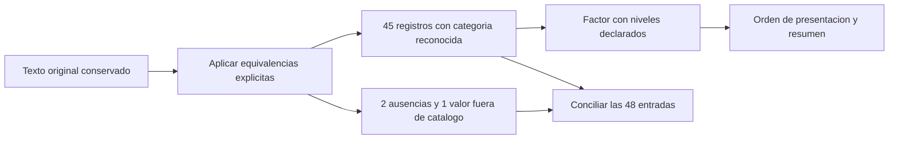

# 07.08 — Texto, categorías y factores

[Inicio](../../../README.md) / [Módulo 07](../README.md) / **Lección 07.08**

| Tu sesión | Qué prepararás o comprobarás |
| --- | --- |
| **Meta** | Normalizar categorías y ordenar factores conservando el origen |
| **Necesitas** | 07.07 preparada; agrupación y correspondencias |
| **Evidencia** | Reconocidos y pendientes con etiquetas, niveles e importes comprobados |

[Preparación](#antes-de-empezar) · [Material de apoyo](#material-de-apoyo) · [Lab 07.08](../../../labs/07_tidyverse/08_text_categories_factors/README.md) · [Comprobar](#evidencia-y-criterio-de-salida)

<a id="propósito-prerrequisitos-y-objetivos"></a>

## Propósito

**Alcance esencial.** Interpretar categorías con reglas explícitas y controlar
su orden de presentación conservando el texto original y los casos pendientes.

## Antes de empezar

Completa [07.07 — Datos ordenados y reshape](../07_tidy_reshape/README.md) y su
lab; retoma [agrupación de 07.05](../05_group_summarize/README.md) y
[claves y correspondencias de 07.06](../06_join_tables/README.md).

Trabaja en RStudio/IDE, en el mismo proyecto renv. stringr 1.6.0 ya estaba
instalado por tidyr; ahora se declara como dependencia directa. Se añade
**forcats 1.0.1** con un lockfile generado y restaurado, conservando todos los
registros anteriores. R 4.6.1/dplyr 1.2.1/readr 2.2.0 se mantienen. No se instala
todo tidyverse ni se produce una figura: la primera permanece en 07.10.

## Qué vas a aprender

- Separar normalización de texto, reconocimiento de categoría y presentación.
- Usar stringr para espacios, minúsculas y búsquedas sencillas.
- Conservar categorías desconocidas antes de crear un factor.
- Declarar niveles y modificar su orden con forcats sin cambiar las etiquetas.
- Conciliar filas e importes después de separar reconocidos y pendientes.

## Material de apoyo

| Recurso | Para qué sirve | Uso |
| --- | --- | --- |
| [Preparador](preparar_texto.R) | Respaldar 07.07 y añadir material y metadatos de forcats | Para el recorrido |
| [Lockfile](renv.lock) | Consultar dependencias y versiones de la práctica | Para el recorrido |
| [CSV de texto](../../02_pandas/06_text_dates/cartera_texto_fechas.csv) | Inspeccionar textos originales y casos pendientes | Para el recorrido |
| [Funciones](funciones_texto.R) | Seguir normalización, reconocimiento y factores estrictos | Para el recorrido |
| [Ejecutor](revisar_texto.R) | Reconstruir partición y niveles sin alterar indicadores | Para el recorrido |

Los enlaces permiten consultar las fuentes. Sigue el preparador una sola vez
para incorporar el material al mismo proyecto de práctica; después abre allí
los scripts desde el IDE. La sección de preparación distingue la raíz de DS Track
de la raíz de esa práctica y explica cuándo restaurar dependencias.

## 1. Tres decisiones que conviene separar

| Decisión | Pregunta | Ejemplo |
| --- | --- | --- |
| Normalizar texto | ¿Qué diferencias de escritura acordamos ignorar? | Quitar espacios exteriores |
| Reconocer una categoría | ¿El valor resultante pertenece al catálogo? | consumo está declarado; microcredito no |
| Presentar | ¿En qué orden queremos mostrar las categorías? | consumo antes de servicios |

Cambiar el orden de un factor no corrige una etiqueta. Pasar a minúsculas no
demuestra pertenencia al catálogo. Y reemplazar un desconocido por NA puede
ocultar qué información faltaba y cuál estaba presente pero no era reconocida.



Sin renderizador: conservamos el origen, normalizamos, distinguimos estados,
creamos factores solo para las categorías reconocidas y conciliamos ambas partes.
El objetivo no es hacer desaparecer los casos que requieren revisión.

## 2. Fuente y contrato de esta sección

Reutilizamos [cartera_texto_fechas.csv de pandas 02.06](../../02_pandas/06_text_dates/cartera_texto_fechas.csv):
48 registros sintéticos con ID, segmento, fecha_corte, fecha_alta y saldo_mxn.
Es una muestra distinta de las 48 observaciones de 07.07; no mezcles sus cifras.
El lector conserva los cuatro primeros campos como character y exige saldo
integer presente y no negativo. Lee un campo vacío como NA, sin recortar espacios.

**Solo normalizamos segmento.** ID y fechas se conservan exactamente como se
leyeron, incluso si contienen espacios, faltantes o fechas inválidas. El trabajo
temporal corresponde a [07.09](../09_dates_cutoffs/README.md). Aquí no declaramos
créditos válidos ni una clave ID/corte depurada: numero_registro identifica la
posición de cada entrada para reconstruirla sin perder filas.

Catálogo didáctico y orden inicial: consumo, servicios, comercio, educacion.
La regla de equivalencia es:

1. Quitar espacios exteriores.
2. Interpretar el texto vacío resultante como ausencia.
3. Convertir a minúsculas con locale = "es".
4. Reemplazar el valor completo educación por educacion.

No quitamos espacios internos, no borramos acentos en cualquier palabra ni
asignamos automáticamente «otros» a los desconocidos. Son reglas de este
campo y catálogo; no se aplican indiscriminadamente a nombres o identificadores.

## 3. Preparar y restaurar desde el IDE

Guarda los scripts. Una sola vez, desde la raíz de DS Track en **Console de R**:

```r
source("curriculum/07_tidyverse/08_text_categories_factors/preparar_texto.R")
destino <- preparar_texto(
  "curriculum/06_r_foundations/09_known_result/output/cierre_ventas"
)
```

Usa tu ruta de práctica si es distinta; requiere 07.07 preparada.
[preparar_texto.R](preparar_texto.R) respalda DESCRIPTION/renv.lock en
respaldo_07_07/, actualiza ambos y añade R/funciones_texto.R, revisar_texto.R
y datos/cartera_texto.csv, copia exacta de la fuente. Conserva archivos y salidas
anteriores; no instala por preparar. Rechaza archivos ocupados y repetición.
Ante copia parcial, conserva el respaldo y revisa antes de intentar otra vez.

Vuelve a abrir el mismo proyecto y reinicia R. Desde su raíz, en Console:

```r
source("restaurar.R")
```

Puede descargar forcats a la biblioteca local. No reinicialices renv en la raíz
del curso ni modifiques Conda o bibliotecas globales. Si en sesiones posteriores
el estado está sincronizado, no necesitas restaurar de nuevo. La apertura del
proyecto se explica en [07.01](../01_tibbles_import_pipes/README.md#a-preparar-los-archivos-una-sola-vez).

Crea output/mi_texto.R en el editor; mantén la raíz de la práctica como directorio.
Comprueba getwd() en Console, ejecuta bloques con Run e inspecciona las tablas:

```r
source(".Rprofile")
stopifnot(isTRUE(renv::status()$synchronized))
source("R/funciones_calidad.R", encoding = "UTF-8")
source("R/funciones_texto.R", encoding = "UTF-8")
ruta <- "datos/cartera_texto.csv"
huella <- tools::md5sum(ruta)
fuente <- leer_texto_segmentos(ruta)
original <- fuente
stopifnot(identical(dim(fuente), c(48L, 5L)))
```

## 4. Limpiar espacios y cambiar escritura conservando el origen

Empieza con valores pequeños antes de usar la tabla completa:

```r
ejemplo <- c(" Consumo ", "SERVICIOS", "Educación", "   ", NA_character_,
             "educación superior", "consu mo", "NA")
conversion <- normalizar_segmento(ejemplo)
print(tibble::tibble(original = ejemplo, limpio = conversion$limpio,
                    normalizado = conversion$normalizado))
stopifnot(identical(conversion$normalizado,
                    c("consumo", "servicios", "educacion", NA_character_, NA_character_,
                      "educación superior", "consu mo", "na")))
```

str_trim recorta espacios, tabulaciones y otros blancos de los extremos.
na_if(x, "") cambia solo el valor completo vacío a NA. str_to_lower cambia
la escritura; declarar locale evita depender de una elección implícita para
las reglas lingüísticas. NA_character_ sigue siendo ausencia; el texto "NA"
es un valor presente que pasa a "na", fuera del catálogo.

La función conserva también el texto recortado antes de convertirlo a minúsculas.
La equivalencia educación → educacion usa igualdad del valor completo. No cambia
educación superior en educacion ni consu mo en consumo: necesitarían otra regla
respaldada. Tampoco resuelve todas las representaciones Unicode posibles.

```r
frase <- "  educación   superior  "
print(stringr::str_trim(frase))
print(stringr::str_squish(frase))
```

str_squish además reduce los blancos internos a un espacio. Puede ser útil en
campos de varias palabras si se acuerda esa política; no lo usamos en el flujo
principal. Quitar todos los espacios podría convertir consu mo en una categoría
aparentemente válida sin evidencia de que eso quiso decir la fuente.

## 5. Buscar texto no equivale a validar una categoría

```r
busqueda <- c("consumo", "microconsumo", "consumo extra", NA_character_)
contiene <- stringr::str_detect(busqueda, stringr::fixed("consumo"))
exacto <- stringr::str_detect(busqueda, "^consumo$")
pertenece <- busqueda %in% niveles_segmento
stopifnot(identical(contiene, c(TRUE, TRUE, TRUE, NA)),
          identical(exacto, c(TRUE, FALSE, FALSE, NA)),
          identical(pertenece, c(TRUE, FALSE, FALSE, FALSE)))
```

fixed busca un fragmento literal: microconsumo contiene consumo, pero no es
la categoría consumo. Sin fixed, str_detect interpreta una expresión regular.
En el ejemplo, ^ marca el inicio y $ el final: se exige el texto completo.
Para el catálogo usamos %in%, que expresa pertenencia exacta de forma directa.

Una búsqueda sobre NA devuelve NA; %in% aquí devuelve FALSE porque NA no está
entre los niveles. Eso no convierte la ausencia en una categoría desconocida:
primero preguntamos is.na y después pertenencia. Si filtras una búsqueda,
decide explícitamente cómo tratar su resultado NA, sin cambiar el dato fuente.
Los patrones más complejos son una ampliación posterior.

Normalizar claves también puede unir escrituras antes distintas. Por ejemplo,
str_trim(c("001", " 001 ")) produce dos veces "001". Si se normalizara el ID,
habría que volver a comprobar su clave con el corte antes de unir o resumir.
En esta sección los IDs se conservan; no confundas número de registro con ID.

## 6. Separar reconocidos y pendientes antes del factor

```r
resultado <- preparar_segmentos(fuente)
comprobar_segmentos(fuente, resultado)
trabajo <- resultado$trabajo
reconocidos <- resultado$reconocidos
pendientes <- resultado$pendientes
resumen <- resultado$resumen
print(resultado$controles, width = Inf)
print(pendientes |> dplyr::select(numero_registro, segmento, segmento_normalizado,
                                  estado_segmento, saldo_mxn), width = Inf)
```

trabajo conserva las cinco columnas fuente y añade numero_registro,
segmento_limpio, segmento_normalizado, estado_segmento y texto_modificado.
La última marca registra cambio de escritura o paso de un texto en blanco a NA;
NA original → NA no cuenta como cambio. Las 48 entradas permanecen en trabajo.

| Estado del segmento | Registros | Suma de saldos de esos registros MXN |
| --- | ---: | ---: |
| reconocido | 45 | 105800 |
| ausente | 2 | 5100 |
| fuera_catalogo | 1 | 1900 |
| Entrada completa | 48 | 112800 |

Los registros 5 y 48 son ausencias después de la regla; el 9 conserva
microcredito como fuera_catalogo. Pendientes reúne esos tres registros y
7000 MXN sin borrarlos. Hay 46 textos modificados. Estos conteos describen
**solo segmento**: reconocido no significa registro aceptado por todas las
reglas ni fecha válida. La suma incluye distintas etiquetas de corte todavía
sin interpretar; no se presenta como saldo de una cartera a una fecha única.

## 7. Un factor contiene etiquetas y niveles

Un vector character guarda texto. Un factor representa valores categóricos
con un conjunto de niveles y códigos internos que apuntan a esas etiquetas.
levels muestra las categorías posibles; as.character recupera las etiquetas.
Los códigos enteros no representan cantidades, riesgo ni importancia.

```r
f <- reconocidos$segmento_factor
stopifnot(identical(levels(f), niveles_segmento), !is.ordered(f),
          identical(as.character(f), reconocidos$segmento_normalizado), !anyNA(f))
trampa <- factor(c("20", "10"), levels = c("10", "20"))
print(as.integer(trampa))
print(as.character(trampa))
```

La primera impresión de trampa muestra 2 y 1, códigos de nivel; la segunda
muestra las etiquetas "20" y "10". No conviertas factores directamente a
números para obtener medidas. Nuestros segmentos son categorías nominales:
tienen un orden de presentación, pero no una relación «menor que» entre sectores.
ordered = TRUE declararía un orden ordinal; aquí no lo usamos.

Un riesgo de factor(x, levels = ...) es que un valor no declarado se convierta
en NA, mezclándolo con una ausencia original:

```r
con_desconocido <- c("consumo", "microcredito", NA_character_)
silencioso <- factor(con_desconocido, levels = niveles_segmento)
stopifnot(identical(is.na(silencioso), c(FALSE, TRUE, TRUE)))
```

forcats::fct comprueba estrictamente que los valores pertenezcan a los niveles.
La función del curso lo aplica solo después de separar pendientes. En un bloque
aislado verifica el **error esperado**; déjalo fuera del script correcto:

```r
# ERROR ESPERADO: ejecutar por separado.
forcats::fct(con_desconocido, levels = niveles_segmento)
```

No declares microcredito como NA para evitar el error: primero necesitas decidir
si ampliar el catálogo o corregir con evidencia. La cadena original permanece
disponible en pendientes. Una categoría «otros» requeriría una definición y
conservar qué valores agrupó.

## 8. Ordenar niveles no cambia las etiquetas de cada fila

El resumen conserva el orden inicial de los niveles. Se puede preparar otra
vista con orden manual o por una medida ya comprobada, sin construir aún una figura:

```r
manual <- resumen |>
  dplyr::mutate(segmento_factor = forcats::fct_relevel(
    segmento_factor, "educacion", "comercio", "servicios", "consumo"
  ))
por_saldo <- resumen |>
  dplyr::mutate(segmento_factor = forcats::fct_reorder(
    segmento_factor, saldo_observado_mxn, .fun = sum, .desc = TRUE
  ))
stopifnot(identical(as.character(manual$segmento_factor), as.character(resumen$segmento_factor)),
          identical(levels(por_saldo$segmento_factor),
                    c("comercio", "servicios", "educacion", "consumo")),
          identical(por_saldo$saldo_observado_mxn, resumen$saldo_observado_mxn))
print(manual |> dplyr::arrange(segmento_factor), width = Inf)
print(por_saldo |> dplyr::arrange(segmento_factor), width = Inf)
```

fct_relevel modifica el orden declarado de niveles; fct_reorder lo calcula
a partir de otra variable. Aquí cada fila del resumen ya representa un segmento,
por lo que usamos su saldo agregado; .fun = sum hace explícita la medida.
Aplicar el valor predeterminado median a los registros individuales respondería
otra pregunta. .desc = TRUE pide orden descendente.

Cambiar niveles no reordena por sí solo las filas de una tabla: usamos arrange
para mostrarlas en ese orden. Los empates necesitan un criterio de presentación;
si las medidas empatan, comprueba también el orden previo de niveles. Ninguna
de estas operaciones cambia las etiquetas, registros ni importes por categoría.

## 9. Niveles sin observaciones, NA y ceros

Después de filtrar un factor suelen permanecer niveles que ya no aparecen.
Eso puede ser útil para mantener una presentación estable:

```r
solo_consumo <- reconocidos |> dplyr::filter(segmento_normalizado == "consumo")
con_vacios <- solo_consumo |>
  dplyr::group_by(segmento_factor, .drop = FALSE) |>
  dplyr::summarise(registros = dplyr::n(),
                   saldo_observado_mxn = suma_observada(saldo_mxn), .groups = "drop")
reducido <- forcats::fct_drop(solo_consumo$segmento_factor)
stopifnot(length(levels(solo_consumo$segmento_factor)) == 4L,
          identical(con_vacios$registros, c(10L, 0L, 0L, 0L)),
          all(is.na(con_vacios$saldo_observado_mxn[-1])),
          identical(levels(reducido), "consumo"),
          identical(as.character(reducido), as.character(solo_consumo$segmento_factor)))
```

.drop = FALSE conserva los grupos de niveles sin registros. Su conteo es cero
y nuestra política de suma observada devuelve NA, porque no hay cantidades
observadas. Un registro con saldo cero sería otra situación. fct_drop elimina
niveles no utilizados; no borra filas ni corrige categorías desconocidas.
Esta sección completa la ampliación de factores introducida en 07.05.

<a id="comprobación-práctica-y-siguiente-paso"></a>

## Comprobación del recorrido

```r
comprobar_segmentos(fuente, resultado)
stopifnot(identical(resultado$controles$registros, c(48L, 45L, 3L)),
          identical(resultado$controles$saldo_observado_mxn, c(112800, 105800, 7000)),
          identical(resumen$registros, c(10L, 12L, 12L, 11L)),
          identical(resumen$saldo_observado_mxn, c(23000, 27600, 28800, 26400)),
          identical(fuente, original), identical(huella, tools::md5sum(ruta)))
```

La comprobación revisa todas las columnas, las dos partes reconstruidas,
etiquetas y niveles del factor. No basta conservar el saldo global: podrías
reasignar dos categorías o eliminar evidencia de una ausencia. Recalcular con
la misma función es un control de coherencia. La revisión de autoría compara
independientemente con pandas sobre esta misma fuente y estas reglas de texto;
no equipara su validación completa de fechas con nuestro reconocimiento de segmento.

## Práctica

Realiza el [lab 07.08](../../../labs/07_tidyverse/08_text_categories_factors/README.md).
Puedes dividir la sesión en normalización (1–3) y factores/comprobación (4–6).
Guarda output/mi_texto.R con los bloques correctos y el error esperado aparte.
Usa Session > Restart R, y desde Console en la raíz de la práctica:

```r
source("output/mi_texto.R", encoding = "UTF-8")
source("revisar_texto.R", encoding = "UTF-8")
```

También puedes usar Source desde el editor manteniendo ese directorio. No
necesitas Terminal ni recuperar un workspace.

Consulta [revisar_texto.R](revisar_texto.R) como referencia del recorrido completo;
trabaja con su copia preparada dentro del proyecto, manteniendo su raíz como
directorio al ejecutar.

## Evidencia y criterio de salida

| Conserva | Comprueba | Explica |
| --- | --- | --- |
| Script, origen y partes | 48 registros = 45 reconocidos + 3 pendientes; 112800 MXN conservados | Normalizar escritura frente a reconocer una categoría |
| Factor y resumen | Etiquetas y niveles; dos ausencias y microcredito fuera de catálogo | Orden de presentación sin cambiar indicadores; límites de esta validación |

Puedes avanzar cuando conserves origen y pendientes, justifiques equivalencias
y niveles y reconstruyas las tablas sin alterar sus indicadores desde una sesión nueva.

Quien aprende realiza la práctica y explica las decisiones; su compañero revisa.
Tu compañero cambia el orden de niveles y pide demostrar qué cambia en la presentación y qué cifras permanecen iguales.
Guarda evidencia, ayudas y dudas en una nota personal junto a tu práctica.
PROGRESS.md registra desarrollo editorial, no tu expediente de aprendizaje.
El proyecto integrador y sus checkpoints siguen pendientes; disponer de
lecciones y scripts no acredita haber completado el aprendizaje.

<a id="referencias-y-atribución"></a>

## Referencias

Ejemplos propios con datos sintéticos de DS Track. Consulta: 2026-10-19;
ayuda instalada y ejecución en R 4.6.1/stringr 1.6.0/forcats 1.0.1.

- Hadley Wickham, Mine Çetinkaya-Rundel y Garrett Grolemund,
  [R for Data Science: Strings](https://r4ds.hadley.nz/strings.html) y
  [Factors](https://r4ds.hadley.nz/factors.html), segunda edición.
- stringr: [str_trim/str_squish](https://stringr.tidyverse.org/reference/str_trim.html),
  [mayúsculas/minúsculas](https://stringr.tidyverse.org/reference/case.html),
  [str_detect](https://stringr.tidyverse.org/reference/str_detect.html) y
  [expresiones regulares](https://stringr.tidyverse.org/articles/regular-expressions.html).
- forcats: [fct](https://forcats.tidyverse.org/reference/fct.html),
  [fct_relevel](https://forcats.tidyverse.org/reference/fct_relevel.html),
  [fct_reorder](https://forcats.tidyverse.org/reference/fct_reorder.html) y
  [fct_drop](https://forcats.tidyverse.org/reference/fct_drop.html).
- R oficial: [factor, niveles y códigos](https://stat.ethz.ch/R-manual/R-devel/library/base/html/factor.html).
- [Guía de lecturas y coautorías](../../../docs/r-reading-guide.md).

## Siguiente paso

Después de la práctica y su comprobación, continúa con
[07.09 — Fechas y cortes](../09_dates_cutoffs/README.md).

[← Módulo 07](../README.md) · [Lab 07.08](../../../labs/07_tidyverse/08_text_categories_factors/README.md) · [Siguiente →](../09_dates_cutoffs/README.md)
