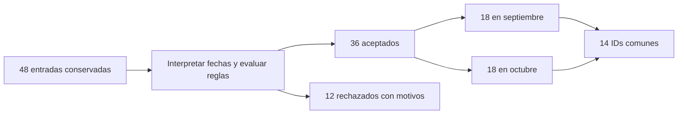

# 07.09 — Fechas y cortes

## Propósito, prerrequisitos y objetivos

**Alcance esencial.** Interpretar fechas bajo un contrato, conservar sus fallas
y comparar períodos sobre una población explícita. Completa
[07.08 — Texto, categorías y factores](../08_text_categories_factors/README.md)
y su lab. Retoma [claves y uniones de 07.06](../06_join_tables/README.md) y
[denominadores de 07.05](../05_group_summarize/README.md).

Al terminar podrás:

- Distinguir texto, fecha calendario e instante.
- Separar ausencia, formato incompatible, día imposible y relación temporal inválida.
- Interpretar fechas con lubridate y calcular diferencias con unidades explícitas.
- Seleccionar intervalos con límites que no dupliquen observaciones.
- Conciliar aceptados/rechazados y comparar cortes en una base común de IDs.

Trabaja en el mismo proyecto RStudio/IDE. Incorporamos **lubridate 1.9.5** y
timechange 0.4.0 mediante un lockfile generado y restaurado, conservando todos
los registros anteriores. R 4.6.1, dplyr 1.2.1 y los paquetes de 07.08 se mantienen.
No se requieren paquetes SQL ni otra fuente de datos. La primera figura sigue
en 07.10 y el proyecto/checkpoint integrador permanece pendiente.

## 1. Una fecha escrita todavía puede no ser una fecha válida

El texto "2026-09-30" tiene apariencia de fecha, pero antes de interpretarlo
necesitamos un acuerdo sobre el orden y la precisión. "03/04/2026" podría
significar días distintos según la convención. No elegimos una interpretación
por intuición si el contrato exige otra forma.

Una variable Date de R representa una fecha de calendario. Un instante agrega
hora y contexto temporal; no es lo mismo que un día. Esta fuente no tiene horas:
no inventamos medianoche ni una zona horaria para analizar sus cortes.

Reutilizamos **datos/cartera_texto.csv de 07.08**, copia de
[pandas 02.06](../../02_pandas/06_text_dates/README.md). Conservamos las 48 entradas
y no partimos solo de los 45 segmentos reconocidos: eso perdería pendientes
antes de revisar todas las reglas. No confundas esta población con la de 07.07.

## 2. Contrato: formato, calendario, relaciones y clave

| Aspecto | Regla de esta práctica |
| --- | --- |
| Entrada | Cinco columnas de 07.08; saldo integer presente y no negativo |
| Texto | Recortar espacios exteriores de ID y fechas; vacío pasa a NA |
| ID | Tres dígitos ASCII, conservados como texto, por ejemplo 001 |
| Segmento | Las mismas equivalencias y cuatro categorías de 07.08 |
| Fechas | Forma completa YYYY-MM-DD; año entre 1900 y 2100, incluidos; día real |
| Relación | fecha_alta ≤ fecha_corte |
| Clave | ID + fecha_corte interpretada, completos y únicos |

El rango de años es un límite didáctico explícito para estas funciones, no una
limitación general de R. No se exigen fines de mes para aceptar una fecha: un
30 de septiembre o un 1 de octubre pueden ser fechas válidas. El contrato de
un sistema real podría imponer otros cortes y reglas adicionales.

| Entrada original | Tras recortar | Resultado |
| --- | --- | --- |
| " 2026-10-31 " | 2026-10-31 | Date válido |
| "2026-10-3" | Igual | Incompatible con la forma acordada |
| "30/09/2026" | Igual | Otro formato, no se intenta adivinar |
| "2026-09-31" | Igual | Forma correcta, día imposible |
| "   " o NA | NA | Ausente, no fecha inválida presente |
| "2101-01-01" | Igual | Fuera del rango declarado |

Una fecha válida en ambos campos todavía puede incumplir la relación alta/corte.
Y dos registros individualmente interpretables pueden colisionar en la clave.
Conservaremos todos los motivos de cada registro.

## 3. Preparar y restaurar desde el IDE

Guarda los scripts. Una sola vez, desde la raíz de DS Track en **Console de R**:

```r
source("curriculum/07_tidyverse/09_dates_cutoffs/preparar_fechas.R")
destino <- preparar_practica_fechas(
  "curriculum/06_r_foundations/09_known_result/output/cierre_ventas"
)
```

Usa la ruta de tu práctica si es distinta; requiere 07.08 preparada.
[preparar_fechas.R](preparar_fechas.R) respalda DESCRIPTION/renv.lock en
respaldo_07_08/, actualiza ambos y añade R/funciones_fechas.R y revisar_fechas.R.
No copia otro CSV, instala paquetes ni sobrescribe archivos de trabajo anteriores.
Rechaza archivos ocupados y una segunda preparación. Si falla una copia, conserva
el respaldo y revisa antes de intentar otra vez; la preparación no es atómica.

Abre nuevamente el mismo proyecto y reinicia R. Desde su raíz, en Console:

```r
source("restaurar.R")
```

Puede descargar los dos paquetes nuevos a la biblioteca local. No inicialices
renv en la raíz del curso ni cambies Conda o bibliotecas globales. Si en sesiones
posteriores ya está sincronizado, no necesitas restaurar otra vez. El flujo de
apertura está en [07.01](../01_tibbles_import_pipes/README.md#a-preparar-los-archivos-una-sola-vez).

Crea output/mis_fechas.R en el editor. Mantén la raíz de la práctica como directorio;
comprueba getwd() en Console. Ejecuta por bloques con Run e inspecciona los objetos:

```r
source(".Rprofile")
stopifnot(isTRUE(renv::status()$synchronized))
source("R/funciones_calidad.R", encoding = "UTF-8")
source("R/funciones_texto.R", encoding = "UTF-8")
source("R/funciones_fechas.R", encoding = "UTF-8")
ruta <- "datos/cartera_texto.csv"
huella <- tools::md5sum(ruta)
fuente <- leer_texto_segmentos(ruta)
original <- fuente
```

## 4. Parsear no es comprobar todas las reglas

ymd indica el orden año/mes/día. Sin tz devuelve Date. Su lector admite varias
escrituras, algo útil en otros contratos; por eso no basta con que consiga leerlas:

```r
flexible <- lubridate::ymd(c("2026-09-30", "2026/09/30", "2026-9-30"), locale = "C")
stopifnot(all(flexible == lubridate::ymd("2026-09-30")))
ensayo <- interpretar_fecha_iso(c("2026-09-30", "2026-09-31", "2026-10-3",
                                 "30/09/2026", "   ", NA_character_))
print(tibble::tibble(texto = ensayo$texto, fecha = ensayo$fecha,
                    ausente = ensayo$ausente, invalida = ensayo$invalida))
stopifnot(identical(ensayo$ausente, c(FALSE, FALSE, FALSE, FALSE, TRUE, TRUE)),
          identical(ensayo$invalida, c(FALSE, TRUE, TRUE, TRUE, FALSE, FALSE)))
```

interpretar_fecha_iso conserva el texto recortado y separa ausencia de invalidez.
Antes de llamar a ymd exige forma y rango. El patrón
^[0-9]{4}-[0-9]{2}-[0-9]{2}$ exige cuatro dígitos de año, guiones y dos dígitos
para mes y día; ^/$ anclan el texto completo, como vimos en 07.08. Todavía no
prueba que septiembre tenga 31 días: eso lo comprueba la interpretación calendario.

La función vuelve a representar la fecha con format(..., "%Y-%m-%d") y exige
coincidencia con el texto admitido. %Y, %m y %d indican año completo, mes y día.
Esta vuelta impide aceptar una corrección de escritura inadvertida. No rellena
ceros ni cambia 30/09/2026 para hacerlo pasar por la forma exigida.

El ensayo genera una advertencia esperada por el día imposible. Las advertencias
se leen; el resultado NA y su bandera quedan disponibles para revisar. Un fallo
de parseo no se convierte en una fecha aproximada. Los casos sin forma apta no
se envían al lector; vacío y todos ausentes se mantienen como Date con NA.

## 5. Validar la relación y reconstruir las partes

```r
resultado <- preparar_fechas(fuente)
comprobar_fechas(fuente, resultado)
trabajo <- resultado$trabajo
aceptados <- resultado$aceptados
rechazados <- resultado$rechazados
print(resultado$controles, width = Inf)
print(rechazados |> dplyr::select(numero_registro, id_credito, motivos), n = 12, width = Inf)
```

trabajo tiene 48 filas y 15 columnas. Conserva los cuatro textos *_original,
normaliza ID/segmento, interpreta fecha_corte/fecha_alta y añade motivos e
indicadores temporales. Saldo y fuente permanecen intactos. Las diez banderas
revisan presencia/formato de ID, presencia/catálogo de segmento, ausencia/invalidez
de cada fecha, alta posterior al corte y clave repetida. No contienen NA: lo
desconocido en una comparación no confirma ese incumplimiento, pero sus reglas
de ausencia/invalidez impiden aceptar la fila.

| Parte | Registros | Suma de saldos de registros MXN |
| --- | ---: | ---: |
| Entrada | 48 | 112800 |
| Aceptados bajo este contrato | 36 | 81400 |
| Rechazados con evidencia | 12 | 31400 |

No presentes 81400 como saldo de una única fotografía: suma observaciones de
varios cortes. Conciliar estas partes demuestra conservación, no que conocemos
todas las reglas de cualquier cartera. El criterio de aceptación es el de la tabla
de contrato, no una certificación externa.

El registro 12 tiene alta 2026-10-01 y corte 2026-09-30: ambas fechas existen,
pero la relación es inválida. Los registros 43 y 44 contienen "019" y " 019 ",
con el mismo corte interpretado. Tras recortar coinciden: se apartan **ambos**,
sin escoger una primera versión por posición. El mismo ID en otro corte sí
puede ser una observación legítima.

En esta muestra cada rechazo tiene un motivo, pero las funciones conservan
motivos múltiples si coinciden varias fallas. Las comprobaciones recalculan
banderas, comparan columnas y reconstruyen las 48 filas; repetir el cálculo
puede repetir las advertencias conocidas, sin que eso implique nuevos registros.

## 6. Diferencias con unidad y componentes de calendario

```r
alta_demo <- lubridate::ymd("2026-08-01")
corte_demo <- lubridate::ymd("2026-09-30")
transcurrido <- difftime(corte_demo, alta_demo, units = "days")
print(transcurrido)
stopifnot(as.numeric(transcurrido, units = "days") == 60)
print(lubridate::year(corte_demo))
print(lubridate::month(corte_demo))
print(lubridate::floor_date(corte_demo, unit = "month"))
```

Son **60 días desde el alta**; no días de atraso. Son preguntas distintas y
no existe en esta fuente un campo que convierta esa antigüedad en atraso.
difftime guarda una unidad; escribirla evita interpretar una diferencia sin contexto.

En trabajo, dias_desde_alta guarda ese conteo como integer, seguro bajo el
rango de años acordado. Si falta una fecha, queda NA. Una relación temporal
inválida puede dar un número negativo: se conserva en trabajo para diagnosticar,
pero el registro no entra a aceptados. No aplicamos abs ni truncamos a cero.

year y month extraen componentes; floor_date(..., "month") obtiene el primer
día del mes y conserva la fecha original en otra columna. inicio_mes es Date:
sirve como clave mensual sin mezclar septiembre de años distintos. Agrupar solo
por mes_corte mezclaría años si hubiera más de uno.

Un mes calendario no tiene siempre 30 días. Una diferencia en días no equivale
a contar meses de calendario. No necesitamos objetos Period/Duration/Interval
para filtrar esta fuente; son ampliaciones cuando la pregunta requiera otras
unidades, horas o reglas de calendario. Aquí no se cambian opciones de zona horaria.

## 7. Períodos sin doble conteo en las fronteras

Usaremos intervalos **cerrados al inicio y abiertos al final**: inicio ≤ fecha < fin.
El fin es exclusivo. Así el 1 de octubre no puede entrar a septiembre y octubre
al concatenar selecciones mensuales:

```r
septiembre <- seleccionar_periodo(aceptados,
  lubridate::ymd("2026-09-01"), lubridate::ymd("2026-10-01"))
octubre <- seleccionar_periodo(aceptados,
  lubridate::ymd("2026-10-01"), lubridate::ymd("2026-11-01"))
resumen <- resumir_cortes_fechas(aceptados)
print(resumen, width = Inf)
stopifnot(nrow(septiembre) == 18L, nrow(octubre) == 18L,
          identical(resumen$saldo_observado_mxn, c(39900, 41500)))
```

seleccionar_periodo exige límites Date escalares y ordenados, además de fechas
interpretadas presentes en la tabla. Se usa después de separar los rechazados;
filtrar directamente el trabajo con fechas NA podría perderlos sin explicarlos.
No confíes en una comparación implícita entre texto y fechas.

Este bloque produce **error esperado** y se conserva fuera del script correcto:

```r
# ERROR ESPERADO: ejecutar por separado.
seleccionar_periodo(aceptados, "2026-10-01", "2026-11-01")
```

Una demostración independiente permite comprobar la frontera de forma visible:

```r
fronteras <- tibble::tibble(fecha_corte = lubridate::ymd(
  c("2026-09-30", "2026-10-01", "2026-10-31", "2026-11-01")))
oct_demo <- seleccionar_periodo(fronteras,
  lubridate::ymd("2026-10-01"), lubridate::ymd("2026-11-01"))
stopifnot(identical(oct_demo$fecha_corte, lubridate::ymd(c("2026-10-01", "2026-10-31"))))
```

## 8. Igual cantidad de filas no garantiza igual población

Los aceptados de septiembre suman 39900 MXN y los de octubre 41500: diferencia
de totales por corte 1600 MXN. Ambos tienen 18 filas y saldos conocidos, pero
sus IDs no son idénticos. Para describir el cambio de los mismos créditos,
primero necesitamos una base común:

```r
comparables <- dplyr::inner_join(
  septiembre |> dplyr::select(id_credito, saldo_sep = saldo_mxn),
  octubre |> dplyr::select(id_credito, saldo_oct = saldo_mxn),
  by = "id_credito", relationship = "one-to-one", na_matches = "never"
) |> dplyr::mutate(diferencia_mxn = as.double(saldo_oct) - saldo_sep)
solo_sep <- dplyr::anti_join(septiembre, octubre, by = "id_credito", na_matches = "never")
solo_oct <- dplyr::anti_join(octubre, septiembre, by = "id_credito", na_matches = "never")
stopifnot(nrow(comparables) == 14L, nrow(solo_sep) == 4L, nrow(solo_oct) == 4L,
          sum(comparables$saldo_sep) == 29000,
          sum(comparables$saldo_oct) == 31800,
          sum(comparables$diferencia_mxn) == 2800)
```

La unión por ID es apropiada **después de seleccionar un corte por tabla** y
comprobar unicidad ID/corte. La relación uno a uno detiene una multiplicación
si la selección no fuera única por ID. En un histórico sin separar, unir solo
por ID sería otro problema, como vimos en 07.06.

| Pregunta | Base | Resultado |
| --- | --- | --- |
| Totales aceptados por corte | 18 registros en cada corte, con miembros distintos | 39900 → 41500 MXN |
| Cambio en los IDs comunes | 14 IDs con un saldo conocido en cada corte | 29000 → 31800 MXN |
| Cobertura de la base común | 14 de los 18 IDs aceptados de cada corte | Aproximadamente 77.78 % en cada lado |

Los 2800 MXN describen solo esos 14 IDs, no los 18 de cada corte ni los 24 IDs
pretendidos por la fuente. Los cuatro no coincidentes por lado se conservan
para explicar la selección. No inferimos altas/bajas reales ni causalidad a partir
de su ausencia: pueden intervenir las reglas y problemas de la muestra sintética.



Sin renderizador: primero se conservan las partes de calidad; después se eligen
los períodos y, si la pregunta lo exige, se comparan solo los IDs presentes en ambos.

## Comprobación, práctica y siguiente paso

```r
comprobar_fechas(fuente, resultado)
stopifnot(identical(resultado$controles$registros, c(48L, 36L, 12L)),
          identical(resultado$controles$saldo_observado_mxn, c(112800, 81400, 31400)),
          identical(class(trabajo$fecha_corte), "Date"),
          sum(!is.na(trabajo$dias_desde_alta)) == 42L,
          identical(fuente, original), identical(huella, tools::md5sum(ruta)))
```

La revisión de autoría concilia con pandas 2.3.3 todas las columnas comunes,
banderas, motivos, partes y selecciones sobre el mismo CSV de 02.06. También
comprueba componentes y la base común de 14 IDs; Date y datetime de pandas
no se declaran clases idénticas, se compara su significado calendario bajo
este contrato. La comparación independiente complementa los controles de
coherencia R. No necesitas ejecutar Python para completar la lección.

Realiza el [lab 07.09](../../../labs/07_tidyverse/09_dates_cutoffs/README.md).
Puedes dividir la sesión en interpretación/calidad (1–3) y períodos/comparación
(4–6). Guarda output/mis_fechas.R con el error esperado aparte. Usa Session >
Restart R y, desde Console en la raíz de la práctica, ejecuta:

```r
source("output/mis_fechas.R", encoding = "UTF-8")
source("revisar_fechas.R", encoding = "UTF-8")
```

También puedes usar Source desde el editor manteniendo ese directorio. No
necesitas Terminal ni recuperar un workspace. Puedes avanzar cuando justifiques
formato, calendario, relaciones y claves, conserves rechazos y compares períodos
con una base explícita desde una sesión nueva. Registra evidencia y dudas;
material disponible no acredita aprendizaje. No hay checkpoint integrador
implementado asociado.

Siguiente: [07.10 — Primera figura y cierre del análisis](../README.md#10-primera-figura-y-cierre-del-analisis),
todavía planificada. Volver al [índice del módulo](../README.md).

## Referencias y atribución

Ejemplos propios con datos sintéticos DS Track. Consulta: 2026-10-19;
documentación contrastada con ayuda instalada y ejecución R 4.6.1/lubridate 1.9.5.

- Hadley Wickham, Mine Çetinkaya-Rundel y Garrett Grolemund,
  [R for Data Science, segunda edición: Dates and times](https://r4ds.hadley.nz/datetimes.html).
- Lubridate: [ymd](https://lubridate.tidyverse.org/reference/ymd.html),
  [componentes de calendario](https://lubridate.tidyverse.org/reference/day.html),
  [floor_date](https://lubridate.tidyverse.org/reference/round_date.html) y
  [períodos como ampliación](https://lubridate.tidyverse.org/reference/period.html).
- R oficial: [difftime y unidades](https://stat.ethz.ch/R-manual/R-devel/library/base/html/difftime.html).
- [Guía de lecturas y coautorías](../../../docs/r-reading-guide.md).
