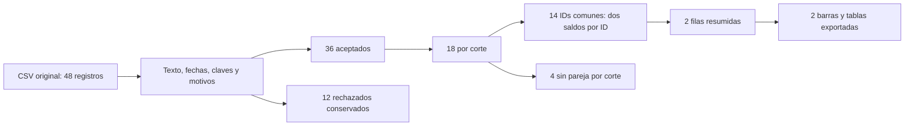

# 07.10 — Primera figura y cierre del análisis

[Inicio](../../../README.md) / [Módulo 07](../README.md) / **Lección 07.10**

| Tu sesión | Qué prepararás o comprobarás |
| --- | --- |
| **Meta** | Reconstruir tablas y explicar una primera figura con población comprobada |
| **Necesitas** | 07.09 preparada; resúmenes, uniones y factores en el mismo proyecto |
| **Evidencia** | Entrega releída, figura legible y explicación de alcance y diferencia |

[Preparación](#antes-de-empezar) · [Material de apoyo](#material-de-apoyo) · [Lab 07.10](../../../labs/07_tidyverse/10_first_plot_closure/README.md) · [Comprobar](#evidencia-y-criterio-de-salida)

<a id="propósito-prerrequisitos-y-objetivos"></a>

## Propósito

**Práctica de cierre.** Reconstruir un análisis desde el archivo original y
explicar una primera figura cuyos valores y población podamos comprobar.

## Antes de empezar

Completa [07.09 — Fechas y cortes](../09_dates_cutoffs/README.md) y su lab.
Retoma [resúmenes y denominadores](../05_group_summarize/README.md),
[uniones y cardinalidad](../06_join_tables/README.md) y
[niveles de factores](../08_text_categories_factors/README.md).

Trabaja en RStudio o tu IDE, en **el mismo proyecto renv de 07.09**. Añadimos
ggplot2 **4.0.3** y sus dependencias necesarias mediante un lockfile generado
y restaurado con R 4.6.1. Los registros previos permanecen idénticos. No se
instala todo tidyverse ni se cambia Conda o una biblioteca global.
Las diez secciones de 07 tienen material; la práctica
y la explicación del estudiante requieren evidencia propia. El proyecto
integrador y sus checkpoints siguen pendientes.

## Qué vas a aprender

- Identificar datos, estéticas y capas de ggplot2.
- Distinguir conteos de importes ya agregados.
- Exportar explícitamente una figura y sus tablas.
- Reconstruir el resultado desde una sesión nueva conservando los rechazos.

## Material de apoyo

| Recurso | Para qué sirve | Uso |
| --- | --- | --- |
| [Preparador](preparar_cierre.R) | Respaldar 07.09 y añadir material y metadatos de ggplot2 | Para el recorrido |
| [Lockfile](renv.lock) | Consultar el entorno registrado para restaurar | Para el recorrido |
| [Funciones de cierre](funciones_cierre.R) | Reconstruir tablas, figura, exportación y controles | Para el recorrido |
| [Recorrido completo](cerrar_analisis.R) | Calcular y dibujar desde la práctica; source no exporta | Para el recorrido |
| [Verificador](verificar_cierre.R) | Definir la revisión de una entrega contra el CSV actual | Para el recorrido |
| [Criterios de cierre](../../../docs/tidyverse-closure.md) | Distinguir material, práctica y proyecto pendiente | Consulta para el cierre |

Los enlaces permiten consultar las fuentes. Sigue el preparador una sola vez
para incorporar el material al mismo proyecto de práctica; después abre allí
los scripts desde el IDE. La sección de preparación distingue la raíz de DS Track
de la raíz de esa práctica y explica cuándo restaurar dependencias.

## 1. Empezar por una pregunta y una población

**Pregunta:** ¿cómo cambia el saldo observado de los mismos créditos entre
el 30 de septiembre y el 31 de octubre de 2026?

Usamos datos/cartera_texto.csv, conservado desde 07.08 y validado en 07.09.
Las reglas no cambian: ID de tres dígitos; segmentos del catálogo; fechas ISO
reales entre 1900 y 2100; alta ≤ corte; clave ID/corte única. Todas las
apariciones de una clave repetida se rechazan y se conservan los originales
y los motivos. Saldo es integer presente, no negativo, en MXN.

| Población | Septiembre | Octubre | Diferencia octubre − septiembre |
| --- | ---: | ---: | ---: |
| Todos los aceptados de cada corte | 18; 39900 MXN | 18; 41500 MXN | 1600 MXN |
| Los mismos 14 IDs aceptados en ambas fechas | 14; 29000 MXN | 14; 31800 MXN | 2800 MXN |

Hay cuatro IDs aceptados sin pareja en cada corte. La primera fila responde
otra pregunta: describe dos conjuntos cuyos integrantes cambian. No llamamos
altas o bajas a los no coincidentes sin evidencia adicional. Para la figura
elegimos la segunda fila: igual población, dos mediciones por crédito.
Su cobertura es **14/18 = 77.78%** de los aceptados de cada corte, y no abarca
los rechazos. La suma 81400 MXN de los 36 aceptados reúne dos fechas: no es
un saldo de cartera en una fecha única.



Sin renderizador: primero validamos los 48 registros; conservamos 36 aceptados
y 12 rechazos. Unimos los dos cortes por ID con relación uno a uno. Conservamos
los ocho registros sin pareja y resumimos los 14 pares en dos filas. Las barras
representan esas dos filas, no los 48 registros originales.

## 2. Preparar una sola vez y restaurar desde R

Guarda tu trabajo. Desde la raíz de DS Track, en **Console de R**, no Terminal:

```r
source("curriculum/07_tidyverse/10_first_plot_closure/preparar_cierre.R")
destino <- preparar_practica_cierre(
  "curriculum/06_r_foundations/09_known_result/output/cierre_ventas"
)
```

Adapta la ruta si tu práctica vive en otra carpeta. Requiere 07.09 preparada.
[El preparador](preparar_cierre.R) respalda DESCRIPTION y renv.lock en
respaldo_07_09/, actualiza esos metadatos y añade R/funciones_cierre.R,
cerrar_analisis.R y verificar_cierre.R. No copia otra fuente ni instala paquetes;
rechaza destinos ocupados y una segunda preparación. Si falla una copia,
conserva el respaldo y revisa la preparación parcial antes de repetirla.

Abre otra vez el mismo proyecto, reinicia R y ejecuta desde su raíz:

```r
source("restaurar.R")
```

Puede descargar ggplot2 y ocho dependencias nuevas a la biblioteca local:
farver, gtable, isoband, labeling, RColorBrewer, S7, scales y viridisLite.
El [lockfile](renv.lock) registra sus versiones exactas; las versiones citadas
describen esta práctica comprobada, no una exigencia de estar siempre al día.
Si el proyecto ya está sincronizado, no necesitas reinstalar.
La apertura del proyecto se explica en [07.01](../01_tibbles_import_pipes/README.md#a-preparar-los-archivos-una-sola-vez).

## 3. Reconstruir tablas antes de dibujar

Crea output/mi_cierre.R en el editor. Mantén la raíz de la práctica como
directorio de trabajo y ejecuta por bloques con Run. Las funciones auxiliares
ya fueron explicadas en 07.04, 07.08 y 07.09; source carga sus definiciones.

```r
source(".Rprofile")
stopifnot(isTRUE(renv::status()$synchronized))
source("R/funciones_calidad.R", encoding = "UTF-8")
source("R/funciones_texto.R", encoding = "UTF-8")
source("R/funciones_fechas.R", encoding = "UTF-8")
source("R/funciones_cierre.R", encoding = "UTF-8")
fuente <- leer_texto_segmentos("datos/cartera_texto.csv")
cierre <- construir_cierre(fuente)
comprobar_cierre(fuente, cierre)
print(cierre$resultado$controles, width = Inf)
print(cierre$datos_figura, width = Inf)
```

Esperado: 48 = 36 + 12 registros y suma de observaciones
112800 = 81400 + 31400 MXN. Las advertencias de fechas imposibles son visibles;
la comprobación reconstruye el análisis y puede repetirlas. Inspecciona
cierre$resultado$rechazados y sus motivos: las advertencias no sustituyen esa
auditoría ni implican que debamos borrar filas manualmente.

construir_cierre devuelve una lista: fuente; resultado (trabajo, aceptados,
rechazados, banderas y controles); resumen_cortes; comunes; sin_pareja;
fuera_cortes; datos_figura. Para este cierre se seleccionan **dos fechas exactas**,
no meses enteros. Si hubiese otra fecha aceptada, queda en fuera_cortes, sin
convertir varias observaciones mensuales en un único saldo por ID.

datos_figura tiene Date, número de créditos, saldo y aceptados por corte:

| fecha_corte | creditos | saldo_mxn | aceptados_corte |
| --- | ---: | ---: | ---: |
| 2026-09-30 | 14 | 29000 | 18 |
| 2026-10-31 | 14 | 31800 | 18 |

Comprueba el significado de cada unidad:

```r
stopifnot(nrow(cierre$comunes) == 14L,
          nrow(cierre$sin_pareja) == 8L,
          nrow(cierre$fuera_cortes) == 0L,
          identical(cierre$datos_figura$saldo_mxn, c(29000, 31800)),
          sum(cierre$comunes$diferencia_mxn) == 2800)
variacion_pct <- 100 * (31800 - 29000) / 29000
variacion_pct
```

Esperado: aproximadamente 9.655172%. El denominador es el saldo de septiembre
**de los 14 IDs**, no 39900 ni el número de filas. Si la base inicial fuera
cero, una variación relativa no estaría definida; el cambio absoluto sí podría
ser interpretable. No trasladamos esta cifra a otras muestras del track.

## 4. Una gráfica se construye con datos, estéticas y capas

ggplot() crea un objeto que contiene la descripción del gráfico. aes() vincula
columnas con propiedades visuales, llamadas estéticas: aquí x con fecha y y con
saldo. geom_col() añade rectángulos cuya altura es el valor de y. El operador
`+` agrega capas y componentes al gráfico; el pipe `|>` pasa datos o resultados
a la siguiente función. Tienen funciones distintas.

```r
datos <- cierre$datos_figura |>
  dplyr::mutate(corte = factor(format(fecha_corte, "%Y-%m-%d"),
                              levels = c("2026-09-30", "2026-10-31")))
p <- ggplot2::ggplot(datos, ggplot2::aes(x = corte, y = saldo_mxn)) +
  ggplot2::geom_col(fill = "#246A86", width = 0.6) +
  ggplot2::labs(x = "Fecha de corte", y = "Saldo observado (MXN)")
print(p)
```

En Plots verás dos barras, de 29000 y 31800. Date sigue en la tabla de análisis;
la columna corte usa un factor para mostrar dos categorías en orden cronológico.
Las dos barras tienen el mismo relleno: fill está **fuera de aes** porque es
una constante. Dentro de aes se mapearía una variable a una escala y podría
aparecer una leyenda. El ancho 0.6 es estilo, no una medida del tiempo transcurrido.

**Contar no es sumar saldos.** Ejecuta este contraste y mira el eje:

```r
conteo <- ggplot2::ggplot(datos, ggplot2::aes(x = corte)) +
  ggplot2::geom_bar() +
  ggplot2::labs(y = "Filas en la tabla resumida")
print(conteo)
```

geom_bar() cuenta por defecto: aquí dibuja **1 y 1**, porque recibe una fila
por corte. No cuenta los 14 créditos originales ni muestra MXN. geom_col()
conserva los valores previamente calculados. No basta cambiar el título para
transformar un conteo en dinero. Si pasas varias filas por x a geom_col(), su
apilado predeterminado puede sumar alturas: verifica siempre la unidad de fila.

## 5. Dar contexto y guardar el objeto correcto

```r
figura <- crear_figura_cierre(cierre)
print(figura)
```

La [función incluida](funciones_cierre.R) añade título, población, unidades,
etiquetas numéricas y pie descriptivo. geom_text(aes(label = etiqueta)) utiliza
una columna de texto; vjust desplaza esa etiqueta respecto a su punto.
scale_y_continuous conserva la base cero y deja espacio sobre las barras con
expansion; no recorta el eje para exagerar una diferencia. theme_minimal cambia
la presentación; theme ajusta la cuadrícula y alineación. No cambian los datos.
Las etiquetas permiten leer la cifra sin depender del color.

La función rechaza una base común vacía: un saldo desconocido por ausencia de
pares no equivale a cero. Un par observado cuyos dos saldos son cero sí es
válido y se etiqueta 0. Los datos y pendientes vacíos conservan esquema y tipos.

Guarda una prueba PNG en una **ruta nueva**; ggsave puede sobrescribir archivos:

```r
ruta_prueba <- "output/mi_primera_figura.png"
stopifnot(!file.exists(ruta_prueba))
ggplot2::ggsave(ruta_prueba, plot = figura, device = grDevices::png,
                width = 9, height = 6, units = "in", dpi = 144, bg = "white")
```

plot = figura elige explícitamente el objeto, incluso si el último gráfico
mostrado fue conteo. La salida mide 1296 × 864 píxeles: 9 × 144 y 6 × 144.
La fuente y el sistema pueden cambiar detalles del dibujo sin cambiar los
indicadores. Abre el PNG: comprueba números, acentos, ejes y que ningún texto
esté cortado. La revisión visual complementa los controles de tablas.

## 6. Entregar y comprobar desde una sesión nueva

exportar_cierre crea una carpeta nueva; rechaza cualquier destino existente.
No sobrescribas tu primera entrega para ocultar una diferencia. Si una escritura
falla, conserva la carpeta parcial y revisa el error antes de usar otra ruta.

```r
exportar_cierre(cierre, "output/entrega_0710")
comprobar_entrega(fuente, "output/entrega_0710")
```

La entrega incluye siete CSV (aceptados, rechazados, resumen_cortes, base_comun,
sin_pareja, fuera_cortes, datos_figura), analisis.rds, saldo_comun.png y sesion.txt.
saveRDS guarda **un objeto R**, aquí la lista completa con valores, tipos, Date,
banderas y textos originales; readRDS lo recupera explícitamente. No necesita
recuperar un workspace. Es apoyo a la auditoría, no el formato de intercambio
entre lenguajes que estudiaremos en 09. CSV no conserva tipos y en estas salidas
un vacío representa NA o texto vacío; el RDS conserva esa distinción.

comprobar_entrega reconstruye desde fuente y compara todas las tablas del RDS;
relee los CSV, conserva IDs como texto y contrasta columnas y valores. Comprueba
presencia y firma PNG, pero **no certifica que los píxeles correspondan al análisis**.
Abre la figura y contrástala con datos_figura. sesion.txt registra versiones y
rutas locales para diagnóstico; no es un archivo para publicar sin revisarlo.

Guarda mi_cierre.R con los bloques de construcción y exploración. Mantén las
exportaciones en un script aparte o coméntalas antes de repetir: sus rutas ya
existirán. En **Session > Restart R**, con la raíz del proyecto como directorio:

```r
source("output/mi_cierre.R", encoding = "UTF-8")
source("verificar_cierre.R", encoding = "UTF-8")
verificar_entrega_cierre("output/entrega_0710")
```

[cerrar_analisis.R](cerrar_analisis.R) es una referencia completa para la muestra
del curso: reconstruye, comprueba valores conocidos y dibuja, sin exportar por
source. [verificar_cierre.R](verificar_cierre.R) solo define la verificación de
una entrega desde el CSV actual; no exporta ni abre gráficos. Usa Console de R;
Rscript desde Terminal es una alternativa opcional cuando conozcas esas rutas.

## 7. Interpretar con alcance y límites

Una explicación verificable sería: «Entre los 14 IDs aceptados presentes en
ambas fechas, el saldo observado pasó de 29000 a 31800 MXN: +2800 MXN, 9.66%
respecto de septiembre. Cubren 14 de los 18 aceptados de cada corte. Existen
12 registros rechazados y cuatro aceptados sin pareja por corte. La comparación
es descriptiva; estos datos no explican las causas del aumento».

Dos cortes no demuestran tendencia sostenida; saldo no es ingreso ni morosidad.
La coincidencia de ID tampoco prueba que segmento permanezca igual ni justifica
agrupar por él sin una regla temporal. Evita conclusiones sobre toda la cartera,
calidad de pago o causalidad que la figura no sustenta.

Durante autoría se conciliaron los aceptados, pares, saldos y datos de la figura
con pandas 2.3.3 y una consulta SQLite sobre la misma población. Comparar con
las cifras de otro CSV o con las reglas distintas de pandas 02.06 no sería una
validación. El lab pide documentar contrato y denominador antes de comparar.

<a id="práctica-criterio-de-salida-y-siguiente-paso"></a>

## Práctica

Realiza el [lab 07.10](../../../labs/07_tidyverse/10_first_plot_closure/README.md).

Consulta [cerrar_analisis.R](cerrar_analisis.R) como referencia del recorrido completo;
trabaja con su copia preparada dentro del proyecto, manteniendo su raíz como
directorio al ejecutar.

## Evidencia y criterio de salida

| Conserva | Comprueba | Explica |
| --- | --- | --- |
| Script y entrega con tablas y PNG | 14 IDs comunes; 29000/31800 MXN, diferencia 2800 y cobertura 14/18 | Barras de importes agregados frente a conteos y población completa |
| Relectura y nota de interpretación | Tablas y RDS conciliados; PNG abierto y contrastado con datos_figura | Límites de la figura y de la verificación automática de sus píxeles |

Puedes cerrar la práctica cuando reconstruyas desde una sesión nueva,
concilies las tablas, muestres el PNG legible y expliques población, diferencia
y límites sin depender de objetos de otra sesión.

Quien aprende realiza la práctica y explica las decisiones; su compañero revisa.
Tu compañero pide rastrear la altura de una barra hasta datos_figura y los IDs incluidos.
Guarda evidencia, ayudas y dudas en una nota personal junto a tu práctica.
PROGRESS.md registra desarrollo editorial, no tu expediente de aprendizaje.
El proyecto integrador y sus checkpoints siguen pendientes; disponer de
lecciones y scripts no acredita haber completado el aprendizaje.

<a id="referencias-y-atribución"></a>

## Referencias

Ejemplos propios y datos sintéticos DS Track. Consulta: 2026-10-20; APIs y
ejemplos comprobados con R 4.6.1 y ggplot2 4.0.3.

- ggplot2: [ggplot](https://ggplot2.tidyverse.org/reference/ggplot.html),
  [aes](https://ggplot2.tidyverse.org/reference/aes.html),
  [geom_bar y geom_col](https://ggplot2.tidyverse.org/reference/geom_bar.html),
  [etiquetas](https://ggplot2.tidyverse.org/reference/labs.html) y
  [ggsave](https://ggplot2.tidyverse.org/reference/ggsave.html).
- Hadley Wickham, Mine Çetinkaya-Rundel y Garrett Grolemund,
  [R for Data Science, segunda edición: Data visualization](https://r4ds.hadley.nz/data-visualize.html).
- Hadley Wickham, Danielle Navarro y Thomas Lin Pedersen,
  [ggplot2: Elegant Graphics for Data Analysis, tercera edición en desarrollo](https://ggplot2-book.org/).
- R oficial: [saveRDS y readRDS](https://stat.ethz.ch/R-manual/R-devel/library/base/html/readRDS.html).
  Más contexto en la [guía de lecturas](../../../docs/r-reading-guide.md).

## Siguiente paso

Consulta el [documento de cierre y pendientes](../../../docs/tidyverse-closure.md)
y continúa con [08.01 — Pregunta y gramática de gráficos](../../08_visualization_r/01_question_grammar/README.md),
ya disponible con lección, script y lab.

[← Módulo 07](../README.md) · [Lab 07.10](../../../labs/07_tidyverse/10_first_plot_closure/README.md) · [Siguiente →](../../08_visualization_r/01_question_grammar/README.md)
