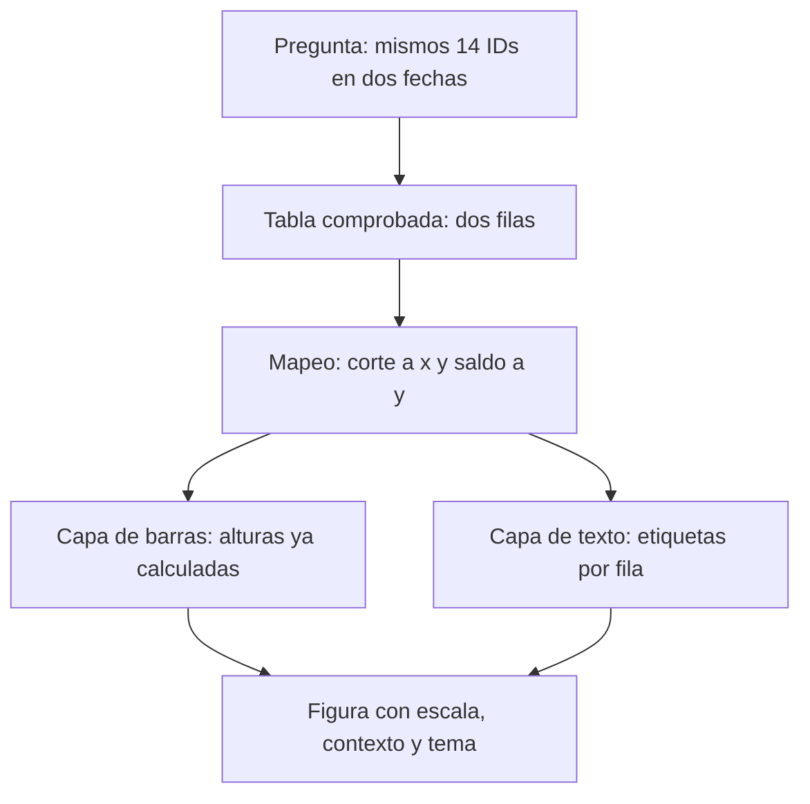
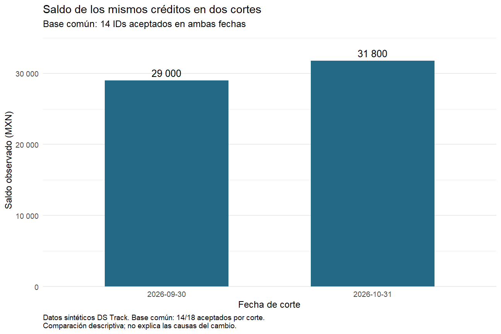

# 08.01 — Pregunta y gramática de gráficos

[Inicio](../../../README.md) / [Módulo 08](../README.md) / **Lección 08.01**

| Tu sesión | Qué prepararás o comprobarás |
| --- | --- |
| **Meta** | Convertir una pregunta y una tabla comprobada en capas de ggplot2 |
| **Necesitas** | 07.10 y su lab; mismo proyecto renv, sin dependencias nuevas |
| **Evidencia** | Script reconstruible, revisión de la figura y explicación de sus componentes |

[Preparación](#antes-de-empezar) · [Material de apoyo](#material-de-apoyo) · [Lab 08.01](../../../labs/08_visualization_r/01_question_grammar/README.md) · [Comprobar](#evidencia-y-criterio-de-salida)

<a id="propósito-prerrequisitos-y-objetivos"></a>

## Propósito

**Esencial.** Entender cómo una pregunta y una tabla comprobada se convierten en
una figura de ggplot2. En [07.10](../../07_tidyverse/10_first_plot_closure/README.md)
produjimos la primera gráfica; ahora la desarmaremos y construiremos por partes.
No hace falta memorizar una receta completa para explicar cada decisión.

## Antes de empezar

Completa esa lección y su lab. Reutiliza **el mismo proyecto renv**, el CSV
original y sus funciones. Consulta [tablas ordenadas](../../07_tidyverse/07_tidy_reshape/README.md),
[factores](../../07_tidyverse/08_text_categories_factors/README.md) y
[fechas/cortes](../../07_tidyverse/09_dates_cutoffs/README.md) si necesitas repasar.
Se conserva el lockfile de 07.10: referencia comprobada R 4.6.1/ggplot2 4.0.3.
Esta sección no añade dependencias ni requiere volver a restaurar una biblioteca
ya sincronizada. Tampoco requiere otra entrega exportada.

Puedes trabajar en varias sesiones: primero pregunta/tabla; después construcción;
por último lab y explicación propia.

## Qué vas a aprender

- Formular la pregunta con población, unidad, fechas y medida explícitas.
- Diferenciar registro original, fila resumida y marca gráfica.
- Leer `ggplot`, `aes`, `geom_col` y `geom_text` por su responsabilidad.
- Construir un objeto por partes, explicar herencia y mostrarlo con `print`.
- Reconocer escalas, etiquetas y tema sin confundirlos con capas de datos.
- Comprobar los valores e interpretar el cambio sin inventar causas.

## Material de apoyo

| Recurso | Para qué sirve | Uso |
| --- | --- | --- |
| [Script de gramática](explorar_gramatica.R) | Reconstruir y construir la figura por partes | Para el recorrido |
| [Base y reglas compartidas](../../07_tidyverse/10_first_plot_closure/README.md) | Ubicar el proyecto, la fuente y las funciones de reconstrucción | Para el recorrido |
| [Figura de referencia](assets/figura_gramatica.png) | Contrastar alturas, población y contexto | Consulta visual |

Consulta las fuentes aquí y trabaja con el script propio dentro del proyecto
de práctica, manteniendo su raíz como directorio. Las imágenes de referencia
acompañan la lectura; contrasta también tablas y comprobaciones numéricas.

## 1. La pregunta determina qué debemos representar

Una pregunta como «¿cómo va la cartera?» deja decisiones abiertas: ¿qué fecha,
qué créditos y qué medida? Empezamos por una pregunta que sí podemos comprobar:

> ¿Cómo cambia el saldo observado de los mismos créditos aceptados entre el
> 30 de septiembre y el 31 de octubre de 2026?

| Decisión | En este análisis | Qué error ayuda a evitar |
| --- | --- | --- |
| Unidad original | Un crédito observado en una fecha de corte | Contar dos observaciones del mismo crédito como dos créditos distintos |
| Población comparable | 14 IDs aceptados en ambas fechas | Suponer que dos conjuntos de 18 filas contienen a las mismas personas o créditos |
| Medida | Suma de saldo observado en MXN en cada fecha | Confundir saldo con conteo o sumar fechas como si fueran una sola |
| Comparación | Octubre menos septiembre, sobre esos mismos IDs | Atribuir al cambio de saldo lo que proviene de cambiar integrantes |
| Alcance | Descriptivo, datos sintéticos | Afirmar causas, rentabilidad o representatividad que no evaluamos |

Conservamos las decisiones de aceptación de 07.09/07.10: 48 registros de entrada,
36 aceptados, 12 rechazados con originales y motivos. Hay 18 aceptados por corte,
14 comunes y cuatro sin pareja por lado. Estos últimos siguen conservados;
«sin pareja» no demuestra alta o baja real.

| Selección | Septiembre (MXN) | Octubre (MXN) | Cambio (MXN) |
| --- | ---: | ---: | ---: |
| Todos los aceptados de cada corte | 39900 | 41500 | +1600 |
| Los mismos 14 IDs | 29000 | 31800 | +2800 |

Ambas filas tienen significado, pero responden preguntas diferentes. Nuestra
figura usa la segunda. Cambiar el título sin cambiar la tabla no convierte una
comparación en la otra. El saldo de los 36 aceptados, 81400 MXN, reúne dos fechas;
no es el saldo de cartera en una fecha única.

**Antes de seguir:** explica por qué no alcanza con decir «hay 18 en cada corte».
El control decisivo es la identidad de los integrantes, no solo su cantidad.
Esta manera de empezar por la pregunta también aparece en
[04.01 — Pregunta y elección de gráfico](../../04_visualization_python/01_question_chart/README.md).

## 2. Leer la tabla antes de leer el gráfico

Abre el proyecto preparado para 07.10 en RStudio o tu IDE. Mantén su raíz como
directorio de trabajo. Crea `output/mi_gramatica.R`; usa el editor y **Console
de R**, no Terminal. Ejecuta los bloques con Run e inspecciona los objetos.
Si no tienes esa práctica preparada, vuelve a
[la preparación de 07.10](../../07_tidyverse/10_first_plot_closure/README.md#2-preparar-una-sola-vez-y-restaurar-desde-r).

```r
source(".Rprofile")
stopifnot(isTRUE(renv::status()$synchronized))
source("R/funciones_calidad.R", encoding = "UTF-8")
source("R/funciones_texto.R", encoding = "UTF-8")
source("R/funciones_fechas.R", encoding = "UTF-8")
source("R/funciones_cierre.R", encoding = "UTF-8")
ruta <- "datos/cartera_texto.csv"
huella <- tools::md5sum(ruta)
fuente <- leer_texto_segmentos(ruta)
cierre <- construir_cierre(fuente)
comprobar_cierre(fuente, cierre)
stopifnot(identical(cierre$resultado$controles$registros, c(48L, 36L, 12L)),
          nrow(cierre$comunes) == 14L, nrow(cierre$sin_pareja) == 8L,
          nrow(cierre$fuera_cortes) == 0L,
          identical(cierre$datos_figura$saldo_mxn, c(29000, 31800)),
          identical(cierre$datos_figura$aceptados_corte, c(18L, 18L)))
print(cierre$datos_figura, width = Inf)
```

Las funciones reconstruyen las reglas ya estudiadas; no las reescribimos para
aprender gráficos. Las advertencias por fechas imposibles pueden repetirse al
reconstruir. Revisa los rechazos y sus motivos; no edites la fuente para silenciarlas.

| fecha_corte | creditos | saldo_mxn | aceptados_corte |
| --- | ---: | ---: | ---: |
| 2026-09-30 | 14 | 29000 | 18 |
| 2026-10-31 | 14 | 31800 | 18 |

Aquí una fila ya **resume 14 créditos** en una fecha. El gráfico recibirá dos
filas, no 28 observaciones individuales ni los 48 registros originales. Una
barra representará una suma; no representa un crédito.

Preparamos una copia para presentación. `fecha_corte` se conserva como Date;
`corte` expresa las dos fechas como categorías ordenadas y `etiqueta` guarda el
texto que aparecerá encima de cada barra. El saldo sigue siendo numérico:

```r
datos <- cierre$datos_figura |> dplyr::mutate(
  corte = factor(format(fecha_corte, "%Y-%m-%d"),
                 levels = c("2026-09-30", "2026-10-31")),
  etiqueta = format(saldo_mxn, big.mark = " ", scientific = FALSE, trim = TRUE)
)
print(datos, width = Inf)
```

`format` devuelve texto: `"29 000"` y `"31 800"`. No lo usamos como altura
porque queremos una escala numérica, no categorías de texto. `factor` y `levels`
fijan septiembre antes de octubre incluso si luego cambia el orden de las filas.
Las dos posiciones son categorías equidistantes: esta figura no representa una
serie diaria ni describe lo que sucedió entre los cortes.

## 3. Qué significa «gramática de gráficos»

Una gramática permite expresar una figura mediante componentes que se combinan.
En lugar de pensar solamente «quiero un gráfico de barras», podemos preguntar:
¿qué tabla?, ¿qué columna determina cada posición?, ¿qué marcas representan sus
valores?, ¿qué contexto necesita quien lo lea?

ggplot2 implementa una gramática por capas. Empezaremos con datos, mapeos y
geometrías; después reconoceremos otros componentes. No necesitas usar todos
explícitamente: varios tienen valores predeterminados.
[Documentación de ggplot](https://ggplot2.tidyverse.org/reference/ggplot.html).



Sin renderizador: partimos de la pregunta, elegimos la tabla y vinculamos sus
columnas a posiciones. Dos capas usan esa información para dibujar barras y
textos. Escala, etiquetas y tema completan la figura. Este esquema explica
decisiones, no todos los pasos internos del motor de dibujo.

| Componente | Responsabilidad | Ejemplo aquí |
| --- | --- | --- |
| Datos | Valores y unidad de las filas | `datos`: una fila por corte para la base común |
| Mapeo estético | Vincula columnas con propiedades visuales | `corte` → posición x; `saldo_mxn` → posición y |
| Geometría | Define las marcas que se dibujan | Barras y textos |
| Transformación estadística (`stat`) | Calcula lo que representará una capa | Identidad en `geom_col`: usa las alturas suministradas |
| Ajuste de posición | Resuelve disposición/superposición de marcas | Aquí hay una barra por categoría, sin grupos apilados |
| Escalas y guías | Relacionan valores con posiciones/estéticas y los hacen legibles | Eje numérico en MXN; marcas de referencia del eje |
| Coordenadas | Organizan el espacio donde se dibuja | Cartesianas predeterminadas |
| Facetas | Separan datos en paneles | No las necesitamos para estas dos barras |
| Etiquetas y tema | Dan contexto y formato a la presentación | Título, población, unidades, fuente y fondo |

Una **capa de datos** combina datos, mapeo, geometría, transformación estadística
y ajuste de posición. Las funciones `geom_*` preparan muchos de esos valores
por nosotros; no hace falta llamar a `layer()` directamente.
[Referencia de layer](https://ggplot2.tidyverse.org/reference/layer.html).
Las estadísticas se profundizan en [08.02](../02_geometries_stats/README.md),
ya disponible; las coordenadas en 08.04 y las facetas en 08.05, todavía
planificadas en el [índice](../README.md).

## 4. Construir un objeto, luego mostrarlo

```r
p0 <- ggplot2::ggplot(datos, ggplot2::aes(x = corte, y = saldo_mxn))
print(p0)
```

Lee la instrucción de dentro hacia fuera: `aes` describe los vínculos; `ggplot`
establece datos y mapeos predeterminados para el gráfico; `<-` guarda el objeto
como `p0`. `ggplot2::` indica el paquete de la función, sin cargar todo tidyverse.

**Estética** significa aquí una propiedad visual que puede representar datos:
posición, color, relleno, tamaño o forma. No es sinónimo de decoración.
En `aes(x = corte, y = saldo_mxn)` los nombres a la izquierda son propiedades;
los de la derecha son columnas de `datos`. Se escriben sin comillas y sin
`datos$`: ggplot2 los busca en la tabla de la capa.
[Referencia de aes](https://ggplot2.tidyverse.org/reference/aes.html).

`p0` es una descripción de gráfico, no un archivo PNG. Todavía no tiene marcas
que representen los saldos: ver un panel sin barras en este paso es esperado.
Guardar con `<-` no obliga a mostrar el objeto. Usamos `print(p0)` para dibujarlo
explícitamente, también dentro de funciones o al ejecutar con `source`.
[Referencia de print](https://ggplot2.tidyverse.org/reference/print.ggplot.html).

Construir el objeto no garantiza que pueda dibujarse: los mapeos se evalúan
cuando se construye la representación para mostrarla. Por eso un nombre de
columna incorrecto puede producir el error al hacer `print`, aunque la
asignación anterior haya terminado. Comprueba tanto la tabla como el dibujo.

## 5. Añadir las barras: qué hace y qué no hace una capa

```r
p1 <- p0 + ggplot2::geom_col(fill = "#246A86", width = 0.6)
print(p1)
```

`+` agrega un componente a la descripción y devuelve otro objeto; aquí lo
guardamos en `p1`. `p0` sigue disponible sin capas. Si ejecutaras solamente
`p0 + geom_col(...)`, podrías ver el resultado, pero `p0` seguiría siendo el
objeto anterior. El `+` va al final de una línea que continúa. El pipe `|>`
envía un objeto a una función; no sustituye la suma de componentes de ggplot2.
[Adición de componentes](https://ggplot2.tidyverse.org/reference/gg-add.html).

`geom_col` usa `saldo_mxn` como altura: septiembre 29000, octubre 31800. No
calcula la aceptación, no empareja IDs ni decide qué población es comparable.
Todo eso tuvo que resolverse antes. `fill` fija el relleno azul de las barras;
`width` controla su ancho. Son constantes fuera de `aes`, sin una variable
adicional representada por color. La comparación de mapeo/fijación se amplía
en [08.03](../03_aesthetic_mapping/README.md).

No intercambies `geom_col` y `geom_bar` conservando la interpretación. Por
defecto, `geom_bar` cuenta filas por x. El siguiente contraste **omite y** porque
el conteo la calcula; cambiar solo el nombre de la geometría conservando x/y
no es la forma correcta de solicitarlo:

```r
conteo <- ggplot2::ggplot(datos, ggplot2::aes(x = corte)) +
  ggplot2::geom_bar() +
  ggplot2::labs(title = "Filas de la tabla resumida por corte", y = "Filas (no MXN)")
print(conteo)
```

Predicción: **1 y 1**, porque hay una fila resumida por corte. Eso no significa
que haya un crédito ni un peso por fecha. Cambiamos la medida que dibuja la capa.
La [referencia de barras](https://ggplot2.tidyverse.org/reference/geom_bar.html)
documenta identidad frente a conteo; 08.02 ampliará el tema.

## 6. Una segunda capa y la herencia de mapeos

```r
p2 <- p1 + ggplot2::geom_text(
  ggplot2::aes(label = etiqueta), vjust = -0.5, size = 4.5
)
print(p2)
```

La capa de texto usa los datos y x/y definidos en `p0`, porque no suministramos
otros. Agrega un mapeo **local**: `etiqueta` determina el texto de cada fila.
Ese mapeo no se propaga hacia atrás a las barras. `vjust` desplaza el texto
respecto a su punto de anclaje; el valor negativo lo coloca por encima. `size`
fija el tamaño del texto de esta capa. No cambia el saldo ni el número de IDs.
[Referencia de texto](https://ggplot2.tidyverse.org/reference/geom_text.html).

Ahora hay dos barras y dos textos, producidos por **dos capas**, no cuatro.
Una capa puede dibujar muchas marcas. Las capas posteriores se dibujan encima
de las anteriores: poner las barras después del texto podría taparlo si ocupa
su misma zona. El orden visual no corrige ni valida los datos.

**Práctica breve:** tapa el código y explica de dónde obtiene `geom_text` cada
posición y cada etiqueta. Respuesta esperada: x/y heredadas; `label` local;
dos filas compartidas. La herencia ahorra repetir código, pero debemos conocer
la tabla y los mapeos efectivos de cada capa.

## 7. Completar el contexto sin confundir componentes con capas

Antes de interpretar, añadimos una escala con origen cero, espacio superior para
el texto, unidades y población. En esta muestra los saldos son no negativos.
`limits = c(0, NA)` fija el límite inferior en cero y deja el superior automático;
`NA` aquí es una instrucción del argumento, no un saldo ausente. `expand` añade
un margen proporcional arriba. `labels` recibe una función que formatea los
números del eje sin modificar la tabla.
[Escala continua](https://ggplot2.tidyverse.org/reference/scale_continuous.html).

```r
p3 <- p2 + ggplot2::scale_y_continuous(
  limits = c(0, NA), expand = ggplot2::expansion(mult = c(0, 0.12)),
  labels = function(x) format(x, big.mark = " ", scientific = FALSE, trim = TRUE)
) + ggplot2::labs(
  title = "Saldo de los mismos créditos en dos cortes",
  subtitle = "Base común: 14 IDs aceptados en ambas fechas",
  x = "Fecha de corte", y = "Saldo observado (MXN)",
  caption = paste(
    "Datos sintéticos DS Track. Base común: 14/18 aceptados por corte.",
    "Comparación descriptiva; no explica las causas del cambio.", sep = "\n"
  )
)
print(p3)
```

`labs` pone nombres y contexto: `title` es el título; `subtitle`, el subtítulo;
`x`/`y`, nombres de ejes; `caption`, nota al pie. `paste(..., sep = "\n")` separa
las dos frases de la nota con un salto de línea. Cambiar `y` a «porcentaje» no
convertiría MXN a porcentaje: una etiqueta debe describir la medida real.
[Referencia de labs](https://ggplot2.tidyverse.org/reference/labs.html).

El tema controla elementos como fondo, cuadrícula y tipografía. Usamos la misma
presentación de 07.10 para concentrarnos en su estructura:

```r
figura <- p3 + ggplot2::theme_minimal(base_size = 12) +
  ggplot2::theme(panel.grid.major.x = ggplot2::element_blank(),
                 plot.caption = ggplot2::element_text(hjust = 0))
print(figura)
```

`theme_minimal` establece un tema; `theme` lo ajusta: elimina la cuadrícula
vertical principal con `element_blank` y alinea la nota a la izquierda con
`hjust = 0`. No necesitamos memorizar esas opciones todavía. No asignan datos
a colores ni alteran sumas. Se profundizan en 08.06.
[Referencia de theme](https://ggplot2.tidyverse.org/reference/theme.html).

Aunque todas estas instrucciones usan `+`, no todas agregan capas de datos:
`geom_col` y `geom_text` sí; escala, `labs` y tema son otros componentes.
La figura final mantiene dos capas. Tampoco requiere un panel por capa: ambas
comparten el mismo espacio de dibujo.



Figura de referencia generada con el script de esta sección. Sin imagen: el
eje horizontal identifica las dos fechas; el vertical muestra saldo observado
en MXN desde cero. Cada barra tiene su importe arriba. Título y notas indican
base común, cobertura y alcance descriptivo.

## 8. Comprobar e interpretar lo que vemos

```r
stopifnot(length(p0$layers) == 0L, length(p1$layers) == 1L,
          length(p2$layers) == 2L, length(figura$layers) == 2L,
          identical(datos$saldo_mxn, cierre$datos_figura$saldo_mxn),
          identical(huella, tools::md5sum(ruta)))
variacion_pct <- 100 * (31800 - 29000) / 29000
variacion_pct
print(figura)
```

`$layers` permite inspeccionar las capas en esta versión; `length` cuenta esas
capas, no marcas. Es una comprobación de apoyo, no una API que necesites
modificar. La huella confirma que esta ejecución dejó intacto el CSV; no demuestra
que su contenido original fuera correcto. La reconstrucción comprueba tablas;
todavía debemos inspeccionar en Plots que no se corten textos o se oculten marcas.

Una interpretación adecuada es: «En los mismos 14 IDs aceptados en ambas fechas,
el saldo observado pasa de 29000 a 31800 MXN: +2800 MXN, aproximadamente +9.66%
respecto a septiembre. La base común cubre 14 de los 18 aceptados en cada corte
(77.78%); el resultado no describe todos los créditos ni explica las causas».

El 9.66% usa saldo inicial como denominador; 77.78% usa cantidad de aceptados.
No son porcentajes intercambiables. Dos cortes tampoco muestran la trayectoria
intermedia ni prueban una tendencia sostenida. Si no hubiese IDs comunes,
conservaríamos las tablas y explicaríamos la ausencia de base; no inventaríamos
dos saldos cero. Un cero observado con créditos presentes es otro caso.

## 9. Errores habituales y cómo razonar sobre ellos

| Síntoma | Qué revisar |
| --- | --- |
| No aparecen barras en `p0` | Faltan marcas; todavía no agregamos una geometría |
| Después de sumar una capa, `p0` sigue vacío | El resultado debe guardarse en otro objeto o reasignarse |
| `object 'corte' not found` | Ejecutar primero la preparación de `datos`; escribir el nombre real sin comillas |
| Una columna es texto en vez de cantidad | No usar `etiqueta` como y; el saldo numérico y su texto tienen responsabilidades distintas |
| Barras 1 y 1 | Se contó la tabla resumida con `geom_bar`; revisar la medida, no los colores |
| Aparece una leyenda inesperada al escribir `aes(fill = "azul")` | Se mapeó una categoría constante; para fijar relleno, escribir `fill = "blue"` fuera de `aes`. Se amplía en [08.03](../03_aesthetic_mapping/README.md) |
| Funciona al ejecutar bloques, falla con `source` | Faltan pasos previos en el script o el directorio de trabajo no es la raíz de la práctica |
| Figura correcta, conclusión sobre otra población | Comparar título, tabla y selección de IDs antes de interpretar |

<a id="práctica-evidencia-y-siguiente-paso"></a>

## Práctica

Realiza el [lab 08.01](../../../labs/08_visualization_r/01_question_grammar/README.md).
El [script de referencia](explorar_gramatica.R) reúne la reconstrucción y los
pasos; ábrelo en el editor y, si quieres ejecutarlo, guárdalo como
`output/mi_gramatica.R` **dentro del mismo proyecto de práctica**. Elige otro nombre
si ya tienes trabajo. No cambies el directorio a la carpeta del script.

Guarda, reinicia R con Session > Restart R y ejecuta desde la raíz de la práctica:

```r
source("output/mi_gramatica.R", encoding = "UTF-8")
```

Debe reconstruir sin cargar un workspace anterior y mostrar la figura con los
mismos saldos. El script no exporta ni sobrescribe entregas; puedes volver a
ejecutarlo. Si necesitas conservar una imagen como evidencia, utiliza el
procedimiento ya estudiado en 07.10 con una carpeta nueva. La exportación se
profundizará en 08.08; aquí basta script, revisión visual y explicación.

## Evidencia y criterio de salida

| Conserva | Comprueba | Explica |
| --- | --- | --- |
| Script y lectura de componentes | Dos barras con 29000/31800 MXN; mismos 14 IDs y cobertura 14/18 | Registro original, fila resumida y marca gráfica |
| Predicciones y revisión visual | Herencia de mapeos, etiquetas y reconstrucción tras reiniciar R | Datos, estéticas, capas, escalas y tema; límites de la interpretación |

Puedes avanzar cuando expliques cada componente, anticipes las alturas de
ambas geometrías, reconstruyas desde una sesión nueva y justifiques población,
unidades y límites.

Quien aprende realiza la práctica y explica las decisiones; su compañero revisa.
Tu compañero señala una marca y pide rastrearla hasta su capa y su fila de datos.
Guarda evidencia, ayudas y dudas en una nota personal junto a tu práctica.
PROGRESS.md registra desarrollo editorial, no tu expediente de aprendizaje.
El proyecto integrador y sus checkpoints siguen pendientes; disponer de
lecciones y scripts no acredita haber completado el aprendizaje.

<a id="referencias-y-atribución"></a>

## Referencias

Ejemplos y preguntas propios con datos sintéticos DS Track. Consulta:
2026-10-20. APIs comprobadas con R 4.6.1 y ggplot2 4.0.3; no se afirma que sean
las versiones más recientes. Las referencias por función se enlazan en cada
apartado para consultar una duda concreta sin leerlas completas.

- Hadley Wickham, Mine Çetinkaya-Rundel y Garrett Grolemund,
  [R for Data Science, segunda edición: Data visualization](https://r4ds.hadley.nz/data-visualize.html):
  lectura inicial sobre relación entre datos, variables y representación.
- Hadley Wickham, Danielle Navarro y Thomas Lin Pedersen,
  [ggplot2: Elegant Graphics for Data Analysis](https://ggplot2-book.org/),
  tercera edición en desarrollo. El capítulo de
  [capas](https://ggplot2-book.org/layers.html) sirve como consulta del modelo;
  la página advierte que es un borrador y desaconseja su lectura actual.
  No es lectura obligatoria: prioriza las referencias oficiales y esta práctica.
- [Guía de lecturas del recorrido R](../../../docs/r-reading-guide.md).

## Siguiente paso

Después de la práctica y su comprobación, continúa con
[08.02 — Geometrías y transformaciones estadísticas](../02_geometries_stats/README.md).

[← Módulo 08](../README.md) · [Lab 08.01](../../../labs/08_visualization_r/01_question_grammar/README.md) · [Siguiente →](../02_geometries_stats/README.md)
