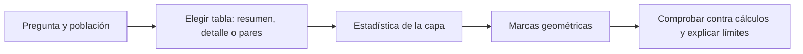
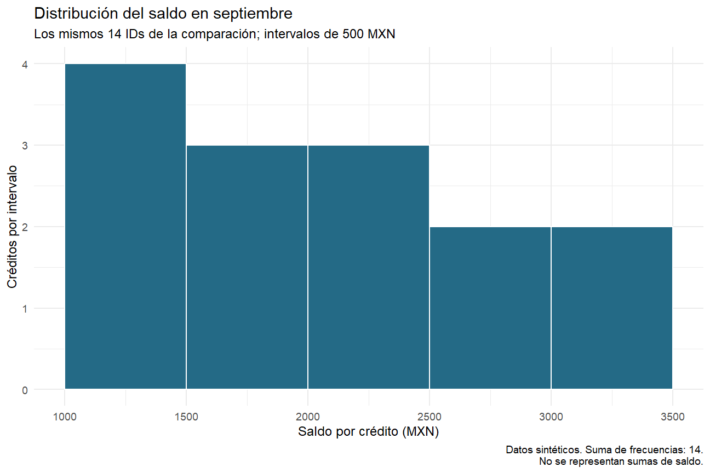
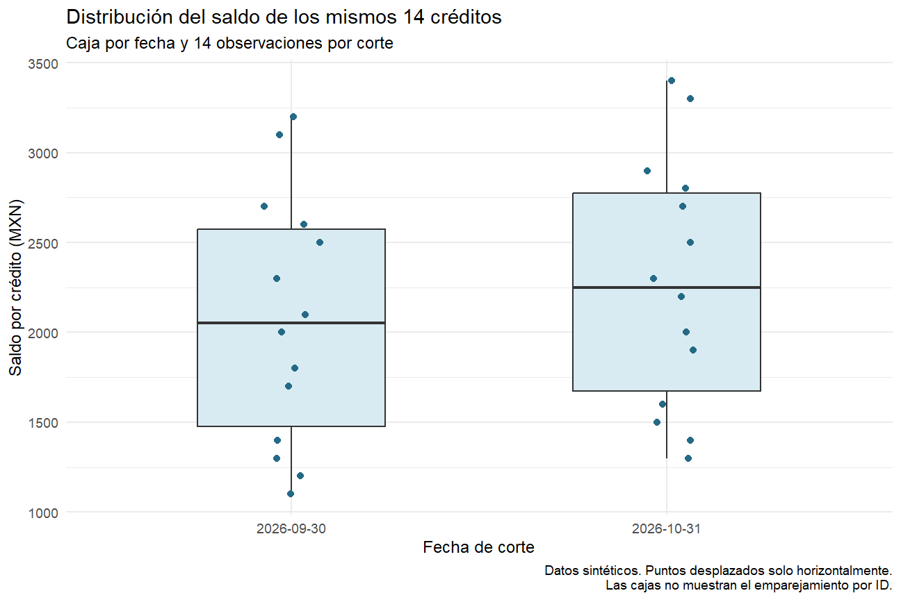

# 08.02 — Geometrías y transformaciones estadísticas

## Propósito, prerrequisitos y objetivos

**Esencial.** Elegir una geometría según la pregunta y comprobar qué calcula
su capa. En [08.01](../01_question_grammar/README.md) distinguimos datos, mapeos
y capas. Ahora compararemos cinco familias: barras, líneas, puntos, histogramas
y diagramas de caja. Cambiar la geometría puede cambiar la medida representada,
no solamente su apariencia.

Completa 08.01 y su lab. Trabaja en el mismo proyecto renv preparado para
[07.10](../../07_tidyverse/10_first_plot_closure/README.md). Reutilizamos su CSV,
funciones y lockfile: R 4.6.1 y ggplot2 4.0.3 comprobados. No hay dependencias,
fuentes ni reglas de aceptación nuevas. No necesitas otra instalación ni una
nueva exportación para completar esta práctica.

Al terminar podrás:

- Relacionar una pregunta con la tabla y geometría que necesita.
- Diferenciar identidad, conteo, intervalos y resumen estadístico.
- Explicar por qué 2 filas resumidas, 28 observaciones y 14 pares no son intercambiables.
- Comprobar frecuencias de un histograma y cuartiles/bigotes de una caja.
- Reconocer qué información pierde cada resumen y qué no demuestra una figura.

El recorrido principal usa RStudio o tu IDE: editor, Run, Console de R y Plots.
Mantén la raíz del proyecto de práctica como directorio; Console de R y Terminal
del sistema son herramientas distintas. Puedes repartir la lección entre
comparación/relación y distribuciones antes de realizar el lab.

## 1. Geometría, estadística y pregunta

Una **geometría** define marcas: puntos, tramos, barras o cajas. Una
**transformación estadística**, `stat`, define qué valores calcula la capa antes
de dibujarlos. No significa necesariamente inferencia o modelado: contar filas
ya es una transformación estadística. **Identidad** significa usar los valores
suministrados, sin resumirlos mediante la estadística de la capa.

| Pregunta concreta | Entrada necesaria | Geometría | Estadística predeterminada |
| --- | --- | --- | --- |
| ¿Qué suma de saldo tiene la base común en cada fecha? | Una fila resumida por corte | `geom_col` | Identidad: alturas suministradas |
| ¿Cuántos registros hay por categoría? | Detalle de registros | `geom_bar` | Conteo por x |
| ¿Cómo se conectan las mediciones de una serie ordenada? | Una fila por fecha/serie | `geom_line` y `geom_point` | Identidad; la línea ordena por x |
| ¿Cómo se relacionan dos mediciones del mismo ID? | Una fila por par | `geom_point` | Identidad: coordenadas suministradas |
| ¿Dónde se concentran los saldos de un corte? | Un saldo por crédito de ese corte | `geom_histogram` | Intervalos y conteo |
| ¿Cómo se distribuyen los saldos por corte? | Detalle, separado por fecha | `geom_boxplot` | Cuartiles, bigotes y valores exteriores |

La tabla es una guía de elección para nuestros ejemplos, no una lista de usos
únicos. Geometría y estadística pueden configurarse por separado. Primero
conviene entender sus parejas predeterminadas y verificar sus resultados;
no hace falta memorizar todos los argumentos. La
[documentación de barras](https://ggplot2.tidyverse.org/reference/geom_bar.html)
permite contrastar explícitamente `stat = "count"` e `"identity"`.



Sin renderizador: primero definimos qué queremos saber y de quién; después
elegimos la tabla, revisamos qué calcula la capa y qué marcas dibuja. Al final
contrastamos los valores con un cálculo y revisamos la lectura de la figura.

## 2. Preparar tres tablas sin cambiar de población

Crea `output/mi_geometrias.R` en tu proyecto de práctica. Copia los bloques en
orden y ejecútalos por partes. También tienes el
[script completo](explorar_geometrias.R) para revisar después de intentarlo.

```r
source(".Rprofile")
stopifnot(isTRUE(renv::status()$synchronized))
source("R/funciones_calidad.R", encoding = "UTF-8")
source("R/funciones_texto.R", encoding = "UTF-8")
source("R/funciones_fechas.R", encoding = "UTF-8")
source("R/funciones_cierre.R", encoding = "UTF-8")
ruta <- "datos/cartera_texto.csv"
huella <- tools::md5sum(ruta)
fuente <- leer_texto_segmentos(ruta)
cierre <- construir_cierre(fuente)
comprobar_cierre(fuente, cierre)
stopifnot(identical(cierre$resultado$controles$registros, c(48L, 36L, 12L)),
          nrow(cierre$comunes) == 14L, nrow(cierre$sin_pareja) == 8L,
          nrow(cierre$fuera_cortes) == 0L,
          identical(cierre$datos_figura$saldo_mxn, c(29000, 31800)))
```

Seguimos con 48 entradas, 36 aceptados y 12 rechazados conservados. Los
14 IDs comunes cubren 14/18 aceptados por corte; los ocho registros aceptados
sin pareja permanecen aparte. Las advertencias de fechas imposibles de la
fuente se conservan: revisa sus motivos como en 07.10.

El análisis ofrece tres formas de la misma base común:

| Objeto | Filas | Qué representa una fila |
| --- | ---: | --- |
| `resumen` | 2 | Suma de los 14 saldos de una fecha |
| `pares` | 14 | Un ID con saldo de septiembre, octubre y diferencia |
| `detalle` | 28 | Un ID en un corte, con su saldo individual |

Construimos el detalle desde los pares ya validados. `select` renombra el saldo
de cada fecha como `saldo_mxn`; `mutate` agrega su fecha; `bind_rows` apila las
dos tablas con el mismo esquema. Repasa
[07.02](../../07_tidyverse/02_select_filter_sort/README.md),
[07.03](../../07_tidyverse/03_transform_columns/README.md) y
[07.07](../../07_tidyverse/07_tidy_reshape/README.md) si necesitas recordar
selección, transformación o cambio de forma.

```r
resumen <- cierre$datos_figura |> dplyr::mutate(
  corte = factor(format(fecha_corte, "%Y-%m-%d"),
                 levels = c("2026-09-30", "2026-10-31"))
)
pares <- cierre$comunes
detalle <- dplyr::bind_rows(
  pares |> dplyr::select(id_credito, saldo_mxn = saldo_sep) |>
    dplyr::mutate(fecha_corte = as.Date("2026-09-30")),
  pares |> dplyr::select(id_credito, saldo_mxn = saldo_oct) |>
    dplyr::mutate(fecha_corte = as.Date("2026-10-31"))
) |> dplyr::mutate(
  corte = factor(format(fecha_corte, "%Y-%m-%d"), levels = levels(resumen$corte))
)
control_detalle <- detalle |> dplyr::group_by(fecha_corte) |>
  dplyr::summarise(creditos = dplyr::n(), saldo_mxn = sum(as.double(saldo_mxn)), .groups = "drop")
stopifnot(nrow(detalle) == 28L, !anyNA(detalle),
          anyDuplicated(detalle[c("id_credito", "fecha_corte")]) == 0L,
          identical(control_detalle$creditos, c(14L, 14L)),
          identical(control_detalle$saldo_mxn, resumen$saldo_mxn))
print(control_detalle)
```

Esperado: 14 créditos y 29000 MXN en septiembre; 14 y 31800 en octubre.
La suma se calcula como double para compararla también en tipo con la de 07.10;
no redondeamos ni cambiamos las cantidades. `anyDuplicated` devuelve cero cuando
no hay claves repetidas. El detalle no contiene ausencias porque esta base exige
saldos conocidos; eso no significa que cualquier fuente esté completa.

## 3. Barras: valores suministrados frente a conteos

```r
barras <- ggplot2::ggplot(resumen, ggplot2::aes(corte, saldo_mxn)) +
  ggplot2::geom_col(fill = "#246A86", width = 0.6) +
  ggplot2::labs(title = "Saldo de los mismos 14 créditos",
                 x = "Fecha de corte", y = "Saldo observado (MXN)") +
  ggplot2::theme_minimal(base_size = 12)
conteo_resumen <- ggplot2::ggplot(resumen, ggplot2::aes(corte)) + ggplot2::geom_bar()
conteo_detalle <- ggplot2::ggplot(detalle, ggplot2::aes(corte)) + ggplot2::geom_bar()
print(barras)
print(conteo_resumen)
print(conteo_detalle)
```

Anticipa las alturas: **29000/31800**, **1/1** y **14/14**. En el primer caso
la unidad vertical es MXN; en el segundo, filas resumidas; en el tercero,
observaciones crédito/corte. El conteo del detalle equivale aquí a créditos por
fecha porque verificamos la clave ID/corte. Sin esa condición, registros
duplicados podrían inflar el conteo.

Identidad no garantiza «una fila = una barra separada»: con varias filas en
la misma x, `geom_col` apila por defecto. Por ejemplo, si le dieras el detalle
podrías obtener otra vez las alturas 29000/31800 mediante apilado. Eso no valida
la población ni sustituye la tabla resumida: tendrías varios rectángulos
superpuestos verticalmente. Conserva la responsabilidad del resumen explícito.

`geom_bar` también admite pesos; por eso «siempre cuenta filas» sería una regla
incompleta. En estos ejemplos no se mapea `weight`. Para saldos ya resumidos,
usamos `geom_col` y no cambiamos la medida silenciosamente.
[Referencia de barras](https://ggplot2.tidyverse.org/reference/geom_bar.html).

## 4. Líneas: conectar fechas no agrega mediciones

```r
linea <- ggplot2::ggplot(resumen, ggplot2::aes(fecha_corte, saldo_mxn, group = 1)) +
  ggplot2::geom_line(linewidth = 0.8, colour = "#246A86") +
  ggplot2::geom_point(size = 3, colour = "#246A86") +
  ggplot2::scale_x_date(breaks = resumen$fecha_corte, date_labels = "%Y-%m-%d") +
  ggplot2::labs(title = "Dos cortes observados de los mismos 14 créditos",
    x = "Fecha de corte", y = "Saldo observado (MXN)",
    caption = "Datos sintéticos. Base común: 14/18 por corte.\nEl tramo no son mediciones diarias.") +
  ggplot2::theme_minimal(base_size = 12)
print(linea)
```

Aquí `fecha_corte` sigue siendo Date: el espacio horizontal representa tiempo,
en lugar de categorías. `group = 1` indica una sola serie; no significa que
haya un crédito. `geom_line` conecta en orden de x; `geom_path` seguiría el
orden de las filas. `linewidth` fija el grosor del trazo. Los puntos hacen
visibles las dos mediciones que sí existen.
[Referencia de líneas](https://ggplot2.tidyverse.org/reference/geom_path.html).

`scale_x_date` pone las marcas del eje en las dos fechas y les da formato ISO;
no rellena observaciones. Las escalas se profundizan en 08.04.
[Referencia de fechas](https://ggplot2.tidyverse.org/reference/scale_date.html).
La línea muestra una conexión visual entre 29000 y 31800: no observamos el
saldo diario, no sabemos si subió continuamente y no establecemos tendencia
con dos puntos. El cambio sigue siendo +2800 MXN, sin evidencia de causas.

La inclinación visual también depende de los límites de los ejes y de las
dimensiones del panel. Aquí la línea no mide longitudes desde cero como una
barra: lee las fechas y los valores, sin interpretar el ángulo como una tasa
diaria observada. Las decisiones de escala se profundizan en 08.04.

Si un período falta como fila, la línea puede unir los vecinos y ocultar el
hueco. Un NA explícito en medio interrumpe el trazo; un cero es una medición
distinta. La ampliación del lab explora ese caso en otra muestra, sin tocar
esta cartera. No confundas ausencia, cero y continuidad.

## 5. Puntos: relacionar dos valores del mismo registro

```r
dispersion <- ggplot2::ggplot(pares, ggplot2::aes(saldo_sep, saldo_oct)) +
  ggplot2::geom_point(size = 3, colour = "#246A86") +
  ggplot2::labs(title = "Saldos por crédito en dos fechas",
    subtitle = "14 pares; cada punto corresponde al mismo ID",
    x = "Saldo septiembre (MXN)", y = "Saldo octubre (MXN)",
    caption = "Datos sintéticos: todos los pares aumentan 200 MXN.\nEsta relación construida no demuestra una causa.") +
  ggplot2::theme_minimal(base_size = 12)
print(dispersion)
stopifnot(all(pares$saldo_oct - pares$saldo_sep == 200L))
```

El punto de ID 001 está en (1100, 1300); el de ID 022, en (3200, 3400).
Son coordenadas de cada crédito, no frecuencias. La alineación exacta surge
de la construcción de esta muestra sintética: todos aumentan 200 MXN. No
demuestra que el saldo inicial cause el final ni permite predecir otra cartera.
La [referencia de puntos](https://ggplot2.tidyverse.org/reference/geom_point.html)
describe esta geometría y el problema de superposición.

No dibujes esta dispersión con dos vectores filtrados por separado y supongas
que sus posiciones corresponden al mismo ID. La unión validada de 07.10 es la
que garantiza el emparejamiento. Tampoco conectes los 14 puntos entre sí: x es
saldo, no tiempo ni una secuencia de créditos que debamos recorrer.

## 6. Histograma: agrupar valores en intervalos

Tomamos **solo septiembre y solo los 14 IDs comunes**. La pregunta cambia:
¿cuántos de esos créditos tienen saldo en cada intervalo? Ya no preguntamos
por la suma de sus saldos. Agregar octubre produciría 28 observaciones con
créditos repetidos entre fechas, otra unidad de análisis.

```r
septiembre <- detalle |> dplyr::filter(fecha_corte == as.Date("2026-09-30"))
bordes <- seq(1000, 3500, by = 500)
frecuencias <- graphics::hist(septiembre$saldo_mxn, breaks = bordes,
  right = TRUE, include.lowest = TRUE, plot = FALSE)
stopifnot(identical(frecuencias$counts, c(4L, 3L, 3L, 2L, 2L)),
          sum(frecuencias$counts) == 14L)
histograma <- ggplot2::ggplot(septiembre, ggplot2::aes(saldo_mxn)) +
  ggplot2::geom_histogram(breaks = bordes, closed = "right",
                          fill = "#246A86", colour = "white") +
  ggplot2::scale_x_continuous(breaks = bordes) +
  ggplot2::labs(title = "Distribución del saldo en septiembre",
    subtitle = "Los mismos 14 IDs de la comparación; intervalos de 500 MXN",
    x = "Saldo por crédito (MXN)", y = "Créditos por intervalo",
    caption = "Datos sintéticos. Suma de frecuencias: 14.\nNo se representan sumas de saldo.") +
  ggplot2::theme_minimal(base_size = 12)
print(histograma)
print(frecuencias$counts)
```

`seq` genera 1000, 1500, 2000, 2500, 3000 y 3500. `breaks` fija los bordes;
`closed = "right"` incluye el extremo derecho. No se mapea y: `stat_bin`
calcula los conteos. `colour = "white"` separa visualmente intervalos vecinos;
no significa que sean categorías sin orden.
[Referencia del histograma](https://ggplot2.tidyverse.org/reference/geom_histogram.html).

| Intervalo de saldo (MXN) | Créditos | Ejemplo de asignación |
| --- | ---: | --- |
| [1000, 1500] | 4 | 1100, 1200, 1300, 1400 |
| (1500, 2000] | 3 | 2000 pertenece aquí |
| (2000, 2500] | 3 | 2500 pertenece aquí |
| (2500, 3000] | 2 | 2600 y 2700 |
| (3000, 3500] | 2 | 3100 y 3200 |

`(` excluye el límite; `]` lo incluye. El primer intervalo incluye también
el extremo inicial. Los bordes cubren toda esta muestra. Si la fuente cambia,
revisa el rango antes de reutilizarlos: no aceptes perder valores fuera de los
intervalos y seguir anunciando n = 14.

`graphics::hist(..., plot = FALSE)` calcula una referencia sin dibujar con
gráficos base. Su `right = TRUE` e `include.lowest = TRUE` expresan el mismo
cierre que elegimos; `$counts` devuelve las cinco frecuencias. La suma debe
recuperar 14, no 29000. La
[ayuda oficial de hist](https://stat.ethz.ch/R-manual/R-devel/library/graphics/html/hist.html)
describe esos argumentos. También puedes verificar los créditos de cada
intervalo manualmente, en lugar de confiar solo en dos bibliotecas.

La forma depende de los bordes: intervalos de 1000 MXN darían 7, 5 y 2 para
[1000, 2000], (2000, 3000] y (3000, 4000]. Los créditos no cambiaron; cambió
el resumen. No busques una división «correcta» por verse más regular: declara
la elección y contrasta alternativas. Una muestra de 14 observaciones no
permite afirmar la forma de distribución de todos los créditos.



Sin imagen: los intervalos son contiguos y tienen igual anchura. Su altura
cuenta créditos, no pesos; las cinco frecuencias suman 14.

## 7. Caja: cuartiles, mediana, bigotes y detalle

La caja resume la distribución de cada fecha. La mediana divide los valores
ordenados en mitades; Q1 y Q3 delimitan su parte central. Para calcularlos
declaramos el algoritmo **tipo 7**, que interpola entre posiciones vecinas:
un cuartil no tiene que ser un saldo observado ni tener valor entero.
La [ayuda de quantile](https://stat.ethz.ch/R-manual/R-devel/library/stats/html/quantile.html)
documenta las distintas convenciones. No uses automáticamente el resultado de
`boxplot.stats` como si todos los métodos de cuartiles fueran iguales.

El rango intercuartílico es **IQR = Q3 − Q1**. Con coeficiente 1.5, los límites
de referencia son Q1 − 1.5 × IQR y Q3 + 1.5 × IQR. Los **bigotes terminan en
observaciones** dentro de esos límites, no necesariamente en los límites.
Los puntos exteriores merecen revisión; no son automáticamente errores.
[Definición de IQR](https://stat.ethz.ch/R-manual/R-devel/library/stats/html/IQR.html).

```r
cuartiles <- detalle |> dplyr::group_by(corte) |>
  dplyr::summarise(n = dplyr::n(),
    q1 = stats::quantile(saldo_mxn, 0.25, type = 7, names = FALSE),
    mediana = stats::median(saldo_mxn),
    q3 = stats::quantile(saldo_mxn, 0.75, type = 7, names = FALSE),
    .groups = "drop")
cajas <- ggplot2::ggplot(detalle, ggplot2::aes(corte, saldo_mxn)) +
  ggplot2::geom_boxplot(coef = 1.5, quantile.type = 7,
                        outlier.shape = NA, fill = "#D9EBF2", width = 0.5) +
  ggplot2::geom_point(position = ggplot2::position_jitter(width = 0.08, height = 0, seed = 802),
                       size = 2, colour = "#246A86") +
  ggplot2::labs(title = "Distribución del saldo de los mismos 14 créditos",
    subtitle = "Caja por fecha y 14 observaciones por corte",
    x = "Fecha de corte", y = "Saldo por crédito (MXN)",
    caption = "Datos sintéticos. Puntos desplazados solo horizontalmente.\nLas cajas no muestran el emparejamiento por ID.") +
  ggplot2::theme_minimal(base_size = 12)
print(cajas)
print(cuartiles)
```

| Corte | n | Q1 | Mediana | Q3 | Bigotes |
| --- | ---: | ---: | ---: | ---: | --- |
| Septiembre | 14 | 1475 | 2050 | 2575 | 1100 y 3200 |
| Octubre | 14 | 1675 | 2250 | 2775 | 1300 y 3400 |

En septiembre, IQR = 1100 y los límites son −175 y 4225. Ningún saldo de la
muestra queda fuera; los bigotes llegan a 1100/3200. El límite negativo no
representa un crédito con saldo negativo. En octubre, la distribución entera
está desplazada 200 MXN en esta muestra particular.

`outlier.shape = NA` evita dibujar puntos exteriores por duplicado, porque
la segunda capa ya muestra **todas** las observaciones. No los borramos ni
usamos `outliers = FALSE`. `quantile.type` y `coef` fijan método y regla.
[Referencia de cajas](https://ggplot2.tidyverse.org/reference/geom_boxplot.html).
`position_jitter` desplaza ligeramente x para reducir superposición; `height = 0`
conserva los saldos y `seed = 802` repite el desplazamiento. Esa variación
horizontal no es una variable medida.
[Referencia de jitter](https://ggplot2.tidyverse.org/reference/position_jitter.html).

Las cajas no muestran qué crédito se empareja con cuál ni los cambios de cada
ID. Para eso usamos `pares`. Tampoco resumen bien una distribución si les das
solo la suma de cada corte: una observación por caja no recupera los 14 saldos.
Estos conceptos también se explican en
[04.04 — Distribuciones y relaciones](../../04_visualization_python/04_distributions_relationships/README.md).



Sin imagen: la caja de octubre queda 200 MXN por encima de la de septiembre;
los puntos muestran los 14 saldos de cada fecha, sin unir los pares. Las
figuras de referencia se generaron con el script de esta sección.

## 8. Inspeccionar lo que calculó una capa

La figura puede verse razonable y representar una medida equivocada. Para
contrastar los cálculos, `layer_data(figura, número)` recupera la tabla preparada
para una capa; las capas se numeran desde uno en el orden de adición. La usamos
para inspección, no para modificar internamente el gráfico.
[Referencia de construcción e inspección](https://ggplot2.tidyverse.org/reference/ggplot_build.html).

```r
calculado_hist <- ggplot2::layer_data(histograma, 1)
calculado_caja <- ggplot2::layer_data(cajas, 1)
stopifnot(identical(ggplot2::layer_data(barras, 1)$y, c(29000, 31800)),
          identical(ggplot2::layer_data(conteo_resumen, 1)$count, c(1, 1)),
          identical(ggplot2::layer_data(conteo_detalle, 1)$count, c(14, 14)),
          identical(calculado_hist$count, as.double(frecuencias$counts)),
          identical(calculado_caja$lower, cuartiles$q1),
          identical(calculado_caja$middle, cuartiles$mediana),
          identical(calculado_caja$upper, cuartiles$q3),
          identical(huella, tools::md5sum(ruta)))
print(calculado_hist[c("xmin", "xmax", "count")])
print(calculado_caja[c("ymin", "lower", "middle", "upper", "ymax")])
```

En el histograma, `xmin`/`xmax` son bordes y `count` la frecuencia. En la caja,
`lower`/`middle`/`upper` son Q1/mediana/Q3; `ymin`/`ymax`, los bigotes.
Que septiembre tenga mediana 2050 y suma 29000 no es una discrepancia: son
medidas diferentes. La mediana de los 14 cambios es 200 MXN; no se calcula
dividiendo una diferencia de medianas por la cantidad de créditos.

## 9. Límites, ausencias y ampliaciones

- **Vacío:** conserva tablas y explica que no hay base; una caja o histograma
  sin marcas no prueba saldo cero. Para generar `cierre` sin pares, aplica
  los controles ya estudiados en 07.10.
- **Ausencias:** esta base exige saldos conocidos. En otra muestra, identifica
  conocidos y pendientes antes de graficar, declara cobertura y conserva los
  excluidos. `na.rm = TRUE` puede silenciar un aviso; no completa un dato.
- **Pocas observaciones o empates:** una caja puede colapsar; superposición puede
  ocultar puntos. Mira el detalle y n antes de interpretar forma o dispersión.
- **Proporción, extensión:** `after_stat` permite mapear cantidades producidas
  por una estadística, por ejemplo frecuencias relativas de un histograma.
  El lab ofrece un ejemplo con un solo grupo y denominador explícito.
  [Referencia](https://ggplot2.tidyverse.org/reference/aes_eval.html).
- **Suavizados y bandas, avanzado:** `geom_smooth` estima una media condicional;
  método, fórmula, grupos y parámetros importan. Su banda predeterminada no es
  un rango que contenga a todos los créditos ni explica causas. No necesitamos
  ajustar una curva a dos sumas ni a una relación construida artificialmente.
  Si se incorpora después, habrá que justificar el modelo y su incertidumbre.
  [Referencia](https://ggplot2.tidyverse.org/reference/geom_smooth.html).

## Práctica, criterio de salida y siguiente paso

Realiza el [lab 08.02](../../../labs/08_visualization_r/02_geometries_stats/README.md).
Conserva script propio y una explicación de qué recibe, calcula y dibuja cada
geometría. La revisión visual debe acompañar las comprobaciones numéricas.

El [script de referencia](explorar_geometrias.R) reúne el recorrido esencial.
Ábrelo en el editor y guárdalo como `output/mi_geometrias.R` en la práctica,
eligiendo otro nombre si ya existe trabajo. Guarda, reinicia R mediante
Session > Restart R y ejecuta en Console desde la raíz del mismo proyecto:

```r
source("output/mi_geometrias.R", encoding = "UTF-8")
```

No depende del workspace de 08.01, no modifica el CSV ni exporta. Para este
cierre bastan reconstrucción, inspección de figuras y explicación; una nueva
entrega de archivos no es obligatoria. El proyecto integrador y sus checkpoints
siguen pendientes; la existencia de material no acredita aprendizaje.

Puedes avanzar cuando justifiques tabla/geometría, anticipes conteos y sumas,
compruebes intervalos y cuartiles y expliques lo que cada figura pierde.
Siguiente: [08.03 — Mapear y fijar estéticas](../03_aesthetic_mapping/README.md),
ya disponible. Volver al [índice de 08](../README.md).

## Referencias y atribución

Ejemplos, comprobaciones y datos sintéticos propios de DS Track. Consulta:
2026-10-20. Funciones comprobadas con R 4.6.1/ggplot2 4.0.3; las páginas
R-devel pueden describir otra versión y se contrastaron con la ejecución local.
Las referencias por función aparecen junto al concepto que sustentan.

- Documentación oficial de ggplot2: barras, líneas, puntos, histogramas, cajas,
  posiciones, inspección, evaluación estadística y suavizados enlazados arriba.
- R Core Team y autorías indicadas en la ayuda de `hist`, `quantile` e `IQR`.
- Hadley Wickham, Mine Çetinkaya-Rundel y Garrett Grolemund,
  [R for Data Science, segunda edición](https://r4ds.hadley.nz/), como apoyo del
  recorrido. Hadley Wickham, Danielle Navarro y Thomas Lin Pedersen,
  [ggplot2: Elegant Graphics for Data Analysis](https://ggplot2-book.org/),
  tercera edición en desarrollo. Las referencias de API verificadas guían esta
  práctica; no se copian ejemplos de capítulos en borrador.
- [Guía de lecturas R](../../../docs/r-reading-guide.md).
