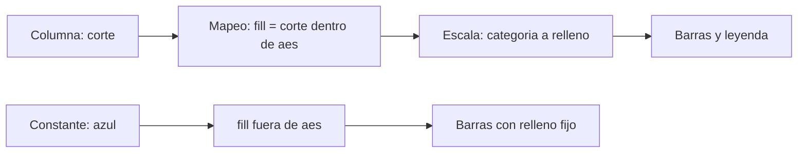
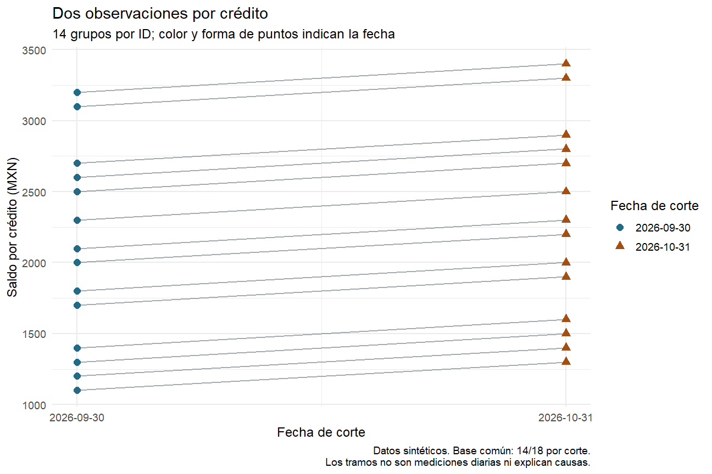

# 08.03 — Mapear y fijar estéticas

[Inicio](../../../README.md) / [Módulo 08](../README.md) / **Lección 08.03**

| Tu sesión | Qué prepararás o comprobarás |
| --- | --- |
| **Meta** | Separar propiedades constantes de mapeos y grupos de dibujo |
| **Necesitas** | 08.01–08.02 y sus labs; mismo proyecto de práctica |
| **Evidencia** | Mapeos y leyendas justificados con una trayectoria por ID |

[Preparación](#antes-de-empezar) · [Material de apoyo](#material-de-apoyo) · [Lab 08.03](../../../labs/08_visualization_r/03_aesthetic_mapping/README.md) · [Comprobar](#evidencia-y-criterio-de-salida)

<a id="propósito-prerrequisitos-y-objetivos"></a>

## Propósito

**Esencial.** Decidir qué propiedades visuales representan datos y cuáles son
estilos constantes. En ggplot2, una estética es una propiedad de las marcas:
posición, color, relleno, forma o tamaño. No significa solamente «hacer bonito».
Una elección equivocada puede inventar categorías o unir créditos distintos.

## Antes de empezar

Completa [08.01](../01_question_grammar/README.md),
[08.02](../02_geometries_stats/README.md) y sus labs. Reutiliza el proyecto renv
de [07.10](../../07_tidyverse/10_first_plot_closure/README.md), sus funciones,
fuente y lockfile. Referencia: R 4.6.1/ggplot2 4.0.3. No añadimos dependencias.
Repasa [factores](../../07_tidyverse/08_text_categories_factors/README.md) y
[fechas y base común](../../07_tidyverse/09_dates_cutoffs/README.md) si hace falta.

Puedes dividir el trabajo en sesiones: barras y leyenda; puntos y propiedades;
después líneas, comprobación y lab. Las escalas se profundizan en 08.04; aquí
introducimos únicamente las necesarias para entender el mapeo.

## Qué vas a aprender

- Leer `aes(propiedad = columna)` y distinguirlo de una propiedad constante.
- Predecir cuándo aparece una leyenda y corregir una categoría accidental.
- Diferenciar `colour` de `fill`, `size` de `linewidth` y categorías de cantidades.
- Aplicar mapeos locales y explicar qué hereda cada capa.
- Separar la identidad de una línea de su color: una trayectoria por crédito.
- Comprobar posiciones, grupos y población, además de inspeccionar el dibujo.

## Material de apoyo

| Recurso | Para qué sirve | Uso |
| --- | --- | --- |
| [Script de estéticas](explorar_esteticas.R) | Contrastar mapeos, constantes, herencia y agrupación | Para el recorrido |
| [Base y reglas compartidas](../../07_tidyverse/10_first_plot_closure/README.md) | Ubicar el proyecto, la fuente y las funciones de reconstrucción | Para el recorrido |
| [Trayectorias](assets/trayectorias.png) | Revisar identidad de las líneas y señal por fecha | Consulta visual |

Consulta las fuentes aquí y trabaja con el script propio dentro del proyecto
de práctica, manteniendo su raíz como directorio. Las imágenes de referencia
acompañan la lectura; contrasta también tablas y comprobaciones numéricas.

## 1. Una decisión antes de escribir `aes()`

Pregunta: **¿qué dato explica que dos marcas se vean diferentes?** Si el color
indica la fecha, la fecha debe estar vinculada al color. Si todas las barras
deben tener el mismo relleno por presentación, ese relleno se fija en la capa.

| Intención | Instrucción en la geometría | Lectura |
| --- | --- | --- |
| Todas las barras azules | `geom_col(fill = "#246A86")` | Relleno constante |
| Un relleno por fecha | `geom_col(aes(fill = corte))` | La columna determina la categoría |
| Puntos del mismo tamaño | `geom_point(size = 3)` | Tamaño constante |
| Tamaño según saldo | `geom_point(aes(size = saldo_mxn))` | La cantidad pasa por una escala |
| Una línea por crédito | `geom_line(aes(group = id_credito))` | El ID decide qué filas se conectan |

Dentro de `aes`, el lado izquierdo nombra una estética de ggplot2 y el derecho
una columna o expresión evaluada en los datos de la capa. Escribe las columnas
sin comillas ni `tabla$`. Fuera de `aes`, los argumentos de la geometría fijan
propiedades o parámetros, según corresponda. `data`, `width`, `na.rm` y
`show.legend`, por ejemplo, no son nombres de columnas que debamos mapear.

La regla inicial «variables dentro, constantes fuera» es una guía de intención,
no una prohibición del lenguaje: `aes(fill = "red")` es válido, pero significa
algo diferente de `fill = "red"`. Lo comprobaremos.
[Referencia de aes](https://ggplot2.tidyverse.org/reference/aes.html).



Sin renderizador: la columna pasa por un mapeo y una escala; una guía puede
explicar la correspondencia. Una propiedad fijada se aplica a las marcas de esa
capa. La leyenda no es una tabla nueva ni una validación de los datos.

## 2. Reconstruir la base antes de cambiar su apariencia

Abre el mismo proyecto de 07.10 en RStudio o tu IDE y mantén su raíz como
directorio. Crea `output/mi_esteticas.R`, eligiendo otro nombre si ya existe.
Ejecuta bloques en **Console de R**, no en Terminal. Si falta la práctica,
vuelve a [la preparación de 07.10](../../07_tidyverse/10_first_plot_closure/README.md#2-preparar-una-sola-vez-y-restaurar-desde-r).

```r
source(".Rprofile")
stopifnot(isTRUE(renv::status()$synchronized))
source("R/funciones_calidad.R", encoding = "UTF-8")
source("R/funciones_texto.R", encoding = "UTF-8")
source("R/funciones_fechas.R", encoding = "UTF-8")
source("R/funciones_cierre.R", encoding = "UTF-8")
ruta <- "datos/cartera_texto.csv"
huella <- tools::md5sum(ruta)
fuente <- leer_texto_segmentos(ruta)
cierre <- construir_cierre(fuente)
comprobar_cierre(fuente, cierre)
resumen <- cierre$datos_figura |> dplyr::mutate(
  corte = factor(format(fecha_corte, "%Y-%m-%d"),
                 levels = c("2026-09-30", "2026-10-31"))
)
pares <- cierre$comunes
detalle <- dplyr::bind_rows(
  pares |> dplyr::select(id_credito, saldo_mxn = saldo_sep) |>
    dplyr::mutate(fecha_corte = as.Date("2026-09-30")),
  pares |> dplyr::select(id_credito, saldo_mxn = saldo_oct) |>
    dplyr::mutate(fecha_corte = as.Date("2026-10-31"))
) |> dplyr::mutate(
  corte = factor(format(fecha_corte, "%Y-%m-%d"), levels = levels(resumen$corte))
)
control <- detalle |> dplyr::group_by(fecha_corte) |>
  dplyr::summarise(creditos = dplyr::n(),
    saldo_mxn = sum(as.double(saldo_mxn)), .groups = "drop")
stopifnot(identical(cierre$resultado$controles$registros, c(48L, 36L, 12L)),
          nrow(pares) == 14L, nrow(detalle) == 28L,
          nrow(cierre$sin_pareja) == 8L,
          !anyNA(detalle), anyDuplicated(detalle[c("id_credito", "fecha_corte")]) == 0L,
          identical(control$creditos, c(14L, 14L)),
          identical(control$saldo_mxn, c(29000, 31800)))
print(control)
```

Reconstruimos desde el CSV sin depender del workspace anterior. Las advertencias
por fechas imposibles proceden de la validación estudiada: revisa los rechazos,
no cambies la fuente para silenciarlas. Conservamos 48 entradas, 36 aceptados y
12 rechazados; de los aceptados hay 14 IDs comunes y cuatro sin pareja por corte.

`resumen` tiene dos filas con las sumas 29000/31800 MXN. `pares` tiene 14 filas,
una por crédito. `detalle` tiene 28 filas, una por crédito y corte. Todas las
figuras principales usan esa misma base común: cubre 14/18 aceptados por fecha.
No se suman los dos cortes para afirmar un saldo en una fecha única.

## 3. Relleno fijo frente a relleno que representa la fecha

Primero fijamos el relleno. `colour` controla el borde de las barras; `fill`, su
interior. El código hexadecimal `#246A86` especifica un color en R. `color` es
sinónimo de `colour`; usaremos el segundo de forma consistente.

```r
base_barras <- ggplot2::ggplot(resumen, ggplot2::aes(corte, saldo_mxn))
fijas <- base_barras +
  ggplot2::geom_col(fill = "#246A86", colour = "#183C4A", width = 0.6) +
  ggplot2::labs(title = "Saldo de los mismos 14 créditos",
    subtitle = "Relleno constante; la fecha se lee en el eje",
    x = "Fecha de corte", y = "Saldo observado (MXN)") +
  ggplot2::theme_minimal(base_size = 12)
print(fijas)
```

Predicción: dos barras del mismo relleno, alturas 29000/31800 y ninguna leyenda
de relleno. Ahora vinculamos una columna a esa propiedad:

```r
mapeadas <- base_barras +
  ggplot2::geom_col(ggplot2::aes(fill = corte), width = 0.6) +
  ggplot2::labs(title = "Saldo de los mismos 14 créditos",
    subtitle = "El relleno representa la fecha, además del eje",
    x = "Fecha de corte", y = "Saldo observado (MXN)", fill = "Fecha de corte") +
  ggplot2::theme_minimal(base_size = 12)
print(mapeadas)
```

Los niveles del factor se traducen a rellenos mediante una escala discreta
predeterminada. No son nombres de colores: `"2026-09-30"` no es una pintura.
La leyenda permite interpretar la correspondencia. `labs(fill = ...)` cambia
su título, no los saldos ni los colores. Aquí el color repite información del
eje; no siempre necesitamos esa redundancia. No añadimos una variable nueva a
la fuente ni cambiamos qué representa cada barra.
[Colour y fill](https://ggplot2.tidyverse.org/reference/aes_colour_fill_alpha.html).

### Una escala manual conserva el mapeo

Si queremos elegir los colores de cada fecha, mantenemos `aes(fill = corte)` y
especificamos la correspondencia. Introducimos este caso pequeño antes del
estudio completo de escalas de [08.04](../04_scales_coordinates/README.md):

```r
paleta <- c("2026-09-30" = "#246A86", "2026-10-31" = "#A34E12")
manual <- mapeadas + ggplot2::scale_fill_manual(values = paleta) +
  ggplot2::theme(legend.position = "bottom")
print(manual)
```

`paleta` es un vector con nombres: cada nombre debe coincidir exactamente con
una categoría de `corte`. La escala busca por esos nombres, no por el orden de
las filas. El mapeo sigue representando fechas y conserva una leyenda; no se
convierte en propiedad fija. Una categoría sin correspondencia puede recibir
el valor para ausencias de la escala; un color gris no demuestra por sí solo
un saldo ausente. Revisa categorías y paleta.
[Escalas manuales](https://ggplot2.tidyverse.org/reference/scale_manual.html).

`theme(legend.position = "bottom")` coloca la leyenda abajo para darle espacio;
no cambia su correspondencia. Es el mismo tipo de ajuste de presentación que
introdujimos en 08.01. Ajusta el tamaño del panel Plots si el IDE corta textos.

## 4. Por qué aparece una leyenda «red»

Antes de ejecutar, predice la diferencia:

```r
accidental <- base_barras + ggplot2::geom_col(ggplot2::aes(fill = "red"))
rojas <- base_barras + ggplot2::geom_col(fill = "red")
print(accidental)
print(rojas)
```

En `accidental`, la cadena literal `"red"` actúa como una categoría constante
para todas las filas y pasa por la escala discreta. Normalmente aparece una
leyenda con esa etiqueta; el relleno resultante no tiene por qué ser rojo.
En `rojas`, R interpreta `"red"` como el color fijo y no crea una leyenda de
relleno. Las alturas son idénticas en ambos casos.

También son cosas distintas `aes(fill = corte)` y `aes(fill = "corte")`: la
primera usa los valores de la columna; la segunda inventa una única categoría
literal llamada «corte». Por otro lado, `fill = corte` fuera de `aes` intentaría
evaluar un objeto de R y suministrar colores directamente; no es una forma de
mapear una columna.

Ocultar la leyenda con `show.legend = FALSE` no cambia un mapeo accidental.
Corrige primero la intención. Una constante dentro de `aes` puede utilizarse
deliberadamente para identificar series en otras figuras, pero debe tener un
significado explícito; no es la solución para pintar todas las marcas de rojo.

**Pausa:** explica por qué cambiar el título de la leyenda a «azul» tampoco
garantiza que las barras sean azules.

## 5. Cada geometría utiliza propiedades diferentes

En un punto sólido habitual, `colour` controla el color visible. Para distinguir
borde e interior necesitamos una forma que admita ambos, como `shape = 21`.
No es un nivel de datos: aquí 21 es el código de una forma de punto en ggplot2.

```r
puntos <- ggplot2::ggplot(detalle, ggplot2::aes(corte, saldo_mxn)) +
  ggplot2::geom_point(ggplot2::aes(fill = corte), shape = 21,
    colour = "#183C4A", size = 3, stroke = 0.7) +
  ggplot2::scale_fill_manual(values = paleta) +
  ggplot2::labs(title = "Saldo por crédito y fecha",
    subtitle = "28 observaciones de 14 IDs; puntos coincidentes pueden superponerse",
    x = "Fecha de corte", y = "Saldo por crédito (MXN)", fill = "Fecha de corte") +
  ggplot2::theme_minimal(base_size = 12)
print(puntos)
```

`stroke` fija el grosor del borde del punto; `size`, su tamaño. Elegir una forma
que no use `fill`, como la sólida predeterminada 19, puede hacer que no se vea
el relleno solicitado. Una leyenda visible tampoco garantiza que cada marca
muestre la diferencia buscada. Los 28 registros pueden producir menos de 28
posiciones visibles si hay empates: no borres duplicados de saldo para separarlos.
[Puntos](https://ggplot2.tidyverse.org/reference/geom_point.html).

### Categoría, cantidad y tamaño no son intercambiables

```r
doble_senal <- ggplot2::ggplot(detalle, ggplot2::aes(corte, saldo_mxn)) +
  ggplot2::geom_point(ggplot2::aes(colour = corte, shape = corte), size = 3) +
  ggplot2::labs(colour = "Fecha de corte", shape = "Fecha de corte",
    x = "Fecha de corte", y = "Saldo por crédito (MXN)")
tamano <- ggplot2::ggplot(pares, ggplot2::aes(saldo_sep, saldo_oct)) +
  ggplot2::geom_point(ggplot2::aes(size = saldo_sep), colour = "#246A86") +
  ggplot2::labs(size = "Saldo septiembre (MXN)",
    x = "Saldo septiembre (MXN)", y = "Saldo octubre (MXN)")
print(doble_senal)
print(tamano)
```

En `doble_senal`, fecha es una categoría ordenada para presentación, sin afirmar
que las formas tengan magnitud. Color y forma comunican la misma variable; sus
guías compatibles pueden combinarse. En `tamano`, una cantidad continua pasa por
la escala de tamaño: **1100 MXN no se dibujan como un punto de 1100 mm**. La
escala predeterminada relaciona el área con el valor; no supongas que duplicar
saldo duplica el diámetro. En este ejemplo el tamaño repite el eje x; sirve
para entender la mecánica, no añade información independiente.

No mapees un saldo numérico directamente a `shape`: la escala habitual de formas
es discreta y esa petición produce error. Convertir cada saldo a factor solo
para evitarlo puede producir demasiados símbolos y ocultar su magnitud.
Para muchas categorías tampoco basta asignar una forma distinta a cada una.
Escoge propiedades que permitan leer la pregunta.
[Formas y grosores](https://ggplot2.tidyverse.org/reference/aes_linetype_size_shape.html),
[escala de tamaño](https://ggplot2.tidyverse.org/reference/scale_size.html).

| Propiedad | Uso inicial | Precaución |
| --- | --- | --- |
| `colour` | Color de puntos/líneas y bordes | No equivale al interior de todas las marcas |
| `fill` | Interior de barras y formas 21–25 | No todas las formas de punto lo usan |
| `shape` | Categorías en puntos | No expresa cantidades continuas |
| `size` | Tamaño de puntos/texto | Un valor mapeado pasa por una escala |
| `linewidth` | Grosor de líneas | Usarlo para líneas en la versión del curso |
| `linetype` | Tipo de trazo, como `"dashed"` | La categoría representada debe ser comprensible |
| `alpha` | Opacidad: 0 transparente, 1 opaco | La superposición cambia la apariencia; no es frecuencia calculada |
| `group` | Qué observaciones pertenecen al mismo trazo | No dibuja por sí mismo un color ni una leyenda |

## 6. La identidad de una línea requiere una decisión explícita

Ahora la pregunta es: **¿qué dos observaciones pertenecen al mismo crédito?**
Para ver la respuesta sin una leyenda de 14 colores usamos un trazo constante y
agrupamos por ID. `geom_line` ordena por x dentro de cada grupo. Las fechas son
Date y las claves ID/corte ya se comprobaron; ordenar filas por saldo no define
la trayectoria. `geom_path`, en cambio, sigue el orden de las filas.

```r
trayectorias <- ggplot2::ggplot(detalle,
    ggplot2::aes(fecha_corte, saldo_mxn)) +
  ggplot2::geom_line(ggplot2::aes(group = id_credito),
    colour = "#68747A", linewidth = 0.6, alpha = 0.6) +
  ggplot2::geom_point(ggplot2::aes(colour = corte, shape = corte), size = 2.8) +
  ggplot2::scale_colour_manual(values = paleta) +
  ggplot2::scale_x_date(breaks = resumen$fecha_corte, date_labels = "%Y-%m-%d") +
  ggplot2::labs(title = "Dos observaciones por crédito",
    subtitle = "14 grupos por ID; color y forma de puntos indican la fecha",
    x = "Fecha de corte", y = "Saldo por crédito (MXN)",
    colour = "Fecha de corte", shape = "Fecha de corte",
    caption = "Datos sintéticos. Base común: 14/18 por corte.\nLos tramos no son mediciones diarias ni explican causas.") +
  ggplot2::theme_minimal(base_size = 12)
print(trayectorias)
```

Hay 14 grupos de dos filas en la capa de líneas; algunas trayectorias pueden
coincidir visualmente por saldos iguales. No prometemos 14 trazos distinguibles.
Cada grupo debe contener un solo ID y las dos fechas. Todos estos pares
sintéticos aumentan 200 MXN; eso no demuestra una causa ni una tendencia futura.

`group = id_credito` es local a la línea. `colour = corte` y `shape = corte` son
locales a los puntos; los puntos no necesitan conectarse. X/y se heredan del
gráfico. Esta separación impide que un mapeo pensado para puntos divida las
líneas por fecha. No necesitas dar un color distinto a cada ID para conectarlo.
[Agrupación](https://ggplot2.tidyverse.org/reference/aes_group_order.html),
[líneas y orden](https://ggplot2.tidyverse.org/reference/geom_path.html).



Sin imagen: dos columnas de puntos por fecha; cada línea gris conecta los dos
saldos del mismo ID. Los colores y formas de los puntos identifican septiembre
y octubre. Las coincidencias no se eliminan; la nota aclara población y límites.

### Tres agrupaciones incorrectas que pueden parecer razonables

- **Sin ID ni otra estética discreta:** una única línea puede unir los 28
  registros, incluso entre créditos diferentes. Un dibujo sin advertencias
  puede estar respondiendo una pregunta equivocada.
- **`group = 1` sobre el detalle:** obliga a conectar todos los registros en una
  serie. Era válido en 08.02 sobre las dos sumas de una serie; no es la regla
  para 14 series individuales. Depende de la unidad de la tabla.
- **Color global por corte sin grupo explícito:** ggplot2 infiere grupos a partir
  de la interacción de estéticas discretas. Puede reunir 14 créditos de la
  misma fecha y conectarlos verticalmente, en lugar de unir cada ID entre fechas.
  Si además x es discreta, el agrupamiento implícito puede dejar puntos aislados.

No basta cambiar el orden de las filas ni usar `dplyr::group_by` antes del
gráfico: la agrupación gráfica debe expresarse o verificarse mediante sus
estéticas. Una clave numérica sigue pudiendo identificar grupos con
`aes(group = id)`; no necesitas convertir una cantidad continua en categoría
para que actúe como identificador explícito. ID y magnitud son roles distintos.

## 7. Comprobar marcas, grupos e invariantes

Inspeccionamos con `layer_data`, como en 08.02. Sus columnas son los valores
preparados para dibujar; los grupos aparecen codificados con números internos,
no con los IDs originales. Aquí podemos comparar sus pares de posiciones con
los pares originales porque cada grupo contiene exactamente dos fechas.

```r
capa_fija <- ggplot2::layer_data(fijas, 1)
capa_manual <- ggplot2::layer_data(manual, 1)
lineas <- ggplot2::layer_data(trayectorias, 1)
grupos <- split(lineas, lineas$group)
firma <- function(x, y) paste(x, y, sep = "/")
pares_dibujados <- vapply(grupos, function(g) {
  g <- g[order(g$x), ]
  stopifnot(nrow(g) == 2L,
            identical(g$x, as.numeric(resumen$fecha_corte)))
  firma(g$y[1], g$y[2])
}, character(1))
stopifnot(identical(capa_fija$y, c(29000, 31800)),
          identical(capa_manual$y, capa_fija$y),
          all(capa_fija$fill == "#246A86"),
          identical(capa_manual$fill, unname(paleta[as.character(resumen$corte)])),
          length(grupos) == 14L,
          identical(sort(unname(pares_dibujados)),
                    sort(firma(pares$saldo_sep, pares$saldo_oct))),
          nrow(ggplot2::layer_data(trayectorias, 2)) == 28L,
          identical(huella, tools::md5sum(ruta)))
print(table(lineas$group))
```

`split` separa la tabla por grupo; `vapply` devuelve una cadena por grupo del
tipo `1100/1300`. La función `firma` es solo una ayuda de comparación para estos
saldos enteros. Ordenamos las cadenas y conservamos repeticiones para comparar
el conjunto de pares con multiplicidad. Esto detecta conexiones equivocadas
que podrían conservar sumas y cantidades. La tabla original y el mapeo por ID
siguen siendo necesarios: dos créditos con saldos idénticos no se distinguen
solo por sus coordenadas. Los números internos de grupo pueden cambiar al
reordenar datos; no los interpretes como identificadores del negocio.

Como revisión visual, confirma que la leyenda describa las fechas, que la línea
no use una leyenda de 14 IDs, que las marcas se vean y que no se corten textos.
Una huella intacta prueba que esta ejecución no modificó el CSV; no certifica
por sí sola la validez de sus registros. Las reglas reconstruidas hacen esa
comprobación. Ninguna inspección visual sustituye las claves y los controles.

## 8. Errores habituales y decisiones de alcance

| Síntoma | Qué revisar |
| --- | --- |
| Leyenda con «red» o «corte» como única categoría | Cadena literal dentro de `aes`; distinguirla de columna o estilo fijo |
| Cambiar `fill` no cambia los puntos | Forma utilizada; empezar con `shape = 21` si necesitas borde e interior |
| Error al mapear saldo a forma | Tipo continuo frente a escala discreta; no convertir a factor sin propósito |
| Líneas verticales o entre créditos | Mapeos globales, grupos inferidos y clave ID/corte |
| Una leyenda enorme de IDs | Separar identidad del trazo y color informativo de puntos |
| Una tabla nueva falla al heredar | Revisar que incluya todas las columnas de los mapeos heredados; `inherit.aes = FALSE` requiere declarar los propios |
| Colores inesperados al cambiar datos | Categorías, niveles y nombres de la paleta; no asumir correspondencia por posición |
| Menos puntos visibles que filas | Posiciones repetidas, opacidad y superposición; no eliminar datos para arreglar apariencia |

No enseñamos a ocultar un error de agrupación mediante una leyenda más bonita.
Primero tabla y conexiones; después presentación. Escalas completas y límites
pertenecen a [08.04](../04_scales_coordinates/README.md), facetas a 08.05 y accesibilidad/temas a 08.06; sus alcances
siguen en el [índice](../README.md). No es requisito usar simultáneamente todas
las estéticas, representar 14 IDs con 14 colores ni exportar otra entrega.

<a id="práctica-criterio-de-salida-y-siguiente-paso"></a>

## Práctica

Realiza el [lab 08.03](../../../labs/08_visualization_r/03_aesthetic_mapping/README.md).
El [script de referencia](explorar_esteticas.R) reúne los bloques esenciales;
sirve para contrastar tu trabajo. Guarda tu script, reinicia R con Session >
Restart R y ejecuta en Console desde la raíz del proyecto:

```r
source("output/mi_esteticas.R", encoding = "UTF-8")
```

## Evidencia y criterio de salida

| Conserva | Comprueba | Explica |
| --- | --- | --- |
| Script con variantes de mapeo y constantes | Leyendas, propiedades y herencia de cada capa | Categoría accidental frente a estilo constante |
| Trayectorias y comprobaciones | 14 pares, 28 observaciones y 29000/31800 MXN conservados | Una línea por crédito; color y forma por fecha frente a identidad del grupo |

Puedes avanzar cuando anticipes mapeos y leyendas, corrijas una constante mal
ubicada, justifiques propiedades según la geometría y compruebes una línea por
ID sin alterar población ni saldos.

Quien aprende realiza la práctica y explica las decisiones; su compañero revisa.
Tu compañero pide explicar por qué mapear el color a la fecha no identifica la trayectoria de cada crédito.
Guarda evidencia, ayudas y dudas en una nota personal junto a tu práctica.
PROGRESS.md registra desarrollo editorial, no tu expediente de aprendizaje.
El proyecto integrador y sus checkpoints siguen pendientes; disponer de
lecciones y scripts no acredita haber completado el aprendizaje.

<a id="referencias-y-atribución"></a>

## Referencias

Ejemplos y datos sintéticos propios de DS Track. Consulta: 2026-10-20.
Referencias de API oficiales de ggplot2 4.0.3 enlazadas junto a cada concepto:
`aes`, agrupación, colores/relleno, formas/grosores, puntos, líneas, escalas
manuales y tamaño. No se copian ejemplos de libros.

Como lectura de apoyo: Hadley Wickham, Mine Çetinkaya-Rundel y Garrett Grolemund,
[R for Data Science, segunda edición: Data visualization](https://r4ds.hadley.nz/data-visualize.html).
La [guía de lecturas R](../../../docs/r-reading-guide.md) distingue ese recorrido
del libro ggplot2 de Hadley Wickham, Danielle Navarro y Thomas Lin Pedersen,
cuya tercera edición en línea continúa en desarrollo.

## Siguiente paso

Después de la práctica y su comprobación, continúa con
[08.04 — Escalas y coordenadas](../04_scales_coordinates/README.md).

[← Módulo 08](../README.md) · [Lab 08.03](../../../labs/08_visualization_r/03_aesthetic_mapping/README.md) · [Siguiente →](../04_scales_coordinates/README.md)
