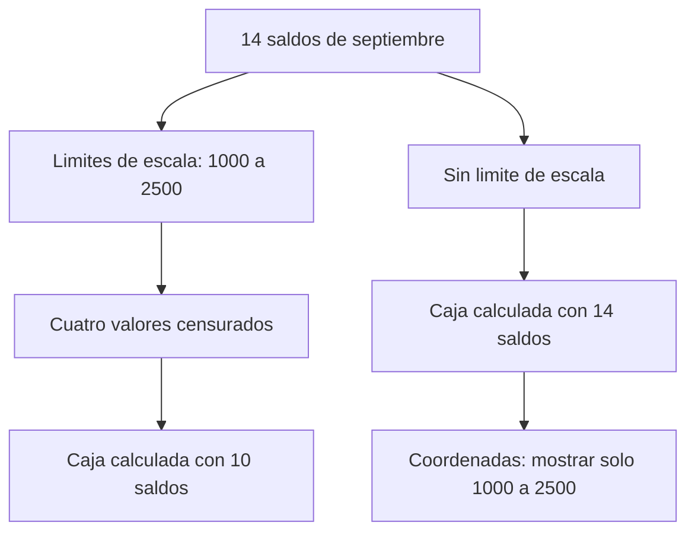
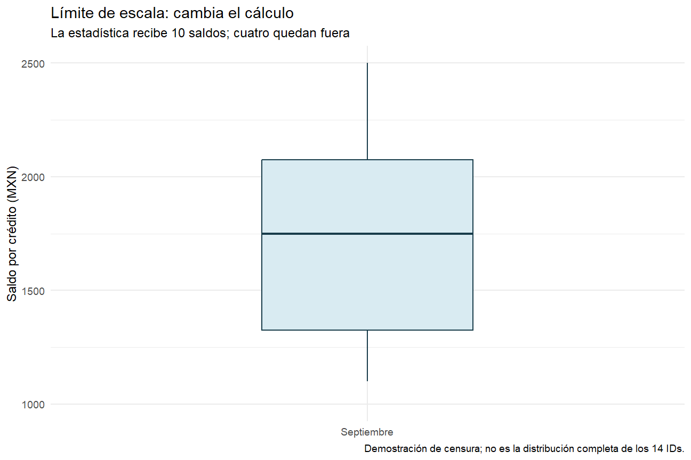
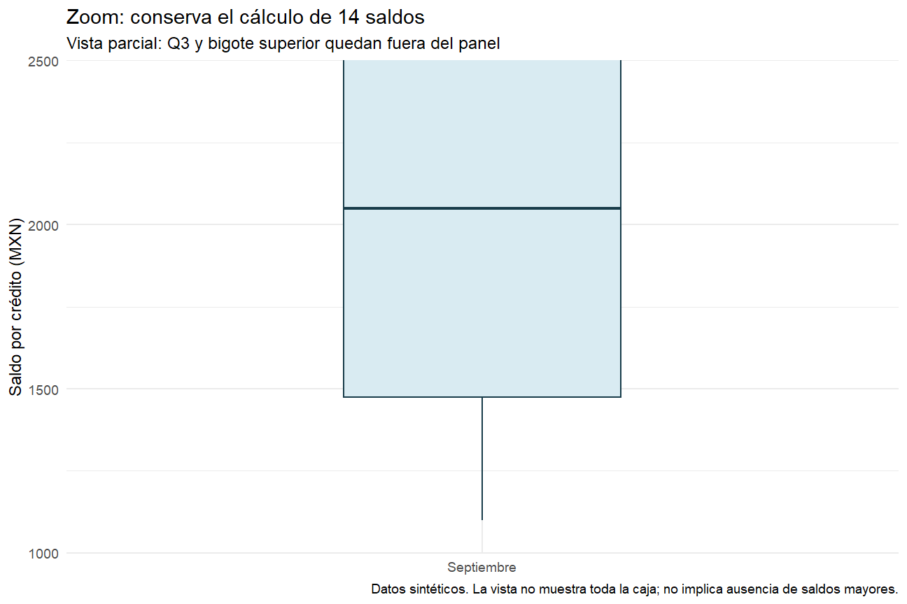
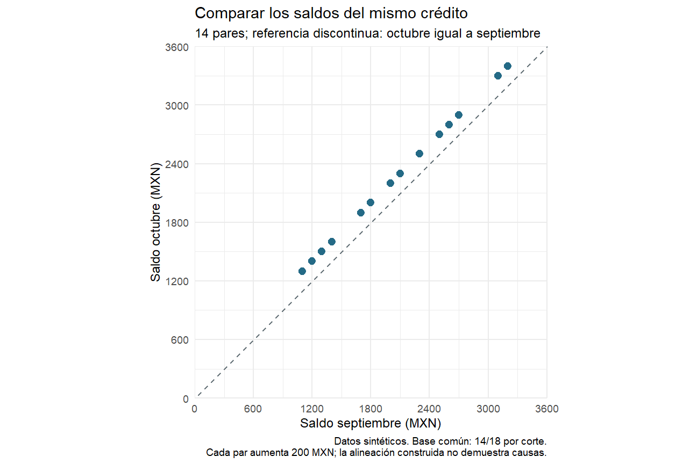

# 08.04 — Escalas y coordenadas

[Inicio](../../../README.md) / [Módulo 08](../README.md) / **Lección 08.04**

| Tu sesión | Qué prepararás o comprobarás |
| --- | --- |
| **Meta** | Justificar escalas, unidades y ventana sin confundir sus efectos |
| **Necesitas** | 08.02–08.03 y sus labs; mismo proyecto sin paquetes nuevos |
| **Evidencia** | Comparación de límites y zoom con estadísticas y unidades comprobadas |

[Preparación](#antes-de-empezar) · [Material de apoyo](#material-de-apoyo) · [Lab 08.04](../../../labs/08_visualization_r/04_scales_coordinates/README.md) · [Comprobar](#evidencia-y-criterio-de-salida)

<a id="propósito-prerrequisitos-y-objetivos"></a>

## Propósito

**Esencial.** Justificar cómo se traducen los datos a posiciones y qué parte de
la figura se muestra. Una escala puede cambiar las posiciones, las etiquetas e
incluso los datos disponibles para una estadística; acercar la vista con
coordenadas tiene otro efecto. No basta conseguir que «el eje se vea bien».

## Antes de empezar

Completa [08.02 — Geometrías y estadísticas](../02_geometries_stats/README.md),
[08.03 — Mapear y fijar estéticas](../03_aesthetic_mapping/README.md) y sus labs.
Reutiliza el proyecto renv de [07.10](../../07_tidyverse/10_first_plot_closure/README.md),
su fuente, funciones y lockfile. Referencia comprobada: R 4.6.1/ggplot2 4.0.3.
No añadimos paquetes ni necesitamos restaurar una biblioteca ya sincronizada.

Puedes estudiar por partes: vocabulario/unidades; después límites/cajas; al
final fechas, transformación y lab. No necesitas memorizar todas las funciones.

## Qué vas a aprender

- Elegir escalas continuas, discretas o temporales según el significado del dato.
- Distinguir título, marcas, etiquetas, límites y margen del eje.
- Expresar miles de MXN sin confundir formato, unidad y transformación.
- Demostrar cómo limitar una escala puede cambiar una caja y cómo conservarla
  al acercar la vista con `coord_cartesian`.
- Explicar una escala logarítmica y sus restricciones con cero y negativos.
- Justificar origen cero para barras y proporción de unidades en una dispersión.

## Material de apoyo

| Recurso | Para qué sirve | Uso |
| --- | --- | --- |
| [Script de escalas](explorar_escalas.R) | Comparar límites, zoom, transformaciones y proporción | Para el recorrido |
| [Base y reglas compartidas](../../07_tidyverse/10_first_plot_closure/README.md) | Ubicar el proyecto, la fuente y las funciones de reconstrucción | Para el recorrido |
| [Caja con límite](assets/caja_limite.png) | Leer la estadística tras apartar datos por escala | Consulta visual |
| [Caja con zoom](assets/caja_zoom.png) | Contrastar la ventana con la estadística conservada | Consulta visual |
| [Dispersión](assets/comparacion.png) | Examinar unidades iguales y referencia de igualdad | Consulta visual |

Consulta las fuentes aquí y trabaja con el script propio dentro del proyecto
de práctica, manteniendo su raíz como directorio. Las imágenes de referencia
acompañan la lectura; contrasta también tablas y comprobaciones numéricas.

## 1. Qué controla cada componente

En [08.03](../03_aesthetic_mapping/README.md), `aes` vinculaba una columna a una
propiedad visual. La **escala** establece cómo se representa esa propiedad:
posiciones o colores, y su guía de lectura. El **sistema de coordenadas** organiza
el espacio donde se dibujan las marcas. Aquí trabajaremos con ejes cartesianos.

| Decisión | Ejemplo | Efecto que debemos revisar |
| --- | --- | --- |
| Título (`name` o `labs`) | «Saldo observado (MXN)» | Describe la medida; no convierte sus valores |
| Marcas (`breaks`) | 0, 10000, 20000, 30000 | Decide dónde se rotula el eje; no crea observaciones |
| Etiquetas (`labels`) | Mostrar 10000 como «10» | Cambia el texto; exige indicar miles de MXN |
| Límites de escala (`limits`) | Admitir de 1000 a 2500 | Con la política predeterminada, censura valores exteriores |
| Expansión (`expand`) | Espacio para que una marca no toque el borde | Añade margen de presentación |
| Transformación (`transform`) | Logaritmo base 10 | Cambia la relación entre valor y distancia |
| Vista (`coord_cartesian`) | Mostrar de 1000 a 2500 | Recorta el dibujo conservando los datos para el cálculo |

Una escala continua trata magnitudes numéricas; una discreta, categorías. Date
tiene una escala temporal con distancias en días. Que una fecha esté escrita
con dígitos no la convierte en cantidad ordinaria, ni un ID numérico implica
una magnitud. Elige por significado y tipo, no solo por apariencia.
[Escalas continuas](https://ggplot2.tidyverse.org/reference/scale_continuous.html).

## 2. Reconstruir la misma población

Abre el proyecto de 07.10 en RStudio o tu IDE; mantén su raíz como directorio.
Crea `output/mi_escalas.R`, usando otro nombre si existe trabajo previo. Ejecuta
en **Console de R**, no en Terminal. Si falta el proyecto, vuelve a
[la preparación de 07.10](../../07_tidyverse/10_first_plot_closure/README.md#2-preparar-una-sola-vez-y-restaurar-desde-r).

```r
source(".Rprofile")
stopifnot(isTRUE(renv::status()$synchronized))
source("R/funciones_calidad.R", encoding = "UTF-8")
source("R/funciones_texto.R", encoding = "UTF-8")
source("R/funciones_fechas.R", encoding = "UTF-8")
source("R/funciones_cierre.R", encoding = "UTF-8")
ruta <- "datos/cartera_texto.csv"
huella <- tools::md5sum(ruta)
fuente <- leer_texto_segmentos(ruta)
cierre <- construir_cierre(fuente)
comprobar_cierre(fuente, cierre)
resumen <- cierre$datos_figura |> dplyr::mutate(
  corte = factor(format(fecha_corte, "%Y-%m-%d"),
                 levels = c("2026-09-30", "2026-10-31"))
)
pares <- cierre$comunes
septiembre <- pares |> dplyr::select(id_credito, saldo_mxn = saldo_sep)
stopifnot(identical(cierre$resultado$controles$registros, c(48L, 36L, 12L)),
          nrow(pares) == 14L, nrow(cierre$sin_pareja) == 8L,
          identical(resumen$saldo_mxn, c(29000, 31800)),
          sum(as.double(pares$saldo_sep)) == 29000,
          sum(as.double(pares$saldo_oct)) == 31800,
          !anyNA(septiembre))
print(resumen)
```

Se conservan 48 entradas, 36 aceptados y 12 rechazados con sus motivos. Los
14 IDs comunes cubren 14/18 aceptados por corte; otros cuatro por fecha siguen
sin pareja. Las advertencias de fechas imposibles corresponden a la validación
ya estudiada: inspecciona los rechazos, no alteres la fuente para silenciarlas.

Usaremos las dos sumas para barras, los 14 pares para dispersión y los 14 saldos
de septiembre para cajas. El zoom de una caja no cambia por sí solo esa
población; un límite de escala sí puede cambiar los valores que recibe su estadística.

## 3. Un eje legible: marcas, etiquetas, límites y margen

```r
formato_mxn <- function(x) {
  format(x, big.mark = " ", scientific = FALSE, trim = TRUE)
}
base_barras <- ggplot2::ggplot(resumen, ggplot2::aes(corte, saldo_mxn)) +
  ggplot2::geom_col(fill = "#246A86", width = 0.6) +
  ggplot2::labs(title = "Saldo de los mismos 14 créditos",
    x = "Fecha de corte", y = "Saldo observado (MXN)",
    caption = "Datos sintéticos. Base común: 14/18 aceptados por corte.") +
  ggplot2::theme_minimal(base_size = 12)
barras <- base_barras + ggplot2::scale_y_continuous(
  limits = c(0, NA), breaks = seq(0, 40000, by = 10000),
  labels = formato_mxn, expand = ggplot2::expansion(mult = c(0, 0.08))
)
print(barras)
```

`limits = c(0, NA)` fija cero abajo y calcula automáticamente el límite superior.
Ese `NA` es una instrucción del argumento, no un saldo faltante. Las barras
codifican magnitud mediante longitud desde cero; cortar su origen exageraría
la diferencia. Para comparar valores cercanos mediante posiciones puedes
elegir puntos y declarar el rango, sin presentar barras truncadas como longitudes completas.

`breaks` pide marcas cada 10000; una marca fuera del rango efectivo no aparece.
No extiende por sí sola el eje hasta 40000. Tampoco añade filas ni decide los
intervalos de un histograma: los `breaks` de `geom_histogram` definen intervalos
estadísticos, mientras que los de una escala rotulan posiciones del eje.

`labels` recibe la función de formato, sin llamarla: ggplot2 le pasa las marcas
que necesita rotular. Los valores siguen siendo 29000/31800. `expansion` deja
0% de margen abajo y 8% arriba del rango usado para la presentación. Margen,
límite y nueva observación son tres cosas distintas.
[Expansión](https://ggplot2.tidyverse.org/reference/expansion.html).

### Miles de MXN: dos caminos que requieren etiquetas coherentes

```r
etiquetas_miles <- base_barras + ggplot2::scale_y_continuous(
  limits = c(0, NA), breaks = c(0, 10000, 20000, 30000),
  labels = function(x) formato_mxn(x / 1000)
) + ggplot2::labs(y = "Saldo observado (miles de MXN)")
tabla_miles <- resumen |> dplyr::mutate(saldo_miles_mxn = saldo_mxn / 1000)
valores_miles <- ggplot2::ggplot(tabla_miles,
    ggplot2::aes(corte, saldo_miles_mxn)) +
  ggplot2::geom_col(fill = "#246A86", width = 0.6) +
  ggplot2::labs(x = "Fecha de corte", y = "Saldo observado (miles de MXN)")
print(etiquetas_miles)
print(valores_miles)
stopifnot(identical(ggplot2::layer_data(etiquetas_miles, 1)$y, c(29000, 31800)),
          identical(ggplot2::layer_data(valores_miles, 1)$y, c(29, 31.8)))
```

En el primer camino solo se divide el texto del eje; las posiciones de la capa
siguen en MXN. En el segundo se crea una columna en miles, conservando la
original. Ambos pueden comunicar la misma magnitud si están bien rotulados.
No dividas los valores y otra vez las etiquetas: mostrarías mil veces menos.
Cambiar solo `labs(y = "Porcentaje")` no convertiría un saldo en porcentaje.
Para porcentajes se necesita una razón y un denominador definidos.

## 4. Escala discreta: ordenar, rotular y conservar categorías

```r
barras_rotuladas <- barras + ggplot2::scale_x_discrete(
  breaks = levels(resumen$corte),
  labels = c("2026-09-30" = "Septiembre 2026", "2026-10-31" = "Octubre 2026")
)
print(barras_rotuladas)
```

Los niveles del factor determinan el orden; aquí no cambiamos filas ni fechas.
Las etiquetas nuevas son nombres de presentación, no nuevos valores de la
columna. Al usar nombres explícitos evitamos asignarlas a una fecha equivocada.
En una escala discreta, `limits` puede fijar categorías y orden; omitir una
categoría en esos límites puede excluir sus marcas. Para mostrar menos rótulos
sin excluir datos, revisa `breaks`, no uses límites como si fueran solo texto.

`drop = FALSE` puede conservar niveles existentes sin observaciones, pero no
crea registros ni demuestra que una categoría sin datos tenga saldo cero.
Los factores y categorías se estudiaron en
[07.08](../../07_tidyverse/08_text_categories_factors/README.md).
[Escalas discretas](https://ggplot2.tidyverse.org/reference/scale_discrete.html).

## 5. El experimento central: limitar una escala o acercar la vista

Tomaremos una caja de septiembre con la definición de [08.02](../02_geometries_stats/README.md):
cuartiles tipo 7 y bigotes 1.5 IQR. Su mediana es 2050; Q1 y Q3 son 1475/2575.
Ahora queremos inspeccionar de 1000 a 2500 MXN. Cuatro saldos superan 2500.

```r
base_caja <- ggplot2::ggplot(septiembre, ggplot2::aes(x = "Septiembre", y = saldo_mxn)) +
  ggplot2::geom_boxplot(quantile.type = 7, coef = 1.5, width = 0.4,
    fill = "#D9EBF2", colour = "#183C4A") +
  ggplot2::labs(x = NULL, y = "Saldo por crédito (MXN)") +
  ggplot2::theme_minimal(base_size = 12)
caja_completa <- base_caja + ggplot2::labs(title = "Caja de los 14 saldos de septiembre")
caja_limite <- base_caja +
  ggplot2::scale_y_continuous(limits = c(1000, 2500)) +
  ggplot2::labs(title = "Límite de escala: cambia el cálculo",
    subtitle = "La estadística recibe 10 saldos; cuatro quedan fuera",
    caption = "Demostración de censura; no es la distribución completa de los 14 IDs.")
caja_zoom <- base_caja +
  ggplot2::coord_cartesian(ylim = c(1000, 2500),
    expand = c(bottom = FALSE, top = FALSE)) +
  ggplot2::labs(title = "Zoom: conserva el cálculo de 14 saldos",
    subtitle = "Vista parcial: Q3 y bigote superior quedan fuera del panel",
    caption = "Datos sintéticos. La vista no muestra toda la caja; no implica ausencia de saldos mayores.")
print(caja_completa)
print(caja_limite)
print(caja_zoom)
```

En `caja_limite`, la política predeterminada de la escala convierte los valores
fuera de rango en ausentes para esa capa. La estadística de caja descarta esos
valores no finitos, avisa y calcula con diez saldos. No cambia el CSV ni
`septiembre`, pero **sí cambia el análisis representado**. `ylim(1000, 2500)`
es un atajo de límites de escala; no es un zoom inocuo.

En `caja_zoom`, el cálculo sigue utilizando catorce saldos y el panel recorta
el dibujo. Por eso parte de la caja puede quedar fuera del panel. No se
recalculan sus cuartiles usando solo lo visible. `expand = c(bottom = FALSE, top = FALSE)` quita el margen vertical para
mostrar exactamente esa ventana, conservando espacio horizontal alrededor de la caja. Se conserva el recorte normal
(`clip = "on"`): dibujar fuera del panel no es una solución para recuperar datos.
[Coordenadas cartesianas](https://ggplot2.tidyverse.org/reference/coord_cartesian.html).



Sin renderizador: el límite de escala actúa antes del cálculo de esta caja;
la ventana de coordenadas actúa después. Este esquema se refiere a las
escalas de posición continuas y a la política predeterminada del ejemplo, no
a cualquier argumento llamado `limits` en cualquier función.

### Verificar qué estadística se dibuja

```r
dentro <- septiembre$saldo_mxn >= 1000 & septiembre$saldo_mxn <= 2500
cuartiles <- function(x) {
  stats::quantile(x, c(0.25, 0.5, 0.75), type = 7, names = FALSE)
}
q_completos <- cuartiles(septiembre$saldo_mxn)
q_limitados <- cuartiles(septiembre$saldo_mxn[dentro])
completa <- ggplot2::layer_data(caja_completa, 1)
limitada <- ggplot2::layer_data(caja_limite, 1)
zoom <- ggplot2::layer_data(caja_zoom, 1)
columnas_caja <- c("ymin", "lower", "middle", "upper", "ymax")
stopifnot(sum(dentro) == 10L, sum(!dentro) == 4L,
          identical(q_completos, c(1475, 2050, 2575)),
          identical(q_limitados, c(1325, 1750, 2075)),
          identical(unname(unlist(completa[c("lower", "middle", "upper")])), q_completos),
          identical(unname(unlist(limitada[c("lower", "middle", "upper")])), q_limitados),
          identical(completa[columnas_caja], zoom[columnas_caja]))
print(rbind(completa = q_completos, con_limite = q_limitados))
```

| Variante | Saldos para calcular | Q1 | Mediana | Q3 |
| --- | ---: | ---: | ---: | ---: |
| Caja completa | 14 | 1475 | 2050 | 2575 |
| Escala limitada a 1000–2500 | 10 | 1325 | 1750 | 2075 |
| Zoom a 1000–2500 | 14 | 1475 | 2050 | 2575 |

`layer_data` inspecciona valores preparados para dibujar, no solo lo visible en
el panel. Una caja recortada puede conservar un `upper` de 2575 aunque no lo
veas. Una advertencia esperada de cuatro filas retiradas ayuda a detectar la
censura; no la ocultes con `na.rm = TRUE` para fingir que se conservó la población.



Sin imagen: la caja limitada se recalcula sobre diez saldos; su mediana baja a
1750. La siguiente figura conserva los catorce y recorta la vista:



Sin imagen: el eje termina en 2500 y corta la parte superior de la caja. La
mediana sigue en 2050. No significa que el mayor saldo sea 2500 ni que haya
desaparecido el cuartil superior. Contrasta con la tabla de comprobación.

**Si la pregunta realmente pide saldos entre 1000 y 2500**, filtra una copia
explícita con una regla, informa 10/14 y conserva los cuatro exteriores. Eso
define una subpoblación; es una decisión analítica distinta de acercar una vista.
Los límites no reemplazan la validación ni las reglas de aceptación de 07.09.

## 6. Tiempo: una fecha no es solamente una etiqueta

```r
temporal <- ggplot2::ggplot(resumen,
    ggplot2::aes(fecha_corte, saldo_mxn, group = 1)) +
  ggplot2::geom_line(colour = "#246A86", linewidth = 0.8) +
  ggplot2::geom_point(colour = "#246A86", size = 3) +
  ggplot2::scale_x_date(breaks = resumen$fecha_corte, date_labels = "%d/%m/%Y") +
  ggplot2::labs(title = "Dos cortes observados de los mismos 14 IDs",
    x = "Fecha de corte", y = "Saldo observado (MXN)",
    caption = "Datos sintéticos. El segmento conecta dos fechas; no son mediciones diarias.") +
  ggplot2::theme_minimal(base_size = 12)
print(temporal)
stopifnot(inherits(resumen$fecha_corte, "Date"),
          identical(ggplot2::layer_data(temporal, 1)$x, as.numeric(resumen$fecha_corte)))
```

`date_labels` controla el formato (`%d` día, `%m` mes, `%Y` año); no cambia Date
ni calcula fechas nuevas. `date_breaks = "1 month"` pediría marcas regulares de
meses, pero no garantiza que coincidan con nuestros cortes de fin de mes. Para
mostrar exactamente las observaciones elegimos `breaks` explícitos. No añadas
puntos diarios a partir de las marcas del eje.
[Escalas de fechas](https://ggplot2.tidyverse.org/reference/scale_date.html).

Con dos fechas se ve una sola separación. Para entender la diferencia con un
factor, usa esta **muestra didáctica independiente**, ajena a los saldos de cartera:

```r
calendario <- data.frame(
  fecha = as.Date(c("2026-09-30", "2026-10-01", "2026-10-31")),
  valor = c(100, 200, 150)
)
calendario$categoria <- factor(format(calendario$fecha, "%Y-%m-%d"),
                               levels = format(calendario$fecha, "%Y-%m-%d"))
espacio_fecha <- ggplot2::ggplot(calendario, ggplot2::aes(fecha, valor)) +
  ggplot2::geom_point() + ggplot2::scale_x_date(date_labels = "%d/%m")
espacio_categoria <- ggplot2::ggplot(calendario, ggplot2::aes(categoria, valor)) +
  ggplot2::geom_point()
print(espacio_fecha)
print(espacio_categoria)
stopifnot(identical(diff(ggplot2::layer_data(espacio_fecha, 1)$x), c(1, 30)),
          all(diff(as.numeric(ggplot2::layer_data(espacio_categoria, 1)$x)) == 1))
```

Date conserva distancias de 1 y 30 días; el factor deja separaciones iguales.
Ambas representaciones pueden servir a preguntas diferentes, pero una categoría
equidistante no comunica duración. No agregamos esa muestra al CSV principal.

## 7. Transformación: distancias aditivas y razones

En un eje lineal, incrementos iguales ocupan distancias iguales. En uno log10,
razones iguales ocupan distancias iguales: 100 → 1000 y 1000 → 10000 avanzan
una unidad logarítmica cada uno. El logaritmo base 10 responde «¿a qué potencia
elevo 10 para obtener este valor?». Por eso `log10(1000)` es 3.

```r
stopifnot(all(septiembre$saldo_mxn > 0))
puntos_lineales <- ggplot2::ggplot(septiembre,
    ggplot2::aes(x = "Septiembre", y = saldo_mxn)) +
  ggplot2::geom_point(colour = "#246A86", size = 2.5) +
  ggplot2::labs(x = NULL, y = "Saldo por crédito (MXN)")
puntos_log <- puntos_lineales +
  ggplot2::scale_y_log10(breaks = c(1000, 1500, 2000, 3000), labels = formato_mxn) +
  ggplot2::labs(title = "Saldos positivos: eje logarítmico base 10",
    subtitle = "Marcas rotuladas en MXN; las distancias representan razones",
    y = "Saldo por crédito (MXN; escala log10)")
print(puntos_lineales)
print(puntos_log)
stopifnot(isTRUE(all.equal(ggplot2::layer_data(puntos_log, 1)$y,
                          log10(septiembre$saldo_mxn))))
```

Las marcas siguen rotuladas en MXN originales; las posiciones preparadas por la
escala están transformadas. No son «3 MXN» porque `log10(1000)` sea 3. El CSV
sigue intacto. Aquí el rango es pequeño: la transformación sirve para estudiar
su funcionamiento; no es una mejora obligatoria ni evidencia de un modelo.

`scale_y_log10()` es una variante de `scale_y_continuous(transform = "log10")`.
Usa el argumento vigente `transform` si necesitas especificarlo; `trans` figura
como obsoleto en esta versión. Las transformaciones de escala actúan antes de
la estadística: una caja sobre datos transformados no debe asumirse igual a
transformar después una caja calculada en MXN. Los cuartiles interpolados y las
reglas de bigotes pueden diferir. Con puntos de identidad vemos el efecto sin
introducir un cálculo estadístico nuevo.

El cero tiene logaritmo `-Inf`; un negativo no tiene logaritmo real. No sumes 1,
borres ceros ni filtres negativos para evitar avisos sin justificar una regla:
estarías cambiando datos o significado. Si hay ceros válidos, usa una escala
compatible, como la lineal, y explica la decisión. Tampoco usamos log10 sobre
barras cuyo origen necesario sería cero. `scale_y_reverse()` invierte el sentido
de crecimiento; no cambia el signo ni equivale a multiplicar por -1.

## 8. Coordenadas y proporción de unidades

Una dispersión compara septiembre y octubre del mismo crédito en MXN. Para que
una unidad tenga la misma longitud física en ambos ejes, usamos
`coord_fixed(ratio = 1)`. Así la referencia `y = x` expresa igualdad con una
proporción visual consistente. El ángulo aparente por sí solo no valida un dato.

```r
comparacion <- ggplot2::ggplot(pares, ggplot2::aes(saldo_sep, saldo_oct)) +
  ggplot2::geom_abline(intercept = 0, slope = 1, linetype = "dashed", colour = "#68747A") +
  ggplot2::geom_point(colour = "#246A86", size = 3) +
  ggplot2::scale_x_continuous(breaks = seq(0, 3600, by = 600)) +
  ggplot2::scale_y_continuous(breaks = seq(0, 3600, by = 600)) +
  ggplot2::coord_fixed(ratio = 1, xlim = c(0, 3600), ylim = c(0, 3600), expand = FALSE) +
  ggplot2::labs(title = "Comparar los saldos del mismo crédito",
    subtitle = "14 pares; referencia discontinua: octubre igual a septiembre",
    x = "Saldo septiembre (MXN)", y = "Saldo octubre (MXN)",
    caption = "Datos sintéticos. Base común: 14/18 por corte.\nCada par aumenta 200 MXN; la alineación construida no demuestra causas.") +
  ggplot2::theme_minimal(base_size = 12)
print(comparacion)
stopifnot(nrow(ggplot2::layer_data(comparacion, 2)) == 14L,
          all(pares$saldo_oct - pares$saldo_sep == 200L),
          identical(huella, tools::md5sum(ruta)))
```

`geom_abline` dibuja una referencia con intercepto 0 y pendiente 1; no ajusta una
regresión ni añade créditos. Los límites de `coord_fixed` delimitan la vista.
El panel puede dejar espacio blanco alrededor para respetar la proporción.
Esto no obliga a que todas las dispersiones empiecen en cero; aquí elegimos un
rango común que conserva los pares y hace explícita la referencia.
[Coordenadas de proporción fija](https://ggplot2.tidyverse.org/reference/coord_fixed.html).



Sin imagen: un panel cuadrado con ambos ejes de 0 a 3600 MXN. Los 14 puntos
quedan por encima de la diagonal de igualdad, con diferencia de 200 MXN. La
figura no explica causas ni representa créditos fuera de la base común.

## Errores habituales y ampliaciones

| Síntoma | Qué revisar |
| --- | --- |
| La mediana cambia al «hacer zoom» | Si usaste `limits`, `xlim` o `ylim` de escala; comparar con `coord_cartesian` |
| Una caja queda cortada con coordenadas | El cálculo puede estar intacto; informar que la vista es parcial |
| Las barras desaparecen con límites desde 28000 | La base cero también queda fuera de escala; no truncar longitudes |
| Un saldo aparece como 0.029 miles | Posible doble división de valores y etiquetas |
| Marcas equidistantes pese a intervalos irregulares | Fecha convertida a texto/factor en lugar de Date |
| Un logaritmo avisa o produce valores no finitos | Ceros, negativos o ausencias; revisar dominio y reglas |
| Aviso de escala reemplazada | Hay dos escalas para la misma estética; la última sustituye la anterior |
| Una categoría no aparece | Límites discretos, niveles descartados o ausencia real de observaciones; no imputar cero |

**Extensión opcional.** Para barras horizontales, intercambiar x/y suele bastar;
`coord_flip()` sigue disponible pero está reemplazado como primera opción en la
documentación actual. Para transformar coordenadas después de la estadística
existe `coord_transform()`, con efectos distintos de transformar escalas; no se
requiere aquí. Mapas, coordenadas polares, ejes secundarios y políticas especiales
para valores fuera de rango quedan fuera del cierre esencial. No añadas un
segundo eje para aparentar relación entre medidas diferentes.
[Orientación](https://ggplot2.tidyverse.org/reference/coord_flip.html),
[transformación de coordenadas](https://ggplot2.tidyverse.org/reference/coord_transform.html).

<a id="práctica-criterio-de-salida-y-siguiente-paso"></a>

## Práctica

Realiza el [lab 08.04](../../../labs/08_visualization_r/04_scales_coordinates/README.md).
El [script de referencia](explorar_escalas.R) reúne el recorrido esencial para
contrastarlo con tu trabajo. Guarda, reinicia R mediante Session > Restart R
y ejecuta en Console desde la raíz del proyecto:

```r
source("output/mi_escalas.R", encoding = "UTF-8")
```

## Evidencia y criterio de salida

| Conserva | Comprueba | Explica |
| --- | --- | --- |
| Script y comparación de cajas | 14 saldos y mediana 2050 frente a 10 y 1750 al limitar; zoom conserva cálculo | Límite de escala frente a ventana de coordenadas |
| Ejes y nota de transformaciones | Unidades, etiquetas, fechas y restricciones de log10 | Formato frente a transformación; origen cero y proporción de unidades |

Puedes avanzar cuando justifiques tipo de escala, unidades, límites y ventana;
demuestres la diferencia entre las dos cajas y reconstruyas sus comprobaciones.

Quien aprende realiza la práctica y explica las decisiones; su compañero revisa.
Tu compañero pide acercar la vista sin cambiar la mediana y explicar cómo lo comprobaste.
Guarda evidencia, ayudas y dudas en una nota personal junto a tu práctica.
PROGRESS.md registra desarrollo editorial, no tu expediente de aprendizaje.
El proyecto integrador y sus checkpoints siguen pendientes; disponer de
lecciones y scripts no acredita haber completado el aprendizaje.

<a id="referencias-y-atribución"></a>

## Referencias

Ejemplos y muestras didácticas propios de DS Track. Consulta: 2026-10-20.
APIs contrastadas con ggplot2 4.0.3: escalas continuas/discretas/temporales,
expansión y coordenadas enlazadas junto a cada concepto. Se conserva la definición
de caja de [08.02](../02_geometries_stats/README.md), documentada en
[geom_boxplot](https://ggplot2.tidyverse.org/reference/geom_boxplot.html).

Como apoyo, consulta la [guía de lecturas R](../../../docs/r-reading-guide.md):
R for Data Science, segunda edición, de Hadley Wickham, Mine Çetinkaya-Rundel y
Garrett Grolemund; y ggplot2: Elegant Graphics for Data Analysis, de Hadley
Wickham, Danielle Navarro y Thomas Lin Pedersen, cuya tercera edición en línea
continúa en desarrollo. Los ejemplos no copian capítulos del libro.

## Siguiente paso

Después de la práctica y su comprobación, continúa con
[08.05 — Facetas y comparación entre grupos](../05_facets_groups/README.md).

[← Módulo 08](../README.md) · [Lab 08.04](../../../labs/08_visualization_r/04_scales_coordinates/README.md) · [Siguiente →](../05_facets_groups/README.md)
