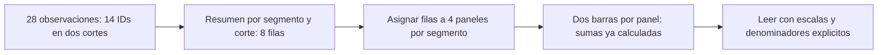
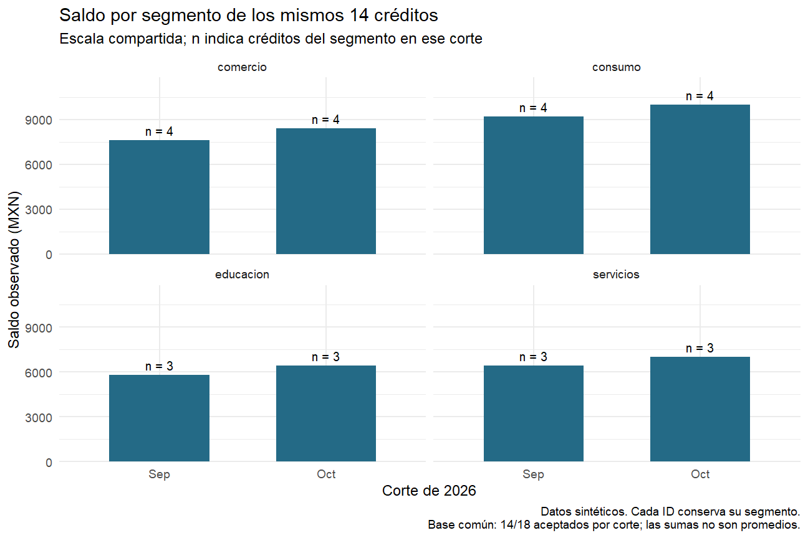
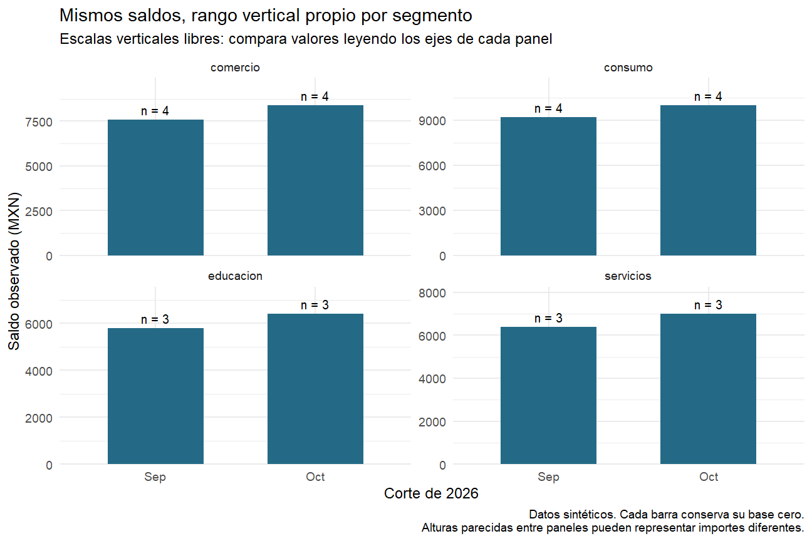
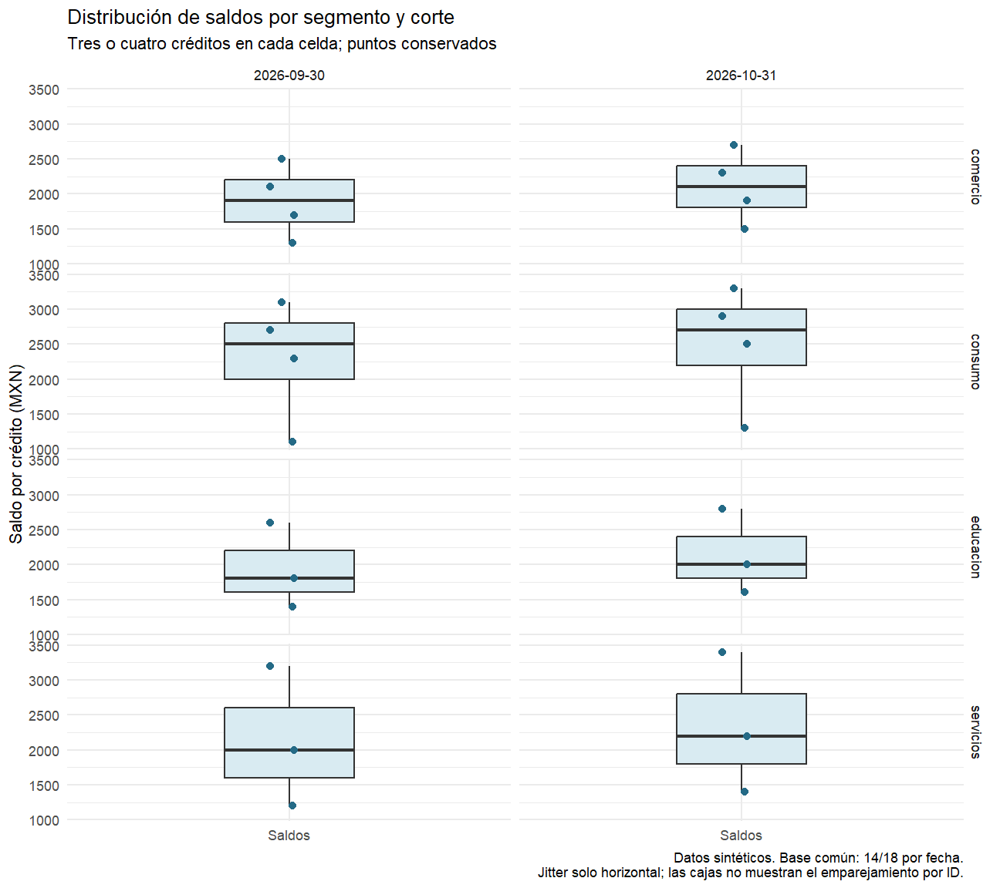
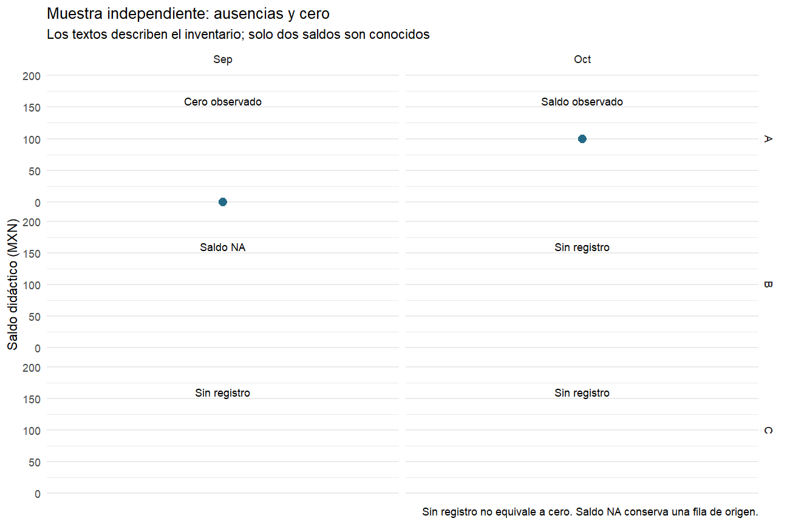

# 08.05 — Facetas y comparación entre grupos

## Propósito, prerrequisitos y objetivos

**Práctica.** Comparar grupos mediante paneles que conservan una pregunta, una
medida y reglas explícitas de lectura. Las facetas separan una figura según
columnas de datos; no son una colección de imágenes independientes ni una
validación automática de que los grupos sean comparables.

Completa [08.02](../02_geometries_stats/README.md),
[08.03](../03_aesthetic_mapping/README.md), [08.04](../04_scales_coordinates/README.md)
y sus labs. Reutiliza el proyecto renv de
[07.10](../../07_tidyverse/10_first_plot_closure/README.md), fuente, funciones y
lockfile. Referencia comprobada: R 4.6.1/ggplot2 4.0.3. No añadimos dependencias.
Repasa [resúmenes](../../07_tidyverse/05_group_summarize/README.md),
[uniones](../../07_tidyverse/06_join_tables/README.md) y
[factores](../../07_tidyverse/08_text_categories_factors/README.md) si lo necesitas.

Al terminar podrás:

- Elegir `facet_wrap` para distribuir grupos y `facet_grid` para cruzar dimensiones.
- Distinguir panel, capa, grupo de dibujo y grupo de resumen.
- Justificar escalas compartidas o libres según la comparación.
- Revisar cantidades, integrantes y denominadores por panel.
- Conservar categorías sin registros sin inventar saldos cero.
- Detectar que una capa sin las variables de faceta puede repetirse en varios paneles.

Puedes dividir la sección en tres sesiones: tabla y paneles; escalas y capas;
ausencias y lab. El cierre exige explicar qué compara cada panel, además de
conseguir que la figura se dibuje.

## 1. La pregunta y la tabla van antes que los paneles

> ¿Cómo se comparan los saldos por segmento de los mismos 14 créditos entre
> septiembre y octubre de 2026?

En 07.10–08.04 usamos dos sumas globales: 29000/31800 MXN para los mismos 14
IDs. Para separar por segmento necesitamos recuperar esa columna del detalle
aceptado; no se puede deducir a partir de los dos totales. Conservamos las
reglas de aceptación y seleccionamos los IDs ya emparejados.

Hay dos decisiones distintas: que un ID aparezca en ambas fechas y que conserve
su segmento. Si un crédito cambiara de segmento, las sumas por segmento podrían
comparar integrantes diferentes aunque la base global fuese la misma. En esta
muestra comprobaremos que cada ID conserva su segmento. No asumimos que eso
ocurra en cualquier cartera ni reasignamos segmentos para forzarlo.

Abre el mismo proyecto de 07.10 en RStudio o tu IDE. Crea
`output/mi_facetas.R`, eligiendo otro nombre si ya hay trabajo. Ejecuta por
bloques en **Console de R**, con la raíz del proyecto como directorio; no en
Terminal. Si falta la práctica, vuelve a
[la preparación de 07.10](../../07_tidyverse/10_first_plot_closure/README.md#2-preparar-una-sola-vez-y-restaurar-desde-r).

```r
source(".Rprofile")
stopifnot(isTRUE(renv::status()$synchronized))
source("R/funciones_calidad.R", encoding = "UTF-8")
source("R/funciones_texto.R", encoding = "UTF-8")
source("R/funciones_fechas.R", encoding = "UTF-8")
source("R/funciones_cierre.R", encoding = "UTF-8")
ruta <- "datos/cartera_texto.csv"
huella <- tools::md5sum(ruta)
fuente <- leer_texto_segmentos(ruta)
cierre <- construir_cierre(fuente)
comprobar_cierre(fuente, cierre)
fechas <- cierre$datos_figura$fecha_corte
niveles_segmento <- c("comercio", "consumo", "educacion", "servicios")
detalle <- cierre$resultado$aceptados |>
  dplyr::filter(fecha_corte %in% fechas) |>
  dplyr::semi_join(cierre$comunes, by = "id_credito", na_matches = "never") |>
  dplyr::select(id_credito, fecha_corte, segmento, saldo_mxn) |>
  dplyr::mutate(
    segmento = factor(segmento, levels = niveles_segmento),
    corte = factor(format(fecha_corte, "%Y-%m-%d"), levels = format(fechas, "%Y-%m-%d"))
  )
por_id <- detalle |> dplyr::distinct(id_credito, segmento)
control <- detalle |> dplyr::group_by(fecha_corte) |>
  dplyr::summarise(creditos = dplyr::n(),
    saldo_mxn = sum(as.double(saldo_mxn)), .groups = "drop")
stopifnot(identical(cierre$resultado$controles$registros, c(48L, 36L, 12L)),
          nrow(detalle) == 28L, nrow(cierre$comunes) == 14L,
          !anyNA(detalle), anyDuplicated(detalle[c("id_credito", "fecha_corte")]) == 0L,
          nrow(por_id) == 14L,
          identical(control$creditos, c(14L, 14L)),
          identical(control$saldo_mxn, c(29000, 31800)))
print(control)
```

`semi_join` conserva las filas aceptadas cuyos IDs aparecen en la base común;
no añade columnas ni multiplica filas por las coincidencias de la otra tabla.
La clave ID/corte sigue siendo única. `por_id` tiene una fila por combinación
ID/segmento: obtener 14 confirma aquí que los 14 IDs tienen un solo segmento.
El factor fija un orden de presentación; `!anyNA` también detectaría una
categoría que no figurara en los niveles declarados. No la absorbas como ausencia.

La entrada sigue teniendo 48 registros, 36 aceptados y 12 rechazados. La
comparación cubre 14/18 aceptados por corte; los cuatro sin pareja por lado se
conservan en el cierre. Las advertencias de fechas imposibles provienen de la
validación ya estudiada: revisa los rechazos sin cambiar la fuente.

### Una fila resumida por segmento y corte

```r
resumen_segmentos <- detalle |> dplyr::group_by(segmento, corte) |>
  dplyr::summarise(creditos = dplyr::n(),
    saldo_mxn = sum(as.double(saldo_mxn)), .groups = "drop") |>
  dplyr::group_by(corte) |>
  dplyr::mutate(total_creditos = sum(creditos),
    proporcion_creditos = creditos / total_creditos) |>
  dplyr::ungroup() |>
  dplyr::arrange(segmento, corte)
stopifnot(nrow(resumen_segmentos) == 8L,
          !dplyr::is_grouped_df(resumen_segmentos),
          all(resumen_segmentos$total_creditos == 14L))
print(resumen_segmentos, width = Inf)
```

| Segmento | Créditos por corte | Septiembre (MXN) | Octubre (MXN) | Fracción de IDs comunes por corte |
| --- | ---: | ---: | ---: | --- |
| comercio | 4 | 7600 | 8400 | 4/14 |
| consumo | 4 | 9200 | 10000 | 4/14 |
| educacion | 3 | 5800 | 6400 | 3/14 |
| servicios | 3 | 6400 | 7000 | 3/14 |

Las cantidades suman 14 en cada fecha; los saldos, 29000 y 31800. Las fracciones
usan 14 como denominador: no son tasas de atraso ni coberturas sobre los 18
aceptados. Un grupo más grande puede tener mayor suma por tener más créditos;
la suma no describe el saldo típico de cada integrante. Para esa pregunta
necesitaríamos otra medida y conservar sus denominadores.

## 2. Qué es una faceta y qué no hace

Una faceta es un panel para un valor o combinación de valores de columnas. La
misma especificación gráfica se aplica a las filas asignadas a cada panel.

| Componente | Qué decide | Ejemplo |
| --- | --- | --- |
| Resumen previo | Qué representa una fila de entrada | Suma de saldo de un segmento en un corte |
| Capa | Qué marcas o estadísticas se dibujan | Barras y textos |
| `group` | Qué filas se conectan o procesan juntas dentro de una capa/panel | Una trayectoria por ID en 08.03 |
| Faceta | En qué panel participa una fila | Un panel por segmento |
| Escala | Cómo se leen posiciones y magnitudes | Mismos MXN en todos los paneles |

Facetar no calcula automáticamente la suma por segmento, no cambia `geom_bar`
en `geom_col` y no crea una leyenda. Tampoco `dplyr::group_by` crea paneles por
sí solo. En una capa con estadística, como una caja, el cálculo sí se realiza
en los grupos de cada panel; por eso se debe revisar el dato que recibe.



Sin renderizador: el resumen produce ocho filas; las facetas las distribuyen
en cuatro paneles y las barras usan sus sumas. Ocho barras no significan ocho
créditos, ocho capas ni ocho muestras independientes.

## 3. `facet_wrap`: una serie de paneles distribuida en filas y columnas

```r
base_segmentos <- ggplot2::ggplot(resumen_segmentos, ggplot2::aes(corte, saldo_mxn)) +
  ggplot2::geom_col(fill = "#246A86", width = 0.6) +
  ggplot2::scale_y_continuous(limits = c(0, NA),
    expand = ggplot2::expansion(mult = c(0, 0.18))) +
  ggplot2::scale_x_discrete(labels = c("2026-09-30" = "Sep", "2026-10-31" = "Oct")) +
  ggplot2::labs(x = "Corte de 2026", y = "Saldo observado (MXN)") +
  ggplot2::theme_minimal(base_size = 12)
por_segmento <- base_segmentos +
  ggplot2::geom_text(ggplot2::aes(label = paste0("n = ", creditos)), vjust = -0.5, size = 3.5) +
  ggplot2::facet_wrap(ggplot2::vars(segmento), ncol = 2, scales = "fixed") +
  ggplot2::labs(title = "Saldo por segmento de los mismos 14 créditos",
    subtitle = "Escala compartida; n indica créditos del segmento en ese corte",
    caption = "Datos sintéticos. Cada ID conserva su segmento.\nBase común: 14/18 aceptados por corte; las sumas no son promedios.")
print(por_segmento)
```

`vars(segmento)` identifica la columna de faceta sin comillas ni `tabla$`.
`ncol = 2` distribuye cuatro paneles en dos columnas; no agrega otra variable.
Los encabezados de panel, llamados *strips* en la documentación, muestran los
segmentos. El orden procede de los niveles del factor, no de cuál saldo es mayor.
`scales = "fixed"` es el valor predeterminado; lo escribimos para declarar la
comparación. La barra conserva su base cero, como en 08.04.
[Referencia de facet_wrap](https://ggplot2.tidyverse.org/reference/facet_wrap.html),
[vars](https://ggplot2.tidyverse.org/reference/vars.html).

Hay cuatro paneles, dos capas y ocho barras más ocho textos. `geom_text` usa
las mismas ocho filas resumidas y conserva `segmento`; por eso cada etiqueta
va al panel correcto. La altura es saldo; el texto informa cantidad de créditos.
La etiqueta `n = 4` no significa cuatro filas resumidas en esa barra.



Sin imagen: comercio 7600/8400, consumo 9200/10000, educacion 5800/6400 y
servicios 6400/7000 MXN; cada par se dibuja desde cero con la misma escala.
Los textos señalan cuatro créditos por corte en los dos primeros segmentos y
tres en los otros dos. No se afirma que el segmento cause la diferencia.

## 4. Escalas compartidas y libres responden comparaciones diferentes

```r
segmentos_libres <- base_segmentos +
  ggplot2::geom_text(ggplot2::aes(label = paste0("n = ", creditos)), vjust = -0.5, size = 3.5) +
  ggplot2::facet_wrap(ggplot2::vars(segmento), ncol = 2, scales = "free_y") +
  ggplot2::labs(title = "Mismos saldos, rango vertical propio por segmento",
    subtitle = "Escalas verticales libres: compara valores leyendo los ejes de cada panel",
    caption = "Datos sintéticos. Cada barra conserva su base cero.\nAlturas parecidas entre paneles pueden representar importes diferentes.")
print(segmentos_libres)
```

Con escala fija, una distancia vertical significa los mismos MXN en todos los
paneles; facilita comparar magnitudes entre segmentos. Con `free_y`, cada panel
adapta su rango y puede facilitar la lectura dentro del grupo. Dos barras
visualmente igual de altas en paneles distintos pueden valer 6400 y 10000 MXN.
No deduzcas igualdad de saldos comparando solo alturas relativas al panel.

Aquí el rango no difiere mucho entre segmentos: la versión fija es la principal.
Las escalas libres se estudian como una decisión que necesita justificación,
no como mejora obligatoria. Conservamos cero abajo incluso al liberar y.
`scales` no modifica las sumas ni elimina filas. Un límite de escala que
censure valores tendría el efecto distinto estudiado en
[08.04](../04_scales_coordinates/README.md).



Sin imagen: cada panel aprovecha su altura y mantiene cero abajo; por eso las
barras de octubre parecen de altura semejante aunque sus importes son distintos.
Se conservan exactamente las ocho sumas de la tabla.

| Opción | Qué puede variar | Cuidado principal |
| --- | --- | --- |
| `"fixed"` | Se comparte la escala de cada eje | Un rango común puede comprimir un grupo pequeño |
| `"free_y"` | Rango vertical | Comparar magnitudes entre paneles exige leer sus ejes |
| `"free_x"` | Rango horizontal | Posiciones/categorías pueden dejar de ser comparables entre paneles |
| `"free"` | Ambos ejes | Ni distancia horizontal ni vertical se presupone común |

`scales` y `space` son argumentos distintos: uno controla escalas, el otro
tamaño de paneles. Aquí mantenemos tamaños iguales (`space = "fixed"`, el
valor predeterminado). No interpretamos el área de un panel como cantidad de
créditos. Cambiar tamaño de paneles queda como ampliación.

## 5. `facet_grid`: cruzar segmento y fecha

Para estudiar distribuciones individuales cambiamos de la tabla de ocho sumas
al detalle de 28 observaciones. Cada celda de la cuadrícula corresponderá a un
segmento y corte. Construimos cajas con la definición de 08.02 y conservamos
todos los puntos; son grupos pequeños de tres o cuatro saldos, no una inferencia.

```r
cuadricula <- ggplot2::ggplot(detalle, ggplot2::aes(x = "Saldos", y = saldo_mxn)) +
  ggplot2::geom_boxplot(quantile.type = 7, coef = 1.5,
    outlier.shape = NA, width = 0.35, fill = "#D9EBF2") +
  ggplot2::geom_point(position = ggplot2::position_jitter(width = 0.07, height = 0, seed = 805),
    colour = "#246A86", size = 2) +
  ggplot2::facet_grid(rows = ggplot2::vars(segmento), cols = ggplot2::vars(corte),
    scales = "fixed") +
  ggplot2::labs(title = "Distribución de saldos por segmento y corte",
    subtitle = "Tres o cuatro créditos en cada celda; puntos conservados",
    x = NULL, y = "Saldo por crédito (MXN)",
    caption = "Datos sintéticos. Base común: 14/18 por fecha.\nJitter solo horizontal; las cajas no muestran el emparejamiento por ID.") +
  ggplot2::theme_minimal(base_size = 11)
print(cuadricula)
```

`rows` coloca segmentos en filas y `cols`, cortes en columnas: cuatro por dos,
ocho paneles. La cadena `"Saldos"` dentro de `aes` es aquí una única categoría
deliberada de posición, como la caja de 08.04; no pretende nombrar una columna.
`outlier.shape = NA` evita duplicar el símbolo de los exteriores de la caja;
la capa de puntos conserva todos los valores. El desplazamiento no cambia y.

La caja se calcula dentro de cada panel; no copia los cuartiles globales de
septiembre en cada segmento. La cuadrícula separa fechas y no dibuja líneas
entre ellas. Si la pregunta es por trayectorias individuales, vuelve al mapeo
por ID de 08.03; cajas parecidas no prueban cambios parecidos por crédito.
[Referencia de facet_grid](https://ggplot2.tidyverse.org/reference/facet_grid.html).



Sin imagen: ocho celdas comparten la escala de saldo; cada una contiene una
caja de tres o cuatro observaciones y todos sus puntos, desplazados solo en x.
Los encabezados identifican segmento y corte.

En `facet_grid`, los paneles de una misma columna comparten x y los de una
misma fila comparten y, incluso al permitir escalas libres. Por ejemplo,
`scales = "free_y"` libera y **entre filas de segmentos**, pero los dos cortes
de una fila siguen compartiendo y. No equivale a ocho rangos independientes.
En `facet_wrap(..., scales = "free_y")`, cada panel puede tener su rango propio.

Una faceta por combinación de dos variables con `facet_wrap(vars(a, b))` también
es posible. La elección depende de si necesitas una disposición compacta o
comparar explícitamente filas/columnas. La cuadrícula permite reconocer celdas
vacías de cruces que no aparecen; los niveles y `drop` afectan qué se conserva.

## 6. Comprobar qué filas llegaron a cada panel

Ya conocemos `layer_data`. Ahora necesitamos relacionar su columna `PANEL` con
el segmento real, porque el código numérico del panel no es el identificador
del grupo. Usamos la estructura construida por ggplot2 como apoyo de revisión
en esta versión; no modificamos sus datos internos.

```r
construccion <- ggplot2::ggplot_build(por_segmento)
paneles <- construccion$layout$layout
capa_barras <- ggplot2::layer_data(por_segmento, 1) |> tibble::as_tibble()
observado <- capa_barras |> dplyr::select(PANEL, x, y) |>
  dplyr::left_join(paneles |> dplyr::select(PANEL, segmento),
    by = "PANEL", relationship = "many-to-one") |>
  dplyr::transmute(segmento = as.character(segmento),
    corte = levels(detalle$corte)[as.integer(x)], saldo_mxn = y) |>
  dplyr::arrange(segmento, corte)
esperado <- resumen_segmentos |>
  dplyr::transmute(segmento = as.character(segmento), corte = as.character(corte), saldo_mxn) |>
  dplyr::arrange(segmento, corte)
stopifnot(nrow(paneles) == 4L, identical(observado, esperado),
          nrow(ggplot2::layer_data(segmentos_libres, 1)) == 8L,
          nrow(ggplot2::layer_data(cuadricula, 1)) == 8L,
          nrow(ggplot2::layer_data(cuadricula, 2)) == 28L)
print(paneles[c("PANEL", "segmento", "SCALE_X", "SCALE_Y")])
```

`PANEL` enlaza cada barra con el segmento y x con la categoría de corte. Así
verificamos las ocho combinaciones, no solo la suma total. `SCALE_X` y
`SCALE_Y` son códigos de escalas compartidas dentro del gráfico; no magnitudes
ni valores para comparar entre gráficos diferentes. Invertir el orden de
filas no debe cambiar los pares clave/valor. Reordenar niveles puede cambiar
el orden de paneles, pero no qué saldo pertenece a cada segmento.

**Revisión visual:** compara las alturas con la tabla, revisa `n`, los encabezados,
la escala y los textos completos. En escalas libres lee cada eje. Ni cuatro
paneles ni ocho barras demuestran por sí solos que la selección sea correcta.

## 7. Un panel vacío, un cero y un saldo NA son situaciones distintas

La cartera principal tiene registros en las ocho combinaciones. Para no
inventar ausencias en ella, usamos una **muestra didáctica independiente**:

| Segmento didáctico | Sep | Oct |
| --- | --- | --- |
| A | Un registro con saldo 0 | Un registro con saldo 100 |
| B | Un registro con saldo NA | Ningún registro |
| C | Ningún registro | Ningún registro |

Definimos C como nivel de presentación sin observaciones. No es una nueva
categoría aceptada del CSV principal. `drop = FALSE` conserva niveles del
factor para formar paneles; no crea filas de mediciones ni rellena saldos.

```r
demo <- data.frame(
  segmento = factor(c("A", "A", "B"), levels = c("A", "B", "C")),
  corte = factor(c("Sep", "Oct", "Sep"), levels = c("Sep", "Oct")),
  saldo_mxn = c(0, 100, NA_real_), observado = TRUE
)
inventario <- expand.grid(segmento = levels(demo$segmento), corte = levels(demo$corte),
                          stringsAsFactors = FALSE) |>
  dplyr::left_join(demo, by = c("segmento", "corte"), relationship = "one-to-one") |>
  dplyr::mutate(
    segmento = factor(segmento, levels = levels(demo$segmento)),
    corte = factor(corte, levels = levels(demo$corte)),
    estado = dplyr::case_when(
      is.na(observado) ~ "Sin registro",
      is.na(saldo_mxn) ~ "Saldo NA",
      saldo_mxn == 0 ~ "Cero observado",
      .default = "Saldo observado"
    )
  )
sin_registros <- ggplot2::ggplot(demo, ggplot2::aes(x = 1, y = saldo_mxn)) +
  ggplot2::geom_point(size = 3, colour = "#246A86") +
  ggplot2::geom_text(data = inventario, ggplot2::aes(x = 1, y = 160, label = estado),
    inherit.aes = FALSE, size = 3.2) +
  ggplot2::facet_grid(rows = ggplot2::vars(segmento), cols = ggplot2::vars(corte), drop = FALSE) +
  ggplot2::scale_x_continuous(breaks = NULL) +
  ggplot2::scale_y_continuous(limits = c(0, 200)) +
  ggplot2::labs(title = "Muestra independiente: ausencias y cero",
    subtitle = "Los textos describen el inventario; solo dos saldos son conocidos",
    x = NULL, y = "Saldo didáctico (MXN)",
    caption = "Sin registro no equivale a cero. Saldo NA conserva una fila de origen.") +
  ggplot2::theme_minimal(base_size = 11)
print(inventario)
print(sin_registros)
stopifnot(nrow(demo) == 3L, nrow(inventario) == 6L,
          sum(!is.na(demo$saldo_mxn)) == 2L,
          sum(inventario$estado == "Sin registro") == 3L,
          sum(inventario$estado == "Saldo NA") == 1L,
          nrow(ggplot2::ggplot_build(sin_registros)$layout$layout) == 6L,
          identical(huella, tools::md5sum(ruta)))
```

`expand.grid` crea el inventario esperado de 3 × 2 combinaciones para describir
cobertura. El `left_join` añade lo observado; la marca `observado` distingue
una fila con NA de una combinación sin fila. El inventario es una tabla de
estado, no seis observaciones de saldos. No utilizamos cero para completarlo.

La capa de puntos avisa que retira un valor ausente al dibujar: la fila B/Sep
sigue en `demo` y está descrita como «Saldo NA». El punto A/Sep en cero se
conserva. Los textos incluyen ambas columnas de faceta para llegar a su celda.
Con solo paneles vacíos no podríamos distinguir estas situaciones.



Sin imagen: A/Sep tiene un punto en 0 y A/Oct en 100. B/Sep no tiene punto
porque su saldo es NA; B/Oct y ambas celdas de C carecen de registro. Cada
celda muestra su estado. C conserva paneles sin inventar mediciones.

## 8. Las capas también necesitan las columnas de faceta

Si una capa usa otra tabla que no contiene `segmento`, ggplot2 puede repetir
sus filas en todos los paneles de segmento. No adivina a qué grupo pertenecen.
Una referencia global deliberada puede necesitar esa repetición; una etiqueta
de «créditos del segmento» no debe usar el total global repetido.

`inherit.aes = FALSE` evita heredar mapeos, pero **no desactiva la asignación a
facetas**. Para una etiqueta por segmento/corte, la tabla de la capa debe
conservar esas claves, además de x/y/label. El lab construye y corrige ese error.
Si ninguna capa proporciona la información necesaria para formar las facetas,
el gráfico puede fallar al construirse. No ocultes esa falla eliminando la
faceta sin revisar la tabla.
[Preguntas frecuentes de facetas](https://ggplot2.tidyverse.org/articles/faq-faceting.html).

## Errores habituales y alcance

| Síntoma | Qué revisar |
| --- | --- |
| Una barra vale 1 en cada fecha | `geom_bar` contó filas resumidas; usar alturas con `geom_col` |
| Cambia el número de integrantes entre cortes | Claves, base común y cambios de segmento; no basta tener igual cantidad |
| Barras de grupos diferentes parecen iguales | Rango y unidad de cada eje, especialmente `free_y` |
| Una cifra global aparece en todos los paneles | Tabla de la capa sin la variable de faceta |
| Se pierde un grupo sin datos | Factores, niveles y `drop`; conservar panel no crea cero |
| Hay un punto ausente y no sé por qué | Inventario de origen: NA frente a combinación sin registro |
| Hay más paneles o etiquetas de los esperados | Cruce de variables, factores y datos suministrados por cada capa |
| No queda ninguna fila para facetar | Mostrar un diagnóstico; conservar niveles conocidos puede mostrar paneles vacíos, pero no crea observaciones |

Un NA en la **variable de faceta** puede formar un panel de categoría ausente;
no es lo mismo que el saldo NA de B/Sep, cuya categoría sí conocemos. Define
la política de categorías antes de interpretar o renombrar ese panel.

**Ampliaciones opcionales:** `labeller = ggplot2::label_both` añade el nombre de
la variable al encabezado; `label_wrap_gen` ayuda con encabezados largos. Si hay
muchos IDs, no crees decenas de paneles ilegibles por automatismo. Márgenes
de totales (`margins`), tamaños variables de panel y personalización de ejes
interiores quedan fuera del cierre. Componer gráficos diferentes pertenece a
08.07; aquí repetimos una especificación sobre subconjuntos de datos.
[Etiquetas de facetas](https://ggplot2.tidyverse.org/reference/labellers.html).

## Práctica, criterio de salida y siguiente paso

Realiza el [lab 08.05](../../../labs/08_visualization_r/05_facets_groups/README.md).
El [script de referencia](explorar_facetas.R) reúne los bloques esenciales para
contrastar tu trabajo. Guarda tu script, reinicia R con Session > Restart R y
ejecuta en Console desde la raíz del proyecto:

```r
source("output/mi_facetas.R", encoding = "UTF-8")
```

Puedes avanzar cuando expliques paneles, población, medida y denominador;
justifiques las escalas y distingas cero/NA/sin registro. Comprueba las ocho
sumas y corrige una capa repetida por falta de clave. Conserva script propio,
controles y notas de revisión visual. No exigimos nuevas exportaciones ni
restaurar otra biblioteca. El proyecto integrador y sus checkpoints siguen
pendientes; desarrollar material no acredita aprendizaje del estudiante.

Siguiente: [08.06 — Etiquetas, temas y accesibilidad](../06_labels_themes_accessibility/README.md),
ya disponible. Volver al [índice de 08](../README.md).

## Referencias y atribución

Ejemplos y muestras sintéticas propios de DS Track. Consulta: 2026-10-20.
Referencias oficiales de ggplot2 4.0.3 enlazadas junto a los conceptos: facetas,
`vars`, preguntas frecuentes y etiquetas. La definición de cajas y el jitter
se conservan desde [08.02](../02_geometries_stats/README.md); los límites y
escalas desde [08.04](../04_scales_coordinates/README.md).

La [guía de lecturas R](../../../docs/r-reading-guide.md) distingue R for Data
Science, segunda edición, de Hadley Wickham, Mine Çetinkaya-Rundel y Garrett
Grolemund; y ggplot2: Elegant Graphics for Data Analysis, de Hadley Wickham,
Danielle Navarro y Thomas Lin Pedersen, cuya tercera edición en línea continúa
en desarrollo. No se copian ejemplos de capítulos.
