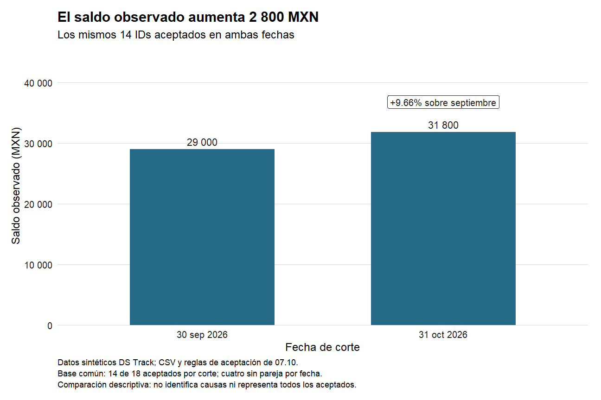
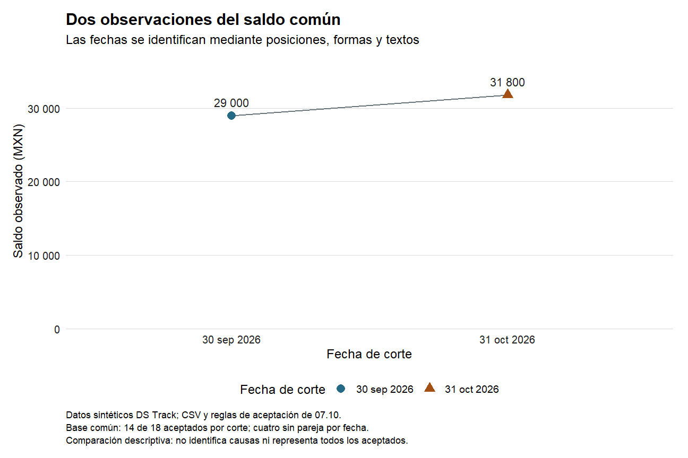
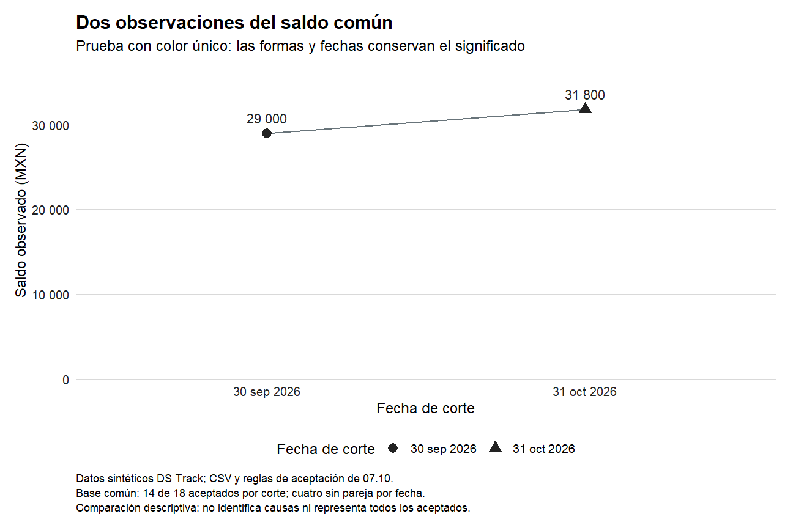

# 08.06 — Etiquetas, temas y accesibilidad

## Propósito, prerrequisitos y objetivos

**Esencial.** Comunicar qué se midió, en quiénes, cuándo y con qué límites.
Una figura legible necesita más que una paleta: títulos fieles, unidades,
etiquetas comprensibles, contraste y una explicación disponible sin la imagen.
La presentación debe conservar los datos y ayudar a interpretar su alcance.

Completa [08.03](../03_aesthetic_mapping/README.md),
[08.04](../04_scales_coordinates/README.md), [08.05](../05_facets_groups/README.md)
y sus labs. Reutiliza el proyecto renv de
[07.10](../../07_tidyverse/10_first_plot_closure/README.md), sus funciones,
fuente y lockfile. Referencia: R 4.6.1/ggplot2 4.0.3; sin paquetes nuevos.

Al terminar podrás:

- Escribir un título que comunique el hallazgo sin inventar causas.
- Separar títulos/guías, elementos del tema y capas de texto.
- Usar `geom_text`, `geom_label` y `annotate` según el origen de la información.
- Aplicar un tema local y explicar el orden de sus ajustes.
- Complementar el color con formas, posiciones, etiquetas y tabla.
- Producir una descripción alternativa y comprobar que el destino la utilice.

Puedes trabajar en tres sesiones: mensaje y etiquetas; tema y anotaciones;
señales adicionales al color, descripción y lab. No se requiere publicar una
página ni exportar otra entrega para cerrar esta sección.

## 1. Decidir qué podemos afirmar

La pregunta sigue siendo cómo cambia el saldo observado de los mismos 14 IDs
aceptados entre septiembre y octubre de 2026. El resultado es 29000 → 31800
MXN, diferencia +2800 y aproximadamente +9.66% sobre septiembre. La base común
cubre 14 de los 18 aceptados en cada fecha; los demás siguen conservados.

| Texto | Qué permite interpretar |
| --- | --- |
| «Resultados» | No identifica medida, población ni hallazgo |
| «El saldo observado aumenta 2800 MXN» | Comunica el cambio, pero necesita población y fechas |
| «La cartera mejoró gracias a la estrategia» | Atribuye valoración y causa que este análisis no prueba |
| «El saldo común pasa de 29000 a 31800 MXN» | Describe una comparación que podemos conciliar |

Un mayor saldo no demuestra mejora de calidad, rentabilidad ni efecto de una
acción. Dos cortes tampoco describen la trayectoria diaria. La cobertura de
77.78% usa cantidades de IDs; el cambio de 9.66% usa saldo inicial. No son el
mismo indicador. El tamaño de letra o el título no solucionan ese problema.

Tampoco hay un diseño de muestreo o un modelo de incertidumbre para construir
intervalos estadísticos aquí. No añadimos bandas de confianza por decoración.
Sí declaramos población, datos sintéticos y alcance descriptivo. Escribir esos
límites no equivale a demostrar que no exista incertidumbre.

## 2. Reconstruir datos y calcular el mensaje

Abre el mismo proyecto de 07.10 en RStudio o tu IDE. Crea
`output/mi_comunicacion.R`, usando otro nombre si ya hay trabajo. Ejecuta por
bloques en **Console de R**, con la raíz del proyecto como directorio; no en
Terminal. Si falta la práctica, vuelve a
[la preparación de 07.10](../../07_tidyverse/10_first_plot_closure/README.md#2-preparar-una-sola-vez-y-restaurar-desde-r).

```r
source(".Rprofile")
stopifnot(isTRUE(renv::status()$synchronized))
source("R/funciones_calidad.R", encoding = "UTF-8")
source("R/funciones_texto.R", encoding = "UTF-8")
source("R/funciones_fechas.R", encoding = "UTF-8")
source("R/funciones_cierre.R", encoding = "UTF-8")
ruta <- "datos/cartera_texto.csv"
huella <- tools::md5sum(ruta)
fuente <- leer_texto_segmentos(ruta)
cierre <- construir_cierre(fuente)
comprobar_cierre(fuente, cierre)
formato_mxn <- function(x) format(x, big.mark = " ", scientific = FALSE, trim = TRUE)
datos <- cierre$datos_figura |> dplyr::arrange(fecha_corte) |>
  dplyr::mutate(
    corte = factor(format(fecha_corte, "%Y-%m-%d"),
      levels = c("2026-09-30", "2026-10-31")),
    etiqueta = formato_mxn(saldo_mxn)
  )
inicial <- datos$saldo_mxn[1]
final <- datos$saldo_mxn[2]
diferencia <- final - inicial
variacion_pct <- if (inicial == 0) NA_real_ else 100 * diferencia / inicial
stopifnot(identical(cierre$resultado$controles$registros, c(48L, 36L, 12L)),
          nrow(cierre$comunes) == 14L, nrow(cierre$sin_pareja) == 8L,
          identical(datos$saldo_mxn, c(29000, 31800)), diferencia == 2800,
          all(datos$creditos == 14L), all(datos$aceptados_corte == 18L))
titulo <- paste("El saldo observado aumenta", formato_mxn(diferencia), "MXN")
nota_fuente <- paste(
  "Datos sintéticos DS Track; CSV y reglas de aceptación de 07.10.",
  "Base común: 14 de 18 aceptados por corte; cuatro sin pareja por fecha.",
  "Comparación descriptiva: no identifica causas ni representa todos los aceptados.", sep = "\n"
)
print(datos, width = Inf)
print(variacion_pct)
```

Ordenamos por fecha antes de restar; el texto se deriva de los mismos saldos
que se dibujan. No escribimos 2800 a mano en una anotación que pueda quedar
desactualizada al corregir datos. El título «aumenta» corresponde a esta muestra
con diferencia positiva; si cambian el sentido o la población, hay que revisar
también la redacción. Un saldo inicial cero deja el porcentaje sin definir:
no se informa un crecimiento infinito ni se sustituye la base por uno.

Las advertencias por fechas imposibles pertenecen a la validación ya estudiada.
Se conservan 48 entradas, 36 aceptados y 12 rechazados con sus motivos. No
cambies la fuente para silenciarlas ni elimines los no coincidentes del cierre.

## 3. Títulos, etiquetas del eje y texto sobre las marcas

```r
base <- ggplot2::ggplot(datos, ggplot2::aes(corte, saldo_mxn)) +
  ggplot2::geom_col(fill = "#246A86", width = 0.6)
rotulado <- base +
  ggplot2::geom_text(ggplot2::aes(label = etiqueta), vjust = -0.5,
    colour = "#222222", size = 11, size.unit = "pt") +
  ggplot2::scale_y_continuous(limits = c(0, NA), labels = formato_mxn,
    expand = ggplot2::expansion(mult = c(0, 0.25))) +
  ggplot2::scale_x_discrete(labels = c(
    "2026-09-30" = "30 sep 2026", "2026-10-31" = "31 oct 2026")) +
  ggplot2::labs(title = titulo,
    subtitle = "Los mismos 14 IDs aceptados en ambas fechas",
    x = "Fecha de corte", y = "Saldo observado (MXN)", caption = nota_fuente)
print(rotulado)
```

`labs` comunica títulos de figura, ejes y guías; no crea marcas de datos ni
calcula indicadores. `geom_text` es una capa que obtiene un texto por fila:
dos filas resumidas, dos barras y dos importes. `etiqueta` es texto formateado;
`saldo_mxn` sigue siendo el valor numérico que determina la altura.
[Referencia de labs](https://ggplot2.tidyverse.org/reference/labs.html),
[texto y etiquetas](https://ggplot2.tidyverse.org/reference/geom_text.html).

| Elemento | Función en esta figura |
| --- | --- |
| `title` | Mensaje principal comprobable |
| `subtitle` | Población comparable |
| `x` / `y` | Qué representan posiciones y unidades |
| `caption` | Fuente, cobertura y límites de interpretación |
| `geom_text(aes(label = ...))` | Valor de cada marca a partir de su fila |

`vjust` ajusta el texto respecto de su anclaje; no modifica el saldo. Aquí
`size.unit = "pt"` declara puntos tipográficos, para comparar el tamaño con el
tema. Si se omite esa unidad, el tamaño de texto de estas geometrías se expresa
por defecto en milímetros; `size = 11` no significaría once puntos. Revisa las
unidades antes de aumentar tamaños por ensayo.

No conviene repetir toda la tabla sobre cada marca. En una figura con muchas
observaciones, etiquetar todos los IDs puede ocultar datos. Selecciona las
etiquetas con una regla explícita y conserva el detalle en la tabla. Usar
`check_overlap = TRUE` puede omitir textos; no garantiza que se vean todos ni
que se hayan eliminado filas de origen.

## 4. Un tema completo y después ajustes locales

```r
con_tema <- rotulado + ggplot2::theme_minimal(base_size = 12, base_family = "sans")
tema_lectura <- ggplot2::theme(
  plot.title = ggplot2::element_text(face = "bold", size = 15),
  plot.caption = ggplot2::element_text(hjust = 0, size = 9, lineheight = 1.1),
  axis.text = ggplot2::element_text(colour = "#222222", size = 10),
  panel.grid.major.x = ggplot2::element_blank(),
  panel.grid.major.y = ggplot2::element_line(colour = "#D9D9D9", linewidth = 0.3),
  panel.grid.minor = ggplot2::element_blank(),
  plot.background = ggplot2::element_rect(fill = "white", colour = NA),
  plot.margin = ggplot2::margin(12, 14, 12, 12),
  legend.position = "bottom"
)
legible <- con_tema + tema_lectura
print(legible)
```

`theme_minimal` define un tema completo; `theme` modifica componentes concretos.
El orden importa: si añades después otro tema completo, como `theme_bw`, varios
ajustes previos se reemplazan. Construimos primero la base visual y después los
ajustes locales. No usamos `theme_set` ni `theme_update`: no hace falta cambiar
el tema global de la sesión para esta práctica.
[Temas completos](https://ggplot2.tidyverse.org/reference/ggtheme.html),
[componentes de theme](https://ggplot2.tidyverse.org/reference/theme.html).

| Función / argumento | Qué cambia |
| --- | --- |
| `element_text` | Apariencia de textos del tema: fuente, tamaño y alineación |
| `element_line` | Líneas de elementos como la cuadrícula |
| `element_rect` | Fondos y bordes de componentes del tema |
| `element_blank` | Suprime el dibujo del componente indicado |
| `margin(t, r, b, l)` | Espacio externo: arriba, derecha, abajo e izquierda; aquí en puntos |

`sans` es una familia genérica; no exige instalar una fuente especial.
`hjust = 0` alinea la nota a la izquierda. `lineheight` regula la separación
entre sus líneas. Quitamos cuadrícula vertical y menor, pero conservamos las
referencias horizontales para leer magnitudes. No quitamos ejes ni unidades.

Los tamaños del tema se expresan en puntos. Aumentar `axis.text` no cambia el
tamaño de una capa `geom_text`: esa capa tiene sus propios argumentos. Tampoco
`element_text(colour = ...)` cambia el relleno de las barras; esa propiedad se
define en su geometría o escala. Un tema puede hacer ilegible una figura sin
cambiar sus valores: controles numéricos e inspección visual se complementan.

## 5. Anotar un cambio sin inventar otra observación

```r
mensaje_pct <- if (is.na(variacion_pct)) {
  "Porcentaje no definido: base inicial cero"
} else {
  paste0("+", formatC(variacion_pct, format = "f", digits = 2, decimal.mark = "."),
         "% sobre septiembre")
}
nota_octubre <- datos |> dplyr::filter(fecha_corte == max(fecha_corte)) |>
  dplyr::mutate(posicion_nota = saldo_mxn + 5000, mensaje = mensaje_pct)
comunicada <- legible + ggplot2::geom_label(data = nota_octubre,
  ggplot2::aes(x = corte, y = posicion_nota, label = mensaje),
  inherit.aes = FALSE, colour = "#222222", fill = "white",
  size = 10, size.unit = "pt", linewidth = 0.3)
con_nota <- comunicada + ggplot2::annotate("text", x = "2026-09-30", y = 37000,
  label = "Datos sintéticos", colour = "#222222", size = 10, size.unit = "pt")
print(comunicada)
print(con_nota)
```

`geom_label` dibuja texto y un recuadro que lo separa del fondo. La tabla local
tiene una sola fila, octubre; las barras siguen usando las dos filas completas.
`posicion_nota` es una posición de presentación, no un nuevo saldo observado.
Como toda posición de capa, puede ampliar el rango del eje. No sumamos esos
5000 MXN a la medida ni incluimos esa fila en los indicadores.

`annotate` sirve para información explícita sin construir un mapeo desde una
tabla: aquí el origen sintético y su ubicación. No crea una categoría de leyenda
de color. Tampoco valida que el texto sea cierto. Usamos una categoría x ya
existente; una nueva categoría o posición exterior podría ampliar la escala.
En una figura facetada, una anotación sin claves de faceta puede repetirse en
varios paneles, como estudiamos en [08.05](../05_facets_groups/README.md).
[Referencia de annotate](https://ggplot2.tidyverse.org/reference/annotate.html).

La nota de porcentaje se redondea solo para presentar. El cálculo conserva su
precisión; 9.66% es aproximado. La rama que añade «+» y el texto «sobre septiembre»
corresponden a esta comparación positiva y estas fechas: revisar la redacción
forma parte de adaptar el análisis a otros datos. Un signo escrito en un texto
no comprueba el signo del indicador.



Sin imagen: septiembre tiene 29000 MXN y octubre 31800, sobre los mismos 14
IDs. La nota de octubre indica +9.66% sobre septiembre. La fuente es sintética;
la base común cubre 14/18 aceptados por fecha y la comparación no identifica causas.

## 6. Accesibilidad: varias formas de leer la información

El color puede reforzar una diferencia; no debe ser la única señal que permita
comprenderla. Las fechas ya están en posiciones rotuladas. Para practicar otra
señal, mostraremos los dos totales como puntos con color **y forma** por fecha.
No necesitamos asignar 14 colores a IDs ni instalar una paleta adicional.
[W3C WAI: uso del color](https://www.w3.org/WAI/WCAG22/Understanding/use-of-color.html).

```r
etiquetas_fecha <- c("2026-09-30" = "30 sep 2026", "2026-10-31" = "31 oct 2026")
paleta <- c("2026-09-30" = "#246A86", "2026-10-31" = "#A34E12")
formas <- c("2026-09-30" = 16, "2026-10-31" = 17)
base_puntos <- ggplot2::ggplot(datos, ggplot2::aes(corte, saldo_mxn)) +
  ggplot2::geom_line(ggplot2::aes(group = 1), colour = "#68747A", linewidth = 0.7) +
  ggplot2::geom_point(ggplot2::aes(colour = corte, shape = corte), size = 3.5) +
  ggplot2::geom_text(ggplot2::aes(label = etiqueta), vjust = -1,
    colour = "#222222", size = 11, size.unit = "pt") +
  ggplot2::scale_x_discrete(labels = etiquetas_fecha) +
  ggplot2::scale_y_continuous(limits = c(0, NA), labels = formato_mxn,
    expand = ggplot2::expansion(mult = c(0, 0.18))) +
  ggplot2::labs(title = "Dos observaciones del saldo común",
    subtitle = "Las fechas se identifican mediante posiciones, formas y textos",
    x = "Fecha de corte", y = "Saldo observado (MXN)", caption = nota_fuente) +
  ggplot2::theme_minimal(base_size = 12, base_family = "sans") + tema_lectura
con_senales <- base_puntos +
  ggplot2::scale_colour_manual(name = "Fecha de corte", values = paleta, labels = etiquetas_fecha) +
  ggplot2::scale_shape_manual(name = "Fecha de corte", values = formas, labels = etiquetas_fecha)
sin_color <- base_puntos +
  ggplot2::scale_colour_manual(name = "Fecha de corte",
    values = c("2026-09-30" = "#222222", "2026-10-31" = "#222222"), labels = etiquetas_fecha) +
  ggplot2::scale_shape_manual(name = "Fecha de corte", values = formas, labels = etiquetas_fecha) +
  ggplot2::labs(subtitle = "Prueba con color único: las formas y fechas conservan el significado")
print(con_senales)
print(sin_color)
```

Las escalas tienen títulos y etiquetas compatibles, de modo que la leyenda
puede combinar color y forma. Sus nombres se corresponden con los niveles;
no asignamos códigos por el orden accidental de las filas. El círculo y el
triángulo siguen diferenciando fechas cuando ambos tienen el mismo color.
Los puntos y la línea usan dos filas resumidas: no son 14 créditos individuales
ni mediciones diarias del intervalo.



Sin imagen: septiembre usa círculo azul y octubre triángulo naranja; ambos
tienen su fecha e importe escritos. La siguiente variante conserva las formas
y rótulos al utilizar un solo color:



Sin imagen: un círculo marca septiembre y un triángulo octubre; ambos son
oscuros, tienen su importe encima y fecha debajo. El segmento une dos cortes
observados; no demuestra lo que pasó cada día ni la causa del cambio.

### Contraste, tamaño y orden de lectura

- Usa texto oscuro sobre fondo claro y comprueba también las marcas respecto
  de su fondo. Una paleta agradable puede tener poco contraste.
- El contraste de un color con blanco no demuestra que se distinga de otro
  color; conserva formas/textos y revisa la figura sin depender del color.
- Si usas transparencia, el color visible cambia al mezclarse con el fondo;
  verifica el resultado, no solo el código hexadecimal.
- Revisa al tamaño en que se leerá: una figura legible ampliada puede fallar
  reducida. Primero simplifica o distribuye el texto; no reduzcas todo hasta
  que sea imposible leerlo. `base_size` por sí solo no garantiza legibilidad.
- Mantén el orden temporal y las categorías con significado. Renombrar una
  etiqueta no debe cambiar a qué valor corresponde, como en 08.03–08.05.

Como referencia para texto web, W3C describe un contraste mínimo de 4.5:1 para
texto normal y 3:1 para texto grande, con condiciones y excepciones. Estos
criterios orientan la revisión; elegir dos colores oscuros o inspeccionar una
imagen no certifica la accesibilidad completa de un documento o aplicación.
En esta práctica no se exige implementar un medidor de contraste ni simular
todas las formas de visión.
[W3C WAI: contraste del texto](https://www.w3.org/WAI/WCAG22/Understanding/contrast-minimum.html).

## 7. Una descripción alternativa y una tabla también comunican

```r
descripcion <- paste(
  "Gráfico de dos barras desde cero. Saldo observado de los mismos 14 IDs aceptados:",
  paste0("30 de septiembre de 2026, ", formato_mxn(inicial), " MXN;"),
  paste0("31 de octubre, ", formato_mxn(final), " MXN."),
  paste0("Diferencia de ", formato_mxn(diferencia), " MXN; ",
    if (is.na(variacion_pct)) mensaje_pct else paste("aproximadamente", mensaje_pct), "."),
  "Datos sintéticos; cobertura de 14 de 18 aceptados por corte. No identifica causas."
)
comunicada <- comunicada + ggplot2::labs(alt = descripcion)
texto_alternativo <- ggplot2::get_alt_text(comunicada)
tabla_lectura <- datos |> dplyr::select(fecha_corte, creditos, saldo_mxn, aceptados_corte)
stopifnot(identical(texto_alternativo, descripcion),
          identical(ggplot2::get_labs(comunicada)$title, titulo))
cat(texto_alternativo, "\n")
print(tabla_lectura)
```

La descripción identifica tipo de figura, medida, población, fechas, valores y
límite relevante. No tiene que enumerar colores decorativos ni repetir cada
línea de cuadrícula. La tabla ofrece valores exactos; el texto explica la
comparación. Para figuras más complejas puede hacer falta una descripción
extendida junto a una tabla, además de un texto alternativo breve.
[W3C WAI: imágenes complejas](https://www.w3.org/WAI/tutorials/images/complex/).

`labs(alt = ...)` guarda el texto en el objeto; `get_alt_text` permite recuperarlo.
Eso **no asegura que un PNG o su visor exponga ese texto a un lector de pantalla**.
Al insertar la figura en Markdown, HTML o un reporte, suministra la alternativa
mediante el mecanismo del destino y comprueba que esté disponible. Aquí la
imagen viene acompañada de descripción y tabla; la integración de reportes se
estudia en el módulo 11, no se exige ahora.
[get_alt_text](https://ggplot2.tidyverse.org/reference/get_alt_text.html).

| Fecha | IDs comunes | Saldo observado (MXN) | Aceptados del corte |
| --- | ---: | ---: | ---: |
| 2026-09-30 | 14 | 29000 | 18 |
| 2026-10-31 | 14 | 31800 | 18 |

El texto de ejemplo redondea 9.66% como el gráfico; si cambian los indicadores,
revisa y actualiza también la descripción, no solo las marcas. Un texto
alternativo viejo puede contradecir una figura recién reconstruida.

## 8. Comprobar valores y revisar la presentación

```r
columnas_barra <- c("x", "y", "ymin", "ymax")
stopifnot(identical(ggplot2::layer_data(base, 1)[columnas_barra],
                    ggplot2::layer_data(comunicada, 1)[columnas_barra]),
          identical(ggplot2::layer_data(rotulado, 2)$label, datos$etiqueta),
          nrow(ggplot2::layer_data(comunicada, 3)) == 1L,
          identical(ggplot2::layer_data(con_senales, 2)$y,
                    ggplot2::layer_data(sin_color, 2)$y),
          length(unique(ggplot2::layer_data(sin_color, 2)$colour)) == 1L,
          length(unique(ggplot2::layer_data(sin_color, 2)$shape)) == 2L,
          identical(huella, tools::md5sum(ruta)))
```

Las posiciones de las barras y los saldos se conservan. La nota local es una
fila de presentación, no un crédito ni un tercer corte. Las pruebas de color
único conservan formas y datos, pero todavía hay que inspeccionar tamaño,
solapamientos, recortes y correspondencia de la leyenda. Tampoco una huella
intacta valida la verdad del título: hay que confrontarlo con el resultado.

| Síntoma | Qué revisar |
| --- | --- |
| Cambié `axis.text` y el importe sobre la barra no cambió | El importe es una capa con tamaño propio |
| Mis ajustes desaparecieron | Orden del tema completo y de `theme(...)` |
| La nota queda cortada | Tamaño del panel, margen, posiciones y expansión; no alterar los saldos |
| El eje se amplió al anotar | Las posiciones de anotación participan en las escalas |
| El color único vuelve ambigua la leyenda | Añadir señales con significado y conservar sus correspondencias |
| Quité la leyenda y perdí la identificación | Títulos de ejes, etiquetas directas o guía necesaria para interpretar |
| El texto declara porcentaje pero los valores son MXN | Unidades y denominador; `labs` no convierte datos |

## Práctica, criterio de salida y siguiente paso

Realiza el [lab 08.06](../../../labs/08_visualization_r/06_labels_themes_accessibility/README.md).
El [script de referencia](comunicar_resultados.R) reúne los bloques esenciales;
sirve para contrastar tu trabajo. Guarda, reinicia R mediante Session > Restart
R y ejecuta en Console desde la raíz del proyecto:

```r
source("output/mi_comunicacion.R", encoding = "UTF-8")
```

Puedes avanzar cuando justifiques mensaje, población, unidades, tema y señales;
reconstruyas los mismos valores y produzcas una explicación utilizable sin la
imagen. Conserva script propio, tabla, descripción y revisión visual. No se
requiere otra exportación, publicación web ni una auditoría completa de
accesibilidad. Proyecto integrador y checkpoints siguen pendientes; desarrollar
material no acredita aprendizaje del estudiante.

Siguiente: [08.07 — Componer figuras](../07_compose_figures/README.md), ya
disponible. Volver al [índice de 08](../README.md).

## Referencias y atribución

Ejemplos y datos sintéticos propios de DS Track. Consulta: 2026-10-20.
APIs contrastadas con ggplot2 4.0.3 y referencias oficiales enlazadas junto a
cada concepto. W3C WAI aporta las orientaciones de color, contraste y alternativas
de imágenes; no se presenta esta práctica como certificación de conformidad.

La [guía de lecturas R](../../../docs/r-reading-guide.md) distingue R for Data
Science, segunda edición, de Hadley Wickham, Mine Çetinkaya-Rundel y Garrett
Grolemund; y ggplot2: Elegant Graphics for Data Analysis, de Hadley Wickham,
Danielle Navarro y Thomas Lin Pedersen, cuya tercera edición en línea continúa
en desarrollo. No se copian ejemplos de capítulos.
