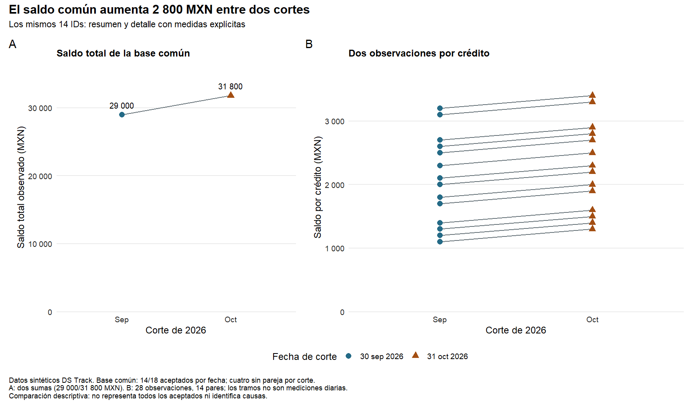
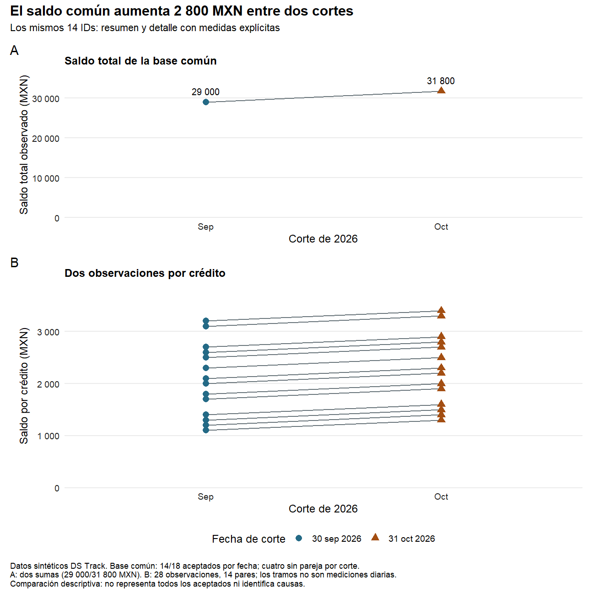
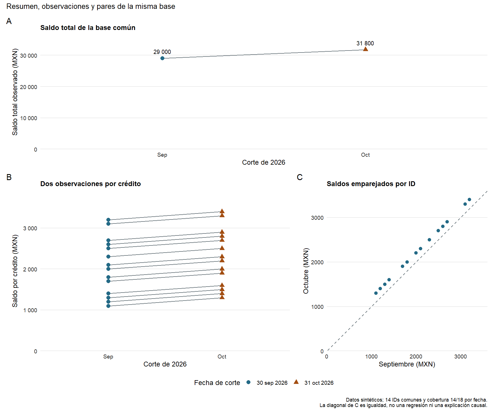

# 08.07 — Componer figuras

## Propósito, prerrequisitos y objetivos

**Práctica.** Reunir vistas complementarias en una figura con orden de lectura,
contexto común y medidas explícitas. Un buen conjunto no es simplemente poner
gráficos uno al lado del otro: cada vista debe responder una parte de la pregunta
y conservar su población, unidad, escala y explicación.

Completa [08.03](../03_aesthetic_mapping/README.md),
[08.04](../04_scales_coordinates/README.md), [08.05](../05_facets_groups/README.md),
[08.06](../06_labels_themes_accessibility/README.md) y sus labs. Usa el mismo
proyecto renv de [07.10](../../07_tidyverse/10_first_plot_closure/README.md).
Esta sección incorpora **patchwork 1.3.2**, con R 4.6.1/ggplot2 4.0.3. El
lockfile conserva los 43 registros anteriores y añade solo patchwork.

Al terminar podrás:

- Diferenciar una faceta de una composición de gráficos distintos.
- Preparar objetos verificables antes de reunirlos.
- Decidir filas, columnas y tamaños relativos con `wrap_plots` y `plot_layout`.
- Añadir título, notas y rótulos A/B al conjunto.
- Recoger leyendas compatibles sin asumir que se unifican datos o escalas.
- Explicar el conjunto sin la imagen y comprobarlo desde una sesión nueva.

Puedes dividir el trabajo en preparación, vistas individuales y composición;
después realiza el lab. No necesitas memorizar todos los operadores de patchwork
ni exportar otra entrega: la exportación se profundizará en 08.08.

## 1. Diseñar la lectura antes de elegir la disposición

La pregunta mantiene los mismos 14 IDs en septiembre/octubre de 2026:
¿cuánto cambia su saldo total y cómo se relaciona ese cambio con los saldos
individuales? Dos vistas responden partes diferentes:

| Vista | Tabla de entrada | Qué representa una marca | Medida vertical |
| --- | --- | --- | --- |
| A: resumen | Dos filas por corte | Suma de los mismos 14 créditos | Saldo total observado en MXN |
| B: detalle | 28 filas crédito/corte | Saldo de un crédito en una fecha | Saldo por crédito en MXN |

Ambas usan MXN, pero sus medidas tienen distinta agregación. Unirlas no permite
comparar alturas como si un punto individual fuera un total. Tampoco se suman
las dos fechas para declarar un saldo en una fecha única. El conjunto debe
explicar tanto lo compartido como esa diferencia.

En [08.05](../05_facets_groups/README.md), una faceta repetía una especificación
gráfica sobre subconjuntos definidos por columnas. Aquí reunimos **objetos de
gráfico diferentes**, con tablas y medidas distintas. Cada objeto puede tener
sus propias capas, facetas, títulos y coordenadas. La composición controla su
disposición, no reconstruye las reglas de calidad ni concilia sus indicadores.

## 2. Preparar una sola vez y restaurar desde el IDE

Guarda tu trabajo. Desde la raíz de **DS Track**, en Console de R:

```r
source("curriculum/08_visualization_r/07_compose_figures/preparar_composicion.R")
destino <- preparar_practica_composicion(
  "curriculum/06_r_foundations/09_known_result/output/cierre_ventas"
)
```

Adapta la ruta a tu práctica existente. El [preparador](preparar_composicion.R)
comprueba la base de 07.10, respalda `DESCRIPTION` y `renv.lock` en
`respaldo_08_06/`, actualiza esos dos metadatos y añade `componer_figuras.R`.
No copia datos ni cambia funciones previas; tampoco instala paquetes. Rechaza
repeticiones, rutas inválidas y metadatos distintos de los de referencia de
07.10/08.06 para no sobrescribir personalizaciones sin revisarlas. Una copia
parcial requiere revisar el respaldo antes de repetir, no borrar trabajo.

Abre otra vez **el mismo proyecto de práctica**, reinicia R y ejecuta desde su
raíz en Console:

```r
source("restaurar.R")
```

Se restaura patchwork en la biblioteca local, usando las versiones del
[lockfile](renv.lock). No se inicializa renv en la raíz de DS Track ni se
modifica Conda o una biblioteca global. No hace falta añadir `install.packages`
al script analítico ni ejecutar `snapshot` para «arreglar» una restauración
fallida. Si ya preparaste y sincronizaste esta sección, pasa a la reconstrucción.
[Referencia de restore](https://rstudio.github.io/renv/reference/restore.html).

La versión de patchwork es la referencia comprobada, no una afirmación sobre
la más reciente. Sus páginas de desarrollo pueden describir otra versión;
contrastamos las funciones utilizadas con la instalación local 1.3.2.

## 3. Reconstruir tablas y comprobar la población

En el editor del IDE crea `output/mi_composicion.R`, usando otro nombre si ya
existe trabajo. Mantén la raíz de la práctica como directorio. Ejecuta bloques
en **Console de R**, no en Terminal. El script preparado `componer_figuras.R`
sirve para contrastar tu recorrido; no depende de objetos de lecciones previas.

```r
source(".Rprofile")
stopifnot(isTRUE(renv::status()$synchronized))
library(patchwork)
source("R/funciones_calidad.R", encoding = "UTF-8")
source("R/funciones_texto.R", encoding = "UTF-8")
source("R/funciones_fechas.R", encoding = "UTF-8")
source("R/funciones_cierre.R", encoding = "UTF-8")
ruta <- "datos/cartera_texto.csv"
huella <- tools::md5sum(ruta)
fuente <- leer_texto_segmentos(ruta)
cierre <- construir_cierre(fuente)
comprobar_cierre(fuente, cierre)
fechas <- cierre$datos_figura$fecha_corte
resumen <- cierre$datos_figura |> dplyr::mutate(
  corte = factor(format(fecha_corte, "%Y-%m-%d"), levels = format(fechas, "%Y-%m-%d"))
)
detalle <- cierre$resultado$aceptados |>
  dplyr::filter(fecha_corte %in% fechas) |>
  dplyr::semi_join(cierre$comunes, by = "id_credito", na_matches = "never") |>
  dplyr::select(id_credito, fecha_corte, saldo_mxn) |>
  dplyr::mutate(corte = factor(format(fecha_corte, "%Y-%m-%d"), levels = levels(resumen$corte)))
control <- detalle |> dplyr::group_by(fecha_corte) |>
  dplyr::summarise(creditos = dplyr::n(), saldo_mxn = sum(as.double(saldo_mxn)), .groups = "drop")
stopifnot(identical(cierre$resultado$controles$registros, c(48L, 36L, 12L)),
          nrow(cierre$comunes) == 14L, nrow(detalle) == 28L,
          !anyNA(detalle), anyDuplicated(detalle[c("id_credito", "fecha_corte")]) == 0L,
          identical(control$creditos, c(14L, 14L)),
          identical(control$saldo_mxn, c(29000, 31800)),
          identical(control$saldo_mxn, resumen$saldo_mxn))
print(control)
```

`library(patchwork)` carga la herramienta y sus operadores de composición; no
instala ni cambia el lockfile. Conservamos 48 entradas, 36 aceptados y 12
rechazados. La base común cubre 14/18 aceptados por corte; cuatro sin pareja
por fecha se conservan en el cierre. Las advertencias de fechas imposibles
pertenecen a la validación previa: revisa los motivos sin alterar la fuente.

## 4. Construir y leer cada vista por separado

```r
paleta <- c("2026-09-30" = "#246A86", "2026-10-31" = "#A34E12")
formas <- c("2026-09-30" = 16, "2026-10-31" = 17)
rotulos_fecha <- c("2026-09-30" = "30 sep 2026", "2026-10-31" = "31 oct 2026")
formato_mxn <- function(x) format(x, big.mark = " ", scientific = FALSE, trim = TRUE)
tema_vista <- ggplot2::theme_minimal(base_size = 12, base_family = "sans") +
  ggplot2::theme(panel.grid.minor = ggplot2::element_blank(),
    panel.grid.major.x = ggplot2::element_blank(),
    axis.text = ggplot2::element_text(colour = "#222222"),
    plot.title = ggplot2::element_text(size = 12, face = "bold"))
escala_color <- ggplot2::scale_colour_manual(name = "Fecha de corte", values = paleta, labels = rotulos_fecha)
escala_forma <- ggplot2::scale_shape_manual(name = "Fecha de corte", values = formas, labels = rotulos_fecha)
p_resumen <- ggplot2::ggplot(resumen, ggplot2::aes(corte, saldo_mxn)) +
  ggplot2::geom_line(ggplot2::aes(group = 1), colour = "#68747A", linewidth = 0.7) +
  ggplot2::geom_point(ggplot2::aes(colour = corte, shape = corte), size = 3) +
  ggplot2::geom_text(ggplot2::aes(label = formato_mxn(saldo_mxn)),
    vjust = -1, size = 10, size.unit = "pt") +
  escala_color + escala_forma +
  ggplot2::scale_x_discrete(labels = c("2026-09-30" = "Sep", "2026-10-31" = "Oct")) +
  ggplot2::scale_y_continuous(limits = c(0, NA), labels = formato_mxn,
    expand = ggplot2::expansion(mult = c(0, 0.15))) +
  ggplot2::labs(title = "Saldo total de la base común", x = "Corte de 2026",
    y = "Saldo total observado (MXN)") + tema_vista
p_detalle <- ggplot2::ggplot(detalle, ggplot2::aes(corte, saldo_mxn)) +
  ggplot2::geom_line(ggplot2::aes(group = id_credito), colour = "#68747A", linewidth = 0.6) +
  ggplot2::geom_point(ggplot2::aes(colour = corte, shape = corte), size = 3) +
  escala_color + escala_forma +
  ggplot2::scale_x_discrete(labels = c("2026-09-30" = "Sep", "2026-10-31" = "Oct")) +
  ggplot2::scale_y_continuous(limits = c(0, NA), labels = formato_mxn,
    expand = ggplot2::expansion(mult = c(0, 0.15))) +
  ggplot2::labs(title = "Dos observaciones por crédito", x = "Corte de 2026",
    y = "Saldo por crédito (MXN)") + tema_vista
print(p_resumen)
print(p_detalle)
```

En A hay dos puntos que representan sumas y una sola serie. En B hay 28
puntos y 14 grupos de dos observaciones, uno por ID. El color y la forma
identifican las mismas fechas con las mismas correspondencias; las líneas
grises tienen estilo fijo. El texto de A usa sus dos filas resumidas.

Ambos ejes y empiezan en cero, pero sus máximos son propios: total y saldo
individual tienen rangos distintos. Alinear paneles no comparte esos rangos.
Mantendremos sus títulos y ejes para hacer explícita la diferencia. Forzar el
detalle a un máximo de 35000 solo para igualarlos comprimiría los saldos
individuales sin ayudar a responder la pregunta.

La suma del detalle por fecha concilia con A. Además, todos estos pares
sintéticos aumentan 200 MXN: 14 × 200 = 2800. Eso explica una identidad de
cálculo de la muestra; no identifica causas ni describe trayectorias diarias.

## 5. Reunir dos objetos con una disposición explícita

```r
en_fila <- patchwork::wrap_plots(p_resumen, p_detalle,
  ncol = 2, widths = c(1, 1.4), guides = "collect", axes = "keep", axis_titles = "keep")
anotacion <- patchwork::plot_annotation(
  title = "El saldo común aumenta 2 800 MXN entre dos cortes",
  subtitle = "Los mismos 14 IDs: resumen y detalle con medidas explícitas",
  caption = paste(
    "Datos sintéticos DS Track. Base común: 14/18 aceptados por fecha; cuatro sin pareja por corte.",
    "A: dos sumas (29 000/31 800 MXN). B: 28 observaciones, 14 pares; los tramos no son mediciones diarias.",
    "Comparación descriptiva: no representa todos los aceptados ni identifica causas.", sep = "\n"
  ),
  tag_levels = "A",
  theme = ggplot2::theme(plot.title = ggplot2::element_text(face = "bold", size = 15),
    plot.caption = ggplot2::element_text(hjust = 0, size = 9),
    plot.background = ggplot2::element_rect(fill = "white", colour = NA))
)
composicion <- (en_fila + anotacion) & ggplot2::theme(legend.position = "bottom")
print(composicion)
```

`wrap_plots` recibe objetos ya construidos. `ncol = 2` solicita dos columnas;
`widths = c(1, 1.4)` da más espacio relativo al detalle. No son centímetros ni
proporciones de crédito: controlan áreas de panel, sin cambiar los datos. Los
textos, ejes y leyendas también necesitan espacio alrededor de esas áreas.
[Referencia de wrap_plots](https://patchwork.data-imaginist.com/reference/wrap_plots.html).

`plot_annotation` aporta títulos y notas **del conjunto**. `tag_levels = "A"`
rotula las vistas A/B para referirnos a ellas en la interpretación. Sus títulos
individuales siguen describiendo cada medida. El `theme` de esa anotación
controla elementos generales como título, nota, fondo y márgenes; no sustituye
automáticamente el tema de cada panel.
[Referencia](https://patchwork.data-imaginist.com/reference/plot_annotation.html).

El operador `&` aplica un ajuste a los gráficos del conjunto; aquí coloca las
leyendas abajo. Los paréntesis indican que primero se forma el conjunto con
anotación y después se aplica el ajuste. No es el uso lógico de `&` entre
vectores: patchwork define un método para objetos gráficos. Seguimos evitando
cambiar el tema global de la sesión.



Sin imagen: A muestra 29000 y 31800 MXN de saldo total; B, los saldos de los
mismos 14 IDs en ambas fechas. Las fechas comparten colores/formas y una guía;
los ejes verticales conservan rangos y títulos diferentes. El pie declara
cobertura, fuente sintética y alcance descriptivo.

## 6. Recoger leyendas no unifica escalas ni valida significados

`guides = "collect"` reúne guías y elimina duplicados compatibles visualmente.
Aquí ambas vistas usan la misma columna de fecha, colores, formas, etiquetas y
tamaño de punto, de modo que una guía puede servir a las dos. Si la apariencia
de las guías difiere, puede quedar más de una aunque los nombres sean iguales.
Antes de recogerlas, comprueba que comuniquen realmente la misma variable.

| Decisión | Lo que sí hace | Lo que no demuestra |
| --- | --- | --- |
| `guides = "collect"` | Reúne guías, evitando duplicados compatibles | Que las variables o poblaciones sean equivalentes |
| `axes = "keep"` | Conserva los ejes de cada vista | Que sus rangos sean iguales |
| `axis_titles = "keep"` | Conserva títulos de ejes | Que «total» e «individual» sean la misma medida |
| Alinear áreas de panel | Facilita organizar la lectura | Una relación causal entre las vistas |

Al recoger leyendas y cambiar su posición, aplica ese ajuste al conjunto como
arriba. No cambies solo la leyenda de un hijo y supongas que se moverá la guía
común. `guides = "keep"` conserva guías junto a sus gráficos; puede ser adecuado
si describen variables diferentes.
[Diseño y guías](https://patchwork.data-imaginist.com/reference/plot_layout.html).

La recolección de ejes o títulos queda como ampliación: exige comprobar que
son comparables. Dos ejes que dicen «MXN» pueden medir agregaciones distintas.
No ocultes los rótulos de total/por crédito para ahorrar espacio.

## 7. Cambiar de fila a columna y leer operadores

```r
en_columna <- patchwork::wrap_plots(p_resumen, p_detalle,
  ncol = 1, heights = c(1, 1.4), guides = "collect", axes = "keep", axis_titles = "keep")
vertical <- (en_columna + anotacion) & ggplot2::theme(legend.position = "bottom")
print(vertical)
```

`heights` asigna alturas relativas; aquí damos más al detalle. Una columna
puede funcionar mejor en una ventana estrecha, pero no garantiza que un título
largo quepa. Revisa el tamaño de lectura real. Cambiar disposición no modifica
la conciliación ni convierte los puntos individuales en totales.



Sin imagen: A aparece arriba y B abajo, con mayor altura para el detalle. Se
conservan las mismas dos sumas, los 28 puntos y la explicación general.

También puedes encontrar esta sintaxis en ejemplos de patchwork:

| Expresión | Lectura sobre objetos gráficos |
| --- | --- |
| `p_resumen + p_detalle` | Añadir gráficos al conjunto con disposición automática |
| `p_resumen \| p_detalle` | Colocarlos en una fila |
| `p_resumen / p_detalle` | Colocarlos en una columna |
| `(p_resumen \| p_detalle) + plot_layout(widths = c(1, 1.4))` | Ajustar esa fila explícitamente |
| `conjunto & theme(...)` | Aplicar un ajuste a sus gráficos |

Los operadores dependen del tipo de objeto y de patchwork cargado. `/` aquí
no divide los saldos, y `+` entre dos gráficos no suma sus datos. Usa paréntesis
para expresar el orden y evita mezclar muchas operaciones sin explicarlas.
La ruta principal con `wrap_plots` es suficiente; no se exige dominar todas
las variantes de sintaxis.
[Guía de composición](https://patchwork.data-imaginist.com/articles/guides/assembly.html).

## 8. Ampliación: anidar vistas con una tercera pregunta

Si queremos comparar directamente los saldos emparejados de septiembre y
octubre, agregamos una dispersión de los 14 pares, ya estudiada en 08.04:

```r
p_pares <- ggplot2::ggplot(cierre$comunes, ggplot2::aes(saldo_sep, saldo_oct)) +
  ggplot2::geom_abline(intercept = 0, slope = 1, linetype = "dashed", colour = "#68747A") +
  ggplot2::geom_point(colour = "#246A86", size = 2.5) +
  ggplot2::coord_fixed(ratio = 1, xlim = c(0, 3600), ylim = c(0, 3600), expand = FALSE) +
  ggplot2::labs(title = "Saldos emparejados por ID", x = "Septiembre (MXN)", y = "Octubre (MXN)") +
  tema_vista
anidada <- ((p_resumen / (p_detalle | p_pares)) +
  patchwork::plot_layout(heights = c(1, 1.4), guides = "collect") +
  patchwork::plot_annotation(title = "Resumen, observaciones y pares de la misma base",
    caption = "Datos sintéticos; 14 IDs comunes y cobertura 14/18 por fecha.\nLa diagonal de C es igualdad, no una regresión ni una explicación causal.",
    tag_levels = "A")) & ggplot2::theme(legend.position = "bottom")
print(anidada)
```

Los paréntesis forman primero una fila de detalle y pares; después colocan
el resumen encima. Hay tres gráficos, no tres capas ni tres facetas. La
diagonal de C es una referencia de igualdad; `coord_fixed` conserva la
proporción de sus unidades. No estires esa vista para llenar un rectángulo
ignorando la proporción; puede quedar espacio libre para respetarla.

La anotación general se coloca en el nivel superior. Anotaciones de conjuntos
anidados pueden perderse en la composición exterior: no dependas de ellas para
una fuente o advertencia esencial. Conserva títulos locales concisos y una
nota general que describa el alcance completo.
[Anotación y estilo](https://patchwork.data-imaginist.com/articles/guides/annotation.html),
[control del diseño](https://patchwork.data-imaginist.com/articles/guides/layout.html).



Sin imagen: A ocupa la fila superior; B y C comparten la inferior. C conserva
unidades de igual longitud y muestra 14 puntos por encima de la diagonal de igualdad,
por el aumento de 200 MXN en cada par sintético.

Esta ampliación es opcional: no necesitas tres vistas para cerrar. Añade una
solo cuando responda otra pregunta y quepa con texto legible; más gráficos no
garantizan más información. No se requieren tablas gráficas, mapas, inserciones
ni otro paquete de composición.

## 9. Comprobar el conjunto y explicarlo sin imagen

```r
stopifnot(inherits(composicion, "patchwork"),
          length(composicion) == 2L,
          identical(ggplot2::layer_data(composicion[[1]], 2)$y, c(29000, 31800)),
          nrow(ggplot2::layer_data(composicion[[2]], 2)) == 28L,
          length(unique(ggplot2::layer_data(composicion[[2]], 1)$group)) == 14L,
          all(cierre$comunes$saldo_oct - cierre$comunes$saldo_sep == 200L),
          identical(huella, tools::md5sum(ruta)))
descripcion_conjunto <- paste(
  "Dos vistas de los mismos 14 IDs aceptados en septiembre y octubre de 2026.",
  "A muestra saldo total de 29 000 y 31 800 MXN, diferencia +2 800.",
  "B conserva 28 observaciones y conecta los dos saldos de cada crédito; cada par aumenta 200 MXN.",
  "Las vistas tienen ejes de agregación diferente. Datos sintéticos, cobertura 14/18 por fecha; sin interpretación causal."
)
cat(descripcion_conjunto, "\n")
print(control)
```

`[[1]]` y `[[2]]` permiten inspeccionar los gráficos del conjunto en esta
versión. Comprobamos capas de cada hijo: usar `layer_data` sobre la composición
entera no es una auditoría de todas sus vistas. Una figura que se imprime sin
error aún puede mezclar poblaciones o esconder una unidad.

La descripción general acompaña a la imagen y la tabla; no asumimos que el
texto alternativo de un hijo describa toda la composición. Revisa la
integración en el documento de destino según [08.06](../06_labels_themes_accessibility/README.md).
En la ampliación de tres vistas habría que describir también C; reutilizar
sin revisar un texto de dos vistas lo dejaría incompleto.

| Revisión visual | Qué debe quedar claro |
| --- | --- |
| Lectura A → B | Primero total, luego observaciones que lo componen |
| Ejes y rangos | Total frente a saldo por crédito, ambos en MXN |
| Guía compartida | Mismas fechas, colores y formas |
| Fuente y límites | Base común, cobertura, datos sintéticos y alcance descriptivo |
| Tamaños y espacio | Títulos, marcas y notas legibles, sin recortes |

Si no hay IDs comunes, conserva las tablas y explica la falta de base: no
fabriques puntos cero para llenar un panel. Un cero observado con créditos
presentes sigue siendo otro caso. Para datos distintos, reconstruye cada vista
y revisa también el título del conjunto; el texto «aumenta 2800» es específico
de esta muestra.

## Práctica, criterio de salida y siguiente paso

Realiza el [lab 08.07](../../../labs/08_visualization_r/07_compose_figures/README.md).
El [script de referencia](componer_figuras.R) reúne la reconstrucción, las dos
vistas principales y la ampliación señalada. Guarda, reinicia R con Session >
Restart R y ejecuta en Console desde la raíz del proyecto:

```r
source("output/mi_composicion.R", encoding = "UTF-8")
```

Puedes avanzar cuando concilies resumen/detalle, justifiques disposición,
rangos y guías, y describas el conjunto sin depender de la imagen. Conserva
script propio, controles y revisión visual. El proyecto integrador y sus
checkpoints siguen pendientes; desarrollar material no acredita aprendizaje.

Siguiente: [08.08 — Exportación reproducible](../08_reproducible_export/README.md). Volver al [índice de 08](../README.md).

## Referencias y atribución

Ejemplos y datos sintéticos propios de DS Track. Consulta: 2026-10-20.
Patchwork, de Thomas Lin Pedersen y sus colaboradores: documentación oficial
de composición, diseño, guías y anotación enlazada arriba. El sitio consultado
se identifica como versión de desarrollo; ejemplos contrastados con patchwork
1.3.2/ggplot2 4.0.3. Metadatos generados con renv 1.3.1, sin editar a mano
registros del lockfile. Consulta también la [guía de lecturas R](../../../docs/r-reading-guide.md).
