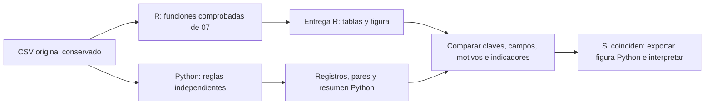
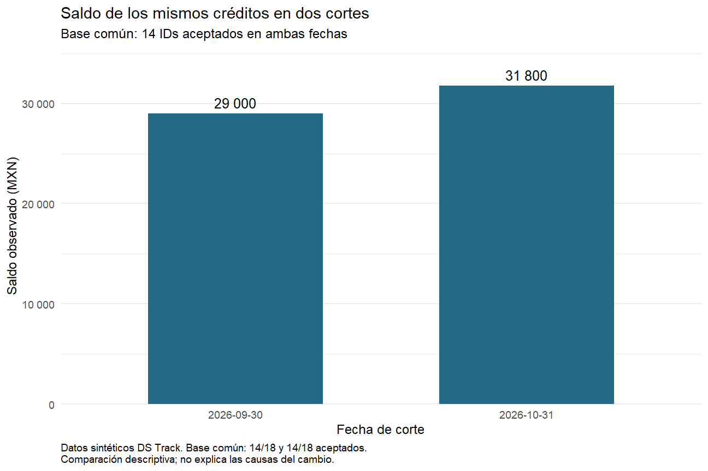
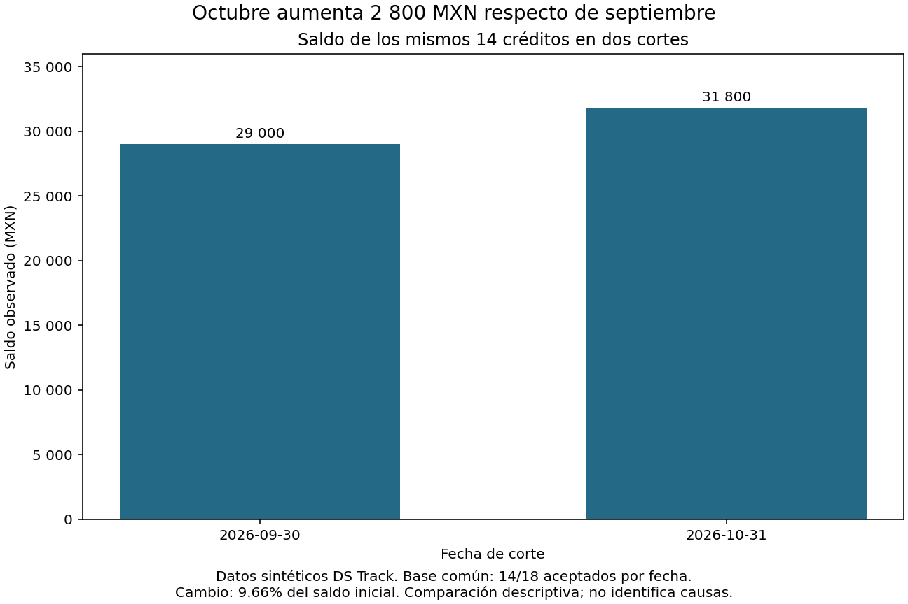

# 08.09 — Cierre visual y comparación con Python

[Inicio](../../../README.md) / [Módulo 08](../README.md) / **Lección 08.09**

| Tu sesión | Qué prepararás o comprobarás |
| --- | --- |
| **Meta** | Comprobar que R y Python representan el mismo análisis |
| **Necesitas** | 07.09–07.10 y 08.01–08.08; proyecto R y entorno Python del track |
| **Evidencia** | Entrega R y comparación Python con seis tablas conciliadas y comentario |

[Preparación](#antes-de-empezar) · [Material de apoyo](#material-de-apoyo) · [Lab 08.09](../../../labs/08_visualization_r/09_visual_comparison/README.md) · [Comprobar](#evidencia-y-criterio-de-salida)

<a id="propósito-prerrequisitos-y-objetivos"></a>

## Propósito

**Práctica de cierre.** Entregar una figura reconstruible y explicar por qué
dos implementaciones representan el mismo análisis. La apariencia ayuda a
comunicar; la equivalencia se comprueba en población, claves, fechas y valores.

## Antes de empezar

Retoma [07.09 — Fechas y cortes](../../07_tidyverse/09_dates_cutoffs/README.md),
[07.10 — Primera figura y cierre](../../07_tidyverse/10_first_plot_closure/README.md)
y [08.01–08.08](../README.md). En Python, retoma
[texto y fechas](../../02_pandas/06_text_dates/README.md) y el
[cierre visual](../../02_pandas/10_analysis_plot/README.md).
Necesitas el mismo proyecto renv y un entorno Python del track ya preparado.
Referencias comprobadas: R 4.6.1, ggplot2 4.0.3, Python 3.12.12 y Matplotlib 3.10.7.
Esta sección no añade paquetes ni modifica lockfiles.

La elección entre PNG/SVG/PDF, dimensiones, resolución y comprobación del archivo
se desarrolla en [08.08 — Exportación reproducible](../08_reproducible_export/README.md).
Aquí reutilizamos la entrega PNG/CSV de 07.10 para centrar el cierre en la
conciliación R/Python. Las nueve secciones tienen material; completar su
desarrollo no acredita las prácticas del estudiante ni el proyecto integrador.

Puedes trabajar en tres sesiones: reconstrucción R; conciliación Python;
interpretación y evidencia. No necesitas traducir toda la sintaxis de un
lenguaje al otro ni dominar el código interno del verificador.

## Qué vas a aprender

- Especificar qué significa «el mismo análisis» en dos lenguajes.
- Reconstruir una entrega R desde la fuente y contrastarla con Python.
- Distinguir diferencia monetaria, cambio relativo y cobertura.
- Localizar discrepancias antes de interpretar gráficos.
- Entregar tablas, código y un comentario con hallazgo y límites.

## Material de apoyo

| Recurso | Para qué sirve | Uso |
| --- | --- | --- |
| [Cierre R](cerrar_visual.R) | Reconstruir y exportar una entrega nueva desde el proyecto | Para el recorrido |
| [Referencia Python](comparar_python.py) | Reconstruir el CSV independientemente y conciliar antes de dibujar | Para el recorrido |
| [Base y reglas compartidas](../../07_tidyverse/10_first_plot_closure/README.md) | Ubicar el proyecto, la fuente y las funciones de reconstrucción | Para el recorrido |
| [Figura R](assets/saldo_comun_r.png) | Revisar población, unidades y lectura | Consulta visual |
| [Figura Python](assets/saldo_comun_python.png) | Contrastar representación sobre la misma base | Consulta visual |

Consulta las fuentes aquí y trabaja con el script propio dentro del proyecto
de práctica, manteniendo su raíz como directorio. Las imágenes de referencia
acompañan la lectura; contrasta también tablas y comprobaciones numéricas.

## 1. Fijar el contrato antes de comparar

La pregunta es: **¿cuánto cambia el saldo observado de los mismos créditos
entre el 30 de septiembre y el 31 de octubre de 2026?**

| Decisión | Contrato compartido |
| --- | --- |
| Fuente | `datos/cartera_texto.csv`, los 48 registros conservados desde 07.08 |
| Unidad original | Un registro de crédito/corte; ID es texto, conserva `001` |
| Calidad | ID de tres dígitos ASCII, segmento reconocido, fechas ISO reales entre 1900 y 2100, alta ≤ corte |
| Clave | ID/corte normalizados; todas las apariciones repetidas se rechazan |
| Saldo | Entero presente, no negativo, en MXN; ausencia no equivale a cero |
| Población de la figura | Intersección de IDs aceptados de los dos cortes |
| Unidad resumida | Una suma de saldo por corte sobre los mismos IDs |
| Comparación | Octubre menos septiembre; porcentaje sobre septiembre |

Las reglas de texto son las de [07.08](../../07_tidyverse/08_text_categories_factors/README.md):
recortar extremos, normalizar mayúsculas y reconocer la equivalencia completa
`educación` → `educacion`. `microcredito` permanece fuera de catálogo. Las fechas
inválidas y los originales se conservan para revisar los rechazos; no se imputan
ni se eliminan repeticiones eligiendo arbitrariamente una aparición.

El contrato incluye decisiones que los tipos de cada lenguaje no resuelven
solos. `Date` de R y `date` de Python representan aquí días del calendario;
no comparamos sus representaciones binarias. Intercambiamos texto ISO explícito.
Los IDs conservan ceros iniciales. Los saldos de esta muestra son enteros exactos;
no necesitamos tolerancia numérica. En otro problema con decimales habría que
acordar precisión y redondeo antes de declarar equivalencia.

## 2. Leer tres medidas con denominadores distintos

| Medida | Cálculo | Lectura |
| --- | --- | --- |
| Diferencia | 31800 − 29000 = 2800 MXN | Cuánto aumenta el saldo de la base común |
| Cambio relativo | 2800 / 29000 × 100 ≈ 9.66% | Aumento respecto al saldo inicial de esa base |
| Cobertura por fecha | 14 / 18 × 100 ≈ 77.78% | Qué parte de los aceptados integra la base común |

El porcentaje relativo no es `2800 / 31800`: eso usaría como referencia el saldo
final. Tampoco es una diferencia de puntos porcentuales, porque aquí comparamos
importes. Si el saldo inicial fuera cero, el cambio relativo no estaría definido;
habría que comunicar la diferencia monetaria y explicar ese límite.

Hay **18 aceptados por corte**, pero sus integrantes no coinciden completamente.
Los totales de todos los aceptados son 39900 y 41500 MXN: diferencia 1600 MXN.
Ese resultado responde a otra pregunta. Para los **mismos 14 IDs**, los totales
son 29000 y 31800 MXN: diferencia 2800 MXN. Cuatro registros aceptados por fecha
quedan sin pareja y se conservan aparte. Los 12 rechazos tampoco desaparecen.

No sumes septiembre y octubre para declarar un saldo en una sola fecha. Tampoco
atribuyas el aumento a una causa ni generalices a una población real: son datos
sintéticos y dos observaciones por ID.

## 3. Dos rutas de cálculo y una conciliación



Sin renderizador: R y Python vuelven a leer el CSV original. Cada ruta aplica
las reglas y construye los pares por su cuenta. Python lee después las tablas
R para compararlas con lo que calculó. Solo si coinciden genera su nueva entrega.

Si Python leyera únicamente `datos_figura.csv` de R y dibujara dos barras,
habríamos comprobado una representación del mismo agregado. Eso no verificaría
la selección ni los cálculos por una segunda ruta.

La [referencia Python](comparar_python.py) usa biblioteca estándar para datos
y Matplotlib para la figura. Reexpresa las reglas de esta muestra; no sustituye
al lector y los contratos generales del módulo 07. No depende de una sesión R
ni ejecuta R desde Python. Puedes inspeccionar `fecha_iso`, `reconstruir`,
`conciliar` y `comparar` por separado, sin exportar al importar el archivo.

## 4. Reconstruir R desde el IDE

Abre **el mismo proyecto de práctica**, guarda y reinicia R. Mantén su raíz
como directorio de trabajo. Desde el editor abre [cerrar_visual.R](cerrar_visual.R)
y guarda una copia como `output/mi_cierre_visual.R`; usa otro nombre si ya
existe una copia propia. No necesitas otro preparador ni cambiar metadatos.

Ejecuta el archivo por bloques en **Console de R**, después:

```r
source("output/mi_cierre_visual.R", encoding = "UTF-8")
cierre <- cerrar_visual("output/entrega_visual_r")
```

`source` carga las funciones existentes y define `cerrar_visual`; la llamada
reconstruye el análisis y crea una entrega nueva. Reutiliza `exportar_cierre`
y `comprobar_entrega` de 07.10: siete CSV, `analisis.rds`, `saldo_comun.png`
y `sesion.txt`. Relee los CSV, compara los valores y comprueba que la fuente
sigue intacta. La exportación usa un objeto de gráfico explícito.

La carpeta de destino debe ser nueva y `output/` debe existir. Una segunda
llamada con el mismo destino falla para conservar la evidencia anterior. Para
otra reconstrucción elige otro nombre, como `output/entrega_visual_r_02`.
Una salida parcial requiere revisión; no se reemplaza automáticamente.

Inspecciona las tablas desde el IDE:

```r
print(cierre$datos_figura)
print(cierre$comunes)
print(cierre$resultado$controles)
stopifnot(nrow(cierre$sin_pareja) == 8L,
          all(cierre$comunes$diferencia_mxn == 200))
```

En esta muestra cada par aumenta 200 MXN y 14 × 200 = 2800 MXN. Eso se observa
en la tabla de pares; no puede deducirse de dos barras agregadas por sí solas.
Las advertencias por fechas imposibles de la fuente son esperables: inspecciona
los motivos, no las ocultes para obtener una consola silenciosa.



Lectura sin imagen: dos barras desde cero muestran 29000 y 31800 MXN para
14 IDs comunes; la nota indica 14/18 aceptados por fecha y el alcance descriptivo.

## 5. Ejecutar Python y conciliar antes de dibujar

La terminal se usa aquí para seleccionar explícitamente **otro intérprete**.
No pegues estos comandos en Console de R. Abre Terminal en la raíz de DS Track
y activa tu entorno Python elegido, como aprendiste en
[00.05](../../00_getting_started/05_environment/README.md).
Comprueba `python` antes de ejecutar: no instales paquetes en `base` ni mezcles
gestores. Si usas uv, conserva su recorrido y `uv run --locked` en lugar de
`python`; si el entorno ya es adecuado no hace falta reinstalarlo.

Los siguientes recorridos son alternativas completas. Adapta la primera ruta
a tu proyecto de práctica. Los argumentos son: fuente original, entrega R que
quieres comprobar y carpeta **nueva** para la salida Python. Conserva las comillas.

### PowerShell

```powershell
$practica = (Resolve-Path "curriculum/06_r_foundations/09_known_result/output/cierre_ventas").Path
python -c "import sys, matplotlib; print(sys.executable); print(matplotlib.__version__)"
python curriculum/08_visualization_r/09_visual_comparison/comparar_python.py "$practica/datos/cartera_texto.csv" "$practica/output/entrega_visual_r" "$practica/output/entrega_visual_python"
```

### Bash/Zsh

```bash
practica="curriculum/06_r_foundations/09_known_result/output/cierre_ventas"
python -c "import sys, matplotlib; print(sys.executable); print(matplotlib.__version__)"
python curriculum/08_visualization_r/09_visual_comparison/comparar_python.py "$practica/datos/cartera_texto.csv" "$practica/output/entrega_visual_r" "$practica/output/entrega_visual_python"
```

Resultado esperado:

```text
6 tablas conciliadas; 14 IDs, 29000/31800 MXN; cambio 9.66%.
```

La salida contiene `base_comun.csv`, `datos_figura.csv`, `saldo_comun_python.png`
y `comparacion.json`. El JSON registra versión de Python/Matplotlib, huella SHA-256
de la fuente, tablas comprobadas, diferencia y porcentaje sin redondear. Una
huella permite reconocer contenido; no prueba por sí sola su calidad.

Esta ejecución exige los valores conocidos de la muestra. Las funciones de
reconstrucción también permiten inspeccionar casos pequeños: sin IDs comunes,
el saldo resumido queda ausente y la exportación se detiene; no dibuja un cero
ficticio. Una base con saldos observados iguales a cero sí tiene mediciones.
Son situaciones distintas, aunque ambas impidan usar un porcentaje sobre cero.



Las dos figuras usan barras desde cero, fechas explícitas y MXN. Matplotlib
separa figura (`fig`, conjunto) y ejes (`ax`, panel); `ax.bar` recibe los dos
saldos **ya calculados**. `fig.savefig` guarda ese objeto explícito. En ggplot2,
`geom_col` representa igualmente valores suministrados, como viste en
[08.02](../02_geometries_stats/README.md). No exige copiar fuentes, márgenes
o marcas del eje exactamente. Abre ambos PNG y revisa etiquetas y notas completas.

## 6. Qué demuestra la comprobación y qué falta mirar

| Comprobación | Alcance |
| --- | --- |
| R: `comprobar_entrega` | Reconstruye desde la fuente, relee las siete tablas completas y compara el RDS |
| Python: aceptados/rechazados | Compara número de registro, ID, segmento, dos fechas, saldo y motivos |
| Python: sin pareja/fuera de cortes | Compara esos mismos campos; conserva exclusiones de la figura |
| Python: pares | Compara ID, ambos saldos y diferencia de cada crédito |
| Python: resumen | Compara fechas, número de comunes, saldo y denominador de aceptados |
| Revisión visual y explicación | Verifica legibilidad, unidades, población y alcance del mensaje |

Son seis tablas contrastadas desde Python. No compara todas las columnas
auxiliares de fechas ni `resumen_cortes.csv`; eso lo revisa el verificador R.
Tampoco interpreta RDS ni compara píxeles. Las filas se indexan por su clave:
reordenarlas no cambia el resultado; repetir o sustituir una sí. La coincidencia
se exige campo a campo en la proyección declarada, además de los valores conocidos
de la muestra. Dos errores compensados pueden conservar un total y aun así fallar.

El verificador Python trata los CSV R como entrada de solo lectura. Si una
conciliación falla, no crea su carpeta de salida. Si falla una escritura después
de crearla, conserva la salida parcial para revisarla. La relectura posterior
de los CSV Python puede contrastarse de nuevo con `conciliar`; el lab lo practica.

Para comprobar desde otra sesión R sin volver a exportar, reinicia y ejecuta:

```r
source("output/mi_cierre_visual.R", encoding = "UTF-8")
fuente <- leer_texto_segmentos("datos/cartera_texto.csv")
comprobar_entrega(fuente, "output/entrega_visual_r")
```

Después repite Python con otro nombre de destino. La reconstrucción completa
debe producir las mismas tablas; no dependas de objetos que quedaron en memoria.

## 7. Diagnosticar una discrepancia

Sigue el recorrido fuente → reglas → registros → pares → resumen → figura.

- **36 aceptados frente a otra cantidad:** compara motivos por número de registro;
  revisa fechas reales, rango de años y repeticiones de claves normalizadas.
- **14 pares frente a otra cantidad:** conserva los ceros iniciales del ID y usa
  la intersección de aceptados de ambas fechas. No emparejes por posición de fila.
- **Totales iguales, pares distintos:** inspecciona ambos saldos por ID. Coincidir
  en una suma no garantiza coincidir en sus integrantes.
- **Tablas iguales, figuras distintas:** revisa límites, unidad, orden de cortes,
  filtros adicionales y si la geometría cuenta filas o representa importes.
- **Carpeta ocupada:** conserva la entrega y usa otro nombre. No borres evidencia
  para que una ejecución parezca nueva.

<a id="práctica-criterio-de-salida-y-continuidad"></a>

## Práctica

Realiza el [lab 08.09](../../../labs/08_visualization_r/09_visual_comparison/README.md) para
reconstruir ambas rutas y conciliar tablas antes de interpretar sus figuras.

## Evidencia y criterio de salida

| Conserva | Comprueba | Explica |
| --- | --- | --- |
| Código, tablas y figuras de ambos lenguajes | Seis tablas conciliadas; 14 IDs, 29000/31800 MXN y cambio 9.66% | Diferencia monetaria, cambio relativo y cobertura con sus bases |
| Tabla de pares y comentario con límites | Reconstrucción independiente y detección de una alteración compensada | Equivalencia de población y valores frente a parecido visual |

Puedes avanzar en este cierre cuando reconstruyas ambas rutas, expliques las
seis conciliaciones, detectes una alteración compensada y redactes el hallazgo
con denominadores y límites. Entrega los pares junto al resumen: las barras
no permiten auditar por sí solas la selección de la población.

Quien aprende realiza la práctica y explica las decisiones; su compañero revisa.
Tu compañero propone dos cambios que conservan el total y pide mostrar por qué la comparación por clave los detecta.
Guarda evidencia, ayudas y dudas en una nota personal junto a tu práctica.
PROGRESS.md registra desarrollo editorial, no tu expediente de aprendizaje.
El proyecto integrador y sus checkpoints siguen pendientes; disponer de
lecciones y scripts no acredita haber completado el aprendizaje.

<a id="referencias-primarias"></a>

## Referencias

- [ggsave: objeto, dimensiones y dispositivo](https://ggplot2.tidyverse.org/reference/ggsave.html).
- [Matplotlib: Figure.savefig](https://matplotlib.org/3.10.7/api/_as_gen/matplotlib.figure.Figure.savefig.html)
  y [Axes.bar](https://matplotlib.org/3.10.7/api/_as_gen/matplotlib.axes.Axes.bar.html).
- [Python: lectura CSV](https://docs.python.org/3/library/csv.html),
  [date.fromisoformat](https://docs.python.org/3/library/datetime.html#datetime.date.fromisoformat)
  y [Counter](https://docs.python.org/3/library/collections.html#collections.Counter).
- [runpy.run_path: ejecución de un archivo](https://docs.python.org/3/library/runpy.html#runpy.run_path),
  utilizado en el lab para inspeccionar la referencia sin activar su entrada de terminal.

Las páginas oficiales pueden describir versiones posteriores; las funciones
de estos ejemplos se comprobaron con las versiones declaradas al inicio.
Los ejemplos y la conciliación de esta muestra son propios del track.

## Siguiente paso

Después del lab, revisa el criterio global del [módulo 08](../README.md).
Continúa con [09 — Arrow y Parquet](../../09_arrow_parquet/README.md),
que dispone de nueve lecciones y labs, empezando por
[09.01 — CSV, Parquet y Arrow](../../09_arrow_parquet/01_csv_parquet_arrow/README.md). Proyecto y checkpoints
integradores siguen pendientes.

[← Módulo 08](../README.md) · [Lab 08.09](../../../labs/08_visualization_r/09_visual_comparison/README.md) · [Siguiente →](../../09_arrow_parquet/01_csv_parquet_arrow/README.md)
