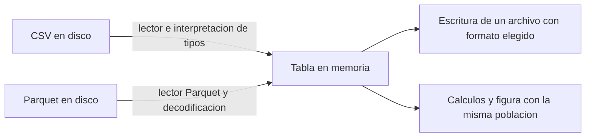

# 09.01 — CSV, Parquet y Arrow

## Propósito, prerrequisitos y objetivos

**Esencial.** Distinguir qué se guarda en disco, cómo se representa una tabla
en memoria y qué biblioteca permite trabajar con ella. Este vocabulario evita
confundir «cambiar de formato» con «cambiar de análisis».

Retoma [08.09 — Cierre visual y comparación con Python](../../08_visualization_r/09_visual_comparison/README.md)
y la [exportación reproducible de 08.08](../../08_visualization_r/08_reproducible_export/README.md).
La pregunta y los saldos ya son conocidos; aquí no se repite la limpieza ni se
introduce otro dominio. Necesitas poder abrir un archivo, ejecutar un script y
explicar una clave de registros.

Al terminar podrás:

- Clasificar CSV y Parquet como formatos de archivo, y reconocer el papel de Arrow.
- Explicar filas, columnas, esquema y dataset con un ejemplo concreto.
- Distinguir tamaño de archivo, buffers de una tabla y memoria de un proceso.
- Inspeccionar una muestra sin confundir una firma de archivo con una lectura completa.
- Mantener claves e indicadores al cambiar de representación.

El recorrido esencial usa Python estándar y R base, sin instalar paquetes ni
modificar entornos o lockfiles. La lectura real de Parquet se proporciona como
evidencia de autoría y ampliación opcional con PyArrow **ya disponible**. Los
recorridos de instalación/conversión Python y R se desarrollarán en 09.03 y
09.04, después del contrato de 09.02. No necesitas completar esa ampliación
para explicar los conceptos de esta primera sección.

## 1. La misma tabla puede tener distintas representaciones

Trabajamos con una proyección de la base común del cierre: los mismos 14 IDs
aceptados en septiembre y octubre de 2026. Cada fila representa un crédito
en una fecha, por lo que hay **28 filas y tres columnas**:

| id_credito | fecha_corte | saldo_mxn |
| --- | --- | ---: |
| 001 | 2026-09-30 | 1100 |
| 002 | 2026-09-30 | 1200 |
| … | … | … |
| 001 | 2026-10-31 | 1300 |
| 002 | 2026-10-31 | 1400 |

La clave es **ID/corte**, no solamente ID: `001` aparece en dos fechas y eso
es correcto. El saldo es un importe observado en MXN. Los totales siguen
siendo **29000 y 31800 MXN**, diferencia **2800 MXN**. No sumamos ambas fechas
para afirmar un saldo de cartera en una fecha única.

Es una selección de datos ya comprobados, no los 48 registros originales ni
todos los aceptados. Conserva cobertura de 14/18 aceptados por corte; rechazos
y ocho registros sin pareja permanecen en las entregas de 07/08. Esta muestra
no contiene todos sus campos de auditoría y no las sustituye.

Dispones de [CSV](datos/base_comun.csv), [Parquet](datos/base_comun.parquet),
[inventario](datos/inventario.csv) y [lectura de autoría](datos/lectura_parquet.txt).
La procedencia y decisiones de generación están en [datos/README.md](datos/README.md).

## 2. Archivo, representación y biblioteca

| Concepto | Qué es | Ejemplo en esta sección |
| --- | --- | --- |
| Archivo | Secuencia persistente de bytes con una ruta | `base_comun.parquet` |
| Formato | Reglas para interpretar esos bytes | CSV o Parquet |
| Tabla en memoria | Valores organizados en un proceso para trabajar con ellos | Un data.frame de R o una tabla Arrow |
| Biblioteca | Código que lee, escribe o procesa representaciones | PyArrow en Python, arrow en R |
| Esquema | Descripción de campos, tipos y posibilidad de ausencia | ID textual, fecha de calendario y saldo entero |
| Dataset | Conjunto lógico de datos organizado para consultarse | Varios archivos por cortes con un esquema compatible |

**Apache Arrow** es un proyecto con especificaciones y bibliotecas. Una de sus
piezas centrales es un formato columnar en memoria, independiente del lenguaje.
PyArrow y arrow de R son interfaces de ese ecosistema; no son extensiones de
archivo ni sinónimos de Parquet. [Visión general de Arrow](https://arrow.apache.org/overview/).

Arrow también define mecanismos de serialización e intercambio como IPC;
Feather se relaciona con ese recorrido. Por tanto, «Arrow solo existe en RAM»
sería una simplificación incorrecta. En esta primera ruta nos concentramos
en **Parquet para persistencia** y **Arrow para representación/intercambio**;
IPC/Feather no son requisito. [Especificación Arrow](https://arrow.apache.org/docs/format/Columnar.html).



Sin renderizador: un lector interpreta un archivo y construye una representación
en memoria. Distintos lectores pueden devolver distintos tipos de objeto.
Después calculamos o escribimos. Una biblioteca capaz de trabajar con Arrow
puede leer Parquet y devolver una tabla Arrow; eso no convierte ambos formatos
en uno solo. Tampoco significa que todo data.frame o DataFrame tenga internamente
el formato Arrow.

## 3. Qué conserva y qué no declara un CSV

El CSV guarda texto organizado en registros y campos. En nuestra muestra usa
coma, cabecera, UTF-8 y salto de línea LF. Todos los archivos son bytes; aquí
«texto» significa que se interpretan con una codificación y reglas textuales.
Un fragmento puede leerse así:

```csv
id_credito,fecha_corte,saldo_mxn
001,2026-09-30,1100
002,2026-09-30,1200
```

El texto `001` no declara por sí mismo «identificador textual»: un lector que
infiera un entero podría devolver `1`. Tampoco `2026-09-30` garantiza una columna
de fechas; el lector puede conservar texto o convertirlo. Necesitamos un contrato
y una lectura explícita, como en los módulos anteriores.

CSV tiene variantes: delimitador, comillas, separador decimal y convención de
ausencias deben acordarse. Un campo entre comillas puede contener comas e incluso
saltos de línea; no basta separar cualquier archivo con `split(",")` ni contar
líneas físicas para conocer sus registros. El
[RFC 4180](https://www.rfc-editor.org/rfc/rfc4180) documenta convenciones comunes;
es informativo y no resuelve por sí solo tipos o reglas de negocio.

Un campo vacío, el texto `NA` y el número `0` no son equivalentes. Esta muestra
no contiene ausencias; decidir cómo intercambiarlas corresponde a 09.02. No
convertiremos automáticamente una ausencia en saldo cero.

## 4. Qué cambia al guardar Parquet

Parquet es un formato de archivo **binario y columnar** con esquema, metadatos,
codificaciones y opciones de compresión. Un lector adecuado reconstruye sus
valores y tipos. No debe interpretarse con un lector de texto o con `grep` como
si fuera un CSV. Binario no significa cifrado, y compresión no significa cifrado.
[Visión general oficial](https://parquet.apache.org/docs/overview/).

«Columnar» significa que el almacenamiento agrupa datos por columnas dentro
de unidades del archivo. Para imaginarlo, nuestra tabla contiene las secuencias
de IDs, fechas y saldos; no son tres CSV concatenados ni una promesa sobre bytes
legibles. Parquet organiza grupos de filas y bloques de columna con metadatos;
sus detalles se desarrollarán en 09.07.

Leer pocas columnas puede evitar trabajo que no necesita la consulta. Omitir
filas o grupos depende del lector, filtro y metadatos; no se garantiza por usar
la extensión `.parquet`. La lectura selectiva se practica en 09.06.
[Estructura del archivo](https://parquet.apache.org/docs/file-format/).

En la muestra, el lector reconstruyó este esquema Arrow a partir del Parquet:

```text
id_credito: string not null
fecha_corte: date32[day] not null
saldo_mxn: int32 not null
```

`string` conserva identificadores textuales; `date32[day]` representa una fecha
de calendario con unidad de día; `int32` es un entero con un rango finito. Aquí
el saldo representa MXN enteros. Ese tipo no dice «dinero» ni declara moneda;
tampoco es una elección universal para cualquier cartera. `not null` declara
que estos campos no admiten ausencia en el esquema de la muestra.

Un esquema no demuestra que ID/corte sea único, que el saldo sea no negativo
o que todas las fechas pertenezcan al período correcto. Son comprobaciones
adicionales. Tampoco garantiza que todas las bibliotecas expongan las mismas
clases al leer; por eso comprobaremos ambos lenguajes.

Cambiar `base_comun.csv` a un nombre terminado en `.parquet` no convierte su
contenido. Un escritor Parquet debe producir una estructura válida. Nuestra
muestra sin cifrar tiene la marca `PAR1` al principio y al final; encontrarla
es una comprobación parcial, **no una validación ni decodificación completa**.

## 5. Disco, buffers y memoria del proceso

| Medida observada en esta muestra | Valor | Qué mide |
| --- | ---: | --- |
| CSV en disco | 593 bytes | Texto de los 28 registros con cabecera |
| Parquet en disco | 1668 bytes | Archivo con datos, esquema, metadatos y compresión Snappy |
| `table.nbytes` al leer con PyArrow 21.0.0 | 420 bytes | Tamaño lógico de buffers referenciados por esa tabla Arrow |

Aquí Parquet es **más grande** que el CSV. Es un ejemplo pequeño: los metadatos
tienen peso frente a pocos valores. No demuestra que CSV sea siempre más pequeño
o rápido. La compresión, distribución de valores, columnas, filas y configuración
influyen. No se midió velocidad, y no extrapolamos una prueba de 28 filas a
millones de registros.

Los 420 bytes tampoco son «la RAM que necesita Python». Un proceso mantiene el
intérprete, bibliotecas, objetos, buffers temporales y otros datos. `table.nbytes`
no mide el pico de memoria ni toda la memoria asignada. `object.size` de R y
otras mediciones de objetos tampoco deben compararse como si fueran esa misma
métrica. [Referencia de Table.nbytes](https://arrow.apache.org/docs/python/generated/pyarrow.Table.html#pyarrow.Table.nbytes).

Un Parquet comprimido que ocupa poco en disco puede necesitar más espacio al
decodificarse. Arrow puede permitir compartir buffers en operaciones compatibles,
pero convertir tipos, descomprimir o pasar a otra representación puede copiar o
asignar memoria. No asumimos «cero copias» ni memoria acotada por usar Arrow.

## 6. Inspección esencial: Python completo

Desde tu IDE, con la **raíz de DS Track** como directorio, abre
[inspeccionar_formatos.py](inspeccionar_formatos.py). Puedes ejecutarlo con el
intérprete Python ya elegido; en terminal usa una de estas alternativas completas.
No es Console de R. No requiere pandas ni PyArrow en este recorrido.

### PowerShell

```powershell
python curriculum/09_arrow_parquet/01_csv_parquet_arrow/inspeccionar_formatos.py
```

### Bash/Zsh

```bash
python curriculum/09_arrow_parquet/01_csv_parquet_arrow/inspeccionar_formatos.py
```

El resultado muestra 28 registros, 14 IDs, 29000/31800 MXN, tamaños y huellas
de ambos archivos. La función interpreta el CSV con `csv.DictReader`, conserva
IDs como texto y aplica conversiones explícitas para fechas/saldos. Revisa las
claves y contrasta los archivos con el inventario. No escribe nada.

La frase final es **«CSV interpretado; Parquet sin decodificar»**. Contrastar
bytes, huella y firma contra un inventario conocido permite reconocer esta
muestra, pero no equivale a ejecutar un lector Parquet. La huella tampoco prueba
la calidad de datos si alguien modifica también el inventario.

## 7. Inspección esencial: R completo

Desde RStudio o tu IDE, usa la raíz de **DS Track** como directorio para este
apartado de R base. Guarda tu trabajo antes de cambiar de proyecto/directorio.
No inicialices renv en la raíz ni copies datos sobre tu proyecto de práctica.
Puedes guardar el siguiente recorrido en un script propio dentro de `output/`,
con otro nombre si ya existe; la fuente y los archivos de referencia se conservan.

En **Console de R**, no Terminal:

```r
source("curriculum/09_arrow_parquet/01_csv_parquet_arrow/inspeccionar_formatos.R", encoding = "UTF-8")
resultado <- inspeccionar_formatos()
print(resultado$resumen)
print(resultado$inventario)
print(resultado$alcance)
```

El script usa `read.csv` con todas las columnas inicialmente textuales; convierte
fecha y saldo explícitamente y comprueba las claves. `file.info` consulta bytes
en disco, y `readBin` lee la firma binaria. **No usa arrow de R ni decodifica
Parquet.** La tabla R y su resumen no son un objeto Arrow por haber inspeccionado
la firma de un Parquet.

Guarda, reinicia R y ejecuta el bloque completo otra vez desde la misma raíz.
Debe producir los mismos datos y no crear ni modificar archivos. Los scripts
Python y R ofrecen recorridos completos separados; no necesitas conectar los
intérpretes mediante reticulate.

## 8. Leer la evidencia y reconocer un dataset

Abre [lectura_parquet.txt](datos/lectura_parquet.txt). Documenta una **lectura
real realizada durante la autoría**, con PyArrow 21.0.0 ya disponible, dos grupos
de 14 filas y Snappy. No se añadió PyArrow al entorno del curso. La versión de
la biblioteca `21.0.0` no es la versión de formato Parquet `2.6` que informa el
lector. Las versiones a usar por el estudiante se verificarán en 09.03/09.04.

**Ampliación de autoría:** si PyArrow ya existe en el entorno que elegiste,
puedes ejecutar desde la raíz:

```powershell
python curriculum/09_arrow_parquet/01_csv_parquet_arrow/inspeccionar_formatos.py --verificar-parquet
```

El mismo comando sirve en Bash/Zsh. Esta opción importa PyArrow, lee el Parquet,
revisa esquema y compara cada observación por ID/corte con el CSV. También muestra
`table.nbytes`. Sin el paquete fallará la importación; conserva el recorrido
esencial y espera 09.03. No lo instales en un entorno global para esta ampliación.
La API interna se proporciona como referencia, no como sintaxis que debas dominar
antes de su lección. [ParquetFile](https://arrow.apache.org/docs/python/generated/pyarrow.parquet.ParquetFile.html).

La carpeta `datos/` contiene **dos representaciones de la misma tabla**, no dos
lotes para sumar. Si las concatenaras, duplicarías los registros. Un dataset
podría organizar distintos cortes en varios archivos compatibles; para leerlo
hay que definir archivos, esquema y reglas, no simplemente tomar «todo lo que
hay en una carpeta». No debe confundirse un directorio, un archivo Parquet, un
grupo de filas interno y una partición. Se profundizará en 09.06–09.08.

## Práctica, criterio de salida y siguiente paso

Realiza el [lab 09.01](../../../labs/09_arrow_parquet/01_csv_parquet_arrow/README.md).
Puedes avanzar cuando clasifiques archivo/formato/representación/biblioteca,
expliques las tres medidas de tamaño y reconstruyas los controles esenciales
sin afirmar que leíste Parquet cuando solo inspeccionaste su firma.

Siguiente: [09.02 — Esquemas y tipos entre lenguajes](../02_schemas_types/README.md).
Consulta [cierre y pendientes](../../../docs/storage-closure.md)
para retomar el trabajo. El módulo completo, la lectura cruzada R/Python y sus
checkpoints no quedan terminados por implementar esta introducción.

## Referencias y atribución

Referencias primarias de Apache Arrow, Apache Parquet y RFC Editor enlazadas
junto a los conceptos. La documentación en línea puede mostrar versiones más
recientes; la ampliación se contrastó con PyArrow 21.0.0 existente, y el esencial
con Python 3.12.12/R 4.6.1. Datos sintéticos y ejemplos propios del track.
Consulta: 2026-10-21. No se cambian dependencias por planificar el módulo.
