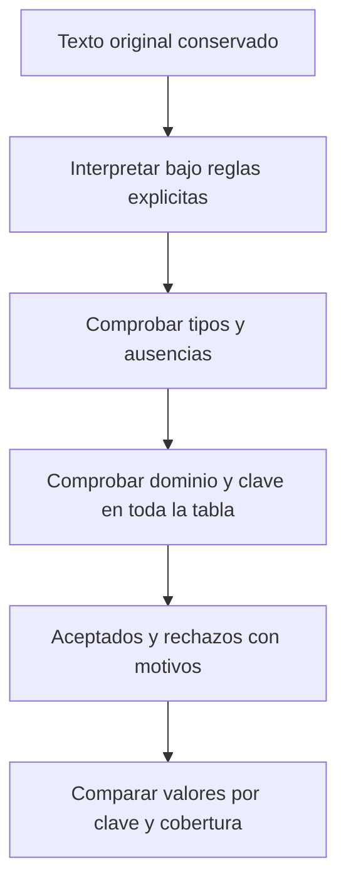

# 09.02 — Esquemas y tipos entre lenguajes

[Inicio](../../../README.md) / [Módulo 09](../README.md) / **Lección 09.02**

| Tu sesión | Qué prepararás o comprobarás |
| --- | --- |
| **Meta** | Definir el contrato que debe conservar una tabla al cambiar de representación |
| **Necesitas** | 09.01, validación, tipos, faltantes y fechas; Python estándar y R base |
| **Evidencia** | Contrato redactado y casos aceptados/rechazados con motivos |

[Preparación](#antes-de-empezar) · [Material de apoyo](#material-de-apoyo) · [Lab 09.02](../../../labs/09_arrow_parquet/02_schemas_types/README.md) · [Comprobar](#evidencia-y-criterio-de-salida)

<a id="propósito-prerrequisitos-y-objetivos"></a>

## Propósito

**Esencial.** Acordar qué significa una tabla antes de convertirla entre Python,
R, Arrow y Parquet. Un archivo puede abrirse sin errores y haber perdido ceros
del ID, precisión o el significado de una fecha.

## Antes de empezar

Retoma [09.01 — CSV, Parquet y Arrow](../01_csv_parquet_arrow/README.md).
Necesitas la [validación Python](../../01_python_foundations/06_validation_summary/README.md),
los [tipos y contratos](../../05_python_applied/05_types_contracts/README.md),
los [faltantes de R](../../06_r_foundations/04_logic_missing/README.md) y las
[fechas de 07.09](../../07_tidyverse/09_dates_cutoffs/README.md).

El recorrido usa **Python estándar y R base**, sin instalar paquetes, cambiar
lockfiles ni inicializar renv en la raíz. Los nombres Arrow/Parquet describen
el destino acordado; aquí comprobamos valores desde CSV, **sin decodificar
Parquet ni demostrar todavía una lectura cruzada**. Eso corresponde a 09.03–09.05.
Los casos de frontera son propios y están separados de la muestra anterior.

## Qué vas a aprender

- Definir nombres, tipos y nulabilidad.
- Separar esquema de reglas de negocio.
- Distinguir ausente, vacío y cero.
- Elegir unidad y rango del dinero.
- Explicar qué comparar al intercambiar una tabla.

## Material de apoyo

| Recurso | Para qué sirve | Uso |
| --- | --- | --- |
| [Casos de contrato](casos_contrato.csv) | Examinar 23 casos independientes de la base común | Para el recorrido |
| [Evaluador Python](contrato_tabla.py) | Comprobar valores y conservar motivos con biblioteca estándar | Para el recorrido |
| [Evaluador R](contrato_tabla.R) | Contrastar el mismo contrato desde R base | Para el recorrido |
| [Muestra conocida](../01_csv_parquet_arrow/datos/README.md) | Relacionar el acuerdo con la tabla de intercambio | Para el recorrido |

Consulta los archivos aquí y ábrelos donde indica el recorrido. Python y R
tienen instrucciones de preparación y ejecución propias; conserva los
originales y utiliza carpetas nuevas cuando la actividad escriba resultados.

## 1. Esquema y contrato: dos niveles de acuerdo

Un **esquema** describe los campos: nombre, tipo y si admiten ausencia. Por
ejemplo: `saldo_mxn`, entero de 32 bits con signo, no anulable. «Anulable»
significa que un campo puede contener un valor ausente, llamado null en Arrow.
Que una columna permita null no obliga a que aparezca alguno en cada archivo.

Un **contrato de datos** añade significado y reglas: cada fila es un crédito
en un corte, el saldo está en MXN enteros, no puede ser negativo y la pareja
ID/corte es única. También define cómo leer texto, qué hacer ante errores y
qué evidencia conservar. Un entero negativo cabe en el tipo y falla nuestra
regla de saldo. Dos filas idénticas pueden cumplir el esquema y violar la clave.



Sin renderizador: conserva el texto, interpreta, comprueba campos y reglas
de la tabla, separa resultados y compara. Interpretar `"-1"` como entero es
posible; aceptarlo como saldo en este contrato no lo es. Los scripts reúnen
motivos por campo en orden ID → fecha → saldo, y después añaden clave repetida.
Un fallo de forma impide evaluar reglas que requieren ese valor interpretado.
Se usa calendario gregoriano sin año cero en ambos evaluadores; después se
aplica el rango didáctico 1900–2100. No se presupone que los lectores de fechas
de ambos lenguajes acepten exactamente las mismas entradas.

## 2. Contrato de la tabla conocida

La [muestra de 09.01](../01_csv_parquet_arrow/datos/README.md) contiene 28
observaciones de los mismos 14 IDs, con 29000/31800 MXN en septiembre/octubre.
Representa la base común, con cobertura 14/18 aceptados por corte. No es toda
la cartera ni conserva todos los campos de auditoría de 07/08.

| Campo, en este orden | Significado y tipo lógico acordado | Ausencia | Reglas adicionales |
| --- | --- | --- | --- |
| `id_credito` | Identificador textual; Arrow `string` | No | Tres dígitos ASCII, ceros conservados; sin recortar espacios |
| `fecha_corte` | Fecha de calendario; Arrow `date32` | No | Texto `AAAA-MM-DD`, calendario válido y años 1900–2100 |
| `saldo_mxn` | Pesos mexicanos enteros; Arrow `int32` | No | De 0 a 2147483647; sin fracciones ni conversión de unidades implícita |

**Reglas de tabla:** nombres y orden exactos; clave compuesta ID/corte única.
Se apartan **todas** las apariciones repetidas, aunque alguna tenga saldo
inválido. Una clave solo se evalúa si el ID tiene forma válida y la fecha
se pudo interpretar. Las filas no tienen un orden obligatorio: se comparan
por clave. Un vacío de cero filas conserva sus tres campos y tipos; no permite
afirmar los resultados conocidos de la muestra.

**Lectura textual de esta práctica:** CSV con coma, cabecera y UTF-8; saldo
con dígitos y un signo menos opcional para diagnosticar negativos. No admite
espacios, `+1`, `1e3`, `1.0`, separadores de miles, `Inf` ni `NaN`. No son
todos errores matemáticos: incumplen la representación acordada. Los ceros
iniciales del saldo se interpretan numéricamente; los del ID se conservan.

En [casos_contrato.csv](casos_contrato.csv) reservamos **`\N` como marcador
textual de ausencia**. Es una decisión local de esa entrada, no un estándar
universal de CSV ni una modificación de 09.01. Un campo vacío y el texto `NA`
se conservan como texto y se diagnostican por separado del marcador.
No se modifica, imputa, redondea ni descarta silenciosamente una entrada.
Si un texto legítimo pudiera ser `\N`, haría falta otro acuerdo de codificación.

Los 28 registros y sus sumas son controles de **esta muestra**, no restricciones
universales de cualquier tabla con el mismo esquema. Los casos separados
incluyen un saldo máximo: no se suman a la cartera ni a sus indicadores.

## 3. Tipo lógico, almacenamiento y objeto del lenguaje

El mismo significado puede usar distintos objetos al entrar en cada lenguaje.
`int` de Python no equivale a un entero de ancho fijo; `numeric` de R puede
referirse a integer o double. Especificar el nombre de una clase no basta.

| Significado | Python estándar de esta práctica | R base de esta práctica | Destino Arrow | Representación Parquet esperada |
| --- | --- | --- | --- | --- |
| ID textual | `str` | `character` | `string` UTF-8 | `BYTE_ARRAY` con tipo lógico `STRING` |
| Fecha de calendario | `datetime.date` | clase `Date` | `date32`, días desde 1970-01-01 | `INT32` con tipo lógico `DATE` |
| Saldo en MXN enteros | `int`, rango comprobado | `integer`, rango comprobado | `int32` con signo | `INT32` |

El **tipo lógico** dice cómo interpretar; el **tipo físico** dice cómo se
almacena. Un `INT32` sin la anotación de fecha no declara por sí solo una fecha.
La época permite representar fechas como distancias en días; no son números
`AAAAMMDD`. Esta tabla describe el contrato, no ejecuta una conversión.
Consulta los [tipos lógicos de Parquet](https://parquet.apache.org/docs/file-format/types/logicaltypes/).

La unidad MXN y la clave compuesta no quedan garantizadas por `int32`.
Los metadatos pueden documentarlas; los lectores y verificadores deben
comprobarlas. Una biblioteca puede devolver otra clase compatible: decidir
compatibilidad exige revisar valores, rango, ausencia y significado.

En pandas, `Int32`/`Int64` con mayúscula son tipos anulables, distintos de los
enteros NumPy `int32`/`int64`. La inferencia puede cambiar una columna por la
presencia de faltantes. Retoma [02.04](../../02_pandas/04_types_calculated_columns/README.md);
no necesitas pandas para ejecutar esta sección.
[Enteros anulables, pandas 2.3](https://pandas.pydata.org/pandas-docs/version/2.3/user_guide/integer_na.html).

## 4. Ausente, vacío, cero y fila inexistente

| Caso | Qué declara | Qué hacer aquí |
| --- | --- | --- |
| Saldo `0` | Importe observado igual a cero | Aceptar si el resto cumple |
| Marcador `\N` | Saldo no disponible en esta entrada | Rechazar: el campo no admite ausencia |
| Campo vacío `""` | Texto de longitud cero | Conservar; no tiene forma de entero |
| Texto `NA` | Dos letras en el CSV | Conservar; no es automáticamente NA nativo |
| No existe fila ID/corte | Falta una observación completa | Detectar con inventario de claves, no con null en una celda |

En Python usamos `None` como ausencia en un ejemplo en memoria; en R usamos
`NA_integer_`. En Arrow, null se identifica con información de validez
separada del valor; no es necesariamente cero, cadena vacía o un número especial.
`NaN` es un valor de punto flotante distinto de null en Arrow. El lector puede
aplicar conversiones: hay que comprobar su política, no asumirla.
[Validez y null en Arrow](https://arrow.apache.org/docs/format/Columnar.html#validity-bitmaps).

R `NULL` no representa una celda faltante de un vector integer: `c(1L, NULL)`
tiene longitud uno; `c(1L, NA_integer_)` tiene longitud dos. Usa `is.na()`,
no `x == NA`. [NA de R](https://stat.ethz.ch/R-manual/R-devel/library/base/html/NA.html).

Una muestra analítica **independiente**, con saldo anulable, puede ser
`[0, ausente, 10]`. Tiene tres registros, dos saldos conocidos, suma observada
10 y cobertura 2/3; el total completo sigue desconocido. No se cambia el
contrato no anulable de la cartera para aceptar esos faltantes.

## 5. Rango, precisión y dinero

**Rango**: qué magnitudes admite un tipo. `int32` con signo abarca
−2147483648 a 2147483647. R reserva un patrón de su integer para NA, por lo
que no se debe asumir que todo int32 de Arrow entra como integer no ausente
en R. Nuestro dominio no negativo evita esa frontera inferior.
Python admite enteros de precisión arbitraria, pero un destino `int32` no.
[Enteros de R y truncamiento](https://stat.ethz.ch/R-manual/R-devel/library/base/html/integer.html).

**Precisión**: qué valores se distinguen exactamente. Un double binario tiene
normalmente 53 bits de precisión: representa todos los enteros entre
−2^53 y 2^53, pero después algunos consecutivos se confunden. Un ID de
`9007199254740993` convertido a double puede perder una unidad antes de
convertirlo a texto. Mantenerlo como texto desde el inicio evita esa pérdida;
no se recupera con formato. El contrato actual exige IDs de tres dígitos:
ese ID largo es solo una demostración independiente.

`0.1 + 0.2` tampoco tiene por qué ser exactamente `0.3` en binario. Formatear
dos decimales cambia la presentación, no el valor almacenado. Una tolerancia
debe tener justificación y unidad; nunca sirve para dar por iguales claves,
recuentos o importes que el contrato exige exactos.
[Explicación de punto flotante de Python](https://docs.python.org/3.12/tutorial/floatingpoint.html).

### Si más adelante necesitas centavos

Hay que acordar otra columna y contrato. Dos opciones de diseño:

- **Entero en centavos:** 12345 representa 123.45 MXN, no 12345 MXN. Si se usa
  int32 no negativo, el máximo pasa a 21474836.47 MXN. La escala es 100.
- **Decimal de precisión y escala fijas:** `decimal128(12, 2)` permite doce
  dígitos en total, dos tras el punto: hasta 9999999999.99 en magnitud.
  Es una elección distinta; exige lector compatible y política de cálculo.

No basta multiplicar un float por 100 y truncarlo: hay que interpretar el texto,
comprobar decimales y rango, y definir si se rechaza o cómo se redondea.
En un contrato de dos decimales, `12.345` requiere esa decisión; no se vuelve
`12.34` por accidente. Aquí se **rechaza** como saldo de pesos enteros.

Python ofrece `Decimal` en su biblioteca estándar. Se construye desde texto
para no introducir primero una aproximación binaria. Sus operaciones también
tienen un contexto de precisión y redondeo; no es exactitud ilimitada.
R base no tiene un vector decimal financiero equivalente: en el ejemplo
trabajamos directamente con 10 y 20 centavos enteros, sin paquetes nuevos.
[Decimal de Python](https://docs.python.org/3.12/library/decimal.html).

## 6. Fechas, instantes y categorías

`2026-09-30` es una **fecha de calendario**, sin hora ni zona. Un instante como
`2026-10-01T00:30:00Z` requiere hora y referencia temporal: en UTC es 1 de
octubre, con desplazamiento fijo −06:00 cae el 30 de septiembre. Pasarlo a
fecha implica elegir la referencia; no se debe cortar el texto sin decidirla.
Una fecha de corte no necesita convertirse en «medianoche UTC».
[Fechas e instantes en Python](https://docs.python.org/3.12/library/datetime.html).

Para un timestamp Arrow se acuerdan unidad (`s`, `ms`, `us` o `ns`) y zona,
si procede. Reducir resolución puede perder fracciones; aumentar resolución
puede reducir el rango representable con el mismo entero de 64 bits. Un
timestamp sin zona no identifica por sí solo un instante mundial.
[Timestamps de Arrow](https://arrow.apache.org/docs/format/Columnar.html#timestamps).
No implementamos aquí conversión de timestamps ni reglas de zonas regionales.

Los factores y categorías añaden etiquetas, niveles y una decisión de orden.
El código entero `1` puede significar `consumo` en un factor y `comercio` en
otro. Comparar sus códigos daría una coincidencia falsa. Para intercambiar,
acuerda etiquetas, niveles permitidos, orden, ausencia y categorías sin uso;
comprueba cómo los conserva cada lector. Una codificación de diccionario no
demuestra el orden semántico. Retoma [07.08](../../07_tidyverse/08_text_categories_factors/README.md).
[Factores de R](https://stat.ethz.ch/R-manual/R-devel/library/base/html/factor.html) y
[categorías de pandas 2.3](https://pandas.pydata.org/pandas-docs/version/2.3/user_guide/categorical.html).
No añadimos segmento al CSV de tres columnas para demostrarlo.

## 7. Recorrido completo Python

Abre [contrato_tabla.py](contrato_tabla.py) en tu IDE. Define lectura textual,
evaluación de campos/clave y comprobación de la base más los casos separados.
`original` conserva los textos; `motivos` explica rechazos. Los resultados
intermedios pueden tener valores interpretados de filas rechazadas: usa
`aceptado` antes de analizarlos. La sintaxis reutiliza funciones, listas,
diccionarios y validación ya estudiados; el archivo es referencia reutilizable.

Desde la raíz, en **PowerShell**, con el entorno Python elegido activo:

```powershell
python curriculum/09_arrow_parquet/02_schemas_types/contrato_tabla.py
```

En **Bash/Zsh**, desde la misma raíz y con tu entorno activo:

```bash
python curriculum/09_arrow_parquet/02_schemas_types/contrato_tabla.py
```

No cambies de gestor ni reinstales si el entorno ya funciona. Si editas en el
IDE, ejecuta el archivo completo con ese intérprete. Obtendrás 28 observaciones,
14 IDs, saldos 29000/31800 y **23 casos separados: 5 aceptados y 18 rechazados**.
Se muestran motivos esperados, incluidas ambas apariciones de la clave repetida.
El archivo solo lee; no crea entregas ni modifica entradas.

En un script propio o consola Python, ejecuta estos ejemplos pequeños:

```python
from decimal import Decimal
from datetime import datetime, timedelta, timezone

assert str(int("001")) == "1"  # Demuestra la perdida del formato del ID.
valores = [0, None, 10]
conocidos = [x for x in valores if x is not None]
assert (sum(conocidos), len(conocidos), len(valores)) == (10, 2, 3)
assert 0.1 + 0.2 != 0.3
assert Decimal("0.10") + Decimal("0.20") == Decimal("0.30")
assert float(2**53) == float(2**53 + 1)
instante = datetime.fromisoformat("2026-10-01T00:30:00+00:00")
local = instante.astimezone(timezone(timedelta(hours=-6)))
assert str(instante.date()) == "2026-10-01"
assert str(local.date()) == "2026-09-30"
```

`timezone(timedelta(...))` representa un desplazamiento fijo para aislar la
idea; no es una base de reglas históricas de una región. Repite el archivo y
estos ejemplos desde un proceso nuevo. No hace falta instalar PyArrow.

## 8. Recorrido completo R en el IDE

Abre DS Track en RStudio o tu IDE y comprueba que el directorio de trabajo es
la raíz. No actives renv en ella. Abre [contrato_tabla.R](contrato_tabla.R),
ejecuta sus funciones por bloques e inspecciona los resultados. En **Console
de R**, ejecuta:

```r
source("curriculum/09_arrow_parquet/02_schemas_types/contrato_tabla.R", encoding = "UTF-8")
r <- comprobar_contrato()
print(r$saldos_mxn)
print(data.frame(caso = r$casos$caso, r$evaluados$diagnostico))
stopifnot(nrow(r$base$aceptados) == 28L,
          identical(r$saldos_mxn, c(29000, 31800)),
          sum(r$evaluados$diagnostico$aceptado) == 5L,
          sum(!r$evaluados$diagnostico$aceptado) == 18L)
str(r$base$aceptados)
```

Debes ver ID character, fecha Date y saldo integer. `tipados` conserva el
trabajo intermedio, incluso para rechazados; `aceptados` selecciona las filas
que cumplen. `diagnostico` conserva cada texto y motivo. No confundas un NA
producido por fallo de interpretación con una ausencia declarada en origen.

Ejecuta en tu script propio estos ejemplos independientes:

```r
stopifnot(as.character(as.integer("001")) == "1")
x <- c(0L, NA_integer_, 10L)
stopifnot(sum(x, na.rm = TRUE) == 10L, sum(!is.na(x)) == 2L, length(x) == 3L,
          is.na(sum(x)), length(c(1L, NULL)) == 1L)
stopifnot(0.1 + 0.2 != 0.3, 2^53 == 2^53 + 1)
centavos <- c(10L, 20L)
stopifnot(sum(centavos) == 30L)  # Exactitud en centavos; no en pesos double.
stopifnot(as.integer(12.50) == 12L)  # Conversion exitosa, perdida real.
a <- factor("consumo", levels = c("consumo", "comercio"))
b <- factor("comercio", levels = c("comercio", "consumo"))
stopifnot(as.integer(a) == as.integer(b), as.character(a) != as.character(b))
```

La suma `na.rm = TRUE` es observada, con cobertura 2/3; no sustituye al total
completo. El truncamiento y los factores son demostraciones de pérdida, no
pasos para limpiar datos. Guarda tu script, reinicia la sesión R y ejecútalo
completo, incluido `source()` y `comprobar_contrato()`. Debe reproducir los
controles sin escribir archivos. No se requiere terminal del sistema.

<a id="práctica-criterio-de-salida-y-continuidad"></a>

## Práctica

Realiza el [lab 09.02](../../../labs/09_arrow_parquet/02_schemas_types/README.md) para
redactar el contrato y justificar las fronteras de tipos, ausencias, unidades y fechas.

Como referencia de la actividad, consulta [Evaluador Python](contrato_tabla.py), [Evaluador R](contrato_tabla.R).
Sigue las rutas y el directorio de trabajo indicados para cada lenguaje.

## Evidencia y criterio de salida

| Conserva | Comprueba | Explica |
| --- | --- | --- |
| Contrato y evaluación de los casos | 23 casos: cinco aceptados y dieciocho rechazados con texto y motivos | Esquema frente a reglas de negocio; nulabilidad y rangos |
| Nota de fronteras | Ausente/vacío/cero, precisión, calendario e instantes | Qué comparar por clave y por qué sumar o igualar clases no demuestra igualdad |

Puedes avanzar si redactas el contrato, justificas los rechazos, conservas
ceros/ausencias y explicas por qué igualar sumas o clases no demuestra igualdad.
La comprobación debe incluir esquema, claves, valores, ausencia y cobertura
por corte; la igualdad de bytes es otra propiedad.

Quien aprende realiza la práctica y explica las decisiones; su compañero revisa.
Tu compañero presenta dos tablas con igual suma y pide una comprobación que detecte valores intercambiados.
Guarda evidencia, ayudas y dudas en una nota personal junto a tu práctica.
PROGRESS.md registra desarrollo editorial, no tu expediente de aprendizaje.
El proyecto integrador y sus checkpoints siguen pendientes; las comprobaciones
técnicas del material no acreditan haber completado la práctica.

<a id="referencias-y-atribución"></a>

## Referencias

Fuentes primarias enlazadas junto a cada concepto: equipos de Apache Arrow y
Parquet, Python Software Foundation, R Core y comunidad pandas. Los ejemplos
y casos son propios; no se copian capítulos. Consulta: 2026-10-21. Documentación
en línea puede avanzar; se comprueba la práctica con Python 3.12.12 y R 4.6.1,
sin dependencias externas ni cambios de lockfile. Los tipos de destino se
verificarán con lectores reales al desarrollar 09.03–09.05.

## Siguiente paso

Después de la práctica y su comprobación, continúa con
[09.03 — Leer y escribir desde Python](../03_python_read_write/README.md).

Consulta los [criterios de cierre e integración](../../../docs/storage-closure.md).

[← Módulo 09](../README.md) · [Lab 09.02](../../../labs/09_arrow_parquet/02_schemas_types/README.md) · [Siguiente →](../03_python_read_write/README.md)
