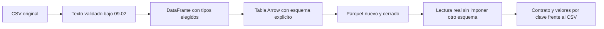

# 09.03 — Leer y escribir desde Python

## Propósito, prerrequisitos y objetivos

**Esencial.** Convertir una tabla conocida a Parquet y demostrar, al releerla,
que conserva el contrato, las claves y cada valor. Abrir el archivo y comparar
dos sumas no basta para detectar importes intercambiados entre créditos.

Completa [09.02 — Esquemas y tipos entre lenguajes](../02_schemas_types/README.md).
Retoma [lectura CSV](../../02_pandas/02_read_inspect_export/README.md),
[tipos pandas](../../02_pandas/04_types_calculated_columns/README.md) y
[módulos reutilizables](../../05_python_applied/01_notebook_to_modules/README.md).
La práctica reutiliza el [CSV de 09.01](../01_csv_parquet_arrow/datos/base_comun.csv):
28 observaciones de los mismos 14 IDs, dos cortes de 14 registros y
29000/31800 MXN. No se generan otros datos de cartera ni se reemplaza su Parquet.

Al terminar podrás:

- Preparar PyArrow en el entorno elegido y registrar versiones.
- Pasar de DataFrame a tabla Arrow con un esquema explícito.
- Explicar qué sucede con el índice de pandas y con las ausencias.
- Escribir y cerrar un Parquet, releerlo desde otro proceso y conciliar por clave.
- Reconocer una pérdida de tipo o de información aunque los totales coincidan.

Aquí se escribe y lee **desde Python**. La lectura desde R y el intercambio en
ambas direcciones siguen pendientes de 09.04–09.05; no necesitas instalar arrow
de R, Polars ni DuckDB. Tampoco necesitas notebook ni repetir la limpieza de 07.

## 1. Qué hace cada paso



Sin renderizador: leemos el texto, aplicamos las reglas ya acordadas, construimos
objetos tipados, escribimos y cerramos, y después decodificamos y comparamos.
El CSV es la referencia reconstruida; el objeto previo a escribir no sustituye
la relectura. Un `print(df)` muestra datos en memoria y no guarda un archivo.

Un **DataFrame** organiza el análisis en pandas. Una **tabla Arrow** organiza
columnas con tipos Arrow. **Parquet** almacena la tabla en disco. PyArrow conecta
esas operaciones; no convierte automáticamente una clave o una unidad en regla
de negocio. La lectura completa de esta muestra cabe en memoria; aquí no se
promete lectura por lotes, memoria acotada ni mejora de velocidad.

## 2. Preparar el entorno y obtener una primera entrega

Usamos **Python 3.12.12, pandas 2.3.3 y PyArrow 21.0.0** como referencia
comprobada. PyArrow 21.0.0 ya se utilizó en la autoría de 09.01; desde esta
sección queda declarado en [pyproject.toml](../../../pyproject.toml) y
[uv.lock](../../../uv.lock). No es una afirmación de versión más reciente.
La resolución conserva las versiones previas del curso.

Sigue los [recorridos completos por shell y gestor](recorridos.md): PowerShell,
después Bash/Zsh y CMD para Anaconda Prompt. Elige **un gestor y un shell**.
Si ya puedes importar las versiones de referencia en tu entorno de estudio,
omite la instalación y conserva la comprobación. La documentación de
[instalación de PyArrow 21](https://arrow.apache.org/docs/21.0/python/install.html)
incluye paquetes binarios; compilar Arrow desde fuentes no es objetivo de esta práctica.

El recorrido crea `output/09_03_python/` con:

| Archivo propio | Papel |
| --- | --- |
| `base_comun.parquet` | Nueva representación de las tres columnas |
| `sesion.json` | Versiones, esquema, decisión de índice y resumen de esa ejecución |

El JSON se escribe tras verificar el Parquet. Es una nota de ejecución, no una
prueba permanente de integridad: si alguien modifica después el archivo,
hay que volver a ejecutar el verificador. Las salidas de práctica quedan fuera
de Git. El script rechaza un destino ocupado, incluso si está vacío; usa otra
carpeta para repetir. Si una escritura falla, una carpeta parcial no es una
entrega terminada. No se borra automáticamente.

## 3. Leer texto antes de convertir tipos

Abre [intercambio_python.py](intercambio_python.py). Sus funciones reutilizan
el evaluador de 09.02 sin modificarlo. Si una fila incumple el contrato, se
detiene **el lote completo** con número de registro y motivos; no se exporta
solo el subconjunto que pasó. Los números de registro cuentan datos desde uno,
sin incluir cabecera. El CSV original conserva toda la evidencia.

Para explorar por bloques, guarda un script propio y ejecútalo desde la raíz
en tu IDE con el intérprete del gestor elegido. Este bloque permite importar
el módulo local por su carpeta; solo cambia la búsqueda de módulos en ese
proceso, no instala paquetes ni cambia la configuración del sistema.

```python
from pathlib import Path
import sys

carpeta = Path("curriculum/09_arrow_parquet/03_python_read_write").resolve()
sys.path.insert(0, str(carpeta))
import pandas as pd
import pyarrow as pa
import pyarrow.parquet as pq
from intercambio_python import (
    COLUMNAS, ESQUEMA, cargar_dataframe, crear_tabla,
    comparar_tablas, resumir, verificar_parquet,
)

df = cargar_dataframe()
print(df.head())
print(df.dtypes)
assert df.shape == (28, 3)
assert df.iloc[0]["id_credito"] == "001"
```

La lectura inicial conserva texto, incluidos vacío y el marcador `\N` usado
en los casos de 09.02. Solo después de validar se construye:

| Columna | Tipo elegido en pandas | Motivo |
| --- | --- | --- |
| ID | `string[python]` | Conservar los tres dígitos, incluido `001` |
| Corte | `object` con objetos `datetime.date` | Fecha de calendario sin hora |
| Saldo | `Int32` | Entero de 32 bits con posibilidad de ausencia en el contenedor |

`Int32` puede representar `pd.NA`; nuestro **contrato lo prohíbe**. La función
comprueba presencia antes de convertir. Tampoco convierte timestamps a fechas,
ni floats a enteros para conseguir que pasen. `object` solo nombra un contenedor:
se comprueba que cada elemento de fecha sea realmente un `date` sin hora.
Un DataFrame vacío se construye con los mismos tipos explícitos.

## 4. Crear Arrow con un esquema explícito

En el mismo script, continúa:

```python
print(ESQUEMA)
tabla = crear_tabla(df)
assert tabla.schema.equals(ESQUEMA, check_metadata=False)
assert all(col.null_count == 0 for col in tabla.columns)
print(resumir(tabla))
```

El esquema contiene `string`, `date32` e `int32`, todos `nullable=False`:

```text
id_credito: string not null
fecha_corte: date32[day] not null
saldo_mxn: int32 not null
```

La conversión central es `pa.Table.from_pandas(df, schema=ESQUEMA,
preserve_index=False, safe=True)`. `safe=True` solicita comprobaciones de
conversión; no sustituye las reglas del dominio. La función también comprueba
columnas exactas, tipos de entrada, ausencia, rango, calendario y clave.
Con un esquema explícito, columnas adicionales pueden omitirse por la API:
por eso rechazamos columnas inesperadas **antes** de convertir.
[API Table de PyArrow 21](https://arrow.apache.org/docs/21.0/python/generated/pyarrow.Table.html).

`validate(full=True)` revisa consistencia interna de Arrow. Los controles de
presencia y reglas de 09.02 siguen siendo necesarios. `nullable=False` declara
una obligación; también se verifica que cada columna tenga `null_count == 0`.
No se utiliza `safe=False` para ocultar una conversión incompatible.

### La decisión del índice

El índice de pandas no es la clave del contrato: ID/corte ya vive en columnas.
Por eso se omite con `preserve_index=False`. Si una clave solo estuviera en el
índice, habría que pasarla a columnas explícitas **antes** de descartarlo.

Sin esquema explícito, `preserve_index=None` conserva un RangeIndex como
metadatos y otros índices como columnas físicas. `True` fuerza conservar el
índice también como columnas; `False` lo omite. Esas decisiones no comprueban
unicidad de ID/corte. Demuéstralo con una copia independiente:

```python
con_indice = df.copy()
con_indice.index = pd.Index([f"fila_{i}" for i in range(28)], name="posicion_local")
inferida = pa.Table.from_pandas(con_indice)  # Sin esquema, para observar la inferencia.
assert "posicion_local" in inferida.column_names
sin_indice = crear_tabla(con_indice)
assert sin_indice.column_names == COLUMNAS
comparar_tablas(tabla, sin_indice)
```

En la ruta principal también se quitan los metadatos auxiliares de pandas con
`replace_schema_metadata(None)`: los consumidores reciben columnas y esquema
explícitos. No es una receta para borrar todos los metadatos de cualquier
proyecto; aquí no se necesita reconstruir un índice pandas. La unidad y las
reglas siguen documentadas en el contrato.
[Integración pandas/Arrow e índices](https://arrow.apache.org/docs/21.0/python/pandas.html#handling-pandas-indexes).

## 5. Escribir, cerrar y decodificar

Continúa con una carpeta **nueva**, distinta de la primera entrega del recorrido:

```python
ruta = Path("output/09_03_bloques/base_comun.parquet")
ruta.parent.mkdir(parents=True, exist_ok=False)
with ruta.open("xb") as archivo:
    pq.write_table(tabla, archivo, version="2.6", compression="snappy")

releida = pq.ParquetFile(ruta).read()
comparar_tablas(tabla, releida)
assert resumir(releida)["cortes"] == [
    {"fecha_corte": "2026-09-30", "registros": 14, "saldo_mxn": 29000},
    {"fecha_corte": "2026-10-31", "registros": 14, "saldo_mxn": 31800},
]
```

`xb` abre para escritura binaria **exclusiva**: falla si el archivo existe.
`with` cierra el archivo incluso si ocurre un error; la relectura se hace
después del cierre. Sin esa precaución, muchas funciones de escritura permiten
reemplazar un archivo existente. No escribas sobre la muestra versionada.

`version="2.6"` es una versión del formato Parquet; `21.0.0` es la versión de
PyArrow. Snappy es el códec elegido, no una afirmación de mejor rendimiento.
Se usa una configuración conocida; comparar códecs/grupos de filas pertenece
a 09.07. El tamaño o los bytes pueden diferir del Parquet de 09.01 sin cambiar
la tabla. [Escritura Parquet](https://arrow.apache.org/docs/21.0/python/generated/pyarrow.parquet.write_table.html).

`ParquetFile(...).read()` decodifica este archivo individual y lo materializa
en memoria; no interpreta particiones por los nombres de sus carpetas padre.
`pq.read_table(...)` es otra API y admite recorridos de dataset que se estudiarán
en 09.06. Al verificar no pasamos un esquema para forzar conversiones: primero
observamos el tipo realmente leído y luego lo comparamos con el contrato.
[ParquetFile.read](https://arrow.apache.org/docs/21.0/python/generated/pyarrow.parquet.ParquetFile.read.html).

## 6. Volver a pandas y elegir cómo representar los tipos

```python
regreso = releida.to_pandas(types_mapper=pd.ArrowDtype)
print(regreso.dtypes)
assert regreso["saldo_mxn"].dtype == pd.ArrowDtype(pa.int32())
assert regreso["fecha_corte"].dtype == pd.ArrowDtype(pa.date32())
assert regreso["id_credito"].iloc[0] == "001"
assert isinstance(regreso.index, pd.RangeIndex)
```

`types_mapper=pd.ArrowDtype` pide tipos pandas respaldados por Arrow: puedes
ver `string[pyarrow]`, `date32[day][pyarrow]` e `int32[pyarrow]`. Son otros
contenedores, compatibles con los valores acordados; no tienen que imprimir
los mismos nombres que el DataFrame inicial. El índice nuevo es posicional.
Sin esa elección, las clases de retorno dependen de tipos y metadatos; no
concluyas que una fecha cambió de significado solo por el nombre de su dtype.

El atajo `pd.read_parquet(ruta, engine="pyarrow", dtype_backend="pyarrow")`
permite pedir ese backend. `df.to_parquet(..., engine="pyarrow", index=False)`
también omite el índice, pero la inferencia puede declarar campos anulables.
**No equivale a imponer todo nuestro contrato.** La ruta principal usa el
esquema explícito y vuelve a verificarlo.
[read_parquet de pandas 2.3](https://pandas.pydata.org/pandas-docs/version/2.3/reference/api/pandas.read_parquet.html)
y [to_parquet](https://pandas.pydata.org/pandas-docs/version/2.3/reference/api/pandas.DataFrame.to_parquet.html).

## 7. Qué significa «conserva los datos»

La función `comparar_tablas()` comprueba esquema y reglas en ambas tablas y
después compara **todos los campos ordenados por ID/corte**. No hace falta
que el orden físico de filas sea igual. Tampoco compara los bytes de archivos.

| Control | Qué detecta |
| --- | --- |
| Nombres, orden de columnas, tipo y nulabilidad | `int64` en lugar de `int32`, fecha timestamp, columna de índice extra |
| Presencia y reglas del dominio | Null, saldo negativo, fecha fuera del rango o ID alterado |
| Clave compuesta única | Repeticiones de un crédito en un mismo corte |
| Cada valor por clave | Saldos intercambiados aunque el total permanezca igual |
| Recuentos, sumas y cobertura | Resumen interpretable, cortes o registros ausentes |

Los 14 IDs tienen dos registros cada uno: la diferencia de los saldos por corte
es 2800 MXN, aproximadamente 9.66% sobre septiembre. Sigue siendo la base común
14/18 aceptados por corte; no toda la población. La igualdad de valores no
demuestra que esta selección sea representativa ni explica causas del cambio.

Para comprobar desde una sesión nueva, cierra el proceso de exploración y usa
el comando `--verificar` de [tu recorrido](recorridos.md). Esa acción reconstruye
el CSV, decodifica el Parquet y compara; no escribe ni repara la entrega.
No basta abrir el JSON y leer que antes pasó. Tampoco es una comprobación
independiente con otro motor o lenguaje: la ruta completa R llegará en 09.04.

## 8. Ampliación: ausencia permitida en otra tabla

La base principal no admite faltantes. Para observar un entero anulable sin
alterarla, usa una tabla analítica independiente. `BytesIO` actúa como archivo
binario en memoria; solo aquí evita crear otro archivo de práctica en disco.

```python
from io import BytesIO

analitica = pa.table({"saldo_mxn": pa.array([0, None, 10], type=pa.int32())})
buffer = BytesIO()
pq.write_table(analitica, buffer)
buffer.seek(0)
con_ausente = pd.read_parquet(buffer, engine="pyarrow", dtype_backend="pyarrow")
assert con_ausente["saldo_mxn"].dtype == pd.ArrowDtype(pa.int32())
assert con_ausente["saldo_mxn"].isna().sum() == 1
assert con_ausente["saldo_mxn"].iloc[0] == 0
assert con_ausente["saldo_mxn"].sum() == 10
assert con_ausente["saldo_mxn"].notna().sum() == 2
```

La suma observada es 10 con cobertura 2/3; el total completo sigue desconocido.
No rellenes con cero para comparar. Esa tabla tiene otro esquema y no debe
pasar nuestro verificador de cartera. No confundas tener un tipo que admite
ausencias con haber autorizado ausencias en cualquier contrato.

## Práctica, criterio de salida y siguiente paso

Realiza el [lab 09.03](../../../labs/09_arrow_parquet/03_python_read_write/README.md).
Puedes avanzar si reconstruyes una entrega desde sesión nueva, justificas el
índice y el esquema, y detectas una alteración que conserve los totales.
Una sesión puede cubrir solo parte de la lección.

Siguiente: [09.04 — Leer y escribir desde R](../04_r_read_write/README.md),
con lección y lab disponibles. No existe proyecto ni checkpoint implementado asociado;
consulta los [pendientes de almacenamiento](../../../docs/storage-closure.md).
La disponibilidad de material no acredita la práctica del estudiante.

## Referencias y atribución

Fuentes primarias de Apache Arrow y del equipo pandas enlazadas por concepto;
los recorridos también citan a Conda, pip y uv. Ejemplos y funciones propios
del track sobre sus datos sintéticos. Consulta: 2026-10-21. Práctica comprobada
con Python 3.12.12/pandas 2.3.3/PyArrow 21.0.0. No se exige identidad binaria
entre equipos; versiones y capacidades de R se verificarán en su sección.
