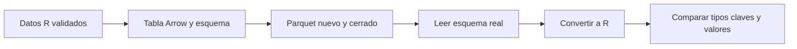

# 09.04 — Leer y escribir desde R

## Propósito, prerrequisitos y objetivos

**Esencial.** Guardar una tabla en Parquet desde R, abrir el archivo escrito y
demostrar que conserva tipos, claves y valores. La pregunta es: **¿lo que otra
sesión puede recuperar del archivo coincide con lo que queríamos guardar?**

Retoma los conceptos de [09.01](../01_csv_parquet_arrow/README.md), el contrato
de [09.02](../02_schemas_types/README.md) y los proyectos locales de
[06.08](../../06_r_foundations/08_projects_renv/README.md). El orden del track
sitúa esta lección después de [09.03](../03_python_read_write/README.md), pero
no necesitas ejecutar Python ni disponer de su entrega personal. Aquí se
presentan otra vez los datos, las reglas y los resultados necesarios. El primer
ejemplo se construye completo dentro de esta página; la práctica común lee
archivos incluidos en el repositorio, sin reconstruir el análisis de 07–08.

Al terminar podrás:

- Diferenciar `data.frame`/tibble, tabla Arrow y archivo Parquet.
- Elegir `character`, `Date` e `integer` sin perder ceros iniciales ni fechas.
- Declarar tipos y nulabilidad antes de escribir; inspeccionar el esquema real al leer.
- Releer y comparar cada registro por clave desde una sesión nueva.
- Detectar errores de contrato aunque las sumas coincidan.

## 1. Tres representaciones y una comprobación

| Representación | Qué tienes | Qué puedes inspeccionar |
| --- | --- | --- |
| `data.frame` o tibble | Columnas de R listas para trabajar | `str(x)`, `class(x$fecha_corte)` |
| `arrow::Table` | Columnas en memoria con tipos Arrow | `tabla$schema`, `nrow(tabla)` |
| Archivo `.parquet` | Datos serializados en disco | Su lectura real con `read_parquet()` |

Un tibble es una clase de tabla de R. Una `Table` de Arrow tiene otra
representación y ofrece su esquema mediante `$schema`. Convertir entre ambas
no guarda un archivo. Escribir tampoco demuestra que el archivo se recupere
correctamente: falta cerrarlo, leerlo y contrastarlo.



Sin renderizador: validar → convertir → escribir → releer → comparar. La tabla
previa a escribir no sustituye la relectura. Estas muestras caben en memoria;
usar Arrow no implica por sí solo memoria acotada. Las consultas a varios
archivos se desarrollarán en 09.06.

## 2. Preparar el proyecto desde el IDE

Referencia comprobada: **R 4.6.1, renv 1.3.1 y arrow 25.0.1**. No se afirma
que sean las versiones más recientes. El [lockfile](renv.lock) añade arrow y
assertthat 0.2.1; conserva los 44 registros de 08.07–08.09. PyArrow y arrow de R
son paquetes distintos: no se exige que sus números de versión coincidan.

Guarda tu trabajo. Desde la raíz de **DS Track**, ejecuta en **Console de R**
del IDE, no en Terminal:

```r
source("curriculum/09_arrow_parquet/04_r_read_write/preparar_parquet.R")
destino <- preparar_practica_parquet(
  "curriculum/06_r_foundations/09_known_result/output/cierre_ventas"
)
```

Adapta la ruta al proyecto renv que has usado hasta 08.09. El
[preparador](preparar_parquet.R) comprueba sus metadatos, respalda `DESCRIPTION`
y `renv.lock` en `respaldo_08_09/` y copia funciones, ejecutor y entradas con
nombres propios de esta sección. No instala paquetes. Rechaza repeticiones,
archivos ocupados y metadatos personalizados; revisa sus diferencias antes de
integrar cambios, sin borrar tu trabajo. Una preparación parcial se diagnostica
conservando el respaldo.

Abre **el mismo proyecto de práctica**, reinicia R y ejecuta en Console:

```r
source("restaurar.R")
stopifnot(isTRUE(renv::status()$synchronized))
print(utils::packageVersion("arrow"))
stopifnot(arrow::codec_is_available("snappy"))
```

`restore()` instala las versiones registradas en la biblioteca de esa copia;
si ya está sincronizada, conserva la comprobación y omite repetir la restauración.
No inicialices renv en la raíz de DS Track ni añadas instalaciones al script
de análisis. [Referencia oficial de restore](https://rstudio.github.io/renv/reference/restore.html).

En Windows/macOS los binarios de arrow incluyen la biblioteca C++ necesaria.
Linux puede requerir preparación adicional según distribución y disponibilidad
de binarios: consulta la [guía oficial de instalación](https://arrow.apache.org/docs/r/articles/install.html).
No cambies Conda ni bibliotecas globales para resolver esta práctica. Si una
restauración falla, conserva el mensaje; no uses `snapshot()` para registrar
un estado incompleto como si fuera el previsto.

## 3. Un ejemplo pequeño, con todos sus datos

En el editor crea un script propio, por ejemplo `output/mi_parquet.R`, con la
raíz del proyecto de práctica como directorio. Ejecuta sus bloques en Console.
La carpeta `output/` se crea si todavía no existe; conserva otro nombre si ya
tienes ese script. Este ejemplo representa **tres créditos ficticios en una
sola fecha**, con saldo en pesos enteros:

```r
mini <- data.frame(
  id_credito = c("101", "102", "103"),
  fecha_corte = as.Date(c("2026-10-31", "2026-10-31", "2026-10-31")),
  saldo_mxn = c(0L, 1200L, 800L)
)
str(mini)
stopifnot(nrow(mini) == 3L, sum(mini$saldo_mxn) == 2000L)

esquema_mini <- arrow::schema(
  arrow::field("id_credito", arrow::utf8(), nullable = FALSE),
  arrow::field("fecha_corte", arrow::date32(), nullable = FALSE),
  arrow::field("saldo_mxn", arrow::int32(), nullable = FALSE)
)
tabla_mini <- arrow::arrow_table(mini, schema = esquema_mini)
print(tabla_mini$schema)
```

### Por qué esos tipos

| Columna | En R | En Arrow | Regla del ejemplo |
| --- | --- | --- | --- |
| `id_credito` | `character` | `string`, creado con `utf8()` | Tres dígitos, también si empieza por cero |
| `fecha_corte` | `Date` | `date32` | Día de calendario, sin hora |
| `saldo_mxn` | `integer` | `int32` | Pesos enteros, cero permitido |

`1200L` crea un entero de R; `1200` crea un `double`. `as.Date()` da significado
de fecha a un texto. `date32` representa días, mientras un timestamp representa
fecha y hora; no hay que convertir primero a timestamp para guardar una fecha.
Un ID es una etiqueta: convertir `"001"` a número perdería sus ceros iniciales.
`utf8()` designa el tipo de texto Arrow; no convierte un factor a ID ni valida
que tenga tres dígitos. El paquete ofrece estas
[correspondencias de tipos](https://arrow.apache.org/docs/r/articles/data_types.html).

El contrato de esta práctica admite saldos de 0 a 2 147 483 647 y fechas entre
1900 y 2100. Son reglas elegidas para la muestra compartida, no límites
universales de Parquet. R reserva una representación entera para `NA_integer_`;
no uses el mínimo int32 como saldo válido de este dominio. Para centavos u
otros rangos habría que diseñar otro contrato; truncar decimales no los valida.

### Tipo, nulabilidad y regla de negocio

`field()` relaciona nombre y tipo. `nullable = FALSE` declara que el campo no
admite ausencias. `schema()` reúne esos campos en orden. Usamos `arrow::`
para indicar de qué paquete procede cada función sin adjuntarlo con `library()`.
`$schema` consulta una propiedad del objeto; `$Equals(...)` llama a un método
de comparación. No necesitas desarrollar clases para utilizar estas operaciones.

Hay tres preguntas distintas:

1. ¿El campo **permite** ausencias? Se consulta en el esquema.
2. ¿Los datos **contienen** ausencias? Se comprueba en los valores.
3. ¿Los valores cumplen calendario, rango y clave única? Se valida aparte.

Una columna que hoy no tiene `NA` puede inferirse como anulable. Por otra parte,
declarar `nullable = FALSE` no sustituye revisar valores antes y después de
convertir. El esquema tampoco impide por sí solo repetir crédito y fecha.
La [referencia de schema](https://arrow.apache.org/docs/r/reference/schema.html)
muestra cómo declarar campos explícitos.

## 4. Escribir, cerrar y leer de dos maneras

```r
carpeta_mini <- "output/09_04_mini"
stopifnot(!file.exists(carpeta_mini))
stopifnot(dir.create(carpeta_mini, recursive = TRUE))
ruta_mini <- file.path(carpeta_mini, "mini.parquet")
arrow::write_parquet(tabla_mini, ruta_mini,
  version = "2.6", compression = "snappy")

leida_arrow <- arrow::read_parquet(ruta_mini, as_data_frame = FALSE)
print(leida_arrow$schema)
stopifnot(leida_arrow$schema$Equals(esquema_mini, check_metadata = FALSE))
leida_r <- as.data.frame(leida_arrow)
stopifnot(identical(mini, leida_r))

leida_tibble <- arrow::read_parquet(ruta_mini)
print(leida_tibble)
stopifnot(inherits(leida_tibble, "tbl_df"), sum(leida_tibble$saldo_mxn) == 2000L)
```

Con una ruta, `write_parquet()` escribe el archivo y gestiona su cierre; no es
necesario llamar a `save()` después. La carpeta nueva evita sobrescribir una
entrega existente: cambia el nombre al repetir. El escritor puede reemplazar
un archivo si le das una ruta ocupada; nuestra preparación lo impide en este
recorrido. Snappy comprime sin cambiar los valores. `version = "2.6"` selecciona
una versión del formato, no la del paquete R. Elegir compresión y medirla se
profundizará en 09.07. [Referencia del escritor](https://arrow.apache.org/docs/r/reference/write_parquet.html).

`read_parquet()` devuelve un tibble de forma predeterminada.
`as_data_frame = FALSE` devuelve una tabla Arrow y permite observar su esquema
**antes** de convertir a R. No damos al lector un esquema que fuerce a coincidir
con el esperado. Después, `as.data.frame()` materializa columnas como objetos R.
Son dos representaciones del mismo contenido; sus clases completas no son
idénticas. [Referencia del lector](https://arrow.apache.org/docs/r/reference/read_parquet.html).

Los metadatos auxiliares pueden conservar atributos específicos de R. Aquí
comparamos nombres, tipos y nulabilidad ignorando esos metadatos, y comprobamos
los valores aparte. El contrato de intercambio debe estar en columnas explícitas;
los nombres de fila no se usan como clave. Consulta
[Schema y metadatos R](https://arrow.apache.org/docs/r/reference/Schema-class.html).

## 5. Práctica común: saber qué se recibe sin rehacer otros ejemplos

El preparador ha copiado estas entradas en `datos/`:

| Entrada | Contenido y procedencia |
| --- | --- |
| `base_comun_0904.csv` | CSV de 09.01, 28 observaciones y tres columnas |
| `referencia_python_0904.parquet` | Parquet de la misma muestra, generado con PyArrow en 09.01 |
| `casos_contrato_0904.csv` | Los 23 casos separados de 09.02, con motivos esperados |

Cada fila es un crédito en una fecha. La clave es **ID + fecha**: un ID puede
aparecer en dos cortes, pero no dos veces en el mismo corte. Son 14 IDs en
septiembre y los mismos 14 en octubre; suman **29 000 y 31 800 MXN**, respectivamente.
No sumes ambos cortes para presentarlos como saldo en una fecha única. Aquí no
es necesario saber cómo se seleccionaron esos créditos en capítulos anteriores.

El CSV conserva los textos; `\N` representa ausencia en los casos de contrato.
Vacío y texto literal `NA` no son importes válidos. Ninguna columna admite
ausencias en esta base. Las funciones aplican las reglas del
[evaluador 09.02](../02_schemas_types/contrato_tabla.R), copiado sin cambios en
`R/contrato_0902.R`. Si falla una fila, se rechaza **el lote completo** con
número de registro y motivos; no se exporta un subconjunto silenciosamente.

```r
source("R/contrato_0902.R", encoding = "UTF-8")
source("R/intercambio_parquet.R", encoding = "UTF-8")
base <- cargar_cartera()
tabla <- crear_tabla_cartera(base)
print(tabla$schema)
print(resumir_cartera(tabla))
stopifnot(nrow(base) == 28L, length(unique(base$id_credito)) == 14L)

# Primero leer el archivo incluido, sin crear una entrega desde Python.
print(verificar_parquet_r("datos/referencia_python_0904.parquet"))
# Ahora escribir y releer nuestra propia entrega desde R.
print(crear_entrega_r("output/09_04_r"))
```

Si conservas una entrega de 09.03, también puedes pasar la ruta de su Parquet
a `verificar_parquet_r()`: se exige el mismo contrato y los mismos valores.
Es una comprobación adicional; el recorrido principal usa la referencia
incluida para no depender de aquella entrega.

Resultado esperado en ambos archivos:

| fecha_corte | registros | saldo_mxn |
| --- | --- | --- |
| 2026-09-30 | 14 | 29000 |
| 2026-10-31 | 14 | 31800 |

`crear_tabla_cartera()` exige `character`/`Date`/`integer`, presencia, fechas
de días enteros y reglas del dominio antes de convertir. No utiliza conversiones
para ocultar decimales o ausencias. Retira metadatos auxiliares R de la tabla
creada; los tipos y sus restricciones permanecen.

`verificar_parquet_r()` reconstruye la referencia desde el CSV, decodifica el
archivo y comprueba el esquema real. Convierte a R, revisa presencia/dominio y
compara **todas las filas ordenadas por ID y fecha**. Cambiar el orden de las
filas es aceptable; intercambiar saldos entre IDs no lo es. Una tabla vacía
conserva sus tipos, pero no coincide con esta fuente de 28 filas: el tamaño
pertenece al resultado de la muestra, no al contrato universal de cualquier tabla.

La carpeta nueva contiene `base_comun.parquet`, `resumen.csv` y `sesion.csv`.
La nota registra versiones, esquema y configuración sin rutas personales.
Si falla una escritura queda una carpeta parcial para revisar: el conjunto
no es transaccional y no se borra automáticamente. El verificador compara el
Parquet con el CSV; no certifica que las notas sigan intactas ni el aprendizaje.

## 6. Comprobar desde una sesión nueva

Guarda el script. Reinicia R desde el IDE, abre el mismo proyecto y verifica
la entrega sin escribir sobre ella. No necesitas recuperar objetos del panel
Environment ni ejecutar nuevamente el bloque que crea la carpeta:

```r
source("R/contrato_0902.R", encoding = "UTF-8")
source("R/intercambio_parquet.R", encoding = "UTF-8")
control <- verificar_parquet_r("output/09_04_r/base_comun.parquet")
stopifnot(identical(control$registros, c(14L, 14L)),
  identical(control$saldo_mxn, c(29000, 31800)))
print(control)
```

Para reconstruir otra entrega completa, el [ejecutor](ejecutar_parquet.R)
carga las mismas funciones y exige otra carpeta nueva:

```r
source("ejecutar_parquet.R", encoding = "UTF-8")
ejecutar_practica_parquet("output/09_04_reconstruida")
```

Como apoyo opcional de automatización, desde la raíz de la práctica se puede
usar `Rscript --vanilla` para ejecutar un script guardado. En ese caso comienza
el script con `source(".Rprofile")`, porque `--vanilla` omite perfiles automáticos.
El recorrido principal sigue siendo editar, ejecutar bloques, inspeccionar y
reiniciar en el IDE. La existencia de `sesion.csv` no sustituye esta relectura.

## 7. Ausencia y cero: otra tabla con otro permiso

Este ejemplo independiente es una **ampliación conceptual**, no una modificación
de la cartera anterior. Sus tres observaciones son `0`, ausente y `10`:

```r
observaciones <- data.frame(saldo_mxn = c(0L, NA_integer_, 10L))
esquema_observaciones <- arrow::schema(
  arrow::field("saldo_mxn", arrow::int32(), nullable = TRUE)
)
tabla_observaciones <- arrow::arrow_table(observaciones, schema = esquema_observaciones)
carpeta_na <- "output/09_04_ausencias"
stopifnot(!file.exists(carpeta_na), dir.create(carpeta_na, recursive = TRUE))
archivo_na <- file.path(carpeta_na, "observaciones.parquet")
arrow::write_parquet(tabla_observaciones, archivo_na)
vuelta <- arrow::read_parquet(archivo_na)$saldo_mxn
stopifnot(identical(vuelta, c(0L, NA_integer_, 10L)),
  sum(!is.na(vuelta)) == 2L, sum(vuelta, na.rm = TRUE) == 10L)
```

Hay saldo conocido en 2 de 3 registros y suma observada de 10. El total completo
es desconocido. `na.rm = TRUE` permite sumar valores presentes; no recupera
el dato ausente. El cero sí es observado. Esta tabla tiene otro esquema y debe
ser rechazada por el verificador de cartera. Elegir un tipo que admite `NA`
no autoriza ausencias en cualquier contrato.

## Errores habituales

| Situación | Qué revisar |
| --- | --- |
| `could not find function` | Cargar las dos funciones con `source()` desde la raíz de la práctica |
| Paquete ausente | Abrir el proyecto correcto y restaurar su lockfile local |
| Esquema anulable o saldo `double` | Inspeccionar el esquema antes de convertir; revisar cómo se construyeron los datos |
| Esquema correcto, comparación fallida | Revisar claves y valores; dos totales iguales no garantizan igualdad |
| Destino ocupado | Conservarlo y elegir otra carpeta nueva |
| Error al resolver paquetes base renv en Windows | Revisar permisos de lectura y enlaces del ejecutor; no desactivar controles para ocultarlo |

## Práctica, criterio de salida y siguiente paso

Realiza el [lab 09.04](../../../labs/09_arrow_parquet/04_r_read_write/README.md).
Puedes avanzar si explicas las tres representaciones, justificas tipos y
nulabilidad, reconstruyes desde sesión nueva y detectas una alteración con
totales conservados. Puedes dividir la lección en varias sesiones.

Siguiente: [09.05 — Intercambio Python y R](../05_python_r_exchange/README.md),
con lección y lab disponibles. Aquí se ha leído en R una referencia escrita
por Python y se ha escrito/releído desde R; 09.05 desarrolla la práctica
de intercambio en ambas direcciones. No hay proyecto/checkpoint implementado asociado.
Consulta los [pendientes de almacenamiento](../../../docs/storage-closure.md).
Material disponible no acredita práctica del estudiante.

## Referencias y atribución

Documentación primaria de Apache Arrow y renv enlazada en cada concepto.
Ejemplos, funciones y explicaciones propios sobre datos sintéticos del track.
Consulta: 2026-10-21; páginas oficiales pueden describir otra versión: las APIs
utilizadas se contrastan con arrow 25.0.1 instalado y su ayuda local
(`help("read_parquet", package = "arrow")`, por ejemplo). Se comprueban sesiones
nuevas y restauración local; no se acredita prueba de la interfaz del IDE ni
instalación en otros sistemas. No se exige identidad binaria entre escritores.
