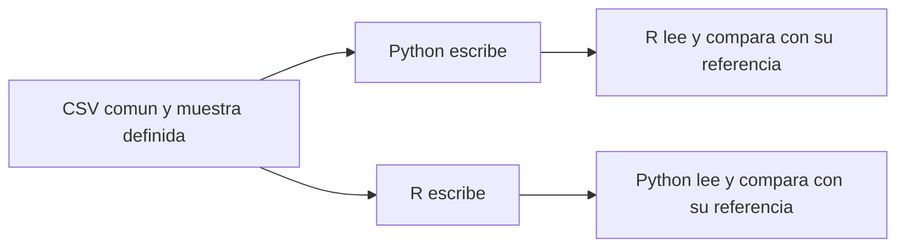

# 09.05 — Intercambio Python y R

[Inicio](../../../README.md) / [Módulo 09](../README.md) / **Lección 09.05**

| Tu sesión | Qué prepararás o comprobarás |
| --- | --- |
| **Meta** | Comprobar archivos de ambos escritores con el otro lenguaje |
| **Necesitas** | Conceptos y entornos 09.02–09.04; sin entregas personales anteriores |
| **Evidencia** | Lecturas cruzadas con claves, valores y ausencias conciliados |

[Preparación](#antes-de-empezar) · [Material de apoyo](#material-de-apoyo) · [Lab 09.05](../../../labs/09_arrow_parquet/05_python_r_exchange/README.md) · [Comprobar](#evidencia-y-criterio-de-salida)

<a id="propósito-prerrequisitos-y-objetivos"></a>

## Propósito

**Práctica.** Escribir una tabla con un lenguaje y comprobarla con el otro.
La pregunta es: **¿el otro lector recupera el contrato y cada valor que queremos
compartir?** Que Python pueda releer su archivo, o R el suyo, todavía no
responde esa pregunta.

## Antes de empezar

Retoma [09.02 — Contratos](../02_schemas_types/README.md),
[09.03 — Python](../03_python_read_write/README.md) y
[09.04 — R](../04_r_read_write/README.md). Necesitas sus entornos y conceptos;
**no sus entregas personales ni objetos de sesiones anteriores**. Aquí se
presentan todas las entradas y los resultados esperados. Se reutilizan las
funciones verificadas, sin repetir sus algoritmos ni reconstruir el análisis
de cartera de otros módulos.

## Qué vas a aprender

- Completar Python escribe/R lee y R escribe/Python lee con archivos nuevos.
- Comparar esquema, presencia, claves y todos los valores antes de resumir.
- Explicar por qué tipos lógicos compatibles no implican clases o bytes idénticos.
- Conservar fechas, ceros iniciales, acentos, vacíos y ausencias según cada contrato.
- Repetir las verificaciones desde sesiones nuevas sin modificar los archivos.

## Material de apoyo

| Recurso | Para qué sirve | Uso |
| --- | --- | --- |
| [Preparador R](preparar_intercambio.R) | Añadir funciones al proyecto sin dependencias nuevas | Para el recorrido |
| [Intercambio Python](intercambio_cruzado.py) | Escribir y verificar la lectura del otro escritor | Para el recorrido |
| [Intercambio R](intercambio_cruzado.R) | Leer Python y escribir para Python | Para el recorrido |
| [CSV de base común](../01_csv_parquet_arrow/datos/base_comun.csv) | Consultar la referencia de 28 observaciones con claves y valores conocidos | Para el recorrido |

Consulta los archivos aquí y ábrelos donde indica el recorrido. Python y R
tienen instrucciones de preparación y ejecución propias; conserva los
originales y utiliza carpetas nuevas cuando la actividad escriba resultados.

## 1. Qué significa que el intercambio funcione

Hay dos recorridos y una referencia reconstruida en cada lector:



Sin renderizador: Python escribe dos archivos y R los verifica; después R
escribe otros dos y Python los verifica. Cada lector reconstruye los valores
esperados, observa el esquema real y compara por clave. No se limita a aceptar
el resumen que dejó el escritor. Tampoco convierte el archivo recibido a un
esquema esperado antes de inspeccionarlo, porque eso podría ocultar diferencias.

| Comprobación | Qué establece | Qué no establece por sí sola |
| --- | --- | --- |
| Leer sin error | El lector puede decodificar el archivo | Que sean las columnas, unidades o claves correctas |
| Revisar esquema | Nombres, orden, tipos y nulabilidad acordados | Calendario permitido, unicidad o igualdad de valores |
| Revisar dominio y presencia | Las filas respetan las reglas de esa tabla | Que corresponda el mismo importe a cada ID |
| Comparar por clave | Cada valor pertenece a la misma observación | Identidad binaria de los archivos |
| Conciliar indicadores | La interpretación final coincide | Sustituir las comprobaciones anteriores |

Dos saldos intercambiados entre créditos pueden conservar un total. Por eso
primero comprobamos las filas, después usamos el resumen para explicar el
resultado. El tamaño de la muestra no es una regla general del formato.

## 2. Dos tablas con permisos distintos

### Una muestra pequeña, completa en esta sección

El código de ambos lenguajes construye **exactamente estas tres observaciones**:

| id_prueba | fecha | etiqueta | importe |
| --- | --- | --- | --- |
| A | 2024-02-29 | Crédito ágil | 0 |
| B | 2026-09-30 | Texto vacío (`""`) | Ausente |
| C | 2026-10-31 | Ausente | 10 |

`id_prueba` es la clave. El esquema, en ese orden, es `string/date32/string/int32`.
ID y fecha no admiten ausencias; etiqueta e importe sí. `None` en Python y
`NA_character_`/`NA_integer_` en R se representan como valores ausentes Arrow.
Una cadena vacía sigue siendo texto presente; el importe cero es una medición
presente. El año 2024 incluye el 29 de febrero: la fecha debe recuperarse como
ese día, sin hora ni conversión a otro día.

La suma **observada** es 10, con importe conocido en 2 de 3 registros. El total
completo es desconocido. Este ejemplo tiene otro contrato y no se añade a la
cartera ni pasa su validador. Su comparación exige esos tres IDs y todos los
valores de la tabla mostrada; no pretende validar cualquier dataset de texto.

### La base común, sin rehacer ejercicios anteriores

El [CSV incluido](../01_csv_parquet_arrow/datos/base_comun.csv) contiene tres
columnas y 28 observaciones de créditos ficticios:

| Campo | Significado | Contrato |
| --- | --- | --- |
| `id_credito` | Etiqueta del crédito | Texto de tres dígitos, conserva `001` |
| `fecha_corte` | Día de observación | Fecha entre 1900 y 2100, sin hora |
| `saldo_mxn` | Saldo en pesos enteros | Entero entre 0 y 2 147 483 647 |

Los tres campos son no anulables y el esquema es `string/date32/int32`.
La clave es ID + fecha: el mismo crédito puede aparecer en fechas distintas.
Hay 14 IDs y dos cortes con los mismos integrantes:

| fecha_corte | registros | saldo_mxn |
| --- | --- | --- |
| 2026-09-30 | 14 | 29000 |
| 2026-10-31 | 14 | 31800 |

No sumes ambos cortes como si fueran saldo de una fecha única. El CSV mantiene
la referencia textual; los evaluadores de 09.02 aplican las mismas reglas desde
Python y R. Si falla un registro, se rechaza el lote, sin exportar solo los que
pasaron ni reemplazar ausencias por cero.

## 3. Preparar herramientas y una carpeta compartida

No hay dependencias nuevas: **Python 3.12.12/pandas 2.3.3/PyArrow 21.0.0** y
**R 4.6.1/arrow 25.0.1/renv 1.3.1** son las referencias comprobadas.
`pyproject.toml`, `uv.lock`, el lockfile R y sus 46 registros se conservan.
Las versiones de los paquetes Python y R no necesitan tener el mismo número;
su compatibilidad se comprueba con los tipos y archivos que usamos.

Para Python utiliza el entorno de estudio elegido en los
[recorridos de 09.03](../03_python_read_write/recorridos.md). Si ya puedes
importar pandas/PyArrow, no reinstales. Para R abre el mismo proyecto renv
preparado en 09.04 y conserva su biblioteca local; no inicialices renv en la
raíz de DS Track ni cambies Conda o bibliotecas globales.

Guarda el trabajo del IDE. Desde la **raíz de DS Track**, en Console de R:

```r
source("curriculum/09_arrow_parquet/05_python_r_exchange/preparar_intercambio.R")
preparar_practica_intercambio(
  "curriculum/06_r_foundations/09_known_result/output/cierre_ventas"
)
```

Adapta esa ruta al proyecto renv existente. El [preparador](preparar_intercambio.R)
comprueba fuentes y metadatos de 09.04 y añade solo `intercambio_cruzado.R` y
`ruta_cruce_0905.txt`. No copia entregas anteriores ni modifica funciones,
datos, lockfile o biblioteca. Rechaza destinos ocupados y personalizaciones
para revisarlas antes de continuar; no las sobrescribe. Si se interrumpe la
preparación, conserva los archivos parciales y revisa antes de repetir. Si ya está preparado,
omite volver a prepararlo.

El TXT contiene la ruta absoluta a `output/09_05_cruce/` de DS Track. Es una
configuración local porque Python y R pueden tener **directorios de trabajo
distintos**. No se distribuye ni se incorpora a las entregas. `file.path()`
añade los nombres de archivo sin construir rutas a mano con separadores.

```text
DS Track/output/09_05_cruce/
├── python/   base_comun.parquet, muestra.parquet, sesion.json
└── r/        base_comun.parquet, muestra.parquet, resumen.csv, sesion.csv
```

Cada escritor exige su subcarpeta nueva. Si ya existen, conserva la evidencia
y elige otra carpeta compartida en ambos lenguajes. El preparador acepta un
segundo argumento `carpeta_cruce` para elegirla al preparar; si ya preparaste,
puedes editar tu TXT local y usar la misma ruta en el script Python.

## 4. Recorrido Python: construir, escribir y luego recibir

En tu IDE Python, con la raíz de DS Track como directorio y el intérprete de
estudio, crea un script propio en `output/`. Ejecuta este primer bloque:

```python
from pathlib import Path
import sys
import pyarrow.parquet as pq

modulos = Path("curriculum/09_arrow_parquet/05_python_r_exchange").resolve()
sys.path.insert(0, str(modulos))
import intercambio_cruzado as cruce

compartida = Path("output/09_05_cruce").resolve()
muestra = cruce.construir_muestra()
print(muestra.schema)
print(muestra.to_pylist())
resultado_python = cruce.escribir_desde_python(compartida / "python")
assert resultado_python["cartera"]["registros"] == 28
assert resultado_python["muestra"] == {
    "registros": 3, "importes_conocidos": 2, "suma_observada": 10,
}
print(resultado_python)
print(compartida)
```

Como en [módulos locales](../../05_python_applied/01_notebook_to_modules/README.md),
la ruta añadida a `sys.path` sirve para importar el módulo local en este
proceso; no instala paquetes ni cambia Python global. El módulo reutiliza
el escritor/validador de 09.03. Construye la cartera desde el CSV y la muestra
de tres filas desde sus valores explícitos. Los dos Parquet se escriben en
una carpeta nueva y se releen localmente. **Todavía falta que los lea R**.

En PyArrow, `pq.ParquetFile(ruta).read()` lee el archivo individual sin
descubrir particiones desde el nombre de su carpeta padre. Inspecciona
`.schema` antes de convertir a pandas. La clave se conserva en columnas;
el índice pandas no forma parte del contrato. Véase
[ParquetFile de PyArrow 21](https://arrow.apache.org/docs/21.0/python/generated/pyarrow.parquet.ParquetFile.html).

**Deja el segundo bloque para después del recorrido R.** Reinicia Python o
ejecútalo como otro script completo con el mismo intérprete:

```python
from pathlib import Path
import sys
import pyarrow.parquet as pq

modulos = Path("curriculum/09_arrow_parquet/05_python_r_exchange").resolve()
sys.path.insert(0, str(modulos))
import intercambio_cruzado as cruce

compartida = Path("output/09_05_cruce").resolve()
recibida = pq.ParquetFile(compartida / "r/base_comun.parquet").read()
print(recibida.schema)
resultado_r = cruce.leer_desde_r(compartida / "r")
assert [c["saldo_mxn"] for c in resultado_r["cartera"]["cortes"]] == [29000, 31800]
assert resultado_r["muestra"]["importes_conocidos"] == 2
print(resultado_r)
```

`leer_desde_r()` es de solo lectura: reconstruye la cartera desde el CSV,
verifica cada registro del Parquet R y compara la muestra con los tres valores
esperados, incluidas sus ausencias. No depende de `resultado_python`, de
objetos de otra sesión ni de `sesion.csv`. La misma comprobación se reutiliza
en la relectura del escritor; el nombre de la función no certifica procedencia:
la evidencia del cruce incluye qué programa escribió cada carpeta.

## 5. Recorrido R: recibir Python y escribir para Python

Abre el **proyecto de práctica preparado**, reinicia R y trabaja en su raíz.
En Console, no en Terminal, ejecuta estos bloques desde un script propio.
Python ya debe haber escrito su subcarpeta.

```r
stopifnot(isTRUE(renv::status()$synchronized))
source("intercambio_cruzado.R", encoding = "UTF-8")
compartida <- readLines("ruta_cruce_0905.txt", encoding = "UTF-8")
stopifnot(length(compartida) == 1L, dir.exists(compartida))

muestra <- construir_muestra_cruce()
print(muestra$schema)
print(as.data.frame(muestra))
recibida <- arrow::read_parquet(file.path(compartida, "python/base_comun.parquet"),
  as_data_frame = FALSE)
print(recibida$schema)
resultado_python <- leer_desde_python(file.path(compartida, "python"))
stopifnot(identical(resultado_python$cartera$registros, c(14L, 14L)),
  identical(resultado_python$cartera$saldo_mxn, c(29000, 31800)))
print(resultado_python)
```

`read_parquet(..., as_data_frame = FALSE)` entrega una tabla Arrow para observar
su esquema real. `as.data.frame()` convierte después a columnas R. Las funciones
comprueban tipos y nulabilidad, presencia y dominio de cartera y equivalencia
completa por clave. [Referencia del lector R](https://arrow.apache.org/docs/r/reference/read_parquet.html).

```r
resultado_r <- escribir_desde_r(file.path(compartida, "r"))
stopifnot(identical(resultado_r$cartera$saldo_mxn, c(29000, 31800)),
  resultado_r$muestra$importes_conocidos == 2L,
  resultado_r$muestra$suma_observada == 10L)
print(resultado_r)
```

El escritor usa las funciones de 09.04 y agrega el Parquet de la muestra
independiente. Cierra y relee los archivos propios. Ahora vuelve al **segundo
bloque Python** para que el otro lenguaje compruebe esta subcarpeta R.

Reinicia R otra vez y verifica únicamente la carpeta Python, sin volver a
escribir ni recuperar objetos del panel Environment:

```r
source("intercambio_cruzado.R", encoding = "UTF-8")
compartida <- readLines("ruta_cruce_0905.txt", encoding = "UTF-8")
print(leer_desde_python(file.path(compartida, "python")))
```

Los reinicios comprueban que los datos necesarios están en disco. Si usas
`Rscript --vanilla` como apoyo opcional, comienza el script guardado con
`source(".Rprofile")`, porque esa opción omite el perfil automático del proyecto.
No es necesario usar reticulate ni cargar ambos intérpretes en un proceso.

## 6. Interpretar las dos verificaciones

| Aspecto | Python | R | Acuerdo compartido |
| --- | --- | --- | --- |
| Texto | Valores `str` al extraer de Arrow | `character` | Contenido exacto, incluidos acentos y ceros iniciales |
| Fecha | `datetime.date` al extraer `date32` | `Date` | El mismo día, sin añadir hora |
| Entero presente | `int` al extraer de Arrow | `integer` | `int32` y valores dentro del rango acordado |
| Ausente de la muestra | `None` al extraer de Arrow | `NA` tipado | Sigue ausente; no se convierte a cero ni a `""` |
| Esquema | `.schema` | `$schema` | Nombres, orden, tipos y nulabilidad |

Las clases completas de un tibble, un DataFrame y una tabla Arrow pertenecen
a sus herramientas; no se comparan como si fueran el mismo objeto. En cambio,
se puede exigir el mismo esquema lógico y la misma correspondencia clave/valor.
Los saldos elegidos son enteros: aquí no necesitamos tolerancia numérica.
Para decimales o cálculos de punto flotante habría que acordar unidad,
precisión y tolerancias antes de comparar; esta práctica no implementa ese
nuevo contrato ni utiliza redondeo para conseguir igualdad.

El orden accidental de filas puede variar. Cada lector ordena por clave para
comparar; claves repetidas o filas ausentes se rechazan. En la cartera se
suma después de validar; R usa `double` en la agregación para no desbordar
`int32`. Estos totales son exactos en ese rango, sin prometerlo para sumas
arbitrarias por encima de 2^53.

Los metadatos privados de pandas o R pueden describir índices y atributos
que el otro lenguaje no interpreta. Aquí los escritores dejan la información
necesaria en columnas y tipos, y los comparadores ignoran los metadatos
auxiliares. Eso no permite ignorar nulabilidad ni tipos. Véase
[metadatos y atributos en Arrow R](https://arrow.apache.org/docs/r/articles/metadata.html).
Los factores/categorías requieren su propio acuerdo sobre etiquetas y niveles;
esta muestra utiliza texto simple y no acredita preservar cualquier factor.

Archivos equivalentes pueden diferir en bytes por opciones del escritor,
metadatos o disposición interna. Una huella sirve para comprobar que **un
archivo concreto** sigue intacto; exigir huellas iguales a dos escritores
distintos no define nuestro intercambio. Tampoco se certifica aquí toda
característica de Parquet ni compatibilidad con cualquier versión de Arrow.
La [guía Parquet de PyArrow](https://arrow.apache.org/docs/21.0/python/parquet.html)
documenta sus opciones; las mediciones se profundizan en 09.07.

## Errores habituales y límites de la entrega

| Situación | Qué revisar |
| --- | --- |
| No encuentra la carpeta del otro escritor | Leer la ruta absoluta compartida; comprobar quién escribió y dónde |
| Python intenta leer R antes de escribir R | Completar el bloque R y volver al segundo bloque Python |
| Destino ocupado | Conservar la evidencia y elegir otra carpeta compartida |
| Se lee el Parquet pero falla el esquema | Inspeccionar el tipo/nulabilidad real antes de convertir |
| Sumas iguales pero falla la comparación | Revisar claves e importes asociados, no solo el resumen |
| La muestra falla por convertir `NA` a `""` | Conservar ausencia y vacío como valores diferentes |

Los archivos de sesión/resumen describen la ejecución de la cartera; no son
un certificado de ambos cruces ni sustituyen releer los dos Parquet. Si falla
una escritura puede quedar carpeta parcial: se conserva para diagnosticar y
no se borra automáticamente. El verificador solo lee; si falta o cambia la
muestra también debe fallar. Las salidas y la configuración local quedan fuera
de Git. Las dos verificaciones satisfactorias, con sus autores y versiones,
son la evidencia técnica; la comprensión se comprueba explicando decisiones.

<a id="práctica-criterio-de-salida-y-siguiente-paso"></a>

## Práctica

Realiza el [lab 09.05](../../../labs/09_arrow_parquet/05_python_r_exchange/README.md) para
completar ambas direcciones y contrastar la base común y la muestra de ausencias.

Como referencia de la actividad, consulta [Preparador R](preparar_intercambio.R), [Intercambio Python](intercambio_cruzado.py), [Intercambio R](intercambio_cruzado.R).
Sigue las rutas y el directorio de trabajo indicados para cada lenguaje.

## Evidencia y criterio de salida

| Conserva | Comprueba | Explica |
| --- | --- | --- |
| Archivos y lecturas cruzadas | 28 registros y 29000/31800 MXN por clave; esquemas antes de adaptar | Escritor frente a lector y compatibilidad entre lenguajes |
| Muestra independiente y comprobaciones | Acentos, vacío/ausente/cero; suma observada 10 y cobertura 2/3 | Por qué el total completo sigue desconocido y los bytes pueden diferir |

Puedes avanzar cuando otro proceso haya leído cada escritor, expliques la
cobertura 2/3 y detectes una alteración que conserve los totales. Puedes dividir
la práctica en varias sesiones.

Quien aprende realiza la práctica y explica las decisiones; su compañero revisa.
Tu compañero elige una cadena vacía y un importe ausente y pide rastrearlos en ambos lectores.
Guarda evidencia, ayudas y dudas en una nota personal junto a tu práctica.
PROGRESS.md registra desarrollo editorial, no tu expediente de aprendizaje.
El proyecto integrador y sus checkpoints siguen pendientes; las comprobaciones
técnicas del material no acreditan haber completado la práctica.

<a id="referencias-y-atribución"></a>

## Referencias

Fuentes primarias de Apache Arrow enlazadas en los conceptos y APIs utilizados;
ejemplos y código propios del track. Consulta: 2026-10-21. Las páginas R pueden
describir una versión posterior; APIs contrastadas con la ayuda local de arrow
25.0.1. Se comprueban procesos nuevos y lecturas cruzadas con las versiones
de referencia, sin instalar paquetes nuevos. No se acredita prueba de la
interfaz del IDE, de otros sistemas ni intercambio en memoria sin copia.

## Siguiente paso

Después de la práctica y su comprobación, continúa con
[09.06 — Lectura selectiva y datasets](../06_selective_datasets/README.md).

Consulta los [criterios de cierre e integración](../../../docs/storage-closure.md).

[← Módulo 09](../README.md) · [Lab 09.05](../../../labs/09_arrow_parquet/05_python_r_exchange/README.md) · [Siguiente →](../06_selective_datasets/README.md)
