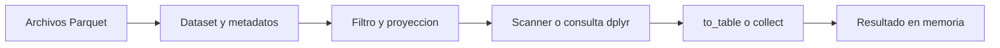

# 09.06 — Lectura selectiva y datasets

## Propósito, prerrequisitos y objetivos

**Esencial.** Consultar filas y columnas de una tabla distribuida entre varios
archivos Parquet. La pregunta es: **¿cómo expresar qué datos necesitamos antes
de cargar el resultado completo en memoria?**

Retoma [09.02 — Contratos](../02_schemas_types/README.md),
[09.03 — Python](../03_python_read_write/README.md),
[09.04 — R](../04_r_read_write/README.md) y
[09.05 — Intercambio](../05_python_r_exchange/README.md). Necesitas sus conceptos
y entornos, no sus entregas personales. Aquí se incluyen el contexto, los
datos y los resultados necesarios; el primer ejemplo se define completo en
la sección. Las funciones reutilizan los validadores del recorrido.

Al terminar podrás:

- Distinguir un archivo, un dataset y una consulta sobre él.
- Seleccionar columnas y filtrar filas con Dataset/Scanner y con dplyr sobre Arrow.
- Identificar cuándo se prepara un plan y cuándo se materializa su resultado.
- Comparar la selección por clave con una referencia independiente desde CSV.
- Separar comprobación de esquemas, auditoría completa y validación de una consulta.
- Explicar por qué una API diferida no garantiza memoria acotada ni lectura física mínima.

## 1. Archivo, dataset, fragmento y resultado

Un **archivo** es una unidad guardada en disco. Un **dataset** permite consultar
uno o varios archivos como una tabla lógica. Un **fragmento** representa una
parte de esa fuente; en nuestro ejemplo corresponde a un archivo Parquet.
El **resultado** contiene las filas y columnas que pidió una consulta.

```text
mi_dataset/
├── inventario.csv
└── datos/
    ├── parte_001.parquet
    └── parte_002.parquet
```

`datos/` contiene solo los Parquet. El inventario queda fuera para no confundir
notas con archivos de datos. Un dataset no es una base de datos con restricciones:
si copias una parte otra vez, sus filas pueden aparecer repetidas. Arrow no
deduce que la copia sea un error ni elimina claves duplicadas.

Aquí escribimos partes planas de hasta 14 filas por archivo. Es un tamaño
didáctico, **no una recomendación para producción**. Las fechas permanecen
dentro de cada fila; no se infieren de carpetas. Tener varios archivos no
equivale a configurar particiones Hive. Eso se profundizará en 09.08.

## 2. Proyección, filtro y materialización

- **Proyección:** elegir las columnas del resultado.
- **Filtro:** conservar filas cuya condición sea verdadera.
- **Plan o consulta diferida:** describir operaciones antes de reunir todo el resultado.
- **Materializar:** ejecutar y disponer de ese resultado en memoria.



Sin renderizador: localizar los archivos y conocer su esquema → expresar la
consulta → ejecutarla → recibir el resultado. Abrir el dataset puede leer
directorios y metadatos; no significa que no haya ninguna operación de disco.
Preparar un `Scanner` o una consulta dplyr tampoco significa que todas las
filas ya estén cargadas.

Preguntaremos por **octubre de 2026 y saldo ≥ 2000 MXN**, devolviendo únicamente
ID y saldo. La fecha se utiliza para filtrar aunque no aparezca en la salida:
pedir dos columnas de resultado no demuestra que solo se leyeran dos columnas.

El motor puede acercar proyección y filtro al lector, lo que suele llamarse
*pushdown*. Algunas columnas, archivos o grupos de filas pueden omitirse si
el formato, los metadatos y el predicado permiten descartar datos. En otros
casos el lector debe decodificar valores para aplicar el filtro. Un resultado
pequeño no prueba cuántos bytes se leyeron. Esta sección comprueba equivalencia
lógica; no mide I/O ni demuestra una mejora de rendimiento.
[Dataset de PyArrow](https://arrow.apache.org/docs/21.0/python/dataset.html).

## 3. Preparar los entornos y la práctica

Sin paquetes nuevos: **Python 3.12.12/pandas 2.3.3/PyArrow 21.0.0** y
**R 4.6.1/arrow 25.0.1/dplyr 1.2.1/renv 1.3.1** son las referencias comprobadas.
Conserva el entorno Python elegido en los [recorridos de 09.03](../03_python_read_write/recorridos.md)
y el mismo proyecto renv de 09.04–09.05. No reinstales si ya están disponibles;
no cambies Conda, bibliotecas globales ni lockfiles.

Guarda tu trabajo. Desde la **raíz de DS Track**, en Console de R del IDE:

```r
source("curriculum/09_arrow_parquet/06_selective_datasets/preparar_dataset.R")
preparar_practica_dataset(
  "curriculum/06_r_foundations/09_known_result/output/cierre_ventas"
)
```

Adapta la ruta a tu proyecto existente. El [preparador](preparar_dataset.R)
comprueba las fuentes y metadatos previos; añade `consultas_dataset.R` y
`ruta_dataset_0906.txt` sin modificar funciones, entradas, biblioteca o entregas.
La ruta absoluta del TXT señala `output/09_06_datasets/` de DS Track: permite
que R y Python encuentren la misma carpeta aunque sus directorios de trabajo
sean distintos. Es configuración local, no un archivo para publicar.

Si ya preparaste, no repitas el preparador. Rechaza rutas ocupadas y fuentes
personalizadas para revisar diferencias, sin sobrescribirlas. Una preparación
parcial se conserva para diagnosticar antes de repetir. Para otra carpeta
compartida usa su argumento `carpeta_dataset` al preparar, o adapta después
tu TXT local y la variable Python a la misma ruta.

## 4. Python: ejemplo pequeño y consulta completa

Trabaja en tu IDE con el intérprete de estudio y la raíz de DS Track como
directorio. Guarda un script propio en `output/`. El módulo local se importa
como en [05.01 — Módulos](../../05_python_applied/01_notebook_to_modules/README.md):
la ruta añadida a `sys.path` afecta solo a este proceso.

### Cuatro observaciones definidas aquí

Dos créditos ficticios, dos fechas y saldos en pesos enteros, incluido cero.
Esquema no anulable `string/date32/int32`, clave ID + fecha:

```python
from datetime import date
from pathlib import Path
import sys
import pyarrow as pa
import pyarrow.dataset as ds

sys.path.insert(0, str(Path("curriculum/09_arrow_parquet/06_selective_datasets").resolve()))
import consultas_dataset as curso

compartida = Path("output/09_06_datasets").resolve()
mini = pa.Table.from_pylist([
    {"id_credito": "101", "fecha_corte": date(2026, 9, 30), "saldo_mxn": 0},
    {"id_credito": "102", "fecha_corte": date(2026, 9, 30), "saldo_mxn": 1500},
    {"id_credito": "101", "fecha_corte": date(2026, 10, 31), "saldo_mxn": 100},
    {"id_credito": "102", "fecha_corte": date(2026, 10, 31), "saldo_mxn": 2000},
], schema=curso.cartera.ESQUEMA)
curso.escribir_partes(mini, compartida / "mini_python", filas_por_archivo=2)
dataset_mini = curso.abrir_dataset(compartida / "mini_python/datos")
filtro = ((ds.field("fecha_corte") == pa.scalar(date(2026, 10, 31))) &
          (ds.field("saldo_mxn") >= 2000))
scanner_mini = dataset_mini.scanner(columns=["id_credito", "saldo_mxn"], filter=filtro)
print(scanner_mini.projected_schema)
resultado_mini = scanner_mini.to_table()
assert resultado_mini.to_pylist() == [{"id_credito": "102", "saldo_mxn": 2000}]
```

`ds.field()` representa una columna dentro de una expresión; no extrae todos
sus valores a una lista Python. `&` combina las dos condiciones; los paréntesis
separan las comparaciones. `columns` fija la proyección. La fila con saldo
2000 entra porque usamos `>=`, no `>`. `to_table()` materializa la selección
como tabla Arrow; todavía no es un DataFrame pandas.

### La base común se presenta de nuevo

El [CSV incluido](../01_csv_parquet_arrow/datos/base_comun.csv) tiene 28 filas,
14 IDs y tres columnas: ID textual de tres dígitos, fecha entre 1900 y 2100,
saldo entero no negativo hasta 2 147 483 647. La clave es ID/fecha; no admite
ausencias. Son 14 registros por corte y 29 000/31 800 MXN en septiembre/octubre.
No necesitas reconstruir cómo se eligieron esos créditos en otros capítulos.

```python
print(curso.crear_dataset(compartida / "python"))
carpeta_datos = compartida / "python/datos"
print([p.name for p in curso.archivos_dataset(carpeta_datos)])

# Auditoría completa de una muestra pequeña: lee todas las filas.
print(curso.verificar_dataset(carpeta_datos))
dataset = curso.abrir_dataset(carpeta_datos)
print(dataset.schema)

# Preparar la consulta no es reunir su resultado completo.
scanner = curso.preparar_consulta(dataset, date(2026, 10, 31), 2000)
print(scanner.projected_schema)
seleccion = scanner.to_table()
control = curso.comprobar_consulta(seleccion, date(2026, 10, 31), 2000)
assert control == {"registros": 9, "saldo_mxn": 24100}
print(seleccion.sort_by("id_credito").to_pylist())
print(control)
```

La consulta devuelve estos nueve pares ID/saldo:
`008/2000`, `010/2200`, `011/2300`, `013/2500`, `015/2700`, `016/2800`,
`017/2900`, `021/3300`, `022/3400`. La suma **de esta selección** es 24 100,
no el saldo de todo octubre. La clave visible es ID dentro del corte fijo;
para juntar resultados de varios cortes conserva también la fecha.

`comprobar_consulta()` reconstruye desde CSV las reglas y recorre sus filas
con Python, sin usar un filtro Arrow/pandas como referencia. Compara todos los
IDs y saldos, incluidos tipos/presencia, no solo el total. El orden de filas
del dataset no se usa como garantía; ordenar aquí facilita leer el resultado.

## 5. R: las mismas ideas desde el IDE

Abre el proyecto de práctica preparado, reinicia R y trabaja desde su raíz
en Console. No necesita que ejecutes el recorrido Python para producir sus datos.
Crea un script propio y ejecuta sus bloques:

```r
stopifnot(isTRUE(renv::status()$synchronized))
source("consultas_dataset.R", encoding = "UTF-8")
compartida <- readLines("ruta_dataset_0906.txt", encoding = "UTF-8")
funciones <- funciones_cartera_dataset()
mini <- data.frame(id_credito = c("101", "102", "101", "102"),
  fecha_corte = as.Date(c("2026-09-30", "2026-09-30", "2026-10-31", "2026-10-31")),
  saldo_mxn = c(0L, 1500L, 100L, 2000L))
escribir_partes_r(funciones$crear_tabla_cartera(mini), file.path(compartida, "mini_r"),
  filas_por_archivo = 2L)
dataset_mini <- abrir_dataset_r(file.path(compartida, "mini_r/datos"))
consulta_mini <- dataset_mini |>
  dplyr::filter(fecha_corte == as.Date("2026-10-31"), saldo_mxn >= 2000L) |>
  dplyr::select(id_credito, saldo_mxn)
print(consulta_mini)
resultado_mini <- dplyr::collect(consulta_mini)
stopifnot(identical(resultado_mini$id_credito, "102"),
  identical(resultado_mini$saldo_mxn, 2000L))
```

`filter()` y `select()` se aplican a un Dataset, no a un tibble ya cargado.
Registran una consulta Arrow. `collect()` la ejecuta y trae el resultado a un
tibble de R. La sintaxis se conecta con [07.02](../../07_tidyverse/02_select_filter_sort/README.md),
pero aquí las operaciones se traducen al motor Arrow. No todas las funciones
R tienen traducción: un Dataset puede rechazar una operación no admitida;
no lo resuelvas recolectando sin revisar el volumen.
[Funciones admitidas](https://arrow.apache.org/docs/r/reference/acero.html).

```r
print(crear_dataset_r(file.path(compartida, "r")))
carpeta_datos <- file.path(compartida, "r/datos")
print(basename(archivos_dataset_r(carpeta_datos)))

# Auditoría completa, separada de la selección.
print(verificar_dataset_r(carpeta_datos))
dataset <- abrir_dataset_r(carpeta_datos)
print(dataset$schema)
consulta <- preparar_consulta_r(dataset, as.Date("2026-10-31"), 2000L)
print(consulta)
seleccion <- dplyr::collect(consulta)
control <- comprobar_consulta_r(seleccion, as.Date("2026-10-31"), 2000L)
stopifnot(control$registros == 9L, control$saldo_mxn == 24100)
print(dplyr::arrange(seleccion, id_credito))
print(control)
```

El control reconstruye el CSV con las reglas compartidas y filtra mediante
indexación R base, sin reutilizar dplyr/Arrow para calcular lo esperado.
El resultado coincide con los nueve pares anteriores. `2000L` explicita un
entero de R; el contrato no trunca fracciones para aceptar parámetros.
[Datasets en R](https://arrow.apache.org/docs/r/articles/dataset.html).

## 6. Qué comprueba cada función

| Etapa | Python / R | Alcance |
| --- | --- | --- |
| Enumerar y revisar esquemas | `abrir_dataset()` / `abrir_dataset_r()` | Carpeta plana, solo Parquet, todos los archivos con el esquema acordado |
| Auditoría completa | `verificar_dataset()` / `verificar_dataset_r()` | Decodifica todo y compara con CSV: claves, presencia, reglas y valores |
| Preparar selección | `preparar_consulta()` / `preparar_consulta_r()` | Plan con fecha, umbral y dos columnas; no valida todas las filas |
| Materializar | `to_table()` / `collect()` | Ejecuta la selección y reúne su resultado en memoria |
| Comprobar resultado | `comprobar_consulta()` / `comprobar_consulta_r()` | Compara solo la selección contra su referencia |

No se impone un esquema al lector para ocultar diferencias. Las funciones de
apertura inspeccionan el esquema real de **cada** archivo antes de construir
el Dataset; no basta confiar en el primero. `unify_schemas = TRUE` en R permite
inspeccionar las fuentes al abrir, pero no sustituye exigir tipos/nulabilidad
iguales ni demuestra claves únicas. Unificar esquemas o convertir tipos no es
una reparación automática del contrato. [Referencia de open_dataset](https://arrow.apache.org/docs/r/reference/open_dataset.html).

La auditoría completa está incluida para esta muestra pequeña. **Sí carga el
dataset completo**, y no sirve como demostración de ahorro de memoria. La
consulta selectiva se mantiene separada para observar sus operaciones. En un
volumen grande habría que diseñar también una validación escalable; aquí no se
ha implementado ese pipeline.

Un dataset sin registros puede conservar un Parquet vacío con esquema. Una
carpeta sin archivos no establece ese esquema y nuestra apertura la rechaza.
Una selección vacía conserva sus dos columnas: no inventa registros ni afirma
que el saldo de un corte completo sea cero.

Una consulta de octubre puede ser correcta aunque haya filas repetidas en
septiembre. Por eso acertar nueve filas y 24 100 MXN no certifica todo el
dataset. El lab lo demuestra sin cambiar los originales. El inventario es
una nota de escritura, no una prueba permanente: el auditor vuelve a enumerar
y leer los archivos reales. Si falta una parte, sobra una copia o cambia un
saldo, debe detectarlo frente a la fuente.

## 7. Memoria, sesiones nuevas y ampliación por lotes

`to_table()` y `collect()` reúnen el resultado: un filtro poco selectivo puede
dejar pasar casi toda la fuente. Ordenar y agrupar también pueden necesitar
memoria adicional. Que una consulta sea diferida no fija por sí solo un límite
de RAM. Estos 28 registros no permiten concluir que un método sea más rápido
o pueda procesar cualquier volumen.

Guarda tus scripts. Reinicia cada sesión y ejecuta **solo lectura**, sin
repetir los bloques que crean carpetas. En Python, tras volver a importar el
módulo, usa `abrir_dataset()`, `preparar_consulta()`, `to_table()` y el control.
En R, tras `source("consultas_dataset.R")` y leer el TXT, utiliza las funciones
equivalentes. No se necesitan objetos previos del panel Environment ni de otro
kernel. La sección se comprueba también desde procesos nuevos; la terminal
con `Rscript --vanilla` es apoyo opcional y debe cargar `.Rprofile` explícitamente.

**Extensión opcional Python:** consumir lotes sin reunirlos en una lista:

```python
registros = 0
saldo = 0
for lote in scanner.to_batches():
    registros += lote.num_rows
    saldo += sum(lote.column("saldo_mxn").to_pylist())
assert (registros, saldo) == (9, 24100)
```

Este acumulador conserva conteo y suma, no todos los lotes. `batch_size`
controla un máximo de filas por lote, no bytes ni RAM total. Lecturas
anticipadas, paralelismo y buffers también cuentan; convertir el iterador a
`list(...)` volvería a reunir los resultados. No se acredita aquí memoria
constante. [Referencia de Scanner](https://arrow.apache.org/docs/21.0/python/generated/pyarrow.dataset.Scanner.html).

Las funciones rechazan destinos ocupados; repite en otra carpeta. Si falla
una escritura, conserva su carpeta parcial para diagnosticar. Las entradas,
fuentes y resultados anteriores permanecen intactos. En `datos/` no mezcles
notas, subcarpetas o archivos ajenos: nuestra apertura los rechaza en lugar de
ignorarlos silenciosamente. Particiones, metadatos detallados y mediciones
quedan para las secciones correspondientes.

## Práctica, criterio de salida y siguiente paso

Realiza el [lab 09.06](../../../labs/09_arrow_parquet/06_selective_datasets/README.md).
Puedes avanzar cuando reconstruyas una consulta desde sesión nueva, identifiques
la materialización, concilies cada valor y expliques qué filas no validó esa
selección. La ampliación por lotes no bloquea avanzar. No hay proyecto/checkpoint
implementado asociado; el material no acredita práctica del estudiante.

Siguiente: [09.07 — Metadatos, row groups y compresión](../README.md#07-metadatos-row-groups-y-compresion),
todavía planificada. Consulta los [pendientes de almacenamiento](../../../docs/storage-closure.md).

## Referencias y atribución

Fuentes primarias de Apache Arrow enlazadas por concepto. Código y ejemplos
propios sobre datos sintéticos del track. Consulta: 2026-10-21; páginas R
pueden describir otra versión: APIs contrastadas con arrow 25.0.1 instalado.
Procesos nuevos y comparación Python/R comprobados sin paquetes nuevos.
No se acredita prueba de la interfaz del IDE, de otros sistemas, rendimiento,
bytes omitidos físicamente ni límites de RAM.
