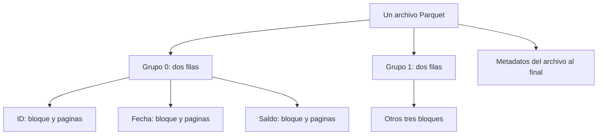

# 09.07 — Metadatos, row groups y compresión

## Propósito, prerrequisitos y objetivos

**Práctica.** Explicar cómo está organizado un Parquet y comparar decisiones
de almacenamiento conservando los mismos datos. La pregunta es:
**¿qué cambió dentro del archivo y qué evidencia tenemos de su efecto?**

Retoma archivo/esquema de [09.01](../01_csv_parquet_arrow/README.md),
contratos de [09.02](../02_schemas_types/README.md) y lectura selectiva de
[09.06](../06_selective_datasets/README.md). Necesitas los conceptos y las
bibliotecas, no sus entregas. Los primeros ejemplos definen todos sus datos,
esquema y archivos aquí. Después conectamos con un CSV incluido en el track.

Al terminar podrás:

- Distinguir archivo, grupo de filas, bloque de columna y página.
- Leer esquema, conteos y metadatos; reconocer estadísticas ausentes.
- Separar codificación, compresión y particiones.
- Comparar una modificación por vez con esquema y valores equivalentes.
- Conservar tiempos crudos separados de tamaño y de validación.
- Justificar los límites de una comparación sobre 28 filas.

## 1. Una tabla pequeña que cabe completa en esta página

Son saldos ficticios de dos créditos en dos cortes; pesos enteros, no pagos.
La clave es ID + fecha y no se permiten ausencias:

| id_credito | fecha_corte | saldo_mxn |
| --- | --- | ---: |
| 101 | 2026-09-30 | 0 |
| 102 | 2026-09-30 | 1500 |
| 101 | 2026-10-31 | 100 |
| 102 | 2026-10-31 | 2000 |

Septiembre suma 1500 MXN y octubre 2100. El cero de `101` en septiembre es
conocido. El mismo ID aparece en fechas distintas sin repetir la clave.
Guardaremos **un solo archivo** con dos grupos de dos filas: el grupo 0
contendrá septiembre y el grupo 1 octubre, por el orden de esta tabla.

## 2. Qué hay dentro del archivo

Un **row group** o grupo de filas es un tramo horizontal de la tabla. Dentro
de él, los valores de cada columna se guardan en su propio **column chunk**
o bloque de columna. Cada bloque contiene páginas, unidades de codificación
y compresión. En esta muestra plana, dos grupos por tres columnas producen
seis bloques. No son seis archivos.



Sin renderizador: archivo → grupos de filas → un bloque por columna en cada
grupo → páginas. El final del archivo contiene metadatos para localizar e
interpretar sus partes. Leer esos metadatos requiere acceder al archivo;
no equivale a decodificar todas sus columnas.
[Estructura oficial de Parquet](https://parquet.apache.org/docs/file-format/),
[metadatos](https://parquet.apache.org/docs/file-format/metadata/).

| Concepto | Dónde actúa | Ejemplo |
| --- | --- | --- |
| Archivo | Unidad guardada en disco | `mini.parquet` |
| Grupo de filas | Dentro de un archivo | Dos observaciones por grupo |
| Bloque de columna | Columna dentro de un grupo | Los dos saldos de octubre |
| Página | Dentro de un bloque | Valores codificados, con o sin compresión |
| Partición | Organización lógica por valores, a menudo en carpetas | `corte=2026-10-31/` en una ampliación posterior |

Más grupos pueden dar estadísticas más localizadas y más oportunidades de
descartar datos, pero también más metadatos y trabajo de organización. Grupos
de dos o siete filas son tamaños didácticos, no recomendaciones de producción.
Un grupo de Parquet tampoco es un lote entregado por un Scanner: el lector
puede producir lotes con otra cantidad de filas.

## 3. Codificar no es comprimir

**Codificar** define cómo representar valores. Por ejemplo, un diccionario
asigna códigos a valores repetidos y guarda su correspondencia. **Comprimir**
aplica un códec, como Snappy, a los datos de páginas para reducir espacio.
Son decisiones diferentes: puede haber diccionario sin compresión, o compresión
sin diccionario. Tampoco cambian las unidades del saldo ni autorizan a perder
precisión. [Codificaciones](https://parquet.apache.org/docs/file-format/data-pages/encodings/),
[compresión](https://parquet.apache.org/docs/file-format/data-pages/compression/).

`use_dictionary=True` solicita diccionario; no garantiza que todas las páginas
usen solo esa codificación. El escritor puede recurrir a otra representación.
`encodings` enumera codificaciones presentes en un bloque; no describe el
orden de todas sus páginas. Ver `RLE` no basta para afirmar que los valores
se codificaron con diccionario; también se usa para información estructural.
Buscaremos `RLE_DICTIONARY` cuando corresponda.

## 4. Entorno y dos recorridos de práctica

Referencias: Python 3.12.12/PyArrow 21.0.0/pandas 2.3.3 y R 4.6.1/arrow 25.0.1.
No añadimos dependencias ni modificamos lockfiles. Conserva el gestor y la
biblioteca local elegidos; los [recorridos Python](../03_python_read_write/recorridos.md)
y la [preparación R](../04_r_read_write/README.md#2-preparar-el-proyecto-desde-el-ide)
sirven si faltan paquetes. No instales desde el script de análisis.

**Muestra pequeña:** solo necesita PyArrow o arrow de R. No usa funciones,
CSV, TXT ni entregas de capítulos anteriores. Puedes ejecutar cada lenguaje
por separado. Las rutas `output/...` son relativas a tu directorio de trabajo:
consulta `Path.cwd()` en Python o `getwd()` en R.

**Base común:** añade las funciones incluidas en este capítulo al proyecto
existente. Su preparación se explica después de los ejemplos autónomos.

## 5. Python: escribir, inspeccionar y leer un grupo

Guarda este bloque completo como script en tu IDE. Crea una carpeta nueva;
para repetir la creación, cambia su nombre. Para repetir solo lectura, conserva
el archivo y ejecuta desde `ParquetFile`, con los imports y `ruta` definidos.

```python
from datetime import date
from pathlib import Path
import pyarrow as pa
import pyarrow.parquet as pq

esquema = pa.schema([
    pa.field("id_credito", pa.string(), nullable=False),
    pa.field("fecha_corte", pa.date32(), nullable=False),
    pa.field("saldo_mxn", pa.int32(), nullable=False),
])
tabla = pa.Table.from_pylist([
    {"id_credito": "101", "fecha_corte": date(2026, 9, 30), "saldo_mxn": 0},
    {"id_credito": "102", "fecha_corte": date(2026, 9, 30), "saldo_mxn": 1500},
    {"id_credito": "101", "fecha_corte": date(2026, 10, 31), "saldo_mxn": 100},
    {"id_credito": "102", "fecha_corte": date(2026, 10, 31), "saldo_mxn": 2000},
], schema=esquema)
carpeta = Path("output/09_07_mini_python")
carpeta.mkdir(parents=True, exist_ok=False)
ruta = carpeta / "mini.parquet"
with ruta.open("xb") as archivo:
    pq.write_table(tabla, archivo, version="2.6", compression="NONE",
                   use_dictionary=False, row_group_size=2, write_statistics=True)

# Inspeccionar: estas lineas no decodifican todas las filas.
with pq.ParquetFile(ruta) as lector:
    print(lector.schema_arrow)
    print(lector.metadata.num_rows, lector.metadata.num_row_groups)
    assert lector.metadata.num_row_groups == 2
    for i in range(lector.metadata.num_row_groups):
        grupo = lector.metadata.row_group(i)
        saldo = grupo.column(2)  # Posiciones desde cero; saldo es la tercera columna.
        estadisticas = saldo.statistics
        print(i, grupo.num_rows, saldo.compression, saldo.encodings)
        if estadisticas is not None and estadisticas.has_min_max:
            print(estadisticas.min, estadisticas.max, estadisticas.null_count)
    # Leer un grupo SI decodifica valores. El grupo 1 es octubre en esta muestra.
    octubre = lector.read_row_group(1)
    assert octubre["saldo_mxn"].to_pylist() == [100, 2000]
    assert sum(octubre["saldo_mxn"].to_pylist()) == 2100
```

Resultado: cuatro filas, dos grupos; saldos mínimo/máximo `0/1500` para el
grupo 0 y `100/2000` para el 1, cero nulos y códec `UNCOMPRESSED`.
`row_group_size` limita filas por grupo; el último puede tener menos.
No limita bytes ni RAM del proceso. `read_row_group(1)` recibe una **posición**,
no un filtro por fecha. Si cambia el orden o el tamaño de grupo, deja de
identificar octubre. Para consultar por valores usa Dataset y filtros, como
en [09.06](../06_selective_datasets/README.md).

## 6. Qué dicen las estadísticas y qué no

Las estadísticas pueden incluir mínimo, máximo y cantidad de nulos por
columna/grupo. Para buscar octubre en la muestra pequeña, el grupo 0 tiene
fecha mínima y máxima de septiembre: se puede descartar lógicamente. El grupo
1 sigue siendo candidato. No afirmamos cuántos bytes leyó un motor concreto.

Si un grupo tiene saldo entre 100 y 2000, **no** sabemos que contenga 1500:
el intervalo solo ayuda a descartar valores imposibles. Si mezclamos ambos
cortes en cada grupo, sus extremos de fecha abarcan septiembre y octubre;
ninguno puede descartarse solo por ese intervalo. El orden de los registros
influye en la utilidad de las estadísticas, aunque no cambien los valores.

Las estadísticas son opcionales. `statistics is None` significa que no están
disponibles para ese bloque, no que haya cero nulos ni cero registros. Incluso
si hay estadísticas, revisa `has_min_max` antes de utilizar los extremos.
No reconstruyas una suma exacta a partir de mínimo y máximo.
[Statistics de PyArrow](https://arrow.apache.org/docs/21.0/python/generated/pyarrow.parquet.Statistics.html).

Los metadatos describen un archivo; no demuestran unicidad ID/fecha, reglas del
dominio ni equivalencia con el CSV. La lectura y comparación por clave siguen
siendo necesarias, como distinguimos en 09.06.

## 7. R: el mismo archivo lógico desde el IDE

Abre un proyecto con arrow disponible, reinicia R y crea un script propio.
Este bloque es completo e independiente de la ejecución Python:

```r
esquema <- arrow::schema(
  arrow::field("id_credito", arrow::utf8(), nullable = FALSE),
  arrow::field("fecha_corte", arrow::date32(), nullable = FALSE),
  arrow::field("saldo_mxn", arrow::int32(), nullable = FALSE))
x <- data.frame(id_credito = c("101", "102", "101", "102"),
  fecha_corte = as.Date(c("2026-09-30", "2026-09-30", "2026-10-31", "2026-10-31")),
  saldo_mxn = c(0L, 1500L, 100L, 2000L))
tabla <- arrow::Table$create(x, schema = esquema)
carpeta <- "output/09_07_mini_r"
if (file.exists(carpeta)) stop("Elige una carpeta nueva")
stopifnot(dir.create(carpeta, recursive = TRUE))
ruta <- file.path(carpeta, "mini.parquet")
arrow::write_parquet(tabla, ruta, version = "2.6", compression = "uncompressed",
  use_dictionary = FALSE, chunk_size = 2L, write_statistics = TRUE)

# Solo esquema y conteos.
lector <- arrow::ParquetFileReader$create(ruta, mmap = FALSE)
print(lector$GetSchema())
print(c(filas = lector$num_rows, grupos = lector$num_row_groups))
stopifnot(lector$num_rows == 4, lector$num_row_groups == 2)
# Este metodo usa indices DESDE CERO, aunque R suele contar desde uno.
octubre <- as.data.frame(lector$ReadRowGroup(1L))
stopifnot(identical(octubre$saldo_mxn, c(100L, 2000L)),
  sum(octubre$saldo_mxn) == 2100L)
print(octubre)
lector <- NULL
```

`chunk_size` corresponde aquí al tamaño de grupo de Parquet; `2L` es entero
R. No lo confundas con `batch_size` de un Scanner. `mmap = FALSE` solicita
lectura sin mapeo de memoria. `ReadRowGroup()` devuelve una tabla Arrow;
`as.data.frame()` convierte sus columnas a R. Esa lectura sí decodifica datos.
[ParquetFileReader](https://arrow.apache.org/docs/r/reference/ParquetFileReader.html).

**Límite de la interfaz comprobada:** arrow de R 25.0.1 expone esquema,
conteos y métodos de lectura de grupos; no expone en esta clase las estadísticas,
códecs y codificaciones por bloque como PyArrow. No llamamos «estadísticas de
metadatos» a calcular `min()` después de leer los valores. Para ese detalle,
el inspector Python de este capítulo puede abrir también los archivos R:
es una lectura de archivo compartido, sin reticulate. La ruta R completa puede
escribir, medir y verificar valores sin ejecutar Python; el contraste detallado
de metadatos se realiza con el inspector disponible en Python.

Los atributos auxiliares de un esquema (por ejemplo, pares clave/valor)
tampoco sustituyen los metadatos de grupos y bloques del archivo. Que R
muestre una indicación sobre `$metadata` al imprimir un esquema no significa
que allí estén los mínimos/máximos de todos los grupos.

## 8. Base común: un cambio por comparación

El [CSV incluido](../01_csv_parquet_arrow/datos/base_comun.csv) contiene 28 filas,
14 IDs textuales de tres dígitos, `fecha_corte` y `saldo_mxn`. Clave ID/fecha,
tipos Arrow `string/date32/int32` no anulables, fechas entre 1900 y 2100 y
pesos enteros no negativos hasta 2 147 483 647. Son 14 filas por corte:
29 000 MXN en septiembre y 31 800 en octubre. No necesitas entregas anteriores.

| Configuración | Códec | Diccionario solicitado | Filas por grupo | Comparación con base |
| --- | --- | --- | ---: | --- |
| base | Sin compresión | No | 14 | Referencia |
| snappy | Snappy | No | 14 | Solo códec |
| diccionario | Sin compresión | Sí | 14 | Solo diccionario |
| grupos7 | Sin compresión | No | 7 | Solo grupos |

Se fija Parquet 2.6 y estadísticas activadas. No comparamos Snappy/grupos7
para atribuir diferencias a un único factor: entre ellos cambian dos opciones.
El experimento exige Snappy disponible antes de crear la carpeta; si no lo
está, conserva el diagnóstico y revisa el entorno. No lo sustituye sin avisar.
La muestra pequeña sin compresión sigue siendo ejecutable.

### Python: experimento y notas crudas

Desde la raíz de DS Track, con el intérprete de estudio en tu IDE:

```python
from pathlib import Path
import sys
import statistics
import pyarrow as pa

sys.path.insert(0, str(Path("curriculum/09_arrow_parquet/07_metadata_compression").resolve()))
import metadatos_parquet as curso

print(pa.__version__, pa.Codec.is_available("snappy"))
compartida = Path("output/09_07_metadatos").resolve()
medidas = curso.crear_experimento(compartida / "python", repeticiones=3)
print(curso.verificar_experimento(compartida / "python"))
for nombre in curso.CONFIGURACIONES:
    filas = [f for f in medidas if f["configuracion"] == nombre]
    print(nombre, [f["bytes_archivo"] for f in filas],
          statistics.median(f["lectura_s"] for f in filas))
detalle = curso.inspeccionar(compartida / "python/base_01.parquet")
print(detalle["filas"], detalle["grupos"])
print(detalle["columnas"])
```

Son doce Parquet: cuatro variantes por tres repeticiones, cada uno con los
28 registros completos. **No los abras juntos como un único dataset:** estarías
repitiendo las observaciones doce veces. `base`, `snappy` y `diccionario`
tienen dos grupos; `grupos7`, cuatro. La mediana resume las tres lecturas;
conserva también cada observación, no reemplaces el CSV por ese resumen.

Cada carpeta Python contiene `mediciones.csv` (tiempos, orden, parámetros,
filas/grupos y bytes de cada archivo), `metadatos.csv` (bloques reales) y
`sesion.json` (versiones y condiciones). Los tamaños y tiempos varían con el
escritor/entorno; no son respuestas fijas del ejercicio.

### R: preparación y experimento completo

Guarda tu trabajo. Desde la raíz de DS Track en **Console de R**, prepara
el mismo proyecto renv que ya dispone de arrow desde 09.04:

```r
source("curriculum/09_arrow_parquet/07_metadata_compression/preparar_metadatos.R")
preparar_practica_metadatos(
  "curriculum/06_r_foundations/09_known_result/output/cierre_ventas")
```

Adapta la ruta al proyecto existente. El [preparador](preparar_metadatos.R)
solo añade `metadatos_parquet.R` y `ruta_metadatos_0907.txt`; comprueba que
fuentes y metadatos coincidan con los originales. No cambia dependencias,
biblioteca ni entregas. Si ya está preparado, no lo repitas; rechaza rutas
ocupadas o personalizadas para evitar sobrescrituras. No exige las entregas
de 09.04–09.06. El TXT local permite que Python y R compartan una ubicación
aunque sus directorios de trabajo sean distintos.

Abre ese proyecto en tu IDE, reinicia R y guarda un script con este bloque:

```r
stopifnot(isTRUE(renv::status()$synchronized))
source("metadatos_parquet.R", encoding = "UTF-8")
compartida <- readLines("ruta_metadatos_0907.txt", encoding = "UTF-8")
print(utils::packageVersion("arrow"))
print(arrow::codec_is_available("snappy"))
medidas <- crear_experimento_r(file.path(compartida, "r"), repeticiones = 3L)
print(verificar_experimento_r(file.path(compartida, "r")))
print(medidas)
print(stats::aggregate(lectura_s ~ configuracion, medidas, stats::median))
print(inspeccionar_metadatos_r(file.path(compartida, "r/base_01.parquet")))
```

R produce doce Parquet, `mediciones.csv`, `resumen.csv` y `sesion.txt`.
Son notas propias, no necesitan los resultados de Python. Aquí el códec y el
diccionario en el CSV son **parámetros solicitados**. Para observar los códecs,
codificaciones y estadísticas efectivos de un archivo R, desde Python usa:

```python
detalle_r = curso.inspeccionar(compartida / "r/diccionario_01.parquet")
print(detalle_r["columnas"])
# Contraste independiente de tipos y valores con la fuente CSV, no solo metadatos.
print(curso.cartera.verificar_parquet(compartida / "r/diccionario_01.parquet"))
```

Usa en Python la misma ruta absoluta que contiene el TXT R. En ambos casos,
la validación relee todas las filas y compara cada clave/valor; no elimina
duplicados ni acepta igualdad solo porque coincidan las sumas.

## 9. Qué medimos exactamente

Los scripts [Python](metadatos_parquet.py) y [R](metadatos_parquet.R) preparan
la fuente y la tabla **antes** de iniciar el reloj. Cada intervalo de escritura
incluye crear/escribir/cerrar el archivo mediante la API. Cada intervalo de
lectura incluye abrir y decodificar el archivo completo a una tabla Arrow.
Validación, inspección y escritura de notas quedan fuera de ambos intervalos.
No medimos la preparación del entorno, lectura CSV, conversión a pandas/R,
consulta filtrada ni renderizado de tablas.

Python usa `perf_counter()` y lectura sin hilos; R usa `proc.time()["elapsed"]`
y el paralelismo predeterminado de Arrow. Son recorridos distintos: **no uses
sus tiempos como una competición entre lenguajes**. El reloj R puede registrar
cero en operaciones muy breves: es resolución insuficiente, no costo inexistente.

Se rota el orden de las variantes entre repeticiones y se guarda esa posición.
La primera lectura ocurre después de escribir: caché de sistema, inicialización
y otras tareas pueden influir. No se vacía la caché ni se controla el equipo.
Cerrar la API tampoco equivale a medir sincronización física duradera a disco;
no usamos `fsync`. Las tres repeticiones enseñan a registrar observaciones,
no proporcionan un benchmark concluyente ni una prueba estadística.

| Medida | Qué significa | Qué no demuestra |
| --- | --- | --- |
| Bytes del archivo | Longitud completa del archivo | RAM del proceso o bytes leídos por una consulta |
| Bytes comprimidos del bloque | Tamaño registrado para ese bloque de columna | Tamaño de todo el archivo |
| Bytes sin comprimir del bloque | Tamaño del bloque antes de compresión, con su representación Parquet | Memoria de un DataFrame o RAM máxima |
| Tiempo de lectura | Segundos de ese recorrido/ejecución | Velocidad general del formato |

No esperes que sumar tamaños de bloques reproduzca el archivo completo: hay
otros componentes y metadatos. El inspector distingue estas medidas.
[ColumnChunkMetaData](https://arrow.apache.org/docs/21.0/python/generated/pyarrow.parquet.ColumnChunkMetaData.html).

## 10. Relectura y errores habituales

Guarda scripts y resultados. Reinicia Python y R y ejecuta solo importación,
carga de funciones y `verificar_experimento()` / `verificar_experimento_r()`
sobre sus carpetas existentes. No vuelvas a crear los experimentos. Los
verificadores reconstruyen el CSV incluido, exigen los archivos esperados y
comparan todos los valores; inspeccionan conteos/tamaños y revisan notas de
configuración. No autentican el tiempo histórico ni certifican notas libres
de sesión. El verificador R no certifica códecs efectivos; usa el inspector
Python para ese detalle. Una carpeta parcial se conserva para diagnosticar.

- Un archivo más pequeño puede tardar más en decodificarse; compara ambas medidas.
- Un único `num_rows` correcto no detecta dos saldos alterados que se compensen.
- No confundas tipo físico `INT32` con tipo lógico: fecha y saldo pueden compartir
  almacenamiento físico y tener significados distintos. Mira también el esquema.
- No interpretes estadísticas ausentes como valores cero ni como corrupción.
- No prometas ahorro de I/O por ver grupos candidatos: aquí no medimos lecturas físicas.
- No cambies filas, orden, esquema, códec y grupos a la vez para atribuir una mejora.

## Práctica, criterio de salida y siguiente paso

Realiza el [lab 09.07](../../../labs/09_arrow_parquet/07_metadata_compression/README.md).
Puedes avanzar cuando expliques la estructura, interpretes estadísticas reales,
contrastes dos variantes equivalentes y documentes tamaño/tiempo por separado,
con límites de la muestra y relectura desde sesión nueva. No hay proyecto ni
checkpoint implementado asociado; crear material no acredita aprendizaje.

Siguiente: [09.08 — Particionamiento justificado](../08_justified_partitioning/README.md),
extensión disponible. Puede omitirse para el cierre esencial
[09.09](../README.md#09-cierre-del-contrato-compartido), también pendiente.
Consulta los [pendientes de almacenamiento](../../../docs/storage-closure.md).

## Referencias y atribución

Ejemplos propios sobre datos sintéticos. Fuentes primarias enlazadas por concepto:
formato Parquet, compresión/codificación, Statistics y ColumnChunkMetaData.
Parámetros de escritura: [PyArrow 21](https://arrow.apache.org/docs/21.0/python/generated/pyarrow.parquet.write_table.html)
y [arrow R](https://arrow.apache.org/docs/r/reference/write_parquet.html).
Consulta: 2026-10-22. La documentación R publicada indica 26.0.0; los métodos
se contrastan con arrow 25.0.1 del proyecto. No se añaden dependencias.
