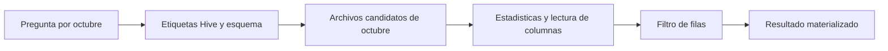

# 09.08 — Particionamiento justificado

## Propósito, prerrequisitos y objetivos

**Extensión opcional.** Organizar un dataset por valores que aparecen en una
consulta y comprobar que sus archivos siguen representando la misma tabla.
La pregunta es: **si consultamos un corte, ¿qué aporta separar los datos por corte?**

Retoma Dataset/filtro/materialización de [09.06](../06_selective_datasets/README.md)
y archivos/grupos/estadísticas de [09.07](../07_metadata_compression/README.md).
Necesitas sus conceptos y bibliotecas, no sus entregas. Los primeros ejemplos
incluyen todos sus datos; después se reconstruye un CSV incluido en el track.
Esta ampliación no bloquea [09.09](../README.md#09-cierre-del-contrato-compartido).

Al terminar podrás:

- Justificar una columna de partición por una consulta concreta.
- Distinguir carpeta de partición, archivo y grupo de filas.
- Reconocer columnas físicas y columnas reconstruidas desde rutas Hive.
- Consultar una partición y contrastarla con una referencia independiente.
- Detectar etiquetas incorrectas, claves repetidas y archivos omitidos.
- Explicar costos de muchas particiones pequeñas y políticas de escritura.

## 1. La pregunta antes de las carpetas

Cuatro observaciones ficticias, saldos en pesos enteros, clave ID + fecha:

| id_credito | fecha_corte | saldo_mxn |
| --- | --- | ---: |
| 101 | 2026-09-30 | 0 |
| 102 | 2026-09-30 | 1500 |
| 101 | 2026-10-31 | 100 |
| 102 | 2026-10-31 | 2000 |

No son pagos ni cuatro créditos diferentes. Septiembre suma 1500 MXN; octubre
2100. Preguntamos por **octubre y saldo ≥ 2000**, devolviendo ID/saldo. La
respuesta será `102/2000`, independientemente de cómo guardemos los datos.

Con frecuencia consultamos una fecha completa; por eso probaremos particionar
por corte. No elegimos ID solo porque sea una clave: una columna útil para
identificar filas no necesariamente sirve para organizar esta consulta.

## 2. Archivo, partición y grupo no son sinónimos

```text
datos/
├── corte=2026-09-30/
│   └── parte-0.parquet
└── corte=2026-10-31/
    └── parte-0.parquet
```

`corte=valor` es una **partición Hive**: el nombre de la carpeta expresa un
valor de una columna. Dentro puede haber uno o muchos archivos, y cada
archivo puede contener uno o muchos grupos de filas. Los dos archivos pueden
llamarse igual porque están en carpetas distintas. La unidad de almacenamiento
es su ruta completa, no solo `parte-0.parquet`.

| Organización | Qué describe | ¿Decide por sí sola la respuesta? |
| --- | --- | --- |
| Varios archivos planos | División en partes | No; pueden mezclar fechas |
| Partición `corte=...` | Valor asociado a sus archivos | Ayuda a localizar candidatos |
| Grupo de filas | Bloque horizontal dentro de un archivo | Sus estadísticas pueden ayudar a descartar datos |
| Filtro | Condiciones de la pregunta | Determina qué filas deben salir |

Una carpeta llamada `octubre/` no establece por sí sola una partición con
tipos y reglas conocidos. El lector necesita saber cómo interpretar la ruta.
Hive usa `campo=valor`; otras convenciones usan posiciones de carpetas.
[HivePartitioning de PyArrow](https://arrow.apache.org/docs/21.0/python/generated/pyarrow.dataset.HivePartitioning.html),
[apertura de datasets en R](https://arrow.apache.org/docs/r/reference/open_dataset.html).

## 3. Una etiqueta auxiliar para conservar el dato original

En esta práctica mantenemos las tres columnas originales **dentro de cada
Parquet** y añadimos `corte`, texto ISO derivado de `fecha_corte`, para escribir
las carpetas. El escritor de datasets quita del archivo la columna utilizada
para particionar; al abrir con Hive, el lector la reconstruye desde la ruta.

| Lugar | Columnas |
| --- | --- |
| Tabla original | ID, fecha_corte Date, saldo entero |
| Tabla preparada para escribir | Las tres originales + corte textual |
| Parquet individual | Las tres originales |
| Dataset abierto con Hive | Las tres originales + corte reconstruido |

Así podemos comparar la etiqueta con la fecha física. Es una decisión
didáctica explícita; también se puede particionar directamente por una columna
original, pero entonces esa columna puede depender de la ruta para recuperarse.
No enseñamos que Parquet repita siempre las columnas de partición.

`corte` es texto de organización; `fecha_corte` sigue siendo Date. No cambiamos
el contrato para tratar fechas como cadenas. Declaramos la partición como
texto sin inferir sus tipos. La presencia y correspondencia de la etiqueta
se verifican aparte: un esquema no comprueba que una carpeta esté bien nombrada.

## 4. Entorno y ejemplo autónomo en Python

Referencias: Python 3.12.12/PyArrow 21.0.0/pandas 2.3.3 y
R 4.6.1/arrow 25.0.1/dplyr 1.2.1. No se añaden dependencias ni se modifican
lockfiles. Utiliza el entorno elegido; consulta los
[recorridos Python](../03_python_read_write/recorridos.md) y la
[preparación R](../04_r_read_write/README.md#2-preparar-el-proyecto-desde-el-ide)
si faltan bibliotecas. No instales desde el script de análisis.

El ejemplo pequeño solo necesita PyArrow. Guarda el script en tu IDE;
la ruta relativa depende de `Path.cwd()`. Crea una carpeta nueva y conserva
los archivos para volver a consultar sin repetir la escritura.

```python
from datetime import date
from pathlib import Path
import pyarrow as pa
import pyarrow.dataset as ds
import pyarrow.parquet as pq

esquema = pa.schema([
    pa.field("id_credito", pa.string(), nullable=False),
    pa.field("fecha_corte", pa.date32(), nullable=False),
    pa.field("saldo_mxn", pa.int32(), nullable=False),
])
tabla = pa.Table.from_pylist([
    {"id_credito": "101", "fecha_corte": date(2026, 9, 30), "saldo_mxn": 0},
    {"id_credito": "102", "fecha_corte": date(2026, 9, 30), "saldo_mxn": 1500},
    {"id_credito": "101", "fecha_corte": date(2026, 10, 31), "saldo_mxn": 100},
    {"id_credito": "102", "fecha_corte": date(2026, 10, 31), "saldo_mxn": 2000},
], schema=esquema)
ampliada = tabla.append_column("corte", pa.array([
    f["fecha_corte"].isoformat() for f in tabla.to_pylist()]))
particion = ds.partitioning(pa.schema([("corte", pa.string())]), flavor="hive")
carpeta = Path("output/09_08_mini_python")
carpeta.mkdir(parents=True, exist_ok=False)
formato = ds.ParquetFileFormat()
ds.write_dataset(ampliada, carpeta, format=formato, partitioning=particion,
    file_options=formato.make_write_options(compression="NONE", version="2.6"),
    basename_template="parte-{i}.parquet", existing_data_behavior="error")

# Desde aqui solo lectura: conserva imports, particion y carpeta al reiniciar.
archivos = sorted(carpeta.glob("*/*.parquet"))
assert len(archivos) == 2
for ruta in archivos:
    with pq.ParquetFile(ruta) as lector:
        assert lector.schema_arrow.equals(esquema, check_metadata=False)
dataset = ds.dataset(carpeta, format="parquet", partitioning=particion)
assert dataset.to_table(columns=esquema.names).sort_by([
    ("fecha_corte", "ascending"), ("id_credito", "ascending")]).equals(tabla)
filtro = ((ds.field("corte") == "2026-10-31") &
          (ds.field("fecha_corte") == pa.scalar(date(2026, 10, 31))) &
          (ds.field("saldo_mxn") >= 2000))
scanner = dataset.scanner(columns=["id_credito", "saldo_mxn"], filter=filtro)
resultado = scanner.to_table()
assert resultado.to_pylist() == [{"id_credito": "102", "saldo_mxn": 2000}]
print(resultado.to_pylist())
print([f.path for f in dataset.get_fragments(filter=ds.field("corte") == "2026-10-31")])
```

`append_column` añade la etiqueta sin alterar las columnas anteriores;
`isoformat()` produce el texto `AAAA-MM-DD`. La lista de partición establece
nombre/tipo y `flavor="hive"` establece cómo interpretarlos en rutas.
`basename_template` genera nombres de archivos; `{i}` es un contador, no el ID.
No se garantiza un archivo por partición en cualquier volumen o configuración.
[write_dataset de PyArrow](https://arrow.apache.org/docs/21.0/python/generated/pyarrow.dataset.write_dataset.html).

La consulta combina la etiqueta y la fecha original y después el umbral de
saldo. Los paréntesis y `&` construyen expresiones Arrow; `to_table()` materializa
el resultado. Los fragmentos devueltos por `get_fragments(filter=...)` son
candidatos según el filtro de partición: no son un registro de bytes leídos.

## 5. El mismo ejemplo autónomo desde R

Abre un proyecto con arrow/dplyr disponibles, reinicia R y crea un script
propio en el IDE. `getwd()` indica la base de la ruta relativa. No necesita
archivos ni funciones de capítulos anteriores ni haber ejecutado Python.

```r
esquema <- arrow::schema(
  arrow::field("id_credito", arrow::utf8(), nullable = FALSE),
  arrow::field("fecha_corte", arrow::date32(), nullable = FALSE),
  arrow::field("saldo_mxn", arrow::int32(), nullable = FALSE))
x <- data.frame(id_credito = c("101", "102", "101", "102"),
  fecha_corte = as.Date(c("2026-09-30", "2026-09-30", "2026-10-31", "2026-10-31")),
  saldo_mxn = c(0L, 1500L, 100L, 2000L))
x$corte <- format(x$fecha_corte, "%Y-%m-%d")
esquema_ampliado <- arrow::schema(
  arrow::field("id_credito", arrow::utf8(), nullable = FALSE),
  arrow::field("fecha_corte", arrow::date32(), nullable = FALSE),
  arrow::field("saldo_mxn", arrow::int32(), nullable = FALSE),
  arrow::field("corte", arrow::utf8()))
tabla <- arrow::Table$create(x, schema = esquema_ampliado)
carpeta <- "output/09_08_mini_r"
if (file.exists(carpeta)) stop("Elige una carpeta nueva")
stopifnot(dir.create(carpeta, recursive = TRUE))
arrow::write_dataset(tabla, carpeta, format = "parquet", partitioning = "corte",
  hive_style = TRUE, basename_template = "parte-{i}.parquet",
  existing_data_behavior = "error", compression = "uncompressed", version = "2.6")

# Solo lectura: al reiniciar conserva carpeta y la declaracion de esquema.
archivos <- list.files(carpeta, pattern = "parquet$", recursive = TRUE, full.names = TRUE)
stopifnot(length(archivos) == 2L)
for (ruta in archivos) {
  lector <- arrow::ParquetFileReader$create(ruta, mmap = FALSE)
  stopifnot(lector$GetSchema()$Equals(esquema, check_metadata = FALSE))
}
dataset <- arrow::open_dataset(carpeta, format = "parquet",
  partitioning = arrow::hive_partition(corte = arrow::utf8()), unify_schemas = TRUE)
consulta <- dataset |>
  dplyr::filter(corte == "2026-10-31", fecha_corte == as.Date("2026-10-31"), saldo_mxn >= 2000L) |>
  dplyr::select(id_credito, saldo_mxn)
print(consulta)
resultado <- dplyr::collect(consulta)
stopifnot(identical(resultado$id_credito, "102"), identical(resultado$saldo_mxn, 2000L))
print(resultado)
```

`partitioning = "corte"` nombra una columna para escribir; `hive_style = TRUE`
solicita carpetas `campo=valor`. Al leer, `hive_partition(corte = utf8())`
declara esa columna reconstruida como texto. `unify_schemas = TRUE` inspecciona
fragmentos para formar el esquema, pero no certifica su contenido ni las claves.
`filter()` y `select()` preparan una consulta; `collect()` trae el resultado
a R. `2000L` es entero R. [write_dataset de R](https://arrow.apache.org/docs/r/reference/write_dataset.html).

Para comprobar toda la muestra desde R, después de la lectura:

```r
completa <- dplyr::collect(dplyr::select(dataset, id_credito, fecha_corte, saldo_mxn))
completa <- as.data.frame(completa[order(completa$fecha_corte, completa$id_credito), ])
rownames(completa) <- NULL
stopifnot(identical(completa, x[c("id_credito", "fecha_corte", "saldo_mxn")]))
```

Esto sí carga el conjunto completo. Al reiniciar, no necesitas `x` para
consultar; para repetir la comparación pequeña puedes redefinir sus cuatro
filas sin reescribir los archivos.

## 6. Qué significa descartar particiones



Sin renderizador: la condición de partición puede excluir rutas; después
el lector decide qué necesita de los archivos candidatos y evalúa filas.
Esto suele llamarse *partition pruning*. No equivale a leer todas las carpetas
y luego filtrar una tabla ya cargada.

No deducimos velocidad ni ahorro físico de esa posibilidad. Enumerar rutas,
inspeccionar esquemas, abrir archivos y leer metadatos también cuesta. Un archivo
plano separado por fecha puede aprovechar estadísticas de grupos; las particiones
no son la única forma de descartar datos. No prometemos una mejora por ver menos
fragmentos en una lista. Aquí comparamos resultados, estructura y candidatos;
no medimos I/O físico, tiempo ni RAM.

### No confiar ciegamente en las rutas

Si una carpeta dice noviembre pero contiene octubre, un filtro por etiqueta
podría omitir esos registros. Una respuesta vacía no certifica que el corte
no exista en los archivos. La auditoría completa debe comparar cada etiqueta
con las fechas físicas y reconstruir todas las claves contra la fuente.
La consulta de octubre tampoco detecta una copia duplicada de septiembre.

## 7. Base común: plano frente a particionado

El [CSV incluido](../01_csv_parquet_arrow/datos/base_comun.csv) contiene 28 filas,
14 IDs y tres columnas. Clave ID/fecha, esquema no anulable `string/date32/int32`,
fechas 1900–2100, saldos en pesos enteros entre 0 y 2 147 483 647. Hay 14 filas
por corte y 29 000/31 800 MXN en septiembre/octubre. Se consulta octubre ≥ 2000:
nueve IDs y 24 100 MXN **en la selección**, no en todo octubre.

Las funciones crean dos entregas nuevas: `plano/datos/` con dos archivos y
`por_corte/datos/` con dos carpetas Hive. Comparten valores, tipos, códec Snappy
y versión Parquet 2.6. No dependen de entregas anteriores. La auditoría relee
todo deliberadamente porque la muestra es pequeña: no es validación escalable.

### Python

Desde la raíz de DS Track, con el intérprete elegido en tu IDE:

```python
from pathlib import Path
from datetime import date
import sys
sys.path.insert(0, str(Path("curriculum/09_arrow_parquet/08_justified_partitioning").resolve()))
import particiones as curso

compartida = Path("output/09_08_particiones").resolve()
print(curso.crear_comparacion(compartida / "python"))
plano = curso.base.abrir_dataset(compartida / "python/plano/datos")
datos = compartida / "python/por_corte/datos"
particionado = curso.abrir_particionado(datos)
print(curso.auditar_particionado(datos))
a = curso.base.preparar_consulta(plano).to_table()
b = curso.preparar_consulta(particionado).to_table()
assert curso.base.comprobar_consulta(a) == curso.base.comprobar_consulta(b)
print(curso.base.comprobar_consulta(b))
print(curso.inventario(datos))
print(curso.candidatos(particionado))
```

El control no se limita a comprobar que ambas consultas coincidan: cada una
se compara por ID/importe con una referencia reconstruida del CSV mediante
recorrido Python. Una equivocación compartida por dos consultas no bastaría.

### R: preparar y ejecutar desde el IDE

Desde la raíz de DS Track, guarda tu trabajo y ejecuta en **Console de R**:

```r
source("curriculum/09_arrow_parquet/08_justified_partitioning/preparar_particiones.R")
preparar_practica_particiones(
  "curriculum/06_r_foundations/09_known_result/output/cierre_ventas")
```

Adapta la ruta al proyecto renv que ya dispone de arrow desde 09.04. El
[preparador](preparar_particiones.R) comprueba fuentes y metadatos; añade
`particiones.R`, `R/consultas_dataset_0906.R` y `ruta_particiones_0908.txt`,
sin cambiar dependencias, lockfile, biblioteca o entregas. El módulo 09.06
se copia desde el repositorio, sin necesitar que hayas preparado su práctica.
Si las rutas están ocupadas o personalizadas, se rechaza la preparación;
conserva el diagnóstico y revisa las diferencias sin sobrescribir.

Abre el proyecto existente, reinicia R y guarda un script con este bloque:

```r
stopifnot(isTRUE(renv::status()$synchronized))
source("particiones.R", encoding = "UTF-8")
compartida <- readLines("ruta_particiones_0908.txt", encoding = "UTF-8")
print(crear_comparacion_r(file.path(compartida, "r")))
f <- funciones_particiones()
plano <- f$abrir_dataset_r(file.path(compartida, "r/plano/datos"))
datos <- file.path(compartida, "r/por_corte/datos")
particionado <- abrir_particionado_r(datos)
print(auditar_particionado_r(datos))
a <- dplyr::collect(f$preparar_consulta_r(plano))
b <- dplyr::collect(preparar_consulta_particion_r(particionado))
stopifnot(identical(f$comprobar_consulta_r(a), f$comprobar_consulta_r(b)))
print(f$comprobar_consulta_r(b))
print(inventario_particiones_r(datos))
print(candidatos_por_etiqueta_r(datos))
```

R compara con indexación R base sobre el CSV reconstruido, sin reutilizar
el filtro Arrow como referencia. `candidatos_por_etiqueta_r()` enumera rutas
compatibles con el corte por nombre de carpeta; no es una traza interna del
motor. En Python `get_fragments()` sí expone candidatos de su Dataset. Ninguna
de las dos salidas mide lecturas físicas.

Dentro de la función R, `fecha_objetivo` guarda el argumento Date para que
no se confunda con la columna textual `corte`; `.data$corte` indica explícitamente
la columna de partición. No compares la fecha original con una etiqueta textual
por accidente al reutilizar nombres en una consulta dplyr.

## 8. Demasiadas particiones y archivos pequeños

La **cardinalidad** es la cantidad de valores distintos de una columna o clave.
En la base común hay dos cortes, 14 IDs y 28 claves ID/fecha. Particionar por
cada clave produciría aquí 28 carpetas de una fila. Para nuestra pregunta de
un corte, aumenta el número de unidades que hay que gestionar.

Como demostración opcional dentro de esta ampliación, escribe otra copia:

```python
tabla = curso.cartera.crear_tabla(curso.cartera.cargar_dataframe())
inventario_exceso = curso.escribir_particionado(tabla, compartida / "python_exceso", por="clave")
assert len(inventario_exceso) == 28
print(curso.auditar_particionado(compartida / "python_exceso/datos", por="clave"))
```

O, desde R, sin necesitar la copia Python:

```r
tabla <- f$crear_tabla_cartera(f$cargar_cartera())
inventario_exceso <- escribir_particionado_r(tabla, file.path(compartida, "r_exceso"), por = "clave")
stopifnot(nrow(inventario_exceso) == 28L)
print(auditar_particionado_r(file.path(compartida, "r_exceso/datos"), por = "clave"))
```

`clave` es otra etiqueta auxiliar, `ID_AAAA-MM-DD`; el contrato físico de tres
columnas se conserva. Compara cantidad de archivos y suma de `bytes_archivo`
con las dos particiones por corte. Es longitud de archivos, no espacio asignado
por el sistema de archivos ni RAM. Se puede explicar el costo de muchas
cabeceras/metadatos; no concluir un tiempo de consulta sin medirlo.

No hay un número universal de particiones correcto. Depende de consultas,
distribución, tamaño y evolución. Compactación y evolución de esquemas quedan
como profundización; no implementamos borrado ni reescritura automática.

## 9. Escribir de nuevo no elimina duplicados

Dos riesgos distintos: reutilizar un nombre puede sobrescribir archivos;
utilizar nombres nuevos puede añadir otra vez las mismas filas. Arrow no
impone nuestra clave ID/fecha ni convierte una escritura en una transacción.

Las APIs tienen políticas distintas por defecto. PyArrow ofrece `error`,
`overwrite_or_ignore` y `delete_matching`; R ofrece `error`, `overwrite` y
`delete_matching`, con `overwrite` como opción predeterminada en la versión
comprobada. Las opciones que borran o sobrescriben no son una deduplicación.
Consulta sus referencias oficiales antes de usarlas.

En esta práctica se usa **`existing_data_behavior="error"`** y un destino
nuevo. Las funciones del curso rechazan incluso una carpeta existente vacía;
la API por sí sola puede permitir una carpeta vacía. La protección del curso
es una política explícita, no una garantía de transacción, control de carreras
entre procesos ni recuperación automática tras interrupciones.

Si queda una entrega parcial, consérvala para diagnosticar y usa otro nombre
para repetir. El lab simula una adición duplicada copiando un archivo sobre
una **copia nueva**, y demuestra que la auditoría la rechaza sin tocar originales.

## 10. Auditoría, vacío y sesión nueva

Las funciones revisan el árbol esperado, todas las extensiones y todos los
esquemas físicos, no solo el primer archivo. Rechazan subcarpetas inesperadas,
notas mezcladas con datos y etiquetas de fecha inválidas. La auditoría completa
decodifica cada archivo, exige que sus valores coincidan con la etiqueta y
compara el conjunto contra el CSV por clave. El inventario es una nota de
escritura, no una certificación permanente de integridad.

Si la tabla está vacía no hay valores para crear particiones. El recorrido
conserva un único `vacio.parquet` de cero filas con esquema, sin carpetas de
corte. Una carpeta sin archivos se rechaza. Una consulta vacía conserva sus
columnas; no establece que todo el corte tenga saldo cero.

Reinicia las sesiones y ejecuta solo importación/carga, rutas y
`verificar_comparacion()` / `verificar_comparacion_r()` sobre carpetas existentes.
Vuelve a abrir ambos datasets y repite la consulta y su control. No repitas
escrituras ni dependas de objetos del panel Environment. Los lectores pueden
abrir también la entrega del otro lenguaje, usando la misma carpeta absoluta
que señala el TXT local; no exigen reticulate ni un proceso compartido.

## Práctica, criterio de salida y siguiente paso

Realiza el [lab 09.08](../../../labs/09_arrow_parquet/08_justified_partitioning/README.md).
Puedes cerrar esta ampliación cuando justifiques la partición por la pregunta,
reconstruyas el contrato, concilies la consulta y rechaces duplicados/etiquetas
incorrectas. No hay proyecto/checkpoint implementado asociado. El material no
acredita práctica del estudiante; omitir esta extensión no bloquea el cierre.

Siguiente: [09.09 — Cierre del contrato compartido](../README.md#09-cierre-del-contrato-compartido),
todavía planificada. Consulta los [pendientes de almacenamiento](../../../docs/storage-closure.md).

## Referencias y atribución

Ejemplos propios con datos sintéticos. Fuentes primarias enlazadas por concepto:
HivePartitioning, write_dataset Python/R y open_dataset de R; apoyo conceptual
en [datasets Python](https://arrow.apache.org/docs/21.0/python/dataset.html) y
[datasets R](https://arrow.apache.org/docs/r/articles/dataset.html).
Consulta: 2026-10-22. La documentación R publicada indica 26.0.0; parámetros
y ejemplos se contrastan con arrow 25.0.1 del proyecto, sin cambiar paquetes.
