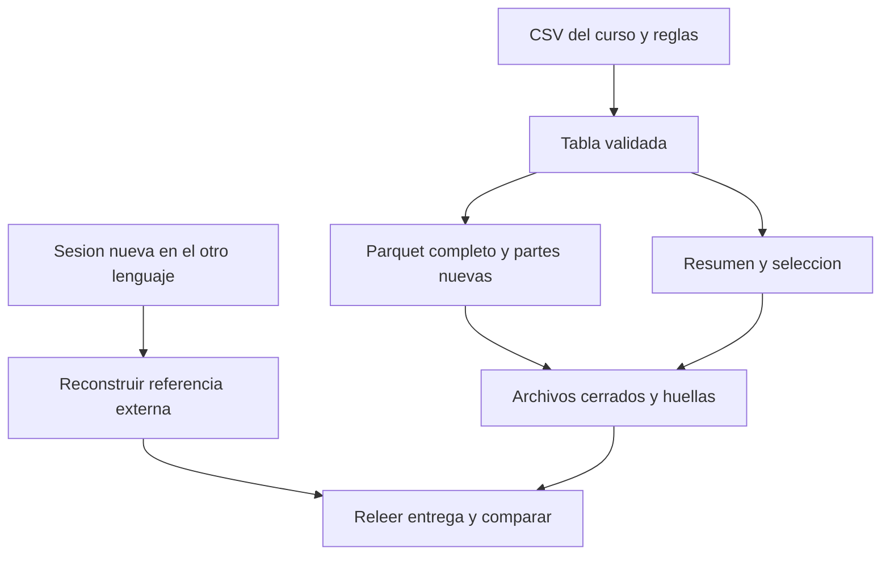

# 09.09 — Cierre del contrato compartido

[Inicio](../../../README.md) / [Módulo 09](../README.md) / **Lección 09.09**

| Tu sesión | Qué prepararás o comprobarás |
| --- | --- |
| **Meta** | Reconstruir y verificar una entrega compartida desde ambos lenguajes |
| **Necesitas** | Conceptos y bibliotecas 09.02–09.07; no exige 09.08 ni entregas anteriores |
| **Evidencia** | Entrega y cuatro combinaciones escritor/lector verificadas desde cero |

[Preparación](#antes-de-empezar) · [Material de apoyo](#material-de-apoyo) · [Lab 09.09](../../../labs/09_arrow_parquet/09_shared_contract_closure/README.md) · [Comprobar](#evidencia-y-criterio-de-salida)

<a id="propósito-prerrequisitos-y-objetivos"></a>

## Propósito

**Práctica de cierre.** Reconstruir una entrega de datos y demostrar desde
Python y R que otra sesión recupera el mismo contrato, las mismas claves y
los mismos valores. La pregunta es: **¿qué puede comprobar otra persona sin
confiar en los objetos que tengo abiertos ni en mi resumen escrito?**

## Antes de empezar

Retoma [09.02 — Contratos](../02_schemas_types/README.md),
[09.03 — Python](../03_python_read_write/README.md),
[09.04 — R](../04_r_read_write/README.md),
[09.05 — Intercambio](../05_python_r_exchange/README.md),
[09.06 — Consulta y auditoría](../06_selective_datasets/README.md) y
[09.07 — Metadatos y medidas](../07_metadata_compression/README.md).
Necesitas sus conceptos y bibliotecas, **no entregas personales anteriores**.
No exige [09.08](../08_justified_partitioning/README.md): particionar es opcional.

## Qué vas a aprender

- Reconstruir fuente y resultados con reglas explícitas y una carpeta nueva.
- Separar contrato, datos, resumen, selección y notas de ejecución.
- Verificar tanto un archivo como un dataset y sus exportaciones CSV.
- Leer una entrega Python desde R y una R desde Python, en procesos separados.
- Explicar igualdad por clave, igualdad binaria y límites de las huellas.
- Repetir la verificación de solo lectura tras reiniciar la sesión.

## Material de apoyo

| Recurso | Para qué sirve | Uso |
| --- | --- | --- |
| [Preparador R](preparar_cierre.R) | Añadir funciones del cierre al mismo proyecto | Para el recorrido |
| [Cierre Python](cierre_contrato.py) | Reconstruir y verificar archivos, dataset y exportaciones | Para el recorrido |
| [Cierre R](cierre_contrato.R) | Reconstruir y leer ambas entregas contra la fuente externa | Para el recorrido |
| [CSV de base común](../01_csv_parquet_arrow/datos/base_comun.csv) | Consultar la referencia de 28 observaciones con claves y valores conocidos | Para el recorrido |
| [Criterios de integración](../../../docs/storage-closure.md) | Distinguir material, práctica y proyecto pendiente | Consulta para el cierre |

Consulta los archivos aquí y ábrelos donde indica el recorrido. Python y R
tienen instrucciones de preparación y ejecución propias; conserva los
originales y utiliza carpetas nuevas cuando la actividad escriba resultados.

## 1. Un ejemplo pequeño con todos sus datos

Cuatro saldos ficticios en pesos enteros, clave ID + fecha y sin ausencias:

| id_credito | fecha_corte | saldo_mxn |
| --- | --- | ---: |
| 101 | 2026-09-30 | 0 |
| 102 | 2026-09-30 | 1500 |
| 101 | 2026-10-31 | 100 |
| 102 | 2026-10-31 | 2000 |

Cada fila representa un crédito **en un corte**. Hay dos IDs, no cuatro
créditos distintos. Septiembre suma 1500 MXN y octubre 2100. El cero es un
importe conocido; no lo confundimos con un dato ausente.

### Python: recuperar todos los valores

Este bloque autónomo solo necesita PyArrow. Guarda un script en tu IDE;
`Path.cwd()` indica desde dónde se interpreta la carpeta relativa:

```python
from datetime import date
from pathlib import Path
import pyarrow as pa
import pyarrow.parquet as pq

esquema = pa.schema([
    pa.field("id_credito", pa.string(), nullable=False),
    pa.field("fecha_corte", pa.date32(), nullable=False),
    pa.field("saldo_mxn", pa.int32(), nullable=False),
])
filas = [
    {"id_credito": "101", "fecha_corte": date(2026, 9, 30), "saldo_mxn": 0},
    {"id_credito": "102", "fecha_corte": date(2026, 9, 30), "saldo_mxn": 1500},
    {"id_credito": "101", "fecha_corte": date(2026, 10, 31), "saldo_mxn": 100},
    {"id_credito": "102", "fecha_corte": date(2026, 10, 31), "saldo_mxn": 2000},
]
esperada = pa.Table.from_pylist(filas, schema=esquema)
carpeta = Path("output/09_09_mini_python")
carpeta.mkdir(parents=True, exist_ok=False)
ruta = carpeta / "saldos.parquet"
with ruta.open("xb") as archivo:
    pq.write_table(esperada, archivo, compression="NONE", version="2.6")

# Solo lectura desde aqui. El lector observa el esquema real del archivo.
with pq.ParquetFile(ruta) as lector:
    observada = lector.read()
assert observada.schema.equals(esquema, check_metadata=False)
clave = lambda f: (f["id_credito"], f["fecha_corte"])
assert sorted(observada.to_pylist(), key=clave) == sorted(filas, key=clave)
print("Cuatro registros recuperados y comparados por ID/fecha")
```

La comparación revisa el saldo correspondiente a **cada** ID/fecha. Cambiar
100 a 200 y 2000 a 1900 conserva la suma de octubre, pero falla esta igualdad.
Ordenar por clave para comparar no significa que el formato garantice un orden
de lectura universal. `nullable=False` declara el esquema; en la entrega
completa también comprobamos presencia, dominio y unicidad.

### R: la misma idea, sin ejecutar Python

Abre un proyecto con arrow disponible, reinicia R y crea un script en el IDE.
`getwd()` indica desde dónde se interpreta la ruta. El bloque define sus
propios datos y no necesita archivos de otro capítulo:

```r
esquema <- arrow::schema(
  arrow::field("id_credito", arrow::utf8(), nullable = FALSE),
  arrow::field("fecha_corte", arrow::date32(), nullable = FALSE),
  arrow::field("saldo_mxn", arrow::int32(), nullable = FALSE))
esperada <- data.frame(id_credito = c("101", "102", "101", "102"),
  fecha_corte = as.Date(c("2026-09-30", "2026-09-30", "2026-10-31", "2026-10-31")),
  saldo_mxn = c(0L, 1500L, 100L, 2000L))
carpeta <- "output/09_09_mini_r"
if (file.exists(carpeta)) stop("Elige una carpeta nueva")
stopifnot(dir.create(carpeta, recursive = TRUE))
ruta <- file.path(carpeta, "saldos.parquet")
arrow::write_parquet(arrow::Table$create(esperada, schema = esquema), ruta,
  compression = "uncompressed", version = "2.6")

# Leer primero el esquema real y despues los valores, sin imponer una conversion.
lector <- arrow::ParquetFileReader$create(ruta, mmap = FALSE)
stopifnot(lector$GetSchema()$Equals(esquema, check_metadata = FALSE))
observada <- as.data.frame(lector$ReadTable())
ordenar <- function(x) {
  x <- x[order(x$id_credito, x$fecha_corte), , drop = FALSE]
  rownames(x) <- NULL
  x
}
stopifnot(identical(ordenar(esperada), ordenar(observada)))
lector <- NULL
print("Cuatro registros recuperados y comparados por ID/fecha")
```

`as.Date()` construye fechas sin hora, `L` explicita enteros R y
`drop = FALSE` conserva la forma tabular al seleccionar filas. `identical()`
exige también tipos iguales. Al reiniciar puedes redefinir los cuatro datos
esperados y la ruta, y ejecutar **solo la lectura**; no repitas la escritura.

## 2. Contrato, integridad y equivalencia

Son preguntas distintas que se complementan:

| Pregunta | Comprobación | Un resultado insuficiente |
| --- | --- | --- |
| ¿Cómo interpretar los datos? | Tipos, unidades, ausencia, claves y reglas | Que el archivo termine en `.parquet` |
| ¿Cambió un archivo desde el registro? | Lista de archivos, tamaño y huella | Un nombre de archivo igual |
| ¿Conserva la fuente conocida? | Cada clave/valor frente a referencia externa | Misma cantidad y suma |
| ¿Responde la consulta? | Cada ID/importe contra CSV independiente | Solo una selección que parece razonable |
| ¿Puede otra sesión comprobarlo? | Reiniciar y verificar desde archivos | Un objeto que quedó en memoria |

Una **huella** resume los bytes de un archivo. Dos Parquet escritos por
Python y R pueden representar la misma tabla y tener huellas distintas por
metadatos, organización o detalles del escritor. No exigimos igualdad binaria
entre lenguajes. Sí exigimos que los archivos de una entrega coincidan con
el registro de esa entrega y que sus valores coincidan con el CSV del curso.

Se utiliza MD5, disponible en Python estándar y `tools` de R, para detectar
cambios accidentales sin dependencias nuevas. No certifica autoría ni protege
frente a quien también modifica el manifiesto. Una huella correcta no demuestra
un contrato correcto: por eso el verificador vuelve a decodificar y comparar.
[hashlib](https://docs.python.org/3.12/library/hashlib.html),
[tools::md5sum](https://search.r-project.org/R/refmans/tools/html/md5sum.html).

## 3. Fuente, pregunta y resultados de la entrega

El [CSV incluido](../01_csv_parquet_arrow/datos/base_comun.csv) se presenta
de nuevo aquí: 28 observaciones, 14 IDs textuales de tres dígitos y dos cortes.
Sus columnas son `id_credito`, `fecha_corte` y `saldo_mxn`.

| Regla | Decisión |
| --- | --- |
| Esquema Arrow | `string/date32/int32`, las tres columnas no anulables |
| Clave | ID + fecha; repetirla rechaza el lote |
| Fechas | Calendario válido, de 1900-01-01 a 2100-12-31 |
| Saldo | Pesos MXN enteros de 0 a 2 147 483 647 |
| Ausencias/fracciones | Se rechazan; no se imputan ni truncan |
| Orden de comparación | Por ID/fecha, sin depender del orden de los archivos |
| Índice de pandas | No se serializa como columna adicional |

Resultados completos conocidos:

| fecha_corte | registros | saldo_mxn |
| --- | ---: | ---: |
| 2026-09-30 | 14 | 29000 |
| 2026-10-31 | 14 | 31800 |

La consulta de cierre pide **octubre con saldo ≥ 2000**, devolviendo ID/saldo:
`008/2000`, `010/2200`, `011/2300`, `013/2500`, `015/2700`, `016/2800`,
`017/2900`, `021/3300`, `022/3400`. Son nueve registros y 24 100 MXN.
Es el saldo de esa selección, no el de todo octubre. Cada lenguaje reconstruye
la referencia desde CSV con sus reglas, sin usar el filtro Arrow para producir
los resultados esperados.

## 4. Qué se entrega y cómo se reconstruye

```text
mi_entrega/
├── entrada.csv
├── contrato.csv
├── tabla.parquet
├── dataset/
│   ├── inventario.csv
│   └── datos/
│       ├── parte_001.parquet
│       └── parte_002.parquet
├── resumen.csv
├── seleccion.csv
├── sesion.csv
└── huellas.csv
```

- `entrada.csv` es una copia exacta de la fuente elegida; conserva el original.
- `contrato.csv` declara las reglas que revisa el código, no las sustituye.
- `tabla.parquet` contiene las 28 observaciones completas.
- `dataset/datos/` divide esa misma tabla en partes de hasta 14 filas, sin particiones.
- `resumen.csv` tiene conteos y saldos por corte; `seleccion.csv`, los nueve pares.
- `sesion.csv` registra escritor, versiones y configuración solicitada.
- `huellas.csv` registra rutas relativas, bytes y MD5 de los demás archivos;
  no se incluye a sí mismo. El inventario describe las partes reales.

**No abras juntos `tabla.parquet` y `dataset/datos/`:** son dos representaciones
de las mismas observaciones. Sumarlas como si fueran partes duplicaría los datos.
Las notas de sesión registran lo declarado por el escritor; no pueden autenticar
una sesión pasada. Los verificadores comprueban sus campos y valores fijos, no
que el número de versión anotado corresponda a un proceso histórico real.



Sin renderizador: fuente → validar → escribir → cerrar → registrar; después,
otra sesión reconstruye la referencia y contrasta los archivos. La comparación
no usa `entrada.csv` como única fuente confiable: también exige que coincida
con el CSV externo indicado al verificador. Si los datos cambian legítimamente,
prepara una nueva entrega con su fuente y contexto; no repares las sumas para
que pasen contra la referencia antigua.

## 5. Preparar los entornos

Referencias comprobadas: Python 3.12.12/pandas 2.3.3/PyArrow 21.0.0 y
R 4.6.1/arrow 25.0.1/dplyr 1.2.1/renv 1.3.1. Conserva el gestor y la biblioteca
local elegidos. No se añaden dependencias ni se cambian lockfiles. Si faltan
bibliotecas, utiliza los [recorridos Python](../03_python_read_write/recorridos.md)
o la [preparación R](../04_r_read_write/README.md#2-preparar-el-proyecto-desde-el-ide).
No necesitas haber generado entregas de esos capítulos.

Para la entrega R, guarda tu trabajo. Desde la raíz de DS Track, en **Console
de R** del IDE:

```r
source("curriculum/09_arrow_parquet/09_shared_contract_closure/preparar_cierre.R")
preparar_practica_cierre(
  "curriculum/06_r_foundations/09_known_result/output/cierre_ventas")
```

Adapta la ruta a tu proyecto renv existente. El [preparador](preparar_cierre.R)
comprueba fuentes y metadatos de 09.04; solo añade `cierre_contrato.R`,
`R/consultas_cierre_0909.R` y `ruta_cierre_0909.txt`. El módulo de consultas se
copia desde el repositorio; no requiere preparar ni ejecutar 09.06–09.08.
No instala paquetes ni modifica biblioteca, fuentes, lockfile o entregas.
Rechaza rutas ocupadas o personalizadas para conservar tu trabajo; si ya está
preparado, no lo repitas.

El TXT guarda una ruta absoluta **local** para compartir archivos entre
procesos Python/R con distintos directorios de trabajo. No la publiques con
tus rutas personales. En los scripts utiliza esa misma ubicación, adaptando
`compartida` en Python si preparaste otra.

## 6. Python: reconstruir la primera entrega

En tu IDE, con el intérprete elegido y la raíz de DS Track como directorio:

```python
from pathlib import Path
import sys
sys.path.insert(0, str(Path("curriculum/09_arrow_parquet/09_shared_contract_closure").resolve()))
import cierre_contrato as curso

compartida = Path("output/09_09_cierre").resolve()
print(curso.crear_entrega(compartida / "python"))
print(curso.verificar_entrega(compartida / "python"))
```

La función reconstruye el CSV incluido, valida el lote completo, escribe en
una carpeta nueva y relee. Sus funciones reutilizan las reglas verificadas
del recorrido, no los objetos ni las entregas de otra sesión. Importar el
módulo no lee datos ni crea salidas. La primera verificación se ejecuta en
la sesión de escritura; todavía falta la prueba desde otra sesión/lenguaje.

Resultado: 28 filas, 14 IDs, dos cortes con 29 000/31 800 MXN y selección
de nueve filas/24 100 MXN. Las versiones anotadas pertenecen al escritor
actual; no se fija un texto de versión como prueba de equivalencia.

## 7. R: leer Python y reconstruir su propia entrega

Abre el proyecto preparado en tu IDE, reinicia R y crea un script con:

```r
stopifnot(isTRUE(renv::status()$synchronized))
source("cierre_contrato.R", encoding = "UTF-8")
compartida <- readLines("ruta_cierre_0909.txt", encoding = "UTF-8")
# Lee Python desde esta sesion nueva: no importa sus objetos en memoria.
print(verificar_entrega_cierre_r(file.path(compartida, "python")))
# R produce otra entrega desde la fuente incluida, no desde la entrega Python.
print(crear_entrega_cierre_r(file.path(compartida, "r")))
```

La lectura de Python requiere que esa carpeta exista **en esta práctica de
cierre**, no en un capítulo anterior. Puedes invertir el orden: crear primero
R, verificarla desde Python y después leer Python desde R. Para estudiar cada
escritor por separado omite temporalmente la lectura cruzada; para acreditar
el cierre completo se comprueban ambas direcciones.

Los lectores observan los esquemas reales antes de comparar, sin imponer al
archivo un esquema que esconda diferencias. El verificador R usa Arrow para
la lectura y sus reglas R para reconstruir la referencia; las exportaciones
CSV se releen como texto para conservar IDs y comparar sus campos sin inferencia.
[read_parquet R](https://arrow.apache.org/docs/r/reference/read_parquet.html),
[Parquet con PyArrow](https://arrow.apache.org/docs/21.0/python/parquet.html).

## 8. Sesiones nuevas y verificación en ambos sentidos

Guarda los scripts. Reinicia Python y ejecuta **solo**:

```python
from pathlib import Path
import sys
sys.path.insert(0, str(Path("curriculum/09_arrow_parquet/09_shared_contract_closure").resolve()))
import cierre_contrato as curso
compartida = Path("output/09_09_cierre").resolve()
print(curso.verificar_entrega(compartida / "python"))
print(curso.verificar_entrega(compartida / "r"))
```

Reinicia también R, carga su proyecto y ejecuta solo lectura:

```r
source("cierre_contrato.R", encoding = "UTF-8")
compartida <- readLines("ruta_cierre_0909.txt", encoding = "UTF-8")
print(verificar_entrega_cierre_r(file.path(compartida, "r")))
print(verificar_entrega_cierre_r(file.path(compartida, "python")))
```

Reiniciar no es borrar la salida de la consola. La nueva sesión debe recuperar
lo necesario desde scripts/archivos, sin reutilizar variables del panel
Environment ni del kernel. Los verificadores leen y comparan; no escriben
una nueva nota, no actualizan huellas ni reparan archivos.

### Qué revisan los verificadores

1. Reconstruyen la referencia desde el CSV externo y sus reglas.
2. Exigen la estructura de entrega y las huellas registradas.
3. Comparan la copia exacta de entrada, el contrato y las notas de configuración.
4. Decodifican el Parquet completo y todas las partes; comparan tipos, presencia,
   dominio, claves y cada valor contra la fuente.
5. Releen inventario/resumen/selección y contrastan sus campos con lo esperado.
6. Ejecutan otra vez la consulta y la comparan con un filtro independiente del CSV.

La auditoría es completa y cabe en memoria en esta muestra. No acredita
validación escalable, I/O físico, rendimiento o RAM acotada. Las notas de
compresión describen la configuración solicitada; el verificador R no expone
todos los códecs/metadatos por bloque. El detalle se inspecciona con las APIs
de [09.07](../07_metadata_compression/README.md) cuando se necesite.

## 9. Repetir, diagnosticar y explicar

Las funciones rechazan cualquier destino ocupado, incluso vacío. Para
reconstruir de nuevo utiliza `python_reconstruido/` o `r_reconstruido/`,
conservando entregas anteriores. Si una escritura falla, su carpeta parcial
se conserva para diagnosticar; no es una entrega válida. No se borra ni se
sobrescribe automáticamente, y no se promete una transacción entre archivos.

El [lab](../../../labs/09_arrow_parquet/09_shared_contract_closure/README.md)
trabaja con copias para comprobar fallos. Ante un rechazo identifica la capa:
¿archivo ausente, bytes cambiados, contrato, clave, saldo o exportación?
Actualizar huellas no corrige datos; volver a leer una suma tampoco corrige
dos errores compensados. No dedupliques ni trunques para forzar igualdad.

Si una fuente válida no tiene filas, se conserva un Parquet vacío con esquema
y una parte vacía; los CSV de resumen/selección conservan encabezados sin
inventar cortes. No hay un saldo observado de cero donde no existen registros.

<a id="práctica-criterio-de-salida-y-siguiente-paso"></a>

## Práctica

Realiza el [lab 09.09](../../../labs/09_arrow_parquet/09_shared_contract_closure/README.md) para
reconstruir ambas entregas, cruzar lectores y justificar cada comprobación.

Como referencia de la actividad, consulta [Preparador R](preparar_cierre.R), [Cierre Python](cierre_contrato.py), [Cierre R](cierre_contrato.R).
Sigue las rutas y el directorio de trabajo indicados para cada lenguaje.

## Evidencia y criterio de salida

| Conserva | Comprueba | Explica |
| --- | --- | --- |
| Fuente, contrato, datos, resumen y selección | 28 registros, 29000/31800 MXN y nueve seleccionados/24100 MXN | Comparación de cada valor por clave contra una referencia externa |
| Código, verificaciones y explicación | Cuatro combinaciones escritor/lector; alteración compensada rechazada | Igualdad por clave frente a binaria; límites de huellas y notas de sesión |

El cierre requiere evidencia propia de reconstrucción, ambas lecturas cruzadas,
verificación de solo lectura desde sesiones nuevas y una explicación razonada.
No exige particiones ni entregas personales anteriores. Conserva fuentes y
resultados previos al reconstruir en carpetas nuevas.

Quien aprende realiza la práctica y explica las decisiones; su compañero revisa.
Tu compañero actualiza las huellas de una copia alterada y pide comprobar por qué eso no corrige los valores.
Guarda evidencia, ayudas y dudas en una nota personal junto a tu práctica.
PROGRESS.md registra desarrollo editorial, no tu expediente de aprendizaje.
El proyecto integrador y sus checkpoints siguen pendientes; las comprobaciones
técnicas del material no acreditan haber completado la práctica.

El proyecto `04_large_credit_dataset` sigue planificado; esta entrega de
cierre no equivale a completarlo.

<a id="referencias-y-atribución"></a>

## Referencias

Ejemplos propios sobre datos sintéticos. Fuentes primarias enlazadas por
concepto: Parquet/PyArrow, lectura R y huellas de biblioteca estándar/base.
Consulta: 2026-10-22. La documentación R publicada muestra 26.0.0; las APIs se
contrastan con arrow 25.0.1. No se añaden dependencias ni se cambian entornos globales.

## Siguiente paso

Continúa con [10.01 — Pregunta, contrato y referencia](../../10_polars_duckdb/01_question_contract_reference/README.md),
disponible sin motores nuevos. La preparación de Polars/DuckDB corresponde a
sus lecciones posteriores. Las nueve secciones de 09 tienen material; el
proyecto integrador y la práctica del estudiante requieren evidencia propia.

Consulta los [criterios de cierre e integración](../../../docs/storage-closure.md).

[← Módulo 09](../README.md) · [Lab 09.09](../../../labs/09_arrow_parquet/09_shared_contract_closure/README.md) · [Siguiente →](../../10_polars_duckdb/01_question_contract_reference/README.md)
