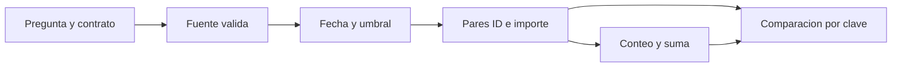

# 10.01 — Pregunta, contrato y referencia

## Propósito, prerrequisitos y objetivos

**Esencial.** Definir qué debe calcular una consulta antes de comparar motores.
La pregunta de esta sección es: **¿cómo sabremos que dos implementaciones
resuelven el mismo problema, aunque usen instrucciones diferentes?**

Un **motor** ejecuta operaciones sobre datos. Polars ofrece expresiones sobre
tablas y consultas diferidas; DuckDB ejecuta SQL analítico. Aprender sus APIs
no empieza por decidir cuál gana: primero fijamos entrada, reglas y respuesta.
Aquí no se instalan ni se ejecutan esos motores. Su preparación se desarrollará
en 10.02 y 10.06, cuando se utilicen de verdad.

Necesitas conceptos de filas/columnas, fechas, filtros y funciones. El recorrido
retoma [contratos](../../09_arrow_parquet/02_schemas_types/README.md) y
[comprobación por clave](../../09_arrow_parquet/09_shared_contract_closure/README.md),
pero **no requiere recordar sus datos ni producir sus entregas**. La muestra,
las reglas y los resultados de los primeros ejemplos están completos aquí.

Al terminar podrás:

- Convertir una pregunta ambigua en una consulta con parámetros precisos.
- Distinguir unidad de observación, clave, esquema y reglas del dominio.
- Construir una referencia sencilla e independiente del motor que se evaluará.
- Comparar cada ID/importe, además de conteo y suma.
- Decidir cómo tratar orden, ausencia, vacío y tipos al comparar resultados.
- Separar lectura, validación, transformación, materialización y exportación.

## 1. La pregunta necesita una población y una unidad

«¿Cuánto saldo alto tenemos?» deja abiertas varias decisiones: ¿en qué fecha?,
¿cuánto es alto?, ¿de qué créditos?, ¿pesos o centavos?, ¿qué significa cada fila?

Usaremos **tres créditos ficticios observados en dos fechas**. Cada fila es
el saldo de un crédito en un corte, no un pago, una persona ni un crédito nuevo.
Las seis observaciones se incluyen también en [muestra.csv](muestra.csv):

| id_credito | fecha_corte | saldo_mxn |
| --- | --- | ---: |
| 001 | 2026-09-30 | 0 |
| 002 | 2026-09-30 | 2000 |
| 003 | 2026-09-30 | 2500 |
| 001 | 2026-10-31 | 100 |
| 002 | 2026-10-31 | 1900 |
| 003 | 2026-10-31 | 2600 |

Son seis observaciones y tres IDs distintos. El ID `002` aparece dos veces
porque cambia la fecha. Su clave completa es **ID + fecha**. Los ceros de
la izquierda forman parte de la representación del identificador: `001`
se conserva como texto, no se convierte en el número `1`.

Septiembre suma 4500 MXN y octubre 4600. Sumar las seis filas daría 9100,
pero mezclaría dos fechas: no sería el saldo de la cartera en un corte.
La primera fila contiene cero conocido, no una ausencia.

Nuestra pregunta precisa será:

> En el corte 2026-10-31, ¿qué créditos tienen saldo mayor o igual a
> 2000 pesos MXN y cuál es el saldo total de esa selección?

La salida necesita **ID y saldo**, además de un control con corte, umbral,
conteo y suma. La fecha se usa para filtrar aunque no aparezca en cada fila
de la selección. Para juntar resultados de varios cortes, conserva también
la fecha: la clave de salida ID solo es válida mientras el corte esté fijo.

## 2. Contrato: más que nombres de columnas

Un **esquema** declara nombres y tipos. El **contrato** añade significado,
unidad, presencia, claves y reglas. Tener tres columnas correctas no demuestra
que la fecha exista en el calendario o que una clave sea única.

| Aspecto | Regla de esta práctica | Error que evita |
| --- | --- | --- |
| Columnas de entrada | `id_credito`, `fecha_corte`, `saldo_mxn` | Leer una columna equivocada |
| Identificador | Texto de tres dígitos | Perder `001` al inferir números |
| Fecha | Fecha sin hora, 1900–2100, calendario válido | Aceptar 2026-02-29 o comparar instantes como fechas |
| Saldo | Pesos enteros de 0 a 2 147 483 647 | Mezclar centavos, truncar fracciones o desbordar int32 |
| Ausencias | No permitidas en estas tres columnas | Imputar cero para que cuadre una suma |
| Clave | ID + fecha, única | Contar dos veces la misma observación |
| Lote inválido | Se rechaza completo y se informa el motivo | Eliminar errores silenciosamente |

El rango del saldo coincide con un entero no negativo representable en
`int32`, usado en el recorrido Arrow. Eso no obliga a que una **suma** se
almacene con el mismo ancho: sumar muchos enteros válidos puede superar el
rango de una celda. Una conversión a un entero más amplio puede ser legítima
si conserva valores y se documenta; convertir a flotante o truncar para
conseguir igualdad no es una reparación.

En CSV los campos se leen inicialmente como texto; luego se comprueban e
interpretan. En esta práctica un campo vacío o el marcador reservado `\N`
no es saldo cero. La referencia rechaza ambos como datos de saldo válidos.
La política es deliberadamente estricta; otros problemas pueden admitir
ausencias, pero necesitan definir cobertura y denominadores antes de calcular.
[Lectura CSV en Python](https://docs.python.org/3.12/library/csv.html).

## 3. Especificar la operación antes del código

| Elemento | Decisión |
| --- | --- |
| Fuente | Las seis filas completas de esta sección |
| Parámetros | Corte 2026-10-31 y mínimo 2000 MXN |
| Predicado | Fecha igual al corte **y** saldo ≥ mínimo |
| Proyección | ID y saldo |
| Conteo | Número de filas seleccionadas |
| Suma | Saldos de esas filas, en pesos enteros |
| Igualdad | Mismos pares ID/importe; el orden no altera la respuesta |
| Selección vacía | Cero filas; control de esta selección con conteo 0 y suma 0 |

Un **predicado** es la condición que decide si una fila entra. Una
**proyección** elige columnas. Una **agregación** combina filas para producir
un conteo, suma u otra medida.

Resolución manual: primero octubre deja `001/100`, `002/1900` y `003/2600`.
El umbral deja solo **`003/2600`**. El control es **una fila y 2600 MXN**.
No incluye `002/2000` de septiembre aunque alcance el umbral; tampoco incluye
`002/1900` de octubre porque queda por debajo.



Sin renderizador: especificar → validar fuente → seleccionar filas → devolver
pares → resumir → comparar. La validación considera también las filas que el
filtro dejará fuera. Encontrar la selección correcta no certifica el lote completo.

## 4. Python: una referencia que cabe en la sección

Una **referencia** es un resultado esperado obtenido con un método que podemos
revisar. Aquí empezamos con los datos escritos en el propio script y un
recorrido explícito. Solo utiliza Python estándar; no necesitas pandas,
Arrow, Polars ni DuckDB para ejecutarlo en tu IDE.

```python
from datetime import date

filas = [
    {"id_credito": "001", "fecha_corte": date(2026, 9, 30), "saldo_mxn": 0},
    {"id_credito": "002", "fecha_corte": date(2026, 9, 30), "saldo_mxn": 2000},
    {"id_credito": "003", "fecha_corte": date(2026, 9, 30), "saldo_mxn": 2500},
    {"id_credito": "001", "fecha_corte": date(2026, 10, 31), "saldo_mxn": 100},
    {"id_credito": "002", "fecha_corte": date(2026, 10, 31), "saldo_mxn": 1900},
    {"id_credito": "003", "fecha_corte": date(2026, 10, 31), "saldo_mxn": 2600},
]
corte = date(2026, 10, 31)
minimo = 2000
seleccion = []
for fila in filas:
    if fila["fecha_corte"] == corte and fila["saldo_mxn"] >= minimo:
        seleccion.append({"id_credito": fila["id_credito"], "saldo_mxn": fila["saldo_mxn"]})

registros = len(seleccion)
saldo = sum(fila["saldo_mxn"] for fila in seleccion)
assert seleccion == [{"id_credito": "003", "saldo_mxn": 2600}]
assert (registros, saldo) == (1, 2600)
print(seleccion, registros, saldo)
```

`date(año, mes, día)` construye una fecha sin hora; `==` compara y `and`
exige ambas condiciones en **una fila Python**. `append()` añade una fila
de salida, `len()` cuenta y `sum()` agrega. La expresión dentro de `sum()`
recorre los importes; no suma fechas ni IDs. En las expresiones columnares
de otros motores la forma de combinar condiciones puede ser diferente.
No traduzcas `and` mecánicamente a una API todavía no explicada.
[date de Python](https://docs.python.org/3.12/library/datetime.html#datetime.date).

El bloque enseña la selección con datos conocidos; no es un validador general.
La función del apartado siguiente añade la revisión completa del contrato
antes de calcular sobre un CSV.

### Del ejemplo visible al CSV incluido

Guarda un script propio y trabaja desde la raíz de DS Track:

```python
from pathlib import Path
from datetime import date
import sys
sys.path.insert(0, str(Path("curriculum/10_polars_duckdb/01_question_contract_reference").resolve()))
import referencia as curso

esperada = curso.construir_referencia()
print(esperada)
assert esperada["fuente"] == {"registros": 6, "ids": 3}
assert esperada["control"]["registros"] == 1
assert esperada["control"]["saldo_mxn"] == 2600
print(curso.comprobar_seleccion([{"id_credito": "003", "saldo_mxn": 2600}]))
```

`Path(...).resolve()` obtiene una ruta absoluta desde la raíz del repositorio.
`sys.path.insert()` permite que **este proceso** encuentre el módulo local;
no instala paquetes ni cambia el entorno global. `curso` es solo un nombre
breve para llamar sus funciones. Sin argumentos, `construir_referencia()` usa
`muestra.csv`, corte de octubre y mínimo 2000; puedes cambiar esos parámetros
por nombre, como hará el lab.

[referencia.py](referencia.py) valida la fuente entera, filtra con un recorrido
Python y devuelve `seleccion`, `control` y un inventario mínimo de la fuente.
No importa motores tabulares. Reutiliza las reglas incluidas de 09.02 como
código, sin necesitar ejecutar aquella lección ni conocer sus ejemplos.
Importar no lee CSV ni escribe archivos; construir/comprobar sí relee la fuente.

`comprobar_seleccion()` recibe registros Python nativos, con IDs textuales e
importes `int`; rechaza flotantes, booleanos, ausencias, duplicados y pares
distintos de la referencia. No sustituye comprobar el esquema del motor:
convertir antes un `2600.5` mediante `int()` ocultaría un error. En 10.02 se
explicará el adaptador de Polars después de revisar sus tipos.

## 5. Qué cuenta como resultado equivalente

Hay varias capas, y una no reemplaza las demás:

1. **Misma entrada y reglas:** mismas observaciones, unidades, corte y umbral.
2. **Misma estructura lógica:** nombres y significado de las columnas; tipos
   compatibles acordados y sin conversiones con pérdida.
3. **Mismos pares:** cada ID debe conservar su importe, sin faltantes ni extras.
4. **Mismo control:** conteo y suma calculados sobre la misma selección.

Para septiembre ≥ 2000 esperamos `002/2000` y `003/2500`: dos filas, 4500 MXN.
Esta salida incorrecta conserva conteo y suma:

| id_credito | saldo_mxn incorrecto |
| --- | ---: |
| 002 | 2100 |
| 003 | 2400 |

Fallan ambos pares. También fallaría cambiar los IDs aunque coincidan los
importes. Ordenar por ID antes de comparar ayuda a emparejar observaciones;
no convierte una fila duplicada en válida. En SQL algunas operaciones no
preservan el orden de entrada; si el orden forma parte de la pregunta, debe
declararse con su criterio y desempate.
[Orden en DuckDB](https://duckdb.org/docs/2.0/sql/dialect/order_preservation.html).

Las etiquetas de tipos varían entre herramientas. Una fecha debe mantener
su significado de fecha, un ID sus ceros y un importe su valor entero; no
aceptamos igualdad basada en «se ven parecidos al imprimir». Un agregado
puede necesitar un entero más amplio que la columna de entrada. Las decisiones
concretas de tipos/adaptación se comprobarán al introducir cada motor.
[Tipos de Polars](https://docs.pola.rs/user-guide/concepts/data-types-and-structures/),
[tipos de DuckDB](https://duckdb.org/docs/2.0/sql/data_types/overview.html).

### Ausencia y selección vacía no son el mismo problema

En noviembre no hay observaciones en la muestra. La referencia devuelve
selección vacía y un control de esa selección con 0 filas/0 MXN. No demuestra
que el saldo de toda la cartera en noviembre sea cero.

Algunas operaciones de agregación representan un conjunto vacío de otra
manera; por ejemplo, `sum` de DuckDB devuelve `NULL` en un grupo vacío.
Al implementar ese recorrido habrá que adaptar **el caso vacío comprobado**
al contrato acordado. No equivale a reemplazar saldos desconocidos por cero.
[Agregaciones de DuckDB](https://duckdb.org/docs/2.0/sql/functions/aggregates.html).

Polars distingue `null` de `NaN`; una ausencia y un valor flotante no numérico
no son intercambiables. La entrada de esta práctica no admite ninguno de
ellos. Aprenderemos otras políticas cuando se necesiten, sin introducir una
imputación para facilitar la comparación.
[Faltantes en Polars](https://docs.pola.rs/user-guide/expressions/missing-data/).

La lista Python `[]` no conserva por sí sola un esquema tabular. En una salida
vacía del motor también habrá que inspeccionar nombres/tipos antes de adaptarla.
El control cero no prueba que esas columnas estuvieran bien construidas.

## 6. Comprobación opcional con R base

Este recorrido ayuda a contrastar la referencia con otra implementación; no
obliga a aprender Polars en R ni a ejecutar ambos lenguajes para empezar 10.02.
Abre tu IDE, reinicia R y guarda un script. El primer bloque es autónomo:

```r
filas <- data.frame(
  id_credito = c("001", "002", "003", "001", "002", "003"),
  fecha_corte = as.Date(c("2026-09-30", "2026-09-30", "2026-09-30",
    "2026-10-31", "2026-10-31", "2026-10-31")),
  saldo_mxn = c(0L, 2000L, 2500L, 100L, 1900L, 2600L))
corte <- as.Date("2026-10-31")
minimo <- 2000L
seleccion <- filas[filas$fecha_corte == corte & filas$saldo_mxn >= minimo,
  c("id_credito", "saldo_mxn"), drop = FALSE]
stopifnot(identical(seleccion$id_credito, "003"),
  identical(seleccion$saldo_mxn, 2600L), nrow(seleccion) == 1L)
saldo <- sum(as.double(seleccion$saldo_mxn))
stopifnot(saldo == 2600)
print(seleccion)
```

`&` combina condiciones vectorizadas; `drop = FALSE` conserva forma de tabla
incluso con una fila o ninguna. Los sufijos `L` son enteros R. Se suma en
`double` para no desbordar int32: estos importes son exactos en ese tipo. La
función general impone una cota conservadora para no prometer exactitud de
enteros más allá de `2^53`; no afirmamos que cualquier suma grande sea exacta.

Para validar también el CSV incluido, trabaja desde la **raíz de DS Track**,
visible con `getwd()`, y ejecuta en Console del IDE:

```r
source("curriculum/10_polars_duckdb/01_question_contract_reference/referencia.R", encoding = "UTF-8")
esperada <- construir_referencia_r()
print(esperada)
print(comprobar_seleccion_r(data.frame(id_credito = "003", saldo_mxn = 2600L)))
```

Solo R base: no prepara proyectos renv ni modifica bibliotecas. Carga las
reglas incluidas al llamar la función y usa indexación R base; no necesita
objetos de otro capítulo. Para repetir, reinicia y ejecuta el script completo.
Los lectores no modifican la muestra ni las salidas.

## 7. Conectar con una referencia de más filas

Como práctica adicional, el CSV de 28 observaciones del módulo 09 está incluido
en el repositorio; **no es una entrega que tengas que generar**. Su contexto
y reglas se presentan otra vez: 14 créditos ficticios en septiembre y octubre,
clave ID/fecha, mismos tres campos y contrato estricto de esta sección.
Septiembre suma 29 000 MXN y octubre 31 800, con 14 filas en cada corte.

Octubre ≥ 2000 devuelve nueve pares:
`008/2000`, `010/2200`, `011/2300`, `013/2500`, `015/2700`, `016/2800`,
`017/2900`, `021/3300`, `022/3400`; suma 24 100 MXN. Python:

```python
comun = curso.construir_referencia(curso.COMUN)
assert comun["fuente"] == {"registros": 28, "ids": 14}
assert comun["control"]["registros"] == 9
assert comun["control"]["saldo_mxn"] == 24100
print(comun["seleccion"])
```

O desde R, después de cargar `referencia.R`:

```r
ruta_comun <- "curriculum/09_arrow_parquet/01_csv_parquet_arrow/datos/base_comun.csv"
comun <- construir_referencia_r(ruta_comun)
stopifnot(comun$fuente$registros == 28L, comun$control$registros == 9L,
  comun$control$saldo_mxn == 24100)
```

No mezclamos esta muestra con las seis filas iniciales. Cada una tiene su
referencia; no se comparan los resultados de dos fuentes diferentes como si
fueran dos motores ejecutados sobre los mismos datos.

## 8. Preparar escalas reproducibles, ampliación

Para explorar más casos se incluye un generador determinista: mismos parámetros,
mismo CSV. No usa azar ni modifica una semilla global. Genera dos cortes para
`n` créditos, ID `001` a `n`, y define cada saldo mediante:

```text
j = posicion del credito, desde 0
mes = 0 para septiembre, 1 para octubre
saldo_mxn = (j * 137 + mes * 83) % 5001
```

`%` es el resto de la división: mantiene valores entre 0 y 5000. Es una
fórmula didáctica, no un modelo de comportamiento crediticio. Para cada corte
hay una observación por ID; no repite las claves de la muestra pequeña.

```python
salidas = Path("output/10_01_referencia")
salidas.mkdir(parents=True, exist_ok=True)
for cantidad in [20, 200]:
    ruta = salidas / f"escala_{cantidad}.csv"
    resultado = curso.generar_escala(ruta, creditos=cantidad)
    assert resultado["fuente"]["registros"] == 2 * cantidad
    print(cantidad, resultado["control"])
```

Se crean 40 y 400 filas en **archivos nuevos**; repetir sobre una ruta ocupada
se rechaza. El padre debe existir. El generador admite 1–999 créditos para
conservar IDs de tres dígitos: como máximo 1998 filas. No es una demostración
de grandes volúmenes; ampliar ese contrato requiere diseñarlo explícitamente.
Los resultados de las muestras incluidas se conservan.

En cada escala, todos los motores deberán recibir el mismo archivo y se
construirá su referencia antes de comparar costos. Duplicar veinte veces la
muestra original sin cambiar claves no es una escala válida bajo este contrato.
No necesitas superar la RAM del equipo ni ejecutar esta ampliación para avanzar.

## 9. Qué comparar después, sin medir todavía

Una consulta diferida describe trabajo; materializarla obtiene su resultado.
Preparar un plan y leer todas las filas no son intervalos equivalentes. La
sección [10.03](../README.md#03-polars-lazy-y-planes-de-consulta) desarrollará
esa diferencia; aquí solo fijamos qué tendría que observar una medición.
[Uso de la API lazy de Polars](https://docs.pola.rs/user-guide/lazy/using/).

| Fase | Ejemplo de costo | Regla para una comparación futura |
| --- | --- | --- |
| Preparación | Entorno, generación y conversión de la fuente | Registrar; decidir si forma parte del caso de uso |
| Lectura/interpretación | Abrir CSV/Parquet y recuperar datos | Mismo contrato; distinguir fuente ya cargada de lectura desde archivo |
| Validación | Revisar claves, tipos y dominio | Aplicar el mismo alcance o separarlo de la consulta |
| Transformación | Filtro y agregado | Misma pregunta y resultado equivalente |
| Materialización | Reunir la salida o consumirla | Incluir ejecución real, no solo crear el plan |
| Exportación | Escribir y cerrar resultado | Misma clase de salida si se incluye |

Estas fases pueden solaparse en un motor diferido; no suponemos que siempre
se puedan cronometrar por separado sin alterar el recorrido. Una comparación
completa deberá indicar sus límites, versiones, hilos, caché y repeticiones.
No se miden tiempos/RAM aquí ni se afirma que Polars o DuckDB sean más rápidos.
Ese trabajo se desarrollará en [10.09](../README.md#09-comparar-tiempo-y-memoria).

## Práctica, criterio de salida y siguiente paso

Realiza el [lab 10.01](../../../labs/10_polars_duckdb/01_question_contract_reference/README.md).
Puedes avanzar cuando escribas la pregunta/contrato, justifiques la respuesta
manual, ejecutes la referencia desde sesión nueva y rechaces una salida que
conserva suma/conteo pero cambia pares. R base y las escalas son apoyos opcionales.

No hay proyecto/checkpoint implementado asociado: `04_large_credit_dataset`
sigue planificado. Material disponible no acredita práctica del estudiante.
Siguiente: [10.02 — Polars: tablas y expresiones](../README.md#02-polars-tablas-y-expresiones),
todavía planificada. Consulta los [pendientes de almacenamiento y procesamiento](../../../docs/storage-closure.md).

## Referencias y atribución

Ejemplos propios y datos sintéticos. Fuentes primarias enlazadas por concepto:
Python estándar, Polars y DuckDB. Consulta: 2026-10-22. Las páginas DuckDB
consultadas redirigen a documentación 2.0; eso no declara una versión instalada
ni añade dependencias al curso. Referencia ejecutada con Python 3.12.12 y
R 4.6.1, sin paquetes externos; APIs/versiones de motores se fijarán al usarlos.
