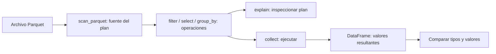

# 10.03 — Polars lazy y planes de consulta

## Propósito y prerrequisitos

Construir una consulta diferida, leer su plan y ejecutarla para comprobar cada
resultado. «Lazy» significa que describimos operaciones antes de pedir la tabla
resultante. Esa separación permite que Polars examine juntas las operaciones.

Necesitas reconocer tablas, tipos, llamadas a funciones y expresiones. Puedes
repasar [10.02](../02_polars_tables_expressions/README.md), pero **los ejemplos
de esta sección definen todos sus datos y resultados**: no necesitan ejecutar
lecciones anteriores ni conservar sus entregas. Las expresiones usadas se
explican aquí al aparecer. Para profundizar en archivos, consulta
[09.01](../../09_arrow_parquet/01_csv_parquet_arrow/README.md).

**Esencial:** `DataFrame`/`LazyFrame`, `scan_parquet`, `collect_schema`, `explain`,
`collect` y conciliación. **Práctica:** cambiar consultas y distinguir auditoría
de selección. **Extensión:** otra escala y base común. No medimos rendimiento
ni desarrollamos streaming; eso tiene su alcance posterior en 10.05/10.09.

## Objetivos

- Identificar qué contiene un plan y cuándo se materializa una tabla.
- Distinguir lectura inmediata, conversión de una tabla a lazy y scan de archivo.
- Explicar filtros/proyecciones en el plan, incluidas columnas que no salen.
- Ejecutar consultas y comparar tipos y valores con una referencia independiente.
- Reconocer límites: un plan no certifica datos, I/O físico ni RAM acotada.

## Entorno y archivos

Referencia ejecutada: **Python 3.12.12 / Polars 2.0.0**, ya declarada en
[`pyproject.toml`](../../../pyproject.toml) y [`uv.lock`](../../../uv.lock).
No se incorporan dependencias. Los [recorridos](recorridos.md) explican cómo
comprobar el entorno elegido y ejecutar desde otra sesión. Preparar entorno
es distinto de necesitar resultados de otras prácticas.

Abre la raíz del repositorio en tu editor y selecciona ese intérprete. Los
bloques Python van en un script o consola **Python**, no en PowerShell. Ejecuta
los bloques en orden dentro de cada recorrido. Para repetirlos, elige una
carpeta nueva bajo `output/`; no borres una práctica anterior para liberar el nombre.

| Archivo | Función |
| --- | --- |
| [muestra.csv](muestra.csv) | Fuente propia de seis filas |
| [consultas_lazy.py](consultas_lazy.py) | Preparador, consultas y verificador de solo lectura |
| [recorridos.md](recorridos.md) | PowerShell, Bash/Zsh y CMD completos |
| [Lab 10.03](../../../labs/10_polars_duckdb/03_polars_lazy_plans/README.md) | Actividad, comprobación y soluciones |

El primer recorrido utiliza directamente Polars y datos definidos abajo, sin
importar funciones del curso. El recorrido integrado reutiliza validadores
incluidos en el repositorio; no importa archivos producidos por el estudiante.

## 1. Pregunta, datos y reglas

Una financiera ficticia registra saldos de tres créditos en dos cortes.
**¿Qué créditos tienen al menos 2000 MXN el 31 de octubre de 2026?** Después
queremos contar registros y sumar el saldo de cada corte completo.

| id_credito | fecha_corte | saldo_mxn |
| --- | --- | ---: |
| 001 | 2026-09-30 | 0 |
| 002 | 2026-09-30 | 2000 |
| 003 | 2026-09-30 | 2500 |
| 001 | 2026-10-31 | 100 |
| 002 | 2026-10-31 | 1900 |
| 003 | 2026-10-31 | 2600 |

Una fila representa **un crédito en un corte**. La clave es el par ID/fecha;
repetir `001` en otra fecha está permitido. ID textual de tres dígitos, fecha
válida entre 1900 y 2100, saldo entero de 0 a 2147483647 MXN, sin ausencias ni
claves repetidas. Cero es un saldo observado, no una ausencia. Rechazamos toda
la fuente ante una incidencia, incluso si aparece fuera del filtro.

Respuesta manual de octubre: solo `003/2600`, una fila y 2600 MXN.
Septiembre completo suma `0 + 2000 + 2500 = 4500`; octubre completo suma
`100 + 1900 + 2600 = 4600`. Cada corte contiene tres registros. Los 9100 MXN
de ambas fechas juntos no representan un saldo de cartera a una fecha única.

## 2. DataFrame y LazyFrame: tabla y descripción

| Objeto u operación | Qué tenemos después |
| --- | --- |
| `pl.DataFrame(...)` | Valores de una tabla en memoria |
| `pl.read_parquet(ruta)` | Un DataFrame leído inmediatamente |
| `tabla.lazy()` | Un plan cuya fuente es una tabla ya materializada |
| `pl.scan_parquet(ruta)` | Un plan cuya fuente es el archivo |
| `consulta.collect_schema()` | Nombres y tipos de la salida prevista |
| `consulta.explain()` | Texto del plan lógico optimizado |
| `consulta.collect()` | Ejecución y DataFrame resultante |

Materializar significa producir valores concretos como una tabla utilizable.
La consulta lazy mantiene las operaciones pendientes hasta pedir su ejecución.
El esquema sí debe resolverse para poder verificar qué columnas existen.
Resolverlo puede requerir lectura de metadatos: diferido no significa cero
acceso al disco. La documentación lo señala en
[`collect_schema`](https://docs.pola.rs/api/python/stable/reference/lazyframe/api/polars.LazyFrame.collect_schema.html).



Sin renderizador: del archivo construimos un plan, añadimos operaciones,
inspeccionamos su descripción y pedimos la ejecución. Solo entonces comparamos
la tabla obtenida. `explain` no es un paso obligatorio para ejecutar.

### Ejemplo autónomo en memoria

Este bloque contiene la muestra completa y no requiere archivos previos.

```python
from datetime import date
import polars as pl

tabla = pl.DataFrame(
    {
        "id_credito": ["001", "002", "003", "001", "002", "003"],
        "fecha_corte": [date(2026, 9, 30)] * 3 + [date(2026, 10, 31)] * 3,
        "saldo_mxn": [0, 2000, 2500, 100, 1900, 2600],
    },
    schema={"id_credito": pl.String, "fecha_corte": pl.Date, "saldo_mxn": pl.Int32},
    strict=True,
)
consulta_memoria = (
    tabla.lazy()
    .filter((pl.col("fecha_corte") == date(2026, 10, 31)) & (pl.col("saldo_mxn") >= 2000))
    .select("id_credito", "saldo_mxn")
    .sort("id_credito")
)
print(type(tabla).__name__, type(consulta_memoria).__name__)
resultado_memoria = consulta_memoria.collect()
print(resultado_memoria.to_dicts())
assert resultado_memoria.to_dicts() == [{"id_credito": "003", "saldo_mxn": 2600}]
```

Se imprime `DataFrame LazyFrame` y el par esperado. `date(año, mes, día)`
construye una fecha; `* 3` repite esa fecha en la lista. `pl.col` nombra una
columna en una expresión. `==` compara fecha, `>=` incluye la frontera y `&`
exige ambas condiciones; usamos paréntesis en cada comparación.
`filter` elige filas; `select` elige columnas; `sort` fija el orden de presentación.
`to_dicts()` convierte la salida pequeña a registros Python para inspeccionarla.

El esquema conserva `001` como texto y cada saldo como Int32. `strict=True`
no comprueba toda la regla de negocio: una fecha fuera del intervalo o un
saldo negativo pueden tener el tipo correcto. Esta muestra fue definida con
valores válidos; el verificador integrado sí audita la fuente completa.

`tabla.lazy()` permite optimizar las operaciones posteriores. La tabla ya
se construyó en memoria. De igual modo, `pl.read_parquet(ruta).lazy()` no
aplaza esa lectura previa; para empezar desde el archivo usamos un scan.

## 3. Escribir una entrada propia y abrirla con scan

Continuación del bloque anterior. Esta preparación crea una carpeta nueva:

```python
from pathlib import Path

carpeta = Path("output/lazy_1003_ejemplo")
carpeta.mkdir(parents=True, exist_ok=False)
ruta = carpeta / "muestra.parquet"
tabla.write_parquet(ruta)

entrada = pl.scan_parquet(ruta, glob=False, hive_partitioning=False)
consulta = (
    entrada
    .filter((pl.col("fecha_corte") == date(2026, 10, 31)) & (pl.col("saldo_mxn") >= 2000))
    .select("id_credito", "saldo_mxn")
    .sort("id_credito")
)
print(type(entrada).__name__)
print(dict(entrada.collect_schema()))
print(dict(consulta.collect_schema()))
```

La escritura es inmediata y pertenece a la **preparación**, no a la consulta
diferida. Parquet conserva nombres y tipos de la tabla. `glob=False` trata
esta ruta literalmente; `hive_partitioning=False` evita interpretar carpetas
como columnas de partición. Aquí leemos un solo archivo, sin particiones.

`entrada` es LazyFrame. Su esquema es `String/Date/Int32`; la salida prevista
tiene `id_credito: String` y `saldo_mxn: Int32`. Todavía no conocemos el número
real de filas de esa salida por inspeccionar su esquema. La
[API de scan_parquet](https://docs.pola.rs/api/python/stable/reference/api/polars.scan_parquet.html)
permite trasladar filtros y selección de columnas al lector. Eso es una
posibilidad de ejecución que examinaremos, no una medición de bytes leídos.

## 4. Leer el plan antes y después de optimizar

Un **plan lógico** describe las operaciones y sus dependencias. El optimizador
puede reorganizarlas conservando el significado de la consulta. El plan físico
se refiere a cómo las ejecutará un motor concreto; aquí usamos la explicación
lógica en texto, sin instalar Graphviz.

```python
print(consulta.explain(optimized=False))
print(consulta.explain())
```

En Polars 2.0.0, el plan sin optimizar de este ejemplo tiene esta estructura
(ruta abreviada):

```text
SORT BY [col("id_credito")]
  SELECT [col("id_credito"), col("saldo_mxn")]
    FILTER col("saldo_mxn") >= 2000
    FROM
      FILTER col("fecha_corte") == 2026-10-31
      FROM
        Parquet SCAN [muestra.parquet]
        PROJECT */3 COLUMNS
        ESTIMATED ROWS: 6
```

Lee el árbol **desde la fuente hacia la salida**, de abajo hacia arriba en
esta representación: archivo → filtro de fecha → filtro de saldo → columnas
de salida → orden. Las líneas indentadas son entradas de la operación superior.
`*` indica todas las columnas. La división de `&` en dos filtros es una
representación equivalente; no tienes que escribir dos llamadas para obtenerla.

El optimizado observado es:

```text
SORT BY [col("id_credito")]
  simple π 2/2 ["id_credito", "saldo_mxn"]
    Parquet SCAN [muestra.parquet]
    PROJECT 3/3 COLUMNS
    SELECTION: (col("fecha_corte") == 2026-10-31) & (col("saldo_mxn") >= 2000)
    ESTIMATED ROWS: 6
```

`π` representa una proyección: elegir columnas. El lector recibe `SELECTION`,
el predicado o condición de filas. Este acercamiento del filtro a la fuente
se llama **predicate pushdown**. La ruta y el orden de condiciones pueden variar;
no memorices el texto completo como contrato. La
[guía de planes](https://docs.pola.rs/user-guide/lazy/query-plan/)
explica ambas representaciones.

**¿Por qué lee tres columnas si devuelve dos?** Necesita `fecha_corte` para
decidir qué filas cumplen, además de ID y saldo. `PROJECT 3/3 COLUMNS` habla
de columnas requeridas del archivo; `π 2/2` habla de la salida de ese paso.
No indica «dos filas». `ESTIMATED ROWS: 6` es una estimación del nodo fuente,
no prueba que la selección final contenga seis filas: sabemos a mano que es una.

### Ver una proyección que sí elimina una columna del scan

Ahora resumimos cada corte **sin filtrar**:

```python
resumen_lazy = entrada.group_by("fecha_corte").agg(
    pl.len().alias("registros"),
    pl.col("saldo_mxn").cast(pl.Int64).sum().alias("saldo_mxn"),
).sort("fecha_corte")
print(resumen_lazy.explain(optimized=False))
print(resumen_lazy.explain())
resumen = resumen_lazy.collect()
print(resumen.to_dicts())
assert resumen.to_dicts() == [
    {"fecha_corte": date(2026, 9, 30), "registros": 3, "saldo_mxn": 4500},
    {"fecha_corte": date(2026, 10, 31), "registros": 3, "saldo_mxn": 4600},
]
assert resumen.schema["saldo_mxn"] == pl.Int64
```

`group_by` forma grupos por fecha; `agg` define sus agregaciones. `pl.len()`
cuenta registros, `alias` nombra la salida. Ampliamos a Int64 **antes** de
sumar: dos saldos máximos Int32 sumarían 4294967294 MXN, fuera de Int32.
La unidad de salida ahora es un corte, no un crédito/corte.

El plan optimizado muestra `PROJECT 2/3 COLUMNS`: fecha y saldo bastan, ID no
se usa. Esta reducción en el scan es **projection pushdown**. Un conteo de
filas no obliga a recuperar el ID. La
[guía de optimizaciones](https://docs.pola.rs/user-guide/lazy/optimizations/)
describe estos mecanismos. No garantiza una mejora medible en esta muestra.

Las dependencias restringen las reorganizaciones. Filtrar octubre con saldo
≥ 2000 **antes** de sumar da 2600. Sumar octubre completo y filtrar después
el total ≥ 2000 deja 4600. Son preguntas distintas; el optimizador no autoriza
a sustituir una por otra. Tampoco puedes quitar `fecha_corte` mediante `select`
y después pedir un filtro que necesita esa columna.

## 5. Ejecutar y comprobar valores

```python
resultado = consulta.collect()
print(type(resultado).__name__, resultado.shape)
print(resultado.to_dicts())
assert dict(resultado.schema) == {"id_credito": pl.String, "saldo_mxn": pl.Int32}
assert resultado.to_dicts() == [{"id_credito": "003", "saldo_mxn": 2600}]
assert resultado.equals(resultado_memoria)
```

Obtenemos un DataFrame `(1, 2)` con `003/2600`, igual al recorrido en memoria.
[`collect`](https://docs.pola.rs/api/python/stable/reference/lazyframe/api/polars.LazyFrame.collect.html)
optimiza y ejecuta la consulta. La salida queda materializada en memoria;
volver a llamar `collect()` puede volver a ejecutar el plan. Guarda el DataFrame
si necesitas reutilizar esos valores. Una variable LazyFrame no es una copia
inmutable de los bytes del archivo: conserva la fuente mientras la usas.

En 2.0.0 `engine="auto"` puede atender la afinidad configurada y, si no existe,
usar el motor streaming. **Lazy y streaming son conceptos distintos**, y el
motor elegido no certifica RAM acotada. Esta lección usa el valor predeterminado;
no cambia configuración global ni mide memoria. Ordenación, agregaciones,
auditoría completa y la propia salida también consumen recursos.

### Tres niveles de evidencia

| Evidencia | Qué permite afirmar | Qué queda por comprobar |
| --- | --- | --- |
| Esquema resuelto | Columnas y tipos previstos | Valores y reglas de negocio |
| Plan explicado | Operaciones lógicas y filtros/proyecciones previstos | Resultado ejecutado y costos reales |
| DataFrame conciliado | Tipos y valores obtenidos en esta ejecución | I/O físico, RAM y rendimiento si interesan |

Un filtro en el scan puede aprovechar estadísticas Parquet para omitir páginas
cuando los datos y el lector lo permiten. El texto del plan no cuenta páginas
realmente omitidas. No inferimos ahorro físico ni un ganador de velocidad.

## 6. Recorrido integrado: fuente externa y auditoría separada

El CSV propio contiene las seis filas de la tabla inicial. El preparador crea
Parquet en una carpeta nueva; el verificador relee el **CSV externo** con Python
estándar, revisa esquema y todas las filas del Parquet, y luego construye y
ejecuta las consultas. Las reglas son las del apartado 1.

Ejecuta desde la raíz, en una sesión Python nueva con el entorno seleccionado:

```python
from pathlib import Path
import sys

modulos = Path("curriculum/10_polars_duckdb/03_polars_lazy_plans").resolve()
sys.path.insert(0, str(modulos))
from consultas_lazy import preparar, ejecutar_verificado

ruta = preparar("output/lazy_1003_integrado")
entrega = ejecutar_verificado(ruta)
print(entrega["planes"]["optimizado"])
print(entrega["seleccion"].to_dicts())
print(entrega["resumen"].to_dicts())
assert entrega["registros_fuente"] == 6
assert entrega["control"]["registros"] == 1
assert entrega["control"]["saldo_mxn"] == 2600
```

`sys.path.insert` permite importar el módulo local por su carpeta; no instala
un paquete. El módulo reutiliza los validadores incluidos de 10.01/10.02,
sin necesitar sus entregas. Esquemas y comparaciones se aplican también al vacío;
las filas se comparan por clave, sin exigir el orden físico del archivo.
No basta con coincidir en suma y conteo: `002/2100` y `003/2400` sumarían lo
mismo que `002/2000` y `003/2500`, pero sus valores estarían mal.

La auditoría materializa **toda** la tabla y registros Python; está separada
de la consulta nativa optimizada y no es un benchmark ni un control de memoria
acotada. Se hacen lecturas adicionales deliberadas. Un duplicado o saldo
negativo de septiembre puede quedar fuera del filtro de octubre: que la selección
sea correcta no demuestra que la fuente cumpla el contrato. El lab lo reproduce.

La verificación no escribe resultados ni actualiza huellas. Durante preparación
y comprobación, conserva fuentes sin cambios; no se garantiza una instantánea
transaccional si otro proceso modifica archivos entre lecturas.

## 7. Errores habituales y práctica

- `print(consulta)` o `explain()` no son la tabla ejecutada: pide `collect()`.
- `collect_schema()` no cuenta filas ni valida unicidad, rangos o ausencias.
- `read_parquet(...).lazy()` empieza después de una lectura ya realizada.
- `select` demasiado temprano puede quitar columnas necesarias para el filtro.
- `collect().filter(...)` aplica el filtro después de materializar la entrada;
  para incluirlo en el plan, escribe `filter(...).collect()`.
- Un resultado vacío con tipos definidos es válido; cero filas no equivale a
  una fila con saldo desconocido. Un resumen agrupado vacío tiene cero grupos.
- Un error puede aparecer al resolver esquema, explicar o ejecutar. Construir
  una cadena sin error no certifica que pueda ejecutarse correctamente.

Realiza el [lab 10.03](../../../labs/10_polars_duckdb/03_polars_lazy_plans/README.md):
septiembre ≥ 2000 produce dos pares/4500; septiembre ≥ 2001 uno/2500;
noviembre produce cero filas conservando los tipos. Explica las dependencias
de columnas y demuestra el rechazo de un incidente fuera del filtro.

**Extensión:** genera 40/400 filas con el generador determinista incluido en
[referencia.py](../01_question_contract_reference/referencia.py), en CSV nuevos,
y pasa `--fuente` tanto a `preparar` como a `verificar`. También puedes usar
la [base común incluida](../../09_arrow_parquet/01_csv_parquet_arrow/datos/base_comun.csv):
28 filas, 14 IDs, 29000/31800 MXN; octubre ≥ 2000 nueve IDs/24100 MXN.
No requiere exportaciones anteriores. No dupliques filas para aumentar escala:
romperías la clave. Estos tamaños no demuestran comportamiento de grandes volúmenes.

## Criterio de salida y continuidad

Puedes explicar tabla/plan, scan/lectura inmediata, esquema/valores y
explain/ejecución; localizar filtros y columnas requeridas; conciliar cada par
y resumen desde una sesión nueva, incluidos vacío y frontera. Puedes justificar
por qué la auditoría completa y la consulta selectiva responden preguntas distintas.

No hay proyecto ni checkpoint activo: `04_large_credit_dataset` sigue previsto
en [proyectos](../../../projects/README.md). Registra práctica, evidencia y dudas
según [PROGRESS.md](../../../PROGRESS.md); disponibilidad del material no acredita
aprendizaje del estudiante.

Siguiente: [10.04 — Tipos, faltantes y uniones](../04_types_missing_joins/README.md).

## Referencias primarias

Consultadas el 2026-10-23; las APIs usadas también se ejecutaron con Polars 2.0.0.
La documentación `stable` puede cambiar; no se exige igualdad literal del plan.

- [Concepto de API lazy](https://docs.pola.rs/user-guide/concepts/lazy-api/).
- [DataFrame.lazy](https://docs.pola.rs/api/python/stable/reference/dataframe/api/polars.DataFrame.lazy.html).
- [LazyFrame.explain](https://docs.pola.rs/api/python/stable/reference/lazyframe/api/polars.LazyFrame.explain.html).
- [scan_parquet](https://docs.pola.rs/api/python/stable/reference/api/polars.scan_parquet.html),
  [collect_schema](https://docs.pola.rs/api/python/stable/reference/lazyframe/api/polars.LazyFrame.collect_schema.html)
  y [collect](https://docs.pola.rs/api/python/stable/reference/lazyframe/api/polars.LazyFrame.collect.html).
- [Planes de consulta](https://docs.pola.rs/user-guide/lazy/query-plan/) y
  [optimizaciones](https://docs.pola.rs/user-guide/lazy/optimizations/).

Los datos y ejemplos son propios. Las referencias aportan las definiciones y
el comportamiento de las APIs; no se copian ejemplos de sus capítulos.
