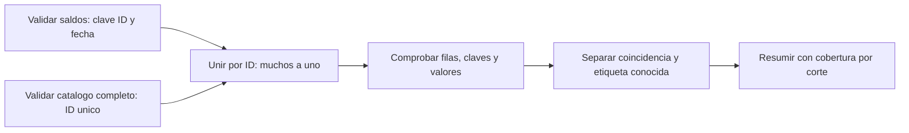

# 10.04 — Tipos, faltantes y uniones

## Propósito y prerrequisitos

Conservar el significado de los datos al convertir tipos, resumir ausencias y
combinar tablas. Que una operación termine sin error no demuestra que conserve
la unidad, las claves, los importes o la cobertura que necesitamos.

Necesitas reconocer tablas y expresiones. Puedes repasar
[10.02](../02_polars_tables_expressions/README.md) y
[10.03](../03_polars_lazy_plans/README.md), pero aquí se presentan **todos los
datos, reglas y resultados**. No necesitas ejecutar lecciones anteriores ni
tener sus entregas. Los ejemplos iniciales utilizan Polars directamente.

**Esencial:** tipos/conversión, `null`/`NaN`, agregaciones con cobertura y
uniones por igualdad con cardinalidad controlada. **Práctica:** vacío,
duplicados y claves sin correspondencia. **Extensión:** contraste pandas/SQL,
unión completa y recorrido lazy equivalente. No medimos tiempo/RAM ni
desarrollamos todavía streaming o DuckDB.

## Objetivos

- Separar tipo, regla de negocio y pérdida de información.
- Identificar cero, texto vacío, ausencia y `NaN` sin intercambiarlos.
- Contar registros y valores conocidos; explicar la suma de un grupo sin datos.
- Elegir una unión y comprobar su cardinalidad, claves y cobertura.
- Conciliar valores por clave, no solo conteos y sumas.

## Entorno y archivos

Referencia comprobada: **Python 3.12.12 / Polars 2.0.0**. La extensión utiliza
pandas 2.3.3 y `sqlite3` estándar; las dependencias ya están declaradas en
[`pyproject.toml`](../../../pyproject.toml)/[`uv.lock`](../../../uv.lock).
No se añade ni instala ningún paquete. Los [recorridos](recorridos.md) explican
cómo seleccionar y comprobar el entorno. Una instalación adecuada no necesita
repetirse para esta sección.

Abre la raíz del repositorio en tu editor. Los bloques Python se ejecutan en
un script o consola Python con ese intérprete, no directamente en PowerShell.
Cada apartado indica si empieza un ejemplo nuevo o continúa el anterior.

| Archivo | Función |
| --- | --- |
| [muestra.csv](muestra.csv) | Seis observaciones completas de saldo |
| [catalogo.csv](catalogo.csv) | Tres claves y una etiqueta ausente declarada |
| [semantica_polars.py](semantica_polars.py) | Carga, validación, unión, cobertura y contraste |
| [recorridos.md](recorridos.md) | Ejecución completa PowerShell, Bash/Zsh y CMD |
| [Lab 10.04](../../../labs/10_polars_duckdb/04_types_missing_joins/README.md) | Actividades y soluciones razonadas |

## 1. Tipos y conversiones: poder convertir no basta

Un tipo describe cómo se representan valores: `String` para texto, `Date` para
fecha, `Int32` para enteros de rango limitado, `Float64` para números aproximados
y `Boolean` para verdadero/falso. Una columna tipada puede contener `null`.
El esquema no declara por sí solo «sin ausencias» ni «clave única».

| Dato | Tipo elegido | Regla adicional |
| --- | --- | --- |
| ID `001` | String | Tres dígitos; conservar ceros |
| Fecha de corte | Date | Calendario válido y años 1900–2100 |
| Saldo en pesos enteros | Int32 | De 0 a 2147483647, sin ausencia |
| Suma de saldos | Int64 | Ampliar antes de reducir; verificar el total |
| Producto del catálogo | String | Puede faltar, según contrato explícito |

### Ejemplo autónomo: diagnosticar una conversión

Queremos inspeccionar textos recibidos, no aceptarlos automáticamente como saldos.

```python
import polars as pl

textos = pl.DataFrame(
    {"original": ["0", "2000", "2.5", "error", None, "2147483648"]},
    schema={"original": pl.String},
)
diagnostico = textos.with_columns(
    pl.col("original").cast(pl.Int32, strict=False).alias("convertido")
).with_columns(
    pl.col("original").is_null().alias("ausente_origen"),
    (pl.col("original").is_not_null() & pl.col("convertido").is_null()).alias("conversion_fallida"),
)
print(diagnostico.to_dicts())
assert diagnostico["convertido"].to_list() == [0, 2000, None, None, None, None]
assert diagnostico["conversion_fallida"].to_list() == [False, False, True, True, False, True]

try:
    textos.select(pl.col("original").cast(pl.Int32, strict=True))
except pl.exceptions.InvalidOperationError:
    print("La conversion estricta rechaza textos invalidos o fuera de rango")
else:
    raise AssertionError("Se esperaba rechazo")
```

`cast` convierte el tipo; `strict=False` produce `null` cuando no puede convertir.
`alias` nombra la salida. En un segundo `with_columns` usamos la columna que
acabamos de crear: sus expresiones dependen de `convertido`. `is_null` detecta
ausencia; `is_not_null` detecta presencia; `&` exige ambas condiciones.

El original ausente no es un fallo nuevo de conversión. Conservar ambos permite
distinguirlo de `error`, `2.5` y desborde. No usamos `fill_null(0)` para borrar
esos motivos. Consulta [cast](https://docs.pola.rs/api/python/stable/reference/expressions/api/polars.Expr.cast.html)
y la [guía de conversiones](https://docs.pola.rs/user-guide/expressions/casting/).

**Límite importante:** convertir un flotante a entero puede truncar su fracción
incluso con `strict=True`. Continuación del ejemplo:

```python
fracciones = pl.Series("importe", [3.9, -3.9], dtype=pl.Float64)
assert fracciones.cast(pl.Int32, strict=True).to_list() == [3, -3]
ids = pl.Series("id", ["001"], dtype=pl.String)
assert ids.cast(pl.Int32).cast(pl.String).to_list() == ["1"]
```

Ambas conversiones se pueden ejecutar, pero pierden información. El contrato de
saldo exige enteros originales, no truncar fracciones. El ID no es una cantidad.
Por eso la carga integrada valida el CSV textual completo **antes** de adaptar
tipos. No sustituimos esa validación por un `cast` permisivo.

## 2. Ausencia, NaN, vacío y cero

| Valor | Significado en este ejemplo | Comprobación |
| --- | --- | --- |
| `None` → `null` | Falta un valor | `is_null()` |
| `float("nan")` → `NaN` | Valor especial de punto flotante | `is_nan()` |
| `""` | Texto de longitud cero | Comparación con `""` |
| `0` | Cantidad observada de cero | Comparación con cero |

No son categorías intercambiables. `null` puede existir en distintos tipos;
`NaN` pertenece a columnas flotantes. Esta muestra independiente representa
**mediciones**, no saldos del contrato monetario:

```python
import math
import polars as pl

mediciones = pl.DataFrame(
    {"valor": [10.0, None, float("nan"), 0.0]}, schema={"valor": pl.Float64}
)
control = mediciones.select(
    pl.len().alias("registros"),
    pl.col("valor").count().alias("no_null"),
    pl.col("valor").is_null().sum().alias("ausentes"),
    pl.col("valor").is_nan().sum().alias("nan"),
    pl.col("valor").sum().alias("suma"),
)
print(control.to_dicts())
assert control.row(0)[:4] == (4, 3, 1, 1)
assert math.isnan(control["suma"][0])
assert mediciones.filter(pl.col("valor").is_finite())["valor"].to_list() == [10.0, 0.0]

textos_vacios = pl.Series("etiqueta", ["", None, "Personal"], dtype=pl.String)
assert textos_vacios.is_null().to_list() == [False, True, False]
```

`pl.len()` cuenta filas; `count()` cuenta valores no nulos, incluyendo `NaN`.
La suma omite `null`, pero aquí propaga `NaN`. `is_finite()` identifica valores
numéricos finitos: excluye también infinitos. Filtrar así sirve para explorar
la cobertura de estas mediciones; no autoriza eliminar registros de una entrega.
No modificamos `mediciones`. La [guía de faltantes](https://docs.pola.rs/user-guide/expressions/missing-data/)
explica las operaciones separadas para `null` y `NaN`.

`fill_null` y `fill_nan` actúan sobre casos distintos. Si una regla exige tratar
NaN como ausente, conserva el original y registra esa regla en una columna nueva;
no lo conviertas silenciosamente para lograr una suma deseada.

### Filtros con información desconocida

Este bloque es autónomo:

```python
import polars as pl

observaciones = pl.DataFrame({"saldo": [10, None, 0]}, schema={"saldo": pl.Int32})
print(observaciones.select((pl.col("saldo") >= 5).alias("cumple")).to_dicts())
assert observaciones.filter(pl.col("saldo") >= 5)["saldo"].to_list() == [10]
assert observaciones.filter(
    (pl.col("saldo") >= 5) | pl.col("saldo").is_null()
)["saldo"].to_list() == [10, None]
```

La comparación produce `True, null, False`. `filter` conserva solo `True`;
negar una condición desconocida no la convierte en verdadera. `|` significa
«o»: el segundo filtro retiene explícitamente ausencias para revisarlas. No
afirma que el saldo ausente cumpla el umbral.

Con flotantes, no uses un umbral como detector de datos válidos: en la muestra
de mediciones, Polars 2.0.0 conserva también NaN con `valor >= 5`. Es un
comportamiento comprobado de esta versión; usa controles explícitos de
`is_nan`/`is_finite` y el contrato, no intuiciones trasladadas de otro motor.

## 3. Agregar con cobertura: cero conocido frente a ningún valor

Muestra nueva de saldos opcionales: cada fila es una observación de una zona.
Aquí **sí** se permite ausencia por diseño; no cambiamos el contrato de los
CSV de crédito. Zona A tiene cero y ausencia; B tiene dos ausencias. No hay
registros de C.

```python
import polars as pl

opcionales = pl.DataFrame(
    {"zona": ["A", "A", "B", "B"], "saldo": [0, None, None, None]},
    schema={"zona": pl.String, "saldo": pl.Int32},
)
por_zona = opcionales.group_by("zona").agg(
    pl.len().alias("registros"),
    pl.col("saldo").count().alias("conocidos"),
    pl.col("saldo").cast(pl.Int64).sum().alias("suma_motor"),
    pl.when(pl.col("saldo").count() > 0)
    .then(pl.col("saldo").cast(pl.Int64).sum())
    .otherwise(pl.lit(None, dtype=pl.Int64)).alias("suma_observada"),
    pl.col("saldo").mean().alias("media_observada"),
).sort("zona")
print(por_zona.to_dicts())
assert por_zona["registros"].to_list() == [2, 2]
assert por_zona["conocidos"].to_list() == [1, 0]
assert por_zona["suma_motor"].to_list() == [0, 0]
assert por_zona["suma_observada"].to_list() == [0, None]
assert por_zona["media_observada"].to_list() == [0.0, None]
assert opcionales.head(0).group_by("zona").agg(pl.len()).height == 0
```

`when(condición).then(valor).otherwise(otro)` construye una expresión
condicional. Nuestra regla de comunicación deja la suma como desconocida
cuando no hay ningún saldo conocido; no imputa. Polars devuelve cero al sumar
sin valores no nulos, según [sum](https://docs.pola.rs/api/python/stable/reference/expressions/api/polars.Expr.sum.html).
Ese cero del motor no prueba observaciones de cero.

La cobertura es conocidos/registros: A `1/2`, B `0/2`. La media observada de A
es `0/1`, no `0/2`; su denominador contiene solo el valor conocido. C no aparece
en la agrupación: sin registro es distinto de un grupo existente con todos sus
valores ausentes. Una entrada vacía conserva tipos y produce cero grupos.

No fuerces tres zonas mediante relleno de ceros. Si necesitas un inventario
de categorías, une con ese inventario y conserva la distinción entre
«sin registros», «sin valores conocidos» y «cero observado».

## 4. Unir tablas: pregunta, unidad y claves completas

**Nueva pregunta:** añadir un producto a los saldos sin perder ni multiplicar
observaciones. La financiera ficticia tiene estos saldos completos:

| id_credito | fecha_corte | saldo_mxn |
| --- | --- | ---: |
| 001 | 2026-09-30 | 0 |
| 002 | 2026-09-30 | 2000 |
| 003 | 2026-09-30 | 2500 |
| 001 | 2026-10-31 | 100 |
| 002 | 2026-10-31 | 1900 |
| 003 | 2026-10-31 | 2600 |

Reglas: ID textual de tres dígitos; fecha válida entre 1900 y 2100; saldo
entero 0–2147483647, sin ausencias; clave **ID/fecha** única. Los totales por
corte son 4500 y 4600 MXN; tres registros cada uno.

El catálogo, cuya unidad es **un crédito**, contiene:

| id_credito | producto |
| --- | --- |
| 001 | Personal |
| 002 | Ausente (`null`) |
| 004 | Vivienda |

Su clave ID es única, no puede faltar y debe tener tres dígitos, incluso si
no se utiliza. Producto puede ser texto no vacío o `null`; no se recortan
etiquetas ni se resuelven duplicados automáticamente. En `catalogo.csv`, el
campo producto vacío representa ausencia por una **convención explícita de
ese archivo**; un campo ID vacío es inválido. No generalizamos esa convención
a cualquier texto vacío.

Suponemos que el producto del crédito es estable en los dos cortes. Si cambiara
con el tiempo, necesitaríamos otra clave/regla temporal antes de unir por ID.

### Ejemplo autónomo: left join con marca de correspondencia

```python
from datetime import date
import polars as pl

saldos = pl.DataFrame(
    {
        "id_credito": ["001", "002", "003", "001", "002", "003"],
        "fecha_corte": [date(2026, 9, 30)] * 3 + [date(2026, 10, 31)] * 3,
        "saldo_mxn": [0, 2000, 2500, 100, 1900, 2600],
    },
    schema={"id_credito": pl.String, "fecha_corte": pl.Date, "saldo_mxn": pl.Int32},
)
catalogo = pl.DataFrame(
    {"id_credito": ["001", "002", "004"], "producto": ["Personal", None, "Vivienda"]},
    schema={"id_credito": pl.String, "producto": pl.String},
)
derecha = catalogo.with_columns(pl.lit(True).alias("coincide_catalogo"))
unida = saldos.join(
    derecha, on="id_credito", how="left", validate="m:1", nulls_equal=False
).with_columns(
    pl.col("coincide_catalogo").fill_null(False),
    pl.col("producto").is_not_null().alias("producto_conocido"),
).sort("fecha_corte", "id_credito")
assert unida.shape == (6, 6)
assert unida["coincide_catalogo"].to_list() == [True, True, False] * 2
assert unida["producto_conocido"].to_list() == [True, False, False] * 2
assert unida.select(saldos.columns).equals(saldos.sort("fecha_corte", "id_credito"))
```

`on` nombra la clave de unión. `how="left"` conserva las observaciones de la
izquierda; no garantiza seis filas si el catálogo repite claves.
`validate="m:1"` exige muchos-a-uno: pueden repetirse IDs a la izquierda
por los cortes, pero cada ID aparece como máximo una vez a la derecha.
`1:1` sería incorrecto para esa clave izquierda; `m:m`, el valor por defecto,
no exige unicidad. Revisa [join](https://docs.pola.rs/api/python/stable/reference/dataframe/api/polars.DataFrame.join.html).

La marca `True` se añade **antes** de unir. Su ausencia después indica que
no hubo correspondencia; reemplazarla por False registra un hecho conocido
del join. No estamos imputando producto ni saldo. Mirar solo `producto.is_null()`
confundiría `002` (coincidió, pero falta etiqueta) con `003` (no está en catálogo).

Por corte: dos coincidencias, una etiqueta conocida, una pendiente a pesar de
coincidir y una sin catálogo. Sobre las seis observaciones: `4/6` coincidencias
y `2/6` etiquetas conocidas. Sobre créditos distintos sería `2/3` y `1/3`:
son denominadores diferentes aunque aquí den la misma proporción.

### Qué conserva cada unión

Continuación de las tablas anteriores:

```python
for modo, filas in [("left", 6), ("inner", 4), ("semi", 4), ("anti", 2)]:
    vista = saldos.join(catalogo, on="id_credito", how=modo)
    assert vista.height == filas
    print(modo, vista.sort("fecha_corte", "id_credito").to_dicts())

completa = saldos.join(catalogo, on="id_credito", how="full", coalesce=True)
assert completa.height == 7
assert completa.filter(pl.col("id_credito") == "004")["saldo_mxn"].to_list() == [None]
```

| Unión | Qué conserva en este ejemplo | Precaución |
| --- | --- | --- |
| left | Seis saldos y producto si coincide | Duplicados derechos pueden multiplicar filas |
| inner | Cuatro observaciones con ID 001/002 | Pierde 003 y sus saldos, no solo etiquetas |
| semi | Las mismas cuatro filas izquierdas | No añade columnas del catálogo |
| anti | Dos observaciones de 003 | Sirve para revisar claves sin correspondencia |
| full (extensión) | Las seis y el crédito 004 del catálogo | Esa fila no tiene corte/saldo; cambia el universo |

`coalesce=True` reúne las columnas de clave del full join en una sola; no
rellena atributos faltantes. Sin esa opción puede haber dos columnas de clave.
En full, la fila de `004` no es un nuevo saldo aceptado. No la incluyas en un
resumen de observaciones como si tuviera corte e importe.

### Multiplicación por claves repetidas

Continuación. Fabricamos otra tabla; conservamos el catálogo original:

```python
repetido = pl.concat([catalogo, catalogo.filter(pl.col("id_credito") == "002")])
sin_control = saldos.join(repetido, on="id_credito", how="left")
assert sin_control.height == 8
assert sin_control.group_by("fecha_corte").agg(
    pl.col("saldo_mxn").cast(pl.Int64).sum()
).sort("fecha_corte")["saldo_mxn"].to_list() == [6500, 6500]
try:
    saldos.join(repetido, on="id_credito", how="left", validate="m:1")
except pl.exceptions.ComputeError:
    print("Rechazo esperado: el catalogo repite la clave")
else:
    raise AssertionError("Se esperaba rechazo por cardinalidad")
```

Cada fila de `002` encuentra dos filas derechas: dos cortes por dos
coincidencias producen cuatro filas de ese ID. En general, para una clave
con `a` filas izquierdas y `b` derechas hay `a × b` pares coincidentes.
No uses `unique()` para elegir una etiqueta arbitraria: primero decide y
justifica qué significa la repetición. El verificador revisa **todo** el
catálogo, incluidas claves repetidas sin uso.



Sin renderizador: valida ambas entradas, une con cardinalidad declarada,
compara la salida por clave y después resume con denominadores explícitos.

Si agrupas solo por producto, un mismo grupo null puede mezclar etiquetas
pendientes y créditos sin correspondencia. Conserva las banderas para separar
esos motivos. Tampoco dependas del orden observado después de un join: ordena
por las claves para presentar o comparar resultados.

## 5. Claves ausentes y diferencias entre motores

Este ejemplo nuevo solo demuestra una política de comparación. **No permite**
claves ausentes en nuestros saldos o catálogo:

```python
import polars as pl

a = pl.DataFrame({"clave": [None, "A"]}, schema={"clave": pl.String})
b = pl.DataFrame(
    {"clave": [None, "A"], "etiqueta": ["sin clave", "con clave"]},
    schema={"clave": pl.String, "etiqueta": pl.String},
)
assert a.join(b, on="clave", how="inner", nulls_equal=False).height == 1
assert a.join(b, on="clave", how="inner", nulls_equal=True).height == 2
```

En Polars no se emparejan claves null por defecto. `nulls_equal=True` cambia
esa política; no demuestra que dos claves desconocidas sean la misma entidad.
En una clave compuesta hay que revisar **todos** sus componentes y sus tipos;
convertir una clave numérica en texto no recupera ceros que ya se perdieron.

En [pandas merge 2.3.3](https://pandas.pydata.org/pandas-docs/version/2.3/reference/api/pandas.DataFrame.merge.html),
las claves ausentes de ambos lados pueden coincidir, distinto del `=` de SQL
con NULL. Por eso la extensión compara las mismas entradas con claves válidas,
no confía en equivalencia automática de los valores por defecto.

También hay diferencias de agregación: SQLite `SUM` sin valores no nulos
devuelve NULL; Polars suma cero. SQLite distingue `COUNT(*)` de `COUNT(columna)`;
véanse sus [agregaciones](https://www.sqlite.org/lang_aggfunc.html).
Define la política y la cobertura antes de comparar un indicador entre motores.
No trasladamos NaN como si fuera un NULL portátil de SQL.

## 6. Recorrido integrado y verificación independiente

Los dos CSV incluidos contienen exactamente las tablas del apartado 4.
El módulo valida saldos y todo el catálogo, hace left join muchos-a-uno y
reconstruye cada campo esperado con Python estándar desde esas fuentes externas.
Las funciones incluidas de 10.02 se reutilizan para las reglas de saldo;
no se requieren sus entregas ni una práctica anterior.

Desde la raíz, en una sesión Python nueva:

```python
from pathlib import Path
import sys

modulos = Path("curriculum/10_polars_duckdb/04_types_missing_joins").resolve()
sys.path.insert(0, str(modulos))
from semantica_polars import ejecutar

entrega = ejecutar()
print(entrega["unida"].to_dicts())
print(entrega["resumen"].to_dicts())
assert entrega["unida"].shape == (6, 6)
assert entrega["resumen"]["saldo_mxn"].to_list() == [4500, 4600]
assert entrega["resumen"]["coincidencias"].to_list() == [2, 2]
assert entrega["resumen"]["productos_conocidos"].to_list() == [1, 1]
```

`sys.path.insert` permite importar el módulo de esa carpeta; no instala un
paquete. El resumen tiene tres registros, dos coincidencias, un producto conocido,
uno pendiente y uno sin catálogo por corte. La suma se amplía a Int64 antes
de agregar. Conservamos el saldo incluso si falta la etiqueta.

El verificador no escribe archivos. Rechaza esquemas, duplicados, claves
incompletas y valores/banderas alterados, aunque coincidan sumas. Sus controles
materializan registros y no son un benchmark ni una garantía de memoria acotada.
Conserva ambas fuentes sin cambios durante las lecturas; no hay instantánea
transaccional frente a modificaciones concurrentes.

**Extensión pandas/SQLite:** `ejecutar(otros_motores=True)` o el argumento CLI
`--contrastar` relee las fuentes y compara los seis campos de cada fila.
SQLite usa una base `:memory:` que se cierra; no altera bases previas. pandas
conserva ID textual/saldo entero y adapta sus ausencias a `None` solo al comparar.
No exigimos igualdad de clases internas entre herramientas.

**Extensión lazy:** con `saldos` y `catalogo` del apartado 4 puedes construir
la misma unión antes de materializar:

```python
union_lazy = saldos.lazy().join(
    catalogo.lazy(), on="id_credito", how="left", validate="m:1", nulls_equal=False
)
lazy_ejecutada = union_lazy.collect(engine="in-memory").sort("fecha_corte", "id_credito")
inmediata = saldos.join(catalogo, on="id_credito", how="left", validate="m:1").sort(
    "fecha_corte", "id_credito"
)
assert lazy_ejecutada.equals(inmediata)
```

Elegimos `engine="in-memory"` en esa ejecución porque la API documenta una
limitación de `validate` con streaming. No cambiamos configuración global.
Construir el plan no certifica la cardinalidad: hay que ejecutarlo; la
validación completa de entradas sigue siendo necesaria. Los
[tipos de unión](https://docs.pola.rs/user-guide/transformations/joins/)
describen las variantes del motor.

## Práctica, criterio de salida y continuidad

Realiza el [lab 10.04](../../../labs/10_polars_duckdb/04_types_missing_joins/README.md).
Puedes explicar pérdidas de conversión, distinguir null/NaN/cero/vacío,
justificar los denominadores y elegir una unión según su unidad y claves.
Puedes detectar multiplicaciones, conservar filas sin catálogo y conciliar
cada valor, incluidos fuente/catálogo vacíos y un catálogo duplicado sin uso.

No hay proyecto/checkpoint activo: `04_large_credit_dataset` sigue previsto
en [proyectos](../../../projects/README.md). Registra evidencia, explicaciones
y dudas según [PROGRESS.md](../../../PROGRESS.md). Material desarrollado no
acredita aprendizaje del estudiante.

Siguiente: [10.05 — Streaming y límites de memoria](../05_streaming_memory/README.md),
extensión disponible. Es opcional; el siguiente apartado esencial
previsto es [10.06 — DuckDB: SQL sobre Parquet](../README.md#06-duckdb-sql-sobre-parquet),
también pendiente de desarrollo.

## Referencias primarias

Consultadas el 2026-10-23 y contrastadas con las versiones declaradas. Las
páginas `stable` pueden cambiar. Datos, preguntas y ejemplos son propios.

- [Conversiones](https://docs.pola.rs/user-guide/expressions/casting/) y
  [Expr.cast](https://docs.pola.rs/api/python/stable/reference/expressions/api/polars.Expr.cast.html).
- [Faltantes](https://docs.pola.rs/user-guide/expressions/missing-data/),
  [sum](https://docs.pola.rs/api/python/stable/reference/expressions/api/polars.Expr.sum.html)
  y [filter](https://docs.pola.rs/api/python/stable/reference/dataframe/api/polars.DataFrame.filter.html).
- [Uniones](https://docs.pola.rs/user-guide/transformations/joins/) y
  [DataFrame.join](https://docs.pola.rs/api/python/stable/reference/dataframe/api/polars.DataFrame.join.html).
- [pandas merge 2.3.3](https://pandas.pydata.org/pandas-docs/version/2.3/reference/api/pandas.DataFrame.merge.html),
  [expresiones SQLite](https://www.sqlite.org/lang_expr.html) y
  [agregaciones SQLite](https://www.sqlite.org/lang_aggfunc.html).
