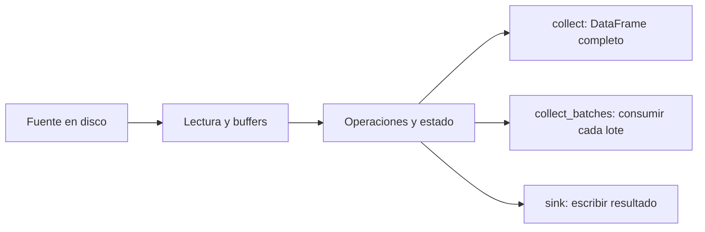

# 10.05 — Streaming y límites de memoria

## Propósito y prerrequisitos

Entender qué cambia cuando el motor procesa datos por lotes, qué memoria sigue
siendo necesaria y cómo escribir una salida sin recoger primero toda la tabla
final en Python. **Esta sección es una extensión opcional**: no bloquea
[10.06 — DuckDB: SQL sobre Parquet](../06_duckdb_parquet/README.md).

Necesitas reconocer tablas, expresiones y planes. Puedes consultar
[10.03](../03_polars_lazy_plans/README.md) y
[10.04](../04_types_missing_joins/README.md), pero aquí se definen todos los
datos, reglas y resultados. No necesitas ejecutar prácticas anteriores ni
conservar sus entregas. Los primeros ejemplos utilizan directamente Polars.

**Recorrido de la extensión:** observar ejecución, consumir
lotes, escribir con sink y conciliar. **Exploración adicional:** registrar
memoria del proceso y probar otra escala pequeña. No exigimos archivos mayores
que la RAM ni forzamos falta de memoria. Las mediciones comparativas de 10.09
tienen otro alcance; esta sección no es un benchmark.

## Objetivos

- Distinguir lazy, ejecución streaming y materialización del resultado.
- Consumir lotes sin acumularlos y escribir directamente a Parquet.
- Reconocer estado de operaciones, buffers, concurrencia y tamaño de salida.
- Inspeccionar un plan físico y registros de ejecución sin confundirlos con RAM.
- Observar un pico residente con unidad y alcance explícitos.
- Comprobar tipos y cada par obtenido, también en vacío y fronteras.

## Entorno y archivos

Referencia comprobada: **Python 3.12.12 / Polars 2.0.0**. No hay dependencias
nuevas ni cambios de [`pyproject.toml`](../../../pyproject.toml) o
[`uv.lock`](../../../uv.lock). Los [recorridos](recorridos.md) explican cómo
comprobar el entorno elegido. No reinstales si ya es adecuado. No se necesita
Graphviz para obtener el plan físico como texto DOT.

Abre la raíz de DS Track en el editor y selecciona ese intérprete. Los bloques
Python van en un script o consola Python, no en PowerShell. Dentro de cada
recorrido, ejecuta los bloques en orden. Para repetir una escritura elige una
carpeta nueva bajo `output/`; conserva las prácticas anteriores.

| Archivo | Función |
| --- | --- |
| [muestra.csv](muestra.csv) | Fuente propia completa de seis filas |
| [streaming_polars.py](streaming_polars.py) | Preparación, lotes, sink y verificación independiente |
| [observar_memoria.py](observar_memoria.py) | Procesos separados, trazas y pico residente |
| [recorridos.md](recorridos.md) | PowerShell, Bash/Zsh y CMD completos |
| [Lab 10.05](../../../labs/10_polars_duckdb/05_streaming_memory/README.md) | Actividad, evidencia y soluciones |

## 1. Pregunta, datos y contrato completos

Una financiera ficticia tiene tres créditos en dos cortes. Queremos los
créditos con saldo **al menos 2000 MXN el 31 de octubre de 2026**; después
bajaremos el umbral a cero para observar más de un lote de salida.

| id_credito | fecha_corte | saldo_mxn |
| --- | --- | ---: |
| 001 | 2026-09-30 | 0 |
| 002 | 2026-09-30 | 2000 |
| 003 | 2026-09-30 | 2500 |
| 001 | 2026-10-31 | 100 |
| 002 | 2026-10-31 | 1900 |
| 003 | 2026-10-31 | 2600 |

Unidad: crédito/corte. Clave única: ID/fecha. ID textual de tres dígitos;
fecha válida entre 1900 y 2100; saldo entero de 0 a 2147483647 MXN; sin
ausencias. Se valida la fuente completa, incluidas filas fuera del filtro.
No se imputan ceros ni se eliminan duplicados.

Respuesta manual de octubre ≥ 2000: `003/2600`, una fila/2600 MXN.
Octubre ≥ 0: `001/100`, `002/1900`, `003/2600`, tres filas/4600 MXN.
Septiembre ≥ 2000: `002/2000`, `003/2500`, dos/4500. Noviembre no tiene filas.
Los cortes completos suman 4500/4600; sumarlos entre fechas no representa
saldo a una fecha única. El orden físico no es parte de la identidad: conciliamos
por clave y ordenamos solo al presentar resultados pequeños.

## 2. Lazy, streaming y salida: tres decisiones distintas

**Lazy** permite construir un plan antes de ejecutarlo. **Streaming** es una
forma de ejecutar operaciones sobre porciones de datos. **Materializar** es
obtener valores concretos, por ejemplo un DataFrame final en memoria.

| Petición | Qué recibe tu código | Qué debe considerar |
| --- | --- | --- |
| `collect(engine="streaming")` | Un DataFrame completo | La salida debe caber en memoria |
| `collect_batches(..., engine="streaming")` | Un iterador de DataFrames | Consumir sin guardar todos los lotes |
| `sink_parquet(..., engine="streaming")` | Escritura del resultado a disco | Buffers/estado del motor y del escritor |

En 2.0.0 usamos `engine="streaming"` explícito; no trasladamos ejemplos
antiguos con `streaming=True`. El valor automático puede usar afinidades de
configuración, por eso aquí indicamos el motor en cada ejecución. La
[guía de streaming](https://docs.pola.rs/user-guide/concepts/streaming/)
describe la ejecución por lotes. Elegir ese motor no impone un presupuesto
máximo de RAM al proceso.



Sin renderizador: la fuente alimenta lectura y operaciones; el destino puede
ser una tabla completa, lotes para Python o un archivo. En los tres recorridos
hay memoria de trabajo. Cambiar el destino no elimina automáticamente el estado.

## 3. Ejemplo autónomo: preparar archivo y recoger una salida pequeña

Este bloque define toda la muestra y crea su propio Parquet. No importa funciones
del curso ni resultados anteriores:

```python
from datetime import date
from pathlib import Path
import polars as pl

tabla = pl.DataFrame(
    {
        "id_credito": ["001", "002", "003", "001", "002", "003"],
        "fecha_corte": [date(2026, 9, 30)] * 3 + [date(2026, 10, 31)] * 3,
        "saldo_mxn": [0, 2000, 2500, 100, 1900, 2600],
    },
    schema={"id_credito": pl.String, "fecha_corte": pl.Date, "saldo_mxn": pl.Int32},
)
carpeta = Path("output/streaming_1005_ejemplo")
carpeta.mkdir(parents=True, exist_ok=False)
entrada = carpeta / "muestra.parquet"
tabla.write_parquet(entrada)

fuente = pl.scan_parquet(entrada, glob=False, hive_partitioning=False)
consulta = fuente.filter(
    (pl.col("fecha_corte") == date(2026, 10, 31)) & (pl.col("saldo_mxn") >= 2000)
).select("id_credito", "saldo_mxn")
resultado = consulta.collect(engine="streaming")
assert resultado.sort("id_credito").rows() == [("003", 2600)]
assert dict(resultado.schema) == {"id_credito": pl.String, "saldo_mxn": pl.Int32}
print(resultado.to_dicts())
```

`date` construye fechas; `* 3` las repite en la lista. El esquema conserva
`001` como texto, fechas Date e importes Int32. `pl.col` nombra una columna;
`&` exige ambas condiciones, con paréntesis en cada comparación. `filter`
elige filas; `select` elige columnas. `sort` solo ordena la salida pequeña
para presentar; `rows`/`to_dicts` permiten inspeccionarla en Python.

`scan_parquet` construye la lectura diferida. Desactivamos patrones de ruta
y particiones porque abrimos un único archivo literal. Escribir la entrada
es preparación inmediata: ya materializamos esta tabla pequeña al construirla.
No presentamos ese paso como una conversión masiva con memoria acotada.

`resultado` **sí contiene toda la selección**. El motor puede haber trabajado
por lotes, pero la API devuelve una tabla final. Esto es adecuado para una
salida pequeña; no se transforma en seguro para una salida enorme por indicar
streaming. Consulta la [API collect](https://docs.pola.rs/api/python/stable/reference/lazyframe/api/polars.LazyFrame.collect.html).

## 4. Consumir lotes sin acumular toda la salida

Continuación. Cambiamos la pregunta a octubre ≥ 0 para obtener tres filas:

```python
consulta_tres = fuente.filter(
    (pl.col("fecha_corte") == date(2026, 10, 31)) & (pl.col("saldo_mxn") >= 0)
).select("id_credito", "saldo_mxn")

registros = 0
saldo_observado = 0
numero_lotes = 0
for lote in consulta_tres.collect_batches(
    chunk_size=2, maintain_order=True, lazy=True, engine="streaming"
):
    print("Filas del lote recibido:", lote.height)
    registros += lote.height
    saldo_observado += int(lote["saldo_mxn"].cast(pl.Int64).sum())
    numero_lotes += 1
assert registros == 3
assert saldo_observado == 4600
print("Lotes recibidos:", numero_lotes)
```

En la revisión se recibieron dos lotes, de dos y una filas. **No son grupos
Parquet ni cortes del negocio**: son entregas a Python. `chunk_size` pide un
tamaño en filas para esa entrega, no una cantidad máxima de bytes de RAM del
motor. Un lote de textos muy largos puede ocupar más que otro con igual número
de filas. Lectores, buffers en vuelo y tareas concurrentes son adicionales.

`lazy=True` aplaza el inicio hasta pedir el primer lote. El `for` consume todos
los lotes; no hacemos `break` ni dejamos resultados sin revisar. La API puede
ejecutar trabajo por adelantado. No guardamos `lote` en una lista, y los
acumuladores son solo conteos y suma. Ampliamos a Int64 **antes** de sumar cada
lote; la acumulación entre lotes utiliza enteros Python.

Construir `list(consulta.collect_batches(...))` o concatenar todos los lotes
reconstruye el problema de retener toda la salida. Tampoco contar y sumar basta
para validar pares: el recorrido integrado relee cada valor desde una referencia.
La [API collect_batches](https://docs.pola.rs/api/python/stable/reference/lazyframe/api/polars.LazyFrame.collect_batches.html)
está marcada como inestable y se considera más lenta que los sinks nativos;
la usamos para enseñar el consumo, no para recomendar callbacks si un sink basta.

## 5. Escribir directamente a Parquet

Continuación. Escribimos las tres filas sin crear un DataFrame completo nuevo
como resultado de esa consulta:

```python
salida = carpeta / "seleccion.parquet"
with salida.open("xb") as archivo:
    consulta_tres.sink_parquet(archivo, compression="zstd", engine="streaming")

# Relectura didactica separada: esta salida pequena si cabe en memoria.
releida = pl.read_parquet(salida)
assert releida.sort("id_credito").rows() == [("001", 100), ("002", 1900), ("003", 2600)]
assert dict(releida.schema) == {"id_credito": pl.String, "saldo_mxn": pl.Int32}
```

`sink` es el destino de ejecución. `sink_parquet` ejecuta y escribe; no se
añade `collect()` después en este uso. `"xb"` abre un archivo binario
**exclusivo**: falla si ya existe. El contexto `with` cierra el archivo incluso
ante error. No sobrescribimos entregas previas. La compresión es Zstandard.
La [API sink_parquet](https://docs.pola.rs/api/python/stable/reference/api/polars.LazyFrame.sink_parquet.html)
describe la escritura streaming y también opciones diferidas adicionales,
que aquí no necesitamos.

El sink evita pedir la tabla completa a Python, pero mantiene buffers de
codificación/escritura y comparte los requisitos de las operaciones anteriores.
La relectura de este ejemplo es una **comprobación separada** que materializa
la salida pequeña; no demuestra que toda una verificación masiva quepa en RAM.
Para errores de escritura puede quedar un archivo parcial: no lo trates como
entrega conciliada. Conserva el diagnóstico y usa otro destino al reintentar.

## 6. Estado de operaciones y plan físico

| Operación | Trabajo o estado que puede necesitar |
| --- | --- |
| Proyectar columnas y filtrar filas | Lotes de entrada/salida y buffers del lector |
| Sumar por pocos grupos | Acumuladores por grupo, además de los lotes |
| Agrupar por muchas claves distintas | Estado que crece con grupos, no solo con filas del lote |
| Unir tablas | Estructuras de correspondencia y posible multiplicación de resultados |
| Ordenar globalmente | Coordinar datos entre lotes; puede requerir recursos adicionales |
| Recoger toda la salida | Memoria para el resultado completo |

Streaming puede soportar operaciones con estado; no clasificamos toda
agregación u ordenación como «imposible en streaming». El algoritmo, soporte,
posible uso de disco y configuración dependen de versión/consulta. Un sink
al final no elimina esos costos. Nunca inferimos soporte o RAM solo por el
nombre de una operación.

Continuación del ejemplo para inspeccionar **planes**, sin ejecutarlos de nuevo:

```python
print(consulta_tres.explain(engine="streaming"))
dot = consulta_tres.show_graph(
    engine="streaming", plan_stage="physical", raw_output=True, show=False
)
assert "digraph" in dot
(carpeta / "plan_fisico.dot").write_text(dot, encoding="utf-8")
print(dot)

por_corte = fuente.group_by("fecha_corte").agg(
    pl.col("saldo_mxn").cast(pl.Int64).sum()
)
por_credito = fuente.group_by("id_credito").agg(
    pl.col("saldo_mxn").cast(pl.Int64).sum()
)
assert por_corte.collect(engine="streaming").height == 2
assert por_credito.collect(engine="streaming").height == 3
```

`explain` muestra el plan lógico; `show_graph(plan_stage="physical")` describe
la organización física para el motor pedido. Con `raw_output=True` y
`show=False` obtenemos texto DOT sin renderizar ni instalar Graphviz. Las dos
últimas llamadas a `collect` sí ejecutan agrupaciones pequeñas para comprobar
sus dos/tres grupos. No son parte de la inspección sin ejecución.

En el DOT de la selección aparecen etiquetas como `multi-scan[parquet]`,
proyección/filtro y `select`; las flechas conectan operaciones. Los números
de nodo y el texto pueden variar. La leyenda distingue nodos streaming,
potencialmente intensivos en memoria y fallback al motor en memoria.
Fallback significa resolver trabajo mediante otra ruta; no equivale a un error
automático. La [API show_graph](https://docs.pola.rs/api/python/stable/reference/lazyframe/api/polars.LazyFrame.show_graph.html)
explica esta representación. El DOT no es una gráfica de RAM ni acredita bytes
leídos o volcados a disco.

Un plan no certifica la ejecución pasada. El observador siguiente registra
trazas reales con `POLARS_VERBOSE=1` solo en procesos hijos. Para este ejemplo
se observaron nodos `polars-stream` y un `io-sink` de Parquet. Lee la traza
con su contexto: `in-memory-source` puede ser una tabla ya materializada que
se escribe, y no basta esa cadena aislada para diagnosticar un fallback.

## 7. Observar memoria con alcance explícito

Conviene separar estas medidas:

| Medida | Qué describe | Qué no demuestra |
| --- | --- | --- |
| Filas recibidas por lote | Tamaño lógico de cada entrega a Python | Buffers internos o RAM total |
| `DataFrame.estimated_size()` | Estimación de buffers visibles de esa tabla | Capacidad total compartida o memoria del proceso |
| Pico residente del proceso | Máximo residente registrado por el SO hasta leerlo | Memoria exclusiva de una operación o límite garantizado |

La [API estimated_size](https://docs.pola.rs/api/python/stable/reference/dataframe/api/polars.DataFrame.estimated_size.html)
advierte que una vista recortada puede informar menos aunque comparta la
asignación subyacente. `tracemalloc` observa asignaciones rastreadas por Python,
no equivale al pico total del motor nativo. No usamos ninguna de esas medidas
como sustituto de la otra.

El observador incluido abre **dos procesos nuevos**, uno por recorrido:

1. `collect(engine="streaming")` y escritura de ese DataFrame a Parquet.
2. `sink_parquet(engine="streaming")` directamente al mismo tipo de formato.

Ambos usan misma entrada, filtro/proyección y compresión Zstd, con destinos
nuevos. La diferencia es materializar la tabla final antes de escribir. Cada
trabajador registra el pico tras terminar consulta y escritura. Incluye
arranque, importaciones, estructuras del motor, escritura e instrumentación;
**no es memoria aislada de la consulta**. La validación completa y conciliación
se hacen en el proceso padre y no se incluyen en ese pico.

En Windows se consulta `PeakWorkingSetSize` en **bytes** mediante la biblioteca
estándar y [GetProcessMemoryInfo](https://learn.microsoft.com/en-us/windows/win32/api/psapi/nf-psapi-getprocessmemoryinfo).
La [estructura de contadores](https://learn.microsoft.com/en-us/windows/win32/api/psapi/ns-psapi-process_memory_counters)
define ese máximo. No es memoria privada ni un límite de memoria comprometida.
En Linux el script contempla `resource.ru_maxrss` y convierte KiB a bytes según
su [manual de getrusage](https://man7.org/linux/man-pages/man2/getrusage.2.html),
pero esa rama no se ejecutó en esta revisión; en otras plataformas
informa no disponible, no cero.

No restamos un pico inicial para inventar «RAM de la consulta»: un máximo
de vida del proceso no se reinicia al comenzar una fase. Los registros JSON
conservan modo, versiones, sistema, hilos, métrica, bytes, alcance y control
de valores; los `.log` guardan trazas. La línea `total memory` de una traza
del motor no es el pico de RAM que consumió nuestra consulta.

Son observaciones exploratorias, una ejecución por modo y sin control de
caché, orden alternado ni evaluación estadística. Puede cambiar cuál valor es
mayor; con seis filas predominan costos fijos. No afirmamos ahorro, rendimiento
general ni procesamiento mayor que RAM. Tampoco medimos I/O físico o disco
temporal. El alcance comparativo se desarrolla en 10.09.

## 8. Recorrido integrado con referencia externa

El CSV incluido tiene exactamente las seis filas del apartado 1. El preparador
crea un Parquet nuevo; el ejecutor audita todas sus filas contra CSV con Python
estándar, conserva los planes, consume lotes y escribe por sink. Finalmente
relee la salida y compara tipo y cada par ID/importe. Reutiliza reglas incluidas
del repositorio, sin necesitar entregas personales anteriores.

Desde la raíz, en una sesión Python nueva:

```python
from pathlib import Path
import sys

modulos = Path("curriculum/10_polars_duckdb/05_streaming_memory").resolve()
sys.path.insert(0, str(modulos))
from streaming_polars import preparar, ejecutar, verificar

entrada_integrada = preparar("output/streaming_1005_entrada")
entrega = ejecutar(entrada_integrada, "output/streaming_1005_salida", minimo=0)
print(entrega)
assert entrega["lotes"]["registros"] == 3
assert entrega["lotes"]["saldo_mxn"] == 4600
assert verificar(entrega["salida"], entrada_integrada, minimo=0)["registros"] == 3
```

`sys.path.insert` permite importar el módulo de esa carpeta; no instala un
paquete. Se ejecuta el plan varias veces para enseñar consumidores y comprobar:
no es un pipeline medido una sola vez. Auditoría, referencia y relectura
**materializan** datos; no tienen una garantía de memoria acotada. Un duplicado
de septiembre debe rechazarse aunque la selección de octubre no cambie.
Conserva las fuentes sin cambios durante las lecturas; no se ofrece una
instantánea transaccional frente a modificaciones concurrentes.

Para observar procesos nuevos, continuación opcional:

```python
from observar_memoria import observar

observaciones = observar(entrada_integrada, "output/streaming_1005_memoria", minimo=0)
for registro in observaciones:
    print(registro["modo"], registro["pico_residente"], registro["control"])
    assert registro["control"]["registros"] == 3
    assert registro["control"]["saldo_mxn"] == 4600
```

No hay un número de bytes esperado universal. La evidencia es la métrica con
unidad/alcance y la conciliación independiente. Los registros no autentican
sesiones pasadas; sirven para revisar esta práctica local.

**Otra escala opcional:** el generador incluido en
[referencia.py](../01_question_contract_reference/referencia.py) crea CSV
nuevos deterministas de 1–999 créditos/dos cortes (máximo 1998 filas), con
IDs de tres dígitos y sin repetir claves. Puedes probar 40/400 filas; pasa
`--fuente` a preparación, ejecución, verificación y observación. No dupliques
la tabla para aumentar filas ni llames «gran volumen» a estas muestras. No
hay que superar la RAM del equipo para completar la extensión.

## Práctica, criterio de salida y continuidad

Realiza el [lab 10.05](../../../labs/10_polars_duckdb/05_streaming_memory/README.md).
Puedes explicar qué queda materializado en cada API, consumir todos los lotes,
conciliar un sink desde otra sesión y distinguir plan/traza/memoria medida.
Puedes justificar por qué estado, concurrencia, buffers y salida impiden
prometer RAM constante solo por usar streaming.

No hay proyecto/checkpoint activo: `04_large_credit_dataset` sigue previsto
en [proyectos](../../../projects/README.md). Registra evidencia, explicación
y dudas según [PROGRESS.md](../../../PROGRESS.md); desarrollar el material no
acredita aprendizaje del estudiante.

Siguiente: [10.06 — DuckDB: SQL sobre Parquet](../06_duckdb_parquet/README.md).
DuckDB se incorpora en esa sección; esta extensión conserva su alcance Polars.

## Referencias primarias

Consultadas el 2026-10-23; APIs ejecutadas con Polars 2.0.0. Las páginas
`stable` pueden cambiar. Ejemplos y datos propios.

- [Streaming](https://docs.pola.rs/user-guide/concepts/streaming/) y
  [sources/sinks](https://docs.pola.rs/user-guide/lazy/sources_sinks/).
- [collect_batches](https://docs.pola.rs/api/python/stable/reference/lazyframe/api/polars.LazyFrame.collect_batches.html),
  [sink_parquet](https://docs.pola.rs/api/python/stable/reference/api/polars.LazyFrame.sink_parquet.html)
  y [show_graph](https://docs.pola.rs/api/python/stable/reference/lazyframe/api/polars.LazyFrame.show_graph.html).
- [estimated_size](https://docs.pola.rs/api/python/stable/reference/dataframe/api/polars.DataFrame.estimated_size.html).
- Windows: [GetProcessMemoryInfo](https://learn.microsoft.com/en-us/windows/win32/api/psapi/nf-psapi-getprocessmemoryinfo)
  y [PROCESS_MEMORY_COUNTERS](https://learn.microsoft.com/en-us/windows/win32/api/psapi/ns-psapi-process_memory_counters).
- Python: [resource](https://docs.python.org/3/library/resource.html) y
  [tracemalloc](https://docs.python.org/3/library/tracemalloc.html).
