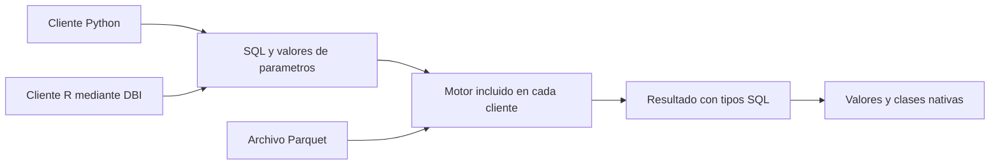

# 10.07 — DuckDB desde Python y R

[Inicio](../../../README.md) / [Módulo 10](../README.md) / **Lección 10.07**

| Tu sesión | Qué prepararás o comprobarás |
| --- | --- |
| **Meta** | Ejecutar el mismo SQL desde Python y R conservando tipos y recursos |
| **Necesitas** | SQL, tablas y funciones; entornos Python/R, sin resultados previos |
| **Evidencia** | Resultados de ambos clientes conciliados y recursos cerrados ante errores |

[Preparación](#antes-de-empezar) · [Material de apoyo](#material-de-apoyo) · [Lab 10.07](../../../labs/10_polars_duckdb/07_duckdb_python_r/README.md) · [Comprobar](#evidencia-y-criterio-de-salida)

<a id="propósito-y-prerrequisitos"></a>

## Propósito

Reutilizar una consulta parametrizada desde dos clientes, inspeccionar tipos y
valores, y cerrar resultados/conexiones incluso ante errores. Python y R no
devuelven necesariamente las mismas clases aunque ejecuten el mismo SQL.

## Antes de empezar

Necesitas reconocer tablas, funciones, SQL y archivos. Puedes consultar
[10.06](../06_duckdb_parquet/README.md) para profundizar; aquí se presentan
todos los datos, reglas y resultados. No se necesitan entregas previas.
Preparar un entorno es distinto de haber realizado una práctica anterior.

**Práctica principal:** elige primero un lenguaje; después ejecuta la misma
consulta desde el otro y concilia. **Ampliación:** recuperación por páginas
y enteros grandes. dbplyr/duckplyr son alternativas de interfaz, no conocimientos
necesarios para resolver esta sección. No comparamos velocidad entre clientes.

<a id="objetivos"></a>

## Qué vas a aprender

- Separar motor, cliente Python, interfaz DBI y backend R.
- Pasar parámetros como valores, sin construir SQL concatenando entradas.
- Recuperar resultados y distinguir paginación de una garantía de memoria.
- Inspeccionar tipos SQL y clases nativas; conservar precisión al adaptar.
- Liberar resultados y conexiones desde procesos nuevos y ante errores.

## Material de apoyo

| Recurso | Para qué sirve | Uso |
| --- | --- | --- |
| [Muestra](muestra.csv) | Revisar seis observaciones del contrato | Para el recorrido |
| [SQL de selección](seleccion.sql) | Consultar la misma pregunta parametrizada | Para el recorrido |
| [SQL de resumen](resumen.sql) | Consultar los cortes completos | Para el recorrido |
| [Cliente Python](clientes.py) | Preparar, consultar y verificar desde Python | Para el recorrido |
| [Cliente R](clientes.R) | Leer tipos y liberar recursos desde DBI | Para el recorrido |
| [Ejecutor R](ejecutar_clientes.R) | Reconstruir el recorrido completo desde R | Para el recorrido |
| [Preparador R](preparar_clientes.R) | Respaldar metadatos y ampliar el proyecto existente | Para el recorrido |
| [Lockfile R](renv.lock) | Consultar versiones fijadas del cliente R | Para el recorrido |
| [Recorridos Python](recorridos.md) | Comprobar el intérprete y ejecutar desde otra sesión | Para el recorrido |

Consulta los recursos donde se utilizan en el recorrido. Selecciona el
intérprete indicado y conserva originales y entregas previas; para repetir
una escritura, usa un destino nuevo. Las ampliaciones se identifican aparte.

## Datos, pregunta y contrato completos

Una financiera ficticia registra tres créditos en dos cortes. **¿Qué créditos
tienen al menos 2000 MXN el 31 de octubre de 2026?** También resumiremos cada
corte completo.

| id_credito | fecha_corte | saldo_mxn |
| --- | --- | ---: |
| 001 | 2026-09-30 | 0 |
| 002 | 2026-09-30 | 2000 |
| 003 | 2026-09-30 | 2500 |
| 001 | 2026-10-31 | 100 |
| 002 | 2026-10-31 | 1900 |
| 003 | 2026-10-31 | 2600 |

Unidad crédito/corte; clave ID/fecha única. ID textual de tres dígitos; fecha
válida entre 1900 y 2100; saldo entero de 0 a 2147483647 MXN, sin ausencias.
Se rechaza toda la fuente ante una incidencia, incluso fuera del filtro;
no se imputan ceros ni se eliminan duplicados.

Octubre ≥ 2000 deja `003/2600`, uno/2600. Septiembre ≥ 2000 deja `002/2000`
y `003/2500`, dos/4500; septiembre ≥ 2001 deja solo `003/2500`. Octubre ≥ 0
deja tres pares/4600. Noviembre no tiene filas. Los cortes completos contienen
tres registros y 4500/4600 MXN; sumar fechas distintas no produce saldo a una
fecha única.

## 1. Clientes, versiones y entorno

| Capa | Papel y referencia ejecutada |
| --- | --- |
| Python | Python 3.12.12, paquete duckdb 2.0.0 |
| R | R 4.6.1, paquete duckdb 1.5.6 |
| DBI | Interfaz R 1.3.0; el backend duckdb implementa sus métodos |
| renv | Biblioteca local y lockfile; renv 1.3.1 |

Cada paquete incluye su motor; `SELECT version()` permite comprobarlo en la
conexión real. No suponemos que los clientes se publiquen al mismo tiempo.
Comprobamos compatibilidad mediante SQL, Parquet, tipos y valores; **no abrimos
una base persistente compartida entre motores de versiones distintas**.



El cliente envía la consulta y sus valores; el motor abre Parquet y calcula.
Al recuperar, el cliente representa la respuesta en su lenguaje. Por eso
comprobamos tanto el esquema SQL como los valores y clases que llegan a Python/R.

Python conserva [`pyproject.toml`](../../../pyproject.toml)/[`uv.lock`](../../../uv.lock)
de 10.06. Los [recorridos Python](recorridos.md) comprueban el entorno sin
reinstalar si ya es adecuado.

R amplía el mismo proyecto renv de 09.04–09.09, conservando sus archivos y
entregas. Los nuevos [DESCRIPTION](DESCRIPTION)/[renv.lock](renv.lock) añaden
DBI 1.3.0, duckdb 1.5.6, dbplyr 2.6.0 y blob 1.3.0. Los 46 registros previos
permanecen idénticos. renv infiere dbplyr al combinar el dplyr existente con
un backend DBI; se registra para restaurar un entorno consistente, sin usar
esa interfaz en la práctica. La [documentación de renv](https://rstudio.github.io/renv/reference/dependencies.html)
explica esa inferencia. No desactivamos sus comprobaciones.

### Preparar la copia R sin exigir entregas previas

Si falta el proyecto, sigue la preparación de entorno de
[06.08](../../06_r_foundations/08_projects_renv/README.md) y la
ampliación de [09.04](../../09_arrow_parquet/04_r_read_write/README.md).
Se necesitan sus archivos de entorno, no sus resultados personales. No se
inicializa renv en la raíz de DS Track ni se instalan paquetes globalmente.

Desde R con la raíz de DS Track como carpeta de trabajo, ajusta la ruta de tu copia:

```r
source("curriculum/10_polars_duckdb/07_duckdb_python_r/preparar_clientes.R")
preparar_practica_clientes("output/mi_proyecto_r")
```

El preparador no instala. Comprueba metadatos previos, crea `respaldo_09_09/`
con DESCRIPTION/lockfile y añade funciones, CSV y SQL propios. Si encuentra
personalizaciones o destinos ocupados, se detiene para conservarlos.

Abre **ese mismo proyecto** en RStudio o el IDE elegido, reinicia R y, en su
consola R, ejecuta:

```r
source("restaurar.R")
```

Restaura versiones locales; puede descargar paquetes. Reinicia otra vez la
sesión antes de los ejemplos. Consola R y terminal del sistema no son lo mismo.
La restauración desde una segunda biblioteca vacía se comprobó; no se probó
la interfaz del IDE. No se cambian Conda, bibliotecas globales ni proyectos previos.

## 2. La misma consulta y sus parámetros

El archivo [seleccion.sql](seleccion.sql), copiado sin cambios al proyecto R,
contiene:

```sql
SELECT id_credito, saldo_mxn
FROM read_parquet(?)
WHERE fecha_corte = CAST(? AS DATE) AND saldo_mxn >= ?
ORDER BY id_credito;
```

Los tres valores son ruta, fecha y umbral, en ese orden. No son fragmentos de
código SQL. `CAST(? AS DATE)` expresa el tipo esperado de la fecha; no valida
todas las reglas del negocio. Las funciones integradas revisan también intervalo,
tipo de parámetro y fuente completa. Los identificadores de tablas/columnas
no se sustituyen de la misma manera que valores.

| Acción | Python | R/DBI |
| --- | --- | --- |
| Conectar | `duckdb.connect(":memory:")` | `dbConnect(duckdb(), dbdir=":memory:")` |
| Ejecutar y recuperar | `execute` + `fetchall` | `dbGetQuery(..., params=list(...))` |
| Recuperar por páginas | `fetchmany(n)` | `dbSendQuery` → `dbBind` → `dbFetch(n)` |
| Liberar resultado preparado | Consumir/reemplazar el resultado de la conexión | `dbClearResult` obligatorio |
| Cerrar conexión | Contexto `with`/`close` | `dbDisconnect`, protegido con `on.exit` |

DBI define la interfaz; cada backend define formatos de parámetros y conversiones.
Aquí comprobamos `?` en los dos clientes. Recuperar una página pequeña no
garantiza cómo el motor retuvo el resto ni que todo el programa tenga RAM acotada.

## 3. Recorrido Python autónomo

Desde la raíz en un script/consola Python, con el intérprete seleccionado.
Este bloque define toda la muestra y escribe su propio Parquet:

```python
from datetime import date
from pathlib import Path
import duckdb

carpeta = Path("output/clientes_1007_python_ejemplo")
carpeta.mkdir(parents=True, exist_ok=False)
archivo_python = carpeta / "saldos.parquet"
sql = """SELECT id_credito, saldo_mxn FROM read_parquet(?)
WHERE fecha_corte = CAST(? AS DATE) AND saldo_mxn >= ? ORDER BY id_credito"""
with duckdb.connect(":memory:") as con:
    con.execute("CREATE TABLE saldos(id_credito VARCHAR, fecha_corte DATE, saldo_mxn INTEGER)")
    con.execute("""INSERT INTO saldos VALUES
        ('001',DATE '2026-09-30',0),('002',DATE '2026-09-30',2000),
        ('003',DATE '2026-09-30',2500),('001',DATE '2026-10-31',100),
        ('002',DATE '2026-10-31',1900),('003',DATE '2026-10-31',2600)""")
    con.execute("COPY saldos TO ? (FORMAT PARQUET)", [str(archivo_python)])
    for corte, minimo, esperado in [
        (date(2026, 10, 31), 2000, [("003", 2600)]),
        (date(2026, 9, 30), 2000, [("002", 2000), ("003", 2500)]),
    ]:
        con.execute(sql, [str(archivo_python), corte, minimo])
        assert [(d[0], str(d[1])) for d in con.description] == [("id_credito", "VARCHAR"), ("saldo_mxn", "INTEGER")]
        assert con.fetchall() == esperado
    print(con.execute("SELECT version()").fetchone()[0])
```

`date` crea una fecha sin hora; `VARCHAR` conserva los ceros del ID e INTEGER
los pesos originales. `execute` inicia la sentencia y `fetchall` consume el
resultado restante. Son salidas pequeñas; el contexto cierra la conexión
también si aparece una excepción. La carpeta nueva protege entregas anteriores:
COPY de archivo único puede sobrescribir un destino existente.

### Recorrido Python integrado

Continúa en la raíz; estas funciones reutilizan validadores incluidos, no resultados
personales previos. Ambos clientes integrados leen el mismo archivo SQL:

```python
import sys
modulos = Path("curriculum/10_polars_duckdb/07_duckdb_python_r").resolve()
sys.path.insert(0, str(modulos))
import clientes

archivo_integrado = clientes.preparar("output/clientes_1007_python_integrado")
entrega_python = clientes.ejecutar(archivo_integrado)
assert entrega_python["seleccion"] == [("003", 2600)]
assert [f[2] for f in entrega_python["resumen"]] == ["4500", "4600"]
print(entrega_python)
```

El ejecutor usa `fetchmany` hasta recibir un bloque vacío. Acumula filas porque
la salida de estudio es pequeña: esto **no** es una implementación de memoria
acotada. Primero audita todas las filas contra CSV externo y comprueba tipos SQL.

## 4. Recorrido R autónomo en el proyecto preparado

En RStudio/IDE, abre un script nuevo dentro de la copia renv. Ejecuta bloques
e inspecciona los objetos. No necesitas el archivo escrito por Python: esta
función crea toda su propia muestra y conserva la conexión bajo su responsabilidad.

```r
demostrar_cliente_r <- function() {
  carpeta <- "output/clientes_1007_r_ejemplo"
  if (file.exists(carpeta) || !dir.create(carpeta, recursive = TRUE)) stop("Elige carpeta nueva")
  archivo <- file.path(normalizePath(carpeta, winslash = "/"), "saldos.parquet")
  con <- DBI::dbConnect(duckdb::duckdb(shared_home = FALSE), dbdir = ":memory:")
  on.exit(DBI::dbDisconnect(con, shutdown = TRUE), add = TRUE)
  DBI::dbExecute(con, "CREATE TABLE saldos(id_credito VARCHAR, fecha_corte DATE, saldo_mxn INTEGER)")
  DBI::dbExecute(con, "INSERT INTO saldos VALUES
    ('001',DATE '2026-09-30',0),('002',DATE '2026-09-30',2000),
    ('003',DATE '2026-09-30',2500),('001',DATE '2026-10-31',100),
    ('002',DATE '2026-10-31',1900),('003',DATE '2026-10-31',2600)")
  DBI::dbExecute(con, "COPY saldos TO ? (FORMAT PARQUET)", params = list(archivo))
  sql <- "SELECT id_credito, saldo_mxn FROM read_parquet(?)
WHERE fecha_corte = CAST(? AS DATE) AND saldo_mxn >= ? ORDER BY id_credito"
  resultado <- DBI::dbSendQuery(con, sql)
  on.exit(DBI::dbClearResult(resultado), add = TRUE, after = FALSE)
  DBI::dbBind(resultado, list(archivo, as.Date("2026-10-31"), 2000L))
  octubre <- DBI::dbFetch(resultado)
  DBI::dbBind(resultado, list(archivo, as.Date("2026-09-30"), 2000L))
  septiembre <- DBI::dbFetch(resultado)
  stopifnot(identical(octubre$id_credito, "003"), identical(octubre$saldo_mxn, 2600L),
    identical(septiembre$id_credito, c("002", "003")), identical(septiembre$saldo_mxn, c(2000L, 2500L)))
  list(archivo = archivo, octubre = octubre, septiembre = septiembre)
}
ejemplo_r <- demostrar_cliente_r()
str(ejemplo_r$octubre)
```

`DBI::` y `duckdb::` indican de qué paquete viene cada función. `params=list(...)`
y `dbBind` pasan valores; `2000L` es un entero R, `as.Date` construye Date.
`dbExecute` se usa para sentencias sin tabla de resultados. Para un SELECT simple
puedes usar `dbGetQuery`; para reutilizar un resultado preparado usamos
`dbSendQuery`, `dbBind` y `dbFetch`.

`on.exit` registra limpieza al salir de **esta función**, con éxito o error;
no se usa suelto en la consola como si protegiera cualquier script. El segundo
registro con `after=FALSE` hace que se libere el resultado **antes** de cerrar
la conexión. [DBI exige dbClearResult](https://dbi.r-dbi.org/reference/dbClearResult.html)
para objetos obtenidos con dbSendQuery, incluso si no se recuperaron filas.
[dbBind](https://dbi.r-dbi.org/reference/dbBind.html) explica el ciclo de parámetros.

`shared_home=FALSE` conserva el almacenamiento auxiliar de este cliente en
ubicación temporal de sesión; no activa una carpeta global persistente. Cerramos
con `shutdown=TRUE` según el cliente R comprobado. No suponemos que documentación
de una versión futura describa exactamente estos métodos.

### Recorrido R integrado y sesión nueva

El preparador copió fuente, funciones y SQL. En la copia del proyecto:

```r
source("R/clientes_1007.R", encoding = "UTF-8")
archivo_r <- preparar_1007("output/clientes_1007_r_integrado")
entrega_r <- ejecutar_1007(archivo_r)
stopifnot(identical(entrega_r$seleccion$id_credito, "003"),
          identical(entrega_r$resumen$saldo_texto, c("4500", "4600")))
print(entrega_r)
```

El ejecutor comprueba DESCRIBE parametrizado antes de abrir el resultado de
selección y valida clases después de recuperar. En DuckDB R 1.5.6 observamos
que `dbColumnInfo` antes de fetch podía informar `unknown`; no lo tomamos como
certificación del esquema ni cambiamos valores para hacerlo pasar.

Para repetir desde una sesión nueva, reinicia R y ejecuta este bloque completo;
solo lee el Parquet y reconstruye la referencia externa:

```r
source("R/clientes_1007.R", encoding = "UTF-8")
revisada <- ejecutar_1007(normalizePath("output/clientes_1007_r_integrado/completo.parquet", winslash = "/"))
stopifnot(identical(revisada$seleccion$saldo_mxn, 2600L))
```

## 5. Tipos SQL frente a representaciones nativas

| Valor | Python comprobado | R comprobado |
| --- | --- | --- |
| ID VARCHAR | str | character |
| Fecha DATE | datetime.date | Date |
| Saldo INTEGER válido del contrato | int | integer |
| SUM de INTEGER (HUGEINT SQL) | int | numeric, potencialmente aproximado |
| CAST del agregado a VARCHAR | str exacto | character exacto |

El resumen compartido [resumen.sql](resumen.sql) convierte **en el motor**
COUNT y SUM a texto decimal. El cálculo sigue siendo entero SQL; no sumamos
textos ni redondeamos dinero. Esto conserva el valor al cruzar la frontera del
cliente. No basta con convertir a texto después de una conversión aproximada.

Ejemplo independiente para inspeccionar esa frontera, sin modificar saldos:

```r
inspeccionar_precision <- function() {
  con <- DBI::dbConnect(duckdb::duckdb(shared_home = FALSE), dbdir = ":memory:")
  on.exit(DBI::dbDisconnect(con, shutdown = TRUE), add = TRUE)
  DBI::dbGetQuery(con, "SELECT 9007199254740993::HUGEINT AS numero,
    CAST(9007199254740993::HUGEINT AS VARCHAR) AS texto")
}
precision <- inspeccionar_precision()
stopifnot(identical(precision$texto, "9007199254740993"))
print(precision)
print(sprintf("%.0f", precision$numero))
```

Es un entero fuera del intervalo consecutivo exacto de double: no pertenece
al saldo Int32 de la muestra. `bigint="integer64"` controla BIGINT, pero no
resuelve automáticamente todas las conversiones de HUGEINT. La
[documentación de tipos R](https://r.duckdb.org/reference/duckdb_types.html)
describe las diferencias; aquí además las ejecutamos con el cliente fijado.
La referencia R base limita filas para que sus sumas de saldos Int32 permanezcan
dentro de la cota exacta documentada; las muestras de estudio son muy inferiores.

<a id="comprobación-práctica-y-continuidad"></a>

## Comprobación del recorrido

Conserva fuente/Parquet sin cambios entre lecturas; no se ofrece instantánea
transaccional frente a modificaciones concurrentes. No se exige una base
persistente compartida ni se presentan estas comprobaciones como equivalencia
universal entre versiones.

## Práctica

Realiza el [lab 10.07](../../../labs/10_polars_duckdb/07_duckdb_python_r/README.md) para
ejecutar la misma consulta desde ambos clientes y justificar tipos, parámetros y cierre de recursos.

Para contrastar tu práctica, consulta [clientes.py](clientes.py). Revisa también [clientes.R](clientes.R) para el otro cliente.

## Evidencia y criterio de salida

| Conserva | Comprueba | Explica |
| --- | --- | --- |
| SQL compartido y salidas de ambos clientes | 003/2600 y 4500/4600 MXN por clave; tipos antes de adaptar | Motor frente a cliente; parámetros como valores |
| Comprobaciones de precisión y recursos | HUGEINT adaptado sin pérdida; resultados/conexiones liberados incluso ante error | Páginas frente a garantía de memoria; límites de versiones e instantáneas |

Puedes avanzar cuando ejecutes el SQL desde ambos clientes, concilies cada
par y resumen, justifiques la adaptación de tipos y compruebes la liberación
de resultados y conexiones. No se exige compartir una base persistente entre versiones.

Quien aprende realiza la práctica y explica las decisiones; su compañero revisa.
Tu compañero provoca una consulta inválida y pide comprobar que los recursos se liberan.
Guarda evidencia, ayudas y dudas en una nota personal junto a tu práctica.
PROGRESS.md registra desarrollo editorial, no tu expediente de aprendizaje.
El proyecto `04_large_credit_dataset` y sus checkpoints siguen planificados;
las comprobaciones técnicas del material no acreditan haber completado la práctica.

<a id="referencias-primarias"></a>

## Referencias

Consultadas el 2026-10-23; ejemplos/datos propios y APIs ejecutadas con las
versiones indicadas. La documentación web del cliente R puede describir una
serie más nueva que el binario CRAN 1.5.6 usado aquí.

- [Python DB API](https://duckdb.org/docs/2.0/clients/python/dbapi).
- [Cliente R](https://duckdb.org/docs/2.0/clients/r),
  [conexiones R](https://r.duckdb.org/reference/duckdb.html) y
  [tipos R](https://r.duckdb.org/reference/duckdb_types.html).
- [DBI dbBind](https://dbi.r-dbi.org/reference/dbBind.html),
  [dbClearResult](https://dbi.r-dbi.org/reference/dbClearResult.html) y
  [dbGetQuery](https://dbi.r-dbi.org/reference/dbGetQuery.html).
- [Dependencias inferidas por renv](https://rstudio.github.io/renv/reference/dependencies.html).

## Siguiente paso

Después de la práctica y su comprobación, continúa con
[10.08 — Intercambio entre motores](../08_engine_interchange/README.md).

Consulta los [criterios de almacenamiento e integración](../../../docs/storage-closure.md).

[← Módulo 10](../README.md) · [Lab 10.07](../../../labs/10_polars_duckdb/07_duckdb_python_r/README.md) · [Siguiente →](../08_engine_interchange/README.md)
