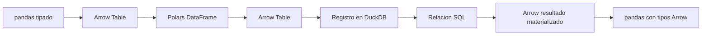

# 10.08 — Intercambio entre motores

## Propósito y prerrequisitos

Pasar una tabla entre pandas, Arrow, Polars y DuckDB, identificar cuándo se
recupera el resultado y comprobar qué se conserva después de cada conversión.
Necesitas reconocer tablas, tipos, funciones y un SELECT parametrizado.
Puedes profundizar en [Arrow](../../09_arrow_parquet/01_csv_parquet_arrow/README.md),
[Polars](../02_polars_tables_expressions/README.md) y
[clientes DuckDB](../07_duckdb_python_r/README.md). Aquí están los datos,
reglas y resultados completos; no necesitas entregas personales anteriores.

**Práctica principal:** Python con los cuatro sistemas ya declarados en el
proyecto. **Ampliaciones:** lector Arrow por lotes, enteros grandes y recorrido
R Arrow/DBI. Polars en R queda como alternativa de profundización; esta sección
no implementa ni exige su instalación. No hacemos mediciones de rendimiento.

## Objetivos

- Distinguir tabla en memoria, relación/consulta y lector de resultados.
- Intercambiar en ambos sentidos e inspeccionar tipos antes de adaptar valores.
- Conservar IDs, fechas, pesos enteros, claves y ausencia frente a cero.
- Explicar por qué equivalencia lógica no exige igualdad física de esquemas.
- Identificar materializaciones sin prometer ausencia de copias ni RAM acotada.

## Datos, reglas y resultado completos

Una financiera ficticia registra tres créditos en dos cortes. Preguntamos
**qué créditos tienen al menos 2000 MXN el 31 de octubre de 2026**.
La muestra [muestra.csv](muestra.csv) tiene:

| id_credito | fecha_corte | saldo_mxn |
| --- | --- | ---: |
| 001 | 2026-09-30 | 0 |
| 002 | 2026-09-30 | 2000 |
| 003 | 2026-09-30 | 2500 |
| 001 | 2026-10-31 | 100 |
| 002 | 2026-10-31 | 1900 |
| 003 | 2026-10-31 | 2600 |

Unidad crédito/corte; clave ID/fecha única. ID textual de tres dígitos, fecha
válida entre 1900 y 2100 y saldo entero 0–2147483647 MXN, sin ausencias.
Una incidencia rechaza la fuente completa, incluso fuera del filtro.
No se imputan ceros ni se eliminan duplicados.

Resultado: `003/2600`, uno/2600. Septiembre ≥ 2000 deja `002/2000` y
`003/2500`; ≥ 2001 deja solo `003/2500`. Octubre ≥ 0 deja tres/4600.
Noviembre no tiene registros. Cada corte completo tiene tres filas y
4500/4600 MXN respectivamente. Sumar fechas distintas no representa saldo
a una fecha única.

## Entorno

Referencias ejecutadas: Python 3.12.12, pandas 2.3.3, PyArrow 21.0.0,
Polars 2.0.0 y DuckDB 2.0.0. Ya están declaradas en
[pyproject.toml](../../../pyproject.toml)/[uv.lock](../../../uv.lock).
No hay dependencias ni lockfiles nuevos. Comprueba tu intérprete según los
[recorridos](recorridos.md); si el entorno ya es adecuado no lo reinstales.
Conda, venv/pip y uv son alternativas; no mezcles gestores sobre un entorno.

## 1. Qué cruza la frontera

| Objeto | Qué representa | Cómo se obtiene aquí |
| --- | --- | --- |
| pandas DataFrame | Tabla con índice y tipos por columna | Series con tipos explícitos |
| pyarrow.Table | Columnas tipadas y posibles bloques, ya disponibles en memoria | `Table.from_pandas`, `to_arrow_table` |
| Polars DataFrame | Tabla inmediata | `pl.from_arrow` |
| DuckDBPyRelation | Descripción de una consulta asociada a su conexión | `con.sql` |
| RecordBatchReader | Interfaz para consumir lotes de resultados | `relacion.to_arrow_reader` |

**Materializar** significa obtener los valores del resultado en una estructura
concreta, por ejemplo una Table o un DataFrame. Registrar una fuente crea un
nombre consultable; no equivale a copiarla a una tabla persistente. Crear la
relación no equivale a recuperar todas sus filas; el motor puede inspeccionar
esquemas u origen durante la preparación. Imprimir una relación para explorarla
también puede provocar trabajo. Conserva la conexión y las fuentes mientras
las necesite la consulta.
No modifiques el DataFrame fuente entre el registro y la lectura: una vista
registrada no se presenta aquí como instantánea independiente de su origen.



Leído sin diagrama: partimos de una tabla, la representamos en Arrow y Polars,
la registramos en DuckDB y calculamos SQL. Recuperamos una Table y regresamos
a pandas. También comprobaremos los registros directos pandas/Polars y la
salida directa DuckDB → Polars. Es un recorrido para aprender las fronteras;
una tarea real puede elegir menos conversiones.

## 2. Ejemplo Python autónomo: tabla → consulta → tabla

Desde la raíz de DS Track, en un script o consola Python con el entorno elegido:
`filas` contiene tuplas en orden ID/fecha/saldo. El diccionario `tipos` asocia
cada nombre con su tipo Arrow; el recorrido con `enumerate` toma la posición
de cada columna y construye una Series pandas tipada con esos valores.
Más adelante, `types_mapper=pd.ArrowDtype` pide también tipos Arrow al regresar
desde una Table a pandas.

```python
from datetime import date
import pandas as pd
import pyarrow as pa
import polars as pl
import duckdb

filas = [
    ("001", date(2026, 9, 30), 0), ("002", date(2026, 9, 30), 2000),
    ("003", date(2026, 9, 30), 2500), ("001", date(2026, 10, 31), 100),
    ("002", date(2026, 10, 31), 1900), ("003", date(2026, 10, 31), 2600),
]
tipos = {"id_credito": pa.string(), "fecha_corte": pa.date32(), "saldo_mxn": pa.int32()}
pandas_origen = pd.DataFrame({nombre: pd.Series([f[i] for f in filas],
    dtype=pd.ArrowDtype(tipo)) for i, (nombre, tipo) in enumerate(tipos.items())})
arrow_origen = pa.Table.from_pandas(pandas_origen, preserve_index=False)
polars_tabla = pl.from_arrow(arrow_origen, rechunk=False)
puente = polars_tabla.to_arrow()
print(pandas_origen.dtypes, arrow_origen.schema, polars_tabla.schema, puente.schema)

with duckdb.connect(":memory:") as con:
    con.register("entrada", puente)
    try:
        relacion = con.sql("""SELECT id_credito,saldo_mxn FROM entrada
          WHERE fecha_corte=CAST(? AS DATE) AND saldo_mxn>=? ORDER BY id_credito""",
          params=[date(2026, 10, 31), 2000])
        print(relacion.types)
        resultado = relacion.to_arrow_table()
        resultado_polars = relacion.pl()
    finally:
        con.unregister("entrada")

esperado = [{"id_credito": "003", "saldo_mxn": 2600}]
assert resultado.to_pylist() == esperado
assert resultado_polars.to_dicts() == esperado
pandas_resultado = resultado.to_pandas(types_mapper=pd.ArrowDtype)
assert pa.Table.from_pandas(pandas_resultado, preserve_index=False).to_pylist() == esperado
print(pandas_resultado, pandas_resultado.dtypes)
```

`pd.ArrowDtype(tipo)` elige una columna pandas respaldada por Arrow y evita
inferir otro tipo cuando la muestra está vacía. `date32` expresa días sin hora;
`int32` conserva el saldo individual del contrato. Los IDs siguen siendo texto.
`preserve_index=False` omite el índice pandas: aquí la clave está en columnas.
Si el índice contiene una clave real, conviértela primero en una columna y
comprueba su unicidad; omitirlo sin esa decisión puede perder información.

`rechunk=False` evita solicitar explícitamente que Polars reúna todos los
bloques en uno. No prueba ausencia de copias en el recorrido. `register` hace
explícita la fuente SQL; no dependemos de que DuckDB encuentre por casualidad
una variable con el mismo nombre. El contexto cierra la conexión y `finally`
retira el registro incluso ante errores. Las Tables ya recuperadas se pueden
inspeccionar después del cierre; no tratamos así una relación o lector pendiente.

En DuckDB 2.0 usamos `con.sql(...).to_arrow_table()` y `relacion.pl()`.
La [documentación de conversión](https://duckdb.org/docs/2.0/clients/python/conversion)
advierte una copia adicional al pedir Arrow sobre el resultado DB-API de
`execute`. Tampoco trasladamos los antiguos alias `arrow`/`pl` de la conexión
a esta versión. Repetir `relacion.pl()` después de `to_arrow_table()` vuelve a
ejecutar la consulta; no es una segunda vista gratuita de la primera salida.

## 3. Equivalencia de tipos, valores y claves

| Concepto | pandas elegido | Arrow observado | Polars | DuckDB SQL |
| --- | --- | --- | --- | --- |
| ID | string[pyarrow] | string o large_string | String | VARCHAR |
| Corte | date32[day][pyarrow] | date32[day] | Date | DATE |
| Saldo | int32[pyarrow] | int32 | Int32 | INTEGER |

Arrow `string` y `large_string` usan distinta anchura para los desplazamientos
que ubican cada texto. En esta muestra ambos representan los mismos IDs;
Polars exportó `large_string` y DuckDB devolvió `string`. Aceptamos **solo esa
equivalencia declarada**. No aceptamos transformar IDs a números, cambiar fecha
por timestamp ni convertir saldos a float para hacer coincidir el esquema.

Los campos pueden tener marcas de anulabilidad y metadatos distintos, por
ejemplo información privada del índice pandas. Esta práctica compara nombres,
tipos lógicos permitidos y valores por clave; no acredita igualdad de metadatos,
disposición de buffers, esquema físico completo o bytes de archivos.
Que un campo permita null no significa que lo contenga: inspecciona también
los conteos reales. La muestra principal exige cero ausencias.

### Recorrido integrado: auditar todas las etapas

El módulo [intercambio.py](intercambio.py) reutiliza reglas incluidas, sin pedir
entregas previas. Primero valida el CSV completo con Python estándar; después
inspecciona cada frontera **antes de adaptar o convertir para comparar**:

```python
from pathlib import Path
import sys
sys.path.insert(0, str(Path("curriculum/10_polars_duckdb/08_engine_interchange").resolve()))
import intercambio

x = intercambio.ejecutar()
assert x["seleccion"] == [{"id_credito": "003", "saldo_mxn": 2600}]
assert [f[2] for f in x["resumen"]] == ["4500", "4600"]
for nombre, control in x["etapas"].items():
    print(nombre, control)
```

Comprueba pandas → Arrow → Polars → Arrow, los registros directos de pandas
y Polars en DuckDB, Arrow → DuckDB → Arrow → pandas → Arrow, y selección
DuckDB → Polars. Compara cada fila de la fuente completa y cada par de la
selección, sin depender del orden físico. Un conteo y una suma iguales pueden
ocultar dos importes intercambiados. No se necesitan archivos Parquet intermedios.
El resumen COUNT/SUM viaja como texto decimal calculado en SQL para conservar
exactitud al adaptar, como se explica en [10.07](../07_duckdb_python_r/README.md).

## 4. Ausencia, cero y vacío: otra muestra independiente

Esta tabla tiene **otro contrato**: permite ausencias en importe y etiqueta.
No representa créditos aceptados de la muestra principal:

| id | importe | etiqueta |
| --- | ---: | --- |
| 001 | 0 | texto vacío |
| 002 | ausencia | ausencia |
| 003 | 10 | café |

Ejemplo completo, sin objetos previos:

```python
import pandas as pd
import pyarrow as pa
import polars as pl

original = pa.table({"id": pa.array(["001", "002", "003"]),
    "importe": pa.array([0, None, 10], type=pa.int32()),
    "etiqueta": pa.array(["", None, "café"])})
tabla_polars = pl.from_arrow(original, rechunk=False)
por_defecto = tabla_polars.to_pandas()
anulable = tabla_polars.to_pandas(use_pyarrow_extension_array=True)
print(por_defecto.dtypes, anulable.dtypes)
vuelta = pa.Table.from_pandas(anulable, preserve_index=False)
assert vuelta["importe"].type == pa.int32()
assert vuelta.to_pylist() == original.to_pylist()
assert vuelta["importe"].null_count == 1
```

Aquí la conversión predeterminada dio `float64`/NaN al importe; con la opción
Arrow conserva `int32[pyarrow]` y ausencia. **Suma observada 10, cobertura 2/3**;
cero participa como observado. No imputamos el importe ausente. El texto vacío
de 001 no es la ausencia de 002. No usamos la igualdad directa de NaN para
certificar equivalencia. El módulo incluye además el cruce completo de esta
muestra por DuckDB y la vuelta a pandas, con comparación de valores/tipos.

### Ampliación: un entero grande no es un float exacto

Ejemplo independiente del contrato Int32 de cartera:

```python
import pandas as pd
import pyarrow as pa

grandes = pa.table({"numero": pa.array([9007199254740993, None], type=pa.int64())})
aproximada = grandes.to_pandas()
exacta = grandes.to_pandas(types_mapper=pd.ArrowDtype)
assert int(aproximada.loc[0, "numero"]) != 9007199254740993
assert exacta.loc[0, "numero"] == 9007199254740993
```

Después de perder precisión, convertir el float de vuelta a entero no recupera
el original. Fijar un tipo antes de convertir y verificar después son decisiones
distintas. Para dinero decimal, zonas horarias, categorías o columnas anidadas
haría falta un contrato específico; no extendemos automáticamente estas garantías.

## 5. Materializar una Table o consumir un lector

Ampliación autónoma que no usa la cartera ni objetos anteriores:

```python
import duckdb

with duckdb.connect(":memory:") as con:
    relacion = con.sql("SELECT i FROM range(5) AS t(i) ORDER BY i")
    with relacion.to_arrow_reader(batch_size=2) as lector:
        conteo = 0
        tamanos = []
        for lote in lector:
            conteo += lote.num_rows
            tamanos.append(lote.num_rows)
    assert conteo == 5 and max(tamanos) <= 2
print(tamanos)
```

El lector consume su secuencia; un segundo recorrido no reinicia la consulta.
Para repetirla, crea otro lector. `read_all()` solicita toda la salida y devuelve
una Table; acumular los lotes en una lista también retiene todos sus datos.
El tamaño máximo del lote no limita el estado del motor, la tabla original ni
el resto del proceso. La auditoría integrada sí materializa valores para comparar.
Revisa [10.05](../05_streaming_memory/README.md) para separar esos alcances.

## 6. Ampliación R: Arrow → DuckDB → data.frame → Arrow

R reutiliza el mismo proyecto renv de 10.07: R 4.6.1, Arrow 25.0.1,
DuckDB 1.5.6 y DBI 1.3.0. No se añaden paquetes ni cambian DESCRIPTION/lockfile.
Si falta el entorno, prepara sus archivos siguiendo
[10.07](../07_duckdb_python_r/README.md#preparar-la-copia-r-sin-exigir-entregas-previas);
no necesitas sus Parquet ni sus resultados personales.

Desde la consola R con la raíz de DS Track como carpeta de trabajo, ajusta la
ruta de tu copia renv ya preparada:

```r
source("curriculum/10_polars_duckdb/08_engine_interchange/preparar_intercambio.R")
preparar_practica_intercambio("output/mi_proyecto_r")
```

Solo copia tres archivos nuevos y se detiene si están ocupados. Abre ese mismo
proyecto en RStudio/IDE, reinicia R y abre `ejecutar_intercambio.R`. Ejecuta
bloques e inspecciona objetos. Para comprobarlo completo, en la consola R:

```r
source("ejecutar_intercambio.R", encoding = "UTF-8")
```

[intercambio.R](intercambio.R) valida el CSV completo, construye Arrow con
string/date32/int32 y usa `duckdb_register_arrow` como vista consultable.
Inspecciona DESCRIBE; `dbGetQuery` materializa un data.frame. Compara sus clases
y cada valor **antes** de reconstruir Arrow con el esquema explícito.
Libera el registro antes de desconectar incluso al salir por un error.
El resultado vuelve a ser `003/2600` y 4500/4600 MXN por corte.

Reinicia R y repite el script completo: el recorrido trabaja en memoria y solo
lee su CSV, así que no requiere cambiar destinos ni borrar resultados. La
reproducción en procesos nuevos se comprueba por autoría; no se afirma haber
probado la interfaz del IDE. Arrow facilita el registro, pero la recuperación
por DBI introduce una frontera de representación: no atribuimos ausencia de
copias a toda esta cadena.

## Práctica y criterio de salida

Realiza el [lab 10.08](../../../labs/10_polars_duckdb/08_engine_interchange/README.md).
Puedes señalar dónde se materializa, justificar la equivalencia string/large_string,
conservar tipos y pares después de cada conversión, explicar índice/ausencias y
repetir desde otra sesión. No se exige demostrar cero copias o un ahorro de RAM.

La [integración prevista](../../../projects/README.md) aún no tiene proyecto ni
checkpoints activos. Registra evidencia según [PROGRESS.md](../../../PROGRESS.md);
disponibilidad del material no acredita aprendizaje.
Siguiente: [10.09 — Comparar tiempo y memoria](../README.md#09-comparar-tiempo-y-memoria),
todavía planificada.

## Referencias primarias

Consultadas el 2026-10-23. Datos y ejemplos propios, APIs ejecutadas con las
versiones fijadas; la documentación web de Polars/R puede describir otra serie.

- [DuckDB 2.0: conversión Python](https://duckdb.org/docs/2.0/clients/python/conversion)
  y [referencia de API](https://duckdb.org/docs/2.0/clients/python/reference/).
- [PyArrow 21: integración pandas, índices y tipos anulables](https://arrow.apache.org/docs/21.0/python/pandas.html).
- Polars: [from_arrow](https://docs.pola.rs/api/python/stable/reference/api/polars.from_arrow.html),
  [to_arrow](https://docs.pola.rs/api/python/stable/reference/dataframe/api/polars.DataFrame.to_arrow.html)
  y [to_pandas](https://docs.pola.rs/api/python/stable/reference/dataframe/api/polars.DataFrame.to_pandas.html).
- [R: registro Arrow en DuckDB](https://r.duckdb.org/reference/duckdb_register_arrow.html).
