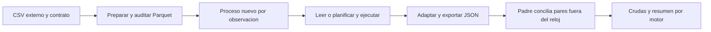

# 10.09 — Comparar tiempo y memoria

[Inicio](../../../README.md) / [Módulo 10](../README.md) / **Lección 10.09**

| Tu sesión | Qué prepararás o comprobarás |
| --- | --- |
| **Meta** | Medir un trabajo equivalente y explicar alcance y variación |
| **Necesitas** | Archivos, tablas, filtros y ejecución diferida; entorno Python existente |
| **Evidencia** | Observaciones crudas, medianas/rangos reconstruidos y resultados conciliados |

[Preparación](#antes-de-empezar) · [Material de apoyo](#material-de-apoyo) · [Lab 10.09](../../../labs/10_polars_duckdb/09_time_memory/README.md) · [Comprobar](#evidencia-y-criterio-de-salida)

<a id="propósito-y-prerrequisitos"></a>

## Propósito

Medir un trabajo definido, conservar observaciones repetidas y explicar qué
incluye cada número. Una medición útil necesita datos, respuesta y límites
equivalentes antes de comparar herramientas.

<a id="entorno-y-alcance"></a>

## Antes de empezar

Necesitas reconocer archivos, tablas, funciones, filtros y ejecución diferida.
Puedes profundizar en [planes](../03_polars_lazy_plans/README.md),
[memoria](../05_streaming_memory/README.md) e
[intercambio](../08_engine_interchange/README.md). Esta sección presenta todos
los datos y resultados; no exige entregas previas. El recorrido principal usa
Python; la ampliación R realiza un experimento distinto y no mezcla sus tiempos.

Referencias: Python 3.12.12, pandas 2.3.3, PyArrow 21.0.0, Polars 2.0.0 y
DuckDB 2.0.0. Ya están en [pyproject.toml](../../../pyproject.toml)/[uv.lock](../../../uv.lock).
No hay paquetes ni lockfiles nuevos. Usa un entorno local elegido según
los [recorridos](recorridos.md); no reinstales si ya es adecuado.

La práctica utiliza seis filas para entender el método. La ampliación permite
40/400, hasta 1998 con IDs válidos; **no representa grandes volúmenes**.
No establece un ganador general, un límite de RAM ni un estudio de I/O físico.
Las mediciones dependen del equipo y no tienen un número de milisegundos esperado.

<a id="objetivos"></a>

## Qué vas a aprender

- Definir unidad, entrada, salida, fases y respuesta equivalente.
- Separar tiempo transcurrido, CPU, memoria de objetos y pico residente.
- Repetir con orden documentado y conservar observaciones crudas.
- Reconocer cachés, importaciones, hilos y conversión en los costos.
- Conciliar antes de interpretar medianas y rangos; justificar límites.

## Material de apoyo

| Recurso | Para qué sirve | Uso |
| --- | --- | --- |
| [Muestra](muestra.csv) | Revisar el trabajo de seis filas | Para el recorrido |
| [Coordinador y verificador](comparar.py) | Preparar, medir y conciliar fuera del trabajador | Para el recorrido |
| [Trabajador aislado](trabajador.py) | Examinar los límites de las fases medidas | Para el recorrido |
| [Métricas del sistema](metricas.py) | Consultar unidad y alcance del contador residente | Consulta de implementación |
| [Recorridos](recorridos.md) | Ejecutar el protocolo desde procesos nuevos | Para el recorrido |

Consulta los recursos donde se utilizan en el recorrido. Selecciona el
intérprete indicado y conserva originales y entregas previas; para repetir
una escritura, usa un destino nuevo. Las ampliaciones se identifican aparte.

## Datos, contrato y respuesta completos

Una financiera ficticia registra tres créditos en dos cortes. Preguntamos:
**¿cuáles tienen al menos 2000 MXN al 31 de octubre de 2026?**
La muestra [muestra.csv](muestra.csv) contiene:

| id_credito | fecha_corte | saldo_mxn |
| --- | --- | ---: |
| 001 | 2026-09-30 | 0 |
| 002 | 2026-09-30 | 2000 |
| 003 | 2026-09-30 | 2500 |
| 001 | 2026-10-31 | 100 |
| 002 | 2026-10-31 | 1900 |
| 003 | 2026-10-31 | 2600 |

Unidad crédito/corte; clave ID/fecha única. ID textual de tres dígitos, Date
1900–2100 y saldo entero 0–2147483647 MXN, sin ausencias. La fuente completa
se rechaza ante una incidencia, incluso fuera del filtro. No se imputan ceros
ni se eliminan duplicados.

Octubre ≥ 2000 deja `003/2600`, uno/2600; septiembre ≥ 2000 deja `002/2000`
y `003/2500`, dos/4500; septiembre ≥ 2001 deja solo `003/2500`. Octubre ≥ 0
deja tres/4600; noviembre, ninguno. Los cortes completos contienen tres filas
y 4500/4600 MXN respectivamente; sumarlos no da saldo a una fecha única.

## 1. Antes del cronómetro: qué significa «el mismo trabajo»

Cada motor recibe el **mismo archivo Parquet** con string/date32/int32.
Filtra por fecha y umbral, selecciona ID/saldo y ordena por ID. Recupera
los valores y exporta la misma lista de pares a JSON UTF-8 en un archivo nuevo.
El padre comprueba tipos y cada par con una referencia externa Python estándar.

Las estrategias pueden diferir: pandas lee las tres columnas y filtra después;
Polars construye un plan lazy y ejecuta collect; DuckDB prepara una relación
SQL y recupera Arrow. Comparamos esos recorridos concretos desde archivo,
no una consulta pandas ya cargada frente a un scan que aún debe leer.
Tampoco atribuimos la diferencia exclusivamente al lenguaje o al motor.



Sin renderizador: primero se prepara/audita la entrada. Cada proceso ejecuta
una variante y entrega pares/tiempos. Otro proceso verifica la respuesta
antes de guardar un resumen; la auditoría no pertenece a los tiempos del hijo.

## 2. Primer cronómetro autónomo

`perf_counter_ns` devuelve un contador de tiempo transcurrido: se resta el
inicio del final. `process_time_ns` mide CPU del proceso. Son enteros en
nanosegundos; esa unidad no garantiza precisión real de un nanosegundo.
La resolución del reloj queda registrada en la entrega integrada.

Desde una consola/script Python, sin motores ni objetos de otra sección:

```python
from datetime import date
from time import perf_counter_ns, process_time_ns
from statistics import median

filas = [
    ("001", date(2026, 9, 30), 0), ("002", date(2026, 9, 30), 2000),
    ("003", date(2026, 9, 30), 2500), ("001", date(2026, 10, 31), 100),
    ("002", date(2026, 10, 31), 1900), ("003", date(2026, 10, 31), 2600),
]
duraciones = []
for repeticion in range(3):
    cpu_inicio = process_time_ns()
    inicio = perf_counter_ns()
    pares = sorted((id_, saldo) for id_, corte, saldo in filas
                   if corte == date(2026, 10, 31) and saldo >= 2000)
    transcurrido = perf_counter_ns() - inicio
    cpu = process_time_ns() - cpu_inicio
    assert pares == [("003", 2600)]  # Comprobar fuera del intervalo principal.
    duraciones.append(transcurrido)
    print(repeticion + 1, transcurrido / 1_000_000, cpu / 1_000_000)
print("Mediana ms:", median(duraciones) / 1_000_000)
```

Este bloque mide el filtro/orden sobre tuplas ya creadas, no lectura Parquet,
importación ni exportación. El CPU incluye un alcance ligeramente mayor por
los propios relojes. Para trabajos tan cortos, resolución y sobrecarga pesan.
El tiempo transcurrido incluye esperas; CPU suma trabajo de hilos del proceso
y puede superar el tiempo de pared cuando hay paralelismo. No es un porcentaje
de CPU. No se exige que ambos números sean iguales.

## 3. Fases comparables y fases con significado distinto

El ejecutor usa estas fronteras explícitas:

| Campo | Incluye |
| --- | --- |
| importar | PyArrow común y el motor solicitado |
| configurar | Pools Arrow; conexión/configuración DuckDB o inspección del pool Polars |
| entrada_o_plan | pandas: lectura real; Polars: scan/filtro/proyección/orden; DuckDB: relación parametrizada y metadatos |
| ejecutar_recuperar | pandas: filtro/selección/orden; Polars: collect con lectura; DuckDB: ejecutar y recuperar Arrow |
| adaptar | Pasar salida a Arrow si hace falta y recuperar registros Python |
| exportar | Serializar JSON, escribir y cerrar el archivo; sin fsync |

**No compares solo `entrada_o_plan` entre motores:** leer pandas y construir
un plan lazy son trabajos diferentes. `consulta_ns` suma entrada_o_plan,
ejecutar_recuperar y adaptar: parte del archivo y termina con los pares nativos.
`intervalo_ns` suma las seis fases e incluye importaciones/configuración/exportación.
`proceso_ns`, medido por el padre, también incluye arranque del intérprete,
carga de scripts, métricas, emisión de crudas y cierre. No incluye auditoría
del padre ni escritura del informe. Ninguno equivale al tiempo interactivo de un IDE.
`cpu_ns` cubre CPU del hijo desde el primer reloj hasta después de exportar;
no incluye CPU del padre ni el arranque anterior a ese reloj.

La lectura y el cálculo se entrelazan en los motores lazy: no afirmamos haber
aislado su I/O de su ejecución. Para separar eso habría que diseñar otra variante,
por ejemplo datos ya residentes, conservando equivalencia. La preparación del
Parquet se hace una sola vez y queda fuera; no ocultes ese costo si tu pregunta
real incluye producir archivos nuevos en cada corrida.

La exportación es una fase distinta, pero su cierre no acredita persistencia
física: el SO puede conservar escritura en caché. El JSON de una variante
debe contener los mismos pares antes de interpretar su costo.

## 4. Repeticiones, orden, caché e hilos

El protocolo principal usa tres observaciones por motor y nueve procesos nuevos:

| Repetición | Primero | Segundo | Tercero |
| --- | --- | --- | --- |
| 1 | pandas | Polars | DuckDB |
| 2 | Polars | DuckDB | pandas |
| 3 | DuckDB | pandas | Polars |

El orden rota; no ejecutamos los motores a la vez. Se admiten múltiplos de
tres hasta treinta repeticiones por motor. Es un diseño didáctico, sin
calentamiento descartado ni prueba de significancia. Una política con calentamiento
sería otro experimento: anota cuántas ejecuciones excluyes y conserva la política.

**Proceso nuevo no implica disco frío.** Preparación y auditoría ya leyeron el
Parquet; el SO puede retener sus páginas, bibliotecas y metadatos. No vaciamos
cachés ni afirmamos lecturas físicas de disco. Aplicaciones de fondo, temperatura,
energía y carga del equipo también influyen. El informe registra sistema, CPU,
arquitectura y procesadores lógicos; usa `--nota` para anotar disco/carga/energía
si los conoces. Un dato no registrado no se inventa ni se considera controlado.

Cada hijo recibe pools configurados a uno: Polars mediante variable local antes
de importar, Arrow CPU/I/O mediante API y DuckDB con threads=1. Se registran los
valores efectivos y límites de bibliotecas numéricas en el entorno del hijo.
No se fija afinidad de CPU ni se promete que el proceso tenga un único hilo.
DuckDB usa memory_limit=128MiB y carpeta temporal exclusiva; ese límite no es
un tope de todo el RSS. No se alteran variables globales ni entornos del usuario.

## 5. Memoria: el nombre de la métrica forma parte del resultado

| Métrica | Qué informa aquí | Qué no prueba |
| --- | --- | --- |
| PeakWorkingSetSize, Windows | Máximo residente del proceso hasta leer el contador | RAM adicional exclusiva de una consulta |
| WorkingSetSize, Windows | Residente en ese instante | Un máximo futuro o memoria virtual total |
| ru_maxrss, Linux opcional | Máximo residente, convertido de KiB a bytes | Igualdad metodológica automática con Windows |
| DataFrame.memory_usage / estimated_size | Contabilidad/estimación del objeto | Pico del proceso y temporales de ejecución |
| tracemalloc | Asignaciones registradas por Python/extensiones participantes | Todas las reservas nativas de los motores |

El contador del ejecutor se lee después de adaptar/exportar y antes de cerrar
la conexión o emitir crudas. Incluye arranque, PyArrow, motor, buffers y objetos
retenidos. pandas conserva su tabla leída además de la selección; los otros
recorridos retienen sus propios objetos. No restamos dos picos históricos para
llamarlo «memoria de la consulta»: el máximo no se reinicia entre fases.
Tampoco sumamos picos de procesos para llamarlo RAM simultánea del equipo.

Los bytes se convierten a MiB dividiendo por `1024**2`. Si la plataforma no
ofrece contador, se registra `null`/no_disponible; no cero. La autoría comprueba
Windows; la rama Linux no se ha ejecutado y otras plataformas quedan sin contador.
No mezcles sus valores como si fueran la misma métrica.

`temporales_retenidos_bytes` cuenta archivos presentes en la carpeta de spill
al final. Cero no prueba ausencia de escrituras intermedias ni mide volumen de
I/O o pico de disco. Este recorrido pequeño no demuestra procesamiento mayor
que memoria; un experimento que lo necesite debe medir también ese alcance.

## 6. Recorrido integrado, completo y repetible

Desde la raíz de DS Track, en Python con el entorno elegido. `preparar` escribe
un Parquet propio en carpeta nueva; `medir` crea otra carpeta nueva:

```python
from pathlib import Path
import sys
sys.path.insert(0, str(Path("curriculum/10_polars_duckdb/09_time_memory").resolve()))
import comparar

entrada = comparar.preparar("output/tiempo_1009_datos")
informe = comparar.medir(entrada, "output/tiempo_1009_corrida",
    nota="Anotar aqui disco, alimentacion y carga conocida del equipo")
revisado = comparar.verificar("output/tiempo_1009_corrida", entrada)
assert revisado == informe["resumen"]
for r in revisado:
    print(r["motor"], "consulta ms:", r["consulta_ns"]["mediana"] / 1_000_000,
          "pico MiB:", None if r["pico_bytes"] is None else r["pico_bytes"]["mediana"] / 1024**2)
```

El código está en [comparar.py](comparar.py), [trabajador.py](trabajador.py) y
[metricas.py](metricas.py). Importar define funciones; no inicia mediciones.
El trabajador importa explícitamente su motor más PyArrow común; sus dependencias
pueden cargar otros módulos. El padre valida
la entrada completa **antes** de lanzar hijos; después concilia cada respuesta
por ID/importe, esquema string/large_string e int32, incluso vacíos. No confunde
esquema entero con una conversión de float que parece acertar por casualidad.

La carpeta de corrida contiene nueve JSON crudos y logs, un `informe.json`
y nueve carpetas `observacion_.../`, cada una con `seleccion.json` y temporales.
No se sobrescribe al repetir: elige otro destino. Si falla un hijo se conservan
archivos parciales y log para revisar; no se entrega un resumen completo como válido.
Conserva fuente y Parquet sin cambios durante las lecturas; no se ofrece una
instantánea frente a modificaciones concurrentes.

`verificar` solo lee: reconstruye la referencia externa, revisa huellas SHA-256,
pares/exportaciones, orden/repeticiones, sumas de fases y resumen de crudas.
Huellas e invariantes **no autentican tiempos históricos**: alguien puede
inventar duraciones coherentes. Registrar datos y medirlos realmente son cosas
distintas. Reiniciar Python y verificar otra vez comprueba reproducibilidad
de la revisión, no vuelve a ejecutar el experimento pasado.

## 7. Interpretar sin borrar la variación

El resumen conserva mínimo, mediana y máximo de consulta, intervalo y proceso,
además del pico residente. Tres repeticiones no bastan para describir toda la
variabilidad. No descartes automáticamente la observación lenta: revisa su
posición, log y contexto; anota el motivo si diseñaste una exclusión previamente.

Ejemplo numérico inventado para practicar estadística, no mediciones de motores:

```python
from statistics import median
ejemplo_ms = [8.1, 7.9, 29.0]
assert median(ejemplo_ms) == 8.1
print(min(ejemplo_ms), median(ejemplo_ms), max(ejemplo_ms))
```

Una conclusión defendible cita pregunta, archivo, filas, política de procesos/
caché, versiones, configuración, métrica y rango. «En esta corrida, este
recorrido tuvo menor mediana de consulta, con este rango» es una observación
local. No demuestra superioridad general ni que cabrá una base mayor en RAM.
Cambiar tamaño, formato, filtros, hilos o forma de salida cambia el experimento.

### Ampliación de tamaño, sin repetir claves

El generador incluido define dos cortes y j=0..n-1: ID `j+1` con tres dígitos,
saldo `(j*137 + mes*83) % 5001`, mes 0/1. Veinte/doscientos créditos producen
40/400 filas; el máximo de 999 produce 1998. No duplica muestras para inflar
filas ni presenta esas cantidades como grandes datos. Consulta el ejemplo
cerrado del [lab](../../../labs/10_polars_duckdb/09_time_memory/README.md).

## 8. Ampliación R: un intervalo distinto con system.time

En el proyecto renv preparado con R 4.6.1, DuckDB 1.5.6 y DBI 1.3.0 de
[10.07](../07_duckdb_python_r/README.md), abre un script nuevo en RStudio/IDE.
No se necesitan archivos de otras prácticas: todos los datos están en el bloque.
`system.time` devuelve CPU y tiempo elapsed; aquí medimos solo SELECT y
recuperación DBI, con conexión/datos ya preparados. `gcFirst=TRUE` solicita GC
antes del intervalo. No mezcles estos tiempos con el protocolo Python.

```r
medir_r <- function() {
  con <- DBI::dbConnect(duckdb::duckdb(shared_home = FALSE), dbdir = ":memory:")
  on.exit(DBI::dbDisconnect(con, shutdown = TRUE), add = TRUE)
  DBI::dbExecute(con, "SET threads=1")
  DBI::dbExecute(con, "CREATE TABLE saldos(id_credito VARCHAR, fecha_corte DATE, saldo_mxn INTEGER)")
  DBI::dbExecute(con, "INSERT INTO saldos VALUES
    ('001',DATE '2026-09-30',0),('002',DATE '2026-09-30',2000),
    ('003',DATE '2026-09-30',2500),('001',DATE '2026-10-31',100),
    ('002',DATE '2026-10-31',1900),('003',DATE '2026-10-31',2600)")
  tiempo <- system.time({
    salida <- DBI::dbGetQuery(con,
      "SELECT id_credito,saldo_mxn FROM saldos WHERE fecha_corte=CAST(? AS DATE)
       AND saldo_mxn>=? ORDER BY id_credito", params = list(as.Date("2026-10-31"), 2000L))
  }, gcFirst = TRUE)
  stopifnot(identical(salida$id_credito, "003"), identical(salida$saldo_mxn, 2600L))
  tiempo
}
crudas_r <- lapply(seq_len(3), function(i) medir_r())
print(crudas_r)
```

Son tres conexiones nuevas en **la misma sesión R**, con tabla en memoria,
sin lectura Parquet ni exportación; no son tres procesos nuevos. Las versiones
de motores también difieren. Un elapsed cero por resolución no significa costo
nulo. object.size no sustituye el pico residente. Para reproducir en el IDE,
reinicia R y ejecuta el script completo; autoría comprueba procesos R nuevos,
no la interfaz del IDE. No hay paquetes ni cambios de renv nuevos.

<a id="práctica-salida-y-continuidad"></a>

## Práctica

Realiza el [lab 10.09](../../../labs/10_polars_duckdb/09_time_memory/README.md) para
repetir el protocolo, reconstruir estadísticas desde las observaciones y justificar límites.

Para contrastar tu práctica, consulta [comparar.py](comparar.py).

## Evidencia y criterio de salida

| Conserva | Comprueba | Explica |
| --- | --- | --- |
| Datos, protocolo y resultados conciliados | Mismo Parquet/pregunta/salida; 003/2600; tres repeticiones por motor y orden rotado | Fases de consulta, intervalo y proceso; validación fuera del trabajador |
| Crudas, medianas, rangos y contexto | Tiempo transcurrido, CPU y pico residente absoluto con unidades | Caché sin vaciar, hilos, importaciones y límites; R usa otro protocolo |

Puedes avanzar cuando concilies resultados, reconstruyas medianas desde
crudas y expliques alcance, caché y memoria sin convertir una observación en
una regla universal. Las métricas dependen del equipo; no hay un tiempo esperado.

Quien aprende realiza la práctica y explica las decisiones; su compañero revisa.
Tu compañero muestra una sola ejecución más rápida y pide justificar qué puede concluirse con ella.
Guarda evidencia, ayudas y dudas en una nota personal junto a tu práctica.
PROGRESS.md registra desarrollo editorial, no tu expediente de aprendizaje.
El proyecto `04_large_credit_dataset` y sus checkpoints siguen planificados;
las comprobaciones técnicas del material no acreditan haber completado la práctica.

<a id="referencias-primarias"></a>

## Referencias

Consultadas el 2026-10-23; ejemplos y datos propios, APIs verificadas con las
versiones declaradas. La documentación web R/Polars puede describir otra serie.

- Python 3.12: [relojes](https://docs.python.org/3.12/library/time.html),
  [estadística](https://docs.python.org/3.12/library/statistics.html) y
  [tracemalloc](https://docs.python.org/3.12/library/tracemalloc.html).
- [Windows: contadores de memoria y unidades](https://learn.microsoft.com/en-us/windows/win32/api/psapi/ns-psapi-process_memory_counters).
- [Linux: getrusage y ru_maxrss](https://man7.org/linux/man-pages/man2/getrusage.2.html).
- [DuckDB 2.0: ajuste de cargas](https://duckdb.org/docs/2.0/guides/performance/how_to_tune_workloads).
- [DuckDB: límites de memoria y reservas fuera del administrador](https://duckdb.org/docs/2.0/guides/troubleshooting/oom_errors).
- [Polars: pool de hilos](https://docs.pola.rs/api/python/stable/reference/api/polars.thread_pool_size.html)
  y [estimated_size](https://docs.pola.rs/api/python/stable/reference/dataframe/api/polars.DataFrame.estimated_size.html).
- [PyArrow 21: pool CPU](https://arrow.apache.org/docs/21.0/python/generated/pyarrow.set_cpu_count.html).
- [pandas 2.3.3: memory_usage](https://pandas.pydata.org/pandas-docs/version/2.3/reference/api/pandas.DataFrame.memory_usage.html).
- [R: system.time](https://stat.ethz.ch/R-manual/R-devel/library/base/html/system.time.html).

## Siguiente paso

Después de la práctica y su comprobación, continúa con
[10.10 — Cierre y elección de herramienta](../10_closure_tool_choice/README.md).

Consulta los [criterios de almacenamiento e integración](../../../docs/storage-closure.md).

[← Módulo 10](../README.md) · [Lab 10.09](../../../labs/10_polars_duckdb/09_time_memory/README.md) · [Siguiente →](../10_closure_tool_choice/README.md)
