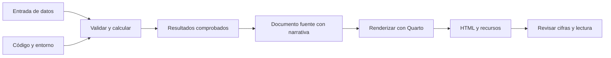

# 11.01 — Reporte, fuente y renderizado

## Propósito y prerrequisitos

Un análisis puede calcular bien y aun así dejar preguntas abiertas: ¿qué se
comparó?, ¿para quién importa?, ¿de dónde sale una cifra? Un reporte reúne una
respuesta, su evidencia y sus límites para una persona que no estuvo presente
durante la exploración. Aquí prepararás esa historia y distinguirás los archivos
necesarios para reconstruirla.

El [módulo 10](../../10_polars_duckdb/README.md) aporta los conceptos de pregunta,
contrato y comprobación. Esta sección incluye todos sus datos y reglas; no exige
una entrega personal de 10.10. Basta saber leer CSV y ejecutar un script en
**Python o R**, y reconocer [Markdown](../../00_getting_started/README.md).
Los preparadores utilizan biblioteca estándar de Python o R base. No instales
Quarto ni paquetes para esta preparación editorial: la creación y el primer
render del `.qmd` se desarrollarán en
[11.02](../README.md#02-primer-documento-quarto), todavía planificada.

Al terminar podrás distinguir entrada, código, documento fuente y salida;
redactar una pregunta para un público; relacionar una afirmación con su tabla;
y explicar por qué abrir un HTML no demuestra que los cálculos estén actualizados.

## 1. Qué necesita saber quien recibe el reporte

**Situación propia y ficticia:** una persona revisa el saldo observado de tres
créditos. Necesita conocer el cambio entre dos cortes, antes de investigar sus
causas. No necesita ver cada intento de código ni elegir un motor de consultas.

La pregunta es: **¿cómo cambió el saldo total de los mismos tres créditos entre
el 30 de septiembre y el 31 de octubre de 2026?** La unidad de observación es un
crédito en una fecha de corte; seis registros representan tres créditos en dos
fechas, no seis créditos diferentes. Un saldo es una cantidad a una fecha:
sumar ambos cortes no produce desembolsos, pagos ni saldo de un solo mes.

Esta es toda la entrada, disponible en [cartera.csv](cartera.csv):

```csv
credito_id,fecha_corte,saldo_mxn
001,2026-09-30,1000
002,2026-09-30,2000
003,2026-09-30,3000
001,2026-10-31,1200
002,2026-10-31,1800
003,2026-10-31,3300
```

| Campo | Significado y regla de esta práctica |
| --- | --- |
| `credito_id` | Texto; exactamente 001, 002 y 003, con ceros iniciales |
| `fecha_corte` | Texto ISO; exactamente 2026-09-30 o 2026-10-31 |
| `saldo_mxn` | Pesos mexicanos enteros, entre 0 y 1000000; sin ausencias |

La clave es ID + fecha. Deben existir las seis combinaciones, una sola vez.
El preparador rechaza la muestra completa si incumple estas reglas; no elimina
registros para obtener un resultado. Es un contrato pequeño y específico, no
un validador general de cualquier cartera. Las fechas están enumeradas; no se
infiere aquí un calendario ni se aceptan otros cortes.

## 2. Del resultado a una afirmación comprobable

Antes de redactar, revisa los pares por crédito:

| Crédito | Septiembre (MXN) | Octubre (MXN) | Octubre menos septiembre (MXN) |
| --- | ---: | ---: | ---: |
| 001 | 1000 | 1200 | 200 |
| 002 | 2000 | 1800 | -200 |
| 003 | 3000 | 3300 | 300 |
| Total | 6000 | 6300 | 300 |

El cambio relativo es `(6300 - 6000) / 6000 × 100 = 5%`. El denominador es
septiembre; dividir entre octubre responde otra pregunta. La base común tiene
tres de tres créditos en ambos cortes. Si faltara uno, esta práctica se detendría:
no presentaría como equivalente una suma con otra cobertura.

Una afirmación útil es: «En esta muestra de los mismos tres créditos ficticios,
el saldo observado pasó de 6000 a 6300 MXN entre septiembre y octubre de 2026:
una diferencia de 300 MXN, equivalente al 5% del saldo inicial».

El total aumentó, pero el crédito 002 disminuyó. «Todos aumentaron» contradice
los pares. «La cobranza empeoró» tampoco se desprende de estos datos: no hay
pagos, atrasos ni información causal. La interpretación debe respetar tanto
lo calculado como lo que no se observó.

## 3. Fuente tiene dos sentidos: identifica cuál estás usando

La **fuente de datos** es la entrada que contiene observaciones. El **documento
fuente** contiene el texto y las instrucciones para producir un documento.
Conviene usar ambos nombres completos cuando pueda haber confusión.

| Pieza | Ejemplo de nombre | Para qué sirve |
| --- | --- | --- |
| Entrada | `cartera.csv` | Observaciones que se validan y resumen |
| Código reutilizable | `preparar.py` o `preparar.R` | Reglas y cálculos, sin depender de objetos de otra sesión |
| Preparación editorial de esta lección | `borrador.md`, `pares.csv`, `resumen.csv` | Ordenar mensaje y evidencia antes de Quarto |
| Documento fuente Quarto, posterior | `reporte.qmd` | Texto Markdown, opciones y, si se necesitan, bloques ejecutables |
| Resultado renderizado, posterior | `reporte.html` y posibles recursos asociados | Documento que abre quien lo recibe |

Los nombres `reporte.qmd` y `reporte.html` describen archivos futuros; esta
lección no los genera. Un `.qmd` es texto editable. Renderizar transforma el
documento fuente al formato de salida; cuando contiene código ejecutable,
puede incluir una fase de cálculo. El tutorial oficial muestra esta separación
entre fuente, procesamiento y salida en [Hello, Quarto](https://quarto.org/docs/get-started/hello/text-editor.html).
La sintaxis base se explica en [Markdown Basics](https://quarto.org/docs/authoring/markdown-basics.html).



Sin renderizador del diagrama: los datos y el código producen resultados;
el documento los relaciona con la narrativa; Quarto produce la salida y después
se revisa esa salida. Las fases pueden ejecutarse dentro de un mismo render,
no es obligatorio guardar una tabla intermedia por cada flecha. Aquí solo
preparamos y comprobamos el borrador anterior a Quarto.

**Editar un número en el HTML cambia esa copia visible**, pero deja el cálculo
y el documento fuente anteriores. Al reconstruir, el cambio puede desaparecer.
La corrección debe hacerse en los datos, reglas o texto fuente correspondientes,
regenerar y comprobar el resultado. Conservar solo el HTML permite leerlo, pero
no garantiza disponer de lo necesario para reconstruir los cálculos.

Un notebook también puede ser fuente de un reporte. La diferencia entre explorar
y reportar es el propósito y la organización, no una prohibición de formatos.
Durante la exploración hay intentos, celdas y decisiones provisionales; el reporte
conserva un recorrido explicable. Quarto admite `.ipynb`, y por defecto no vuelve
a ejecutar sus celdas al renderizar: puede reutilizar sus salidas guardadas.
Por eso «se abrió» o «renderizó sin error» no prueba actualización. La conducta
está documentada en [Using Python, Workflow](https://quarto.org/docs/computations/python.html#workflow).
La ejecución desde una sesión nueva se trabajará en 11.03 y caché/freeze en 11.06.

## 4. Estructura de una narrativa breve

| Parte | Contenido para esta pregunta |
| --- | --- |
| Pregunta y público | Comparar saldos de tres créditos para quien revisa la cartera |
| Hallazgo | Cambio total con fechas, pesos, base común y porcentaje sobre septiembre |
| Evidencia | Tabla por corte y pares por crédito para rastrear el agregado |
| Método | Validar seis claves, sumar por corte, restar y dividir por el saldo inicial |
| Límites | Muestra sintética pequeña, sin causas ni representatividad acreditada |
| Revisión pendiente | Comprobar cifras y lectura antes de distribuir |

El orden de lectura puede empezar con el hallazgo; la evidencia debe quedar
localizable. Para esta pregunta una tabla pequeña basta: no se exige crear una
figura para decorar el reporte. Una figura será útil cuando facilite una
comparación o patrón, como se desarrolla en
[08.01 — Pregunta y gramática](../../08_visualization_r/01_question_grammar/README.md).

Las cifras del borrador siguiente se insertan desde las mismas variables que
producen sus tablas. No debes escribir a mano un nuevo total en el párrafo.
Esto evita una fuente de divergencias, pero no prueba por sí solo que la regla
de cálculo sea correcta: los pares y la referencia conocida siguen siendo necesarios.

## 5. Preparar el borrador: elige un recorrido

Ambos recorridos leen la misma entrada, generan cuatro archivos en una carpeta
nueva y no requieren paquetes externos. El texto tiene la misma estructura;
los CSV pueden tener comillas o finales de línea distintos. Compara valores por
clave, no igualdad binaria. No necesitas ejecutar ambos lenguajes para avanzar.

### Python — editor y terminal

Usa tu entorno Python elegido; [00.05](../../00_getting_started/05_environment/README.md)
explica cómo prepararlo. Abre [preparar.py](preparar.py): `preparar` valida y
calcula antes de crear archivos; `argparse` recoge el destino y `--fuente` permite
usar una copia de la entrada. `f"..."` inserta las variables en la narrativa.
No hay un motor Jupyter en este paso: es un script Python estándar.

En **PowerShell**, desde la raíz de DS Track con tu entorno activado:

```powershell
python curriculum/11_reporting_quarto/01_report_source_render/preparar.py output/1101_python
```

En **Bash/Zsh**, desde la raíz y con tu entorno activado:

```bash
python curriculum/11_reporting_quarto/01_report_source_render/preparar.py output/1101_python
```

El destino no debe existir. Si ya lo usaste, elige otro nombre sin borrar tu
evidencia. El archivo fuente predeterminado se localiza junto al script;
el destino relativo se interpreta desde el directorio de trabajo.

### R — script en RStudio o tu IDE

Abre el proyecto de DS Track o sitúa el directorio de trabajo en su raíz.
Comprueba con `getwd()` en la **consola R**. Guarda este bloque en un script
personal, reinicia la sesión de R y ejecútalo completo:

```r
source("curriculum/11_reporting_quarto/01_report_source_render/preparar.R", encoding = "UTF-8")
r <- preparar_reporte(
  "curriculum/11_reporting_quarto/01_report_source_render/cartera.csv",
  "output/1101_r"
)
print(r$resumen)
print(r$pares)
stopifnot(identical(as.numeric(r$resumen$saldo_mxn), c(6000, 6300)),
          identical(r$porcentaje, "5.00%"))
```

`source` carga la función; cargar el archivo por sí solo no escribe salidas.
`match` forma los pares por sus claves, `sprintf` inserta las cifras y
`writeLines` guarda el borrador. El destino debe ser nuevo. Esto utiliza R base;
**no es todavía ejecución R/knitr**. Quarto usa knitr para R, mientras el recorrido
Python utilizará Jupyter; sus dependencias se comprobarán al implementarlos.
Consulta [Using R](https://quarto.org/docs/computations/r.html) y
[Using Python](https://quarto.org/docs/computations/python.html).
La consola R es distinta de la terminal del sistema.

### Abrir y comprobar la preparación

Desde el explorador de archivos o el editor abre la carpeta elegida:

- `fuente.csv`: copia de las seis filas de entrada, que deben seguir intactas.
- `pares.csv`: 001 → +200, 002 → -200, 003 → +300 MXN.
- `resumen.csv`: tres créditos/6000 MXN y tres/6300 MXN por corte.
- `borrador.md`: pregunta, hallazgo, tabla, método y límites con +300 y 5.00%.

La vista previa Markdown del editor permite leer el borrador con formato, pero
no acredita haber renderizado con Quarto. Revisa también el texto fuente.
Los preparadores rechazan destinos existentes; si una escritura falla después
de crear la carpeta, puede quedar una preparación parcial. Consérvala para
diagnosticar y usa otro destino al repetir; no se promete una transacción atómica.

## 6. Qué pasa si cambia la entrada

Si en **una copia** cambias 3300 por 3600 para el crédito 003 en octubre, el
borrador anterior seguirá diciendo 6300. Abrirlo de nuevo no vuelve a ejecutar
el script. Una preparación nueva debe producir octubre 6600 MXN, diferencia
600 y 10.00% sobre septiembre; el par 003 cambia a +600. El lab reproduce este
caso sin sobrescribir la entrada ni la primera preparación.

Si la base inicial es cero, el porcentaje queda «no definido (base inicial cero)»;
no se escribe 0%. Si todos los saldos son cero, la diferencia sí es cero.
Un CSV vacío o un crédito ausente incumple el contrato: no se redacta una
comparación con cobertura fingida. Un nombre de archivo o su fecha de modificación
tampoco prueban qué observaciones se usaron.

## Práctica, criterio de salida y siguiente paso

Realiza el [lab 11.01](../../../labs/11_reporting_quarto/01_report_source_render/README.md).
Puedes explicar el hallazgo sin atribuir causas, rastrear cada cifra a los pares,
clasificar los archivos y demostrar la diferencia entre abrir y regenerar.
Registra evidencia y reflexión en [PROGRESS.md](../../../PROGRESS.md).

`05_monthly_report` y sus checkpoints siguen previstos en
[proyectos](../../../projects/README.md); este material no los implementa ni
acredita aprendizaje. Sigue con
[11.02 — Primer documento Quarto](../README.md#02-primer-documento-quarto),
todavía planificada. Allí se preparará la herramienta y se generará el primer HTML.

## Referencias primarias

Consultadas el 2026-10-23. Los datos y la narrativa son ejemplos propios;
el alcance de esta sección no requiere ejecutar Quarto ni fija su versión.

- [Hello, Quarto: fuente y renderizado](https://quarto.org/docs/get-started/hello/text-editor.html).
- [Markdown Basics](https://quarto.org/docs/authoring/markdown-basics.html).
- [Using Python: fuentes `.qmd`, notebooks y ejecución](https://quarto.org/docs/computations/python.html).
- [Using R: ejecución con knitr](https://quarto.org/docs/computations/r.html).
