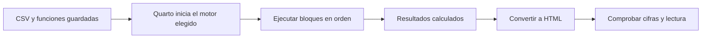

# 11.03 — Ejecución con Python o R

[Inicio](../../../README.md) / [Módulo 11](../README.md) / **Lección 11.03**

| Tu sesión | Qué prepararás o comprobarás |
| --- | --- |
| **Meta** | Ejecutar el cálculo dentro del render con motor y entorno comprobados |
| **Necesitas** | YAML, Markdown, render y funciones; elige Python/Jupyter o R/knitr |
| **Evidencia** | Reporte regenerado al cambiar datos y fallas diagnosticadas |

[Preparación](#antes-de-empezar) · [Material de apoyo](#material-de-apoyo) · [Lab 11.03](../../../labs/11_reporting_quarto/03_execution_python_r/README.md) · [Comprobar](#evidencia-y-criterio-de-salida)

<a id="propósito-y-prerrequisitos"></a>

## Propósito

En [11.02](../02_first_document/README.md) Python o R preparaba cifras como texto
y Quarto las convertía a HTML. Aquí **el render ejecuta el cálculo desde el CSV**.
Cambiar una entrada válida y renderizar de nuevo debe cambiar el resultado sin
editar el total en el documento.

## Antes de empezar

Necesitas reconocer YAML, Markdown y render, tener Quarto disponible y saber
ejecutar funciones en el lenguaje elegido. Elige **Python/Jupyter o R/knitr**:
un recorrido basta para la práctica esencial. Cada uno trae datos y código
completos; no necesita entregas previas. Preparar dependencias no equivale a
necesitar resultados personales de otra lección.

Los recorridos usan HTML local, sin publicación.

## Qué vas a aprender

- Identificar motor, intérprete y biblioteca usados en el render.
- Leer un bloque ejecutable y su resultado.
- Reconstruir las cifras desde archivos guardados.
- Diagnosticar datos, funciones o dependencias faltantes.

## Material de apoyo

| Recurso | Para qué sirve | Uso |
| --- | --- | --- |
| [CSV de la práctica](cartera.csv) | Consultar la entrada completa y conservar el original | Para el recorrido |
| [Preparador py](preparar.py) / [Preparador R](preparar.R) | Crear una copia nueva con las fuentes necesarias | Elige el lenguaje de tu recorrido |
| [Análisis py](analisis.py) / [Análisis R](analisis.R) | Leer reglas y cálculos que ejecuta el documento | Elige el lenguaje de tu recorrido |
| [Reporte python.qmd](reporte_python.qmd) / [Reporte r.qmd](reporte_r.qmd) | Elegir el documento ejecutable del motor | Elige el lenguaje de tu recorrido |

Consulta las fuentes aquí y trabaja en la copia nueva que prepara el recorrido.
Elige el lenguaje indicado para tu práctica; preparar el entorno y renderizar
son pasos distintos. Conserva datos, fuentes y salidas anteriores.

## 1. Editor, Quarto, motor y entorno

| Pieza | Función en este ejemplo |
| --- | --- |
| Editor/IDE | Escribe el `.qmd`; sus objetos interactivos no son entradas del reporte |
| Quarto CLI | Coordina ejecución y conversión a HTML |
| Jupyter y kernel Python | Jupyter gestiona las celdas; el kernel ejecuta Python con un intérprete y sus paquetes |
| knitr y R | knitr ejecuta los bloques R; R usa sus bibliotecas de paquetes |
| Entorno Python o proyecto renv | Conserva las dependencias de la práctica |
| Navegador | Lee el HTML ya producido; no vuelve a ejecutar Python/R |

Que el editor muestre el entorno correcto no demuestra que el proceso lanzado
por Quarto lo use. En Python comprobaremos también `sys.executable` **dentro del
kernel** contra el ejecutable seleccionado. En R comprobaremos que el proyecto
renv activo sea la carpeta del documento y que knitr proceda de su biblioteca.
El HTML muestra versión y comprobación, sin insertar rutas personales completas.



Sin diagrama: Quarto inicia el motor, que lee archivos y ejecuta bloques en
orden; después se convierte el contenido a HTML y se revisa. Ejecutar una celda
suelta ayuda a explorar, pero no demuestra que el documento completo funcione
desde cero. Guarda funciones y entradas, y renderiza todo el archivo.

La [documentación de ejecución](https://quarto.org/docs/computations/execution-options.html#engine-binding)
explica la selección de motor. No mezcles `{python}` y `{r}` en este documento:
esa combinación puede activar knitr y reticulate, fuera del recorrido esencial.

## 2. Primer cálculo completo dentro del documento

Estos tres saldos ficticios corresponden a octubre y están expresados en MXN.
La pregunta es cuánto suman; no hay fechas ni objetos que recuperar de otra sesión.

Versión **Python**, archivo nuevo `minimo_python.qmd`:

````markdown
---
title: "Suma de tres saldos ficticios"
jupyter: python3
format: html
execute:
  daemon: false
  cache: false
  error: false
---

```{python}
saldos = [1200, 1800, 3300]
print(sum(saldos))
```
````

Versión **R**, archivo nuevo `minimo_r.qmd` dentro de tu proyecto renv preparado:

````markdown
---
title: "Suma de tres saldos ficticios"
engine: knitr
format: html
execute:
  cache: false
  error: false
---

```{r}
saldos <- c(1200L, 1800L, 3300L)
print(sum(saldos))
```
````

Después de preparar el entorno según el recorrido siguiente, `quarto render`
debe ejecutar el bloque y mostrar **6300**, además del código. Las llaves hacen
que el bloque sea ejecutable. `cache: false` evita reutilizar resultados de
celdas; `error: false` detiene el render si falla el cálculo. No lo cambies a
`true` para conseguir un documento que aparente éxito. En Python `daemon: false`
desactiva mantener el kernel entre renders. Dentro de un mismo render los
bloques comparten variables y se ejecutan en orden.

Una fuente `.ipynb` tiene otra conducta: Quarto normalmente utiliza sus salidas
guardadas y requiere pedir ejecución para recalcularlas. Aquí usamos `.qmd`;
no confundas ese caso con el de un notebook. Véase
[Using Python](https://quarto.org/docs/computations/python.html#workflow).

Los dos mínimos usan `format: html` sin recursos incorporados para mostrar
solo la estructura esencial. Conserva su carpeta `*_files` si mueves el HTML.
Los reportes completos siguientes sí usan `embed-resources: true`, como en 11.02.

## 3. Datos, reglas y referencia de la comparación

Una persona revisa cómo cambió el saldo de **los mismos tres créditos ficticios**
entre septiembre y octubre de 2026. La muestra propia [cartera.csv](cartera.csv)
contiene todas las observaciones necesarias:

```csv
credito_id,fecha_corte,saldo_mxn
001,2026-09-30,1000
002,2026-09-30,2000
003,2026-09-30,3000
001,2026-10-31,1200
002,2026-10-31,1800
003,2026-10-31,3300
```

Una fila es un crédito en un corte. ID es texto 001/002/003, conservando ceros;
fecha admite exactamente esos dos cortes; saldo es entero entre 0 y 1000000 MXN,
sin ausencias. ID/fecha es clave única y deben existir las seis combinaciones.
Se rechaza todo el lote si no cumple; no se eliminan filas ni se imputan ceros.
El contrato es específico de esta muestra, no un lector de cualquier cartera.

| Crédito | Septiembre (MXN) | Octubre (MXN) | Diferencia (MXN) |
| --- | ---: | ---: | ---: |
| 001 | 1000 | 1200 | 200 |
| 002 | 2000 | 1800 | -200 |
| 003 | 3000 | 3300 | 300 |
| Total | 6000 | 6300 | 300 |

La tasa es `(6300 - 6000) / 6000 × 100 = 5%`, sobre septiembre. El total crece
aunque 002 disminuye: los pares explican qué aporta cada crédito. No se infieren
causas, pagos o desembolsos del mes a partir de saldos. Los seis registros no
representan seis créditos distintos ni acreditan una cartera real completa.

[analisis.py](analisis.py) y [analisis.R](analisis.R) validan y calculan esa
referencia desde archivos. Los pesos se suman exactamente en este contrato:
como máximo tres saldos de un millón por corte. El porcentaje se presenta con
dos decimales; si la base inicial es cero queda no definido. R usa una función
propia, no traduce el modelo de tablas de Python.

## 4. Recorrido Python/Jupyter

### Dependencias y selección

El grupo `notebooks` de [pyproject.toml](../../../pyproject.toml) declara
ipykernel 6.30.1, nbclient 0.10.2, nbformat 5.10.4 y PyYAML 6.0.3. El
[uv.lock](../../../uv.lock) conserva versiones transitivas y requisitos previos.
Son los componentes comprobados para ejecutar esta muestra con Quarto 1.9.38;
no es necesario instalar la interfaz completa JupyterLab ni registrar un kernel
global. La guía oficial presenta una instalación más amplia de Jupyter en
[Using Python](https://quarto.org/docs/computations/python.html).

Sigue **un gestor**, como en [00.05](../../00_getting_started/05_environment/README.md).
Si ya tienes un entorno adecuado, comprueba en él:
`python -c "import sys, ipykernel, nbclient, nbformat, yaml; print(sys.executable)"`.
Con venv/pip instala los cuatro requisitos declarados dentro de tu venv;
con Conda resuélvelos con Conda dentro del entorno del proyecto, no en base.
No ejecutes uv sobre ese mismo entorno. Autoría comprobó el recorrido uv siguiente,
no la resolución de todos los gestores/plataformas.

Este recorrido uv crea un entorno **separado dentro de output**, sin usar la
`.venv` raíz. Necesita red si faltan Python o paquetes. `--locked` exige el
lockfile del proyecto; no pide actualizar versiones. No necesitas activar el
entorno porque invocamos su ejecutable explícitamente.

**PowerShell**, desde la raíz de DS Track, destino nuevo:

```powershell
$quarto1103 = "quarto"
$env:UV_PROJECT_ENVIRONMENT = Join-Path $PWD "output/1103_entorno"
uv sync --locked --group notebooks --python 3.12.12
$python1103 = Join-Path $env:UV_PROJECT_ENVIRONMENT "Scripts/python.exe"
& $python1103 -c "import sys, ipykernel, nbclient, nbformat, yaml; print(sys.executable)"
$env:QUARTO_PYTHON = $python1103
& $python1103 curriculum/11_reporting_quarto/03_execution_python_r/preparar.py output/1103_python
& $quarto1103 render output/1103_python/reporte_python.qmd --to html
```

**Bash/Zsh**, desde la raíz, destino nuevo:

```bash
quarto1103="quarto"
export UV_PROJECT_ENVIRONMENT="$PWD/output/1103_entorno"
uv sync --locked --group notebooks --python 3.12.12
python1103="$UV_PROJECT_ENVIRONMENT/bin/python"
"$python1103" -c "import sys, ipykernel, nbclient, nbformat, yaml; print(sys.executable)"
export QUARTO_PYTHON="$python1103"
"$python1103" curriculum/11_reporting_quarto/03_execution_python_r/preparar.py output/1103_python
"$quarto1103" render output/1103_python/reporte_python.qmd --to html
```

Si Quarto no está en PATH, asigna al inicio su ruta comprobada como en 11.02;
en el equipo de autoría es `C:/Program Files/RStudio/resources/app/bin/quarto/bin/quarto.exe`.
Estas variables afectan la terminal actual y sus hijos; no cambian configuración
global. Para volver al estado anterior, usa otra terminal sin esas asignaciones.

`preparar.py` **copia fuentes**, no calcula ni renderiza. La práctica contiene
CSV, módulo y documento juntos. El primer bloque del `.qmd` importa la función,
comprueba el intérprete del kernel y lee el CSV. El segundo imprime resultados
desde `resultado`, incluida cada diferencia; las cifras no están escritas como
texto fijo en el párrafo. En este documento, las rutas de entrada son relativas
a la carpeta del `.qmd`, no a una carpeta personal.

`QUARTO_PYTHON` selecciona el Python usado por Quarto para Jupyter. Un kernelspec
es la configuración que asocia un nombre de kernel con su ejecutable; uno
personal puede apuntar a otro intérprete. Por eso el documento comprueba también
el ejecutable real. Si no coincide, revisa el kernel/entorno; no retires el control
para ocultar el problema. La selección está documentada en
[Using Python](https://quarto.org/docs/computations/python.html#installation).

## 5. Recorrido R/knitr

El [renv.lock](renv.lock) incorpora knitr **1.52** y rmarkdown **2.32**, con sus
dependencias; conserva idénticos los 50 registros de 10.07 y añade 21. Incluye
el paquete R tinytex como dependencia transitiva, pero **no instala una distribución
TeX** ni exige PDF. La [configuración DESCRIPTION](DESCRIPTION) declara los imports.
Quarto sigue siendo un programa separado: no hace falta instalar el paquete R
`quarto` para utilizar el botón Render o el CLI.

Desde una sesión R con la raíz de DS Track como directorio de trabajo, carga
[preparar.R](preparar.R). Elige una alternativa:

- Si continúas el proyecto renv con los metadatos de 10.07, llama a
  `preparar_ejecucion("ruta/de/tu/proyecto")`, sustituyendo la ruta. Respalda
  DESCRIPTION/lockfile en `respaldo_10_07`, añade los archivos y conserva los
  anteriores. Rechaza personalizaciones o una actualización ya hecha para que
  puedas revisarlas sin sobrescribir. Si conservas otros metadatos, no los fuerces.
- Si necesitas preparar el entorno sin ninguna entrega previa, utiliza el
  recorrido completo siguiente. Crea un proyecto nuevo con configuración renv
  local reutilizada de 06.08 y los requisitos actuales; no inicializa renv en la raíz.

En la **consola R**, desde la raíz del repositorio:

```r
source("curriculum/11_reporting_quarto/03_execution_python_r/preparar.R")
crear_entorno_ejecucion("output/1103_r")
```

La copia no instala paquetes. Abre `output/1103_r/ejecucion_1103.Rproj` en RStudio
o su carpeta en tu IDE. Reinicia R, comprueba `getwd()` y ejecuta en la consola R:

```r
source("restaurar.R")
renv::status()
packageVersion("knitr")
packageVersion("rmarkdown")
```

Restaurar puede descargar paquetes; los instala en la biblioteca **del proyecto**.
El estado debe quedar sincronizado. No uses `renv::init()` en la raíz de DS Track.
Si el ejecutor restringido no puede leer enlaces a paquetes base del sandbox
renv, revisa sus permisos; no desactives comprobaciones para esconder el fallo.

Abre `reporte_1103.qmd`. Reinicia la sesión y pulsa **Render** en RStudio, o usa
el CLI desde la carpeta del proyecto. El render debe cargar sus propios archivos;
no depende de que hayas ejecutado `resultado <- ...` en la consola.

Alternativa en la **terminal del sistema**, situada en la raíz del proyecto R
preparado (no en la raíz del repositorio):

**PowerShell:**

```powershell
$quarto1103 = "quarto"
$env:QUARTO_R = "C:/Program Files/R/R-4.6.1/bin"
& $quarto1103 render reporte_1103.qmd --to html
```

**Bash/Zsh:**

```bash
quarto1103="quarto"
export QUARTO_R="$(dirname "$(command -v Rscript)")"
"$quarto1103" render reporte_1103.qmd --to html
```

En Windows cambia la ruta si tu R está en otro lugar; en Bash comprueba antes
que `command -v Rscript` encuentre el R elegido. `QUARTO_R` contiene el **directorio**
del ejecutable Rscript, mientras `QUARTO_PYTHON` contiene el **archivo** Python.
No copies entre sistemas las rutas del ejemplo. Véase
[Using R](https://quarto.org/docs/computations/r.html#installation).

El `.Rprofile` preparado activa renv al iniciar R desde este proyecto.
El primer bloque comprueba proyecto/biblioteca y carga `R/analisis_1103.R`;
la entrada está en `datos/cartera_1103.csv`. El segundo imprime los cálculos.
No se depende de objetos del IDE, de `.RData` ni de bibliotecas globales.
No se probó el botón del IDE en autoría: sí se ejecutó Quarto desde procesos nuevos.

## 6. Comprobar regeneración y fallos

Abre el HTML generado en tu carpeta de práctica. Debe mostrar la comprobación
del entorno y 6000/6300 MXN, diferencia 300 y 5.00%; revisa los tres pares.
El código visible se conserva para explicar de dónde salen las salidas.

Guarda una copia de esta evidencia. En **la entrada de tu práctica**, cambia
solo 003/octubre de 3300 a 3600 y vuelve a renderizar el mismo `.qmd`, sin volver
a ejecutar el preparador. Ahora debe mostrar 6600 MXN, diferencia 600, 10.00% y
un cambio de +600 para 003. El código fuente del documento sigue siendo el mismo.
Esa es la diferencia observable respecto del flujo de 11.02.

| Problema | Qué revisar |
| --- | --- |
| ImportError o paquete R faltante | Dependencia declarada y disponible en el entorno que realmente ejecuta |
| Archivo no encontrado | Copia completa y rutas relativas a la carpeta correcta |
| `resultado` no existe | Bloque que lo crea guardado y anterior al que lo usa |
| Intérprete/biblioteca no coincide | Selección del kernel, QUARTO_PYTHON/QUARTO_R y proyecto renv activo |
| Clave repetida o fila ausente | Contrato de toda la entrada; no resolver eliminando una fila al azar |
| Sigue abriendo un HTML viejo tras fallar | Revisar salida/estado del comando; un archivo anterior puede seguir en disco |

Renombrar temporalmente la función o la entrada debe producir un fallo, no
un HTML nuevo con una respuesta inventada. Restaura el archivo y renderiza de
nuevo. Caché/freeze se estudiarán en 11.06; aquí no se activan. Un render sin
error tampoco sustituye comprobar cada valor: dos errores pueden compensarse
en el total. Los pares y la referencia independiente permiten detectarlo.

<a id="práctica-criterio-de-salida-y-siguiente-paso"></a>

## Práctica

Realiza el [lab 11.03](../../../labs/11_reporting_quarto/03_execution_python_r/README.md) para
renderizar con un motor y demostrar recálculo, error y recuperación.

Como apoyo para preparar la actividad, consulta [preparar.py](preparar.py) o
[preparar.R](preparar.R) según el lenguaje elegido; sigue las rutas y los pasos
del recorrido completo antes de renderizar o reconstruir.

## Evidencia y criterio de salida

| Conserva | Comprueba | Explica |
| --- | --- | --- |
| Datos, funciones, .qmd y salida | 6000/6300 MXN, +300/5%; cambio a 6600/+600/10% desde el render | Qué motor e intérprete ejecutaron realmente |
| Registro de fallo y recuperación | Entrada/función ausentes producen error; recuperar y renderizar de nuevo | HTML anterior frente a nueva ejecución; preparación de entorno frente a entregas previas |

Puedes avanzar cuando reconstruyas desde archivos guardados, demuestres
el cambio de entrada, expliques qué entorno ejecutó y reconozcas una ejecución
fallida. Un recorrido y HTML local bastan; aquí no se activa caché ni freeze.

Quien aprende realiza la práctica y explica las decisiones; su compañero revisa.
Tu compañero retira temporalmente una función y pide identificar el fallo sin confundir el HTML anterior con uno nuevo.
Guarda evidencia, ayudas y dudas en una nota personal junto a tu práctica.
PROGRESS.md registra desarrollo editorial, no tu expediente de aprendizaje.
El proyecto `05_monthly_report` y sus checkpoints siguen planificados;
las comprobaciones técnicas del material no acreditan haber completado la práctica.

<a id="referencias-primarias-y-alcance-comprobado"></a>

## Referencias

Consultadas el 2026-10-23: [Python y Jupyter](https://quarto.org/docs/computations/python.html),
[R y knitr](https://quarto.org/docs/computations/r.html),
[opciones de ejecución](https://quarto.org/docs/computations/execution-options.html),
[entornos virtuales y renv](https://quarto.org/docs/projects/virtual-environments.html).
Datos y código propios. Autoría: Windows, Quarto 1.9.38/Pandoc 3.8.3,
Python 3.12.12 y R 4.6.1. Las versiones fijadas describen el recorrido comprobado,
no las últimas disponibles. Los comandos Bash/Zsh son apoyo, no certificación
de Linux/macOS. No se acredita revisión visual completa ni accesibilidad del HTML.

## Siguiente paso

Después de la práctica y su comprobación, continúa con
[11.04 — Tablas, figuras y referencias](../04_tables_figures_references/README.md).

[← Módulo 11](../README.md) · [Lab 11.03](../../../labs/11_reporting_quarto/03_execution_python_r/README.md) · [Siguiente →](../04_tables_figures_references/README.md)
