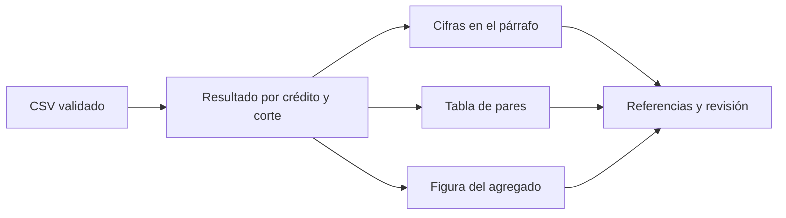

# 11.04 — Tablas, figuras y referencias

[Inicio](../../../README.md) / [Módulo 11](../README.md) / **Lección 11.04**

| Tu sesión | Qué prepararás o comprobarás |
| --- | --- |
| **Meta** | Relacionar texto, tabla y figura con referencias y cifras coherentes |
| **Necesitas** | 11.03; elige Python/Jupyter o R/knitr, sin entregas anteriores |
| **Evidencia** | Tres representaciones actualizadas juntas y referencias resueltas |

[Preparación](#antes-de-empezar) · [Material de apoyo](#material-de-apoyo) · [Lab 11.04](../../../labs/11_reporting_quarto/04_tables_figures_references/README.md) · [Comprobar](#evidencia-y-criterio-de-salida)

<a id="propósito-prerrequisitos-y-objetivos"></a>

## Propósito

Un reporte necesita que quien lo lee pueda localizar la evidencia de cada
afirmación. Aquí crearás una tabla y una figura identificables, las enlazarás
desde el texto y generarás las cifras del párrafo desde los mismos resultados.
Si cambia una entrada, las tres representaciones deben actualizarse juntas.

## Antes de empezar

El prerrequisito conceptual es [11.03 — Ejecución con Python o R](../03_execution_python_r/README.md):
bloques ejecutables, motor, entorno y render desde archivos. Elige Python/Jupyter
o R/knitr. Esta sección incluye datos completos y preparadores: no necesita tus
entregas anteriores. Basta un recorrido para la práctica esencial.

No se incorporan dependencias ni se modifican lockfiles en esta sección.

## Qué vas a aprender

- Distinguir identificador, caption, texto alternativo y referencia cruzada.
- Separar procedencia de datos y cita bibliográfica.
- Generar párrafo, tabla y figura desde los mismos resultados.
- Detectar referencias o citas sin resolver.

## Material de apoyo

| Recurso | Para qué sirve | Uso |
| --- | --- | --- |
| [Ejemplo mínimo](minimo.qmd) | Consultar una tabla y su referencia cruzada | Para el recorrido |
| [CSV de la práctica](cartera.csv) | Consultar la entrada completa y conservar el original | Para el recorrido |
| [Preparador py](preparar.py) / [Preparador R](preparar.R) | Crear una copia nueva con las fuentes necesarias | Elige el lenguaje de tu recorrido |
| [Reporte python.qmd](reporte_python.qmd) / [Reporte r.qmd](reporte_r.qmd) | Generar texto, tabla y figura desde el mismo resultado | Elige el lenguaje de tu recorrido |
| [Bibliografía](referencias.bib) | Resolver la cita técnica y distinguirla de la fuente de datos | Para el recorrido |

Consulta las fuentes aquí y trabaja en la copia nueva que prepara el recorrido.
Elige el lenguaje indicado para tu práctica; preparar el entorno y renderizar
son pasos distintos. Conserva datos, fuentes y salidas anteriores.

## 1. Una tabla pequeña y su referencia

Este ejemplo completo utiliza dos saldos ficticios del **crédito 001**. Solo
demuestra cómo identificar y enlazar una tabla; sus números son texto fijo.
Guárdalo como `minimo.qmd` en una carpeta nueva o copia [minimo.qmd](minimo.qmd):

````markdown
---
title: "Una tabla y su referencia"
lang: es
format: html
---

La @tbl-ejemplo muestra dos saldos ficticios del crédito 001.

| Corte | Saldo (MXN) |
| --- | ---: |
| 2026-09-30 | 1000 |
| 2026-10-31 | 1200 |

: Saldo observado del crédito 001 en dos fechas. {#tbl-ejemplo}

Fuente: ejemplo sintético propio. Una fila representa un crédito en un corte.
Este documento demuestra la sintaxis de referencias; sus cifras son texto fijo.
````

Renderiza con `quarto render minimo.qmd --to html`, como en
[11.02](../02_first_document/README.md). No requiere un motor de cálculo. El
texto debe mostrar una referencia enlazada a la tabla, con el número que Quarto
le asigne. Este mínimo utiliza recursos externos al HTML: conserva `minimo_files`
si mueves su salida. Los reportes completos de abajo incorporan recursos.

`tbl-ejemplo` es el **identificador**, escrito una sola vez al definir la tabla.
`@tbl-ejemplo` es la **referencia** dentro de la narrativa. El texto que empieza
con `:` es el **caption**, el título descriptivo que acompaña la tabla. Si añades
otra tabla antes, Quarto puede cambiar el número sin cambiar el identificador.
Por eso escribimos `@tbl-ejemplo`, no «véase tabla 1» como texto manual.

La sintaxis se desarrolla en [Tables](https://quarto.org/docs/authoring/tables.html)
y [Cross References](https://quarto.org/docs/authoring/cross-references.html).
En los documentos ejecutables usaremos las opciones `label` y `tbl-cap` para
obtener el mismo vínculo con tablas calculadas.

## 2. Qué información aporta cada pieza

| Pieza | Pregunta que responde | Ejemplo |
| --- | --- | --- |
| Tabla | ¿Cuál es el valor de cada caso? | Saldos por crédito y diferencia en MXN |
| Figura | ¿Qué comparación o patrón conviene ver? | Dos barras para el total por corte |
| Identificador | ¿Cómo se localiza este objeto? | `tbl-pares` o `fig-saldo` |
| Caption | ¿Qué muestra y en qué unidad? | Saldo total de los mismos tres créditos por fecha de corte (MXN) |
| Texto alternativo | ¿Qué comunica la imagen si no se ve? | Descripción de las barras y vínculo conceptual con la tabla |
| Referencia cruzada | ¿Dónde está la evidencia que menciona el párrafo? | `@tbl-pares` y `@fig-saldo` |
| Nota de fuente | ¿De dónde salen estos datos? | Elaboración propia con CSV sintético |
| Cita bibliográfica | ¿Qué documento respalda un método o afirmación? | Documentación técnica de Quarto |

Una figura no sustituye siempre a una tabla: las barras agregadas pueden ocultar
movimientos distintos entre créditos. Una tabla con todos los intentos de análisis
tampoco ayuda por sí sola. Elige la evidencia según la pregunta, como en
[08.01 — Pregunta y gramática](../../08_visualization_r/01_question_grammar/README.md).

El texto alternativo no tiene que repetir el caption palabra por palabra. Aquí
describe la estructura de las barras y remite a la tabla de valores exactos.
Es un apoyo a la lectura; añadirlo no certifica accesibilidad completa.

## 3. Muestra completa y resultado esperado

Una persona revisa cómo cambió el saldo total de **los mismos tres créditos**
entre septiembre y octubre de 2026. Esta es toda la fuente propia
[cartera.csv](cartera.csv), independiente de tus entregas anteriores:

```csv
credito_id,fecha_corte,saldo_mxn
001,2026-09-30,1000
002,2026-09-30,2000
003,2026-09-30,3000
001,2026-10-31,1200
002,2026-10-31,1800
003,2026-10-31,3300
```

Una fila representa un crédito en un corte. ID es texto 001/002/003 con ceros
iniciales; fecha admite exactamente esos dos cortes; saldo representa MXN enteros
entre 0 y 1000000, sin ausencias. Deben existir las seis claves ID/fecha, una vez
cada una. Se rechaza la entrada completa si incumple; no se eliminan registros
ni se convierten ausencias en cero. El contrato es deliberadamente pequeño.

| Crédito | Septiembre (MXN) | Octubre (MXN) | Diferencia (MXN) |
| --- | ---: | ---: | ---: |
| 001 | 1000 | 1200 | 200 |
| 002 | 2000 | 1800 | -200 |
| 003 | 3000 | 3300 | 300 |

Los totales son **6000 y 6300 MXN**, diferencia **300** y tasa **5.00%** sobre
septiembre: `(6300 - 6000) / 6000 × 100`. Las dos barras muestran esos totales,
con base cero y etiquetas numéricas. La tabla permite ver que 002 disminuyó:
«todos aumentaron» sería falso aunque el total aumentara.

No se suman ambos cortes como si fueran un solo saldo, ni se infieren pagos,
desembolsos o causas a partir de esta diferencia. Son datos ficticios sin
representatividad acreditada. Si septiembre es cero, la diferencia existe,
pero la tasa queda no definida. Los pesos se conservan enteros; solo la tasa
se presenta con dos decimales.

## 4. Un cálculo y tres formas de comunicarlo

Los preparadores copian las funciones de validación/cálculo de 11.03 junto con
la entrada propia de esta sección. El render vuelve a leer los archivos y crea
un objeto `resultado`. **Texto, tabla y figura utilizan ese mismo objeto**.
Esto reduce divergencias por copiar cifras a mano; no sustituye la comprobación
contra los valores conocidos de la muestra.



Sin diagrama: un cálculo alimenta el párrafo, la tabla y las barras. Las referencias
permiten localizar la evidencia; la revisión confirma que las tres formas dicen
lo mismo. Conservar el mismo total no basta: dos errores individuales pueden
compensarse. Por eso revisamos también cada par por ID.

### Cifras calculadas dentro del párrafo

Después del bloque que calcula `resultado`, Python utiliza expresiones en línea:

````markdown
El saldo pasó de `{python} resultado['septiembre']` MXN
a `{python} resultado['octubre']` MXN.
````

R/knitr utiliza:

````markdown
El saldo pasó de `r resultado$septiembre` MXN
a `r resultado$octubre` MXN.
````

Las expresiones entre acentos graves se ejecutan y se sustituyen por su valor.
Define las variables antes de utilizarlas. No escribas un porcentaje manual
en otra frase: utiliza también la tasa calculada. La documentación de
[Inline Code](https://quarto.org/docs/computations/inline-code.html) explica
estas formas y cómo se tratan sus resultados como texto.

### Tabla calculada con identidad estable

En ambos motores el bloque declara:

```yaml
#| label: tbl-pares
#| tbl-cap: "Saldos por crédito y diferencia entre cortes (MXN)."
```

Son opciones de celda dentro del bloque ejecutable, no otro encabezado YAML
del documento. Python construye una pequeña tabla Markdown desde `pares` y
la muestra con `IPython.display.Markdown`; R utiliza `knitr::kable`. Se mantienen
IDs como texto, encabezados con unidad y diferencias con signo. No hace falta
añadir tabulate ni otro paquete para esta muestra.

Una instrucción como `print(dataframe)` puede mostrar una representación útil
para explorar, pero no garantiza una tabla con caption y referencia correcta.
Abre el HTML y comprueba que realmente haya una tabla identificada, no solo texto
monoespaciado con valores. El texto usa `@tbl-pares` para enlazarla.

### Figura, caption y alternativa textual

El bloque gráfico declara:

```yaml
#| label: fig-saldo
#| fig-cap: "Saldo total de los mismos tres créditos por fecha de corte (MXN)."
#| fig-alt: "Dos barras con base cero y etiquetas numéricas comparan el saldo total de septiembre y octubre. Los valores por crédito se encuentran en la tabla de saldos del reporte."
#| fig-width: 6
#| fig-height: 3.6
```

Python usa Matplotlib; R, ggplot2. Las alturas y las etiquetas salen de los mismos
totales. La base cero permite comparar longitudes de barras; no se recorta el eje
para exagerar el cambio. `fig-width` y `fig-height` indican tamaño en pulgadas,
no número de observaciones. En Python también se fija el lienzo Matplotlib con
`figsize=(6, 3.6)`; si cambias su tamaño, conserva la misma proporción en ambos
lugares. La fuente se escribe como nota debajo de la figura.
La referencia en el texto es `@fig-saldo`. Consulta
[Figures](https://quarto.org/docs/authoring/figures.html) para estas opciones.

Usa identificadores únicos, sin espacios y con prefijos `tbl-` para tablas y
`fig-` para figuras. El prefijo determina el tipo de referencia. Cambiar el título
descriptivo no exige cambiar el identificador; si cambias este último debes
actualizar cada referencia. La posición en el documento determina su numeración.

## 5. Preparar y renderizar — elige un recorrido

No hay paquetes nuevos. Python reutiliza el entorno y grupo notebooks de 11.03,
con Matplotlib **3.10.7** ya declarado. R conserva su proyecto renv, knitr **1.52**
y ggplot2 **4.0.3**, sin cambiar DESCRIPTION ni lockfile. Quarto **1.9.38** y
Pandoc **3.8.3** son los comprobados en autoría.

### Python/Jupyter

Si todavía necesitas crear un entorno, sigue la
[preparación Python de 11.03](../03_execution_python_r/README.md#4-recorrido-pythonjupyter).
Eso prepara herramientas; no necesitas realizar su lab. Con ese entorno ya
disponible, desde la raíz de DS Track y con destino de práctica nuevo:

**PowerShell:**

```powershell
$quarto1104 = "quarto"
$env:QUARTO_PYTHON = (Resolve-Path "output/1103_entorno/Scripts/python.exe").Path
& $env:QUARTO_PYTHON curriculum/11_reporting_quarto/04_tables_figures_references/preparar.py output/1104_python
& $quarto1104 render output/1104_python/reporte_python.qmd --to html
```

**Bash/Zsh:**

```bash
quarto1104="quarto"
export QUARTO_PYTHON="$PWD/output/1103_entorno/bin/python"
"$QUARTO_PYTHON" curriculum/11_reporting_quarto/04_tables_figures_references/preparar.py output/1104_python
"$quarto1104" render output/1104_python/reporte_python.qmd --to html
```

Sustituye el ejecutable por el de tu entorno real si usas otro gestor/localización,
sin mezclar gestores. Si Quarto no está en PATH, asigna su ruta completa a la
variable, como en 11.02. Estas asignaciones afectan la terminal actual, no la
configuración global. El preparador copia cuatro archivos y rechaza destinos
existentes; conserva tu evidencia y elige otro nombre al repetir la preparación.

### R/knitr

Desde la raíz del repositorio, en la consola R, carga el preparador y apunta
al proyecto renv de 11.03. Sustituye la ruta si tu proyecto tiene otro nombre:

```r
source("curriculum/11_reporting_quarto/04_tables_figures_references/preparar.R")
preparar_evidencia("output/1103_r")
```

Si no tienes ese entorno, puedes crear uno sin entregas previas:

```r
source("curriculum/11_reporting_quarto/03_execution_python_r/preparar.R")
crear_entorno_ejecucion("output/1104_r")
source("curriculum/11_reporting_quarto/04_tables_figures_references/preparar.R")
preparar_evidencia("output/1104_r")
```

Abre el `.Rproj` de la carpeta preparada en RStudio o su carpeta en tu IDE.
Reinicia R; si el entorno es nuevo, ejecuta `source("restaurar.R")` en la consola R
para instalar las versiones registradas **localmente**. Si ya está sincronizado,
no hay que reinstalar por pasar de lección. Comprueba `renv::status()`.

Abre `reporte_1104.qmd` y pulsa Render en RStudio. El preparador añade solo CSV,
función, documento y bibliografía con nombres propios de 11.04; conserva archivos
previos y metadatos. Si detecta destinos ocupados o metadatos personalizados,
se detiene para que los revises. No se promete copia atómica tras un fallo de escritura.

Como comprobación por CLI, desde la **carpeta del proyecto R**, en la terminal
del sistema (distinta de la consola R):

**PowerShell:**

```powershell
$quarto1104 = "quarto"
$env:QUARTO_R = "C:/Program Files/R/R-4.6.1/bin"
& $quarto1104 render reporte_1104.qmd --to html
```

**Bash/Zsh:**

```bash
quarto1104="quarto"
export QUARTO_R="$(dirname "$(command -v Rscript)")"
"$quarto1104" render reporte_1104.qmd --to html
```

Usa la ubicación real del R elegido; comprueba que `command -v Rscript` encuentre
ese R antes de usar el bloque Bash. Quarto y la selección de intérprete se explican
en 11.03. Autoría comprobó procesos nuevos en Windows, no el botón del IDE.

## 6. Código visible y resultados visibles

Los documentos completos utilizan `execute: echo: false`: el código se ejecuta,
pero no se muestra al lector. El bloque de preparación tiene `include: false`,
que oculta también sus resultados impresos; **no evita ejecutarlo**. La tabla
y la figura siguen visibles porque sus bloques no usan esa opción.

Para estudiar, cambia `echo: true` en una copia y renderiza. Deberían aparecer
las instrucciones junto a la misma evidencia. No uses `eval: false` para ocultar
código: esa opción evita ejecutar y puede dejar objetos sin crear. No actives
`error: true` para esconder un fallo. Las opciones se documentan en
[Execution Options](https://quarto.org/docs/computations/execution-options.html).

## 7. Referencias cruzadas, fuente de datos y bibliografía

Los reportes incluyen una cita breve a la documentación de Quarto para explicar
el procedimiento de referencias. [referencias.bib](referencias.bib) registra una
entrada con clave `quarto-referencias`, autor institucional, título, URL y fecha
de consulta. No inventa una fecha de publicación de una página sin fecha indicada.

El encabezado del documento declara `bibliography: referencias.bib` (en la
copia R, `referencias_1104.bib`). La expresión `[@quarto-referencias]` inserta la
cita y el bloque `::: {#refs}` sitúa la bibliografía. Quarto utiliza el procesador
bibliográfico incluido en Pandoc; no se descarga un estilo CSL para esta práctica.
Consulta [Citations](https://quarto.org/docs/authoring/citations.html).

`@tbl-pares` apunta a evidencia **dentro** del reporte; `[@quarto-referencias]`
apunta a un documento en la bibliografía. Ninguno sustituye una nota de procedencia
de los datos. La documentación explica la técnica de presentación; no proporciona
los saldos sintéticos ni demuestra las conclusiones sobre ellos. Para este caso,
la fuente de datos es elaboración propia con el CSV entregado.

Un identificador mal escrito o una clave bibliográfica inexistente puede generar
una advertencia y aun así dejar HTML. Por tanto, `error: false` y salida exitosa
del comando no garantizan referencias completas. Revisa el registro de render,
los enlaces y la bibliografía; no dejes marcadores sin resolver ni números manuales.

## 8. Revisar el resultado completo

Abre el HTML desde el explorador, fuera de preview:

- El párrafo indica 6000/6300 MXN, diferencia 300 y 5.00% sobre septiembre.
- La tabla conserva 001/002/003 y los cambios +200/-200/+300.
- La figura presenta dos barras con base cero, etiquetas 6000/6300 y ejes claros.
- Los vínculos de tabla/figura llegan al objeto correcto; sus títulos indican
  unidad y población. La bibliografía resuelve la cita técnica.
- Las notas de fuente distinguen datos sintéticos de documentación. El texto
  alternativo complementa la tabla sin prometer una certificación de accesibilidad.

En una copia del CSV de práctica cambia solo 003/octubre a 3600 y renderiza el
mismo `.qmd`. Deben actualizarse **juntos** párrafo, fila de 003 y segunda barra:
6600 MXN, diferencia 600 y 10.00%; el par 003 cambia a +600. Ninguna cifra requiere
edición manual en el texto, la tabla o el caption.

Conserva datos, funciones, `.qmd` y `.bib` para reconstruir. El HTML completo
incorpora su imagen y recursos de presentación; eso permite leer la evidencia,
pero no incluye automáticamente todos los fuentes para repetir los cálculos.

<a id="práctica-criterio-de-salida-y-siguiente-paso"></a>

## Práctica

Realiza el [lab 11.04](../../../labs/11_reporting_quarto/04_tables_figures_references/README.md) para
rastrear cada cifra y comprobar que texto, tabla y figura se actualizan juntos.

Como apoyo para preparar la actividad, consulta [preparar.py](preparar.py) o
[preparar.R](preparar.R) según el lenguaje elegido; sigue las rutas y los pasos
del recorrido completo antes de renderizar o reconstruir.

## Evidencia y criterio de salida

| Conserva | Comprueba | Explica |
| --- | --- | --- |
| Fuentes, bibliografía y HTML | 6000/6300 MXN; cambios por crédito +200/-200/+300; barras y texto coherentes | Referencia a evidencia frente a cita bibliográfica y procedencia |
| Cambio de entrada y revisión | Octubre 6600, +600/10% y fila de 003 actualizados juntos | Caption, alternativa textual y enlaces resueltos; límites de la revisión automática |

Puedes avanzar cuando rastrees cada cifra, expliques qué aporta cada
representación y distingas una referencia a evidencia de una cita bibliográfica.
Comprueba destinos y advertencias además del éxito del render.

Quien aprende realiza la práctica y explica las decisiones; su compañero revisa.
Tu compañero renumera una figura y pide comprobar que el texto sigue apuntando al objeto correcto.
Guarda evidencia, ayudas y dudas en una nota personal junto a tu práctica.
PROGRESS.md registra desarrollo editorial, no tu expediente de aprendizaje.
El proyecto `05_monthly_report` y sus checkpoints siguen planificados;
las comprobaciones técnicas del material no acreditan haber completado la práctica.

<a id="referencias-primarias-y-alcance"></a>

## Referencias

Consultadas el 2026-10-23: [tablas](https://quarto.org/docs/authoring/tables.html),
[figuras](https://quarto.org/docs/authoring/figures.html),
[referencias cruzadas](https://quarto.org/docs/authoring/cross-references.html),
[código en línea](https://quarto.org/docs/computations/inline-code.html),
[citas y bibliografía](https://quarto.org/docs/authoring/citations.html).
Datos y narrativa propios; versiones de autoría fijadas, sin afirmar que sean
las más recientes. Revisión de figuras y contenido HTML no equivale a certificar
toda la interfaz del IDE, otros sistemas operativos o accesibilidad completa.

## Siguiente paso

Después de la práctica y su comprobación, continúa con
[11.05 — Parámetros y cortes](../05_parameters_cutoffs/README.md).

[← Módulo 11](../README.md) · [Lab 11.04](../../../labs/11_reporting_quarto/04_tables_figures_references/README.md) · [Siguiente →](../05_parameters_cutoffs/README.md)
