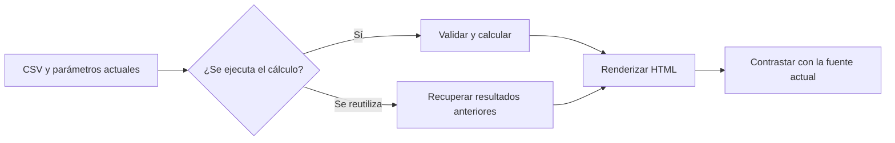

# 11.06 — Proyectos, caché y freeze

[Inicio](../../../README.md) / [Módulo 11](../README.md) / **Lección 11.06**

| Tu sesión | Qué prepararás o comprobarás |
| --- | --- |
| **Meta** | Detectar resultados reutilizados y recuperar un reporte actualizado |
| **Necesitas** | 11.03 y 11.05; un motor, datos y preparadores incluidos |
| **Evidencia** | Experimentos separados de caché/freeze con contraste contra entradas actuales |

[Preparación](#antes-de-empezar) · [Material de apoyo](#material-de-apoyo) · [Lab 11.06](../../../labs/11_reporting_quarto/06_projects_cache_freeze/README.md) · [Comprobar](#evidencia-y-criterio-de-salida)

<a id="propósito-prerrequisitos-y-objetivos"></a>

## Propósito

Organizar un reporte en un proyecto y comprobar cuándo se vuelven a calcular
sus resultados. Un HTML puede generarse sin errores y conservar cifras de una
entrada anterior: aprenderás a detectar esa situación y recuperar un resultado
actualizado sin editar las cifras a mano.

## Antes de empezar

Lee [11.03 — Ejecución](../03_execution_python_r/README.md) y
[11.05 — Parámetros](../05_parameters_cutoffs/README.md). Elige Python/Jupyter
o R/knitr; un motor basta. Hay datos completos propios y preparadores que
reutilizan las funciones de 11.05, sin exigir entregas personales anteriores.

Esta práctica no construye el portal ni el proyecto integrador `05_monthly_report`.

## Qué vas a aprender

- Reconocer la raíz del proyecto Quarto y controlar las rutas.
- Distinguir caché y freeze de una nueva ejecución.
- Contrastar HTML con entradas actuales.
- Justificar el recálculo al cambiar datos, código o parámetros.

## Material de apoyo

| Recurso | Para qué sirve | Uso |
| --- | --- | --- |
| [CSV de la práctica](cartera.csv) | Consultar la entrada completa y conservar el original | Para el recorrido |
| [Preparador py](preparar.py) / [Preparador R](preparar.R) | Crear una copia nueva con las fuentes necesarias | Elige el lenguaje de tu recorrido |
| [Proyecto Quarto](_quarto.yml) | Consultar raíz, rutas y configuración de ejecución | Para el recorrido |
| [Reporte python.qmd](reporte_python.qmd) / [Reporte r.qmd](reporte_r.qmd) | Consultar el documento de cada motor | Elige el lenguaje de tu recorrido |
| [Parámetros](octubre.yml) | Cambiar el corte de manera explícita | Para el recorrido |
| [Verificador](verificar.py) | Contrastar HTML y resultados con los archivos actuales | Para el recorrido |

Consulta las fuentes aquí y trabaja en la copia nueva que prepara el recorrido.
Elige el lenguaje indicado para tu práctica; preparar el entorno y renderizar
son pasos distintos. Conserva datos, fuentes y salidas anteriores.

## 1. Cuatro acciones diferentes

| Acción | Qué sucede | Qué debes comprobar |
| --- | --- | --- |
| Abrir el HTML | Lees un archivo ya generado | Su contenido puede ser anterior al CSV actual |
| Renderizar | Quarto prepara la salida | Puede reutilizar cálculos según las opciones |
| Reutilizar resultados | Recupera salidas guardadas | Que sigan correspondiendo a entradas, reglas y parámetros |
| Recalcular | El motor vuelve a ejecutar el código | Que la ejecución haya leído las entradas correctas |

Primero trabajaremos sin reutilización; después activaremos **una estrategia
por vez**. Así podremos atribuir lo observado a una opción concreta.



Sin renderizador, lee el flujo así: el HTML puede recibir un cálculo nuevo o
uno recuperado; ambos caminos necesitan contraste con la fuente actual.

## 2. Un proyecto pequeño y completo

Un proyecto Quarto es una carpeta con `_quarto.yml`: allí se comparten opciones
para uno o varios documentos. No es un entorno Python ni una biblioteca renv.
Un proyecto puede tener un solo reporte y no necesita ser un sitio web.

Antes de trabajar con la cartera, prueba este mínimo en una carpeta nueva,
dentro del entorno del motor elegido. Guarda `_quarto.yml`:

```yaml
project:
  type: default
  render:
    - informe.qmd
format: html
execute:
  cache: false
  freeze: false
```

Guarda **una** de las dos versiones de `informe.qmd`:

Python:

````markdown
---
title: "Una suma calculada"
jupyter: python3
execute:
  daemon: false
---

```{python}
saldos = [1000, 2500]
print(sum(saldos))
```
````

R, dentro del proyecto renv preparado:

````markdown
---
title: "Una suma calculada"
engine: knitr
---

```{r}
saldos <- c(1000, 2500)
print(sum(saldos))
```
````

En la **terminal del sistema**, desde esa carpeta, ejecuta `quarto render`:
debe aparecer 3500. Cambia 2500 por 3000 y repite: debe aparecer 4000.
Abrir el primer HTML sin renderizar no produce ese cambio.

El documento puede definir opciones propias que prevalecen sobre las compartidas.
Al investigar una salida inesperada, revisa tanto `_quarto.yml` como su encabezado.

## 3. Datos y reglas de esta práctica

Cada fila es el saldo de un crédito ficticio en una fecha exacta. El CSV propio
contiene las siete observaciones siguientes; no se suman cortes entre sí:

| credito_id | fecha_corte | saldo_mxn |
| --- | --- | ---: |
| 001 | 2026-09-30 | 1000 |
| 002 | 2026-09-30 | 2000 |
| 003 | 2026-09-30 | 3000 |
| 001 | 2026-10-31 | 1200 |
| 002 | 2026-10-31 | 1800 |
| 003 | 2026-10-31 | 3300 |
| 004 | 2026-10-31 | 700 |

La función valida el lote completo antes de filtrar: columnas, siete claves
previstas sin repeticiones y saldos enteros entre 0 y 1000000 MXN. Se conservan
IDs textuales. La fecha debe ser texto ISO válido de 1900–2100 y estar disponible;
el mínimo es numérico entero en el mismo intervalo de saldos. Un corte ausente
es error; una selección sin coincidencias es válida.

Pregunta: ¿qué créditos del corte tienen saldo **mayor o igual al mínimo**?

| Escenario | Universo | Selección con mínimo 2000 |
| --- | --- | --- |
| Septiembre original | 3 créditos / 6000 MXN | 002 y 003; 2 / 5000 MXN |
| Octubre original | 4 créditos / 7000 MXN | 003; 1 / 3300 MXN |
| Septiembre con 003 = 3600 | 3 créditos / 6600 MXN | 002 y 003; 2 / 5600 MXN |

El reporte muestra la tabla completa del corte y si cada crédito cumple.
La cobertura por número es 66.67% en septiembre y 25.00% en octubre.
Los criterios y denominadores vienen de 11.05; no cambiamos la regla de negocio
para obtener una cifra deseada.

## 4. Carpetas y rutas: proyecto no significa entorno

El preparador Python produce:

```text
proyecto/
  _quarto.yml
  octubre.yml
  datos/cartera.csv
  funciones/analisis.py
  informes/reporte_1106.qmd
  output/                  # Se crea al ejecutar
```

En R se añaden al proyecto renv `datos/cartera_1106.csv`, `R/analisis_1106.R`,
`informes/reporte_1106.qmd`, `_quarto.yml` y `octubre_1106.yml`. Los archivos
de secciones anteriores y sus metadatos se conservan. Si ya existe `_quarto.yml`,
el preparador se detiene: hay que revisar esa configuración antes de combinarla.

La configuración incluida declara:

```yaml
project:
  type: default
  render:
    - informes/reporte_1106.qmd
  output-dir: output/1106_html
  execute-dir: project
```

`render` selecciona el documento del render global. `output-dir` ubica los HTML;
no cambia automáticamente dónde busca archivos tu código. `execute-dir: project`
hace que las rutas del cálculo partan de la raíz del proyecto aunque el `.qmd`
esté en `informes/`. Por defecto, Quarto trabaja desde la carpeta del documento.

Por eso Python lee `datos/cartera.csv` y R lee `datos/cartera_1106.csv`.
Los reportes comprueban la raíz mediante `QUARTO_PROJECT_DIR`. No uses rutas
personales ni intentes que `setwd()` o un cambio accidental de directorio oculten
el problema. En esta práctica los comandos de render se lanzan desde la raíz.

## 5. Preparación Python/Jupyter

Usa el entorno elegido en [00.05](../../00_getting_started/05_environment/README.md).
La caché Jupyter necesita **jupyter-cache 1.0.1**, añadido al grupo `notebooks`
de la configuración raíz; tener Jupyter o Papermill no lo sustituye. No agregues
paquetes con pip a un entorno administrado por uv.

Recorrido completo **PowerShell**, desde la raíz de DS Track:

```powershell
$quarto1106 = "quarto"
$env:UV_PROJECT_ENVIRONMENT = Join-Path $PWD "output/1106_entorno"
uv sync --locked --group notebooks --python 3.12.12
$env:QUARTO_PYTHON = Join-Path $env:UV_PROJECT_ENVIRONMENT "Scripts/python.exe"
& $env:QUARTO_PYTHON -c "import sys, importlib.metadata; print(sys.executable); print(importlib.metadata.version('jupyter-cache'))"
& $env:QUARTO_PYTHON curriculum/11_reporting_quarto/06_projects_cache_freeze/preparar.py output/1106_python
Push-Location output/1106_python
& $quarto1106 render
Pop-Location
```

Recorrido completo **Bash/Zsh**, desde la raíz:

```bash
quarto1106="quarto"
export UV_PROJECT_ENVIRONMENT="$PWD/output/1106_entorno"
uv sync --locked --group notebooks --python 3.12.12
export QUARTO_PYTHON="$UV_PROJECT_ENVIRONMENT/bin/python"
"$QUARTO_PYTHON" -c "import sys, importlib.metadata; print(sys.executable); print(importlib.metadata.version('jupyter-cache'))"
"$QUARTO_PYTHON" curriculum/11_reporting_quarto/06_projects_cache_freeze/preparar.py output/1106_python
raiz1106="$PWD"
cd output/1106_python
"$quarto1106" render
cd "$raiz1106"
```

Si ya tienes un entorno local adecuado, reutilízalo y asigna `QUARTO_PYTHON`
a su ejecutable; no necesitas crear otro. Para Conda/venv prepara las dependencias
del grupo con tu gestor, comprueba la versión y continúa desde el preparador.
Autoría comprueba uv; no acredita resolución con todos los gestores.

Si Quarto no está en PATH, asigna su ruta real a la variable. Autoría usa
`C:/Program Files/RStudio/resources/app/bin/quarto/bin/quarto.exe` en Windows.
Las variables anteriores solo afectan esta terminal y sus procesos hijos.
La sincronización puede requerir descargas. El preparador rechaza un destino
existente: para retomar abre tu copia; no la prepares encima otra vez.

## 6. Preparación R/knitr

Desde la raíz de DS Track, en la **consola R**, añade el material al proyecto
renv adecuado que ya tengas de 11.03:

```r
source("curriculum/11_reporting_quarto/06_projects_cache_freeze/preparar.R")
preparar_proyecto_quarto("output/1103_r")
```

Alternativa sin entregas previas, también en consola R desde la raíz:

```r
source("curriculum/11_reporting_quarto/03_execution_python_r/preparar.R")
crear_entorno_ejecucion("output/1106_r")
source("curriculum/11_reporting_quarto/06_projects_cache_freeze/preparar.R")
preparar_proyecto_quarto("output/1106_r")
```

Abre el `.Rproj` de esa carpeta en RStudio o tu IDE y reinicia R. En un proyecto
nuevo ejecuta `source("restaurar.R")` en la consola R; comprueba `renv::status()`.
No hace falta instalar paquetes nuevos: knitr y rmarkdown ya están fijados.
Si la biblioteca existente es adecuada, conserva sus paquetes. No inicialices
renv en la raíz de DS Track. La restauración de una biblioteca nueva sí puede
necesitar Internet; los preparadores solo copian archivos.

Abre `_quarto.yml` y `informes/reporte_1106.qmd` en el editor. Inspecciona las
rutas y `params`. Para distinguir render global e individual utilizaremos la
**terminal del sistema** situada en la carpeta del proyecto R:

**PowerShell:**

```powershell
$quarto1106 = "quarto"
$env:QUARTO_R = "C:/Program Files/R/R-4.6.1/bin"
& $quarto1106 render
```

**Bash/Zsh:**

```bash
quarto1106="quarto"
export QUARTO_R="$(dirname "$(command -v Rscript)")"
"$quarto1106" render
```

Sustituye la ruta R por la de tu equipo; en Bash comprueba antes el `Rscript`
elegido. Abrir el proyecto en el IDE no configura automáticamente otra terminal.
El reporte exige la biblioteca renv local. El render inicia su proceso: no
depende de objetos que hayas creado en la consola. Autoría verifica CLI en
procesos nuevos; no se acredita el botón Render ni la interfaz de RStudio.

## 7. Primera ejecución sin reutilización

La configuración inicial tiene `cache: false` y `freeze: false`. Abre:

```text
output/1106_html/informes/reporte_1106.html
```

Dentro de tu proyecto, confirma septiembre, mínimo 2000, universo 6000 y selección
5000. Revisa cada fila. El bloque también imprime `EVIDENCIA_1106`, revisión 1
y un identificador de ejecución. Cada cálculo añade ese identificador a
`output/ejecuciones_1106.log`.

Repite `quarto render`: las cifras son iguales, pero cambia el identificador y
crece la bitácora. Se volvió a calcular el mismo resultado. Este efecto lateral
es intencional para observar la ejecución; no es una estrategia general de
exportación ni una prueba de autenticidad. No edites la bitácora para simularla.

Antes de cada experimento guarda una copia del HTML con otro nombre fuera de
la carpeta de salida; el render puede reemplazarlo. Anota configuración, comando,
valores visibles, identificador y número de líneas de la bitácora.

## 8. Experimento de freeze: render global frente a documento

En `_quarto.yml`, dentro de `execute`, cambia solo:

```yaml
  freeze: auto
  cache: false
```

1. Ejecuta `quarto render` y conserva su evidencia.
2. Repite el comando sin modificar nada. Observa el identificador y la bitácora.
3. En **tu copia** del CSV cambia solo `003,2026-09-30,3000` por
   `003,2026-09-30,3600`. No edites las fuentes del curso ni la fila de octubre.
4. Repite el render global y contrasta el HTML con las siete filas actuales.

En autoría el HTML conserva 6000/5000 y el identificador anterior: el CSV cambió,
pero el `.qmd` no. La salida reutilizada se guarda en `_freeze/`.

Para recuperar el cálculo, en la raíz del proyecto ejecuta el documento explícito:

```text
quarto render informes/reporte_1106.qmd --cache-refresh
```

Ahora deben aparecer 6600/5600 y un identificador nuevo. El render individual
evita la reutilización de freeze; `--cache-refresh` atiende además una caché que
pudiera estar activa. **`quarto render --cache-refresh` global no basta para
invalidar freeze**: en los dos motores de autoría conservó la salida congelada.

Con `freeze: auto`, cambia en el bloque del `.qmd` `revision = 1` por
`revision = 2` (Python), o `revision <- 1` por `revision <- 2` (R). El siguiente
render global sí observa el cambio del documento. No cambia el saldo: cambia
el identificador y aparece revisión 2. Si se modifica un archivo de funciones
externo, la ruta explícita anterior sigue siendo necesaria para asegurar recálculo.

`freeze: true` permite conservar resultados incluso si cambia el documento
durante un render global. Es ampliación para comparar con `auto`, no una garantía
de frescura. El `.qmd` individual sigue permitiendo actualizarlo.

## 9. Experimento de caché: probarlo en otra copia

Para no mezclar salidas de freeze y caché, prepara **otra carpeta** con los
preparadores anteriores; en R puede ser otro proyecto renv con la misma
configuración. No necesitas otra versión de paquetes. No copies `_freeze/`,
`.jupyter_cache/` ni directorios de caché del experimento anterior.

Desde esa carpeta, configura:

```yaml
execute:
  freeze: false
  cache: true
  error: false
  echo: false
  daemon: false
```

Conserva el bloque `project` y el formato del archivo original. Luego:

1. Ejecuta `quarto render informes/reporte_1106.qmd --cache-refresh`.
2. Repite sin `--cache-refresh`: cifras e identificador se conservan y la
   bitácora no crece. El motor reutilizó el cálculo.
3. Cambia el saldo de septiembre de 003 a 3600 en la copia del CSV.
4. Renderiza el documento sin refrescar: autoría observó las cifras antiguas.
5. Añade `--cache-refresh`: deben aparecer 6600/5600 y nueva ejecución.

La caché Jupyter trata las celdas de código del documento como unidad; knitr
puede cachear bloques separados. Aquí el cálculo R está en un solo bloque para
observar la diferencia sin introducir dependencias entre múltiples bloques.
Una modificación de código puede invalidar una entrada, pero volver a código
ya utilizado puede recuperar otra entrada anterior. CSV y funciones externas
no quedan vigilados automáticamente por escribir su ruta en una celda.

Por eso la política de esta práctica es **refrescar explícitamente al cambiar
datos, funciones o parámetros** y comprobar valores, aunque el motor pueda
detectar algunos cambios por sí mismo. No atribuyas el mismo comportamiento
de invalidación de parámetros a Jupyter y knitr.

Para cambiar a octubre desde la raíz del proyecto:

Python:

```text
quarto render informes/reporte_1106.qmd --execute-params octubre.yml --cache-refresh
```

R:

```text
quarto render informes/reporte_1106.qmd --execute-params octubre_1106.yml --cache-refresh
```

Ambos deben mostrar 7000/3300 y 003, aunque hayas cambiado septiembre. Los comandos
anteriores son iguales en PowerShell y Bash/Zsh cuando `quarto` está en PATH;
si usaste una ruta explícita, invócala con la sintaxis del recorrido de tu shell.

La caché no promete restaurar archivos escritos como efecto lateral. Si borras
una exportación mientras conservas el cálculo cacheado, su existencia puede
no recuperarse. La bitácora de esta lección solo crece al ejecutar el bloque.

## 10. Comprobar contra los archivos actuales

Desde la raíz de DS Track, con Python del entorno elegido, ejecuta el verificador
estándar. No necesita ejecutar R ni renderiza ni escribe archivos:

**PowerShell**, proyecto Python de la primera preparación:

```powershell
& $env:QUARTO_PYTHON curriculum/11_reporting_quarto/06_projects_cache_freeze/verificar.py output/1106_python --motor python
```

**Bash/Zsh:**

```bash
"$QUARTO_PYTHON" curriculum/11_reporting_quarto/06_projects_cache_freeze/verificar.py output/1106_python --motor python
```

Para una copia R usa el mismo script con la ruta de esa copia y `--motor r`.
Si estudias solo R, puedes usar un Python estándar ya disponible; como alternativa
esencial contrasta manualmente la tabla y sumas con la sección 3, y explica las
diferencias. No se exige instalar un segundo motor de reporte.

Después de renderizar octubre añade `--fecha 2026-10-31`; el mínimo se pasa con
`--minimo 2000`. El verificador valida la fuente completa y compara fecha,
mínimo, conteos, saldos y **cada celda de la tabla** con el CSV actual. Así puede
rechazar un cambio compensado, aunque la suma total siga siendo idéntica.
No verifica las fechas históricas de ejecución ni certifica el contenido editorial.

Durante el experimento de datos antiguos es correcto que falle. Conserva el
mensaje y repite después del recálculo: ahora debe pasar. Si el render falla,
un HTML anterior puede seguir existiendo; no lo atribuyas al intento fallido.

## 11. Política de conservación y errores habituales

| Situación | Acción |
| --- | --- |
| Cambia CSV o función externa | Render individual con refresco y contraste completo |
| Cambia parámetro | Mostrar valor efectivo, refrescar y verificar ese corte |
| Solo cambias texto | Puedes reutilizar cálculos, si las entradas siguen vigentes |
| Falla una validación | Corregir fuente en la copia; no habilitar `error: true` para entregar |
| Falta jupyter-cache | Revisar Python real y grupo notebooks actualizado |
| La ruta de datos falla | Revisar raíz, `execute-dir` y entorno; no inventar una ruta personal |
| renv no resuelve paquetes base en un ejecutor restringido | Revisar permisos de lectura de sus enlaces antes de culpar al lockfile |

Conserva CSV, funciones, `.qmd`, configuración, parámetros, registro del comando
y HTML de evidencia. `_freeze/` guarda resultados computados; `.quarto/` es
estado auxiliar; otras cachés pertenecen al motor. No son sustitutos de fuentes,
dependencias ni comprobaciones. Todo se genera en copias de práctica fuera de Git;
no añadas estas salidas al repositorio del curso. No borres carpetas para ocultar
el problema: el render explícito con refresco permite observar la recuperación.

No se miden tiempos ni se demuestra una mejora de rendimiento. Estos reportes
pequeños sirven para estudiar vigencia de resultados, no para justificar caché
por ahorro medido.

<a id="práctica-criterio-de-salida-y-siguiente-paso"></a>

## Práctica

Realiza el [lab 11.06](../../../labs/11_reporting_quarto/06_projects_cache_freeze/README.md) para
mostrar una reutilización deliberada y su recuperación en copias separadas.

Como apoyo para preparar la actividad, consulta [preparar.py](preparar.py) o
[preparar.R](preparar.R) según el lenguaje elegido; sigue las rutas y los pasos
del recorrido completo antes de renderizar o reconstruir.

## Evidencia y criterio de salida

| Conserva | Comprueba | Explica |
| --- | --- | --- |
| Proyecto, fuentes, parámetros y salidas | Entrada actual frente a resultado guardado; rutas y execute-dir | Proyecto frente a entorno; render global frente a documento |
| Experimentos y registro de recuperación | Cambios de datos, código y parámetros contrastados tras ejecución explícita | Cifras iguales frente a ejecución nueva; caché/freeze no sustituyen fuentes ni validación |

Puedes avanzar cuando demuestres un resultado reutilizado y su recuperación,
expliques las rutas y distingas igualdad de cifras de nueva ejecución. Esta
práctica estudia vigencia de resultados; no mide ahorro de tiempo.

Quien aprende realiza la práctica y explica las decisiones; su compañero revisa.
Tu compañero cambia solo el CSV y pide demostrar si se recalculó o se reutilizó un resultado.
Guarda evidencia, ayudas y dudas en una nota personal junto a tu práctica.
PROGRESS.md registra desarrollo editorial, no tu expediente de aprendizaje.
El proyecto `05_monthly_report` y sus checkpoints siguen planificados;
las comprobaciones técnicas del material no acreditan haber completado la práctica.

<a id="referencias-primarias-y-alcance"></a>

## Referencias

Consultadas el 2026-10-26: [proyectos Quarto](https://quarto.org/docs/projects/quarto-projects.html),
[gestión de ejecución](https://quarto.org/docs/projects/code-execution.html),
[caché por motor](https://quarto.org/docs/computations/caching.html) y
[Jupyter Cache](https://jupyter-cache.readthedocs.io/).
Ejemplos y experimentos propios. Autoría: Quarto 1.9.38, Python 3.12.12,
jupyter-cache 1.0.1 y R 4.6.1/knitr 1.52. Recorridos Bash/Zsh de apoyo;
comprobaciones reales en Windows, sin acreditar otros sistemas ni revisión del IDE.

## Siguiente paso

Después de la práctica y su comprobación, continúa con
[11.07 — Formatos y revisión visual](../07_formats_visual_review/README.md).

[← Módulo 11](../README.md) · [Lab 11.06](../../../labs/11_reporting_quarto/06_projects_cache_freeze/README.md) · [Siguiente →](../07_formats_visual_review/README.md)
