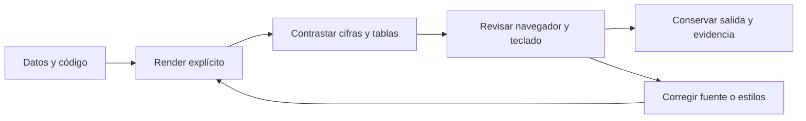

# 11.07 — Formatos y revisión visual

[Inicio](../../../README.md) / [Módulo 11](../README.md) / **Lección 11.07**

| Tu sesión | Qué prepararás o comprobarás |
| --- | --- |
| **Meta** | Revisar el HTML final como entrega legible y contrastable |
| **Necesitas** | 11.04–11.06; un motor y HTML bastan, PDF opcional |
| **Evidencia** | Revisión amplia/estrecha y de teclado con valores y referencias comprobados |

[Preparación](#antes-de-empezar) · [Material de apoyo](#material-de-apoyo) · [Lab 11.07](../../../labs/11_reporting_quarto/07_formats_visual_review/README.md) · [Comprobar](#evidencia-y-criterio-de-salida)

<a id="propósito-prerrequisitos-y-objetivos"></a>

## Propósito

Convertir un render correcto en una entrega que otra persona pueda leer,
recorrer y contrastar. Revisaremos el **HTML final**: encabezados, navegación,
tablas, figura, texto alternativo y comportamiento en una ventana estrecha.
PDF es una ampliación y no bloquea el cierre esencial.

## Antes de empezar

Completa [11.04](../04_tables_figures_references/README.md),
[11.05](../05_parameters_cutoffs/README.md) y
[11.06](../06_projects_cache_freeze/README.md) como prerrequisitos conceptuales.
Elige Python/Jupyter o R/knitr. Esta sección incluye datos completos y copia
las funciones de 11.03: preparar el entorno no exige entregas personales anteriores.

El dashboard se trabaja como ampliación en 11.08; aquí se revisa el HTML del reporte.

## Qué vas a aprender

- Elegir el formato según el uso de la entrega.
- Comprobar referencias y valores en el archivo final.
- Detectar desbordamientos en ventanas estrechas.
- Contrastar la figura con su tabla y recuperar alternativas textuales.
- Distinguir comprobación automática, revisión visual y sus límites.

## Material de apoyo

| Recurso | Para qué sirve | Uso |
| --- | --- | --- |
| [Ejemplo mínimo](minimo.qmd) | Revisar navegación y tabla antes del reporte completo | Para el recorrido |
| [CSV de la práctica](cartera.csv) | Consultar la entrada completa y conservar el original | Para el recorrido |
| [Preparador py](preparar.py) / [Preparador R](preparar.R) | Crear una copia nueva con las fuentes necesarias | Elige el lenguaje de tu recorrido |
| [Reporte python.qmd](reporte_python.qmd) / [Reporte r.qmd](reporte_r.qmd) | Generar la salida del motor elegido | Elige el lenguaje de tu recorrido |
| [Estilos](estilos.css) | Consultar el contenedor desplazable y presentación | Para el recorrido |
| [Verificador](verificar.py) | Contrastar estructura y valores; complementar con revisión humana | Para el recorrido |
| [Borrador de revisión](BORRADOR.md) | Consultar la nota que completa la evidencia visual | Para el recorrido |

Consulta las fuentes aquí y trabaja en la copia nueva que prepara el recorrido.
Elige el lenguaje indicado para tu práctica; preparar el entorno y renderizar
son pasos distintos. Conserva datos, fuentes y salidas anteriores.

## 1. Formato, cálculo y lectura son decisiones distintas

| Elemento | Qué decide | Qué no demuestra |
| --- | --- | --- |
| Código y datos | Población, reglas y valores | Que la presentación sea legible |
| HTML | Lectura en navegador, enlaces y ajuste de contenido | Que sus cifras estén actualizadas |
| PDF, opcional | Páginas de tamaño fijo para distribución o impresión | Que el diseño HTML se conserve automáticamente |
| Verificación de valores | Correspondencia con la fuente actual | Que todo sea visible o accesible |
| Revisión visual y de teclado | Lectura, navegación y controles probados | Accesibilidad completa para todas las personas |

No reduzcas la población ni cambies unidades solo para hacer caber una tabla.
Primero comprueba los valores; después ajusta la presentación y vuelve a revisar.



Sin renderizador: los cambios se hacen en el documento o en sus estilos,
se vuelve a renderizar y se repiten las comprobaciones. No corregimos el HTML
generado a mano para ocultar una diferencia con el cálculo.

## 2. Primer ejemplo completo: leer una tabla y seguir su referencia

El archivo [minimo.qmd](minimo.qmd) no ejecuta Python ni R. Contiene dos créditos
ficticios con saldos de 1000 y 2500 MXN, total 3500, una tabla identificada y
una referencia a ella. Copia sus archivos a una carpeta de práctica nueva con
el preparador de tu motor, como se explica más adelante.

Las opciones HTML principales son:

```yaml
format:
  html:
    toc: true
    toc-location: body
    toc-title: "En este documento"
    embed-resources: true
```

`toc` genera un índice a partir de los encabezados. Aquí lo situamos en el
cuerpo, antes del contenido. El reporte completo añade una regla CSS para
conservarlo también en pantallas estrechas; la ubicación por sí sola no evita
que el tema lo oculte.
`embed-resources` incorpora recursos de lectura al HTML; no incorpora todos los
fuentes de reconstrucción ni convierte enlaces externos en contenido disponible
sin conexión. Un recurso dinámico también puede tener necesidades propias.

En la **terminal del sistema**, dentro de la carpeta preparada:

```text
quarto render minimo.qmd --to html
```

En R el preparador lo llama `minimo_1107.qmd`: sustituye el nombre en el comando.
Los comandos simples de Quarto son iguales en PowerShell y Bash/Zsh si está
en PATH. Si usas una ruta explícita, sigue la sintaxis de tu recorrido completo.

Abre el HTML, sigue el índice y la referencia a la tabla. Comprueba 001/1000,
002/2500 y el total escrito. Cambia en **tu copia** 2500 por 3000 y renderiza
de nuevo: el texto estático 3500 queda incorrecto hasta que lo corrijas a 4000.
Eso es deliberado: un documento estático no recalcula sus afirmaciones. En el
reporte ejecutable que sigue, texto, tablas y figura se calculan juntos.

## 3. Datos completos y resultado conocido

Una observación representa el saldo de un crédito ficticio a una fecha exacta.
El CSV propio de esta sección contiene:

| credito_id | fecha_corte | saldo_mxn |
| --- | --- | ---: |
| 001 | 2026-09-30 | 1000 |
| 002 | 2026-09-30 | 2000 |
| 003 | 2026-09-30 | 3000 |
| 001 | 2026-10-31 | 1200 |
| 002 | 2026-10-31 | 1800 |
| 003 | 2026-10-31 | 3300 |

La pregunta es cómo cambió el saldo de **los mismos tres créditos**. Se validan
las seis filas: columnas, claves únicas previstas y saldos enteros entre 0 y
1000000 MXN, sin ausencias. No se imputan faltantes ni se eliminan duplicados.
Un archivo incompleto o vacío es error bajo este contrato.

| Crédito | Septiembre | Octubre | Diferencia octubre menos septiembre |
| --- | ---: | ---: | ---: |
| 001 | 1000 | 1200 | 200 |
| 002 | 2000 | 1800 | -200 |
| 003 | 3000 | 3300 | 300 |
| Total MXN | 6000 | 6300 | 300 |

La variación es `100 × 300 / 6000 = 5.00%`. El porcentaje toma septiembre como
base; no es el promedio de porcentajes individuales. Hay una baja individual
aunque el total aumente. Los saldos de ambos cortes no se suman como si fueran
pagos del período. Con septiembre cero, la tasa se informa como no definida.

El reporte produce un resumen de cuatro columnas y una tabla de detalle de
seis columnas con las fechas completas. Esa repetición de fechas es útil para
practicar una tabla ancha; no es una nueva fuente ni otro universo.

## 4. Recorrido completo Python/Jupyter

No se añaden dependencias. Reutiliza el entorno elegido con los requisitos del
proyecto y el grupo notebooks. Si ya es adecuado, comprueba el intérprete y
continúa desde el preparador: no necesitas crear otro entorno.

**PowerShell**, desde la raíz de DS Track, usando la alternativa uv:

```powershell
$quarto1107 = "quarto"
$env:UV_PROJECT_ENVIRONMENT = Join-Path $PWD "output/1107_entorno"
uv sync --locked --group notebooks --python 3.12.12
$env:QUARTO_PYTHON = Join-Path $env:UV_PROJECT_ENVIRONMENT "Scripts/python.exe"
& $env:QUARTO_PYTHON -c "import sys, matplotlib; print(sys.executable); print(matplotlib.__version__)"
& $env:QUARTO_PYTHON curriculum/11_reporting_quarto/07_formats_visual_review/preparar.py output/1107_python
Push-Location output/1107_python
& $quarto1107 render minimo.qmd --to html
& $quarto1107 render reporte_python.qmd --to html --cache-refresh
Pop-Location
```

**Bash/Zsh**, recorrido completo desde la raíz:

```bash
quarto1107="quarto"
export UV_PROJECT_ENVIRONMENT="$PWD/output/1107_entorno"
uv sync --locked --group notebooks --python 3.12.12
export QUARTO_PYTHON="$UV_PROJECT_ENVIRONMENT/bin/python"
"$QUARTO_PYTHON" -c "import sys, matplotlib; print(sys.executable); print(matplotlib.__version__)"
"$QUARTO_PYTHON" curriculum/11_reporting_quarto/07_formats_visual_review/preparar.py output/1107_python
raiz1107="$PWD"
cd output/1107_python
"$quarto1107" render minimo.qmd --to html
"$quarto1107" render reporte_python.qmd --to html --cache-refresh
cd "$raiz1107"
```

Si Quarto no está en PATH, asigna a `quarto1107` su ruta real. Autoría usa
`C:/Program Files/RStudio/resources/app/bin/quarto/bin/quarto.exe` en Windows.
Las variables solo afectan la terminal actual y sus procesos hijos. Para
Conda o venv sigue tu gestor de [00.05](../../00_getting_started/05_environment/README.md),
sin mezclarlo con uv sobre el mismo entorno. La sincronización puede descargar
requisitos ya declarados; esta lección no cambia el lockfile.

El preparador copia CSV, funciones, dos documentos y CSS a una carpeta nueva.
Rechaza destinos ocupados. Para retomar abre la copia existente; no la prepares
encima. El resultado esencial es `reporte_python.html`, junto al documento.

## 5. Recorrido completo R/knitr

Desde la raíz del repositorio, en la **consola R**, añade el material al proyecto
renv adecuado de 11.03, cambiando la ruta si tiene otro nombre:

```r
source("curriculum/11_reporting_quarto/07_formats_visual_review/preparar.R")
preparar_revision("output/1103_r")
```

Alternativa sin entregas previas, también en consola R desde la raíz:

```r
source("curriculum/11_reporting_quarto/03_execution_python_r/preparar.R")
crear_entorno_ejecucion("output/1107_r")
source("curriculum/11_reporting_quarto/07_formats_visual_review/preparar.R")
preparar_revision("output/1107_r")
```

Abre su `.Rproj` en RStudio o la carpeta en el IDE elegido. Reinicia R. Si
la biblioteca es nueva, ejecuta `source("restaurar.R")` en la consola R y
comprueba `renv::status()`. No instales otra vez si ya es adecuada; no inicialices
renv en la raíz de DS Track. No hay paquetes ni metadatos nuevos.

Abre `reporte_1107.qmd`, revisa sus bloques y compara la tabla con el CSV.
Puedes inspeccionar el cálculo en la consola R desde la raíz de ese proyecto:

```r
source("R/analisis_1107.R", encoding = "UTF-8")
resultado <- analizar("datos/cartera_1107.csv")
resultado$pares
resultado$tasa
```

La consola ayuda a comprender; el reporte vuelve a calcular en su proceso.
Para observar explícitamente formato y documento, usa la **terminal del sistema**
desde esa misma carpeta:

**PowerShell:**

```powershell
$quarto1107 = "quarto"
$env:QUARTO_R = "C:/Program Files/R/R-4.6.1/bin"
& $quarto1107 render minimo_1107.qmd --to html
& $quarto1107 render reporte_1107.qmd --to html --cache-refresh
```

**Bash/Zsh:**

```bash
quarto1107="quarto"
export QUARTO_R="$(dirname "$(command -v Rscript)")"
"$quarto1107" render minimo_1107.qmd --to html
"$quarto1107" render reporte_1107.qmd --to html --cache-refresh
```

Usa tu R real; en Bash comprueba antes qué `Rscript` se eligió. Si Quarto no
está en PATH, sustituye la variable por su ruta. El resultado es `reporte_1107.html`.
El preparador conserva fuentes y metadatos anteriores y rechaza archivos 11.07
ocupados. No modifica un `_quarto.yml` que ya tengas. Ejecuta el documento
explícito: un render global configurado en 11.06 podría no incluir este reporte.

## 6. Revisar el archivo, no solo el mensaje de éxito

Abre el HTML generado en tu navegador. No necesitas publicar ni iniciar sesión.
Los recursos de esta práctica se incorporan para que puedas leer la figura y
los estilos sin conexión. Una vista previa del editor y el archivo entregado
pueden diferir: revisa el archivo que realmente vas a compartir.

Haz tres pasadas:

1. **Contenido:** título, fechas, unidad, universo, cifra principal, tabla y límites.
2. **Navegación:** índice, referencia a cada tabla y figura, y enlace al detalle.
3. **Presentación:** ventana amplia, ventana estrecha y ampliación del navegador.

El índice y los títulos deben permitir anticipar la información de cada sección.
No uses saltos de encabezados solo para cambiar el tamaño de letra. Un caption
identifica la tabla o figura; la fuente explica de dónde vienen los datos;
el texto alternativo ofrece una descripción cuando la imagen no se puede leer.
No son intercambiables. El resumen conserva cifras exactas fuera de la imagen.

## 7. Tabla ancha, foco y desplazamiento

Una tabla ancha puede requerir espacio horizontal. La solución aquí es conservar
el resumen compacto y permitir desplazamiento **dentro del recuadro del detalle**.
No recortar columnas ni reducir todo a texto diminuto.

El documento delimita la tabla con:

```text
::: {.tabla-ancha role="region" aria-label="Detalle de saldos por crédito, con desplazamiento horizontal" tabindex="0"}
...tabla generada...
:::
```

La clase asocia un estilo; `role` y `aria-label` nombran la región para tecnologías
de asistencia. `tabindex="0"` permite alcanzarla en el orden normal de Tab.
El CSS contiene, entre otras reglas:

```css
main > nav#TOC { display: block; }
.tabla-ancha { max-width: 100%; overflow-x: auto; }
.tabla-ancha table { min-width: 46rem; }
.tabla-ancha .cell-output-display { overflow: visible; }
.tabla-ancha:focus-visible { outline: 3px solid #245b78; outline-offset: 3px; }
```

El ancho mínimo conserva espacio entre columnas y puede exceder el recuadro.
La regla de la celda evita que el contenedor interior generado por Quarto capture
el desplazamiento mientras el foco queda afuera. Este problema se detectó
al probar el borrador: tener un atributo de foco no bastaba.

En una ventana estrecha, pulsa Tab hasta el recuadro y comprueba su contorno.
Usa las flechas para llegar a la última columna y volver al ID. El cuerpo del
reporte debe seguir cabiendo sin desplazamiento horizontal de toda la página.
También prueba el control de desplazamiento con ratón o panel táctil.
El navegador y las tecnologías de asistencia pueden variar: registrar qué se
probó es más preciso que afirmar que funciona para todos los casos.

Amplía el navegador al 200% y revisa de nuevo. Si se oculta texto, un título
se superpone o un control no es alcanzable, corrige y vuelve a renderizar.
Autoría comprobó anchos de 1280, 640 y 390 píxeles y teclado en Chrome headless;
eso no acredita todos los navegadores, lectores de pantalla ni el zoom manual.

## 8. Figura legible y alternativa recuperable

Compara alturas y etiquetas con 6000/6300 MXN. El eje empieza en cero y nombra
la unidad; cada barra identifica el corte. El color es único y no se necesita
una leyenda de colores para interpretar las dos fechas.

La figura tiene dimensiones explícitas de 6 × 3.5 pulgadas y se ajusta al ancho
disponible. Eso no garantiza que sus letras sigan siendo cómodas a cualquier
tamaño: en una pantalla pequeña, la tabla y el párrafo permiten recuperar los
valores. Usa lo aprendido sobre figuras en [04](../../04_visualization_python/README.md)
o [08](../../08_visualization_r/README.md), según tu motor.

Si cambias los datos, no dejes un caption o una descripción que afirme un aumento
fijo. Los reportes usan una descripción neutral de comparación. Una caída,
todos ceros o base inicial cero requieren interpretación acorde con la salida.

## 9. Verificación automática y revisión humana

El [verificador](verificar.py) usa Python estándar, lee el CSV actual y el HTML,
sin ejecutar el reporte ni escribir resultados. Reutiliza el contrato de 11.03
y reconstruye la referencia desde CSV: contrasta el resumen, cada saldo por ID,
las diferencias y las cifras del párrafo. También revisa destinos internos,
idioma, PNG incorporado, alternativa textual y atributos de la región.

Desde la raíz de DS Track, después de preparar/renderizar Python:

**PowerShell:**

```powershell
& $env:QUARTO_PYTHON curriculum/11_reporting_quarto/07_formats_visual_review/verificar.py output/1107_python/cartera.csv output/1107_python/reporte_python.html
```

**Bash/Zsh:**

```bash
"$QUARTO_PYTHON" curriculum/11_reporting_quarto/07_formats_visual_review/verificar.py output/1107_python/cartera.csv output/1107_python/reporte_python.html
```

Para R, pasa `output/1107_r/datos/cartera_1107.csv` y
`output/1107_r/reporte_1107.html`, o las rutas de tu copia. Puedes usar un Python
estándar existente; no necesitas otro motor de reporte. Como recorrido esencial
R sin Python, contrasta manualmente los valores con la sección 3 y conserva la
lista de comprobaciones y las evidencias de navegación/teclado.

Un pase del verificador **no demuestra** alturas de barras, que el CSS permita
desplazarse, contraste suficiente o accesibilidad completa. Esas afirmaciones
necesitan otras comprobaciones. Autoría contrastó además alturas y etiquetas de
las figuras con la referencia y revisó capturas del navegador. La revisión
automática no sustituye que expliques qué representa una fila y una barra.

En una copia de práctica cambia 003/octubre a 3600: el siguiente render explícito
debe mostrar 6000/6600, diferencia 600 y 10.00%. Si solo cambias el CSV y abres el
HTML anterior, sigue siendo antiguo: aplica la distinción de 11.06. Un error de
render puede dejar un HTML previo en disco; no lo atribuyas al intento fallido.

## 10. PDF como ampliación independiente

El mínimo declara también `format: pdf`, un motor `lualatex` y
`latex-auto-install: false`. La salida PDF requiere una distribución TeX adecuada
y sus paquetes; Quarto, Python y R no la sustituyen. No se exige instalarla
para esta sección. Si ya la tienes configurada, desde la carpeta de práctica:

```text
quarto render minimo.qmd --to pdf
```

En R el archivo es `minimo_1107.qmd`. La opción `--to` elige el formato: cambiar
la extensión del HTML no lo convierte en PDF. `keep-tex: true` conserva el
intermedio `.tex` para investigar errores. No habilites instalaciones automáticas
para ocultar un fallo del entorno ni cambies bibliotecas globales como parte del lab.

Autoría intentó el mínimo con LuaLaTeX/MiKTeX existente e instalador deshabilitado.
El ejecutor no pudo acceder a su configuración de usuario; no se generó un PDF
comprobado ni se instalaron paquetes. La ampliación queda documentada con ese
límite, y no se atribuye ese fallo al contenido o a paquetes que no se inspeccionaron.

Si generas PDF en tu equipo, abre **todas sus páginas**: tabla, referencias,
acentos, tamaños, cortes y márgenes. Los estilos CSS y el desplazamiento de una
tabla HTML no se trasladan automáticamente a una página fija. El mínimo es
estático; adaptar el reporte ejecutable completo a PDF requeriría revisar
además recursos y diseño de ese formato. No basta con que compile.

## 11. Evidencia de revisión y errores frecuentes

Conserva una nota con archivo, motor/versiones, fuente utilizada, fecha de revisión,
ancho/zoom probado, comprobación, resultado y corrección. Distingue lo que pasó,
lo que falló y lo que no se probó. Una captura apoya la nota pero no sustituye
los datos ni una prueba de teclado. El historial no acredita aprendizaje.

| Síntoma | Qué revisar |
| --- | --- |
| Párrafo y tabla difieren | Un mismo cálculo y fuente actual; recálculo explícito |
| Figura parece correcta pero total difiere | Alturas, etiquetas, unidad y misma población |
| Falta la última columna | Desplazamiento en el recuadro, no ocultar overflow |
| Tab llega al recuadro pero las flechas no funcionan | Qué contenedor recibe el overflow generado por Quarto |
| Falta imagen al copiar el HTML | Recursos incorporados o carpeta de recursos conservada |
| Referencia muestra una clave sin resolver | Identificador, caption y advertencias del render |
| Verificador pasa y la tabla no se puede leer | Falta la revisión visual; estructura no equivale a uso real |
| PDF no se genera | Entorno y motor TeX; HTML sigue siendo el cierre esencial |

No cambies el HTML generado directamente. Corrige `.qmd`, datos o CSS según
corresponda, renderiza de nuevo y conserva la salida que finalmente revisaste.

<a id="práctica-criterio-de-salida-y-siguiente-paso"></a>

## Práctica

Realiza el [lab 11.07](../../../labs/11_reporting_quarto/07_formats_visual_review/README.md) para
leer el HTML fuera de preview y registrar revisión visual, teclado y límites.

Como apoyo para preparar la actividad, consulta [preparar.py](preparar.py) o
[preparar.R](preparar.R) según el lenguaje elegido; sigue las rutas y los pasos
del recorrido completo antes de renderizar o reconstruir.

## Evidencia y criterio de salida

| Conserva | Comprueba | Explica |
| --- | --- | --- |
| HTML y nota de revisión | Título, tabla, figura, referencias y valores al tamaño de uso | Éxito del render frente a lectura real |
| Revisión amplia/estrecha y de teclado | Detalle desplazable, foco y alternativas recuperables | Qué se comprobó y qué queda fuera; PDF es ampliación |

Puedes avanzar cuando otra persona pueda leer el HTML, encontrar el detalle,
recuperar cada valor y entender las limitaciones. Explica qué comprobaste y qué
quedó fuera. Un motor y HTML bastan; PDF no bloquea el cierre.

Quien aprende realiza la práctica y explica las decisiones; su compañero revisa.
Tu compañero intenta llegar a la última columna solo con teclado y pide mostrar qué contenedor recibe el foco.
Guarda evidencia, ayudas y dudas en una nota personal junto a tu práctica.
PROGRESS.md registra desarrollo editorial, no tu expediente de aprendizaje.
El proyecto `05_monthly_report` y sus checkpoints siguen planificados;
las comprobaciones técnicas del material no acreditan haber completado la práctica.

<a id="referencias-primarias-y-alcance"></a>

## Referencias

Consultadas el 2026-10-26: [HTML y navegación Quarto](https://quarto.org/docs/output-formats/html-basics.html),
[tablas](https://quarto.org/docs/authoring/tables.html),
[comprobaciones de accesibilidad](https://quarto.org/docs/output-formats/html-accessibility.html)
y [PDF](https://quarto.org/docs/output-formats/pdf-basics.html).
Ejemplos propios; bibliotecas ya declaradas. Autoría: Quarto 1.9.38,
Python 3.12.12/Matplotlib 3.10.7 y R 4.6.1/knitr 1.52/ggplot2 4.0.3.
Chrome de prueba en Windows, sin certificar el IDE, otros sistemas, tecnologías
de asistencia o accesibilidad completa. Bash/Zsh son recorridos de apoyo.

## Siguiente paso

La continuación esencial es [11.09 — Cierre del reporte reproducible](../09_reproducible_report_closure/README.md), ya disponible.
Si eliges profundizar, realiza antes [11.08 — Dashboard y distribución](../08_dashboard_distribution/README.md),
una ampliación opcional que no bloquea el cierre.

[← Módulo 11](../README.md) · [Lab 11.07](../../../labs/11_reporting_quarto/07_formats_visual_review/README.md) · [Siguiente →](../09_reproducible_report_closure/README.md)
