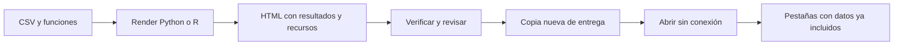

# 11.08 — Dashboard y distribución

## Propósito, prerrequisitos y objetivos

**Ampliación opcional.** Organizar un análisis en tarjetas, figura y detalle,
y preparar una copia local que otra persona pueda abrir. Un motor y una salida
HTML bastan; no se exige cuenta, alojamiento ni servidor. Si no eliges esta
ampliación, el cierre esencial corresponde a 11.09 cuando tenga material.

Lee [11.04](../04_tables_figures_references/README.md),
[11.06](../06_projects_cache_freeze/README.md) y
[11.07](../07_formats_visual_review/README.md). Hay datos completos propios;
se reutilizan funciones de 11.03 sin exigir entregas personales anteriores.

Al terminar podrás construir una disposición sencilla, distinguir interacción
del navegador y recálculo del análisis, contrastar todas las vistas con la misma
fuente y revisar el HTML **después de copiarlo**. No implementamos el portal,
Streamlit, Shiny ni el proyecto integrador de reportes en esta sección.

## 1. Un dashboard no requiere una app con servidor

En esta práctica Python o R se ejecutan al renderizar. Después, el navegador
puede mostrar pestañas mediante JavaScript usando resultados ya incluidos.
No tiene que volver a iniciar esos intérpretes para cambiar de vista.

| Acción | Qué ocurre aquí |
| --- | --- |
| Renderizar | Validar CSV y calcular tarjetas, tabla y figura |
| Abrir HTML | Leer una salida ya producida |
| Cambiar Figura/Detalle | Mostrar otra vista de los mismos resultados |
| Cambiar CSV en disco | No modifica el HTML anterior |
| Actualizar el dashboard | Volver a renderizar y revisar una entrega nueva |

No hay filtros en este ejemplo. Un navegador puede ofrecer algunas interacciones
sin servidor, pero no debes inferir que cualquier control ejecuta Python o R.
Una aplicación que recalcula ante entradas del usuario requiere otro diseño;
eso se estudiará en las rutas 12/13. Tampoco se ha medido rendimiento aquí.



Sin renderizador: se calcula antes de distribuir. El cambio de pestaña ocurre
en el navegador y no vuelve a leer el CSV. La revisión incluye la copia final.

## 2. Primer ejemplo completo: dos vistas ya preparadas

El [mínimo](minimo.qmd) es estático y no ejecuta Python ni R. Incluye dos créditos:
001/1000 y 002/2500 MXN, suma 3500. Puedes guardarlo como `minimo.qmd`:

````markdown
---
title: "Dos vistas de una muestra"
lang: es
format:
  dashboard:
    scrolling: true
    embed-resources: true
---

## Contexto {.flow}

::: {.card title="Pregunta y universo"}
Dos créditos ficticios a una sola fecha; saldos en MXN.
:::

## Vistas {.tabset .flow}

::: {.card title="Resumen"}
Dos créditos; saldo observado **3500 MXN**.
:::

::: {.card title="Detalle"}
| Crédito | Saldo (MXN) |
| --- | ---: |
| 001 | 1000 |
| 002 | 2500 |
:::
````

En la terminal del sistema, desde su carpeta:

```text
quarto render minimo.qmd --to dashboard
```

Los preparadores posteriores ya incluyen una versión completa de este mínimo;
en R se llama `minimo_1108.qmd`. Abre el HTML y alterna Resumen/Detalle.
Los dos contenidos ya están allí. Si cambias un dato del mínimo, también
debes corregir sus afirmaciones estáticas antes de renderizar: no calcula sumas.

## 3. Sintaxis de disposición antes de usarla

`format: dashboard` selecciona el formato. `scrolling: true` permite lectura
vertical según la altura del contenido; los resultados deben seguir revisándose
a distintos anchos. No garantiza por sí solo que una tabla sea utilizable.

En este formato los encabezados organizan la disposición: `##` define filas;
los textos de esos encabezados ayudan a editar y no se muestran como títulos
de sección del reporte. `.flow` solicita altura según contenido. `.tabset`
presenta las tarjetas de una fila como pestañas. Una tarjeta de texto se delimita
con `.card` y puede tener `title`. Las celdas también pueden producir tarjetas.
Como ampliación, encabezados `#` permitirían varias páginas; aquí usamos una.

En las tarjetas de indicadores empleamos celdas calculadas. Ejemplo Python,
después de calcular una variable `total`:

````text
```{python}
#| content: valuebox
#| title: Saldo observado (MXN)
#| color: light
dict(value=str(total))
```
````

R usa `list(value = pesos(total))`; `pesos` es la función de formato incluida
en su documento. El color es neutro: un aumento de saldo no se interpreta
automáticamente como una mejora. La unidad y el corte pertenecen al título.

El CSS del ejemplo ajusta las filas de lectura a su contenido y conserva el
desplazamiento de la tabla en el recuadro que recibe foco. Si cambias las clases
o anidas tarjetas/celdas de otra forma, comprueba el HTML: en autoría una
estructura anidada duplicó una tabla, aunque el render terminó sin errores.

## 4. Datos completos y contrato de comparación

El CSV propio contiene una fila por crédito y fecha de corte:

| credito_id | fecha_corte | saldo_mxn |
| --- | --- | ---: |
| 001 | 2026-09-30 | 1000 |
| 002 | 2026-09-30 | 2000 |
| 003 | 2026-09-30 | 3000 |
| 001 | 2026-10-31 | 1200 |
| 002 | 2026-10-31 | 1800 |
| 003 | 2026-10-31 | 3300 |

Se valida el lote completo: tres IDs en ambos cortes, claves únicas previstas,
columnas exactas y saldos enteros de 0 a 1000000 MXN, sin ausencias. Un archivo
vacío o incompleto es inválido en este contrato. No se imputa ni se elimina
una fila para obtener un dashboard sin errores.

Las tarjetas muestran **6000**, **6300** y **300 MXN**. La variación es
`100 × (6300 − 6000) / 6000 = 5.00%`. La tabla debe conservar:

| Crédito | Septiembre | Octubre | Diferencia MXN |
| --- | ---: | ---: | ---: |
| 001 | 1000 | 1200 | 200 |
| 002 | 2000 | 1800 | -200 |
| 003 | 3000 | 3300 | 300 |

El agregado aumenta aunque un crédito disminuya. Son saldos a fechas exactas,
no pagos del período; los dos cortes no se suman entre sí. Con septiembre
cero la variación no está definida. Texto, indicadores, tabla y barras deben
representar los mismos tres créditos, sin una población oculta por vista.

## 5. Recorrido completo Python/Jupyter

Usa el entorno elegido con las dependencias ya declaradas y el grupo notebooks.
No se añade ninguna en esta sección. Si ya es adecuado, reutilízalo y asigna
`QUARTO_PYTHON` a su ejecutable; no necesitas crear otro entorno.

**PowerShell**, desde la raíz de DS Track, alternativa uv:

```powershell
$quarto1108 = "quarto"
$env:UV_PROJECT_ENVIRONMENT = Join-Path $PWD "output/1108_entorno"
uv sync --locked --group notebooks --python 3.12.12
$env:QUARTO_PYTHON = Join-Path $env:UV_PROJECT_ENVIRONMENT "Scripts/python.exe"
& $env:QUARTO_PYTHON -c "import sys, matplotlib; print(sys.executable); print(matplotlib.__version__)"
& $env:QUARTO_PYTHON curriculum/11_reporting_quarto/08_dashboard_distribution/preparar.py output/1108_python
Push-Location output/1108_python
& $quarto1108 render minimo.qmd --to dashboard
& $quarto1108 render dashboard_python.qmd --to dashboard --cache-refresh
Pop-Location
```

**Bash/Zsh**, recorrido completo desde la raíz:

```bash
quarto1108="quarto"
export UV_PROJECT_ENVIRONMENT="$PWD/output/1108_entorno"
uv sync --locked --group notebooks --python 3.12.12
export QUARTO_PYTHON="$UV_PROJECT_ENVIRONMENT/bin/python"
"$QUARTO_PYTHON" -c "import sys, matplotlib; print(sys.executable); print(matplotlib.__version__)"
"$QUARTO_PYTHON" curriculum/11_reporting_quarto/08_dashboard_distribution/preparar.py output/1108_python
raiz1108="$PWD"
cd output/1108_python
"$quarto1108" render minimo.qmd --to dashboard
"$quarto1108" render dashboard_python.qmd --to dashboard --cache-refresh
cd "$raiz1108"
```

Si Quarto no está en PATH, usa su ruta real en la variable; en autoría es
`C:/Program Files/RStudio/resources/app/bin/quarto/bin/quarto.exe` en Windows.
Las variables afectan la terminal actual y sus procesos hijos. Para Conda o
venv sigue tu recorrido de [00.05](../../00_getting_started/05_environment/README.md)
sin mezclar gestores. La sincronización puede descargar requisitos ya fijados.

El preparador rechaza carpetas ocupadas. Para retomar abre tu copia existente.
El archivo principal generado es `dashboard_python.html`. El documento usa
celdas para producir los valores Python; en Quarto 1.9.38 un refresco de caché
con expresiones Jupyter en línea produjo incompatibilidad durante autoría.

En dashboards Jupyter puede mostrar resultados de varias expresiones de una
celda. Las llamadas a Matplotlib que devuelven objetos asignan su resultado a
`_` para evitar listas auxiliares en el dashboard. Es un nombre de variable
convencional para un resultado que no utilizaremos. No suprimas las salidas que contienen
el valor del indicador ni ocultes un error del cálculo.

## 6. Recorrido completo R/knitr

Desde la raíz de DS Track, en la **consola R**, añade el material a un proyecto
renv adecuado de 11.03 (cambia la ruta si tiene otro nombre):

```r
source("curriculum/11_reporting_quarto/08_dashboard_distribution/preparar.R")
preparar_dashboard("output/1103_r")
```

Alternativa sin entregas previas:

```r
source("curriculum/11_reporting_quarto/03_execution_python_r/preparar.R")
crear_entorno_ejecucion("output/1108_r")
source("curriculum/11_reporting_quarto/08_dashboard_distribution/preparar.R")
preparar_dashboard("output/1108_r")
```

Abre su `.Rproj` en RStudio o la carpeta en el IDE elegido y reinicia R. En
una biblioteca nueva ejecuta `source("restaurar.R")` en la consola y comprueba
`renv::status()`. Si ya es adecuada, conserva los paquetes. No se instala ni se
inicializa renv en la raíz del curso; los metadatos anteriores se conservan.

Abre `dashboard_1108.qmd` y revisa cómo se forma cada tarjeta. Puedes inspeccionar
el cálculo en la consola R de ese proyecto:

```r
source("R/analisis_1108.R", encoding = "UTF-8")
resultado <- analizar("datos/cartera_1108.csv")
resultado$pares
resultado$tasa
```

El dashboard no depende de esos objetos interactivos: renderiza en su proceso.
En la **terminal del sistema**, dentro de la carpeta del proyecto preparado:

**PowerShell:**

```powershell
$quarto1108 = "quarto"
$env:QUARTO_R = "C:/Program Files/R/R-4.6.1/bin"
& $quarto1108 render minimo_1108.qmd --to dashboard
& $quarto1108 render dashboard_1108.qmd --to dashboard --cache-refresh
```

**Bash/Zsh:**

```bash
quarto1108="quarto"
export QUARTO_R="$(dirname "$(command -v Rscript)")"
"$quarto1108" render minimo_1108.qmd --to dashboard
"$quarto1108" render dashboard_1108.qmd --to dashboard --cache-refresh
```

Comprueba tu R real antes de asignar la variable. El preparador conserva
configuración y entregas anteriores y rechaza los archivos 11.08 ocupados.
Renderiza el documento explícito: un `_quarto.yml` de prácticas previas puede
tener una lista global que no incluya este archivo. La salida es
`dashboard_1108.html`. Autoría comprueba CLI en procesos nuevos, no el botón
Render ni toda la interfaz del IDE.

## 7. Revisar el dashboard y sus pestañas

Aplica la revisión de [11.07](../07_formats_visual_review/README.md): título,
cortes, unidades, cifras, límites, figura y tabla. Comprueba que hay tres
indicadores, una tabla de tres créditos y una figura de dos barras, sin duplicados
ni objetos auxiliares impresos por las celdas.

Prueba una ventana amplia y otra estrecha. Las tarjetas deben conservar el
significado aunque se apilen. Al pasar de Figura a Detalle no deben cambiar
sus cifras. Prueba Tab y las flechas en las pestañas; después alcanza la región
de tabla y recorre sus columnas, con contorno de foco visible. Revisa también
ratón/panel táctil y ampliación del navegador según tu equipo.

Las barras parten de cero y llevan etiquetas. El color es único; no se exige
interpretarlo para comparar fechas. El texto alternativo describe la figura y
la tabla conserva los valores exactos. La tasa usa septiembre como base y no
puede mostrarse como 0% cuando esa base es cero.

El [verificador estándar](verificar.py) lee CSV y HTML sin escribir ni renderizar.
Contrasta títulos/valores de tarjetas, tasa, cada saldo por ID y diferencia;
revisa pestañas, destinos internos, alternativa de imagen y recursos básicos
incorporados. Reutiliza el contrato de 11.03 y el lector HTML de 11.07.

Desde la raíz de DS Track, **PowerShell**:

```powershell
& $env:QUARTO_PYTHON curriculum/11_reporting_quarto/08_dashboard_distribution/verificar.py output/1108_python/cartera.csv output/1108_python/dashboard_python.html
```

**Bash/Zsh:**

```bash
"$QUARTO_PYTHON" curriculum/11_reporting_quarto/08_dashboard_distribution/verificar.py output/1108_python/cartera.csv output/1108_python/dashboard_python.html
```

Para R usa un Python estándar existente y las rutas de
`datos/cartera_1108.csv` y `dashboard_1108.html` de tu copia. Como alternativa
esencial R sin Python, contrasta manualmente la sección 4 y registra las pruebas
de navegación. No se exige otro motor de dashboard.

El verificador no demuestra alturas de barras, funcionamiento del CSS o pestañas,
accesibilidad completa ni autenticidad. Esas afirmaciones requieren comprobaciones
adicionales. Una suma correcta tampoco demuestra que cada crédito esté actualizado:
subir un saldo y bajar otro puede conservar el agregado.

## 8. Incorporar recursos no es incluir la reconstrucción

Los dashboards declaran `embed-resources: true`. En esta muestra el HTML incorpora
CSS, scripts e imagen de lectura: puedes copiarlo a una carpeta sin los fuentes
y probarlo allí. JavaScript sigue siendo necesario para las pestañas; eso no
significa que haya un intérprete Python/R trabajando en el navegador.

Con recursos externos, por ejemplo sin esa opción, puede existir un directorio
`nombre_files/` que debe acompañar al HTML. Además, un enlace externo o un widget
con servicios remotos puede requerir red. No supongas que un único archivo es
autosuficiente sin probar **la copia** sin conexión. Este ejemplo no añade
widgets ni servicios externos.

La entrega de lectura y las fuentes cumplen funciones distintas:

| Conservación | Contenido |
| --- | --- |
| Lectura de esta práctica | `dashboard.html` y `LEEME.md` |
| Reconstrucción | CSV, funciones, `.qmd`, CSS, configuración/versiones del entorno |

Los scripts de distribución solo copian y comprueban que no cambien los bytes;
no sustituyen la conciliación ni la revisión visual. El paquete de lectura no
es una entrega reproducible completa: eso se integrará en 11.09.

## 9. Crear una entrega nueva y revisar el destino

Primero termina la revisión del HTML. Después crea una carpeta nueva; no
sobrescribas una entrega ya compartida para simular que sigue siendo la misma.

Python, desde la raíz, **PowerShell**:

```powershell
& $env:QUARTO_PYTHON curriculum/11_reporting_quarto/08_dashboard_distribution/distribuir.py output/1108_python/dashboard_python.html output/1108_entrega_python
```

**Bash/Zsh:**

```bash
"$QUARTO_PYTHON" curriculum/11_reporting_quarto/08_dashboard_distribution/distribuir.py output/1108_python/dashboard_python.html output/1108_entrega_python
```

R, en la **consola R desde la raíz de DS Track**, sin instalar paquetes:

```r
source("curriculum/11_reporting_quarto/08_dashboard_distribution/distribuir.R")
distribuir_dashboard("output/1108_r/dashboard_1108.html", "output/1108_entrega_r")
```

Usa la ruta real si trabajaste en otro proyecto. Ambos caminos crean
`dashboard.html` y una nota de lectura `LEEME.md`, y rechazan un destino ocupado.
Python compara bytes; R compara MD5 como comprobación de copia, sin atribuirle
autenticidad. Si la copia queda incompleta, consérvala e investiga el error.

Abre el `dashboard.html` **de la carpeta de entrega** sin conexión. Repite la
lectura de tarjetas, ambas pestañas, figura y extremos de la tabla. No debe
necesitar los CSV ni las bibliotecas del equipo de autoría para leer. Puedes
pasar ese HTML al verificador con el CSV de referencia que conservaste aparte.

No hace falta subirlo a un servicio para completar esta práctica. Publicar en
Internet es otra decisión: elegir destino, revisar qué fuentes/recursos quedarán
expuestos y comprobar su funcionamiento allí. No se proporcionan cuentas,
autenticación ni despliegue en esta ampliación. Las salidas personales siguen
fuera del repositorio del curso.

## 10. Cambiar datos y conservar evidencia

En tu copia cambia 003/octubre de 3300 a 3600. Predice **6000/6600 MXN**, diferencia
600 y 10.00%. El HTML y la entrega anterior siguen mostrando los valores previos
hasta que renderices y prepares una **entrega nueva**. No intentes actualizar
el resultado simplemente cambiando de pestaña.

Conserva archivo de entrada, fuentes, comandos y versiones, además de una nota
que identifique qué copia se revisó, con qué ancho/teclado y qué no se probó.
Una captura no prueba que los cálculos se ejecutaran de nuevo. No se certifica
accesibilidad completa, zoom manual, lectores de pantalla u otros sistemas por
haber inspeccionado un navegador de prueba.

## Práctica, criterio de salida y siguiente paso

Realiza el [lab 11.08](../../../labs/11_reporting_quarto/08_dashboard_distribution/README.md).
Puedes cerrar esta ampliación cuando las vistas conserven el mismo universo y
valores, puedas explicar qué ocurre sin servidor y otra persona pueda leer la
copia local revisada. Registra evidencia en [PROGRESS.md](../../../PROGRESS.md).

El proyecto integrador y sus checkpoints siguen pendientes en
[proyectos](../../../projects/README.md). El portal del curso no se implementa
aquí. Continúa con [11.09 — Cierre del reporte reproducible](../09_reproducible_report_closure/README.md). Tener material disponible no acredita aprendizaje.

## Referencias primarias y alcance

Consultadas el 2026-10-26: [dashboards Quarto](https://quarto.org/docs/dashboards/),
[disposición](https://quarto.org/docs/dashboards/layout.html),
[tarjetas e indicadores](https://quarto.org/docs/dashboards/data-display.html)
y [recursos HTML](https://quarto.org/docs/output-formats/html-basics.html#self-contained).
Ejemplos propios. Quarto 1.9.38, Python 3.12.12/Matplotlib 3.10.7 y
R 4.6.1/knitr 1.52/ggplot2 4.0.3 en entornos locales existentes; sin dependencias
nuevas ni cambios de lockfiles. Navegador de prueba en Windows; Bash/Zsh de apoyo.
