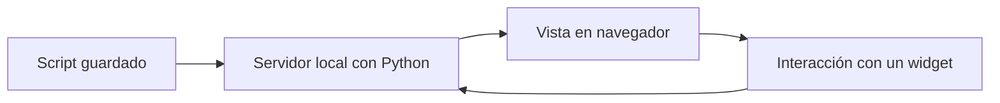
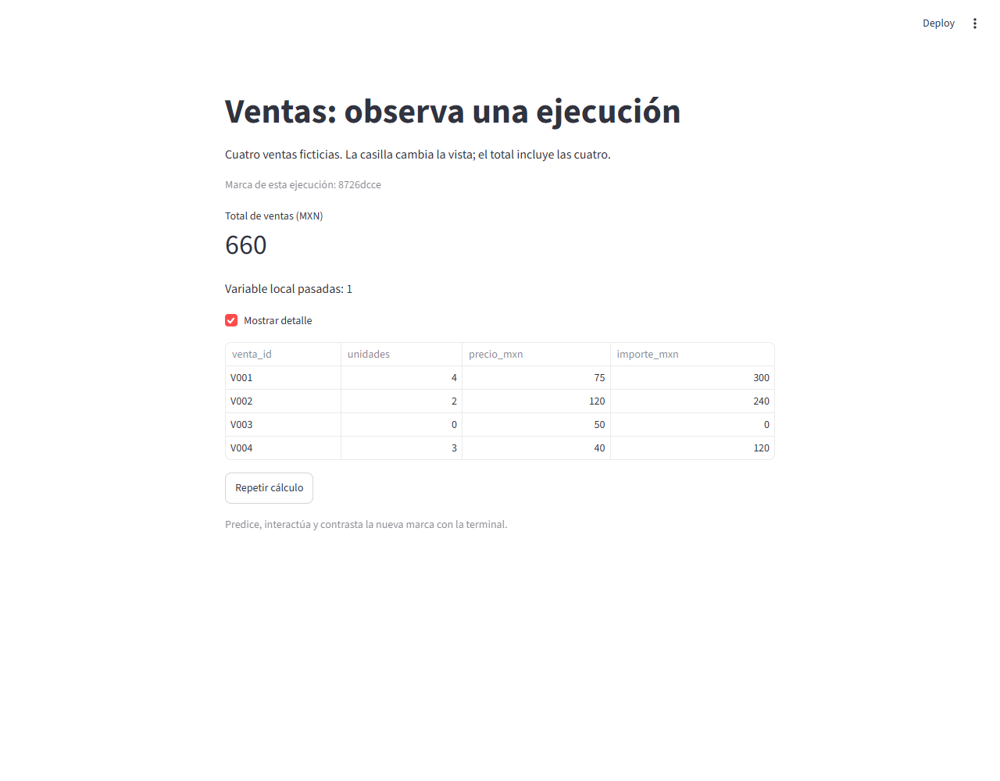

# 12.01 — Primera app y modelo de ejecución

[Inicio](../../../README.md) / [Módulo 12](../README.md) / **Lección 12.01**

| Tu sesión | Qué prepararás o comprobarás |
| --- | --- |
| **Meta** | Iniciar una app local y explicar qué vuelve a ejecutarse al interactuar |
| **Necesitas** | Python, funciones básicas, listas/diccionarios, `if` y un entorno elegido |
| **Evidencia** | App propia, predicciones y registro de cambios en pantalla y terminal |

[Preparación](#antes-de-empezar) · [Material de apoyo](#material-de-apoyo) · [Lab 12.01](../../../labs/12_streamlit/01_first_app_execution/README.md) · [Comprobar](#evidencia-y-criterio-de-salida)

## Propósito

Un reporte Quarto produce un archivo que después se lee. Una app Streamlit
mantiene un programa atendiendo interacciones: alguien pulsa un botón y Python
vuelve a producir la vista. Antes de añadir filtros necesitamos entender dónde
corre el código, qué provoca otra ejecución y qué conserva cada herramienta.

Empezaremos con una venta de 300 MXN. Después observaremos cuatro ventas
ficticias: una casilla cambia la presentación, pero el total sigue siendo 660 MXN.
La pregunta es **qué cambió y qué se calculó otra vez**, no quién hizo más clics.

## Antes de empezar

Retoma [scripts y ejecución](../../00_getting_started/04_first_script/README.md),
[condiciones](../../01_python_foundations/03_conditions_loops/README.md) y
[reporte frente a fuente](../../11_reporting_quarto/01_report_source_render/README.md).
El módulo 11 es el antecedente del recorrido; aquí están todos los datos y
resultados. No necesitas entregas anteriores, Quarto activo, R ni un notebook.

Abre DS Track en el editor y elige **un gestor y un intérprete**, según
[00.05](../../00_getting_started/05_environment/README.md).
Sigue los [recorridos completos de entorno y arranque](recorridos.md):
PowerShell, después Bash/Zsh y CMD para Anaconda Prompt. Referencia comprobada:
Python 3.12.12 y **Streamlit 1.66.1**. El grupo `streamlit` de
[pyproject.toml](../../../pyproject.toml) y [uv.lock](../../../uv.lock) registra
esta ruta opcional; las versiones previas del proyecto se conservan.

La terminal del IDE recibe comandos del sistema; el editor guarda Python; el
navegador muestra la app. Conserva la terminal abierta mientras la usas. Estos
ejemplos no necesitan leer ni escribir archivos de datos. Cada muestra está
incluida en su script.

Puedes trabajar en dos sesiones: primero mínimo/arranque; después reejecución,
predicciones y lab. La arquitectura de funciones, filtros, estado y caché se
profundizará en las secciones posteriores; no se necesita para este primer paso.

## Qué vas a aprender

- Distinguir navegador, servidor local y script Python.
- Iniciar con el mismo intérprete que tiene Streamlit y detener el servidor.
- Relacionar una interacción con una pasada completa del script.
- Explicar una variable local reinicializada, el valor de una casilla y un botón.
- Contrastar el resultado con una cuenta manual y reconstruir desde un arranque nuevo.

## Material de apoyo

| Recurso | Para qué sirve | Uso |
| --- | --- | --- |
| [Recorridos](recorridos.md) | Preparar/comprobar entorno, iniciar y detener | Elige un gestor y shell |
| [Mínimo `hola.py`](hola.py) | Calcular una venta y mostrarla en el navegador | Primera prueba |
| [App `app.py`](app.py) | Observar casilla, botón, marcas y variable local | Recorrido principal |
| [Comprobación de autoría](comprobar_app.py) | Simular interacciones y contrastar sus resultados | Opcional; AppTest se estudia en 12.08 |

Abre los scripts en el editor para leerlos. Para variantes, guarda una copia
con nombre nuevo en `output/mi_1201/`, carpeta personal ignorada por Git.
No cambies el original para ocultar una diferencia. La app y sus copias contienen
los datos: no dependen de la ubicación accidental de un CSV.

## 1. Tres lugares, tres responsabilidades

| Lugar | Qué hace | Qué observas |
| --- | --- | --- |
| Editor | Guarda el archivo `.py` | Código y cambios aún pendientes de guardar |
| Terminal y servidor Streamlit | Ejecutan Python y atienden la app | Dirección local, trazas y errores |
| Navegador | Presenta la vista y envía interacciones | Texto, métricas, casilla y botón |



Sin renderizador: el servidor ejecuta el script y envía su presentación al
navegador. Una interacción vuelve al servidor y provoca otra pasada. En este
ejemplo ambas herramientas están en tu computadora. La dirección
`127.0.0.1` apunta a ella; iniciar esta app no la publica en Internet.

Un **widget** es un control de entrada, como una casilla. El navegador no
ejecuta las multiplicaciones Python. Cerrar una pestaña no equivale a detener
el proceso de la terminal, que puede seguir atendiendo otras conexiones.

## 2. Una primera app completa: una venta

Abre [hola.py](hola.py). Tiene estas instrucciones:

```python
import streamlit as st

st.title("Mi primera app local")
st.write("Cuatro unidades a 75 MXN por unidad.")
st.metric("Importe (MXN)", 4 * 75)
```

`import ... as st` da un nombre corto al módulo. `st.title` crea el título,
`st.write` muestra el texto y `st.metric` presenta una etiqueta y un valor.
Los dos argumentos de `metric` son etiqueta e importe, no una suma adicional.
La multiplicación sigue siendo Python: predice **300 MXN** antes de abrir la app.

En los [recorridos](recorridos.md), el comando principal termina en `app.py`.
Para esta primera prueba sustituye **solo ese nombre por `hola.py`**. Por ejemplo,
con venv/pip o Conda ya comprobado:

```text
python -m streamlit run curriculum/12_streamlit/01_first_app_execution/hola.py --server.address 127.0.0.1 --browser.gatherUsageStats false
```

Si elegiste uv, conserva su prefijo `uv run --locked --group streamlit` delante
de `python`, como en tu recorrido. `python -m streamlit` usa Streamlit desde ese
intérprete. `run` indica el archivo de la app. No uses `python hola.py` ni el
botón habitual «Run Python File»: evaluarían el archivo fuera del servidor que
necesita Streamlit y pueden mostrar avisos en lugar de una app funcional.

La terminal debe mostrar una URL local. Si no abre una pestaña, copia esa URL
al navegador; no copies el comando Python en su barra de dirección. Espera a
que aparezca la métrica y contrástala con 4 × 75. El comando permanece activo:
eso es normal. **Ctrl+C en esa terminal lo detiene.**

## 3. Datos completos de la app de observación

Detén el mínimo y abre [app.py](app.py). Cada fila es una venta sintética;
`venta_id` es su etiqueta única. `unidades` y `precio_mxn` son enteros no negativos;
`importe_mxn` se calcula, no se escribe a mano.

| Venta | Unidades | Precio, MXN por unidad | Importe, MXN |
| --- | ---: | ---: | ---: |
| V001 | 4 | 75 | 300 |
| V002 | 2 | 120 | 240 |
| V003 | 0 | 50 | 0 |
| V004 | 3 | 40 | 120 |

Total: **300 + 240 + 0 + 120 = 660 MXN**. Cero unidades es un dato conocido;
esta muestra no tiene ausencias. No representa cartera, impuestos ni ingresos
de varias fechas. Son cuatro ventas para estudiar ejecución, sin archivos de entrada.

El script define una lista de diccionarios, recorre las ventas y calcula:

```python
for venta in ventas:
    venta["importe_mxn"] = venta["unidades"] * venta["precio_mxn"]
total_mxn = sum(venta["importe_mxn"] for venta in ventas)
```

Retoma [listas y diccionarios](../../01_python_foundations/02_lists_dicts/README.md)
y [ciclos](../../01_python_foundations/03_conditions_loops/README.md) si necesitas
seguir el recorrido. La expresión dentro de `sum` entrega un importe por venta
al sumador, sin escribir otra lista. Puedes sustituirla por un ciclo con un
acumulador para razonar; debe sumar las cuatro filas, incluido el cero.

Ahora inicia `app.py` con el comando completo de tu recorrido. Debes encontrar
la métrica **660**, la variable local con valor **1**, una casilla desmarcada y
un botón. La tabla comienza oculta; el total sigue incluyendo las cuatro ventas.



Lectura sin imagen: V001/V002/V003/V004 tienen importes 300/240/0/120 MXN.
La casilla está marcada y la tabla visible; el total es 660. La marca es una
referencia de esa ejecución y será distinta en la tuya. Captura de la app local,
no de una publicación; el menú Deploy de Streamlit no se usa en esta práctica.

## 4. Qué se repite y cómo observarlo

Al inicio del script se crea una marca mediante `uuid4().hex[:8]`:
`uuid4` pertenece a la biblioteca estándar; produce un identificador, `hex` su
texto y `[:8]` toma ocho caracteres. Aquí sirve como señal visible de una nueva
pasada, no como reloj ni contador. No necesitas memorizar esa llamada.

El mismo valor aparece en el caption de la app y en las líneas `INICIO`/`FIN`
de la terminal. `print(..., flush=True)` manda la traza a esa terminal sin
esperar al vaciado del buffer; `st.write` presenta contenido en el navegador.
Si hay varias pestañas, sus trazas pueden intercalarse: relaciona cada par por
su marca, no atribuyas todas las líneas a una única persona.

En esta app simple, cambiar la casilla o pulsar el botón provoca una pasada
del script **de arriba hacia abajo**. Se crean los datos y se vuelve a calcular
el total antes de llegar a los controles. No se crea un servidor nuevo por clic.
No afirmamos que todas las APIs futuras tengan ese alcance: formularios y
fragmentos introducen otros controles de ejecución.

Antes de interactuar, predice:

| Acción | Marca | Total | Variable `pasadas` | Tabla |
| --- | --- | ---: | ---: | --- |
| Primera carga | Una marca de esa pasada | 660 | 1 | Oculta |
| Marcar «Mostrar detalle» | Nueva | 660 | 1 | Cuatro filas |
| Pulsar «Repetir cálculo» | Nueva | 660 | 1 | Sigue visible |
| Desmarcar la casilla | Nueva | 660 | 1 | Oculta |

Una traza `FIN` ayuda a observar la pasada, pero no sustituye comprobar el total
y las filas. Tampoco necesitas contar un número universal de ejecuciones:
recargar, reconectar o cambiar código puede añadir otras. Observa una acción
a la vez y justifica las diferencias.

## 5. Una variable ordinaria no conserva el historial

En cada pasada el script hace:

```python
pasadas = 0
pasadas = pasadas + 1
```

Por eso muestra **1** después de varias interacciones. No prueba que solo haya
existido una ejecución: prueba que el acumulador vuelve a inicializarse.

La casilla, en cambio, devuelve su valor actual desde el widget. Al pulsar el
botón permanece marcada porque Streamlit gestiona ese control, no porque la
lista ni las variables Python locales se hayan conservado como historial.
Eso es distinto de guardar algo en un archivo o compartirlo entre usuarios.
`session_state` y formularios pertenecen a 12.04; caché, a 12.05.

`st.button` devuelve `True` en la pasada provocada por el clic. El bloque `if`
muestra entonces un mensaje. Al cambiar después la casilla el botón devuelve
`False` y el mensaje desaparece. **El botón no es un interruptor persistente.**
El cálculo está arriba y se ejecuta aunque no pulses ese botón; su etiqueta
permite observar otra pasada, no significa que el total espere hasta ese punto.

## 6. Guardar código, reejecutar y arrancar de nuevo

Para una variante, copia `app.py` a `output/mi_1201/app.py`, conserva el original
y cambia únicamente el precio de V004 de 40 a 50. Predice 150 para esa fila y
**690 MXN** de total. Inicia tu copia indicando su ruta en el mismo comando.

Mientras el servidor está activo, guardar una modificación puede ofrecer una
notificación para volver a ejecutar; también puede hacerlo automáticamente si
ya elegiste esa opción. Guarda, confirma la reejecución cuando se solicite y
contrasta el nuevo resultado. Un texto sin guardar en el editor no cambia la app.
No dependas de automatismos para la comprobación final: detén con Ctrl+C e
inicia de nuevo **tu archivo guardado**.

Prueba una segunda pestaña independiente con la URL local y compara la casilla
sin confundir las sesiones. Para reconstruir el caso inicial, detén el servidor
y arranca otra vez el original: debes recuperar 660 y casilla inicialmente
desmarcada. La app no escribe ni lee resultados personales anteriores.

## 7. Errores habituales y alcance

| Síntoma | Qué revisar |
| --- | --- |
| `No module named streamlit` | Intérprete de `python`, grupo/instalación y entorno elegido |
| Avisos sobre `ScriptRunContext` sin app | Arrancar con `python -m streamlit run`, no con `python app.py` |
| El navegador no conecta | URL de la terminal y proceso aún activo; no confundir con el portal de otro puerto |
| Puerto ocupado | Detener tu servidor anterior o elegir otro con `--server.port 8502`; no cerrar procesos ajenos |
| No aparece una modificación | Ruta del archivo, guardado y reejecución confirmada |
| Esperaba `pasadas = 2` | La asignación a cero ocurre otra vez antes de incrementar |
| El mensaje del botón desaparece | Su valor corresponde a una pasada, no a una selección persistente |
| Cerrar una pestaña no libera la terminal | Detener el servidor con Ctrl+C |

No introducimos todavía filtros de negocio, carga de CSV, manejo general de
datos inválidos, caché, descarga ni despliegue. La casilla solo cambia visibilidad.
En esta app repetir el script es inocuo porque no escribe archivos: en otra app,
poner una escritura arriba podría repetirla con cada interacción. Predecir ese
efecto forma parte de entender el modelo, antes de aprender a controlarlo.

## Práctica

Realiza el [lab 12.01](../../../labs/12_streamlit/01_first_app_execution/README.md)
para predecir interacciones, contrastar pantalla/terminal y reconstruir una variante.
La [comprobación opcional](comprobar_app.py) usa AppTest para autoría; simula los
controles, pero no abre un navegador. No necesitas aprender esa API para cerrar
esta lección; las pruebas de aplicación se desarrollarán en 12.08.

## Evidencia y criterio de salida

| Conserva | Comprueba | Explica |
| --- | --- | --- |
| Script propio y tabla de predicciones | Original 660; cuatro importes 300/240/0/120; variante 690 | Qué cambió y qué permaneció igual |
| Nota de interacciones y nuevo arranque | Marca renovada, variable local 1 y botón transitorio; casilla en otra sesión | Navegador/servidor/script y pasada completa |

Puedes avanzar cuando inicies y detengas la app, relaciones una interacción con
su traza y su salida, expliques por qué `pasadas` sigue en 1 y reconstruyas desde
un arranque nuevo sin alterar el original. Quien aprende hace la práctica; su
compañero pide una predicción y revisa la cuenta manual y una interacción.
Guarda evidencia, ayudas y dudas en tu bitácora personal. PROGRESS.md registra
desarrollo editorial. No hay proyecto ni checkpoint Streamlit implementado;
disponer de esta app no acredita haber realizado la práctica.

## Referencias

- [Conceptos básicos y flujo de ejecución de Streamlit](https://docs.streamlit.io/get-started/fundamentals/main-concepts).
- [Comportamiento de widgets](https://docs.streamlit.io/develop/concepts/architecture/widget-behavior).
- [st.checkbox](https://docs.streamlit.io/develop/api-reference/widgets/st.checkbox) y [st.button](https://docs.streamlit.io/develop/api-reference/widgets/st.button).
- [CLI: streamlit run](https://docs.streamlit.io/develop/api-reference/cli/run).
- [AppTest](https://docs.streamlit.io/develop/api-reference/app-testing/st.testing.v1.apptest), apoyo de autoría.

Ejemplos y datos propios de DS Track. Documentación consultada el 2026-10-27;
referencia de ejecución Streamlit 1.66.1/Python 3.12.12. Las páginas en línea
pueden mostrar otra versión; la referencia describe lo comprobado, no obliga
a cambiar un entorno por existir una edición más reciente.

## Siguiente paso

Después del lab continúa con [12.02 — Entradas, filtros y presentación](../02_inputs_filters_presentation/README.md),
ya disponible con app y lab. Estado, caché y los demás temas mantienen su orden;
no se dan por implementados con estas primeras apps.

[← Módulo 12](../README.md) · [Lab 12.01](../../../labs/12_streamlit/01_first_app_execution/README.md) · [Siguiente: 12.02 →](../02_inputs_filters_presentation/README.md)
