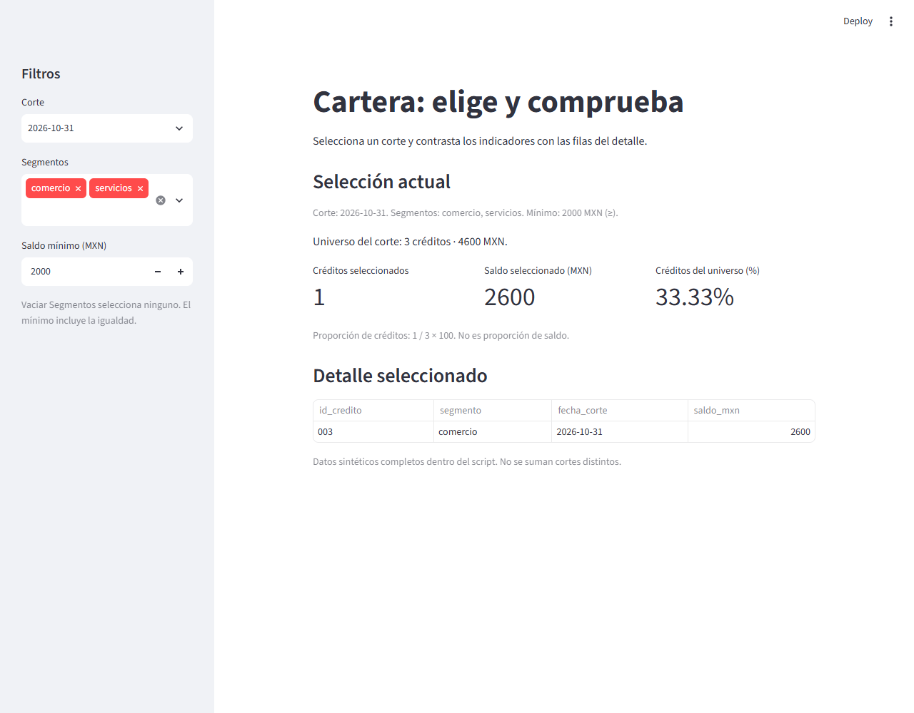

# 12.02 — Entradas, filtros y presentación

[Inicio](../../../README.md) / [Módulo 12](../README.md) / **Lección 12.02**

| Tu sesión | Qué prepararás o comprobarás |
| --- | --- |
| **Meta** | Conectar entradas con un subconjunto y explicar sus indicadores |
| **Necesitas** | Reejecución de 12.01, listas/diccionarios, condiciones y entorno Streamlit |
| **Evidencia** | Predicciones por ID/importe y app contrastada en varias combinaciones |

[Preparación](#antes-de-empezar) · [Material de apoyo](#material-de-apoyo) · [Lab 12.02](../../../labs/12_streamlit/02_inputs_filters_presentation/README.md) · [Comprobar](#evidencia-y-criterio-de-salida)

## Propósito

En [12.01](../01_first_app_execution/README.md) una casilla cambiaba la vista,
pero no los datos del total. Ahora una persona elegirá qué observaciones incluir.
La app debe mostrar esa elección y permitir comprobar cada fila y cada cifra.
Un filtro que dibuja una tabla no basta si la métrica sigue sumando otra población.

La pregunta es: **¿qué créditos de un corte pertenecen a los segmentos elegidos
y tienen saldo de al menos cierto importe?** Primero predeciremos la respuesta;
después conectaremos las entradas y contrastaremos tabla e indicadores.

## Antes de empezar

Retoma el [modelo de ejecución](../01_first_app_execution/README.md#4-qué-se-repite-y-cómo-observarlo),
[listas/diccionarios](../../01_python_foundations/02_lists_dicts/README.md) y
[condiciones](../../01_python_foundations/03_conditions_loops/README.md).
El entorno es el mismo: Python 3.12.12/Streamlit 1.66.1 como referencia comprobada.
No hay dependencias nuevas ni cambios de lockfile. Si aún falta el entorno,
elige un gestor en los [recorridos de 12.01](../01_first_app_execution/recorridos.md);
no necesitas sus resultados ni copias personales para realizar esta sección.

Abre la raíz de DS Track en el editor. Los comandos de arranque van en la
terminal del sistema; el código va en el script. La app se usa en el navegador.
Los datos están completos dentro de esta página y de `app.py`: no se carga un
CSV ni se exige una entrega anterior de cartera. Puedes repartir el trabajo
en dos sesiones: entradas y predicciones; después fronteras, vacío y lab.

## Qué vas a aprender

- Elegir una opción, varias opciones y un mínimo entero con widgets etiquetados.
- Distinguir los valores de entrada de las filas que cumplen las condiciones.
- Combinar alternativas dentro de un filtro y requisitos entre filtros.
- Mantener visibles corte, filtros efectivos, unidades y denominador.
- Conciliar tabla, cantidad, saldo y proporción con casos manuales y vacío.

## Material de apoyo

| Recurso | Para qué sirve | Uso |
| --- | --- | --- |
| [App completa](app.py) | Seguir datos → entradas → selección → presentación | Recorrido principal |
| [Arranque por shell](recorridos.md) | Ejecutar con tu gestor e intérprete ya comprobados | Elige un recorrido |
| [Comprobación de autoría](comprobar_app.py) | Contrastar casos manuales e interacciones simuladas | Opcional; AppTest se estudia en 12.08 |

Trabaja con una copia propia del script si vas a editarlo, en una carpeta nueva
como `output/mi_1202/`. Conserva el original. No necesitas notebook, base de datos
ni descarga para comprobar estos filtros.

## 1. Pregunta, datos y reglas completos

Pasamos de ventas a una pequeña cartera **totalmente ficticia**. Cada fila es
un crédito en un corte, no un movimiento ni una persona nueva. La clave es
`id_credito` + `fecha_corte`: un ID puede aparecer en ambas fechas.

| ID | Segmento | Corte | Saldo, MXN |
| --- | --- | --- | ---: |
| 001 | comercio | 2026-09-30 | 0 |
| 002 | servicios | 2026-09-30 | 2000 |
| 003 | comercio | 2026-09-30 | 2500 |
| 001 | comercio | 2026-10-31 | 100 |
| 002 | servicios | 2026-10-31 | 1900 |
| 003 | comercio | 2026-10-31 | 2600 |

IDs y cortes son texto; se conservan los ceros iniciales y las etiquetas ISO.
Aquí no interpretamos intervalos de fechas: elegimos una de dos fechas conocidas.
Los saldos son pesos enteros no negativos y presentes. Cero no es un faltante.
Los segmentos son etiquetas de la muestra, sin significado de riesgo crediticio.
Los importes coinciden con la muestra pequeña de
[10.02](../../10_polars_duckdb/02_polars_tables_expressions/README.md),
pero esta app define sus propios registros y añade las etiquetas de segmento.

Cada corte tiene tres créditos: septiembre suma **4500 MXN** y octubre **4600 MXN**.
No sumamos ambas fechas para llamarlo saldo de una fecha única.
Las reglas de la interfaz son:

| Entrada | Opciones y valor inicial | Regla |
| --- | --- | --- |
| Corte | Septiembre/octubre; inicia en octubre | Una opción exacta |
| Segmentos | comercio y servicios; inicia con ambos | Cualquiera de los elegidos; ninguno si la lista está vacía |
| Saldo mínimo | Entero de 0 a 1000000; inicia en 2000 | `saldo_mxn >= minimo_mxn`, incluye igualdad |

El **universo** son las tres filas del corte elegido, antes de aplicar segmento
y mínimo. La **selección** es el subconjunto que cumple los otros dos filtros.
Es una decisión explícita de esta app: cambiar segmentos no cambia el denominador.

## 2. Arrancar sin preparar otro entorno

Abre [app.py](app.py) y los [recorridos completos](recorridos.md). Ejecuta uno con
el mismo intérprete que tiene Streamlit. Se inicia un servidor local, como en
12.01; no uses «Run Python File» para sustituir `streamlit run`.

Al abrir la URL de la terminal verás octubre, ambos segmentos y mínimo 2000.
**Predice antes de mirar:** solo debe entrar 003, con 2600 MXN. La cantidad es 1
y la proporción **1 / 3 × 100 = 33.33%**, redondeada para presentar.

La barra lateral reúne los controles. En una ventana estrecha puede estar
plegada: ábrela con el control de la esquina superior izquierda. El área principal
muestra filtros efectivos, universo, indicadores y detalle. Detén con Ctrl+C en
la terminal antes de iniciar otra copia; no necesitas publicar la app.



Lectura sin imagen: la barra lateral elige octubre, comercio/servicios y mínimo
2000. El universo conserva tres créditos y 4600 MXN; el detalle tiene solo
003/comercio/octubre/2600 y los indicadores muestran 1, 2600 y 33.33%.
Es una captura de la app local; no requiere desplegarla.

## 3. Qué devuelve cada widget

Estos bloques aparecen completos en [la app](app.py); son instrucciones Python
dentro del servidor Streamlit. `st.sidebar` coloca los elementos en la barra
lateral; no modifica por sí mismo la tabla.

```python
import streamlit as st

corte = st.sidebar.selectbox("Corte", ["2026-09-30", "2026-10-31"], index=1)
segmentos = st.sidebar.multiselect(
    "Segmentos", ["comercio", "servicios"], default=["comercio", "servicios"]
)
minimo_mxn = st.sidebar.number_input(
    "Saldo mínimo (MXN)", min_value=0, max_value=1_000_000, value=2000, step=1
)
```

`selectbox` devuelve **el texto de la opción**, no su posición. `index=1` elige
la segunda inicialmente porque las posiciones Python empiezan en cero.
`multiselect` devuelve **una lista de textos**; `default` indica la lista inicial.
`number_input` devuelve un entero porque los límites, valor inicial y paso son
enteros. El guion bajo de `1_000_000` hace legible el literal: vale un millón.
`step=1` permite comprobar la frontera 2000/2001 sin introducir decimales.

Cambiar un control produce otra pasada del script con sus valores actuales,
como en 12.01. El valor inicial no se impone de nuevo sobre cada interacción
del mismo widget. No hay botón «Aplicar»: cada cambio confirmado se refleja
en la vista. Al escribir un número, confirma con Enter o sal del campo.
Agrupar cambios en un formulario corresponde a 12.04.

**Predice:** si quitas comercio, `segmentos` será `["servicios"]`, no el texto
`"servicios"`. Si quitas también servicios será `[]`, que aquí significa ninguno.
No introducimos una opción «Todos» que pueda confundirse con esa lista vacía.

## 4. De entradas a filas: no basta tener controles

El script guarda las seis filas en `cartera`. Cada elemento es un diccionario.
Primero obtiene el universo del corte y después la selección:

```python
universo = [fila for fila in cartera if fila["fecha_corte"] == corte]
seleccion = [
    fila for fila in universo
    if fila["segmento"] in segmentos and fila["saldo_mxn"] >= minimo_mxn
]
```

Una comprensión de lista construye una lista nueva recorriendo la entrada:
«toma `fila`, para cada `fila` de la lista, si cumple la condición». Si esa
sintaxis es nueva, el segundo paso equivale a este ciclo:

```python
seleccion = []
for fila in universo:
    if fila["segmento"] in segmentos and fila["saldo_mxn"] >= minimo_mxn:
        seleccion.append(fila)
```

`in` comprueba pertenencia: comercio **o** servicios cuando elegiste ambos.
`and` une requisitos: segmento elegido **y** saldo suficiente. La igualdad de
corte ya se aplicó antes. El orden de los registros se conserva; no se deduplican
ni cambian los saldos. Son listas nuevas que referencian los registros; no son
copias profundas. La app no modifica esos diccionarios.

Si añades un widget sin usar su valor en el filtro, cambiará la pantalla del
control, pero no la selección. Si calculas la métrica sobre `cartera`, mezclarás
cortes aunque la tabla esté filtrada. Rastrear la entrada hasta la condición
es parte de comprobar que el control tiene efecto.

## 5. Qué resumen representa cada cifra

El universo se resume **antes** de los otros filtros; la selección, después:

```python
cantidad_universo = len(universo)
saldo_universo = sum(fila["saldo_mxn"] for fila in universo)
cantidad = len(seleccion)
saldo = sum(fila["saldo_mxn"] for fila in seleccion)
proporcion = cantidad / cantidad_universo * 100
```

`len` cuenta filas y `sum` suma pesos. El denominador siempre es 3 porque el
selector solo ofrece los dos cortes completos de esta muestra. No es una función
general para cualquier fuente: si posteriormente admites cortes sin registros,
deberás definir el tratamiento del denominador cero antes de dividir.

En octubre con mínimo 2000 y ambos segmentos, la proporción de créditos es
**33.33%**. No es 2600 / 4600 × 100 ≈ 56.52%, que sería otra pregunta sobre saldo.
La etiqueta y la fórmula visibles evitan intercambiar esas medidas.

La app usa `st.columns(3)` para crear tres áreas y luego `area.metric(etiqueta,
valor)` para colocar los indicadores. `f"{proporcion:.2f}%"` presenta dos
decimales y el símbolo: no cambia las filas seleccionadas ni redondea sus saldos.
El caption de filtros usa `', '.join(segmentos)` para juntar las etiquetas;
si la lista está vacía, `or 'ninguno'` produce ese texto explicativo. No altera el filtro.

El detalle usa `st.table(seleccion)`. Para esta muestra pequeña permite recuperar
IDs, segmento, corte e importe. Las gráficas y descargas se profundizarán en 12.07;
esta lección no necesita añadirlas para comprobar el resumen.

## 6. Casos que puedes resolver a mano

| Corte | Segmentos | Mínimo, MXN | Pares ID/saldo | Cantidad / saldo | % de créditos del corte |
| --- | --- | ---: | --- | --- | ---: |
| Octubre | ambos | 2000 | 003/2600 | 1 / 2600 | 33.33% |
| Septiembre | ambos | 2000 | 002/2000, 003/2500 | 2 / 4500 | 66.67% |
| Septiembre | ambos | 2001 | 003/2500 | 1 / 2500 | 33.33% |
| Octubre | servicios | 2000 | Ninguno | 0 / 0 | 0.00% |
| Octubre | servicios | 1900 | 002/1900 | 1 / 1900 | 33.33% |
| Octubre | comercio | 0 | 001/100, 003/2600 | 2 / 2700 | 66.67% |
| Septiembre | ambos | 0 | 001/0, 002/2000, 003/2500 | 3 / 4500 | 100.00% |
| Octubre | ninguno | 0 | Ninguno | 0 / 0 | 0.00% |

Elige una fila, predice y cambia los controles. Contrasta **todos los pares**,
la suma y el universo. No basta que aparezca una cantidad esperada: dos errores
pueden conservar el total o el conteo. Después vuelve al caso inicial para
comprobar que no quedan cifras de la combinación anterior.

Cuando no hay coincidencias la app muestra un mensaje en lugar de una tabla
engañosa con datos anteriores. Cantidad y saldo seleccionados son cero por la
regla de selección vacía sobre una fuente completa sin faltantes; no hemos
convertido saldos desconocidos en ceros. El universo del corte sigue siendo
tres y su saldo sigue en 4500 o 4600. Un corte ausente o un CSV inválido serían
otros casos, que se desarrollarán en 12.06.

## 7. Reconstruir y revisar la presentación

Repite un caso con ambos segmentos, uno con un solo segmento y otro con ninguno.
En ventana amplia identifica entradas y resultados; en una estrecha abre/cierra
la barra lateral y recupera las cuatro columnas del detalle. Que la app no lance
una excepción no demuestra que el texto o el denominador se entiendan.

Guarda tus cambios en una copia personal, detén el servidor e inicia de nuevo
el archivo guardado. Debe comenzar en octubre, ambos segmentos y mínimo 2000.
Una pestaña independiente debe comenzar con sus propios controles; cambiar una
no debe cambiar los filtros de la otra. Esto no implementa almacenamiento externo
ni estado propio: esa separación se profundiza en 12.04.

| Síntoma | Qué revisar |
| --- | --- |
| El control cambia, pero los datos no | Su variable aparece en la condición y la app ejecuta el archivo esperado |
| Aparece 002/2000 con mínimo 2001 | Comparador, mínimo efectivo y confirmación del campo numérico |
| Quitar todos los segmentos muestra todo | No usar una condición que trate `[]` como «sin filtro» |
| Proporción dice 100% al elegir un segmento | Denominador del universo antes de filtrar segmento/mínimo |
| Tabla correcta y saldo incorrecto | Ambos se calculan desde `seleccion`, sin mezclar cortes |
| El total parece cero con datos desconocidos | Esta muestra no tiene ausencias; no generalizar esa regla a otra fuente |
| En móvil no veo controles | Abrir la barra lateral; no buscar un botón de aplicar inexistente |

Por ahora el script conserva juntos datos, cálculo e interfaz para seguir el
flujo completo. 12.03 los separará en funciones importables. No añadimos caché,
formularios, lectura de archivos arbitrarios ni dependencias nuevas.

## Práctica

Realiza el [lab 12.02](../../../labs/12_streamlit/02_inputs_filters_presentation/README.md)
para contrastar filtros, fronteras, vacío y denominadores. El
[comprobador de autoría](comprobar_app.py) simula esas interacciones contra
esperados manuales; es opcional y no sustituye revisar el navegador. AppTest
se estudiará como tema en 12.08.

## Evidencia y criterio de salida

| Conserva | Comprueba | Explica |
| --- | --- | --- |
| Tabla de predicciones y observaciones | IDs/importes, cantidad y suma para varias combinaciones | Cómo actúan `in`, `and` y `>=` |
| Nota de frontera, vacío y nuevo arranque | 2000/2001, ningún segmento, recuperación y valores iniciales | Universo frente a selección; cantidad frente a saldo |

Puedes avanzar cuando traces cada entrada hasta su condición, recuperes los
pares correctos y justifiques el denominador, incluidos los casos vacíos. Quien
aprende hace la práctica; su compañero cambia una condición y pide predecir
antes de ejecutar. Guarda evidencia, ayudas y dudas en una nota personal;
PROGRESS.md registra desarrollo editorial. No hay proyecto ni checkpoint de
aplicación implementado asociado; las pruebas de autoría no acreditan tu práctica.

## Referencias

- [st.selectbox](https://docs.streamlit.io/develop/api-reference/widgets/st.selectbox).
- [st.multiselect](https://docs.streamlit.io/develop/api-reference/widgets/st.multiselect).
- [st.number_input](https://docs.streamlit.io/develop/api-reference/widgets/st.number_input).
- [Barra lateral](https://docs.streamlit.io/develop/api-reference/layout/st.sidebar), [columnas](https://docs.streamlit.io/develop/api-reference/layout/st.columns) y [métricas](https://docs.streamlit.io/develop/api-reference/data/st.metric).
- [Comprensiones de listas en Python](https://docs.python.org/3/tutorial/datastructures.html#list-comprehensions).

Datos, ejemplos y comprobaciones propios de DS Track. Documentación consultada
el 2026-10-27; APIs comprobadas con Streamlit 1.66.1/Python 3.12.12. Las páginas
en línea pueden avanzar respecto de la versión del entorno de referencia.

## Siguiente paso

12.03 — Separar datos e interfaz sigue **planificada**. Después del lab, consulta
su [alcance previsto](../README.md#03-separar-datos-e-interfaz); no hay todavía
una lección/lab de esa sección que ejecutar.

[← Módulo 12](../README.md) · [Lab 12.02](../../../labs/12_streamlit/02_inputs_filters_presentation/README.md) · [Alcance de 12.03 →](../README.md#03-separar-datos-e-interfaz)
