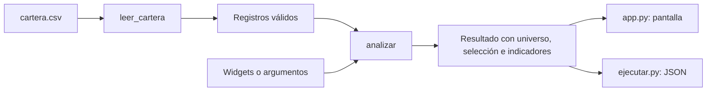
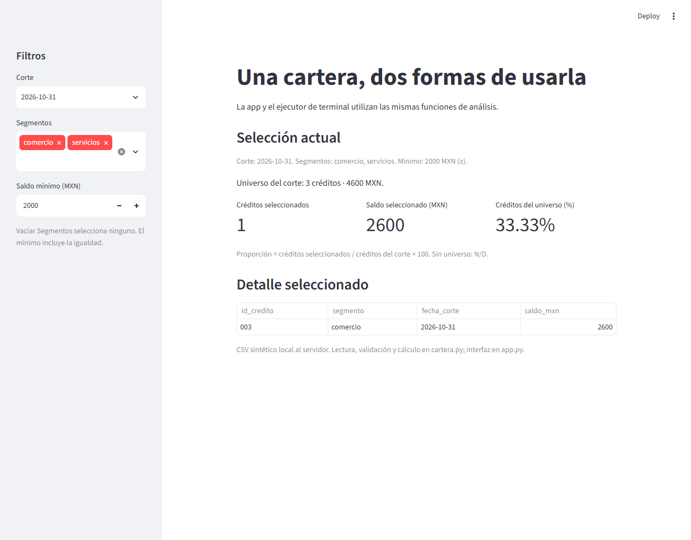

# 12.03 — Separar datos e interfaz

[Inicio](../../../README.md) / [Módulo 12](../README.md) / **12.03**

**Un cálculo que puedas usar desde una app y desde un script.**

| Meta | Necesitas | Evidencia |
| --- | --- | --- |
| Separar lectura, reglas y presentación sin duplicar el análisis | Funciones, imports, CSV y los filtros de 12.02 | Dos salidas conciliadas y una variante de datos explicada |

[Preparación](#antes-de-empezar) · [Material de apoyo](#material-de-apoyo) · [Lab 12.03](../../../labs/12_streamlit/03_data_interface/README.md) · [Criterio de salida](#evidencia-y-criterio-de-salida)

## Propósito

En 12.02, un archivo contenía datos, filtros, sumas y widgets. Eso permitía ver
el recorrido completo. Si ahora necesitas el mismo cálculo en un script, copiarlo
crearía dos versiones que podrían cambiar por separado. Aquí extraemos funciones:
ambos consumidores llaman al mismo análisis y deciden cómo presentar su salida.

No buscamos repartir archivos por repartir. Cada archivo tendrá una responsabilidad
que puedas explicar y comprobar sin arrancar toda la aplicación.

## Antes de empezar

- Revisa [12.02 — Entradas, filtros y presentación](../02_inputs_filters_presentation/README.md).
- Recupera [funciones](../../01_python_foundations/README.md) y
  [05.01 — Del notebook a módulos](../../05_python_applied/01_notebook_to_modules/README.md).
  Aquí volvemos a explicar los imports necesarios.
- Usa la carpeta completa de esta sección. Incluye todos los archivos y un CSV
  propio; **no exige entregas personales anteriores**.
- Para el ejecutor basta Python estándar. Para la app usa el mismo entorno local
  de 12.01; [recorridos](recorridos.md) reúne los comandos por shell. Referencias
  comprobadas: Python 3.12.12 y Streamlit 1.66.1. Sin dependencias nuevas.

## Qué vas a aprender

- Identificar qué parte lee archivos, cuál aplica reglas y cuál presenta.
- Importar funciones sin iniciar una app ni leer datos durante la importación.
- Pasar entradas explícitas y devolver un resultado reutilizable.
- Resolver la ruta de un recurso propio desde su archivo, independientemente de la terminal.
- Conciliar app y script con referencias manuales, incluso al cambiar los datos.

## Material de apoyo

| Recurso | Para qué | Uso |
| --- | --- | --- |
| [cartera.csv](cartera.csv) | Seis registros sintéticos, completos y pequeños | Esencial: leer y contrastar |
| [cartera.py](cartera.py) | Lectura, validación y análisis sin Streamlit | Esencial: seguir las funciones |
| [configuracion.py](configuracion.py) | Ruta propia y valores iniciales | Esencial: explicar las rutas |
| [app.py](app.py) | Consumidor con widgets y presentación | Esencial: ejecutar e inspeccionar |
| [ejecutar.py](ejecutar.py) | Consumidor de terminal, salida JSON | Esencial: comparar el mismo caso |
| [Recorridos](recorridos.md) | Comandos completos por shell | Elige uno |
| [comprobar_modelo.py](comprobar_modelo.py), [comprobar_app.py](comprobar_app.py) | Controles de autoría y regresión | Opcional; las pruebas de apps se desarrollan en 12.08 |

## 1. Primero, una función que devuelve un resultado

Esta muestra de dos créditos en un mismo corte se puede ejecutar en Python sin
Streamlit. Pégala en un script nuevo o en una celda de notebook:

```python
def seleccionar(filas, minimo):
    # Devuelve otra lista; no imprime ni necesita conocer la pantalla.
    return [dict(fila) for fila in filas if fila["saldo_mxn"] >= minimo]

muestra = [
    {"id_credito": "001", "saldo_mxn": 0},
    {"id_credito": "002", "saldo_mxn": 2000},
]
resultado = seleccionar(muestra, 2000)
print(resultado)  # [{'id_credito': '002', 'saldo_mxn': 2000}]
print(muestra)    # Conserva los dos registros originales.
```

`filas` y `minimo` son entradas explícitas. `return` entrega datos al código que
llama la función; `print` es una decisión de ese consumidor. `dict(fila)` copia
cada registro seleccionado: aquí todos los campos son valores simples, por lo
que editar esa salida no cambia el registro original. Una estructura anidada
requeriría revisar la profundidad de la copia.

Esta función mínima supone entradas válidas. El módulo completo añade contrato,
universo por corte e indicadores; no uses este mínimo como lector de CSV general.

## 2. Los datos y su contrato

Unidad: un crédito ficticio en una fecha de corte. Clave: `id_credito` +
`fecha_corte`; un ID puede aparecer en dos cortes, una pareja no puede repetirse.
Los segmentos son etiquetas de esta muestra, no una calificación crediticia.
El [CSV completo](cartera.csv) contiene los mismos valores conocidos de 12.02:

```csv
id_credito,segmento,fecha_corte,saldo_mxn
001,comercio,2026-09-30,0
002,servicios,2026-09-30,2000
003,comercio,2026-09-30,2500
001,comercio,2026-10-31,100
002,servicios,2026-10-31,1900
003,comercio,2026-10-31,2600
```

| Campo | Regla de esta sección |
| --- | --- |
| `id_credito` | Texto de tres dígitos ASCII; conserva `001` |
| `segmento` | Exactamente `comercio` o `servicios` |
| `fecha_corte` | Texto `YYYY-MM-DD`, fecha real, años 1900–2100 |
| `saldo_mxn` | Pesos enteros conocidos, 0–1000000; cero sí es un dato |

UTF-8, coma y encabezado exacto en ese orden. El lector no recorta textos ni
rellena ausencias; rechaza importes vacíos, decimales, negativos, signos y ceros
iniciales como `02000`. Es un contrato didáctico acotado, no un lector universal.
El CSV con solo encabezado es válido y representa cero registros.

`csv.DictReader` devuelve textos. [leer_cartera](cartera.py) revisa primero la forma
del importe y después usa `int`; así no convierte `2000.5` a `2000` ni pierde el
cero inicial del ID. `with open(..., newline="", encoding="utf-8")` cierra el
archivo incluso si hay un error y deja a `csv` interpretar los saltos de línea.

Antes de cualquier filtro se valida **toda la fuente**, incluidas las filas de
septiembre cuando preguntas por octubre. Un duplicado fuera de la selección no
debe quedar oculto. Ante un fallo se rechaza el conjunto: no se borran registros
ni se fabrica un saldo cero. El archivo de origen permanece intacto.

## 3. Una responsabilidad por archivo



Sin renderizador: ambos consumidores leen el CSV con la misma función y envían
registros y parámetros a `analizar`. Esa función devuelve un diccionario; la app
lo presenta con Streamlit y el ejecutor lo imprime como JSON.

| Archivo | Responsabilidad | Límite que conviene respetar |
| --- | --- | --- |
| `configuracion.py` | Ruta propia y valores iniciales | No lee el CSV ni inicia procesos |
| `cartera.py` | Leer, validar y calcular | No importa Streamlit ni imprime resultados |
| `app.py` | Recoger entradas, coordinar y presentar | No vuelve a escribir el filtro ni las sumas |
| `ejecutar.py` | Interpretar argumentos y producir JSON | Usa el mismo análisis, sin servidor web |

En [app.py](app.py) encontrarás:

```python
from cartera import analizar, leer_cartera
from configuracion import RUTA_DATOS

filas = leer_cartera(RUTA_DATOS)
# corte, segmentos y minimo los obtienen los widgets.
resultado = analizar(filas, corte, segmentos, minimo)
```

El fragmento muestra la conexión; para ejecutar usa el archivo completo, que
define los widgets antes de llamar a `analizar`. `from cartera import analizar`
busca el módulo hermano `cartera.py` y incorpora el nombre de esa función.
No se escribe `.py` en el import. Conserva los archivos juntos y evita nombrarlos
`csv.py`, `json.py` o `streamlit.py`: ocultarían los módulos que necesitas.

**Importar también ejecuta las instrucciones del módulo la primera vez.** Por
eso no hay `leer_cartera(...)`, `print(...)` ni `st.title(...)` a nivel superior
en el modelo. Allí se definen funciones y constantes. En `ejecutar.py`, el guardia
`if __name__ == "__main__": main()` llama al programa cuando lo ejecutas como
script; importarlo no analiza argumentos ni imprime JSON.

## 4. El contrato del análisis

Firma: `analizar(filas, corte, segmentos, minimo_mxn)`. Revisa datos y parámetros,
elige el universo de la fecha y luego aplica segmento y mínimo inclusivo `>=`.
Lista de segmentos vacía significa **ninguno**; no significa todos.

Devuelve un diccionario con:

- `corte`, `segmentos`, `minimo_mxn`: parámetros efectivos.
- `universo`: cantidad y saldo del corte antes de segmento/mínimo.
- `seleccion`: registros elegidos, ordenados por ID, con sus cuatro campos.
- `indicadores`: cantidad, saldo y porcentaje de créditos respecto al universo.

Prueba en la consola Python **abierta en la carpeta de la sección**:

```python
from cartera import leer_cartera, analizar
from configuracion import RUTA_DATOS

filas = leer_cartera(RUTA_DATOS)
r = analizar(filas, "2026-10-31", ["comercio", "servicios"], 2000)
print(r["universo"])     # {'cantidad': 3, 'saldo_mxn': 4600}
print(r["seleccion"])    # Solo 003, comercio, 2026-10-31, 2600.
print(r["indicadores"])  # cantidad: 1, saldo_mxn: 2600, porcentaje: 33.3333...
```

La interfaz redondea a `33.33%`; el modelo conserva el valor calculado. No
comparamos porcentajes de saldo: el denominador cuenta créditos. La función
no lee archivos, escribe, imprime ni altera `filas`. Su resultado depende de
esas entradas, lo cual permite usarla en terminal o probarla por separado.

| Control manual | Selección | Universo | Porcentaje de créditos |
| --- | --- | --- | --- |
| Octubre, ambos, ≥ 2000 | 003 / 2600 MXN | 3 / 4600 MXN | 33.33% |
| Septiembre, ambos, ≥ 2000 | 002 / 2000 y 003 / 2500 | 3 / 4500 MXN | 66.67% |
| Septiembre, ambos, ≥ 2001 | 003 / 2500 | 3 / 4500 MXN | 33.33% |
| Octubre, servicios, ≥ 2000 | Ninguno | 3 / 4600 MXN | 0.00% |
| Octubre, ningún segmento | Ninguno | 3 / 4600 MXN | 0.00% |
| Noviembre, ambos, ≥ 2000 (ejecutor) | Ninguno | 0 / 0 MXN | No definido |

Si el corte no tiene registros, el porcentaje es `None` en Python, `null` en JSON
y `N/D` en la app. Una suma vacía de registros válidos es cero; no representa
saldos faltantes. La app ofrece los dos cortes de la muestra mediante configuración;
el ejecutor admite cualquier fecha válida del contrato para comprobar el vacío.

## 5. Las rutas pertenecen a un lugar concreto

En [configuracion.py](configuracion.py):

```python
from pathlib import Path
RUTA_DATOS = Path(__file__).resolve().with_name("cartera.csv")
```

`__file__` identifica el archivo del módulo. `resolve()` obtiene su ruta absoluta;
`with_name` cambia el nombre final por `cartera.csv`. Aunque la terminal esté en
otra carpeta, la ruta predeterminada apunta al CSV que acompaña a la configuración.
En cambio, `open("cartera.csv")` dependería de la carpeta actual de trabajo.

El ejecutor permite `--fuente otra.csv`: una ruta **explícita y relativa** se
interpreta respecto a la terminal. Si quieres eliminar esa ambigüedad, entrega
una ruta absoluta. No cambiamos el directorio global con `chdir` para corregirla.

En Streamlit la lectura ocurre en la máquina del servidor. Aquí es tu equipo;
una ruta escrita en Python no permite leer libremente el disco de otro visitante.
La carga de archivos por navegador sería otra actividad.

## 6. Ejecuta los dos consumidores

Sigue [recorridos](recorridos.md): primero el ejecutor, después la app, desde la
raíz del repositorio. El ejecutor sin argumentos produce JSON con octubre,
ambos segmentos y mínimo 2000. JSON es texto estructurado: listas, objetos y
números; aquí sale en la terminal, no se guarda automáticamente en un archivo.



Captura propia de la app local. Alternativa textual: filtros de octubre, ambos
segmentos y mínimo 2000; universo tres créditos/4600 MXN y una fila seleccionada,
003/comercio/2026-10-31/2600, equivalente al 33.33% de los créditos del corte.

En la app confirma `1`, `2600`, `33.33%` y la fila 003. Cambia a septiembre y
ejecuta el mismo caso con `--corte 2026-09-30`: ambos deben mostrar dos registros
y 4500 MXN. La igualdad entre consumidores comprueba coherencia; las referencias
manuales anteriores comprueban además que la regla y las cifras sean correctas.

Cada pasada de la app llama explícitamente a `leer_cartera`. Importar un módulo
normalmente reutiliza el módulo ya cargado en ese proceso: **eso no guarda el
resultado del análisis ni sustituye una caché de datos**. La reejecución de la app
no implica reejecutar automáticamente todas las instrucciones de cada import.
Al editar módulos o configuración durante esta práctica, detén y reinicia la app
para partir de un proceso nuevo. Caché y estado se desarrollarán después.

El manejo mínimo de error usa `st.error` para explicar la fuente inválida y
`st.stop` para detener esa pasada. El ejecutor devuelve código 2 y ningún JSON
de éxito. No captura errores de programación indiscriminadamente; 12.06 ampliará
la experiencia de mensajes.

### Si algo falla

| Síntoma | Qué revisar |
| --- | --- |
| `No module named cartera` | Copiaste solo app.py o ejecutaste fragmentos desde otra carpeta; usa todos los archivos y el comando completo |
| CSV no encontrado | Revisa el archivo junto a configuracion.py; `--fuente` relativo usa la carpeta de la terminal |
| Rechazo de saldo o encabezado | Conserva originales, compara con el contrato; no conviertas ausencias a cero |
| Cambiaste Python pero observas comportamiento anterior | Detén con Ctrl+C y reinicia el servidor de tu práctica |
| Mismo total con distinto detalle | Compara ID, segmento, fecha e importe; las sumas pueden compensar errores |

## Práctica

Realiza el [Lab 12.03](../../../labs/12_streamlit/03_data_interface/README.md).
Trabajarás en una copia completa, cambiarás un saldo del CSV y comprobarás el
resultado en ambos consumidores. Después introducirás un duplicado fuera del
filtro para verificar que el contrato se aplica antes de seleccionar.

## Evidencia y criterio de salida

| Conserva | Comprueba | Explica |
| --- | --- | --- |
| Carpeta completa de tu variante | App y JSON con mismos parámetros, filas y cifras | Quién lee, calcula y presenta |
| Predicción y resultado de base/cambio | 2600 → 2800 y universo 4600 → 4800 | Por qué cambiar datos no exige copiar reglas |
| Caso vacío y rechazo fuera del filtro | 0% con universo frente a porcentaje indefinido | Validación previa, ruta propia y ausencia de efectos al importar |

Pide a tu compañero que cambie un parámetro y te solicite justificar el detalle
antes de mirar la cifra. Registra ayudas, dudas y siguiente paso en tu bitácora
personal; no en PROGRESS.md. No hay proyecto integrador ni checkpoint Streamlit
implementado todavía. Disponer de esta sección no acredita haberla practicado.

## Referencias

Documentación primaria consultada el 2026-10-27; APIs comprobadas con las versiones
indicadas en la preparación. Los ejemplos de esta sección son propios.

- [Python 3.12: módulos e imports](https://docs.python.org/3.12/tutorial/modules.html).
- [Python 3.12: csv](https://docs.python.org/3.12/library/csv.html),
  [pathlib](https://docs.python.org/3.12/library/pathlib.html) y
  [argparse](https://docs.python.org/3.12/library/argparse.html).
- [Streamlit: arquitectura cliente/servidor](https://docs.streamlit.io/develop/concepts/architecture/architecture).

## Siguiente paso

Después del lab, continúa con el alcance de
[12.04 — Estado de sesión y formularios](../README.md#04-estado-de-sesion-y-formularios),
todavía planificado: conservar elecciones y controlar cuándo aplicarlas.

---

[← 12.02](../02_inputs_filters_presentation/README.md) · [Módulo 12](../README.md) · [Lab 12.03 →](../../../labs/12_streamlit/03_data_interface/README.md)
