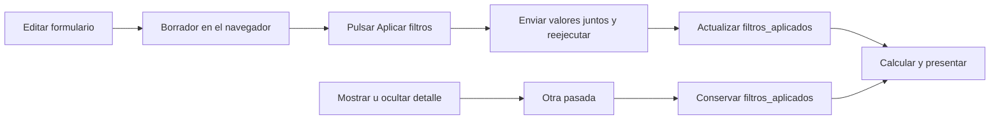
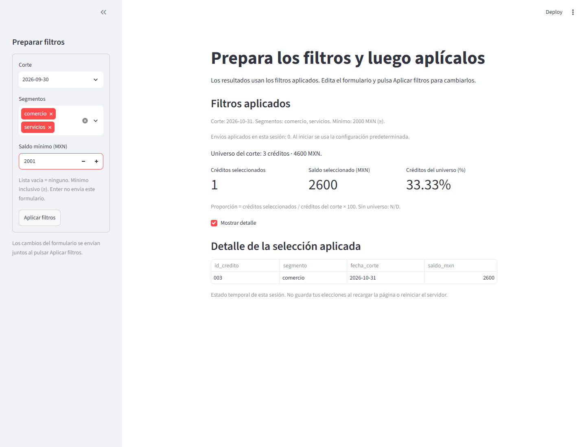

# 12.04 — Estado de sesión y formularios

[Inicio](../../../README.md) / [Módulo 12](../README.md) / **12.04**

**Prepara varias elecciones y decide cuándo aplicarlas.**

| Tu sesión | Qué prepararás o comprobarás |
| --- | --- |
| **Meta** | Conservar filtros aplicados entre pasadas y enviarlos como un lote |
| **Necesitas** | Reejecución, widgets y funciones de 12.01–12.03 |
| **Evidencia** | Predicción, envío, otra pasada y sesión nueva contrastados |

[Preparación](#antes-de-empezar) · [Material de apoyo](#material-de-apoyo) · [Lab 12.04](../../../labs/12_streamlit/04_session_state_forms/README.md) · [Criterio de salida](#evidencia-y-criterio-de-salida)

## Propósito

En 12.02 y 12.03 cada cambio de filtro actualizaba la selección. A veces quieres
preparar corte, segmentos y mínimo antes de cambiar los resultados. Aquí un
formulario reúne esas entradas y un botón aplica la combinación completa.

También necesitamos recordar qué combinación se aplicó. Si después ocultas el
detalle, esa nueva pasada no debe devolver los filtros a su valor inicial. Usaremos
`st.session_state`, memoria de una sesión entre pasadas, y separaremos las claves
de los widgets de una copia de los filtros aplicados.

## Antes de empezar

- Revisa [12.01 — Modelo de ejecución](../01_first_app_execution/README.md),
  [12.02 — Entradas y filtros](../02_inputs_filters_presentation/README.md) y
  [12.03 — Separar datos e interfaz](../03_data_interface/README.md).
- Trabaja desde una copia del repositorio. El preparador toma **fuentes incluidas**
  de 12.03; no necesita que hayas guardado una entrega de esa sección.
- Usa Python 3.12.12/Streamlit 1.66.1 como referencias comprobadas y el mismo
  entorno local de 12.01. No hay paquetes ni lockfiles nuevos.
- Sigue los [recorridos completos](recorridos.md): primero crea una carpeta nueva
  de práctica, después ejecuta su app. **No arranques el app.py fuente de esta
  sección directamente:** sus módulos de análisis llegan con la preparación.
- El mínimo [contador.py](contador.py) sí es autónomo; permite empezar sin CSV.

## Qué vas a aprender

- Distinguir variable local, estado de widget, estado propio de sesión y archivo.
- Inicializar una clave solo cuando falta y actualizarla sin reiniciarla en cada pasada.
- Usar claves explícitas y guardar una copia de los filtros aplicados.
- Enviar entradas con `st.form` y `st.form_submit_button`.
- Comprobar qué persiste al reejecutar y qué se reinicia al abrir una sesión nueva.

## Material de apoyo

| Recurso | Para qué sirve | Uso |
| --- | --- | --- |
| [contador.py](contador.py) | Mínimo completo de memoria entre pasadas | Esencial: observar antes de abrir la app de cartera |
| [Preparador](preparar_practica.py) | Armar una carpeta nueva con fuentes conocidas | Esencial, una vez por copia |
| [app.py](app.py) | Formulario, filtros aplicados y presentación | Esencial: leer aquí y ejecutar la copia preparada |
| [Funciones de 12.03](../03_data_interface/cartera.py), [CSV](../03_data_interface/cartera.csv), [configuración](../03_data_interface/configuracion.py) y [ejecutor](../03_data_interface/ejecutar.py) | Reutilizar lectura, contrato y cálculo | El preparador los copia sin modificarlos |
| [Recorridos](recorridos.md) | Preparar, iniciar, detener y comprobar por shell | Elige un gestor y un shell |
| [Controles de autoría](comprobar_app.py) | Revisar estado y envíos | Opcional; AppTest se estudia en 12.08 |

## 1. Un contador antes de los filtros

Abre [contador.py](contador.py) y ejecútalo con Streamlit según los recorridos.
Su parte central es:

```python
local = 0
local += 1
if "contador" not in st.session_state:
    st.session_state["contador"] = 0

if st.button("Sumar uno"):
    st.session_state["contador"] += 1

st.checkbox("Provocar otra pasada", key="otra_pasada")
st.write(f"Variable local: {local}")
st.write(f"Contador de la sesión: {st.session_state['contador']}")
```

`st.session_state` se usa de forma parecida a un diccionario. La clave `contador`
nombra un valor; antes de leerlo lo inicializamos **solo si no existe**. Luego
`+= 1` suma uno al valor que ya estaba guardado. No se escribe un archivo.

| Acción | Variable local | Contador de sesión |
| --- | --- | --- |
| Abrir la app | 1 | 0 |
| Pulsar Sumar uno | 1 | 1 |
| Pulsar otra vez | 1 | 2 |
| Cambiar la casilla | 1 | 2 |
| Abrir otra pestaña como sesión nueva | 1 | 0 en la nueva; 2 en la anterior |

La variable `local` vuelve a empezar en cero al ejecutar el script. El contador
permanece en la sesión y cambia únicamente cuando el botón devuelve `True`.
Ese `True` dura la pasada provocada por el clic; no es un interruptor que quede
activado para siempre. Presentamos el contador **después** de actualizarlo para
mostrar el valor nuevo en esa misma pasada.

Si escribieras `st.session_state["contador"] = 0` sin el `if`, lo reiniciarías en
cada pasada. Si guardaras el contador en una variable global de un módulo, no
estarías expresando que pertenece a una sesión de visitante.

## 2. Qué clase de memoria necesitas

| Lugar | Qué contiene aquí | Duración y responsabilidad |
| --- | --- | --- |
| Variable del script | `enviado`, `resultado` | Se obtiene de nuevo en cada pasada |
| Clave de un widget | `corte_borrador` | Streamlit relaciona el control con su valor en esa sesión |
| Clave propia de sesión | `filtros_aplicados`, `envios` | La app conserva y actualiza estos valores entre pasadas |
| Archivo | `cartera.csv` | Sigue en disco cuando termina el proceso; no guarda filtros |

Una `key` identifica el widget; no es su etiqueta visible. Aquí las claves son
explícitas y distintas: `corte_borrador`, `segmentos_borrador`, `minimo_borrador`
y `mostrar_detalle`. No uses la misma clave para dos widgets.

La app crea esos widgets en cada pasada. Cambiar de página, dejar de crear un
widget o alterar su identidad tiene otras reglas; aquí no necesitamos navegación
multipágina ni conservación de widgets ocultos. Guardar filtros en una clave
propia evita usar un widget como único dueño de la selección aplicada.

El estado de sesión está ligado a la conexión con la app. Otra pestaña tiene su
sesión independiente. Recargar la página o reiniciar el servidor inicia de nuevo
este ejemplo; no lo uses como bitácora permanente. Conserva la evidencia personal
fuera de esa memoria. Tampoco es una caché: recordar un parámetro y reutilizar
un cálculo costoso son decisiones diferentes; la caché se trabaja en 12.05.

## 3. Datos y reglas de la app completa

Reutilizamos seis observaciones sintéticas de tres créditos en dos cortes,
incluidas en el repositorio. Unidad: un crédito en una fecha; clave: ID/corte.
Los importes son pesos enteros conocidos y el cero es válido.

| ID | Segmento | Corte | Saldo MXN |
| --- | --- | --- | ---: |
| 001 | comercio | 2026-09-30 | 0 |
| 002 | servicios | 2026-09-30 | 2000 |
| 003 | comercio | 2026-09-30 | 2500 |
| 001 | comercio | 2026-10-31 | 100 |
| 002 | servicios | 2026-10-31 | 1900 |
| 003 | comercio | 2026-10-31 | 2600 |

El [contrato y las funciones](../03_data_interface/README.md#2-los-datos-y-su-contrato)
siguen siendo los de 12.03: encabezado exacto, IDs de tres dígitos, segmentos
conocidos, fechas reales 1900–2100, saldos enteros 0–1000000 y claves únicas.
Se revisa toda la fuente antes de filtrar, incluidas filas fuera de la selección.

Primero elegimos el universo del corte; después aplicamos segmentos y mínimo
inclusivo `>=`. Lista vacía selecciona ninguno. El porcentaje cuenta créditos
seleccionados respecto a todos los créditos del corte, no pesos. No sumamos
septiembre y octubre como si fueran una sola cartera a una fecha.

| Caso aplicado | Detalle | Universo | Indicadores |
| --- | --- | --- | --- |
| Octubre, ambos, ≥ 2000 | 003 / 2600 | 3 / 4600 MXN | 1, 2600 MXN, 33.33% |
| Septiembre, ambos, ≥ 2000 | 002 / 2000 y 003 / 2500 | 3 / 4500 MXN | 2, 4500 MXN, 66.67% |
| Septiembre, ambos, ≥ 2001 | 003 / 2500 | 3 / 4500 MXN | 1, 2500 MXN, 33.33% |
| Octubre, servicios, ≥ 2000 | Ninguno | 3 / 4600 MXN | 0, 0 MXN, 0.00% |

## 4. Prepara tu copia sin duplicar el algoritmo

Ejecuta [preparar_practica.py](preparar_practica.py) según los recorridos. Crea
por ejemplo `output/practica_1204`, una carpeta que todavía no debe existir.
Si ya existe, conserva esa práctica y elige otro nombre; el preparador no la
sobrescribe. No instala paquetes ni inicia un servidor.

```text
output/practica_1204/
  app.py              # Interfaz nueva de 12.04
  contador.py         # Mínimo de estado
  cartera.py          # Funciones de 12.03, sin cambios
  configuracion.py    # Ruta al CSV que acompaña a esta copia
  cartera.csv         # Copia de la muestra conocida
  ejecutar.py         # Misma transformación desde la terminal
```

Trabajar en una copia permite variar el CSV sin cambiar las fuentes educativas.
La ruta predeterminada sigue naciendo de `__file__`, por lo que no depende de
la carpeta desde la que arranques. El preparador necesita las carpetas fuente
de 12.03 y 12.04 dentro del repositorio; **no necesita tus salidas anteriores**.

## 5. Del formulario a los filtros aplicados

Abre el [app.py fuente](app.py) y sigue estos pasos en la copia preparada:

1. Lee y valida la fuente actual; si falla, explica el error y detiene esa pasada.
2. Si falta `filtros_aplicados`, inicia octubre, ambos segmentos y mínimo 2000.
   Si falta `envios`, lo inicia en cero. Por eso hay resultados antes del primer clic.
3. Crea el formulario con tres widgets y su botón de envío.
4. Solo si `enviado` es `True`, copia los valores a `filtros_aplicados` e incrementa `envios`.
5. Llama al análisis con **los filtros aplicados** y presenta tabla e indicadores.

```python
with st.form("filtros", clear_on_submit=False, enter_to_submit=False):
    # Aquí están los tres widgets; sus definiciones completas viven en app.py.
    enviado = st.form_submit_button("Aplicar filtros", key="aplicar")

if enviado:
    st.session_state["filtros_aplicados"] = {
        "corte": corte,
        "segmentos": list(segmentos),
        "minimo_mxn": minimo,
    }
    st.session_state["envios"] += 1
```

El fragmento es un mapa de lectura, no una app independiente: necesita las
inicializaciones y widgets del archivo completo. `with` crea el contexto del
formulario; lo que está indentado se incorpora a ese contenedor. El formulario
completo está dentro de `st.sidebar`, por eso aparece en la barra lateral.

`clear_on_submit=False` conserva los valores del formulario después de enviar.
`enter_to_submit=False` desactiva el envío al pulsar Enter dentro de un campo;
en este ejemplo se confirma con el botón. El valor predeterminado de Streamlit
para Enter es distinto, por eso lo indicamos explícitamente.

`list(segmentos)` crea otra lista. La selección aplicada no debe ser un alias
de la lista del widget que después vas a editar. La app no modifica las claves
de widgets después de crearlos; actualiza claves propias con nombres distintos.



Sin renderizador: editar prepara entradas; enviar las aplica. Ocultar el detalle
provoca otra pasada, que conserva los filtros aplicados y recalcula con ellos.

## 6. Comprueba antes y después de enviar

Inicia la app preparada. Debes ver octubre ≥ 2000: un crédito, 2600 MXN y 33.33%,
con cero envíos. En el formulario cambia a septiembre y mínimo 2001, **sin enviar**.
Los indicadores y el texto «Filtros aplicados» deben seguir mostrando octubre.



Captura propia de la app local. Alternativa textual: la barra lateral tiene
septiembre y mínimo 2001, pero el resultado aplicado aún es octubre/2000:
003 con 2600 MXN, universo de tres créditos y 4600 MXN, cero envíos.

Pulsa «Aplicar filtros»: ahora el detalle es 003/septiembre/2500 y el universo
es 3/4500; el contador de envíos pasa a uno. Oculta y muestra el detalle mediante
la casilla que está fuera del formulario. Se reejecuta el script, pero la selección
aplicada sigue en septiembre y el contador no aumenta.

**El servidor no conoce cada edición pendiente del formulario.** Los cambios se
envían juntos al pulsar su botón. Otro control fuera del formulario puede provocar
una pasada sin enviar el borrador; no dependas de conservar ese borrador después
de otra interacción o de recargar. Antes de aplicar, revisa los campos y pulsa
el botón. La pantalla distingue los filtros aplicados de los campos que editas,
sin afirmar que puede detectar todos los cambios todavía locales al navegador.

Abre otra pestaña con la URL de la app: arranca con octubre y cero envíos. La
primera conserva su septiembre. Recarga una de las pestañas y observa su inicio
nuevo. Detener y volver a arrancar el servidor también elimina este estado temporal.

El ejecutor copiado sigue permitiendo contrastar el caso aplicado:
`--corte 2026-09-30 --minimo 2001` debe producir 003/2500 y universo 4500. No lee
el estado de la app: le entregas explícitamente los mismos parámetros.

### Qué queda fuera de esta sección

Cada pasada lee el CSV y calcula de nuevo con los parámetros aplicados: conservamos
elecciones, **no una versión congelada de los datos ni resultados**. Un cambio del
CSV válido se reflejará en la siguiente pasada. No hay caché, escritura de filtros,
login, descarga ni publicación. El contador de envíos es una observación de esta
sesión, no un historial permanente de actividad.

Como ampliación futura puedes usar callbacks. Un callback es una función ejecutada
en respuesta a un evento, antes de la pasada completa. Dentro de un formulario
solo su botón de envío admite callback; aquí no hace falta usar uno ni llamar a
`st.rerun` para aplicar los filtros en la misma pasada.

### Errores habituales

| Observación | Qué revisar |
| --- | --- |
| El contador siempre vuelve a cero | Inicialización sin comprobar si la clave ya existe |
| Resultados cambian al editar | Widgets fuera del formulario o cálculo desde sus valores en lugar de filtros aplicados |
| Desaparecen resultados al ocultar detalle | Presentación condicionada a `if enviado` en vez de conservar parámetros y calcular después |
| Una clave aparece repetida | Dos widgets usan la misma key; asigna nombres diferentes |
| Error al modificar un widget | No reasignes su clave después de crearlo; separa estado propio y controles |
| `No module named cartera` | Ejecutaste el app.py fuente en vez de la copia preparada |
| El ejecutor sigue en octubre | Los argumentos de terminal no heredan elecciones del navegador |

## Práctica

Realiza el [Lab 12.04](../../../labs/12_streamlit/04_session_state_forms/README.md):
predice antes de enviar, conserva una selección al reejecutar y contrasta dos
sesiones. Finalmente cambia un saldo en tu copia para distinguir parámetros
conservados de resultados recalculados.

## Evidencia y criterio de salida

| Conserva | Comprueba | Explica |
| --- | --- | --- |
| Nota del contador mínimo | Local 1, sesión 0 → 1 → 2; la casilla conserva 2 | Inicializar una vez y actualizar en el evento |
| Parámetros y detalle antes/después del envío | Octubre 2600 → septiembre 2500 al confirmar | Borrador, lote y filtros aplicados |
| Otra pasada y otra pestaña | La primera conserva septiembre; la nueva inicia en octubre | Memoria de sesión frente a persistencia en disco |
| Variante del CSV | Misma elección, saldo recalculado en la siguiente pasada | Estado de filtros no equivale a caché de datos |

Pide a tu compañero que prepare un cambio sin enviarlo y te pregunte qué cifras
deben verse. Conserva predicción, resultado, ayudas y dudas en tu bitácora personal.
No uses PROGRESS.md como registro de aprendizaje. No hay proyecto integrador ni
checkpoint Streamlit implementado; esta sección desarrollada no acredita tu práctica.

## Referencias

Documentación oficial consultada el 2026-10-27; ejemplos propios, comprobados con
Python 3.12.12 y Streamlit 1.66.1. La documentación en línea puede avanzar.

- [Estado de sesión: inicialización, widgets y límites](https://docs.streamlit.io/develop/api-reference/caching-and-state/st.session_state).
- [Formularios: cuándo se envían las entradas](https://docs.streamlit.io/develop/concepts/architecture/forms).
- [st.form: clear_on_submit y enter_to_submit](https://docs.streamlit.io/develop/api-reference/execution-flow/st.form).
- [st.form_submit_button](https://docs.streamlit.io/develop/api-reference/execution-flow/st.form_submit_button).
- [Comportamiento e identidad de widgets](https://docs.streamlit.io/develop/concepts/architecture/widget-behavior).

## Siguiente paso

Después del lab, continúa con
[12.05 — Caché de datos y recursos](../05_data_resource_cache/README.md):
reutilizar el cálculo y revisar cuándo un resultado deja de estar vigente.

---

[← 12.03](../03_data_interface/README.md) · [Módulo 12](../README.md) · [Lab 12.04 →](../../../labs/12_streamlit/04_session_state_forms/README.md)
