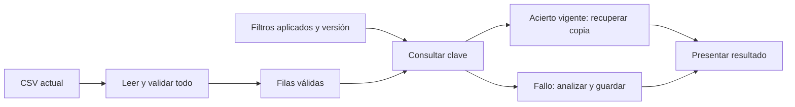
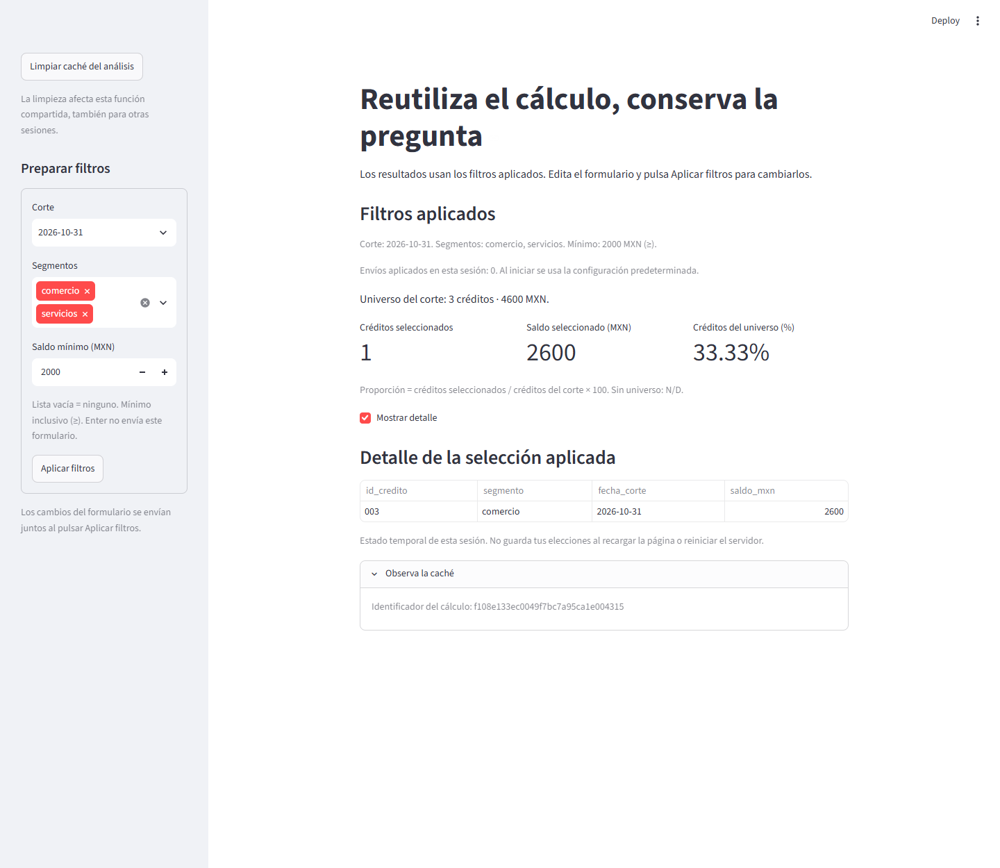

# 12.05 — Caché de datos y recursos

[Inicio](../../../README.md) / [Módulo 12](../README.md) / **12.05**

**Reutilizar un resultado exige saber de qué entradas depende.**

| Tu sesión | Qué prepararás o comprobarás |
| --- | --- |
| **Meta** | Reutilizar un cálculo sin ocultar cambios en sus datos o parámetros |
| **Necesitas** | Funciones importables, filtros aplicados y reejecución de 12.03–12.04 |
| **Evidencia** | Acierto de caché, invalidación, limpieza y recurso compartido explicados |

[Preparación](#antes-de-empezar) · [Material de apoyo](#material-de-apoyo) · [Lab 12.05](../../../labs/12_streamlit/05_data_resource_cache/README.md) · [Criterio de salida](#evidencia-y-criterio-de-salida)

## Propósito

En 12.04 conservamos los filtros aplicados, pero leíamos y calculábamos de nuevo
en cada pasada. Una caché permite reutilizar una llamada que ya produjo un
resultado. Para hacerlo bien, necesitamos identificar sus entradas, su vigencia
y cómo descartarla cuando deja de servir.

La muestra sigue teniendo seis filas: no necesitamos acelerar este pequeño
análisis ni demostrar un rendimiento general. La usamos para observar una
política de caché y comprobar sus cifras. Elegiremos qué parte reutilizar y
qué trabajo sigue ocurriendo en cada pasada.

## Antes de empezar

- Revisa [12.03 — Separar datos e interfaz](../03_data_interface/README.md) y
  [12.04 — Estado de sesión y formularios](../04_session_state_forms/README.md).
- Usa el mismo entorno local de 12.01: Python 3.12.12 y Streamlit 1.66.1 son
  las referencias comprobadas. No hay paquetes ni lockfiles nuevos.
- Sigue los [recorridos](recorridos.md) desde la raíz del repositorio. El
  preparador arma una **carpeta nueva** con las interfaces de esta sección y
  las fuentes de 12.03. No necesita entregas personales anteriores.
- Ejecuta la copia preparada, no el app.py fuente: necesita los módulos hermanos
  que incorpora el preparador. El mínimo también se ejecuta desde esa copia.

## Qué vas a aprender

- Distinguir estado de sesión, caché de datos y caché de recursos.
- Reconocer un acierto y una nueva ejecución con entradas conocidas.
- Incluir datos, filtros y versión de reglas en la clave del análisis.
- Aplicar caducidad, límite de entradas y limpieza por función.
- Comprobar cambios de fuente antes de confiar en un valor guardado.

## Material de apoyo

| Recurso | Para qué sirve | Uso |
| --- | --- | --- |
| [Preparador](preparar_practica.py) | Crear una práctica nueva sin sobrescribir | Esencial, una vez por copia |
| [Mínimo](minimo.py) y [funciones del mínimo](cache_ejemplos.py) | Observar copias y recurso de solo lectura | Esencial, antes de la app completa |
| [Capa de caché](cache_analisis.py) | Parámetros, versión, TTL y límite del análisis | Esencial: leer y contrastar |
| [App](app.py) | Mantener filtros aplicados y presentar el resultado reutilizado | Esencial: ejecutar la copia preparada |
| [Funciones](../03_data_interface/cartera.py), [CSV](../03_data_interface/cartera.csv), [configuración](../03_data_interface/configuracion.py) y [ejecutor](../03_data_interface/ejecutar.py) | Reutilizar el análisis y su referencia de terminal | El preparador los conserva sin cambios |
| [Recorridos](recorridos.md) | Preparación, mínimo y app por shell | Elige un gestor y un shell |
| [Controles de autoría](comprobar_app.py) | Vigencia, parámetros, copias, recursos y sesiones | Opcional; AppTest se desarrolla en 12.08 |

## 1. Qué significa reutilizar una llamada

Imagina una función que recibe `[100, 200]` y calcula su suma: devuelve `300`.
Si vuelve a recibir las mismas entradas, una caché puede recuperar aquel resultado.
Si recibe `[100, 250]`, ya es otra pregunta y debe producir `350`.

En Streamlit un decorador, escrito encima de `def`, envuelve una función con
ese comportamiento. Antes de ejecutar su cuerpo, consulta una clave derivada
de su código y argumentos mediante una huella o hash. Si encuentra una entrada vigente, la recupera
(**acierto**, o hit); si no la encuentra, calcula y guarda (**fallo**, o miss).
Aquí no usamos parámetros excluidos del hash ni funciones de hash personalizadas.

La función cacheada no debería consultar filtros ocultos en `st.session_state`:
recibe los filtros que afectan su resultado como argumentos explícitos. De ese
modo la clave refleja la pregunta aplicada.

## 2. Dos llamadas: copia de datos o mismo recurso

Ejecuta el [mínimo](minimo.py) de tu copia preparada. No necesita CSV: usa los
importes `[100, 200]` y un catálogo ficticio de segmentos. Las funciones están
en [cache_ejemplos.py](cache_ejemplos.py).

```python
@st.cache_data(max_entries=2, show_spinner=False)
def datos_demo():
    return {"importes": [100, 200], "calculo": uuid4().hex}
```

`@st.cache_data` guarda el valor serializado y entrega copias a sus consumidores.
El mínimo añade `999` a la primera copia y llama otra vez. Debes observar:

```text
Copia editada: [100, 200, 999]
Nueva llamada: [100, 200]
¿Datos son el mismo objeto?: False
¿Recurso es el mismo objeto?: True
```

El operador `is` pregunta por identidad del objeto, no por igualdad de valores.
Para el recurso, usamos `@st.cache_resource`: las llamadas iguales recuperan
el mismo objeto. Aquí es una vista de catálogo de solo lectura creada con
`MappingProxyType`; sus valores son tuplas y textos inmutables. No carga un
modelo real ni abre una conexión. Sirve para observar identidad compartida sin
introducir escrituras concurrentes.

Los identificadores generados con `uuid4().hex` son marcas didácticas: se crean
cuando se ejecuta el cuerpo y se recuperan junto al objeto guardado. No son IDs
de créditos, contadores de usuarios ni medidas de rapidez.

Cambia la casilla para provocar otra pasada. Las marcas permanecen. «Limpiar
datos del mínimo» cambia solo la marca del cálculo de datos; «Limpiar recurso
del mínimo» cambia solo la creación del recurso. Ambas cachés son independientes.
Una referencia antigua al recurso puede seguir existiendo después de limpiar;
la siguiente llamada creará otro objeto. Limpiar no equivale a cerrar por sí
solo cualquier conexión externa.

## 3. Elegir el lugar adecuado

| Mecanismo | Qué conserva aquí | Cuándo usarlo |
| --- | --- | --- |
| `st.session_state` | Filtros y número de envíos de una sesión | Elecciones que deben sobrevivir a otra pasada |
| `st.cache_data` | Resultado del análisis y marca de ejecución, devueltos como copia | Transformaciones y resultados de datos reutilizables |
| `st.cache_resource` | El mismo catálogo de solo lectura del mínimo | Objetos compartidos cuya identidad importa, como un cliente o modelo reutilizable |

En esta práctica la caché tiene el alcance global predeterminado: las sesiones
del mismo proceso pueden reutilizar entradas iguales. Los filtros siguen siendo
de cada sesión; no se convierten en una preferencia común por utilizar una caché.
No usamos esta caché global como almacén de elecciones privadas.

Un recurso global mutable requiere controlar su uso concurrente y las garantías
del objeto concreto. No basta añadir `check_same_thread=False` a una conexión o
decorar cualquier objeto y asumir que ya es seguro. Nuestro mínimo comparte
solo lecturas y no necesita un recurso global en el análisis de cartera.

Streamlit también ofrece caché con alcance de sesión; es una ampliación, no la
política que implementamos aquí. La elección de alcance debe ser explícita al
razonar sobre quién puede reutilizar una entrada.

## 4. Datos, pregunta y referencias

Reutilizamos seis registros sintéticos de tres créditos en dos cortes. La unidad
es un crédito en una fecha, clave ID/corte. Los saldos son pesos enteros conocidos.

| ID | Segmento | Corte | Saldo MXN |
| --- | --- | --- | ---: |
| 001 | comercio | 2026-09-30 | 0 |
| 002 | servicios | 2026-09-30 | 2000 |
| 003 | comercio | 2026-09-30 | 2500 |
| 001 | comercio | 2026-10-31 | 100 |
| 002 | servicios | 2026-10-31 | 1900 |
| 003 | comercio | 2026-10-31 | 2600 |

El [contrato de 12.03](../03_data_interface/README.md#2-los-datos-y-su-contrato)
permanece: encabezado exacto, IDs de tres dígitos, segmentos conocidos, fechas
reales 1900–2100, saldos enteros 0–1000000 y claves únicas. La fuente completa
se valida antes de consultar caché; una fila inválida fuera del filtro detiene
la app, sin presentar un resultado previo como válido.

Reglas: universo por fecha; luego segmentos y mínimo inclusivo. Lista vacía
significa ninguno. El porcentaje cuenta créditos seleccionados sobre créditos
del corte, no saldo. No se suman cortes distintos.

| Filtros aplicados | Selección | Universo | Porcentaje |
| --- | --- | --- | --- |
| Octubre, ambos, ≥ 2000 | 003 / 2600 MXN | 3 / 4600 MXN | 33.33% |
| Septiembre, ambos, ≥ 2000 | 002 / 2000 y 003 / 2500 | 3 / 4500 MXN | 66.67% |
| Septiembre, ambos, ≥ 2001 | 003 / 2500 | 3 / 4500 MXN | 33.33% |
| Octubre, servicios, ≥ 2000 | Ninguno | 3 / 4600 MXN | 0.00% |

## 5. Qué entra en la clave del análisis

El [preparador](preparar_practica.py) copia ocho archivos a una carpeta nueva:
`app.py`, `cache_analisis.py`, `cache_ejemplos.py`, `minimo.py` y los cuatro
apoyos de 12.03 (`cartera.py`, CSV, configuración y ejecutor). No sobrescribe
una práctica existente ni instala paquetes. Las funciones de negocio no se
copian dentro de la interfaz ni se reescriben para la caché.

En [cache_analisis.py](cache_analisis.py):

```python
TTL_SEGUNDOS = 60
MAX_ENTRADAS = 8

@st.cache_data(ttl=TTL_SEGUNDOS, max_entries=MAX_ENTRADAS, persist=None, show_spinner=False)
def analizar_con_cache(filas, corte, segmentos, minimo_mxn, version_reglas):
    resultado = analizar(filas, corte, segmentos, minimo_mxn)
    return {"resultado": resultado, "calculo": uuid4().hex}
```

El archivo completo importa `analizar` de 12.03. Todos los argumentos participan
en la clave: registros completos, fecha, lista de segmentos, mínimo y versión
de reglas. No basta usar el nombre del archivo o los totales: el contenido puede
cambiar manteniendo ambos. En esta muestra pequeña se pasan las filas completas;
para fuentes grandes habría que diseñar y verificar otra estrategia de versionado.

`version_reglas` participa en la clave aunque el cuerpo no lo utilice para sumar.
La constante inicial es `1205-v1`. Si cambias una regla o una dependencia del
análisis, debes revisar esa versión, limpiar y reiniciar al comprobar el cambio.
El hash del código decorado no representa automáticamente todo el código de
funciones importadas que este llama.

El flujo de [app.py](app.py) es:



Sin renderizador: cada pasada lee y valida el CSV. Después consulta la caché con
filas y parámetros; recupera o calcula el resultado y lo presenta. Los widgets
y el estado de sesión quedan fuera de la función cacheada.

**No estamos evitando la lectura ni toda validación.** La lectura completa ocurre
en cada pasada y la validación del análisis también ocurre al calcular. Elegimos
reutilizar la transformación después de conocer la fuente actual. Con seis filas,
el coste de gestionar la caché puede superar el de sumar; esto no es un benchmark
ni una garantía de menor RAM.

## 6. Caducidad, límite y limpieza

| Decisión | Comportamiento de esta app |
| --- | --- |
| `ttl=60` | Una entrada puede reutilizarse durante 60 segundos; después, el siguiente acceso la recalcula |
| `max_entries=8` | Al superar ocho combinaciones, se elimina una entrada antigua; no limita bytes ni RAM total |
| `persist=None` | No guardamos la caché de datos en disco |
| `analizar_con_cache.clear()` | Descarta todas las combinaciones de esa función, también para otras sesiones |

El TTL no actualiza la pantalla por sí solo: hace falta otra pasada y una llamada.
No es un mecanismo para enterarse inmediatamente de cambios externos. Aquí la
actualidad de datos se decide antes, pasando los registros recién leídos.

«Limpiar caché del análisis» está fuera del formulario y no aplica los campos
pendientes ni borra `filtros_aplicados`. La siguiente llamada recalcula con los
parámetros ya aplicados. No usamos una limpieza global de todas las funciones ni
«Clear cache» del menú, que mezclaría otras tareas de la práctica.

Una recarga del navegador reinicia los filtros de esa sesión, pero puede encontrar
una entrada global todavía vigente. Reiniciar el servidor elimina esta caché en
memoria. La preparación de una carpeta no limpia cachés de servidores que ya
están ejecutándose; trabaja con el proceso de tu copia.

## 7. Comprueba la vigencia, no solo la marca

Inicia la app y abre «Observa la caché». Anota el identificador y las cifras.
Oculta y muestra detalle antes de 60 segundos: el mismo identificador muestra
reutilización de aquella ejecución. Aplicar septiembre ≥ 2001 produce otra
pregunta: 003/2500, universo 4500 y otra marca.



Captura propia. Alternativa textual: el caso aplicado selecciona 003 con 2600
MXN, universo de tres créditos/4600 MXN y 33.33%; el panel muestra la marca del
cálculo, versión 1205-v1, TTL de 60 segundos y máximo ocho entradas. La marca
exacta cambia entre ejecuciones y no es parte del resultado financiero.

Volver a un caso previo puede recuperar su entrada si sigue vigente y no fue
eliminada. Una marca nueva no identifica por sí sola la causa: puede ser otro
argumento, caducidad, limpieza, expulsión o reinicio. Las referencias de la tabla
comprueban la corrección; la marca observa ejecución.

En el CSV de tu copia cambia solo 003/octubre de 2600 a 2800. Con octubre/ambos/
2000 ya aplicados, provoca otra pasada sin enviar. Debes ver 2800 MXN, universo
4800, uno de tres (33.33%) y una marca nueva: cambió la entrada de datos aunque
la ruta sea la misma. El número de envíos no aumenta.

Si agregas una clave repetida de septiembre y preguntas por octubre, debe aparecer
un error en lugar de cifras guardadas. Conserva el archivo original y realiza
estas variantes solo en tu copia preparada.

### Errores habituales

| Problema | Qué revisar |
| --- | --- |
| Cambia el CSV y permanecen cifras antiguas | Cachear solo por ruta no describe su contenido; revisa las entradas reales |
| Cambia la pregunta y vuelve el mismo cálculo incorrecto | Un filtro quedó oculto dentro de session_state o excluido del hash |
| Un dato faltante produce un éxito anterior | La validación ocurrió solo dentro de una función que no se ejecuta en un acierto |
| Esperar un minuto no mueve la pantalla | TTL necesita un acceso posterior; no programa una reejecución |
| Limpiar afecta otra pestaña | Esta función usa caché global, compartida entre sesiones del proceso |
| Editar una copia de datos cambia otra llamada | Comprueba que no se está usando cache_resource para datos que debían copiarse |

## Práctica

Realiza el [Lab 12.05](../../../labs/12_streamlit/05_data_resource_cache/README.md):
repetición, cambio de parámetros, cambio de fuente, rechazo, limpieza y caducidad.
Contrasta las copias del mínimo con el recurso compartido, sin añadir una base
o modelo pesado para practicar la API.

## Evidencia y criterio de salida

| Conserva | Comprueba | Explica |
| --- | --- | --- |
| Marca, filtros y filas de dos llamadas iguales | Reutilización antes del TTL y mismas cifras correctas | Qué forma la clave |
| Cambio de CSV y resultado | 2600 → 2800 y universo 4600 → 4800 | Actualidad por contenido, no solo por nombre |
| Limpieza y caducidad | Nueva ejecución sin perder filtros aplicados | TTL, siguiente acceso y alcance de clear |
| Salida del mínimo | Datos como copias, recurso como mismo objeto de lectura | Cuándo elegir datos, recurso o estado de sesión |

Pide a tu compañero que cambie una entrada y te pregunte qué se reutiliza.
Registra predicción, comprobación, ayudas y dudas en tu bitácora personal.
PROGRESS.md registra desarrollo del material; no hay proyecto/checkpoint Streamlit
implementado ni aprendizaje acreditado por disponer de estas pruebas.

## Referencias

Documentación primaria consultada el 2026-10-27; ejemplos propios, comprobados
con Python 3.12.12 y Streamlit 1.66.1. La documentación en línea puede avanzar.

- [Streamlit: visión general de caché](https://docs.streamlit.io/develop/concepts/architecture/caching).
- [st.cache_data: claves, copias, TTL, persistencia y clear](https://docs.streamlit.io/develop/api-reference/caching-and-state/st.cache_data).
- [st.cache_resource: identidad y alcance del recurso](https://docs.streamlit.io/develop/api-reference/caching-and-state/st.cache_resource).
- [Python 3.12: MappingProxyType](https://docs.python.org/3.12/library/types.html#types.MappingProxyType).
- [Python 3.12: uuid4](https://docs.python.org/3.12/library/uuid.html#uuid.uuid4).

## Siguiente paso

Después del lab, consulta [12.06 — Mensajes y casos sin datos](../README.md#06-mensajes-y-casos-sin-datos),
todavía planificado: explicar fallos de entrada y selecciones vacías con una
experiencia consistente.

---

[← 12.04](../04_session_state_forms/README.md) · [Módulo 12](../README.md) · [Lab 12.05 →](../../../labs/12_streamlit/05_data_resource_cache/README.md)
