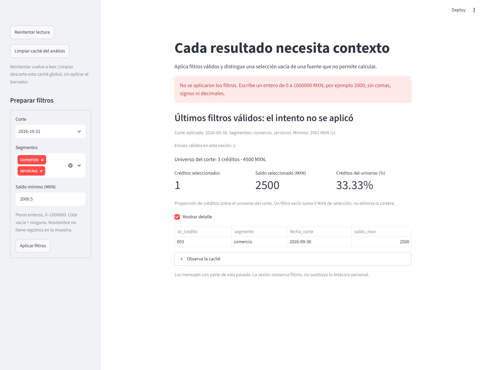
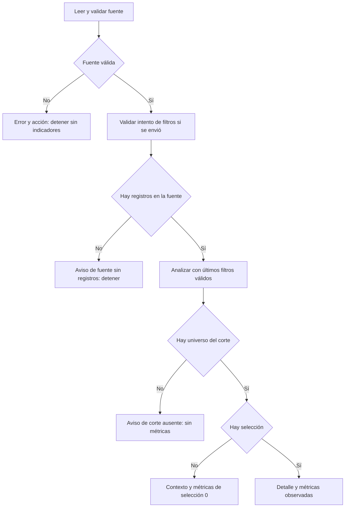

# 12.06 — Mensajes y casos sin datos

[Inicio](../../../README.md) / [Módulo 12](../README.md) / **12.06**

**Explicar qué ocurrió, qué se puede calcular y cómo continuar.**

| Tu sesión | Qué prepararás o comprobarás |
| --- | --- |
| **Meta** | Distinguir entradas inválidas, ausencia de registros y una selección vacía válida |
| **Necesitas** | Funciones, filtros aplicados y caché de 12.03–12.05 |
| **Evidencia** | Casos contrastados, mensajes útiles y recuperación sin cifras engañosas |

[Preparación](#antes-de-empezar) · [Material de apoyo](#material-de-apoyo) · [Lab 12.06](../../../labs/12_streamlit/06_messages_empty_cases/README.md) · [Criterio de salida](#evidencia-y-criterio-de-salida)

## Propósito

Una pantalla sin filas puede significar cosas diferentes: el archivo no se pudo
leer, la fuente no contiene registros, la fecha no aparece o ningún crédito
cumple el filtro. Un cero también puede ser un saldo conocido. El mensaje y las
cifras deben corresponder a esa situación concreta.

Ampliaremos la app para explicar el problema y ofrecer una acción útil. Un intento
de filtro inválido conservará los últimos filtros válidos con una etiqueta clara.
Una fuente inválida detendrá la presentación de indicadores, aunque la caché
tuviera un resultado anterior.

## Antes de empezar

- Revisa [12.03 — Separar datos e interfaz](../03_data_interface/README.md),
  [12.04 — Estado de sesión y formularios](../04_session_state_forms/README.md) y
  [12.05 — Caché](../05_data_resource_cache/README.md).
- Mantén el entorno local de 12.01. Referencias comprobadas: Python 3.12.12 y
  Streamlit 1.66.1; sin paquetes ni lockfiles nuevos.
- Sigue los [recorridos](recorridos.md) desde el repositorio para crear una carpeta
  nueva. Reutiliza fuentes incluidas de 12.03/12.05, no entregas personales anteriores.
- Ejecuta mínimo y app desde la copia preparada. No arranques el app.py fuente:
  sus módulos hermanos se incorporan con el preparador.

## Qué vas a aprender

- Separar cero conocido, selección vacía, corte ausente y error de fuente.
- Escribir mensajes con situación, efecto y siguiente acción.
- Validar un campo de texto antes de aplicar filtros.
- Detener una pasada sin fabricar indicadores ni presentar datos anteriores como actuales.
- Recuperar la práctica después de corregir entradas o restaurar el archivo.

## Material de apoyo

| Recurso | Para qué sirve | Uso |
| --- | --- | --- |
| [Mínimo](minimo.py) | Comparar cuatro situaciones con un crédito de saldo cero | Esencial, antes de la app completa |
| [Preparador](preparar_practica.py) | Crear una copia nueva con ocho archivos | Esencial, una vez por copia |
| [App](app.py) | Mensajes, lectura, filtros y recuperación | Esencial: ejecutar la copia preparada |
| [Entradas](entradas.py) | Interpretar el mínimo sin cambiar el contrato del CSV | Esencial: seguir la validación |
| [Modelo](../03_data_interface/cartera.py), [CSV](../03_data_interface/cartera.csv), [configuración](../03_data_interface/configuracion.py) y [ejecutor](../03_data_interface/ejecutar.py) | Conservar datos y reglas conocidos | Copiados sin cambios |
| [Capa de caché de 12.05](../05_data_resource_cache/cache_analisis.py) | Reutilizar el análisis después de validar la fuente | Copiada sin cambios |
| [Recorridos](recorridos.md) | Preparación y arranque por shell | Elige un gestor y un shell |
| [Controles de autoría](comprobar_app.py) | Probar mensajes y transiciones entre situaciones | Opcional; AppTest se estudia en 12.08 |

## 1. Un cero no explica por sí solo el resultado

Ejecuta el [mínimo](minimo.py) de la carpeta preparada. Simula cuatro escenarios;
no lee archivos. Su único crédito conocido es:

```python
universo = [{"id_credito": "001", "saldo_mxn": 0}]
```

| Escenario del mínimo | Qué sabemos | Qué muestra |
| --- | --- | --- |
| Saldo cero | Hay un crédito, saldo conocido 0 | Un crédito seleccionado y 0 MXN |
| Filtro sin coincidencias | Existe el crédito, pero no fue seleccionado | Cero seleccionados y 0 MXN de selección |
| Corte sin registros | No tenemos registros para ese corte | Aviso, sin saldo observado |
| Fuente inválida | No se puede calcular con confianza | Error, sin indicadores |

Los dos primeros casos muestran un saldo seleccionado de cero, pero el conteo
los distingue: uno frente a ninguno. Una suma vacía válida no significa que
el saldo de todos los créditos del universo sea cero. En los últimos dos casos
no presentamos una cifra como si fuera un saldo observado.

## 2. El mensaje también necesita un contrato

Un mensaje útil responde tres cosas: **qué pasó**, **qué efecto tiene** y
**qué puedes hacer ahora**. No depende únicamente de un color o un icono.

| Situación | Mensaje y acción de esta app |
| --- | --- |
| Archivo ausente | No se encontró cartera.csv; restaura el archivo junto a tu app y reintenta |
| Archivo ilegible o inválido | No se calculan indicadores; revisa acceso o contrato y reintenta |
| Fuente solo con encabezado | No contiene registros; revisa la fuente antes de interpretar una cartera |
| Corte de noviembre | No hay registros para esa fecha; elige septiembre u octubre y aplica |
| Ningún segmento | Lista vacía elige ninguno; selecciona segmentos y vuelve a aplicar |
| Filtro sin coincidencias | El universo conserva registros; revisa segmentos o reduce el mínimo |
| Mínimo inválido | No se aplicó el intento; corrige el campo y confirma de nuevo |

Usamos `st.error` para un fallo o intento rechazado, `st.warning` cuando una
fuente válida no aporta registros suficientes para esa vista y `st.info` para
contexto y acciones. Son decisiones de diseño de esta app, no reglas automáticas
del framework: Streamlit muestra el mensaje que escribes, no valida sus cifras.

El diagnóstico técnico queda en un desplegable. El mensaje principal nombra
el archivo y la acción, sin exigir interpretar una excepción de Python para
continuar. Los avisos de selección vacía permanecen visibles aunque ocultes la tabla.

## 3. Los datos de la app completa

Son seis registros sintéticos de tres créditos en dos cortes. Unidad: crédito
en una fecha; clave ID/corte. Los saldos son pesos enteros conocidos, incluido cero.

| ID | Segmento | Corte | Saldo MXN |
| --- | --- | --- | ---: |
| 001 | comercio | 2026-09-30 | 0 |
| 002 | servicios | 2026-09-30 | 2000 |
| 003 | comercio | 2026-09-30 | 2500 |
| 001 | comercio | 2026-10-31 | 100 |
| 002 | servicios | 2026-10-31 | 1900 |
| 003 | comercio | 2026-10-31 | 2600 |

El [contrato de 12.03](../03_data_interface/README.md#2-los-datos-y-su-contrato)
no cambia: CSV UTF-8 con encabezado exacto, IDs de tres dígitos, fechas reales
1900–2100, segmentos conocidos, saldos 0–1000000 y claves únicas. No imputamos
saldos vacíos ni eliminamos duplicados. Se valida la fuente completa antes de caché.

La app ofrece también **2026-11-30** para comprobar un corte ausente. No agrega
filas de noviembre al CSV ni implica que su saldo sea cero.

| Filtros aplicados | Resultado de referencia |
| --- | --- |
| Octubre, ambos, ≥ 2000 | 003/2600; universo 3/4600; 33.33% |
| Septiembre, ambos, ≥ 2001 | 003/2500; universo 3/4500; 33.33% |
| Octubre, servicios, ≥ 2000 | Ninguno; universo 3/4600; 0% de créditos |
| Noviembre, ambos, ≥ 2000 | Aviso de corte sin registros; sin métricas |

En 12.03 el modelo devuelve `None` para una proporción sin denominador y en
12.04–12.05 la interfaz podía mostrar `N/D`. Aquí elegimos una vista sin métricas
para explicar mejor la ausencia de registros. La regla de cálculo permanece igual;
la presentación evita confundir una suma vacía con saldo observado de cartera.

## 4. Interpretar texto antes de aplicar

Antes el mínimo era un `number_input` acotado. Ahora usamos `text_input` para
practicar entradas inválidas de forma visible: el navegador puede contener
`2000.5`, pero el análisis necesita pesos enteros.

[preparar_filtros](entradas.py) recibe fecha, segmentos y texto del mínimo.
Devuelve otro diccionario de parámetros válidos o lanza `ValueError`.

| Texto | Decisión |
| --- | --- |
| `0`, `2000`, `1000000` | Enteros válidos |
| ` 2000 ` | Se aceptan espacios exteriores del campo de interfaz |
| Vacío, `-1`, `+1`, `2000.5`, `2000.0`, `1,000`, `2e3`, `0002` | Rechazo, con formato esperado |
| `1000001` | Rechazo, supera el máximo |

La conversión con `int` ocurre después de revisar la forma y el rango. No se
trunca un decimal ni se convierte un campo vacío en cero. El patrón usa dígitos
ASCII y limita longitud antes de convertir. Recortar espacios del **filtro de
interfaz** no cambia las reglas estrictas del CSV.

```python
try:
    nuevos = preparar_filtros(corte, segmentos, minimo_texto)
except ValueError as error:
    st.session_state["error_filtros"] = str(error)
else:
    st.session_state["filtros_aplicados"] = nuevos
    st.session_state["envios"] += 1
    st.session_state["error_filtros"] = None
```

Este fragmento pertenece al [app.py completo](app.py): necesita su formulario
y las claves inicializadas. `else` se ejecuta cuando el `try` terminó sin ese
error; solo entonces se reemplazan los parámetros aplicados y se cuenta un envío
válido. Una lista de segmentos vacía es válida: significa ninguno.

Envía septiembre ≥ 2001 y después intenta octubre con `2000.5`. Debes seguir
viendo septiembre/2500, bajo «Últimos filtros válidos: el intento no se aplicó».
El aviso permanece entre pasadas hasta confirmar una entrada válida. Los datos
se leen de nuevo: conservamos parámetros, no una imagen congelada de la fuente.



Captura propia de la app local. Alternativa textual: el formulario contiene un
mínimo decimal; el aviso indica que no se aplicó. La selección sigue utilizando
septiembre/2001 y muestra 003 con 2500 MXN, universo de tres créditos/4500 MXN,
33.33% y un envío válido, bajo la etiqueta de últimos filtros válidos.

## 5. Detener la pasada cuando falta una base válida

La lectura utiliza un contexto de carga:

```python
with st.spinner("Leyendo y validando la fuente local..."):
    filas = leer_cartera(RUTA_DATOS)
```

El indicador existe mientras se ejecuta ese bloque. Con seis filas puede ser
tan breve que no lo veas; no añadimos esperas artificiales ni un porcentaje de
avance que no medimos. El spinner no indica que los datos ya sean correctos.

Si falla la lectura, [detener_fuente](app.py) presenta el error y la acción,
ofrece un diagnóstico desplegable y llama a `st.stop()`. **Mostrar `st.error`
por sí solo no detiene el código.** `st.stop` interrumpe esta pasada completa,
también cuando se llama dentro de una función auxiliar.

Se capturan fallos esperados de lectura y contrato, como archivo ausente,
permisos, Unicode, CSV y valores inválidos. No se ocultan todos los errores de
programación mediante `except Exception`, ni se devuelve una lista vacía para
fingir éxito después de un fallo.

Los controles se crean antes de leer para que «Reintentar lectura» siga disponible.
Su clic ya provoca otra pasada; no hace falta llamar a `st.rerun`. Corrige la
fuente en tu copia y reintenta. Los filtros válidos de sesión se conservan.
Un envío mientras la fuente está fallando no se acepta ni aumenta el contador.

## 6. Resolver cada vacío en el nivel adecuado



Sin renderizador: primero debe existir una fuente válida; después se interpreta
el intento de filtros. Una fuente sin registros o un corte ausente no presentan
métricas. Con universo válido, el filtro puede seleccionar cero registros o
créditos con saldo cero; se explican de forma distinta.

Un archivo de **cero bytes** carece de encabezado y se rechaza. Un archivo con
**solo el encabezado correcto** cumple la forma y contiene cero registros: se
muestra una advertencia. No representan la misma situación.

Para observar un saldo cero conocido en la app, deja en tu copia solo encabezado
y 001/septiembre/0, aplica septiembre con mínimo 0. Verás un crédito, 0 MXN y
100% del universo de esa variante. Conserva antes un respaldo del CSV completo.

## Práctica

Realiza el [Lab 12.06](../../../labs/12_streamlit/06_messages_empty_cases/README.md).
Contrastarás un intento inválido, corte sin registros, filtro vacío, fuente
ausente, encabezado sin filas y cero conocido; después recuperarás la muestra.

## Evidencia y criterio de salida

| Conserva | Comprueba | Explica |
| --- | --- | --- |
| Intento y parámetros efectivos | `2000.5` rechazado; últimos filtros válidos identificados | Error de entrada frente a nueva selección |
| Casos vacíos y cero observado | Avisos diferentes; cifras solo cuando corresponde | Universo, selección y dato conocido |
| Fallo de fuente y recuperación | Sin indicadores anteriores; reintento recupera la lectura | Mensaje, acción y stop |
| Muestra y respaldo propios | Originales del repo conservados | Qué cambiaste y cómo reconstruirlo |

Pide a tu compañero que te describa una pantalla sin filas y justifica qué
situación representa antes de mirar las cifras. Guarda predicciones, resultados,
ayudas y dudas en tu bitácora personal. PROGRESS.md registra desarrollo del
material, no tu aprendizaje. Proyecto/checkpoints Streamlit siguen pendientes.

## Referencias

Fuentes primarias consultadas el 2026-10-27; ejemplos propios comprobados con
Python 3.12.12 y Streamlit 1.66.1. La documentación en línea puede avanzar.

- [st.error](https://docs.streamlit.io/develop/api-reference/status/st.error),
  [st.warning](https://docs.streamlit.io/develop/api-reference/status/st.warning) y
  [st.info](https://docs.streamlit.io/develop/api-reference/status/st.info).
- [st.stop: interrupción de la pasada](https://docs.streamlit.io/develop/api-reference/execution-flow/st.stop).
- [st.spinner: contexto de carga](https://docs.streamlit.io/develop/api-reference/status/st.spinner).
- [Python 3.12: manejo de excepciones](https://docs.python.org/3.12/tutorial/errors.html).

## Siguiente paso

Después del lab, consulta [12.07 — Tablas, gráficos y descarga](../README.md#07-tablas-graficos-y-descarga),
todavía planificado: presentar y exportar el mismo universo filtrado.

---

[← 12.05](../05_data_resource_cache/README.md) · [Módulo 12](../README.md) · [Lab 12.06 →](../../../labs/12_streamlit/06_messages_empty_cases/README.md)
