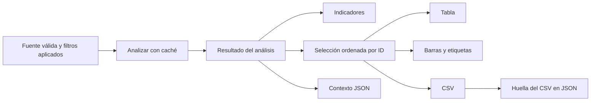
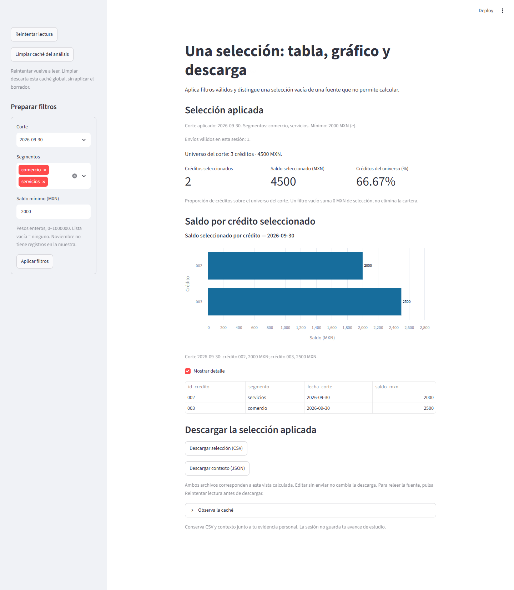

# 12.07 — Tablas, gráficos y descarga

[Inicio](../../../README.md) / [Módulo 12](../README.md) / **12.07**

**Una selección aplicada, varias representaciones que deben coincidir.**

| Tu sesión | Qué prepararás o comprobarás |
| --- | --- |
| **Meta** | Conciliar indicadores, filas, barras y archivos descargados |
| **Necesitas** | Filtros aplicados, caché y mensajes de 12.03–12.06 |
| **Evidencia** | CSV y contexto junto a una comprobación por crédito y corte |

[Preparación](#antes-de-empezar) · [Material de apoyo](#material-de-apoyo) · [Lab 12.07](../../../labs/12_streamlit/07_tables_charts_download/README.md) · [Criterio de salida](#evidencia-y-criterio-de-salida)

## Propósito

Una app puede mostrar una tabla correcta y descargar otras filas si cada parte
repite sus filtros. Aquí los indicadores, la tabla, el gráfico y los archivos
parten del mismo resultado del análisis. La presentación cambia; la pregunta
aplicada y el conjunto de créditos permanecen identificados.

Terminaremos con un CSV de la selección y un JSON de contexto: filtros efectivos,
universo, indicadores y huella del CSV. Son apoyos para conservar y revisar una
vista; no constituyen todavía la entrega final del módulo.

## Antes de empezar

- Revisa [12.03 — Separación de responsabilidades](../03_data_interface/README.md),
  [12.04 — Formularios](../04_session_state_forms/README.md),
  [12.05 — Caché](../05_data_resource_cache/README.md) y
  [12.06 — Mensajes](../06_messages_empty_cases/README.md).
- Para profundizar en el gráfico, consulta [04.07 — Altair](../../04_visualization_python/README.md).
  Aquí explicamos la construcción necesaria para ejecutar esta práctica.
- Usa el mismo entorno local de 12.01. Referencias comprobadas: Python 3.12.12,
  Streamlit 1.66.1 y Altair 6.3.0 ya declarados en el proyecto. No hay paquetes
  ni lockfiles nuevos; no instales herramientas de exportación de imágenes.
- Sigue los [recorridos](recorridos.md) para crear una carpeta nueva con las
  fuentes incluidas. No necesitas entregas personales anteriores.
- Ejecuta la copia preparada, no el app.py fuente de esta sección.

## Qué vas a aprender

- Preparar tabla y gráfico sin volver a filtrar el análisis.
- Conservar IDs como categorías y saldos en pesos enteros.
- Generar CSV y contexto en memoria con nombres y MIME explícitos.
- Descargar la selección aplicada, distinguiéndola del formulario pendiente.
- Comprobar casos vacíos y el alcance de una vista calculada.

## Material de apoyo

| Recurso | Para qué sirve | Uso |
| --- | --- | --- |
| [Mínimo](minimo.py) | Dos créditos en tabla, gráfico y CSV | Esencial, antes de la app completa |
| [Preparador](preparar_practica.py) | Crear una práctica nueva con once archivos | Esencial, una vez por copia |
| [App](app.py) | Coordinar resultado, vistas y descargas | Esencial: ejecutar la copia preparada |
| [Gráfico](graficos.py) | Construir barras y etiquetas desde la selección | Esencial: seguir sus mapeos |
| [Salidas](salidas.py) | CSV y JSON en memoria | Esencial: revisar nombres y contenido |
| [Revisor de descarga](revisar_descarga.py) | Releer huella, filas y suma del par CSV/JSON | Apoyo con Python estándar |
| [Modelo](../03_data_interface/cartera.py), [CSV](../03_data_interface/cartera.csv), [configuración](../03_data_interface/configuracion.py) y [ejecutor](../03_data_interface/ejecutar.py) | Conservar reglas y referencia de terminal | Copiados sin cambios |
| [Caché](../05_data_resource_cache/cache_analisis.py) y [entradas](../06_messages_empty_cases/entradas.py) | Conservar vigencia y validación | Copiados sin cambios |
| [Recorridos](recorridos.md) | Preparación, ejecución y descarga | Elige un gestor y un shell |
| [Controles de autoría](comprobar_app.py) | Conciliar filas, datos del gráfico y archivos | Opcional; pruebas de apps como tema en 12.08 |

## 1. Dos filas antes de la app completa

El [mínimo](minimo.py) usa esta selección completa de septiembre:

| ID | Segmento | Corte | Saldo MXN |
| --- | --- | --- | ---: |
| 002 | servicios | 2026-09-30 | 2000 |
| 003 | comercio | 2026-09-30 | 2500 |

Predice primero: dos filas, dos barras, suma 4500 MXN. Después ejecuta el mínimo
de la copia preparada. La tabla recibe `seleccion`, el gráfico recibe esa misma
lista y `csv.DictWriter` escribe sus registros. No hay un segundo filtro.

Descarga el CSV y ábrelo en un editor de texto. Debe conservar las cuatro columnas,
dos registros e IDs `002`/`003`. La apariencia de las barras no sustituye revisar
los valores exactos. Este mínimo no calcula un porcentaje de universo: solo
presenta las dos filas que define.

## 2. Fuente y pregunta de la app completa

Reutilizamos seis registros sintéticos. Unidad: un crédito en una fecha; clave
ID/corte. Saldo en pesos enteros conocidos; cero no significa ausencia.

| ID | Segmento | Corte | Saldo MXN |
| --- | --- | --- | ---: |
| 001 | comercio | 2026-09-30 | 0 |
| 002 | servicios | 2026-09-30 | 2000 |
| 003 | comercio | 2026-09-30 | 2500 |
| 001 | comercio | 2026-10-31 | 100 |
| 002 | servicios | 2026-10-31 | 1900 |
| 003 | comercio | 2026-10-31 | 2600 |

El [contrato](../03_data_interface/README.md#2-los-datos-y-su-contrato) y los filtros
no cambian: fuente completa validada, universo por corte y selección por segmento
y mínimo inclusivo. Noviembre continúa siendo una opción sin registros. El
porcentaje cuenta créditos seleccionados respecto a los del corte, no saldo.

| Pregunta aplicada | Filas/barras/CSV | Indicadores y universo |
| --- | --- | --- |
| Octubre, ambos, ≥ 2000 | 003 / 2600 | 1, 2600 MXN, 33.33%; universo 3/4600 |
| Septiembre, ambos, ≥ 2000 | 002 / 2000 y 003 / 2500 | 2, 4500 MXN, 66.67%; universo 3/4500 |
| Septiembre, ambos, ≥ 2001 | 003 / 2500 | 1, 2500 MXN, 33.33%; universo 3/4500 |
| Octubre, servicios, ≥ 2000 | Ninguna fila ni barra | 0, 0 MXN, 0%; universo 3/4600 |

## 3. Un resultado, cuatro consumidores



Sin renderizador: el análisis produce universo, indicadores y selección. Las
vistas y archivos consumen ese resultado; ninguna parte decide por separado
qué créditos cumplen. El CSV solo contiene seleccionados; el JSON conserva
el universo necesario para interpretar el denominador.

El [preparador](preparar_practica.py) copia once archivos a un destino nuevo:
modelo, CSV, configuración y ejecutor de 12.03; caché de 12.05; entradas de 12.06;
app, gráfico, salidas, mínimo y revisor de descarga de esta sección. No sobrescribe prácticas previas
ni reescribe algoritmos anteriores. Las lecturas siguen ocurriendo antes de caché.

## 4. Tabla y gráfico con el mismo detalle

La tabla conserva las cuatro columnas originales. «Mostrar detalle» solo cambia
su visibilidad: no cambia el gráfico, los indicadores ni el archivo preparado.
Usamos `st.table` para esta muestra pequeña, sin introducir un filtro local de
tabla que pudiera confundirse con la selección del análisis.

En [graficos.py](graficos.py), Altair recibe registros explícitos:

```python
base = alt.Chart(alt.Data(values=[dict(f) for f in seleccion])).encode(
    x=alt.X("saldo_mxn:Q", title="Saldo (MXN)"),
    y=alt.Y("id_credito:N", title="Crédito"),
)
barras = base.mark_bar()
etiquetas = base.mark_text(align="left", dx=4).encode(
    text=alt.Text("saldo_mxn:Q", format="d")
)
```

Es un mapa de lectura; usa el archivo completo para sus imports, orden, escala
y título. `Q` indica valor cuantitativo; `N`, categoría nominal. Un ID `002` es
una etiqueta, no la cantidad dos. La longitud de barra representa el saldo de
esa fila; no agregamos otra vez ni mezclamos cortes.

El gráfico completo fija el inicio del eje en cero y deja espacio a las etiquetas.
Incluye fecha, unidades y tooltip (detalle al señalar la barra) con los cuatro campos. Un saldo observado de
cero conserva su categoría y etiqueta `0`, aunque la barra no tenga longitud.
Una selección vacía no crea una barra ficticia: muestra contexto y permite
descargar un CSV con solo encabezado.

`st.altair_chart(..., width="stretch", height=320, alt=alternativa)` adapta el ancho,
reserva altura para separar barras y etiquetas y añade una descripción textual.
También mostramos esa alternativa como texto y
conservamos la tabla: el gráfico no es la única forma de recuperar los valores.
No certificamos con ello accesibilidad completa de la aplicación.



Captura propia de la app local. Alternativa textual: septiembre, ambos segmentos,
mínimo 2000; la tabla y las dos barras representan 002/2000 y 003/2500 MXN.
Los indicadores muestran dos seleccionados, 4500 MXN y 66.67% de los tres créditos
del corte. Ambos archivos se preparan a partir de ese resultado.

## 5. Preparar archivos sin escribir en el servidor

[preparar_descargas](salidas.py) usa `StringIO`, un archivo de texto en memoria:

```python
buffer = StringIO(newline="")
escritor = csv.DictWriter(buffer, fieldnames=COLUMNAS, lineterminator="\n")
escritor.writeheader()
escritor.writerows(resultado["seleccion"])
contenido = buffer.getvalue().encode("utf-8")
```

El orden es ID, segmento, corte y saldo. No agregamos un índice de tabla. Los
bytes UTF-8 se entregan al botón; este código no crea un archivo en la carpeta
del servidor. El navegador ofrece guardarlo cuando lo pulsas.

CSV guarda texto, no tipos de columna. Si lo abres directamente en una hoja de
cálculo, esta puede interpretar `001` como número. Para comprobar el contenido,
usa un editor o `csv.DictReader`; si importas en una hoja, declara el ID como texto.
No modifiques el identificador original para corregir una inferencia del visor.

El JSON acompañante contiene:

- Versión de formato y reglas, unidad MXN y filtros efectivos.
- Universo e indicadores calculados, columnas y número de filas del CSV.
- `sha256_csv`, huella de los bytes exactos del CSV preparado.

La huella permite comprobar que ese CSV corresponde al contexto descargado;
no acredita autoría ni autenticidad de una entrega. Conserva ambos archivos.
Si solo guardas el CSV, no quedará en él el denominador de créditos descartados.

## 6. Descargar lo aplicado, no el borrador

Los nombres incluyen corte, mínimo y segmentos, por ejemplo
`seleccion_2026-10-31_min-2000_seg-comercio-servicios.csv`.
El contexto usa el mismo nombre base con `_contexto.json`. El navegador puede
añadir un sufijo si ya existe otro archivo; compara contenido y contexto, no
solamente el nombre.

```python
st.download_button(
    "Descargar selección (CSV)", data=salida["csv"],
    file_name=salida["nombre_csv"], mime="text/csv", on_click="ignore",
)
```

`mime` describe el tipo de contenido para el navegador: `text/csv` para el CSV.
El archivo completo también define JSON con `application/json`. `on_click="ignore"`
evita que el botón provoque otra pasada; los archivos ya se prepararon desde el
resultado mostrado. Los botones están fuera del formulario. Editar campos sin
enviar no cambia la selección ni los archivos de esa vista.

**La descarga corresponde a la última vista calculada**, no relee el CSV al hacer
clic. Si cambió la fuente, pulsa «Reintentar lectura» y revisa los valores antes
de descargar. Esa pasada valida, recalcula si corresponde y prepara nuevos bytes.
Un archivo descargado antes sigue siendo una copia de aquella vista.

Si envías un mínimo inválido, se siguen mostrando los últimos filtros válidos,
pero las descargas quedan deshabilitadas hasta confirmar una entrada válida.
Si la fuente falla, está sin registros o no hay universo del corte, se detiene
la vista antes de crear botones de descarga. Eso no borra archivos que ya guardaste.

| Situación | Tabla/gráfico | Descarga |
| --- | --- | --- |
| Selección válida con filas | Mismas filas, barras y etiquetas | CSV + contexto |
| Selección vacía, universo válido | Aviso, sin barras ni filas ficticias | CSV con encabezado + contexto de cero seleccionados |
| Intento de filtro rechazado | Últimos filtros válidos identificados | Botones deshabilitados hasta corregir |
| Fuente inválida o sin registros / corte ausente | Aviso, sin métricas actuales | No ofrece archivos de esa vista |

## Práctica

Realiza el [Lab 12.07](../../../labs/12_streamlit/07_tables_charts_download/README.md):
descarga y relee los archivos de varios casos, contrasta barras y detalle, y
verifica qué sucede con un borrador, una selección vacía y una fuente cambiada.

## Evidencia y criterio de salida

| Conserva | Comprueba | Explica |
| --- | --- | --- |
| CSV y contexto del mismo caso | ID/segmento/fecha/saldo, filas, suma y huella | Selección frente a universo |
| Predicción de barras y resultado | Una categoría y etiqueta por fila, cero incluido | Mapeo nominal/cuantitativo y unidades |
| Intento pendiente/rechazado | Archivo aplicado y bloqueo tras rechazo | Formulario frente a vista preparada |
| Variante del CSV | 2600 → 2800 y universo 4600 → 4800 tras releer | Descarga como copia de una vista calculada |

Pide a tu compañero que elija una fila descargada y la encuentre en la tabla y
el gráfico. Guarda ayudas, dudas y siguiente paso en tu bitácora personal.
PROGRESS.md registra autoría, no aprendizaje; proyecto/checkpoints siguen pendientes.

## Referencias

Fuentes oficiales consultadas el 2026-10-27; ejemplos propios comprobados con
Python 3.12.12, Streamlit 1.66.1 y Altair 6.3.0. La documentación en línea puede avanzar.

- [st.download_button](https://docs.streamlit.io/develop/api-reference/widgets/st.download_button) y
  [st.altair_chart](https://docs.streamlit.io/develop/api-reference/charts/st.altair_chart).
- [Altair: barras](https://altair-viz.github.io/user_guide/marks/bar.html) y
  [marcas de texto](https://altair-viz.github.io/user_guide/marks/text.html).
- [Python 3.12: CSV](https://docs.python.org/3.12/library/csv.html),
  [JSON](https://docs.python.org/3.12/library/json.html) y
  [hashlib](https://docs.python.org/3.12/library/hashlib.html).

## Siguiente paso

Después del lab, consulta [12.08 — Pruebas de la aplicación](../README.md#08-pruebas-de-la-aplicacion),
todavía planificado. El [estado y punto de reanudación de Streamlit](../../../docs/streamlit-closure.md)
recoge lo disponible y lo pendiente para retomar sin dar por cerrado el módulo.

---

[← 12.06](../06_messages_empty_cases/README.md) · [Módulo 12](../README.md) · [Lab 12.07 →](../../../labs/12_streamlit/07_tables_charts_download/README.md)
