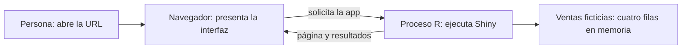
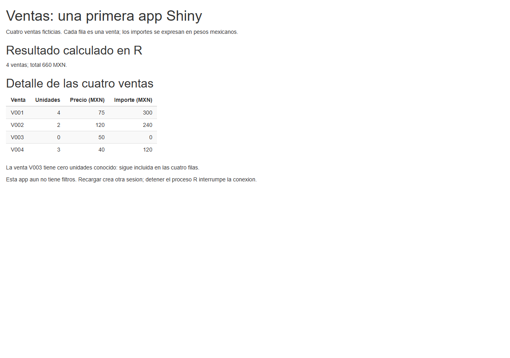

# 13.01 — Web básica y primera app

[Inicio](../../../README.md) / [Módulo 13](../README.md) / **13.01**

**Reconoce qué hace el navegador, qué calcula R y qué mantiene activa tu app.**

| Tu sesión | Qué prepararás o comprobarás |
| --- | --- |
| **Meta** | Iniciar, reconocer, detener y volver a ejecutar una app Shiny local |
| **Necesitas** | R, funciones y tablas básicas; proyecto local con renv |
| **Evidencia** | App, cálculo manual, observaciones de consola y variante reconstruida |

[Preparación](#antes-de-empezar) · [Material de apoyo](#material-de-apoyo) · [Lab 13.01](../../../labs/13_shiny_web/01_web_first_app/README.md) · [Criterio de salida](#evidencia-y-criterio-de-salida)

## Propósito

Hasta ahora un script de R producía objetos, archivos o figuras. Una aplicación
Shiny añade una interfaz web y un proceso R que permanece disponible mientras
la usas. Antes de agregar filtros necesitamos ubicar esas piezas: abrir una
página no significa que el navegador ejecute R, y guardar app.R no publica una app.

Primero iniciaremos una página mínima; después mostraremos cuatro ventas y su
total calculado en R. No hay filtros todavía. [13.02](../02_inputs_outputs/README.md)
conecta controles con salidas; [13.03](../README.md#03-modelo-de-reactividad)
profundizará las dependencias reactivas y sigue planificada.

## Antes de empezar

- Revisa [R fundamental](../../06_r_foundations/README.md), especialmente
  funciones, tablas y [06.08 — Proyectos con renv](../../06_r_foundations/08_projects_renv/README.md).
  El orden del track sitúa esta aplicación después de [11 — Quarto](../../11_reporting_quarto/README.md).
- [12 — Streamlit](../../12_streamlit/README.md) es una alternativa: no necesitas
  haberlo estudiado ni construir dos aplicaciones para continuar después.
- Trabaja principalmente en RStudio o tu IDE de R elegido: abrir proyecto,
  editar archivos, observar consola y reiniciar sesión. Distingue **consola R**
  (instrucciones R) de **terminal del sistema** (PowerShell/Bash/Rscript).
- El [preparador](preparar_app.R) crea un proyecto de app independiente con
  biblioteca local; no modifica el proyecto de análisis anterior ni exige sus
  entregas. Referencias comprobadas: R 4.6.1, renv 1.3.1 y Shiny 1.14.0.
- Preparar copia archivos; restaurar instala localmente lo que indique el
  lockfile; iniciar mantiene un servidor activo. Son tres acciones distintas.
  Sigue los [recorridos](recorridos.md) y revisa metadatos antes de restaurar.

## Qué vas a aprender

- Relacionar navegador, interfaz web, proceso R y dirección local.
- Reconocer `ui`, `server` y el objeto que devuelve `shinyApp()`.
- Iniciar y detener la app conservando archivos y entorno.
- Comprobar una tabla y un total contra datos pequeños completos.
- Diferenciar preparación de datos, sesión y cálculo de una salida.

## Material de apoyo

| Recurso | Para qué sirve | Uso |
| --- | --- | --- |
| [Mínimo](minimo.R) | Página completa sin controles ni cálculos dinámicos | Esencial: empezar aquí |
| [App de ventas](app.R) | Texto y tabla calculados con R | Esencial: ejecutar la copia preparada |
| [Preparador](preparar_app.R) | Crear una carpeta nueva con once fuentes | Esencial, una vez por copia |
| [Proyecto](shiny_1301.Rproj), [DESCRIPTION](DESCRIPTION) y [renv.lock](renv.lock) | Abrir el IDE y declarar/bloquear dependencias reales | Esencial para el entorno local |
| [Restaurador](restaurar.R) e [iniciador](iniciar.R) | Restaurar y arrancar con escucha en 127.0.0.1 | Esencial, desde el proyecto preparado |
| [Recorridos](recorridos.md) | Preparación en consola R y alternativa por terminal | Sigue el IDE; terminal opcional |
| [Controles de autoría](comprobar_app.R) | Contrastar objeto app, resumen y filas con expectativas | Opcional; pruebas como tema en 13.09 |

El preparador reutiliza la configuración local y el activador de
[06.08](../../06_r_foundations/08_projects_renv/plantilla/README.md); no duplica
esas fuentes en el módulo. La app y sus datos se incluyen completos en esta sección.

## 1. Navegador y servidor pueden estar en el mismo equipo

El **navegador** es el programa que presenta una página y recibe las acciones de
la persona. El **servidor**, aquí, es el proceso R que ejecuta Shiny y atiende
esa conexión. No necesitas una segunda computadora para trabajar con esa separación.



Sin renderizador: la persona abre una dirección; el navegador se conecta al
proceso R; R prepara la página y calcula resultados con los datos. El navegador
los presenta. Más adelante los controles enviarán valores a ese proceso.

Al arrancar verás una dirección parecida a:

```text
http://127.0.0.1:8513
```

| Parte | Cómo interpretarla en esta práctica |
| --- | --- |
| `http://` | Forma de comunicación para acceder a la app web local |
| `127.0.0.1` | Este mismo equipo: el iniciador limita allí la escucha |
| `8513` | Puerto que identifica dónde escucha este servidor; puede ser otro |

El puerto no es una carpeta ni una versión del paquete. Si no eliges uno,
Shiny puede seleccionar un puerto disponible. Usa la URL que realmente muestre
tu consola. Copiar esa URL a otro equipo no transporta la app: allí 127.0.0.1
significa ese otro equipo. Esta práctica no despliega un servicio en Internet.

## 2. HTML, CSS y JavaScript: lo que necesitas reconocer

Una página tiene contenido/estructura, presentación y comportamiento en el
navegador. Shiny genera e incorpora recursos web para que puedas definir la app
desde R sin escribir un sitio completo a mano.

| Pieza | Función | Ejemplo que podrás reconocer |
| --- | --- | --- |
| HTML | Estructura y significado del contenido | Un encabezado, un párrafo, una tabla |
| CSS | Presentación de esos elementos | Espacios, colores, anchos y tipografía |
| JavaScript | Comportamiento en el navegador | La infraestructura de Shiny conecta página y servidor |
| R | Datos y cálculos del servidor | Multiplicar unidades por precio y sumar importes |

En una consola R que ya tenga Shiny cargado, prueba:

```r
shiny::h1("Mis ventas")
shiny::p("Importes en pesos mexicanos")
```

Verás representaciones como `<h1>Mis ventas</h1>` y `<p>...</p>`. Esas funciones
describen elementos HTML desde R; imprimirlas en consola no inicia un servidor
ni abre por sí mismo una app. El navegador puede presentar el HTML resultante,
pero no está interpretando la instrucción R `sum(ventas$importe_mxn)`.

No necesitas editar HTML/CSS/JavaScript para resolver este lab. Reconocer sus
responsabilidades ayuda a ubicar problemas: un total incorrecto requiere revisar
datos/cálculo; una tabla difícil de leer requiere además revisar presentación.
En esta sección usamos `fluidPage()`, una función vigente de Shiny que organiza
una página cuyo ancho se adapta. No es una certificación de accesibilidad.

## 3. Una app mínima: tres piezas nombradas

Después de preparar/restaurar tu copia, abre [minimo.R](minimo.R). Este es su
esquema completo, con el mismo comportamiento del archivo:

```r
library(shiny)

ui <- fluidPage(
  h1("Mi primera app Shiny"),
  p("Esta pagina se presenta en el navegador; el proceso R mantiene la app activa."),
  lang = "es"
)

server <- function(input, output, session) {
}

shinyApp(ui = ui, server = server)
```

- `library(shiny)` hace disponibles las funciones del paquete en esta sesión R.
  No instala paquetes; esa tarea pertenece a la restauración del entorno.
- `ui` guarda la definición de la interfaz (*user interface*): el contenido y
  los lugares donde se presentarán resultados. `lang = "es"` identifica el idioma.
- `server` es una función cuyo comportamiento define R por sesión. Aquí está
  vacía, porque la página mínima no pide cálculos ni controles.
- `shinyApp(ui, server)` devuelve un objeto de aplicación que reúne ambas piezas.
  El servidor se inicia al ejecutar la app con `runApp` o el botón Run App del IDE.

La función `server` recibe `input`, `output` y `session`. Por ahora basta reconocer
sus papeles: valores de entradas, definiciones de salidas y conexión/sesión
actual. No son tres archivos que debas crear. El nombre `app.R` es la convención
de una app en un archivo; `minimo.R` sirve como ejemplo que `runApp` también puede
iniciar directamente por su ruta.

**Objeto no significa servidor activo.** `source("minimo.R")` evalúa código y
devuelve información, incluido su último valor; no lo usamos como instrucción
de arranque. Con el [iniciador](iniciar.R) no dependemos de si el IDE imprime
automáticamente el objeto para mostrar la app.

## 4. Preparar, restaurar e iniciar en el IDE

En una consola R abierta en la **raíz del repositorio**, ejecuta:

```r
source("curriculum/13_shiny_web/01_web_first_app/preparar_app.R")
preparar_primera_app("output/practica_1301")
```

El destino debe ser nuevo. El preparador copia once fuentes, incluidos el
proyecto, metadatos y configuración de renv. Todavía no instala ni inicia nada.
Si existe el destino, elige otro; no borres tu práctica para repetir estos pasos.

Abre `shiny_1301.Rproj` **dentro de esa copia** y comprueba `getwd()`.
Si usas otro IDE, abre su carpeta de trabajo y sigue el recorrido equivalente.
En una sesión R nueva de ese proyecto:

```r
source("restaurar.R")
source("iniciar.R")
iniciar_app("minimo.R")
```

Restaurar puede descargar Shiny y dependencias; las instala en la biblioteca
local de la copia. El activador configura estado y sandbox locales. No se
inicializa renv en la raíz de DS Track ni se modifican Conda o bibliotecas globales.
`renv.lock` se generó con paquetes reales; no es una lista de versiones inventadas.

El iniciador llama a `shiny::runApp`, limita la escucha a 127.0.0.1 y abre el
navegador en una sesión interactiva. Mientras la app está activa, la consola R
queda ocupada: no ha fallado porque no reaparezca el indicador `>`.

Predice qué verás: un título y un párrafo, sin tablas, filtros ni métricas.
Compruébalo en el navegador. Para detenerla, usa Stop/Esc en la consola del IDE;
en terminal se usa Ctrl+C. Confirma que vuelve el indicador R antes de seguir.
Cerrar una pestaña no es un procedimiento fiable para detener el proceso R.

Para repetir no prepares ni restaures otra vez si el entorno ya es adecuado:

```r
iniciar_app("minimo.R")
```

Si reiniciaste la sesión R, primero vuelve a ejecutar `source("iniciar.R")`.
Tus archivos siguen en disco, aunque las funciones/objetos de la sesión anterior
ya no estén cargados. Los [recorridos](recorridos.md) incluyen diagnóstico y la
alternativa opcional de terminal para ejecutar desde un proceso nuevo.

**Pausa posible:** detén la app y registra la carpeta, entorno y próximo paso.
No dejes un servidor activo como única forma de recuperar tu trabajo.

## 5. Cuatro ventas: una salida de texto y una tabla

Ahora abre [app.R](app.R). Los datos están dentro del archivo; no necesitas CSV,
bases externas ni entregas previas. Cada fila representa una venta ficticia.

| Venta | Unidades | Precio unitario MXN | Importe MXN |
| --- | ---: | ---: | ---: |
| V001 | 4 | 75 | 300 |
| V002 | 2 | 120 | 240 |
| V003 | 0 | 50 | 0 |
| V004 | 3 | 40 | 120 |

Regla: `importe = unidades × precio`. Los valores son enteros conocidos y las
cuatro claves son distintas. Cero unidades de V003 no es dato ausente: conserva
esa fila. Total esperado: `300 + 240 + 0 + 120 = 660 MXN`, cuatro ventas.
Esta muestra incluida no es un lector/validador general de archivos externos.

La preparación del archivo crea la tabla y una columna calculada:

```r
ventas$importe_mxn <- ventas$unidades * ventas$precio_mxn
```

En la UI, `textOutput("resumen_ventas")` reserva el lugar del resumen. Dentro
de `server` aparece su pareja:

```r
output$resumen_ventas <- renderText({
  paste0(nrow(ventas), " ventas; total ", sum(ventas$importe_mxn), " MXN.")
})
```

`output$resumen_ventas` usa el mismo identificador de la UI. `renderText`
define cómo calcular el texto; el bloque entre llaves contiene la instrucción R.
Shiny decide cuándo ejecutar esa salida. Aquí el cálculo no depende de un
control, porque todavía no hay entradas. Un identificador distinto dejaría
el lugar esperado sin ese resultado aunque otra parte de la página aparezca.

La tabla usa la pareja `tableOutput("detalle_ventas")` /
`output$detalle_ventas <- renderTable({...})`. `setNames` cambia las etiquetas
de presentación de una copia de tabla; `rownames = FALSE` omite números de fila,
`digits = 0` presenta los importes enteros y `striped = TRUE` alterna fondos.
Texto y tabla consumen las mismas cuatro ventas, sin otra selección.

Detén el mínimo y ejecuta `iniciar_app("app.R")`. Contrasta el resumen y cada
fila con la tabla manual. Una pantalla con total 660 no basta si, por ejemplo,
intercambiaras 300 y 240 entre las dos primeras ventas.



Captura propia de autoría en navegador; no es una captura del IDE ni sustituye
ejecutar y comprobar tu copia.

## 6. Preparación, sesión y salida no son lo mismo

La consola de esta app incluye mensajes propios para observar sus etapas:

| Mensaje | Qué observas |
| --- | --- |
| `[13.01] Preparacion: ...` | Se cargó el código que prepara las ventas |
| `[13.01] Sesion abierta: ...` | Se invocó la función server para una conexión |
| `[13.01] Calculo de resumen ...` | Se evaluó la salida de resumen |

Con la app abierta, visita su misma URL desde otra pestaña. Reconoce los
mensajes de nuevas sesiones y comprueba que ambas muestran cuatro ventas/660.
La preparación fuera de `server` pertenece a la carga de la app en ese proceso;
la función `server` se invoca para cada sesión. Varias sesiones pueden usar el
mismo proceso R: no son necesariamente varios intérpretes ni copias de biblioteca.

Las ventas de este ejemplo se consultan sin modificarlas desde las sesiones.
No infieras de ello que cualquier variable global es privada o segura para
guardar elecciones de usuarios. En [13.05](../README.md#05-eventos-y-estado-de-sesion)
se desarrollará estado por sesión; aquí no implementamos ese almacenamiento.

Una salida creada con `renderText` pertenece al mecanismo reactivo. No es una
instrucción para volver a ejecutar todo app.R ante cada interacción. En esta
app sin controles no hay un cambio de entrada que invalide el resumen. Los
controles y el modelo de dependencias se trabajan gradualmente en 13.02–13.03.

Los mensajes permiten reconocer etapas, no medir rendimiento ni certificar
un número universal de evaluaciones. Recargas, reaperturas, cambios de archivo
y reinicios pueden provocar nuevas cargas/sesiones. Registra qué acción hiciste
y qué observaste, sin convertir un conteo de consola en prueba de aprendizaje.

## 7. Guardar, detener y reconstruir una variante

En tu copia, cambia únicamente el precio de V004 de 40 a 50. Detén la app,
guarda app.R y reinicia una sesión R del proyecto. Carga de nuevo el iniciador
y vuelve a arrancar. El resultado debe ser:

```text
V004: 3 × 50 = 150 MXN
Total: 300 + 240 + 0 + 150 = 690 MXN; cuatro ventas
```

Las tres ventas anteriores conservan sus importes. Puedes cambiar después el
título de `h1` para identificar tu variante; eso no cambia unidades ni total.
Comprueba que ver el título nuevo no te haga aceptar un importe incorrecto.
No prometemos aquí recarga automática de código: detener/guardar/reiniciar
permite repetir el ejemplo sin depender de opciones del IDE.

Al detener R, el navegador puede conservar contenido ya dibujado y mostrar una
desconexión. Ver 690 en una pestaña no demuestra que el servidor siga vivo.
Recargar esa URL sin servidor ya no obtiene una app operativa. Los archivos
y el lockfile sí permiten reconstruir la práctica en otra sesión/copia.

## Práctica

Realiza el [lab 13.01](../../../labs/13_shiny_web/01_web_first_app/README.md):
reconoce las piezas, comprueba las cuatro filas y reconstruye la variante de
690 MXN. Basta esta ruta R; no necesitas realizar la alternativa Streamlit.

## Evidencia y criterio de salida

| Conserva | Comprueba | Explica |
| --- | --- | --- |
| Proyecto y metadatos | Biblioteca local/versiones y arranque desde sesión nueva | Preparar, restaurar e iniciar |
| Predicción y resultado base | Cuatro filas y 660 MXN por venta | Dónde se ejecuta el cálculo |
| Variante y observaciones de consola | V004/150, otras filas intactas y total 690 | Preparación, sesión y salida |
| Nota de reinicio/detención | App recuperada desde archivos y desconexión identificada | Por qué una URL/captura no es la entrega completa |

Pide a tu compañero que elija un importe para comprobarlo y que señale UI,
server y objeto app en el código. Puedes continuar cuando inicies/detengas la
app y justifiques esos resultados sin confundir navegador con intérprete R.
Guarda ayudas, dudas y siguiente paso en tu nota personal, fuera de PROGRESS.md.
No hay proyecto integrador ni checkpoints implementados por crear esta práctica.

## Referencias

Fuentes consultadas el 2026-10-28; ejemplos propios. Se comprobó la API con
R 4.6.1/Shiny 1.14.0 y se generó/restauró el lockfile real con renv 1.3.1.
Las páginas web pueden describir otras versiones.

- Posit: [primera app](https://shiny.posit.co/r/getstarted/shiny-basics/lesson1/),
  [shinyApp](https://shiny.posit.co/r/reference/shiny/latest/shinyapp.html),
  [runApp](https://shiny.posit.co/r/reference/shiny/latest/runapp.html) y
  [alcance de variables](https://shiny.posit.co/r/articles/improve/scoping/).
- Hadley Wickham, *Mastering Shiny*: [Your first Shiny app](https://mastering-shiny.org/basic-app.html).
  Se usa como apoyo conceptual; los datos/ejemplos del curso son propios.
- MDN: [servidor web](https://developer.mozilla.org/en-US/docs/Learn_web_development/Howto/Web_mechanics/What_is_a_web_server)
  y [HTML básico](https://developer.mozilla.org/en-US/docs/Learn_web_development/Core/Structuring_content/Basic_HTML_syntax).
- [renv: restauración](https://rstudio.github.io/renv/reference/restore.html).

## Siguiente paso

Después del lab, continúa con [13.02 — Entradas y salidas](../02_inputs_outputs/README.md).
13.03 también está disponible; 13.04–13.10 conservan su plan, sin dar por implementados filtros compartidos,
estado o entrega final.

---

[← Módulo 13](../README.md) · [Lab 13.01 →](../../../labs/13_shiny_web/01_web_first_app/README.md)
