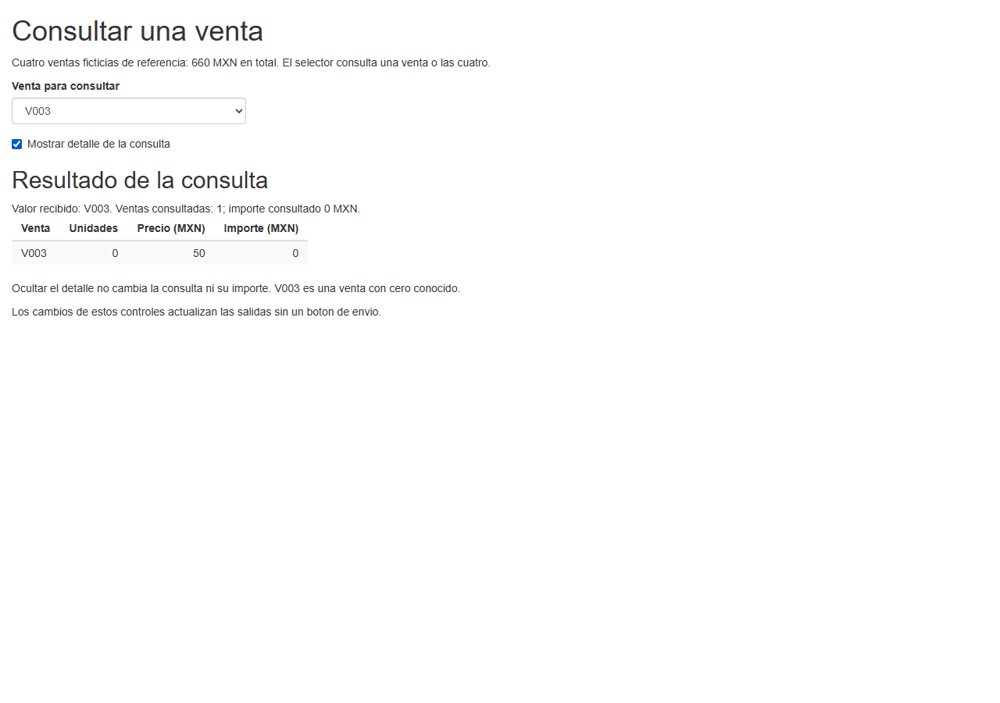

# 13.02 — Entradas y salidas

[Inicio](../../../README.md) / [Módulo 13](../README.md) / **13.02**

**Conecta lo que elige la persona con el resultado que calcula R.**

| Tu sesión | Qué prepararás o comprobarás |
| --- | --- |
| **Meta** | Vincular controles, valores recibidos y salidas de texto/tabla |
| **Necesitas** | UI/servidor de 13.01, funciones y selección de tablas en R |
| **Evidencia** | App, predicciones por venta y una variante de etiquetas/valores comprobada |

[Preparación](#antes-de-empezar) · [Material de apoyo](#material-de-apoyo) · [Lab 13.02](../../../labs/13_shiny_web/02_inputs_outputs/README.md) · [Criterio de salida](#evidencia-y-criterio-de-salida)

## Propósito

En 13.01 la app presentaba siempre cuatro ventas. Ahora una persona podrá
elegir una venta o consultar las cuatro y mostrar u ocultar su detalle. Para
que funcione necesitamos conectar nombres entre la UI y el servidor, leer
valores del tipo esperado y definir cómo se presenta cada resultado.

Comenzaremos con un texto que se devuelve a la pantalla. Después conectaremos
un selector y una casilla con las ventas conocidas. El modelo de dependencias
reactivas se desarrolla en [13.03](../03_reactivity/README.md), ya
disponible. Aquí usamos sus salidas básicas sin exigir `reactive()` u observadores.

## Antes de empezar

- Revisa [13.01 — Web básica y primera app](../01_web_first_app/README.md):
  navegador, proceso R, UI, servidor y arranque local.
- Retoma [selección de tablas](../../06_r_foundations/05_lists_data_frames/README.md)
  y [funciones](../../06_r_foundations/06_functions_control/README.md) si hace falta.
  El índice de [R fundamental](../../06_r_foundations/README.md) permite ubicar esos temas.
- Usa RStudio o tu IDE de R: abre el proyecto, edita el script y observa resultados.
  La terminal es apoyo opcional; no necesitas realizar dos recorridos.
- El [preparador](preparar_app.R) crea una copia nueva con los mismos metadatos
  de 13.01. No exige entregas previas, no modifica aquella práctica y no añade
  dependencias: R 4.6.1, Shiny 1.14.0 y renv 1.3.1 son la referencia comprobada.
- Sigue los [recorridos](recorridos.md). La app completa necesita ventas.R junto
  a app.R; ejecuta la copia preparada y conserva intactas las fuentes educativas.

## Qué vas a aprender

- Distinguir identificador técnico, etiqueta visible y valor de una entrada.
- Leer texto y valores lógicos dentro de una salida calculada.
- Emparejar `textOutput`/`renderText` y `tableOutput`/`renderTable` por identificador.
- Comprobar cambios de selección, importe cero y ocultar/recuperar el detalle.
- Explicar qué se actualiza automáticamente y qué todavía no estamos implementando.

## Material de apoyo

| Recurso | Para qué sirve | Uso |
| --- | --- | --- |
| [Mínimo](minimo.R) | Escribir un texto y verlo como salida | Esencial: primer paso |
| [App](app.R) | Consultar una venta o todas y controlar el detalle | Esencial, ejecutar la copia preparada |
| [Ventas y consulta](ventas.R) | Datos completos y función R sin Shiny | Esencial para la app |
| [Preparador](preparar_app.R) y [recorridos](recorridos.md) | Crear una práctica nueva y trabajar en el IDE | Esencial |
| [DESCRIPTION](../01_web_first_app/DESCRIPTION), [lockfile](../01_web_first_app/renv.lock) y [proyecto base](../01_web_first_app/shiny_1301.Rproj) | Mismo entorno de 13.01 | Copiados sin cambios; el proyecto se nombra shiny_1302.Rproj en la copia |
| [Restaurador](../01_web_first_app/restaurar.R) e [iniciador](../01_web_first_app/iniciar.R) | Reutilizar arranque/aislamiento local | Copiados sin cambios |
| [Controles de autoría](comprobar_app.R) | Contrastar valores, consultas y cambios de salidas | Opcional; no sustituye navegador o IDE |

El preparador también reutiliza perfil/activador/ajustes de
[06.08](../../06_r_foundations/08_projects_renv/plantilla/README.md). No se
duplica el lockfile ni se transportan bibliotecas instaladas.

## 1. De la entrada al resultado: un texto completo

Abre el [mínimo](minimo.R). Su UI contiene:

```r
textInput("mensaje", "Mensaje del ejemplo", value = "Ventas")
textOutput("eco")
```

`textInput` crea un cuadro de texto. Su `inputId` es `"mensaje"`; la etiqueta
que lee la persona es `"Mensaje del ejemplo"`; `value` fija el texto inicial.
`textOutput("eco")` reserva el lugar donde se presentará el resultado.

Dentro de `server` se define la salida:

```r
output$eco <- renderText({
  if (is.null(input$mensaje)) return(NULL)
  paste0("Texto recibido: ", input$mensaje)
})
```

`input$mensaje` lee el texto recibido. `renderText` contiene el cálculo y
`output$eco` lo conecta con el lugar `"eco"` de la UI. Los nombres de entrada
y salida pueden ser distintos: lo que debe coincidir es cada pareja de su
propia conexión. `input` se consulta; no asignamos `input$mensaje <- ...`.

Durante la conexión inicial un valor puede no haber llegado todavía. El `if`
devuelve `NULL` en ese caso y no inventa un dato. Es una guarda de inicio,
no un sistema completo de validación de entradas; ese tema llega en 13.06.
Una cadena vacía `""` sí es texto recibido: no equivale a `NULL`.

Predice y comprueba en el navegador:

| Texto escrito | Salida esperada |
| --- | --- |
| Ventas | Texto recibido: Ventas |
| Otra nota | Texto recibido: Otra nota |
| Campo vacío | Solo el prefijo «Texto recibido:» |
| `<b>ventas</b>` | Los caracteres se muestran como texto, sin convertir ventas en negrita |

El mínimo usa `textOutput`, que presenta texto escapado como HTML. No uses
`renderUI`/`HTML` para tratar un mensaje ordinario como contenido web. Aquí no
se introduce ejecución de código escrito por la persona.

Con la configuración comprobada, el texto se actualiza al editar, sin botón
de envío; puede haber un breve intervalo de comunicación. No prometemos una
latencia exacta. Los eventos de confirmación se desarrollan en 13.05.

## 2. Identificador, etiqueta y valor son cosas distintas

Imagina un menú que muestra «Todas las ventas», pero entrega el valor `"todas"`:

```r
selectInput(
  "venta_elegida", "Venta para consultar",
  choices = c("Todas las ventas" = "todas", "Venta V001" = "V001"),
  selected = "todas", selectize = FALSE
)
```

Este fragmento ilustra dos opciones. La app completa añade las cuatro ventas.

| Pieza | Valor del ejemplo | Para qué sirve |
| --- | --- | --- |
| `inputId` | `"venta_elegida"` | El servidor lee `input$venta_elegida` |
| `label` | `"Venta para consultar"` | Explica el control a la persona |
| Nombre de una opción | `"Todas las ventas"` | Etiqueta que se presenta en el menú |
| Valor de esa opción | `"todas"` | Texto que recibe el servidor |
| `selected` | `"todas"` | Valor inicialmente elegido |

En el vector nombrado de `choices`, los nombres están a la izquierda de `=`
y los valores a la derecha. `selected` debe referirse al **valor**, no a la
etiqueta. Cambiar una etiqueta visible no debería cambiar el criterio de consulta.

Usa IDs claros y únicos en la página, como `venta_elegida`, `mostrar_detalle`,
`resumen_venta` y `detalle_venta`. No repitas un ID entre controles/salidas ni
copies el texto de una etiqueta como si fuera el nombre de la variable.

`selectize = FALSE` elige el selector HTML nativo. Es suficiente para cinco
opciones y facilita observar su selección con teclado. No hace falta instalar
otro paquete de controles. La app usa selección única: el valor es texto como
`"V003"`, aunque contenga dígitos; no es el número 3.

## 3. Datos conocidos antes de conectar varios elementos

[ventas.R](ventas.R) incluye la misma muestra sintética de 13.01. Cada fila es
una venta con clave distinta; unidades/precios/importes son enteros conocidos.

| Venta | Unidades | Precio unitario MXN | Importe MXN |
| --- | ---: | ---: | ---: |
| V001 | 4 | 75 | 300 |
| V002 | 2 | 120 | 240 |
| V003 | 0 | 50 | 0 |
| V004 | 3 | 40 | 120 |

La regla es unidades por precio y el total de referencia sigue siendo 660 MXN.
La venta V003 existe con cero unidades observado: consultar V003 debe devolver
**una fila y 0 MXN**, no una selección vacía. No hay datos ausentes ni lector de
archivos externos en esta sección.

`crear_ventas()` construye esa tabla. `consultar_venta(ventas, clave)` es una
función R corriente: `"todas"` devuelve las cuatro filas; una clave válida,
su fila. Comprueba que la clave sea texto único conocido antes de consultar;
no convierte una clave incorrecta en una venta con importe cero.

Puedes comprobar el cálculo fuera de Shiny en la consola de tu copia:

```r
source("ventas.R")
ventas <- crear_ventas()
consultar_venta(ventas, "V003")
```

La selección usa `drop = FALSE` para conservar forma de tabla al devolver una
fila. La función no modifica la muestra. En esta sección su contrato supone
la tabla conocida: no es un validador general de fuentes de ventas.

## 4. Texto y tabla que responden al selector

En [app.R](app.R), la UI define el selector con `selected = "todas"`, una
casilla marcada y dos lugares de salida. El resumen se calcula dentro de server:

```r
output$resumen_venta <- renderText({
  if (is.null(input$venta_elegida)) return(NULL)
  consulta <- consultar_venta(ventas, input$venta_elegida)
  paste0("Valor recibido: ", input$venta_elegida,
         ". Ventas consultadas: ", nrow(consulta),
         "; importe consultado ", sum(consulta$importe_mxn), " MXN.")
})
```

El resultado inicial debe decir que recibió `todas`, consultó 4 ventas y sumó
660 MXN. Al elegir V002, debe recibir `V002`, consultar una fila y mostrar 240.
La tabla usa la misma función para obtener la consulta y presenta sus cuatro
campos. No agrega un criterio diferente para el precio o las unidades.

| Elección | Valor recibido | Filas | Importe consultado MXN |
| --- | --- | ---: | ---: |
| Todas las ventas | `"todas"` | 4 | 660 |
| V001 | `"V001"` | 1 | 300 |
| V002 | `"V002"` | 1 | 240 |
| V003 | `"V003"` | 1 | 0 |
| V004 | `"V004"` | 1 | 120 |

El texto fijo de referencia «cuatro ventas/660» describe la muestra completa.
El resumen y la tabla describen la **consulta elegida**. Comprueba siempre el
contexto de cada cifra, incluidos los campos por venta; una suma coincidente
no detectaría intercambiar los importes de V001/V002.



Captura propia de autoría en navegador. Contrasta sus valores con tu copia;
no sustituye la interacción ni es una captura del IDE.

Las dos salidas llaman a una función normal; no comparten todavía una expresión
`reactive()` ni un resultado cacheado. Reutilizar la regla evita duplicarla,
pero no garantiza una sola evaluación. La reutilización de un conjunto calculado
entre varias salidas se profundiza en 13.03–13.04.

## 5. Una casilla cambia la presentación

La entrada se define como:

```r
checkboxInput("mostrar_detalle", "Mostrar detalle de la consulta", value = TRUE)
```

Su valor en el servidor es lógico: `TRUE` al marcar y `FALSE` al desmarcar.
No lo compares con el texto `"TRUE"`. La tabla comienza con esta condición:

```r
if (is.null(input$venta_elegida) || !isTRUE(input$mostrar_detalle)) return(NULL)
```

`isTRUE` comprueba un verdadero lógico y también permite no dibujar el detalle
si el valor aún no llegó al iniciar. `return(NULL)` deja esa salida sin tabla.
La casilla no modifica `venta_elegida`, la muestra ni el resumen: oculta una
representación de la consulta. Tampoco guarda resultados de una sesión anterior.

Ensaya V003, desmarca y vuelve a marcar: el resumen conserva una venta/0 MXN,
y al recuperar la tabla vuelve la fila V003. Ocultar no significa eliminar ni
filtrar todas las ventas. La app todavía no crea gráficos ni descargas.

## 6. Conexiones que puedes revisar en el código

| Definición en UI | Lectura/definición en server | Resultado esperado |
| --- | --- | --- |
| `textInput("mensaje", ...)` | `input$mensaje` dentro de `renderText` | El mínimo presenta ese texto |
| `selectInput("venta_elegida", ...)` | `input$venta_elegida` | La clave dirige la consulta |
| `checkboxInput("mostrar_detalle", ...)` | `input$mostrar_detalle` | Muestra/oculta el detalle |
| `textOutput("resumen_venta")` | `output$resumen_venta <- renderText(...)` | Texto de cantidad/importe |
| `tableOutput("detalle_venta")` | `output$detalle_venta <- renderTable(...)` | Tabla con cuatro campos |

La UI define el lugar y el tipo de presentación; el `render` define cómo obtener
el contenido. Un ID mal escrito puede dejar un lugar vacío. Cambiar solo la
etiqueta visible no arregla esa conexión. Usa la pareja del tipo correcto:
texto con renderText y tabla con renderTable.

Lee `input$venta_elegida` dentro de una salida reactiva, como en los ejemplos.
No lo captures fuera de server como una foto inicial ni esperes leerlo en una
consola R ordinaria: es un valor que Shiny proporciona a la sesión. El mecanismo
que registra dependencias e invalida resultados se explica en 13.03.

**Pausa posible:** conserva una tabla de predicciones para las cinco opciones
y detén tu servidor. Retoma cargando el iniciador de la copia, sin prepararla encima.

## 7. Reconstruir una variante sin cambiar los datos

En tu copia, cambia solo la etiqueta de la opción global:

```r
opciones_venta <- c("Conjunto completo" = "todas",
                    setNames(ventas$venta_id, ventas$venta_id))
```

Detén la app, guarda y reinicia la sesión R del proyecto. Inicia de nuevo:
debe mostrar «Conjunto completo», pero el servidor sigue recibiendo `todas` y
calculando cuatro ventas/660 MXN. Elegir V001 sigue produciendo una venta/300.

Como segunda variante cambia `selected = "todas"` por `selected = "V004"`.
Al abrir una sesión nueva, el inicio debe ser una fila/120 MXN. Esto cambia el
valor inicial, no la regla ni la muestra. Recargar reinicia estas elecciones;
persistencia/acciones por sesión se desarrollarán en 13.05.

No cambies precio, unidades o la función de consulta para conseguir estos
resultados. Guarda ambas variantes y explica cuál cambia la presentación y
cuál cambia la elección inicial. Para otra copia limpia usa otro destino.

## Práctica

Realiza el [lab 13.02](../../../labs/13_shiny_web/02_inputs_outputs/README.md):
conecta las piezas, comprueba las cinco opciones y reconstruye una variante de
etiqueta/valor inicial. Basta esta ruta R, sin entregas anteriores.

## Evidencia y criterio de salida

| Conserva | Comprueba | Explica |
| --- | --- | --- |
| Mínimo y predicciones de texto | Texto ordinario, vacío y caracteres HTML | ID/etiqueta/valor y salida de texto |
| Tabla de cinco consultas | Cuatro campos, cantidad e importe por opción | Por qué V003/0 es una venta real |
| Observación al ocultar/recuperar | El resumen no cambia y vuelve el mismo detalle | Presentación frente a consulta |
| Variantes en sesión nueva | Etiqueta global distinta/660 e inicio V004/120 | Etiqueta visible frente a selected |

Pide a tu compañero que elija una opción y encuentre las conexiones en el
código. Continúa cuando puedas justificar los valores, reconocer los tipos y
detectar una salida conectada al ID equivocado. Guarda ayudas/dudas en tu nota
personal. PROGRESS.md registra autoría; no hay proyecto/checkpoints implementados.

## Referencias

Fuentes oficiales consultadas el 2026-10-28; ejemplos propios comprobados con
R 4.6.1/Shiny 1.14.0 y el lockfile de 13.01 sin cambios. La documentación web
puede describir otras versiones.

- Posit: [textInput](https://shiny.posit.co/r/reference/shiny/latest/textinput.html),
  [selectInput](https://shiny.posit.co/r/reference/shiny/latest/selectinput.html) y
  [checkboxInput](https://shiny.posit.co/r/reference/shiny/latest/checkboxinput.html).
- Posit: [textOutput](https://shiny.posit.co/r/reference/shiny/latest/textoutput.html),
  [tableOutput/renderTable](https://shiny.posit.co/r/reference/shiny/latest/rendertable.html)
  y [salidas reactivas](https://shiny.posit.co/r/getstarted/shiny-basics/lesson4/).
- Hadley Wickham, *Mastering Shiny*: [Basic UI](https://mastering-shiny.org/basic-ui.html).
  Apoyo conceptual; datos y ejercicios del track son propios.

## Siguiente paso

Después del lab, consulta [13.03 — Modelo de reactividad](../03_reactivity/README.md),
ya disponible. 13.05–13.10 también conservan su plan; esta app no los
da por implementados por utilizar salidas que responden a entradas.

---

[← 13.01](../01_web_first_app/README.md) · [Módulo 13](../README.md) · [Lab 13.02 →](../../../labs/13_shiny_web/02_inputs_outputs/README.md)
