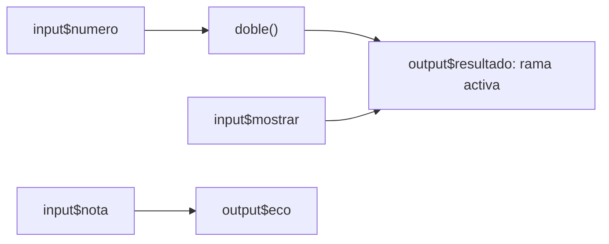
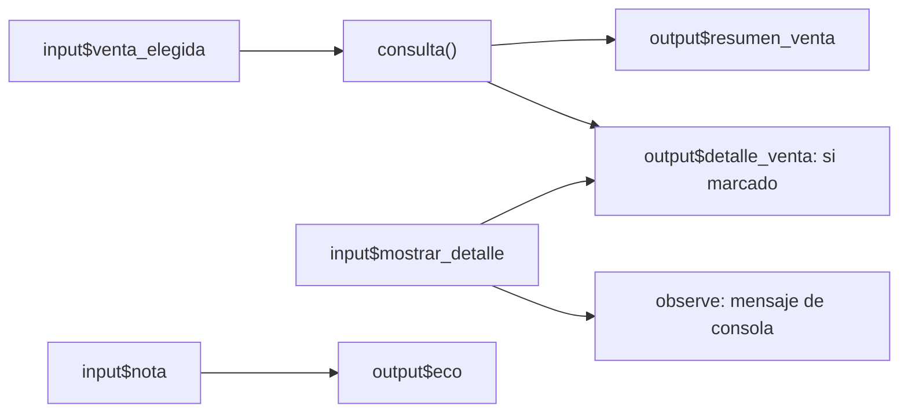

# 13.03 — Modelo de reactividad

[Inicio](../../../README.md) / [Módulo 13](../README.md) / **Lección 13.03**

| Tu sesión | Qué prepararás o comprobarás |
| --- | --- |
| **Meta** | Explicar qué depende de cada entrada y cuándo se vuelve a calcular |
| **Necesitas** | R, el IDE elegido y los conceptos de entradas/salidas de 13.02; copia independiente con el mismo Shiny/renv |
| **Evidencia** | Un grafo, predicciones contrastadas con salidas y consola, y una explicación de invalidación |

[Empezar](#antes-de-empezar) · [Ir al lab](../../../labs/13_shiny_web/03_reactivity/README.md) · [Comprobar](#evidencia-y-criterio-de-salida)

## Propósito

En 13.02 una entrada modificaba una salida. Ahora vamos a explicar el mecanismo
y a extraer un cálculo compartido. Nos interesa poder predecir qué trabajo se
repite, qué resultado se reutiliza y qué entrada no tiene relación con él.
La app responde a dependencias; no vuelve a ejecutar app.R entero ante cada clic.

El objetivo es el modelo reactivo. Los filtros sobre una cartera y sus indicadores
corresponden a 13.04; botones y estado propio a 13.05. Aquí no se necesitan.

## Antes de empezar

- Revisa [13.02 — Entradas y salidas](../02_inputs_outputs/README.md): ID,
  etiqueta, valor y parejas output/render. También usamos funciones R corrientes,
  presentadas en [06.06](../../06_r_foundations/06_functions_control/README.md).
- Trabaja en una copia nueva siguiendo [preparación y arranque](recorridos.md).
  El recorrido principal usa RStudio o tu IDE; la terminal es opcional.
- El preparador reúne doce fuentes, incluida ventas.R de 13.02. No exige una
  práctica anterior, no sobrescribe entregas ni instala paquetes. La restauración
  posterior conserva el lockfile de 13.01: Shiny 1.14.0, renv 1.3.1, R 4.6.1
  como referencia comprobada. No hay dependencias nuevas.

## Qué vas a aprender

- Dibujar conexiones desde productores hacia consumidores.
- Crear una expresión con reactive y leer su resultado con paréntesis.
- Distinguir invalidación, ejecución por demanda y reutilización del resultado.
- Predecir dependencias condicionales y distinguir reactive, render y observe.

## Material de apoyo

| Recurso | Para qué sirve | Uso |
| --- | --- | --- |
| [recorridos.md](recorridos.md) y [preparar_app.R](preparar_app.R) | Preparar una copia, abrir proyecto, restaurar y arrancar | Necesario; elige un recorrido |
| [minimo.R](minimo.R) | Número/doble y rama sin demanda | Primera actividad |
| [app.R](app.R) | Una consulta compartida entre dos salidas | Segunda actividad |
| [ventas.R de 13.02](../02_inputs_outputs/ventas.R) | Crear/consultar las cuatro ventas con funciones corrientes | Se copia automáticamente, sin duplicar algoritmo |
| [comprobar_app.R](comprobar_app.R) | Contrastar valores y propiedades reactivas con testServer | Opcional, apoyo de autoría; no monta UI |

## 1. Un cálculo corriente y uno reactivo

En una sesión R corriente, estas instrucciones calculan una vez:

```r
numero <- 2
doble <- numero * 2
numero <- 3
doble  # 4; no se modifica solo por cambiar numero
```

Una función corriente puede calcular otra vez cuando la llamas, pero R no
organiza automáticamente sus dependencias. En Shiny, reactive añade seguimiento
de lecturas y conserva el último resultado válido. Empieza con [minimo.R](minimo.R)
en la copia preparada; ábrelo en el editor e inicia con:

```r
source("iniciar.R")
iniciar_app("minimo.R")
```

El núcleo está **dentro de server**:

```r
doble <- reactive({
  if (is.null(input$numero)) return(NULL)
  message("[doble] numero=", input$numero)
  2 * input$numero
}, label = "doble")
```

Las llaves contienen el cálculo; la última expresión aporta su resultado.
`label` es un nombre de diagnóstico, no un ID de UI. La marca message se escribe
en la consola R cada vez que se ejecuta ese cuerpo. Es instrumentación didáctica,
no una métrica del producto ni un historial permanente.

`doble` es la expresión reactiva; **`doble()` pide su valor**. Para usarlo en una
salida, se llama dentro de renderText. No se imprime doble() directamente en la
consola R corriente: falta un consumidor/contexto reactivo. No actives modos
globales especiales para esconder ese error.

**Qué deberías observar:** el número inicial 2 produce `Doble: 4`; con 3,
`Doble: 6`; con 0, `Doble: 0`. Cero es un valor conocido, no ausencia.
Si borras temporalmente el número, su representación puede depender del control
y navegador; la validación completa de entradas corresponde a 13.06. Usa los
valores válidos de la actividad y consulta cualquier diagnóstico de R.

## 2. Leer una dependencia dibuja una conexión

Un **productor** ofrece un valor: una entrada o una expresión reactiva. Un
**consumidor** lee ese valor: otra expresión, una salida o un observador.
Una expresión puede ocupar ambos papeles. Las flechas siguientes van del
productor hacia aquello que puede invalidar.



Sin renderizador: número alimenta doble, doble alimenta resultado; la casilla
elige la rama de resultado. La nota solo alimenta eco. El grafo dibujado supone
que la casilla está marcada. Es un esquema de nuestro código, no un registro
automático de todas las dependencias internas de Shiny.

Shiny registra las lecturas durante la ejecución. Que una variable esté cerca
de otra en el archivo no crea una conexión. Cambia la nota, espera a que aparezca
en su eco y revisa la consola: no debería aparecer una nueva marca [doble].

## 3. Invalidar no es recalcular en ese instante

Cuando una entrada cambia, el resultado que dependía de ella deja de poder
reutilizarse como actualizado: queda **invalidado**. Esa señal alcanza a los
consumidores conectados. Cuando una salida solicita el cálculo, Shiny lo evalúa
si hace falta y guarda el resultado válido para lecturas posteriores.

| Momento en el mínimo, con la consulta activa | Interpretación |
| --- | --- |
| Se solicita doble por primera vez con número 2 | Ejecuta el cuerpo y obtiene 4 |
| Otra lectura sin cambios | Reutiliza 4; no imprime otra marca [doble] |
| Cambia número a 3 | El resultado anterior queda invalidado |
| La salida vuelve a pedir doble | Calcula 6 y vuelve a conservarlo |
| Cambia solo la nota | No invalida doble |

La expresión es **perezosa**: necesita demanda para hacer el cálculo. Las salidas
activas suelen proporcionar esa demanda enseguida, por lo que en una app pequeña
los dos pasos pueden parecer simultáneos. No deduzcas que son el mismo paso.
Esta caché automática pertenece a la expresión y, al crearla dentro de server,
a la sesión. No guarda archivos ni comparte automáticamente resultados entre usuarios;
no hace falta añadir bindCache para comprenderla.

**Compruébalo:** cambia una entrada por vez y espera su resultado antes de la
siguiente. No uses el número de mensajes como cronómetro ni como promesa de una
ejecución por cada pulsación: pueden agruparse cambios rápidos, existir lecturas
iniciales sin valor o intervenir la suspensión de salidas. Tampoco dependas del
orden entre salidas independientes.

## 4. La rama que no lee ya no depende

En [minimo.R](minimo.R), la salida consulta primero la casilla:

```r
output$resultado <- renderText({
  message("[resultado] evaluar rama")
  if (!isTRUE(input$mostrar)) return("Consulta desactivada.")
  valor <- doble()
  if (is.null(valor)) return(NULL)
  paste0("Doble: ", valor)
})
```

Desmarca y espera `Consulta desactivada.`. Esa ejecución termina antes de leer
doble(). Después cambia el número a 7: doble puede quedar invalidado por su lectura
anterior, pero ya no hay una salida que lo pida. No debe aparecer una nueva marca
[doble] ni recalcularse resultado por ese cambio. Al marcar otra vez, la salida
lee el cálculo pendiente y muestra 14.

Si cambias únicamente la casilla sin cambiar número, volver a marcar puede
reutilizar el doble válido: no necesita calcularlo otra vez. Las conexiones se
reconstruyen según las lecturas de la ejecución actual. No son una lista fija
extraída de todo el archivo.

**Prueba un cambio:** en tu copia, mueve `valor <- doble()` antes del if. El texto
desactivado será el mismo, pero el cálculo se seguirá leyendo en esa rama. Cambia
número mientras la casilla está desmarcada: ahora aparecen [doble] y [resultado].
Guarda la predicción, prueba, restaura el orden original y reinicia la app.

Esto es una rama R que retorna un texto, no ocultación de un elemento con CSS.
Shiny también suspende por defecto salidas que el navegador informa como ocultas;
esa es otra condición que puede modificar la demanda. Aquí no cambiamos esa opción.

## 5. La misma consulta para dos salidas

Detén el mínimo y abre [app.R](app.R). Inicia `iniciar_app("app.R")` desde la
consola R de la copia. La fuente sintética es completa y no cambia:

| Venta | Unidades | Precio unitario (MXN) | Importe (MXN) |
| --- | --- | --- | --- |
| V001 | 4 | 75 | 300 |
| V002 | 2 | 120 | 240 |
| V003 | 0 | 50 | 0 |
| V004 | 3 | 40 | 120 |

Una fila es una venta; importe = unidades × precio. Todas suman 660 MXN. V003
existe con importe cero. El selector consulta una venta o todas; no agrega
cortes ni reglas nuevas. ventas.R conserva las funciones corrientes de 13.02.

Antes cada salida llamaba a consultar_venta por separado. Ahora ambas leen:

```r
consulta <- reactive({
  if (is.null(input$venta_elegida)) return(NULL)
  message("[consulta] venta=", input$venta_elegida)
  consultar_venta(ventas, input$venta_elegida)
}, label = "consulta")
```

En cada render se usa `datos <- consulta()`. La función corriente sigue siendo
la responsable de seleccionar filas; reactive organiza cuándo se la necesita.
Un render pide la consulta y otro reutiliza su resultado mientras siga válido.
La tabla y el resumen deben coincidir por venta, no solo en el total.



Lectura textual: venta alimenta consulta y esta alimenta resumen/detalle. La
casilla alimenta detalle y el observador de consola. Nota alimenta solo eco.
Con detalle desmarcado desaparece su conexión con consulta; **resumen sigue
pidiendo consulta**, así que cambiar la venta sí requiere calcularla. Ocultar
la tabla no desactiva la consulta completa como ocurría con doble en el mínimo.

| Cambio aislado, después del inicio | Qué comprobar |
| --- | --- |
| Elegir V003 | Una fila, 0 MXN; nueva [consulta], resumen y detalle actualizados |
| Escribir una nota | Cambia eco; no aparece otra [consulta] |
| Desmarcar detalle | Tabla sin filas visibles; resumen conserva 1/0, sin nueva [consulta] |
| Elegir V004 con detalle desmarcado | Resumen 1/120; [consulta] aparece por la demanda del resumen |
| Recuperar detalle | V004/3/40/120; reutiliza la consulta válida |

## 6. reactive, render y observe tienen responsabilidades distintas

| Construcción | Para qué la usamos aquí | Cómo se consume |
| --- | --- | --- |
| reactive({ ... }) | Calcular un valor reutilizable con dependencias | Se llama consulta() desde un contexto reactivo |
| renderText / renderTable | Preparar una salida del tipo que espera la UI | Se asigna a output con su ID |
| observe({ ... }) | Ejecutar un efecto, aquí un mensaje de diagnóstico | Se ejecuta al inicio y tras invalidaciones; su resultado no se usa como dato |

Los observadores programan su ejecución cuando quedan invalidados, sin esperar
que otra expresión les pida un valor. Las salidas también son consumidores que
impulsan el cálculo, con reglas propias como la suspensión cuando están ocultas.
No sustituyas consulta por observe: no es una función que devuelva la tabla.

El [app.R](app.R) contiene este observador pequeño:

```r
observe({
  message("[observador] detalle=", isTRUE(input$mostrar_detalle))
}, label = "aviso_detalle")
```

No actualiza otra variable ni es necesario para que la app funcione. Se incluye
para reconocer un efecto separado de un valor. Quitar ese bloque elimina sus
mensajes y conserva las salidas. No le añadas escrituras de archivos o cambios
de estado para esta práctica. Los eventos y estado de sesión llegan en 13.05.

## 7. Errores que cambian el modelo

| Síntoma o propuesta | Revisión |
| --- | --- |
| Usar consulta sin () | Estás pasando el objeto reactivo, no su tabla resultante |
| Leer input directamente al entrar en server fuera de reactive/render/observe | Falta contexto reactivo; envolver solo la impresión no corrige la lectura anterior |
| Crear una función corriente que lee input y esperar caché propia | La lectura se atribuye al consumidor que la llama; la función corriente no conserva un resultado reactivo |
| Leer todas las entradas al principio de cada render | Introduce dependencias aunque la rama posterior no use esos valores |
| Modificar ventas global con <<- | Introduce estado compartido; no hace falta para actualizar una salida |
| Decir que source de ventas.R se repite con cada clic | Aquí se carga al preparar la app, no al invalidar consulta |
| Prometer un orden fijo de resumen y tabla | Comprueba valores/dependencias, no un orden accidental de consola |

## Práctica

Realiza el [lab 13.03 — Modelo de reactividad](../../../labs/13_shiny_web/03_reactivity/README.md).
Primero predice el grafo y luego contrasta mensajes y resultados. La ampliación
de rama ayuda a distinguir un texto igual de un trabajo interno diferente.

## Evidencia y criterio de salida

| Conserva | Comprueba | Explica |
| --- | --- | --- |
| Grafo del mínimo con casilla marcada/desmarcada | Nota independiente; 2→4, 3→6, pausa y 7→14 | Qué lectura crea o elimina cada conexión |
| Tabla de predicciones de las ventas | Todas 4/660 y V003 1/0; cambio oculto V004 1/120 | Por qué el resumen mantiene la demanda |
| Variante de lectura antes del if | Texto igual, trabajo distinto con la consulta desactivada | Invalidar frente a ejecutar; cache y demanda |

Puedes continuar cuando expliques esos casos y distingas reactive/render/observe
sin decir que Shiny ejecuta todo el script de nuevo. Quien aprende hace y justifica;
su compañero revisa una predicción y propone un cambio. Guarda resultados, ayudas,
dudas y siguiente paso en tu copia o bitácora personal, fuera de PROGRESS.md.
No hay proyecto/checkpoint asociado implementado; material disponible no acredita práctica completada.

## Referencias

- [Posit: reactive](https://shiny.posit.co/r/reference/shiny/latest/reactive.html):
  valor retornado, consumidores e invalidación.
- [Posit: observe](https://shiny.posit.co/r/reference/shiny/latest/observe.html):
  efectos, planificación y diferencia frente a expresiones.
- [Posit: outputOptions](https://shiny.posit.co/r/reference/shiny/latest/outputoptions.html):
  suspensión predeterminada de salidas ocultas.
- Hadley Wickham, [Mastering Shiny, grafo reactivo](https://mastering-shiny.org/reactive-graph.html)
  y [bloques reactivos](https://mastering-shiny.org/reactivity-objects.html):
  lectura de profundización sobre conexiones, demanda y caché.

Consultadas el 2026-10-28; la referencia oficial mostraba Shiny 1.14.0. Las URLs
latest pueden cambiar; la versión de práctica está fijada en renv.lock. Ejemplos
propios de DS Track; no reproducen los ejercicios del libro. No se requiere reactlog.

## Siguiente paso

Después del lab, continúa con
[13.04 — Filtros e indicadores compartidos](../04_shared_filters/README.md), ya disponible.

[← 13.02](../02_inputs_outputs/README.md) · [Módulo 13](../README.md) · [Lab 13.03](../../../labs/13_shiny_web/03_reactivity/README.md)
