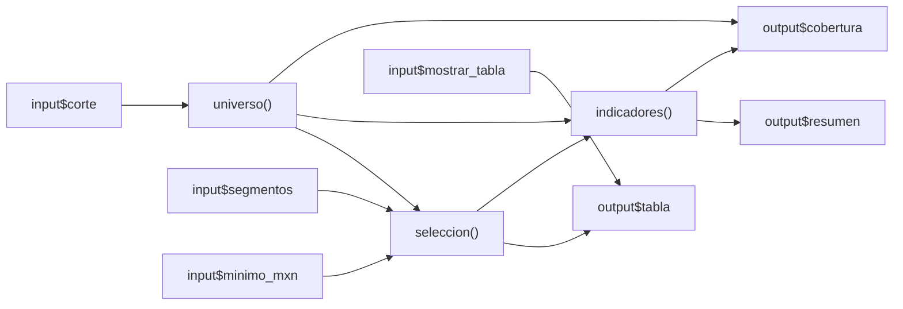

# 13.04 — Filtros e indicadores compartidos

[Inicio](../../../README.md) / [Módulo 13](../README.md) / **Lección 13.04**

| Tu sesión | Qué prepararás o comprobarás |
| --- | --- |
| **Meta** | Reutilizar una selección entre tabla e indicadores y justificar su denominador |
| **Necesitas** | R, tu IDE y el modelo reactivo de 13.03; copia nueva con Shiny/renv conocidos |
| **Evidencia** | Filtros explícitos, filas por clave, cifras conciliadas y un grafo explicado |

[Empezar](#antes-de-empezar) · [Ir al lab](../../../labs/13_shiny_web/04_shared_filters/README.md) · [Comprobar](#evidencia-y-criterio-de-salida)

## Propósito

Una app puede mostrar una tabla correcta junto a un indicador incorrecto si
cada salida filtra por su cuenta. La solución es definir una selección común,
calcular sus medidas con funciones R corrientes y reutilizar esos resultados.
Vamos a contrastar las filas, la suma y el porcentaje, no solo su apariencia.

Primero trabajaremos con tres filas completas dentro de una app mínima. Después
pasaremos a seis observaciones de una cartera ficticia: los mismos tres créditos
en dos fechas. Los filtros se aplican al cambiar controles; no hay botón de envío
ni estado propio. Eso corresponde a 13.05. Gráficas/descargas llegan en 13.07.

## Antes de empezar

- Revisa [13.03 — Modelo de reactividad](../03_reactivity/README.md):
  productores, consumidores, invalidación, demanda y caché por sesión.
- Para selección de filas y funciones corrientes consulta
  [06.03](../../06_r_foundations/03_subsetting/README.md) y
  [06.06](../../06_r_foundations/06_functions_control/README.md).
- Sigue [preparación y arranque](recorridos.md) desde tu IDE. El preparador crea
  una carpeta nueva con trece archivos, incluido el CSV de referencia; no requiere
  prácticas anteriores. Restaura después el mismo lockfile de 13.01: R 4.6.1,
  Shiny 1.14.0 y renv 1.3.1 como referencias comprobadas, sin paquetes nuevos.

## Qué vas a aprender

- Separar fuente completa, universo de un corte y selección de interés.
- Compartir una selección entre tabla y medidas sin repetir filtros en cada render.
- Calcular cantidad, saldo y porcentaje con un denominador explícito.
- Comprobar umbral inclusivo, conjunto vacío y saldo cero sin confundirlos.

## Material de apoyo

| Recurso | Para qué sirve | Uso |
| --- | --- | --- |
| [recorridos.md](recorridos.md) y [preparar_app.R](preparar_app.R) | Copia nueva, entorno local, IDE y alternativas de terminal | Necesario; elige un recorrido |
| [minimo.R](minimo.R) | Tres filas, un umbral y dos salidas | Primera actividad, autónoma |
| [app.R](app.R) | Corte/segmentos/mínimo con selección e indicadores reactivos | Segunda actividad |
| [cartera.R](cartera.R) | Lectura, contrato, filtros y resumen sin Shiny | Se copia junto a la app |
| [CSV de referencia](../../12_streamlit/03_data_interface/cartera.csv) | Seis observaciones sintéticas, conservadas sin cambios | Se copia automáticamente; no exige estudiar Streamlit |
| [comprobar_app.R](comprobar_app.R) | Doce escenarios explícitos y fronteras con funciones/testServer | Opcional, apoyo de autoría; no monta UI |

## 1. Un filtro compartido en tres filas

Abre [minimo.R](minimo.R) en tu copia preparada y arráncalo desde la consola R:

```r
source("iniciar.R")
iniciar_app("minimo.R")
```

La muestra está definida en el propio archivo. Cada fila es un crédito observado
en un único corte; los saldos están completos y expresados en pesos enteros:

```r
datos <- data.frame(credito = c("001", "002", "003"), saldo_mxn = c(0, 2000, 2500))
```

Con mínimo 2000 buscamos saldos **mayores o iguales** a 2000. Deben aparecer
002 y 003: dos créditos y 4500 MXN. La expresión central es:

```r
seleccion <- reactive({
  if (is.null(input$minimo)) return(NULL)
  datos[datos$saldo_mxn >= input$minimo, , drop = FALSE]
})
```

La tabla usa `seleccion()`. El texto también la pide para calcular nrow y sum.
La coma selecciona filas y `drop = FALSE` conserva la forma de tabla, incluso
con una o cero filas. La guarda de NULL atiende el inicio sin valor recibido;
no es una validación completa de lo que alguien escriba en el control.

**Compruébalo:** mínimo 2001 conserva solo 003 y 2500 MXN. Mínimo 0 conserva
las tres filas y sigue sumando 4500: agregar una fila con cero cambia el conteo,
no la suma. Con 2501 no hay filas y la suma del conjunto vacío es 0.
No interpretes esa suma como evidencia de que existe un crédito con saldo cero.

## 2. De ventas a una cartera con dos cortes

Detén el mínimo y abre [app.R](app.R). El preparador ya copió la fuente original
en cartera.csv; no hace falta una entrega de otro módulo. Lee sus seis filas:

| id_credito | segmento | fecha_corte | saldo_mxn |
| --- | --- | --- | --- |
| 001 | comercio | 2026-09-30 | 0 |
| 002 | servicios | 2026-09-30 | 2000 |
| 003 | comercio | 2026-09-30 | 2500 |
| 001 | comercio | 2026-10-31 | 100 |
| 002 | servicios | 2026-10-31 | 1900 |
| 003 | comercio | 2026-10-31 | 2600 |

Una fila es **un crédito en una fecha**, no una venta ni un movimiento. La clave
única es ID/corte. 001 es texto: conserva sus ceros iniciales. Los segmentos son
comercio/servicios; fechas ISO reales entre 1900 y 2100; saldos enteros conocidos
de 0 a 1 000 000 MXN. Esta práctica admite hasta 10 000 observaciones. No hay
ausencias ni importes negativos en el contrato; no se imputan ni se eliminan filas.

Los saldos de septiembre suman 4500 y los de octubre 4600 MXN. **No sumes ambos
cortes para llamar al resultado saldo de cartera:** repetirías créditos de dos
fechas. Tampoco uses las seis observaciones como denominador de créditos de un corte.

[cartera.R](cartera.R) lee primero como texto, revisa forma del saldo, convierte
y valida toda la fuente antes de seleccionar. También comprueba claves, categorías
y fechas; una incidencia en octubre no desaparece al consultar septiembre.
Estas son precondiciones del ejemplo, no un sistema general de limpieza de CSV.
Si la fuente es inválida, el programa falla explícitamente; mensajes amigables
y recuperación pertenecen a 13.06. Conserva el diagnóstico y corrige la copia.

La app lee el archivo al cargar. Editar el CSV mientras el proceso sigue vivo
no provoca automáticamente una lectura nueva: detén y reinicia para cambiar la
fuente. Mover un control sí invalida los cálculos que leen esa entrada.

## 3. Fuente, universo y selección responden preguntas distintas

Abre el servidor en [app.R](app.R), inicia `iniciar_app("app.R")` y localiza:

| Objeto | Qué representa | Caso inicial |
| --- | --- | --- |
| cartera | Fuente completa de dos cortes; no se modifica | Seis observaciones |
| universo() | Todos los créditos de la fecha elegida | Septiembre: tres créditos, 4500 MXN |
| seleccion() | Filas del universo que pasan segmentos y mínimo | Ambos segmentos, >=2000: 002/003, 4500 MXN |
| indicadores() | Medidas de esa selección y porcentaje sobre el universo | 2 créditos, 4500 MXN, 2/3 ≈ 66.67% |

Primero se obtiene el corte, después se combinan las reglas con **y**: pertenecer
a uno de los segmentos elegidos **y** tener saldo >= mínimo. Entre segmentos se
usa pertenencia `%in%`: comercio **o** servicios. Sin ninguna casilla marcada
se eligen cero filas; nunca se convierte automáticamente en «todos».

La regla del denominador de esta sección es: **todos los créditos del corte,
antes de filtrar segmento y mínimo**. Elegir solo comercio no cambia ese
denominador a «créditos de comercio». Otra pregunta podría necesitarlo, pero
tendría que declarar y cambiar su definición. La app muestra el contexto vigente.

## 4. Compartir las transformaciones, no copiar los if

La selección llama una función corriente desde reactive:

```r
seleccion <- reactive({
  datos <- universo()
  if (is.null(datos) || is.null(input$minimo_mxn)) return(NULL)
  segmentos <- if (is.null(input$segmentos)) character() else input$segmentos
  filtrar_seleccion(datos, segmentos, input$minimo_mxn)
})
```

Un grupo de casillas vacío llega como NULL. Se convierte a character() **solo
para representar ningún segmento** en la función de datos. No usamos un valor
predeterminado que seleccione todo cuando el usuario desmarca las casillas.

Después se calculan las medidas:

```r
indicadores <- reactive({
  datos <- seleccion()
  if (is.null(datos)) return(NULL)
  resumir_seleccion(datos, nrow(universo()))
})
```

La tabla lee seleccion(). Resumen y cobertura leen indicadores(). Ningún render
reconstruye el filtro ni vuelve a leer el CSV. `resumir_seleccion` calcula
nrow, suma y `100 * cantidad / cantidad_universo`. La suma convierte a numeric
antes de agregar: con este contrato la suma máxima es 10 000 × 1 000 000,
exacta en R double; no promete exactitud para cualquier importe o tamaño.
El helper comprueba un denominador compatible por cantidad; no puede demostrar
por sí solo que se le pasó el universo correcto. Eso se revisa en el grafo y
contra la fuente externa. No lo sustituyas por nrow(seleccion()).



Lectura sin renderizador: corte → universo; universo + segmentos + mínimo →
selección; selección → tabla y medidas. El universo aporta el denominador;
medidas → resumen y cobertura. La casilla solo controla la tabla. El esquema
omite contexto y la marca de diagnóstico que también lee corte; ambas lecturas
están explícitas en el código. Ocultar tabla no debe cambiar selección/medidas.

Los reactivos están dentro de server, separados por sesión. Con varias salidas
activas se reutiliza el resultado válido, como en 13.03. La marca [seleccion]
permite observar ejecuciones en consola; no es un benchmark ni un orden garantizado.
Si desactivas la tabla, resumen y cobertura siguen demandando los cálculos.

## 5. Conciliar por clave, suma y denominador

Antes de mover cada control, predice filas e indicadores. Revisa estas situaciones:

| Corte | Segmentos | Mínimo | IDs esperados | Cantidad / saldo MXN / porcentaje |
| --- | --- | --- | --- | --- |
| Septiembre | Ambos | 2000 | 002, 003 | 2 / 4500 / 66.67% |
| Octubre | Ambos | 2000 | 003 | 1 / 2600 / 33.33% |
| Septiembre | Comercio | 0 | 001, 003 | 2 / 2500 / 66.67% |
| Septiembre | Comercio | 1 | 003 | 1 / 2500 / 33.33% |
| Octubre | Servicios | 1900 | 002 | 1 / 1900 / 33.33% |
| Octubre | Servicios | 1901 | Ninguno | 0 / 0 / 0.00% |
| Septiembre | Ninguno | 0 | Ninguno | 0 / 0 / 0.00% |

El porcentaje se redondea a dos decimales **al presentar**, no antes de calcular.
Es porcentaje de créditos, no participación del saldo. En el primer caso la
selección conserva todo el saldo observado, pero solo dos de tres créditos.
El crédito excluido tiene saldo cero. Por eso 66.67% y 100% responderían preguntas distintas.

**Compruébalo:** septiembre/comercio con mínimos 0 y 1 suma lo mismo, pero cambia
de dos a un crédito. Una comprobación que solo compara sumas no detectaría que
se perdió 001. Contrasta ID, segmento, corte y saldo de cada fila con el CSV.

## 6. Vacío, cero y falta de universo

En la UI actual los cortes disponibles provienen de la fuente. Un filtro sin
coincidencias conserva el universo de tres créditos y produce cero seleccionados,
suma 0 y cobertura 0%. La tabla puede quedar sin filas visibles; los indicadores
y filtros explican ese estado. Recuperar un segmento o bajar mínimo recupera datos.

Una fila de saldo cero sí cuenta como crédito; no se elimina con `saldo > 0`
salvo que esa sea la pregunta declarada. Si se consulta una fecha sin registros
desde las funciones R, el universo vale cero y el porcentaje queda NA: no se
divide entre cero ni se presenta 0% como si hubiera universo. La UI no añade
un corte inexistente en esta sección; su manejo explícito se amplía en 13.06.

Los límites de numericInput ayudan a operar el control; las funciones comprueban
que mínimo sea entero entre 0 y 1 000 000. No truncamos 1900.5 a 1900 ni convertimos
vacío a cero. Esta sección no conserva una elección válida anterior ante una
entrada inválida ni implementa formularios: ante un error revisa el diagnóstico.

## Práctica

Realiza el [lab 13.04](../../../labs/13_shiny_web/04_shared_filters/README.md):
contrasta escenarios, revisa una regla modificada y explica qué conexiones
evitan que tabla y medidas usen universos distintos.

## Evidencia y criterio de salida

| Conserva | Comprueba | Explica |
| --- | --- | --- |
| Predicciones y filas por clave | Septiembre 002/003, 4500; octubre 003, 2600 | Fuente frente a universo/selección |
| Variantes de frontera y cero | 1900 incluido, 1901 excluido; 001 conserva su fila con mínimo 0 | >= frente a > y por qué la suma no basta |
| Grafo y porcentaje | Denominador tres antes de segmento/mínimo, sin cambios al ocultar tabla | Una selección compartida y dos medidas coherentes |

Continúa cuando puedas reconstruir las cifras desde el CSV y explicar el
denominador y el vacío sin confundirlos con un error de fuente. Quien aprende
hace y justifica; su compañero revisa una predicción y propone otro umbral.
Guarda código, ayudas y dudas en tu copia personal, fuera de PROGRESS.md.
No hay proyecto/checkpoint implementado por esta lección.

## Referencias

- [Posit: reactive](https://shiny.posit.co/r/reference/shiny/latest/reactive.html):
  expresiones, dependencias y reutilización.
- [Posit: numericInput](https://shiny.posit.co/r/reference/shiny/latest/numericinput.html)
  y [checkboxGroupInput](https://shiny.posit.co/r/reference/shiny/latest/checkboxgroupinput.html): controles y valores del servidor.
- Hadley Wickham, [Mastering Shiny: reactividad básica](https://mastering-shiny.org/basic-reactivity.html):
  expresiones intermedias para organizar dependencias y evitar trabajo duplicado.
- [R: extracción de tablas](https://stat.ethz.ch/R-manual/R-devel/library/base/html/Extract.data.frame.html)
  y [sum](https://stat.ethz.ch/R-manual/R-devel/library/base/html/sum.html): forma y agregación.

Consultadas el 2026-10-28. La referencia de Posit mostraba Shiny 1.14.0; latest
y R-devel pueden cambiar. La práctica fija versiones en su lockfile. Datos y
ejercicios propios de DS Track; no requiere dplyr, ggplot2 ni estudiar Streamlit.

## Siguiente paso

Tras el lab, consulta el alcance de
[13.05 — Eventos y estado de sesión](../README.md#05-eventos-y-estado-de-sesion),
todavía planificado. No hay botón de aplicar ni persistencia implementados aquí.

[← 13.03](../03_reactivity/README.md) · [Módulo 13](../README.md) · [Lab 13.04](../../../labs/13_shiny_web/04_shared_filters/README.md)
