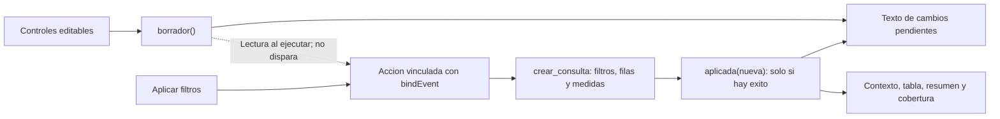

# 13.05 — Eventos y estado de sesión

[Inicio](../../../README.md) / [Módulo 13](../README.md) / **Lección 13.05**

| Tu sesión | Qué prepararás o comprobarás |
| --- | --- |
| **Meta** | Aplicar una acción explícita y mantener sus resultados dentro de cada sesión |
| **Necesitas** | R, tu IDE y las dependencias/filtros de 13.03–13.04; proyecto Shiny local |
| **Evidencia** | Predicciones de edición/aplicación, cifras y dos sesiones contrastadas |

[Empezar](#antes-de-empezar) · [Ir al lab](../../../labs/13_shiny_web/05_events_session/README.md) · [Comprobar](#evidencia-y-criterio-de-salida)

## Propósito

En 13.04 mover un filtro cambiaba los resultados. Ahora queremos editar varios
controles y decidir cuándo usarlos. El problema no se resuelve añadiendo un
botón decorativo: debemos cambiar las dependencias y conservar la consulta
aplicada con sus filtros. Así no mostramos cifras de septiembre con una etiqueta
de octubre que el usuario todavía no ha aplicado.

Un **evento** es la señal que autoriza una acción. El **estado de sesión** es
la información que esta conexión conserva entre interacciones. No significa
guardar un archivo, recordar elecciones después de recargar ni identificar a una persona.

## Antes de empezar

- Revisa [13.03 — Modelo de reactividad](../03_reactivity/README.md) y
  [13.04 — Filtros compartidos](../04_shared_filters/README.md): demanda,
  contexto reactivo, fuente/universo/selección y denominador.
- Sigue [preparación y arranque](recorridos.md) en tu IDE, sobre una carpeta
  nueva. El preparador copia catorce archivos sin exigir entregas anteriores.
- Reutilizamos cartera.R de 13.04, el CSV de seis observaciones y el lockfile de
  13.01: Shiny 1.14.0, renv 1.3.1 y R 4.6.1 como referencias comprobadas.
  No hay paquetes nuevos ni cambios globales. La terminal es opcional.

## Qué vas a aprender

- Distinguir el valor de un botón de los datos que se desean guardar.
- Usar bindEvent para decidir qué dispara una acción.
- Leer/escribir un reactiveVal creado dentro de server.
- Separar borrador, consulta aplicada y último aviso; comprobar sesiones independientes.

## Material de apoyo

| Recurso | Para qué sirve | Uso |
| --- | --- | --- |
| [recorridos.md](recorridos.md), [preparar_app.R](preparar_app.R) | Preparación, entorno local, IDE y terminal opcional | Necesario; elige un recorrido |
| [minimo.R](minimo.R) | Guardar un número al pulsar un botón | Primera actividad, autónoma |
| [app.R](app.R) | Aplicar filtros y conservar una consulta por sesión | Segunda actividad |
| [consulta.R](consulta.R) | Reunir filtros, universo, selección y medidas antes de guardar | Función corriente reutilizable |
| [cartera.R de 13.04](../04_shared_filters/cartera.R), [CSV](../../12_streamlit/03_data_interface/cartera.csv) | Contrato, reglas y datos anteriores intactos | Se copian automáticamente |
| [comprobar_app.R](comprobar_app.R) | Estados y siete consultas por campo con testServer | Opcional, autoría; no monta UI |

## 1. Editar no es guardar

Abre [minimo.R](minimo.R) en tu copia preparada. Desde su consola R:

```r
source("iniciar.R")
iniciar_app("minimo.R")
```

El número inicial es 2, pero aparece `Sin numero guardado.`. Cambia a 3:
solo cambia el borrador. Pulsa Guardar numero: aparece `Guardado: 3; doble: 6.`.
Edita 7 sin guardar: el resultado anterior sigue en 3/6. Pulsa de nuevo:
ahora se conserva 7/14. Guardar 0 es válido y produce 0/0, no ausencia.

El mínimo contiene, **dentro de server**:

```r
guardado <- reactiveVal(NULL)
```

NULL representa que todavía no hay valor guardado. `guardado()` lee el valor;
`guardado(3)` lo reemplaza por 3 y notifica a sus consumidores si cambió.
No escribas `guardado <- 3`: reemplazarías el objeto reactivo por un número.
Tampoco es necesario usar <<- o cambiar una variable global.

`reactiveVal` puede guardar un solo valor que sea una lista completa. No significa
«solo un número». `reactiveValues` permite varios campos con nombres; se menciona
como alternativa, no lo necesitamos aquí. Para un cálculo derivado que no requiere
escrituras explícitas sigue siendo preferible reactive, como en 13.04.

## 2. El botón es una señal, no el número a consultar

`actionButton("guardar", "Guardar numero")` crea el control. Su valor empieza
en cero y aumenta con cada activación: no es TRUE/FALSE ni el número que elegiste.
El primer clic no quiere decir «consulta el crédito 001». Es una señal de evento.
Los cambios rápidos pueden agruparse; no uses el contador como auditoría durable
ni como garantía de procesar exactamente una operación externa por clic.

En [minimo.R](minimo.R), el cuerpo que lee el número y llama a guardado se
envuelve de este modo (aquí se muestra el núcleo; el archivo comprueba el rango):

```r
bindEvent(observe({
  guardado(input$numero)
}), input$guardar, ignoreNULL = TRUE, ignoreInit = TRUE)
```

observe realiza una acción: escribir estado. bindEvent hace que el disparador
sea el botón. Las lecturas del cuerpo quedan aisladas como dependencias para
esa acción: cambiar número no la dispara. Los valores se leen **cuando se ejecuta
la acción**, no quedan congelados al definir el servidor.

| Opción | Decisión en esta práctica |
| --- | --- |
| ignoreNULL = TRUE | Ignora evento NULL y el cero especial de un actionButton |
| ignoreInit = TRUE | No ejecuta la acción durante su inicialización |
| Sin once = TRUE | Permite volver a aplicar; no destruye el observador tras la primera acción |

Son opciones distintas, no sinónimos. La referencia de Posit prefiere observe
con bindEvent para este uso. `observeEvent` es otra API equivalente para asociar
un observador con un evento; no necesitas aprender dos implementaciones ahora.
Para **calcular un valor** ligado a un evento se puede usar reactive con bindEvent
(eventReactive es otra API relacionada). Aquí escribimos un estado explícito
para conservar una consulta completa y manejar un intento rechazado.

## 3. La cartera y sus reglas se conservan

Detén el mínimo e inicia `iniciar_app("app.R")`. El CSV que se copia es:

| Crédito | Segmento | Corte | Saldo MXN |
| --- | --- | --- | --- |
| 001 | comercio | 2026-09-30 | 0 |
| 002 | servicios | 2026-09-30 | 2000 |
| 003 | comercio | 2026-09-30 | 2500 |
| 001 | comercio | 2026-10-31 | 100 |
| 002 | servicios | 2026-10-31 | 1900 |
| 003 | comercio | 2026-10-31 | 2600 |

Una fila es un crédito en un corte; clave ID/corte, IDs textuales y saldos
enteros conocidos en MXN. Los tres créditos suman 4500 en septiembre y 4600
en octubre. No sumamos dos fechas para describir saldo a una fecha. Se conserva
el contrato de [13.04](../04_shared_filters/README.md#2-de-ventas-a-una-cartera-con-dos-cortes):
fuente completa validada antes de filtrar, sin imputar ni descartar incidencias.

Se selecciona el corte, después segmentos y saldo **>= mínimo**. Ningún segmento
significa cero filas. La cobertura sigue siendo porcentaje de créditos sobre
todos los del corte, antes de segmento/mínimo. El botón cambia **cuándo** aplicamos
esas reglas; no cambia la pregunta ni el denominador.

## 4. Guardar una consulta completa

En [app.R](app.R), borrador() reúne los valores actuales de los controles. El
estado `aplicada <- reactiveVal(NULL)` se crea dentro de server. Al pulsar Aplicar:

1. Se leen los valores actuales del borrador.
2. [crear_consulta](consulta.R) calcula universo, selección e indicadores con
   las mismas funciones de 13.04 y reúne también los filtros usados.
3. Solo si todo termina correctamente se llama `aplicada(nueva)`.

La consulta guardada contiene `filtros`, `universo`, `seleccion` e `indicadores`.
Son datos corrientes, no referencias a input. Guardar todo junto evita actualizar
primero la etiqueta, después la tabla y dejar cifras de consultas diferentes
si algún cálculo falla. No es una transacción de base de datos ni persistencia.

Contexto, tabla y medidas leen **aplicada()**, no los controles del borrador.
La casilla Mostrar tabla continúa siendo inmediata y solo controla presentación.
El texto de estado sí compara borrador y filtros aplicados para avisar de cambios
pendientes. Regresar exactamente al borrador aplicado elimina ese aviso sin
necesidad de volver a consultar.



Sin renderizador: editar cambia borrador y su comparación; el botón ejecuta la
acción, que toma el borrador y construye la consulta. Guardarla actualiza todas
las salidas aplicadas. La flecha punteada muestra una lectura aislada, no una
dependencia que dispare la acción. El esquema explica flujo y estado; no es un
grafo completo de invalidaciones de Shiny ni representa la casilla/aviso.

| Acción, después del inicio | Qué debe verse |
| --- | --- |
| No pulsar todavía | Consulta aplicada: ninguna; no hay cifras de una consulta |
| Aplicar septiembre/ambos/2000 | 002/003, 2 créditos, 4500 MXN, cobertura 66.67% |
| Editar octubre sin aplicar | Pendiente; contexto y cifras aplicadas siguen en septiembre |
| Ocultar/recuperar tabla | Conserva la consulta aplicada; no envía borrador |
| Aplicar octubre/ambos/2000 | 003, 1 crédito, 2600 MXN, cobertura 33.33% |
| Aplicar otra vez sin cambios | Nueva acción; misma consulta y cifras, no un historial adicional |

El aviso `Consulta aplicada...` describe la última aplicación exitosa. El texto
de estado describe si el borrador coincide ahora. Son preguntas distintas: tras
editar puedes tener última aplicación exitosa y cambios pendientes a la vez.

## 5. Un intento fallido no reemplaza datos válidos

El helper puede rechazar 1900.5 porque el mínimo debe ser un entero entre 0 y
1 000 000. La acción usa tryCatch para capturar ese error, mostrar el motivo y
salir antes de escribir aplicada. Así mantiene juntos filtros y resultados de
la consulta anterior. Corregir el control no aplica automáticamente: hay que
volver a pulsar. Si aún no hubo una aplicación válida, continúa sin consulta.

Esta captura es parte del control de la acción: evita que un error corriente
escape del observador y termine la sesión. No convierte una fuente inválida
en datos vacíos ni promete gestionar todos los fallos posibles. La fuente se
lee al cargar la app y sus errores no pasan por este handler. Validación y
mensajes con req/validate/need, fuentes ausentes y más recuperación se desarrollan
en 13.06. El mínimo solo ignora un valor fuera de su contrato; la app completa
permite observar el rechazo y corregirlo.

## 6. Cada sesión debe tener su propio estado

cartera se carga fuera de server como referencia de lectura; ninguna sesión la
modifica. aplicada y aviso se crean **dentro**: cada invocación de server produce
otros objetos. No muevas aplicada al ámbito global para que «se recuerde».
Eso mezclaría consultas entre sesiones que usan el mismo proceso R.

**Compruébalo:** en la pestaña A aplica octubre. Abre B: debe iniciar sin
consulta aplicada. En B aplica septiembre y vuelve a A: sigue octubre. Cambia
un borrador en A y comprueba que B tampoco cambia. Dos pestañas son dos sesiones,
aunque sean de la misma persona; no representan autenticación ni permisos.

Recargar A crea una sesión nueva sin consulta aplicada, con controles iniciales.
Detener/reiniciar el proceso R también elimina ese estado en memoria. No se
guardan filtros en disco ni se reconstruyen automáticamente. No confundas esto
con la caché de una expresión reactiva que se recalcula a partir de dependencias.

## 7. Errores habituales

| Síntoma | Qué revisar |
| --- | --- |
| Mover un filtro cambia resultados sin pulsar | Algún render sigue leyendo borrador/input o la acción no está vinculada correctamente |
| La tabla espera al botón, pero el contexto cambia al editar | El contexto debe leer guardada$filtros |
| Se aplica al conectar | Inicialización, ignoreInit/ignoreNULL y valor cero del botón |
| Solo funciona una vez | Revisa si se activó once = TRUE |
| Una pestaña modifica otra | Busca estado reactivo creado fuera de server o escrituras globales |
| Pulsar no parece cambiar nada | La consulta puede ser idéntica; no todas las acciones producen un valor diferente |

## Práctica

Realiza el [lab 13.05](../../../labs/13_shiny_web/05_events_session/README.md).
Predice antes de editar, aplicar, rechazar y abrir otra sesión. No basta una
captura de la cifra final para demostrar que el botón controla las dependencias.

## Evidencia y criterio de salida

| Conserva | Comprueba | Explica |
| --- | --- | --- |
| Predicciones del mínimo | Editar 7 conserva 3/6 hasta guardar; cero válido | Botón como señal y reactiveVal como estado |
| Borrador distinto de consulta aplicada | Septiembre 2/4500, edición octubre sin envío y aplicación 1/2600 | Contexto y resultados del mismo estado |
| Rechazo y dos sesiones | Intento inválido conserva consulta; A y B independientes | Escritura posterior al cálculo y ámbito de server |

Quien aprende hace y justifica; su compañero revisa una transición y propone
otro cambio. Guarda código, pruebas, ayudas y dudas en tu copia personal, fuera
de PROGRESS.md. No hay proyecto/checkpoint implementado por esta lección.

## Referencias

- [Posit: bindEvent](https://shiny.posit.co/r/reference/shiny/latest/bindevent.html):
  eventos, aislamiento, ignoreNULL e ignoreInit.
- [Posit: reactiveVal](https://shiny.posit.co/r/reference/shiny/latest/reactiveval.html)
  y [actionButton](https://shiny.posit.co/r/reference/shiny/latest/actionbutton.html): lectura/escritura y valor especial del botón.
- [Posit: alcance de objetos](https://shiny.posit.co/r/articles/improve/scoping/):
  objetos por aplicación y por sesión.
- Hadley Wickham, [Mastering Shiny: salir del grafo](https://mastering-shiny.org/reactivity-components.html):
  profundización opcional sobre estado y acciones; no se requiere todo el capítulo.

Consultadas el 2026-10-28; referencia Posit Shiny 1.14.0. Las URLs latest pueden
cambiar, la práctica conserva el lockfile. Ejemplos propios de DS Track; sin
paquetes nuevos, autenticación, persistencia, concurrencia distribuida ni escrituras externas.

## Siguiente paso

Tras comprobar el lab, consulta [13.06 — Validación y mensajes](../README.md#06-validacion-y-mensajes),
todavía planificado.

[← 13.04](../04_shared_filters/README.md) · [Módulo 13](../README.md) · [Lab 13.05](../../../labs/13_shiny_web/05_events_session/README.md)
