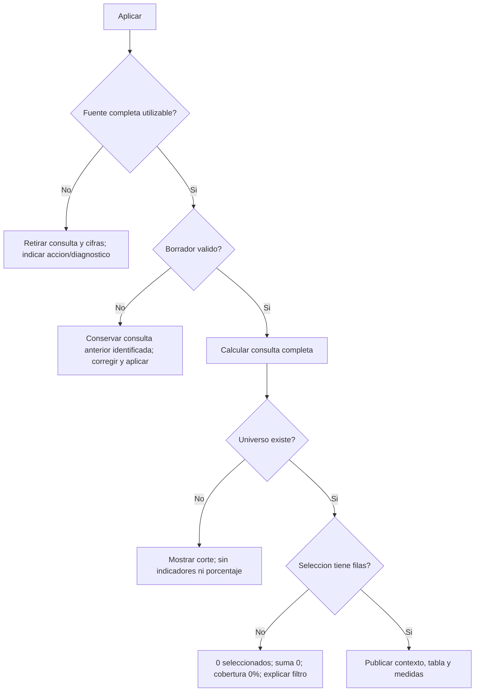

# 13.06 — Validación y mensajes

[Inicio](../../../README.md) / [Módulo 13](../README.md) / **Lección 13.06**

| Tu sesión | Qué prepararás o comprobarás |
| --- | --- |
| **Meta** | Explicar entradas rechazadas y estados sin datos sin publicar indicadores engañosos |
| **Necesitas** | R, tu IDE y eventos/filtros de 13.04–13.05; copia independiente con Shiny local |
| **Evidencia** | Mensajes con acción, cifras retiradas o conservadas según la causa y recuperación comprobada |

[Empezar](#antes-de-empezar) · [Ir al lab](../../../labs/13_shiny_web/06_validation_messages/README.md) · [Comprobar](#evidencia-y-criterio-de-salida)

## Propósito

Una pantalla sin tabla puede significar «todavía no consultaste», «el filtro
no encontró filas», «la fecha no tiene registros» o «no se pudo leer la fuente».
No son equivalentes. Tampoco basta atrapar cualquier error y mostrar saldo cero:
se convertiría una falla del programa en un resultado aparentemente válido.

Vamos a separar esas causas, indicar qué puede hacer la persona y mantener
coherentes contexto, datos y mensajes. El botón de 13.05 sigue controlando la
aplicación; añadimos validación de entradas y relectura completa por aplicación.

## Antes de empezar

- Revisa [13.04](../04_shared_filters/README.md) y [13.05](../05_events_session/README.md):
  universo/selección, denominador, borrador, consulta aplicada y estado por sesión.
- Sigue [preparación y arranque](recorridos.md) en el IDE. Se preparan quince
  archivos en una carpeta nueva, sin exigir entregas anteriores.
- Se conservan cartera.R de 13.04, consulta.R de 13.05, el CSV conocido y los
  metadatos de 13.01. Referencia: R 4.6.1, Shiny 1.14.0 y renv 1.3.1; ningún
  paquete nuevo. La terminal es alternativa opcional.

## Qué vas a aprender

- Diferenciar espera, rechazo, selección vacía, falta de universo y falla de fuente.
- Usar req para detener en silencio y validate/need para explicar una condición de salida.
- Validar texto antes de convertirlo, sin truncar ni imputar cero.
- Elegir cuándo conservar una consulta anterior y cuándo retirar las cifras.

## Material de apoyo

| Recurso | Para qué sirve | Uso |
| --- | --- | --- |
| [recorridos.md](recorridos.md), [preparar_app.R](preparar_app.R) | Copia, entorno local, IDE y terminal | Necesario; elige un recorrido |
| [minimo.R](minimo.R) | req, validate/need y propagación entre dos salidas | Primera actividad, autónoma |
| [app.R](app.R) | Política de mensajes, aplicación y recuperación | Segunda actividad |
| [validacion.R](validacion.R) | Revisar filtros y leer fuente con diagnóstico separado | Funciones corrientes |
| [cartera.R](../04_shared_filters/cartera.R), [consulta.R](../05_events_session/consulta.R), [CSV](../../12_streamlit/03_data_interface/cartera.csv) | Contrato, cálculo y datos previos | Se copian sin cambios |
| [comprobar_app.R](comprobar_app.R) | Estados, entradas y fallos controlados con CSV temporal | Opcional, autoría; no monta UI |

## 1. Antes del mensaje, clasificar la situación

| Situación | ¿Qué sabemos? | Respuesta en esta sección |
| --- | --- | --- |
| Inicio sin aplicar | Todavía no hay una consulta | Pedir Aplicar; no presentar cifras |
| Mínimo inválido | No se puede interpretar el borrador según contrato | Rechazar; conservar la consulta anterior identificada, si existe |
| Selección vacía | Hay créditos en el corte, ninguno pasa los filtros | Cantidad 0, suma 0, cobertura 0%; explicar cómo ampliar selección |
| Corte sin universo | La fuente validada no contiene registros de esa fecha | Sin indicadores; no inventar cobertura 0% |
| Fuente ausente/inválida | No existe una base confiable para esta aplicación | Retirar consulta disponible y cifras; corregir/restaurar fuente |
| Error inesperado de cálculo | Falló el programa, no la pregunta | Retirar cifras y pedir revisar diagnóstico; no simular vacío |

Conservar cifras tras rechazar un borrador no significa que describan los
controles actuales: describen **la última consulta aplicada**. La página lo
indica y marca pendientes. Si una aplicación descubre que la fuente no se puede
usar, el criterio cambia: se retiran las cifras anteriores. Es una decisión de
esta app, no un comportamiento que Shiny elija automáticamente por nosotros.

## 2. Un mínimo con req, validate y need

Abre [minimo.R](minimo.R) en tu copia preparada e inicia desde la consola R:

```r
source("iniciar.R")
iniciar_app("minimo.R")
```

La muestra está completa en el archivo: 001/0, 002/2000 y 003/2500 MXN, en un
solo corte. El mínimo es ahora un textInput: recibimos texto y declaramos cómo
interpretarlo. Con 2000 aparecen 002/003; con 0 aparecen los tres créditos.

```r
minimo <- reactive({
  req(!is.null(input$minimo))
  validate(
    need(nzchar(input$minimo), "Escribe un minimo; 0 incluye el saldo cero."),
    need(grepl("^(0|[1-9][0-9]*)$", input$minimo),
         "Usa digitos enteros sin signos, espacios ni decimales.")
  )
  valor <- as.numeric(input$minimo)
  validate(need(is.finite(valor) && valor <= 1000000, "Usa de 0 a 1000000 MXN."))
  valor
})
```

`req` detiene el camino con una condición especial silenciosa si falta el valor
durante el inicio; no escribe un mensaje ni arregla los datos. `need` devuelve
una prueba para `validate`: éxito o mensaje de condición incumplida. validate
detiene la salida y permite mostrar ese mensaje. No devuelve una tabla corregida.
Ambos textos del ejemplo se pueden mostrar juntos si fallan varias pruebas.

La expresión regular admite exactamente 0 o una secuencia que empieza de 1 a 9
y continúa con dígitos. Por eso rechaza vacío, espacios, signos, decimales,
notación científica y ceros iniciales como 02000. Después convertimos y
comprobamos finitud/rango. Es un contrato didáctico explícito, no una afirmación
de que toda aplicación deba rechazar esas formas.

El texto del valor y la tabla leen minimo(). Una validación que falla ahí se
propaga a ambas salidas; no hace falta repetir toda la regla en cada render.
La tabla añade otra condición: `validate(need(nrow(seleccion) > 0L, mensaje))`.
Con 2501 el mínimo es válido, pero no hay coincidencias: el texto del mínimo
sigue disponible y la tabla explica el vacío. Con 2000 se recupera sin reiniciar.

**Compruébalo:** escribe vacío, 1.5, 2501, 0 y 2000. Distingue mensaje de entrada
de mensaje de selección. Una clase CSS `shiny-output-error-validation` puede
representar estos mensajes esperados; no implica necesariamente un fallo inesperado.

No uses la «veracidad» de un valor como regla de negocio. En Shiny, 0 numérico
es truthy; el cero especial de un actionButton es falsy. Para exigir filas
escribe `nrow(datos) > 0`, no `req(nrow(datos))`. Tampoco hagas req(segmentos)
si ningún segmento es una selección vacía válida en tu contrato.

## 3. La cartera y el borrador

Detén el mínimo e inicia `iniciar_app("app.R")`. Se conserva el CSV sintético:

| Crédito | Segmento | Corte | Saldo MXN |
| --- | --- | --- | --- |
| 001 | comercio | 2026-09-30 | 0 |
| 002 | servicios | 2026-09-30 | 2000 |
| 003 | comercio | 2026-09-30 | 2500 |
| 001 | comercio | 2026-10-31 | 100 |
| 002 | servicios | 2026-10-31 | 1900 |
| 003 | comercio | 2026-10-31 | 2600 |

Cada fila es un crédito a una fecha, clave ID/corte y saldos conocidos en pesos
enteros; no se suman dos cortes como saldo a una fecha. El contrato completo
está en [13.04](../04_shared_filters/README.md#2-de-ventas-a-una-cartera-con-dos-cortes).
Con ambos segmentos y mínimo 2000, septiembre selecciona 002/003 y 4500 MXN,
octubre 003 y 2600. Sus coberturas son 2/3 y 1/3 de los créditos de cada corte.

[revisar_filtros](validacion.R) recibe el texto original del mínimo y devuelve
ok/filtros normalizados o un mensaje. No llama a Shiny ni escribe estado. No
recortamos decimales con as.integer, no reemplazamos vacío por cero ni limpiamos
espacios sin una regla declarada. NULL del grupo de casillas sigue significando
ningún segmento, convertido a character(). El mínimo 0 sigue siendo válido.

La opción noviembre consulta 2026-11-30, ausente en la muestra; **no agrega filas
al CSV**. Sirve para demostrar que un corte sin registros no es un filtro vacío
sobre tres créditos. Las opciones de fecha son explícitas para que la interfaz
pueda abrir incluso cuando la fuente no esté disponible.

## 4. Leer de nuevo al aplicar y decidir antes de publicar

En [app.R](app.R), cada Aplicar ejecuta este orden:

1. Releer y validar **todo** cartera.csv, incluso filas fuera del filtro.
2. Revisar el borrador; si se rechaza, conservar la consulta anterior con aviso.
3. Calcular la consulta completa con las funciones previas.
4. Clasificar universo/selección y escribir el estado completo de una vez.

La prioridad de fuente es intencional: si la fuente no se puede usar y el
borrador también es inválido, se bloquea por fuente y se retiran cifras. No
mantenemos una consulta como disponible tras comprobar que su fuente falla.
Cambiar un archivo sin aplicar **no actualiza ni valida automáticamente** la
página. Las consultas son instantáneas guardadas por sesión, no monitores de archivos.

[leer_fuente_segura](validacion.R) comprueba presencia y captura errores en el
límite de lectura/contrato. Devuelve un mensaje breve con acción y conserva el
diagnóstico técnico para la consola R. «No se puede usar» puede requerir revisar
permisos, estructura o datos; no se inventa que todos esos fallos sean duplicados.
Una incidencia de octubre impide consultar septiembre hasta corregirla.

Un error posterior de cálculo tiene otra rama: se registra como inesperado y
se retiran cifras. No se transforma en lista vacía ni se anuncia «sin coincidencias».
tryCatch permite controlar ese límite, pero no prueba que todo el programa esté
correcto; hay que investigar y corregir el diagnóstico.

## 5. Mensajes que se propagan y mensajes que permanecen visibles

El estado de sesión reúne tipo, consulta y mensaje. La expresión disponible()
usa validate/need para exigir consulta y universo antes de entregar datos a
resumen/cobertura/tabla. Las condiciones se propagan a sus consumidores. Aquí
need recibe FALSE como mensaje para detener sin repetirlo en cada salida:
el aviso general ya explica la causa y la acción. El mínimo muestra la variante
con mensajes visibles en las salidas.
Contexto lee filtros aplicados, incluso en un corte sin universo, y no muestra
los filtros nuevos como si ya describieran las cifras anteriores.

La tabla usa `req(isTRUE(input$mostrar_tabla))`: desmarcarla solo suspende su
presentación con una parada silenciosa. El aviso general es otra salida y sigue
visible. Ocultar la tabla no debe ocultar el rechazo ni la falla de fuente.
La condición de filas se valida en la tabla: selección vacía puede tener medidas
0/0/0%, aunque no haya tabla de registros para mostrar.

`req(..., cancelOutput = TRUE)` puede dejar una salida con su presentación
anterior. No lo usamos para conservar consultas: por sí solo no mantiene juntos
contexto, tabla y medidas, ni etiqueta un resultado anterior. Aquí esa conservación
es estado explícito de la app, y los bloqueos retiran cifras en todos sus consumidores.
No captures indiscriminadamente condiciones de req/validate para convertirlas
en errores corrientes; nuestras validaciones de salida quedan fuera de esos catch.



Sin renderizador: primero fuente, después entrada y cálculo; con fuente fallida
se retiran datos, con entrada rechazada se conserva la consulta anterior, con
universo ausente no se publican indicadores y con selección vacía sí se informan
ceros. El diagrama omite la rama de error inesperado de cálculo, que también
retira cifras y exige revisar consola; está explícita en el código.

## 6. Contrastar vacío, cero, ausencia y recuperación

| Prueba | Resultado que debes comprobar |
| --- | --- |
| Septiembre/comercio/0 | 001/003, dos filas, 2500 MXN y 66.67%; 001 con cero existe |
| Septiembre/ninguno/0 | Cero filas, 0 MXN, 0% sobre tres; mensaje para ampliar filtro |
| Noviembre/ambos/2000 | Contexto de noviembre, sin indicadores; no 0 de 0 ni 0% |
| Mínimo 1900.5 o vacío tras consulta válida | Rechazo, conserva contexto y cifras aplicados, marca pendientes |
| Archivo ausente al aplicar | Aviso de recuperación y cifras retiradas |
| CSV solo con encabezado | Fuente estructuralmente válida sin registros; no universo del corte |
| Fuente con duplicado ID/corte | Bloqueo por contrato aunque el duplicado esté fuera del filtro |
| Fuente corregida y nueva aplicación | Se reconstruye la consulta y se recuperan salidas |

Prueba fuentes solo en tu copia siguiendo el lab. Conserva un respaldo íntegro
y no sobrescribas el CSV del curso. Otra sesión guarda su propia instantánea:
no prometemos retirar automáticamente sus cifras cuando alguien cambia el archivo;
la comprobación ocurre cuando esa sesión vuelve a aplicar.

## Práctica

Realiza el [lab 13.06](../../../labs/13_shiny_web/06_validation_messages/README.md).
Incluye una fuente ausente y su recuperación; no basta comprobar que un mensaje aparece.

## Evidencia y criterio de salida

| Conserva | Comprueba | Explica |
| --- | --- | --- |
| Casos del mínimo | Vacío/decimal rechazados, cero válido, umbral válido sin filas | req frente a validate/need y regla de negocio |
| Transiciones de la app | Rechazo conserva, falla de fuente retira, corrección recupera | Política de estado y mensaje con acción |
| Cifras por clave | Cero observado, selección vacía y noviembre sin universo | Denominador y cuándo un porcentaje no está definido |

Quien aprende realiza y justifica; su compañero revisa una predicción y una
recuperación. Guarda archivos, ayudas y dudas en tu copia personal, fuera de
PROGRESS.md. No hay proyecto/checkpoint implementado por esta lección.

## Referencias

- [Posit: req](https://shiny.posit.co/r/reference/shiny/latest/req.html): parada silenciosa y cancelOutput.
- [Posit: validate/need](https://shiny.posit.co/r/reference/shiny/latest/validate.html): pruebas, mensajes y propagación.
- [Posit: isTruthy](https://shiny.posit.co/r/reference/shiny/latest/istruthy.html): criterios de veracidad de Shiny.
- Hadley Wickham, [Mastering Shiny: información al usuario](https://mastering-shiny.org/action-feedback.html): lectura de apoyo sobre validación y errores.

Consultadas el 2026-10-28; referencia Posit Shiny 1.14.0. Las URLs latest pueden
cambiar; el entorno de práctica conserva el lockfile. Ejemplos propios sin
paquetes nuevos. No se implementan cargas de archivos, descarga, autenticación
ni un sistema general de limpieza o monitoreo de fuentes.

## Siguiente paso

Después del lab consulta [13.07 — Gráficos, tablas y descargas](../README.md#07-graficos-tablas-y-descargas),
todavía planificado.

[← 13.05](../05_events_session/README.md) · [Módulo 13](../README.md) · [Lab 13.06](../../../labs/13_shiny_web/06_validation_messages/README.md)
