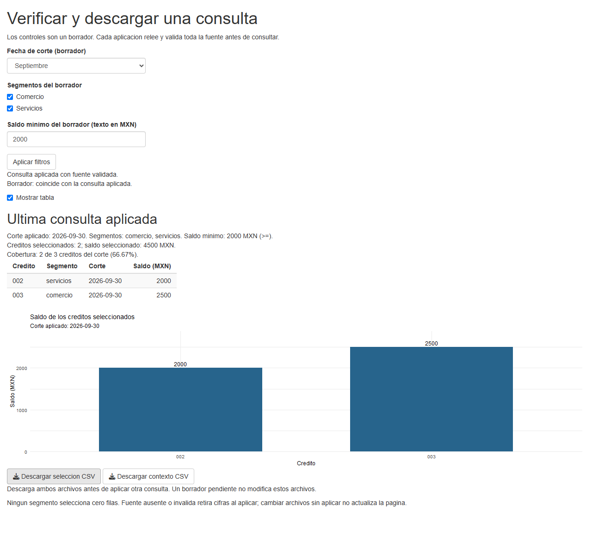
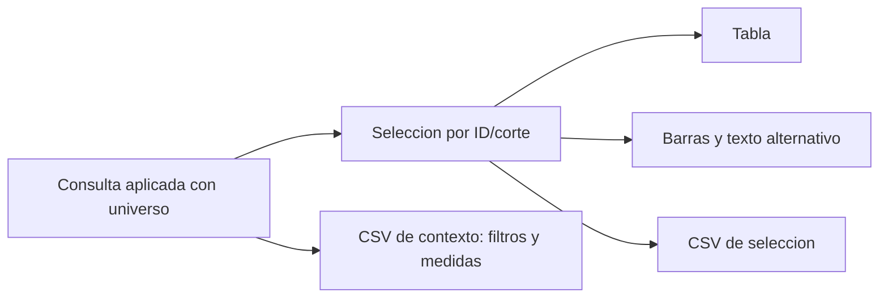

# 13.07 — Gráficos, tablas y descargas

[Inicio](../../../README.md) / [Módulo 13](../README.md) / **Lección 13.07**

| Tu sesión | Qué prepararás o comprobarás |
| --- | --- |
| **Meta** | Entregar filas y contexto que coincidan con tabla, gráfica e indicadores |
| **Necesitas** | R, tu IDE y la consulta aplicada/validación de 13.05–13.06; ggplot2 en proyecto local |
| **Evidencia** | Consulta identificada, barras/celdas conciliadas y dos CSV releídos |

[Empezar](#antes-de-empezar) · [Ir al lab](../../../labs/13_shiny_web/07_outputs_downloads/README.md) · [Comprobar](#evidencia-y-criterio-de-salida)

## Propósito

Una descarga no es correcta solo porque el navegador entregue un archivo.
Tiene que representar la consulta que la página describe. Aquí añadimos una
gráfica y dos CSV a la app de 13.06: selección y contexto de cálculo. Todos leen
la **consulta aplicada**, aunque haya otro borrador en los controles.

No añadimos filtros de presentación que cambien silenciosamente el universo,
ni generamos un reporte completo o una entrega reproducible de cierre. Eso
requiere otros materiales y comprobaciones; 13.10 sigue planificado.

## Antes de empezar

- Revisa [13.05](../05_events_session/README.md) y [13.06](../06_validation_messages/README.md):
  borrador, consulta aplicada, estado por sesión y políticas ante rechazo/fuente.
- Para mapeos/capas y barras consulta [08.01](../../08_visualization_r/01_question_grammar/README.md)
  y [08.02](../../08_visualization_r/02_geometries_stats/README.md). La explicación breve de esta sección basta para su ejemplo.
- Sigue [preparación y arranque](recorridos.md) en una carpeta nueva. El preparador
  copia dieciséis fuentes, sin exigir entregas anteriores.
- DESCRIPTION añade ggplot2 como dependencia directa. El lockfile de esta sección
  fija ggplot2 4.0.3 y conserva los registros previos de Shiny 1.14.0/renv 1.3.1.
  Se restaura en biblioteca local con R 4.6.1 como referencia; no cambia Conda,
  bibliotecas globales ni los lockfiles de otras secciones.

## Qué vas a aprender

- Conectar plotOutput/renderPlot y downloadButton/downloadHandler.
- Dibujar saldos por crédito sin convertirlos en conteos de filas.
- Exportar selección y contexto desde un estado común, con nombres y tipos claros.
- Releer CSV y distinguir vacío exportable de una consulta bloqueada.

## Material de apoyo

| Recurso | Para qué sirve | Uso |
| --- | --- | --- |
| [recorridos.md](recorridos.md), [preparar_app.R](preparar_app.R) | Copia nueva, entorno local, IDE y terminal | Necesario; elige un recorrido |
| [minimo.R](minimo.R) | Primera tabla/descarga sin filtros ni archivos externos | Primera actividad |
| [app.R](app.R) | Tabla, barras y dos descargas de la consulta aplicada | Segunda actividad |
| [Captura propia de septiembre](assets/consulta_septiembre.png) | Ver controles, tabla, barras y descargas en una consulta conocida | Consulta visual opcional |
| [presentacion.R](presentacion.R) | Gráfica, texto alternativo y escritura de selección/contexto | Se copia junto a la app |
| [DESCRIPTION](DESCRIPTION), [renv.lock](renv.lock) | Dependencias declaradas y versiones de reconstrucción | Revisar antes de restaurar |
| [cartera.R](../04_shared_filters/cartera.R), [consulta.R](../05_events_session/consulta.R), [validacion.R](../06_validation_messages/validacion.R), [CSV](../../12_streamlit/03_data_interface/cartera.csv) | Reglas y datos previos intactos | Se copian automáticamente |
| [comprobar_app.R](comprobar_app.R) | Alturas, etiquetas y CSV releídos en escenarios conocidos | Opcional, autoría; no prueba clics de navegador |

## 1. Una tabla y su primera descarga

Abre [minimo.R](minimo.R) en la copia preparada. Inicia en la consola R:

```r
source("iniciar.R")
iniciar_app("minimo.R")
```

El archivo define tres créditos de un solo corte: 001/0, 002/2000 y 003/2500
MXN. La tabla y la descarga usan esa misma tabla R. Pulsa Descargar CSV del
minimo, conserva el archivo y ábrelo primero como texto: debe contener encabezado
y tres filas, sin una columna adicional de números de fila.

```r
output$csv <- downloadHandler(
  filename = "creditos_minimo.csv",
  content = function(file) {
    utils::write.csv(datos, file, row.names = FALSE, fileEncoding = "UTF-8")
  },
  contentType = "text/csv; charset=utf-8"
)
```

La UI contiene `downloadButton("csv", ...)`: el ID coincide con output$csv.
filename sugiere el nombre al navegador; no es la ruta de escritura del servidor.
Shiny llama a content con una ruta temporal llamada aquí file; el código debe
escribir **en esa ruta**. No reemplaces file por cartera.csv ni por una carpeta
de descargas supuesta del usuario. No escribimos en el CSV fuente.

row.names = FALSE evita exportar índices de fila. UTF-8 declara codificación;
text/csv declara el tipo de contenido, no valida lo que escribiste. El navegador
elige dónde guardar y puede cambiar el nombre si ya existe otro igual.

## 2. La consulta que representa cada salida

Detén el mínimo e inicia `iniciar_app("app.R")`. Se conserva la cartera sintética:

| Crédito | Segmento | Corte | Saldo MXN |
| --- | --- | --- | --- |
| 001 | comercio | 2026-09-30 | 0 |
| 002 | servicios | 2026-09-30 | 2000 |
| 003 | comercio | 2026-09-30 | 2500 |
| 001 | comercio | 2026-10-31 | 100 |
| 002 | servicios | 2026-10-31 | 1900 |
| 003 | comercio | 2026-10-31 | 2600 |

Una fila es un crédito en un corte, clave ID/corte. Los IDs son texto y los
saldos son pesos enteros conocidos. No sumamos dos cortes como saldo a una fecha.
El [contrato de 13.04](../04_shared_filters/README.md#2-de-ventas-a-una-cartera-con-dos-cortes)
y las [políticas de 13.06](../06_validation_messages/README.md#1-antes-del-mensaje-clasificar-la-situación)
se conservan. Cada aplicación relee/valida toda la fuente antes de calcular.

Aplica septiembre/ambos/2000. Deben coincidir tabla de 002/2000 y 003/2500,
dos barras de esas alturas, dos créditos/4500 MXN y cobertura 66.67% sobre tres.
El porcentaje es de créditos; la gráfica muestra **saldo**, no porcentaje.



Captura propia de la app a 1280 píxeles. Ilustra el caso; la comprobación requiere
operar la app y releer los archivos, no comparar solo una imagen estática.



Sin renderizador: tabla, barras y selección CSV usan las mismas filas; el
contexto conserva los filtros y medidas de esa consulta. Ninguna salida filtra
otra vez desde los controles pendientes.

Después prepara octubre **sin aplicar**. Tabla, gráfica, subtítulo, texto
alternativo, nombre y contenido de las descargas siguen describiendo septiembre.
No se debe etiquetar un resultado anterior con controles todavía no aplicados.
Al aplicar octubre, todas cambian a 003/2600, un crédito y 33.33%.

## 3. Dibujar valores, conservar cero y explicar el gráfico

Abre [presentacion.R](presentacion.R). crear_grafica recibe la consulta completa
y usa directamente su selección; no filtra ni vuelve a leer archivos:

```r
ggplot2::ggplot(datos, ggplot2::aes(x = id_credito, y = saldo_mxn)) +
  ggplot2::geom_col(fill = "#27648C", width = 0.65)
```

geom_col utiliza el valor y de cada fila. geom_bar sin cambiar su estadística
contaría filas: en esta muestra daría barras de altura 1 y respondería otra
pregunta. Crédito es una categoría, no una cantidad continua ni el orden temporal.

La función completa añade etiquetas de pesos, ejes con unidades, subtítulo del
corte aplicado, tema local y escala desde cero. El límite superior deja espacio
para las etiquetas; con una única fila de saldo cero usa un techo positivo para
dibujar un eje válido. La fila sigue existiendo aunque la barra no tenga altura.
No se reemplaza cero por ausencia ni se recortan filas para obtener una figura bonita.

En la UI se reserva `plotOutput("grafica", height = "340px")`. El servidor usa:

```r
output$grafica <- renderPlot({
  actual <- disponible()
  validate(need(nrow(actual$seleccion) > 0L, "Seleccion vacia: no hay barras para mostrar."))
  crear_grafica(actual)
}, alt = function() { descripcion_grafica(disponible()) })
```

El objeto ggplot es la última expresión, por lo que renderPlot lo recibe.
El texto alternativo se construye desde la misma selección y menciona corte,
IDs y saldos. No describe el borrador. Tabla y texto son alternativas recuperables
a la imagen, pero esto no certifica accesibilidad completa ni legibilidad con
cientos de barras: la práctica usa tres créditos por corte.

## 4. Selección y contexto son dos archivos con funciones distintas

La descarga de selección conserva exactamente las cuatro columnas del contrato:
id_credito, segmento, fecha_corte y saldo_mxn. La de contexto tiene una fila con:

| Campo | Qué permite comprobar |
| --- | --- |
| corte, segmentos, minimo_mxn, regla | Pregunta aplicada; segmentos se separan con `|`, ninguno se escribe como ninguno |
| creditos_universo, saldo_universo_mxn | Universo antes de segmento/mínimo |
| creditos_seleccion, saldo_seleccion_mxn | Conteo/suma de las filas exportadas |
| porcentaje_creditos | Cobertura sin redondear a dos decimales para presentación |

Ambos archivos nacen de disponible(), la consulta aplicada con universo válido:

```r
output$csv_seleccion <- downloadHandler(
  filename = function() { paste0("seleccion_", disponible()$filtros$corte, ".csv") },
  content = function(file) { escribir_seleccion(disponible(), file) },
  contentType = "text/csv; charset=utf-8"
)
```

No usamos input$corte para nombrar el archivo ni input$minimo_texto para
reconstruirlo. La descarga no aplica borradores ni relee la fuente: exporta la
instantánea que la pantalla identifica. Si el CSV fuente cambió, vuelve a aplicar
para validar y reconstruir antes de descargar datos actualizados.

Descarga **los dos archivos antes de aplicar otra consulta** y guárdalos juntos.
Son dos solicitudes independientes, no un paquete atómico: podrías mezclar uno
de septiembre con otro de octubre si cambias la consulta entre clics. El nombre
del corte ayuda, pero no contiene todos los filtros ni es una clave única.
El contexto no autentica una sesión pasada ni contiene el conjunto completo
necesario para reconstruir la fuente. La entrega de cierre corresponde a 13.10.

## 5. Vacío exportable frente a consulta bloqueada

| Estado | Tabla/gráfica | CSV disponibles |
| --- | --- | --- |
| Inicio sin aplicar | Sin consulta | Ninguno |
| Consulta válida con filas | Mismas filas; barras de sus saldos | Selección y contexto |
| Filtro vacío sobre universo | Mensajes sin filas/barras; indicadores 0/0/0% | Selección solo con encabezado; contexto de una fila |
| Corte sin universo | Sin indicadores ni figura | Ninguno |
| Fuente ausente/inválida detectada al aplicar | Retira cifras y figura | Ninguno |
| Borrador rechazado con consulta anterior válida | Conserva consulta anterior identificada | Los de la consulta anterior, nunca del borrador |

La UI se construye con renderUI/uiOutput para ofrecer botones solo cuando
existe una consulta con universo. Además, cada handler comprueba disponible()
al ejecutarse: ocultar enlaces no reemplaza verificar su condición. No se usan
rutas de descarga como almacenamiento permanente ni como control de identidad.

Ocultar la tabla sigue siendo una decisión de presentación: gráfica, indicadores
y descargas conservan la misma consulta. Una selección vacía no se dibuja como
una barra cero inventada. Un crédito observado con saldo cero sí conserva su
fila, categoría y etiqueta 0 cuando pasa el filtro.

## 6. Releer y conciliar, no confiar en el nombre

Detén el servidor si necesitas usar la consola R del mismo IDE. Abre los CSV
primero en el editor, después impórtalos explícitamente. Desde una carpeta donde
guardaste la descarga, adapta el nombre que realmente asignó tu navegador:

```r
filas <- read.csv("seleccion_2026-09-30.csv",
  colClasses = c("character", "character", "character", "numeric"), check.names = FALSE)
contexto <- read.csv("contexto_2026-09-30.csv", colClasses = "character", check.names = FALSE)
filas$id_credito  # "002", "003": conservar ceros iniciales
sum(filas$saldo_mxn)  # 4500
contexto$minimo_mxn   # "2000"
```

Un CSV no lleva un esquema de tipos incorporado. Que el archivo contenga "002"
no obliga a una hoja de cálculo a conservarlo como texto al abrirlo con doble
clic. Importa IDs como texto; no confíes solo en la visualización de Excel.

Comprueba columnas/filas por ID y corte, saldo por fila, suma, conteo y contexto.
Con septiembre/comercio, mínimo 0 da 001/0 y 003/2500; mínimo 1 da solo 003/2500.
La suma coincide y los archivos no son equivalentes. Revisar solo totales
dejaría pasar la pérdida de un crédito con cero.

## Práctica

Realiza el [lab 13.07](../../../labs/13_shiny_web/07_outputs_downloads/README.md).
Incluye una descarga real con borrador pendiente y otra de selección vacía.

## Evidencia y criterio de salida

| Conserva | Comprueba | Explica |
| --- | --- | --- |
| Gráfica/tabla de un corte | IDs, alturas/etiquetas y saldos por fila | geom_col, unidades y cero observado |
| Selección/contexto CSV releídos | 002/003, 4500, mínimo 2000 y denominador tres | Archivo de filas frente a metadatos de consulta |
| Casos pendientes/vacíos/bloqueados | Descargar no aplica; vacío conserva encabezado; bloqueo no ofrece archivos | Una instantánea común y sus límites |

Quien aprende hace y justifica; su compañero revisa una relectura y propone
otro umbral. Guarda descargas, código, ayudas y dudas en tu copia personal,
fuera de PROGRESS.md. No hay proyecto/checkpoint implementado por esta lección.

## Referencias

- [Posit: downloadHandler](https://shiny.posit.co/r/reference/shiny/latest/downloadhandler.html)
  y [downloadButton](https://shiny.posit.co/r/reference/shiny/latest/downloadbutton.html): nombre, archivo temporal y descarga.
- [Posit: renderPlot](https://shiny.posit.co/r/reference/shiny/latest/renderplot.html): objeto gráfico, tamaño y alt reactivo.
- [ggplot2: geom_col/geom_bar](https://ggplot2.tidyverse.org/reference/geom_bar.html): valores frente a conteos.
- [R: escritura de tablas](https://stat.ethz.ch/R-manual/R-devel/library/utils/html/write.table.html): CSV, encabezados y row.names.

Consultadas el 2026-10-28; referencias Shiny 1.14.0/ggplot2 4.0.3. URLs latest
y R-devel pueden cambiar; la práctica fija su entorno. Ejemplos propios, sin
tablas avanzadas, uploads, descarga PNG ni publicación de servicios.

## Siguiente paso

Tras comprobar el lab continúa con [13.08 — Organización y módulos](../08_organization_modules/README.md), ya disponible.

[← 13.06](../06_validation_messages/README.md) · [Módulo 13](../README.md) · [Lab 13.07](../../../labs/13_shiny_web/07_outputs_downloads/README.md)
