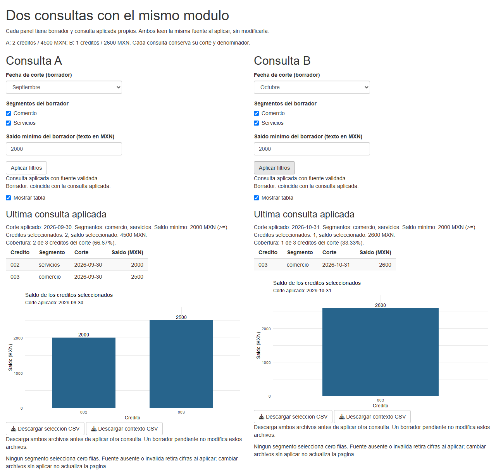
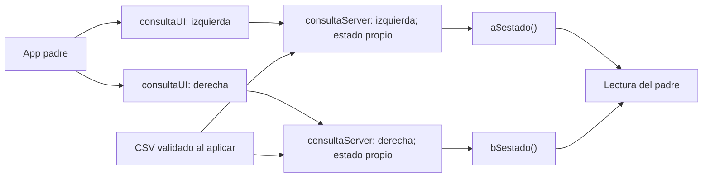

# 13.08 — Organización y módulos

[Inicio](../../../README.md) / [Módulo 13](../README.md) / **Lección 13.08**

| Tu sesión | Qué prepararás o comprobarás |
| --- | --- |
| **Meta** | Reutilizar UI y servidor sin colisiones de IDs ni estado compartido accidental |
| **Necesitas** | R, tu IDE y la consulta aplicada de 13.05–13.07; mismo proyecto Shiny/ggplot2 local |
| **Evidencia** | Dos instancias independientes, un ID renombrado y descargas conciliadas |

[Empezar](#antes-de-empezar) · [Ir al lab](../../../labs/13_shiny_web/08_organization_modules/README.md) · [Comprobar](#evidencia-y-criterio-de-salida)

## Propósito

La app de 13.07 ya separa funciones de datos y presentación, pero su UI y
servidor pertenecen a una sola consulta. Copiar ese bloque para mostrar otra
consulta repetiría código y sus IDs. Queremos definir una pieza una vez y
usarla dos veces, conservando borradores, aplicaciones y descargas independientes.

Un **módulo Shiny** es una pareja de funciones de UI y servidor con un espacio
de nombres. No es simplemente un archivo .R, ni requiere crear un paquete.
La unidad de esta sección es una consulta completa; no dividiremos cada
control en un módulo para aumentar el número de archivos.

## Antes de empezar

- Revisa [13.05](../05_events_session/README.md), [13.06](../06_validation_messages/README.md)
  y [13.07](../07_outputs_downloads/README.md): estado, mensajes y una consulta
  común para tabla, gráfica y CSV. Para funciones corrientes consulta
  [06.06](../../06_r_foundations/06_functions_control/README.md).
- Sigue [preparación y arranque](recorridos.md) en una carpeta nueva. El
  preparador reúne diecisiete archivos; no exige entregas anteriores.
- Conservamos DESCRIPTION y renv.lock de 13.07 byte por byte: R 4.6.1,
  Shiny 1.14.0, ggplot2 4.0.3 y renv 1.3.1 como referencias comprobadas,
  42 registros y ninguna dependencia nueva. No modifica bibliotecas globales.

## Qué vas a aprender

- Distinguir función corriente, función de UI y módulo UI/servidor.
- Usar NS en la UI y nombres locales dentro de moduleServer.
- Pasar una dependencia explícita y devolver una lectura reactiva al padre.
- Reutilizar una instancia cambiando solo su ID y comprobar UI dinámica/descargas.

## Material de apoyo

| Recurso | Para qué sirve | Uso |
| --- | --- | --- |
| [recorridos.md](recorridos.md), [preparar_app.R](preparar_app.R) | Copia, entorno, IDE y terminal opcional | Necesario; elige un recorrido |
| [minimo.R](minimo.R) | Dos números editados/guardados con una pareja UI/servidor | Primera actividad, autónoma |
| [app.R](app.R) | Componer dos consultas y leer su API desde el padre | Segunda actividad |
| [Captura propia](assets/dos_consultas.png) | Ver A en septiembre y B en octubre | Apoyo visual opcional |
| [consulta_module.R](consulta_module.R) | UI, estado y salidas de una consulta reutilizable | Pieza central |
| [Funciones de datos](../04_shared_filters/cartera.R), [consulta](../05_events_session/consulta.R), [validación](../06_validation_messages/validacion.R), [presentación](../07_outputs_downloads/presentacion.R) | Responsabilidades previas conservadas | Se copian sin modificar |
| [CSV](../../12_streamlit/03_data_interface/cartera.csv), [metadatos](../07_outputs_downloads/renv.lock) | Fuente/entorno conocidos, sin nuevas instalaciones por planificar | Se copian automáticamente |
| [comprobar_app.R](comprobar_app.R) | Módulo, dos instancias y API del padre con testServer | Opcional, autoría; no monta UI |

## 1. El problema de copiar controles

Un ID permite conectar un control de la UI con una entrada/salida del servidor.
Si dos bloques usan el mismo ID global numero, no basta que tengan títulos
distintos: sus conexiones pueden colisionar. La etiqueta sirve a la persona;
el ID identifica la conexión para Shiny.

Abre [minimo.R](minimo.R) en tu copia y arráncalo en la consola R:

```r
source("iniciar.R")
iniciar_app("minimo.R")
```

Hay dos instancias del mismo módulo, Numero A y Numero B. Ambas empiezan en 2,
sin número guardado. Guarda 3 en A y 7 en B: A muestra 3/6 y B 7/14. Editar 0
en A no cambia sus resultados hasta guardar; al hacerlo A muestra 0/0 y B sigue
7/14. El texto del padre confirma ambos valores sin inspeccionar sus controles.

## 2. NS transforma IDs, no etiquetas ni datos

La función de UI del mínimo tiene esta forma:

```r
numeroUI <- function(id, titulo) {
  ns <- NS(id)
  tagList(
    h2(titulo),
    numericInput(ns("numero"), "Numero del borrador", 2, min = 0, max = 10, step = 1),
    actionButton(ns("guardar"), "Guardar numero"),
    textOutput(ns("resultado"))
  )
}
```

NS(id) devuelve una función que compone un ID de instancia con el nombre local.
`NS("uno")("numero")` produce uno-numero; con dos produce dos-numero. No se
escriben esos prefijos a mano dentro del módulo. numeroUI se llama dos veces
con IDs distintos, no se copia su cuerpo.

tagList reúne fragmentos; la página completa fluidPage se crea una vez en la
app que los contiene. Las dos etiquetas pueden decir «Numero del borrador»:
son los IDs generados los que deben ser distintos. namespace significa aquí
espacio de nombres para organizar conexiones; no es autenticación ni permisos.

## 3. El servidor ve nombres locales

El servidor correspondiente utiliza moduleServer:

```r
numeroServer <- function(id) {
  moduleServer(id, function(input, output, session) {
    # Estado, accion y render del minimo: ver archivo completo.
    # Se usan input$numero, input$guardar y output$resultado.
  })
}
```

El archivo completo coloca reactiveVal dentro de esa función y conserva el
evento de guardar. Shiny proporciona input, output y session de ese ámbito.
**Dentro** se usa input$numero, no input$uno-numero ni input[["uno-numero"]].
Tampoco se antepone ns de nuevo a output$resultado: moduleServer ya delimita
sus conexiones. NS se utiliza al construir tags de UI, no para leer inputs locales.

En la app se emparejan las llamadas:

| UI | Servidor | Conexión |
| --- | --- | --- |
| numeroUI("uno", "Numero A") | numeroServer("uno") | Misma instancia uno |
| numeroUI("dos", "Numero B") | numeroServer("dos") | Otra instancia dos |

Usar uno en la UI y otra cadena en el servidor no conecta esa pareja. Repetir
uno para ambos paneles tampoco crea dos instancias independientes.

## 4. Extraer la consulta, conservar las reglas

Detén el mínimo e inicia `iniciar_app("app.R")`. [app.R](app.R) carga las
funciones y compone Consulta A/Consulta B. [consulta_module.R](consulta_module.R)
define consultaUI y consultaServer; hacer source de ese archivo no arranca una app.

| Archivo preparado | Responsabilidad |
| --- | --- |
| cartera.R | Leer y validar toda la fuente; seleccionar/filtrar/resumir con R corriente |
| consulta.R | Construir filtros, universo, selección e indicadores juntos |
| validacion.R | Revisar borrador y devolver diagnóstico de lectura |
| presentacion.R | Crear ggplot/alt y escribir CSV de datos/contexto |
| consulta_module.R | Conectar controles, evento, estado y salidas de una consulta |
| app.R | Cargar dependencias, colocar dos instancias y leer su API |

La fuente sintética sigue siendo completa y pequeña:

| Crédito | Segmento | Septiembre 2026-09-30, MXN | Octubre 2026-10-31, MXN |
| --- | --- | --- | --- |
| 001 | comercio | 0 | 100 |
| 002 | servicios | 2000 | 1900 |
| 003 | comercio | 2500 | 2600 |

El CSV contiene seis observaciones: una fila por ID/corte. No se suman dos
fechas como saldo a una fecha. Saldo >= mínimo, ningún segmento selecciona
cero filas y cobertura sobre tres créditos del corte. Fuente y funciones
anteriores se copian byte por byte; no se exige una entrega de otra sección.

Aplica septiembre/ambos/2000 en A y octubre/ambos/2000 en B. A conserva 002/003,
dos créditos/4500 MXN/66.67%; B conserva 003, uno/2600/33.33%. Tabla, gráfica,
alt y descargas deben corresponder a cada panel. El cambio de organización
no es una nueva regla de negocio ni una nueva fuente.

Cada gráfica conserva la escala automática de su consulta. Compara saldos y
etiquetas; no supongas que una misma altura en píxeles entre paneles representa
el mismo importe. No hemos construido una figura con escala compartida.



Captura propia a 1280 píxeles. La independencia se comprueba operando ambos
paneles y releyendo sus archivos, no solo observando la imagen.

## 5. Dependencias y comunicación por una API explícita

En el padre, las llamadas actuales son:

```r
a <- consultaServer("izquierda", ruta = "cartera.csv")
b <- consultaServer("derecha", ruta = "cartera.csv")
```

ruta es un argumento corriente: señala qué fuente leer en cada aplicación.
No se busca una ruta en un input global escondido. Aquí ambas instancias leen
el mismo archivo, sin modificarlo. Eso no mezcla su estado: cada ejecución
crea otro reactiveVal. Tampoco convierte el archivo físico en dos archivos.
La fuente debe cumplir el contrato de esta práctica; la UI mantiene sus tres
opciones de corte. El aviso de archivo ausente usa el nombre configurado, no
supone que cualquier ruta se llama cartera.csv.

Cada módulo devuelve una lista con una **lectura reactiva**:

```r
list(estado = shiny::reactive(estado()))
```

El padre lee `a$estado()` y `b$estado()` dentro de renderText para describir
ambas selecciones. No recibe el setter reactiveVal ni escribe en el interior
del módulo; no usa input[["izquierda-corte"]] para reconstruir su consulta.
En el mínimo el retorno es directamente una función reactiva y el padre llama
a() y b(). En la consulta la lista da nombre a la lectura que constituye su API.

No reemplaces la función reactiva devuelta por su valor leído una vez: el padre
perdería el seguimiento de cambios, o intentaría leer fuera de un contexto
reactivo. Pasar datos reactivos a un módulo también requiere acordar cómo se
leen; es una ampliación posterior, no otra API necesaria para este ejemplo.



Sin renderizador: el padre empareja cada UI/servidor con su ID; ambos leen la
fuente al aplicar, mantienen estado propio y entregan una lectura al padre.
El esquema describe composición y datos, no un grafo completo de invalidación.

## 6. UI dinámica: también necesita namespace

La UI estática usa NS(id). Los botones de descarga se crean después de aplicar,
en renderUI del módulo. Allí se usa la función del ámbito de sesión:

```r
downloadButton(session$ns("csv_seleccion"), "Descargar seleccion CSV")
```

Con izquierda se genera izquierda-csv_seleccion y con derecha,
derecha-csv_seleccion. El handler se declara localmente como
`output$csv_seleccion <- downloadHandler(...)`, sin duplicar el prefijo.
Namespace en el contenedor uiOutput no transforma automáticamente los IDs
de todos los tags que devuelves después. Olvidarlo puede parecer funcionar con
una instancia y fallar al aplicar las dos.

NS tampoco cambia el **nombre del archivo** descargado. Como en 13.07, el
nombre sugerido incluye el corte, no todos los filtros ni la instancia. Guarda
selección/contexto en carpetas separadas para A y B y descarga el par antes
de aplicar otra consulta. Los dos archivos siguen siendo solicitudes independientes.

## 7. Instancia, sesión y fuente no son lo mismo

| Nivel | Qué se conserva o comparte aquí |
| --- | --- |
| Instancia izquierda/derecha | Cada una tiene borrador, evento y estado propios dentro de la misma sesión |
| Otra pestaña | Nueva sesión, con otras dos instancias que empiezan sin consulta |
| Archivo cartera.csv | Misma fuente física para todos; cada instancia la relee al aplicar |
| Funciones corrientes y metadatos | Código/configuración reutilizados, sin estado mutable de usuario |

Si A detecta fuente ausente al aplicar, A se bloquea. B conserva su instantánea
hasta que vuelva a aplicar y haga su propia comprobación. No se promete un
monitor de archivos ni una invalidación global. Un mínimo inválido conserva
la última consulta de ese panel, no la del vecino. Las políticas de vacío,
noviembre sin universo y descarga bloqueada siguen siendo las de 13.06–13.07.

Recargar la página inicia otras dos instancias sin estado aplicado. No hay
persistencia ni comunicación directa entre módulos: el texto del padre solo
lee las APIs. Una app pequeña con una sola consulta puede seguir bien organizada
con funciones corrientes; extraemos un módulo porque aquí reutilizamos UI y servidor juntos.

## Práctica

Realiza el [lab 13.08](../../../labs/13_shiny_web/08_organization_modules/README.md):
contrasta A/B, renombra una instancia y comprueba la UI dinámica y sus CSV.

## Evidencia y criterio de salida

| Conserva | Comprueba | Explica |
| --- | --- | --- |
| Parejas de llamadas UI/servidor | A=3/6, B=7/14 en el mínimo | ID externo y nombres locales |
| Dos consultas y sus descargas | A 002/003/4500, B 003/2600 | Instancias frente a sesiones y fuente compartida |
| ID renombrado y mapa de archivos | Nueva instancia conecta sin editar el módulo | NS, session$ns y API reactiva del padre |

Quien aprende realiza y explica; su compañero revisa una predicción y una
descarga. Guarda variantes, archivos, ayudas y dudas en tu copia personal,
fuera de PROGRESS.md. No hay proyecto/checkpoint implementado por esta lección.

## Referencias

- [Posit: módulos](https://shiny.posit.co/r/articles/improve/modules/): pareja UI/servidor, UI dinámica y organización.
- [Posit: moduleServer](https://shiny.posit.co/r/reference/shiny/latest/moduleserver.html)
  y [NS](https://shiny.posit.co/r/reference/shiny/latest/ns.html): ámbitos e IDs.
- [Posit: testServer](https://shiny.posit.co/r/reference/shiny/latest/testserver.html): apoyo opcional para probar funciones de módulo.
- Hadley Wickham, [Mastering Shiny: módulos](https://mastering-shiny.org/scaling-modules.html): motivación y comunicación por interfaces.

Consultadas el 2026-10-28; referencia Shiny 1.14.0. Las URLs latest pueden
cambiar; se conserva el lockfile de 13.07. Ejemplos propios, sin paquetes
nuevos, módulos dinámicamente insertados/eliminados, paquete R o despliegue.

## Siguiente paso

Consulta [13.09 — Pruebas y observación del flujo](../09_tests_flow/README.md), disponible con lección y lab.

[← 13.07](../07_outputs_downloads/README.md) · [Módulo 13](../README.md) · [Lab 13.08](../../../labs/13_shiny_web/08_organization_modules/README.md)
