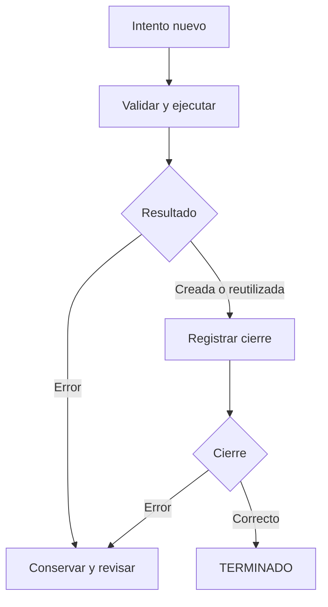

# 14.06 — Trazabilidad y recuperación de fallas

[Inicio](../../../README.md) / [Módulo 14](../README.md) / **Lección 14.06**

| Tu sesión | Qué prepararás o comprobarás |
| --- | --- |
| **Meta** | Reconstruir qué ocurrió y decidir cómo continuar sin mezclar resultados |
| **Necesitas** | Contrato, entorno, pipeline y pruebas de 14.01–14.05 |
| **Evidencia** | Intento fallido, recuperación comprobada y explicación de sus límites |

[**Hacer el lab 14.06 →**](../../../labs/14_reproducible_projects/06_traceability_recovery/README.md) · [Recorridos completos](recorridos.md)

## Propósito

Imagina que ayer obtuviste una tabla correcta. Hoy vuelves a ejecutar, aparece
un error y la tabla de ayer sigue en la carpeta. ¿Es el resultado de hoy? ¿El
error ocurrió antes de escribir, durante la escritura o después de terminarla?
La existencia de un archivo y el mensaje final de la consola no responden solos.

**Trazabilidad** significa poder relacionar una ejecución con sus entradas,
configuración, código, entorno y resultados. **Recuperarse** consiste en revisar
lo que quedó, corregir la causa y realizar un intento comprobable. No siempre
significa continuar desde la línea que falló. En esta práctica recalculamos
desde el inicio y dejamos que el pipeline decida si puede reutilizar una entrega.

## Antes de empezar

Revisa [14.01 — Contrato](../01_product_question_contract/README.md),
[14.02 — Configuración](../02_structure_configuration/README.md),
[14.03 — Entornos](../03_reconstructible_environments/README.md),
[14.04 — Pipeline](../04_pipeline_reprocessing/README.md) y
[14.05 — Pruebas](../05_tests_data_quality/README.md).
Elige Python/uv o R/renv; basta un lenguaje. Los preparadores reúnen **33 fuentes**
en una carpeta nueva. No necesitas haber conservado entregas anteriores.
Se reutilizan datos, modelos, pipeline, suites y lockfiles; no se añaden paquetes.
Trabaja con un solo escritor y sin editar insumos mientras se ejecuta.

## Qué vas a aprender

- Distinguir consulta, intento, evento y entrega.
- Leer etapas, errores y registros incompletos sin inventar estados.
- Relacionar parámetros, huellas y versión de reglas con un resultado.
- Recuperarte conservando parciales y verificando antes de reutilizar.
- Explicar qué demuestra un registro y qué necesita una comprobación actual.

## Material de apoyo

| Recurso | Para qué sirve | Uso |
| --- | --- | --- |
| [Recorridos](recorridos.md) | Preparar y ejecutar en R/IDE, PowerShell o Bash | Elegir uno completo |
| [Preparador Python](preparar.py) / [R](preparar.R) | Reunir 33 fuentes en carpeta nueva | Según ruta |
| [Trazador Python](plantilla/trazar.py) / [R](plantilla/trazar.R) | Registrar intentos alrededor del pipeline existente | Esencial |
| [LEEME](plantilla/LEEME.md) | Entender archivos, fallos y límites operativos | Leer antes de ejecutar |
| [Fuente sintética](../01_product_question_contract/cartera.csv) y [criterios](../01_product_question_contract/criterios.csv) | Contrastar valores por crédito y resultados conocidos | Referencia externa al log |
| [Pipeline Python](../04_pipeline_reprocessing/plantilla/pipeline.py) / [R](../04_pipeline_reprocessing/plantilla/pipeline.R) | Revisar qué se comprueba al crear y reutilizar | Consulta |

## 1. Un ejemplo pequeño: dos intentos, una pregunta

Supón estas dos observaciones sintéticas de octubre. Cada fila representa un
crédito en un corte; la clave es **ID + fecha**. El saldo es MXN entero conocido.

| ID | Corte | Saldo MXN |
| --- | --- | ---: |
| 002 | 2026-10-31 | 1900 |
| 003 | 2026-10-31 | 2600 |

Pregunta: ¿qué créditos tienen saldo **mayor o igual a 2000**? La respuesta es
003/2600; universo de dos créditos y cobertura 1/2 = 50%. Predice qué cambia si
se interrumpe la escritura después de guardar la selección y antes del contexto:
los valores calculados pueden ser correctos, pero la entrega está incompleta.

Un registro esquemático podría decir:

```text
intento a01: inicio → fuente válida → entra al pipeline → fallo
intento a02: inicio → fuente válida → entra al pipeline → creada → terminado
```

Estos renglones no son una salida literal del programa. Muestran la diferencia
entre **la pregunta**, que se mantiene, y **los intentos**, que son distintos.
No debemos agregar el éxito de a02 al archivo de a01 ni renombrar el parcial de
a01 para fingir que terminó.

### Registrar y volver a lanzar el error

Antes del proyecto completo, ejecuta este mínimo en una sesión de Python o R.
Solo imprime; no crea archivos. Se provoca un error explícito
para observar el registro y la propagación en ambos lenguajes.

```python
def paso():
    print("INICIO: seleccion")
    try:
        raise RuntimeError("Fallo didactico antes del contexto")
    except Exception as error:
        print("FALLO:", str(error))
        raise

try:
    paso()
except RuntimeError:
    print("El ejemplo detecto el fallo esperado; no hay entrega")
```

```r
paso <- function() {
  cat("INICIO: seleccion\n")
  tryCatch({
    stop("Fallo didactico antes del contexto")
  }, error = function(error) {
    cat("FALLO:", conditionMessage(error), "\n")
    stop(error)
  })
}
tryCatch(paso(), error = function(error) {
  message("El ejemplo detecto el fallo esperado; no hay entrega")
})
```

El manejador interior registra y propaga: `raise` vuelve a lanzar en Python y
`stop(error)` en R. El manejador exterior existe para observar el ensayo
interactivo. En un proceso real dejamos que el error llegue al intérprete:
el código de salida será distinto de cero. Capturarlo y devolver una tabla vacía
confundiría un fallo con una selección válida sin registros.

## 2. Cuatro objetos que conviene distinguir

| Objeto | Identifica | Ejemplo de esta práctica |
| --- | --- | --- |
| Consulta | Fuente, corte, segmentos, mínimo y reglas | Octubre, ambos segmentos, mínimo 2000 |
| Intento | Una ejecución concreta, incluso si falla | a01, a02, a03 |
| Evento | Un hecho observado dentro del intento | Entró al pipeline, falló, terminó |
| Entrega | Archivos finales comprobados | salidas/octubre con selección, contexto, insumos y COMPLETO |

La [base común](../01_product_question_contract/cartera.csv) amplía el mínimo:
seis filas, tres créditos y dos cortes. Conserva ceros iniciales y saldos cero.
No admite ausencias ni claves duplicadas. Se valida toda la fuente antes de
filtrar, incluidos registros de otro corte.

| Corte | Universo | Selección con ambos segmentos y mínimo 2000 | Saldo seleccionado | Cobertura de créditos |
| --- | --- | --- | ---: | --- |
| Septiembre | 3 / 4500 MXN | 002/2000 y 003/2500 | 4500 MXN | 2/3 |
| Octubre | 3 / 4600 MXN | 003/2600 | 2600 MXN | 1/3 |

La cobertura de octubre es 1/3, no el 1/2 del mínimo. Cambió el universo.
Un registro debe guardar la configuración efectiva para poder explicar esto.
Cambiar el nombre de un intento no cambia sus filtros ni la salida solicitada.

## 3. Qué se registra y cuándo

Los [trazadores](plantilla/trazar.py) crean `intentos/nombre/` de forma exclusiva.
Un nombre ocupado se rechaza sin tocarlo. Dentro escriben:

| Archivo | Contenido y momento |
| --- | --- |
| eventos.csv | Desde el inicio: secuencia, fecha UTC, intento, etapa, evento y detalle |
| consulta.csv | Tras validar configuración: fuente, corte, segmentos, mínimo, app, reglas, salida, ruta de configuración y ejecutable |
| huellas.csv | Antes de consultar: MD5 de fuente/configuración, código operativo y metadatos de la ruta elegida |
| consola.txt | Al entrar al pipeline: mensajes originales, incluida la ubicación del temporal |
| error.txt en Python / error.csv en R | Si se captura un error ordinario: diagnóstico |

UTC evita interpretar una fecha sin zona; la secuencia indica el orden dentro
del intento. No uses el reloj para medir duración ni para ordenar procesos
distintos: puede ajustarse. El identificador lo elige la persona y la creación
exclusiva evita que se mezcle con uno anterior.

Las etapas son **entorno → configuración → huellas → fuente → pipeline → cierre**.
El trazador usa las funciones existentes para validar y calcular; el pipeline
vuelve a hacerlo antes de escribir o reutilizar. Hay lectura repetida deliberada:
esta práctica prioriza claridad y comprobación, no medición de rendimiento.
La etapa pipeline engloba sus operaciones internas; no atribuimos a un evento
una precisión que el código no instrumenta. El detalle del temporal se consulta
en consola.txt, sin deducirlo a partir del archivo más reciente.

En Python se redirige stdout con `redirect_stdout` y se guarda el traceback
con `traceback.print_exc`. En R se redirige salida normal con `sink`; `on.exit`
restaura esa salida y cierra la conexión incluso ante un error. El manejador R
conserva clase, mensaje y llamada de la condición: **no es una pila completa**.
Las redirecciones son para ejecución secuencial; no capturan toda salida nativa,
mensajes ni procesos externos. Véanse las referencias primarias al final.

### Huella, versión y resultado cumplen funciones distintas

`version_reglas=1401-v1` identifica el contrato declarado. Las huellas comparan
bytes concretos; también se registran las del trazador y del ejecutor. El
pipeline conserva su propio insumos.csv sin cambios respecto de 14.04. Las
huellas de inicio se comparan al cerrar para detectar algunos cambios durante
el intento; no hay bloqueo de archivos ni fotografía atómica de todos ellos.

Una huella no archiva el contenido ni lo recupera. Para reconstruir necesitas
conservar las fuentes y el entorno; para validar necesitas comparar los valores.
MD5 no autentica archivos y cualquiera con escritura puede alterar registros.
Un Git commit, si existe, puede complementar la nota personal; tampoco acredita
por sí solo el contenido de una copia con cambios locales.

## 4. Leer el final sin confundir estados

| Último evento observado | Qué sabemos | Qué falta revisar |
| --- | --- | --- |
| TERMINADO / creada | El pipeline creó y comprobó la entrega y el trazador cerró | Validez actual si después cambiaron archivos |
| TERMINADO / reutilizada | Recalculó y comparó la entrega existente | Mismos límites temporales y de autenticidad |
| FALLO en fuente/configuración | Ese intento no llegó al pipeline | Causa, configuración y cualquier entrega anterior |
| FALLO en pipeline | Se produjo un error dentro del pipeline | Diagnóstico, consola, temporales y destino final |
| FALLO en cierre | El pipeline ya devolvió una acción | La entrega puede existir; comprobarla en otro intento |
| INICIO, OK o ENTRADA sin evento terminal | El registro está incompleto | Estado indeterminado; inspeccionar y repetir con comprobación |

`estado_consulta=vacio` es un resultado válido con universo y cero seleccionados;
puede producir entrega con encabezado. `sin_universo` no se publica: el trazador
registra el estado y el pipeline lo rechaza. Ninguno de esos estados analíticos
equivale al estado de un proceso ni al de un registro de ejecución.

El cierre ordinario escribe TERMINADO; el manejador de error escribe FALLO y
relanza. Ctrl+C, terminar el proceso, un corte eléctrico o un disco lleno pueden
impedir ese cierre. Abrir/cerrar cada evento ayuda a leer el prefijo, pero no
garantiza persistencia física: no se implementa fsync. Incluso el diagnóstico
puede fallar al escribirse. No completes a mano un log incompleto para darle
apariencia de éxito.

Si no existe carpeta del intento, revisa también el arranque: un nombre inválido,
un identificador ocupado o un error de importación en Python pueden detenerse
antes de iniciar el registro. Eso no demuestra que la entrega esté ausente.

## 5. Recuperar con evidencia conservada

Sigue un recorrido completo de [preparación y ejecución](recorridos.md).
El ensayo esencial tiene tres intentos sobre la misma configuración:

1. **a01**, con falla simulada: escribe selección en un temporal y falla antes
   del contexto. Queda FALLO en pipeline, ubicación en consola.txt y parcial
   conservado. En una copia nueva todavía no existe salidas/octubre.
2. **a02**, sin simulación: recalcula y crea una entrega nueva; no toma el
   temporal de a01 como checkpoint. Comprueba 003/2600 y universo 3/4600.
3. **a03**, sin cambiar insumos: recalcula y comprueba todos los archivos de
   salidas/octubre; devuelve reutilizada sin escribir en esa entrega. El nuevo
   registro se guarda en intentos/a03.



Sin renderizador: el pipeline crea si no hay destino y comprueba si ya existe.
Si una operación falla, conserva la evidencia y exige revisar la causa. El
cierre es posterior: también puede fallar después de publicar.

**Pausa de revisión:** compara a01, a02 y a03. Localiza la primera etapa fallida,
la salida solicitada y el temporal concreto. Explica por qué tener una selección
con una suma correcta no autoriza promover ese parcial a entrega final.

### Fallo después de publicar

Prepara **otra copia nueva** y usa la simulación final del recorrido. El
pipeline crea salidas/octubre y después se lanza el error de cierre. El intento
queda FALLO aunque la entrega exista. Repetir con otro intento y sin simulación
debe devolver reutilizada después de comprobarla. Así distinguimos estado del
intento y estado del producto sin asumir que todo error implica salida ausente.

## 6. Elegir una acción según la causa

| Hallazgo | Acción razonada |
| --- | --- |
| Simulación de fallo antes de publicar | Conservar temporal y registro; repetir completo con otro intento |
| Fuente o mínimo inválidos | Corregir en una copia/configuración nueva, revisar el contrato y volver a validar |
| Otro corte o insumos registrados distintos | Elegir una salida nueva; conservar la anterior |
| Destino final incompleto o alterado | Conservarlo como evidencia; comprobar causa y usar otro destino |
| Error de cierre con entrega existente | Repetir con otro intento; permitir solo reutilización comprobada |
| Registro sin final o pérdida de consola | Estado indeterminado; inspeccionar destino y repetir con validación |
| Falta de permisos o espacio | Resolver la causa; repetir inmediatamente no la corrige |

Un **reintento** vuelve a ejecutar. La **reutilización** requiere demostrar que
una entrega sigue coincidiendo. La **reanudación desde checkpoint** necesitaría
validar etapas intermedias y sus dependencias; no se implementa aquí. Tampoco
hay rollback, borrado automático ni un mecanismo para deshacer acciones externas.

No se añaden bucles de reintento ni esperas. En un servicio remoto podrían ser
útiles ante fallos transitorios, con límites y operaciones seguras de repetir;
eso es ampliación futura. No corresponde reintentar cualquier error de datos ni
prometer ejecución exactamente una vez. Se mantiene la restricción de un escritor.

## Práctica

Realiza el [lab 14.06](../../../labs/14_reproducible_projects/06_traceability_recovery/README.md):
recupera el fallo inicial, explica la reutilización, observa el fallo final y
prepara una consulta de septiembre en destino nuevo. Las suites de 14.05 siguen
disponibles; aprobarlas no sustituye comprobar esta consulta ni leer sus registros.

## Evidencia y criterio de salida

| Conserva | Comprueba | Explica |
| --- | --- | --- |
| Registros de cada intento y parcial inicial | Etapa, error, configuración y temporal | Qué llegó a ejecutarse |
| Entrega recuperada y referencia externa | 003/2600, universo 3/4600 y cobertura 1/3 | Por qué el archivo existente solo se reutiliza tras comparar |
| Fallo final y nuevo intento | FALLO en cierre y reutilización posterior | Cómo puede fallar el intento y existir una entrega |
| Nota de septiembre y límites | 002/2000, 003/2500, destino distinto | Qué regenerar y qué conservar |

Guarda evidencia y dudas en tu copia personal. La persona que acompaña debe
poder seguir un intento, localizar el fallo y revisar tu decisión sin depender
solo de una captura de éxito. No hay proyecto ni checkpoints implementados;
material disponible no acredita tu práctica. Reporte y app siguen sin integrar.

## Referencias primarias

- [Python 3.12: traceback](https://docs.python.org/3.12/library/traceback.html): diagnóstico de excepciones.
- [Python 3.12: contextlib y redirect_stdout](https://docs.python.org/3.12/library/contextlib.html#contextlib.redirect_stdout): redirección y límites de estado global.
- [R: condiciones y tryCatch](https://stat.ethz.ch/R-manual/R-patched/library/base/html/conditions.html): mensaje, llamada y propagación de condiciones.
- [R: sink](https://stat.ethz.ch/R-manual/R-patched/library/base/html/sink.html): salida normal, conexiones y límites de redirección.
- [R: on.exit](https://stat.ethz.ch/R-manual/R-patched/library/base/html/on.exit.html): restauración de recursos al salir de una función.

## Siguiente paso

[Volver al módulo](../README.md) · [Lab 14.06](../../../labs/14_reproducible_projects/06_traceability_recovery/README.md) ·
[14.07 — Integración de reporte y app](../README.md#07-integracion-de-reporte-y-app), todavía planificada.
