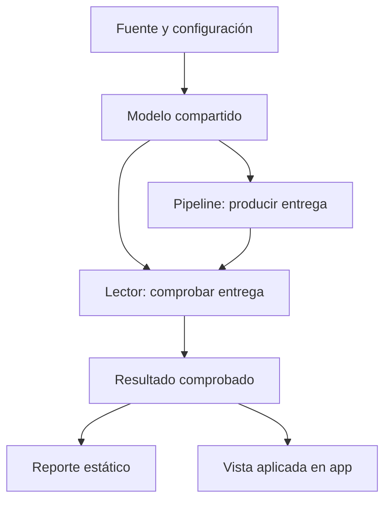

# 14.07 — Integración de reporte y app

[Inicio](../../../README.md) / [Módulo 14](../README.md) / **Lección 14.07**

| Tu sesión | Qué prepararás o comprobarás |
| --- | --- |
| **Meta** | Conciliar una entrega, un reporte HTML y una aplicación de lectura |
| **Necesitas** | Contrato, pipeline y trazabilidad de 14.01–14.06; Quarto y una ruta de app |
| **Evidencia** | Valores por crédito, filtros, universo y revisión coincidentes entre productos |

[**Hacer el lab 14.07 →**](../../../labs/14_reproducible_projects/07_report_app_integration/README.md) · [Recorridos completos](recorridos.md)

## Propósito

Un reporte y una app pueden mostrar cifras razonables y hablar de poblaciones
distintas. También pueden mostrar el mismo total mientras asignan saldos
incorrectos a cada crédito. Integrarlos exige acordar **qué consulta representan**,
compartir sus reglas y comprobar qué datos está mostrando cada producto.

Aquí conectamos la entrega de una consulta con un reporte Quarto y una app
local. El reporte conserva una fotografía; la app permite comprobar de nuevo
la entrega. Ambos muestran contexto, indicadores, barras y tabla desde el mismo
resultado verificado. Elegir Python/Streamlit o R/Shiny es suficiente.

## Antes de empezar

Revisa [14.04 — Pipeline](../04_pipeline_reprocessing/README.md),
[14.05 — Pruebas](../05_tests_data_quality/README.md) y
[14.06 — Trazabilidad](../06_traceability_recovery/README.md).
Quarto se introduce en [11.02](../../11_reporting_quarto/02_first_document/README.md)
y los estados de consulta en [12.06](../../12_streamlit/06_messages_empty_cases/README.md)
o [13.06](../../13_shiny_web/06_validation_messages/README.md).
Los preparadores reúnen **53 fuentes**, incluidos datos y entornos declarados;
no requieren entregas personales anteriores. No instalan paquetes al copiar.

La raíz conserva el proyecto de cálculo mínimo. La interfaz elegida usa su
propio entorno local: Streamlit 1.66.1 o Shiny 1.14.0, ya usados en el curso.
No se cambian dependencias raíz de DS Track ni bibliotecas globales. Quarto
debe estar disponible; no se instala automáticamente. Sigue un recorrido
completo de [preparación](recorridos.md), sin alternar gestores sobre un entorno.

## Qué vas a aprender

- Definir qué debe coincidir entre una entrega y sus presentaciones.
- Separar cálculo, comprobación, presentación y estado de la interfaz.
- Distinguir fecha de corte, hora de comprobación y fotografía histórica.
- Detectar mezcla de cortes, filtros pendientes, salidas alteradas y reportes antiguos.
- Demostrar un caso habitual, uno vacío y un rechazo sin cifras anteriores.

## Material de apoyo

| Recurso | Para qué sirve | Uso |
| --- | --- | --- |
| [Recorridos](recorridos.md) | Preparar, calcular, renderizar y abrir la app | Elegir una ruta |
| [Preparador Python](preparar.py) / [R](preparar.R) | Reunir 53 fuentes en carpeta nueva | Según lenguaje |
| [Integración Python](plantilla/integracion.py) / [R](plantilla/integracion.R) | Leer y comprobar entregas; preparar y verificar reportes | Esencial |
| [Pipeline Python](plantilla/pipeline.py) / [R](plantilla/pipeline.R) | Compartir construcción de tablas esperadas con el lector | Inspeccionar |
| [App Streamlit](plantilla/interfaz/python/app.py) / [Shiny](plantilla/interfaz/r/app.R) | Aplicar una configuración y presentar la vista comprobada | Elegir una |
| [LEEME](plantilla/LEEME.md) | Límites y separación de entornos | Leer antes de restaurar |
| [Criterios independientes](../01_product_question_contract/criterios.csv) | Revisar por crédito sin usar el resultado como su propia referencia | Comprobar |

## 1. Coincidir en el total no basta

Considera una consulta sintética de septiembre: dos créditos seleccionados,
002 con 2000 MXN y 003 con 2500 MXN. El total correcto es 4500 MXN.

| Producto | 002 | 003 | Total |
| --- | ---: | ---: | ---: |
| Referencia y reporte | 2000 | 2500 | 4500 |
| App con un error compensado | 2100 | 2400 | 4500 |

Una comparación del total aprobaría el error. Debemos comparar por **clave y
valor**, además del contexto. Si el reporte usa ambos segmentos y la app solo
comercio, una diferencia puede ser correcta para preguntas distintas; sería un
error presentarlas como la misma consulta sin identificar los filtros.

El acuerdo de integración de esta práctica exige:

| Parte | Qué se compara |
| --- | --- |
| Pregunta | Corte, segmentos, mínimo inclusivo y versión de reglas |
| Población | Universo del corte, selección y denominador de cobertura |
| Detalle | IDs, segmentos, fechas y saldos MXN por crédito |
| Presentación | Texto, etiquetas y barras construidas desde esos valores |
| Procedencia | Configuración, destino de entrega y revisión de sus bytes |

## 2. La base completa y los resultados conocidos

La muestra es sintética. Cada fila representa un crédito en un corte; la clave
es **id_credito + fecha_corte**. El ID es texto con ceros iniciales. Segmentos
permitidos: comercio y servicios. Fechas válidas, saldo entero conocido en MXN,
sin ausencias ni claves repetidas. Se valida el CSV completo antes de filtrar.

| ID | Segmento | Corte | Saldo MXN |
| --- | --- | --- | ---: |
| 001 | comercio | 2026-09-30 | 0 |
| 002 | servicios | 2026-09-30 | 2000 |
| 003 | comercio | 2026-09-30 | 2500 |
| 001 | comercio | 2026-10-31 | 100 |
| 002 | servicios | 2026-10-31 | 1900 |
| 003 | comercio | 2026-10-31 | 2600 |

La pregunta es: para el corte y segmentos elegidos, ¿qué créditos tienen saldo
**mayor o igual al mínimo**, cuánto suman y qué porcentaje de créditos del corte
representan? El universo contiene todos los créditos del corte, antes de filtrar
por segmento y mínimo. La cobertura es un porcentaje de créditos, no de saldo.

| Configuración | Universo | Selección | Saldo seleccionado | Cobertura |
| --- | --- | --- | ---: | --- |
| Octubre: ambos segmentos, mínimo 2000 | 3 / 4600 MXN | 003/2600 | 2600 MXN | 1/3 ≈ 33.33% |
| Septiembre: ambos, mínimo 2000 | 3 / 4500 MXN | 002/2000 y 003/2500 | 4500 MXN | 2/3 ≈ 66.67% |
| Vacío: octubre, servicios, mínimo 1901 | 3 / 4600 MXN | Ninguna fila | 0 MXN | 0/3 = 0% |
| Sin universo: noviembre | Sin registros del corte | No hay entrega | No se informa | No se informa |

Antes de ejecutar, explica por qué 002 entra en septiembre justo en 2000 y
queda fuera de la selección vacía de octubre en 1901. El cero conocido de 001
en septiembre sigue siendo un dato válido, aunque este filtro no lo seleccione.

## 3. Compartir cálculo y comprobar la entrega antes de leerla

La copia de 14.07 factoriza el pipeline en dos responsabilidades:

1. `tablas_esperadas` valida configuración y fuente con las funciones existentes
   del modelo y construye selección, contexto e insumos esperados.
2. `pipeline` / `pipeline_proyecto` comprueba el entorno y crea o reutiliza la
   entrega usando esas mismas tablas, como en 14.04.

El nuevo lector `cargar` / `cargar_integracion` usa `tablas_esperadas` y el
comprobador del pipeline, **sin llamar a la operación que publica archivos**.
Exige que la entrega ya exista y coincida con el cálculo actual: nombres,
filas, contexto, insumos y marca COMPLETO. Una ausencia o alteración produce
rechazo, sin generar una salida para ocultar el problema.

El modelo de selección y cobertura sigue siendo uno por lenguaje. No copiamos
la regla `saldo >= mínimo` dentro del reporte, los widgets ni las etiquetas.
La vista recibe un objeto ya comprobado y presenta esos valores. Se calcula de
nuevo para validar: esta práctica no pretende ahorrar lectura ni medir rendimiento.

Sin renderizador: primero se produce la entrega; después un lector la contrasta
con el modelo actual. Reporte y app reciben un resultado con detalle y contexto.
Las fuentes originales de 14.04–14.06 permanecen intactas; el preparador reúne
las versiones necesarias para esta práctica sin exigir resultados previos.

## 4. Qué significa la identidad que mostramos

Cada vista incluye corte, segmentos, mínimo, reglas, app, archivo de configuración,
carpeta de entrega, revisión MD5 y hora de comprobación en UTC.

- **Corte:** fecha a la que corresponden las observaciones.
- **Comprobado UTC:** cuándo ese consumidor volvió a validar la entrega.
- **Revisión MD5:** huella de COMPLETO.csv, que registra las huellas de selección,
  contexto e insumos. Permite relacionar esos bytes dentro de una ruta.

La hora de comprobación del reporte puede diferir de la de la app. Eso es normal:
se revisaron en momentos distintos. Exigimos la misma entrega y sus valores,
no igualdad del reloj. MD5 no autentica; un registro editable tampoco prueba una
sesión pasada. Las revisiones Python y R pueden diferir aunque concilien datos:
sus insumos registran motores y archivos distintos. No uses igualdad de MD5
entre lenguajes como criterio de equivalencia analítica.

## 5. Preparar y renderizar el reporte son dos pasos

El [generador](plantilla/integracion.py) / [generador R](plantilla/integracion.R)
comprueba la entrega y crea una carpeta nueva bajo reportes/. Incluye:

| Archivo | Función |
| --- | --- |
| producto.csv | Configuración, entrega, revisión y hora de comprobación |
| seleccion.csv y contexto.csv | Copias de las tablas verificadas para revisión |
| reporte.qmd | Narrativa y vista preparadas con ese resultado |
| reporte.html | Se añade al renderizar con Quarto existente |

En el .qmd, el bloque `{=html}` identifica contenido HTML preparado. No es una
celda Python/R. No se ejecutan Jupyter ni knitr en el render; este recorrido
retoma la separación de fases de 11.02. La integración reside en el lector y
la preparación, no en pedir a Quarto que vuelva a calcular. Quien elija después
un documento ejecutable deberá mantener el mismo contrato de lectura.

La configuración desactiva ejecución, caché y freeze. Esto no vuelve dinámico
un .qmd ya preparado: **renderizar el mismo texto otra vez conserva su fotografía**.
Para actualizar, produce otra entrega si cambiaron insumos y genera otro reporte.
El envoltorio de render rechaza un HTML existente; conserva los parciales si
Quarto falla. No uses sobrescritura manual como mecanismo normal de actualización.

Tras renderizar, el verificador compara las tablas, el .qmd esperado y la sección
calculada del HTML. Acepta decoraciones conocidas de Quarto 1.9.38 y espacios;
sigue comparando textos, valores y atributos de las barras. No certifica todo
el documento, CSS externo, autenticidad ni accesibilidad completa. La lectura
en navegador sigue siendo necesaria para revisar presentación y comprensión.

## 6. Aplicar una consulta en la app

La [app Streamlit](plantilla/interfaz/python/app.py) y la
[app Shiny](plantilla/interfaz/r/app.R) ofrecen cuatro configuraciones conocidas.
No cambian las reglas ni permiten editar saldos. Cada sesión empieza sin cifras:

1. Elegir una configuración cambia el **borrador**.
2. Pulsar **Comprobar entrega** valida fuente completa, configuración y entrega.
3. Si todo coincide, se reemplaza la vista aplicada con el resultado comprobado.
4. Si falla, se retira la vista anterior y se informa el rechazo.

El último comportamiento es una decisión explícita de esta práctica: evita que
un error quede junto a cifras anteriores que parezcan recién comprobadas.
Cambiar solo el borrador sí conserva la consulta aplicada, identificada en la
vista y con un aviso cuando difiere de la opción elegida.

No hay caché de cálculo, observación del disco ni recarga automática de fuentes.
Un archivo puede cambiar después de la última comprobación: la hora visible
identifica esa limitación. Pulsa de nuevo para consultar el estado actual.
Para cambios de código, reinicia el proceso de la app; no dependas del estado
de módulos cargados. Recargar o abrir otra sesión no hereda una consulta aplicada.

Las barras HTML y la tabla se construyen con los mismos saldos. Las longitudes
se escalan al máximo de cada selección; **compara valores etiquetados, no longitudes
entre vistas de distintos cortes**. La tabla permite recuperar los números sin
depender del color. Un vacío válido conserva contexto y cero seleccionados,
con tabla de encabezados y sin barras; sin universo se rechaza porque no hay entrega.

## 7. Conciliar de forma observable

Sigue los [recorridos](recorridos.md). Para cada caso, abre el reporte y aplica
la misma configuración en la app. Revisa:

| Comprobación | Evidencia esperada |
| --- | --- |
| Identidad de consulta | Mismo corte, segmentos, mínimo, reglas, configuración y destino |
| Revisión de entrega | Misma revisión dentro de la ruta elegida; horas pueden diferir |
| Detalle | Mismos IDs, fechas, segmentos y saldos por fila |
| Indicadores | Universo, seleccionados, suma y cobertura de la tabla de referencia |
| Presentación | Etiquetas y barras corresponden al detalle; vacío sin barras |
| Transición | Borrador conserva vista identificada; rechazo retira cifras |

**Pausa de revisión:** deja septiembre en el reporte y octubre aplicado en la
app. No «corrijas» uno para hacer coincidir el total: identifica primero la
diferencia de pregunta. Aplica septiembre y concilia. Después prueba la selección
vacía y sin universo; explica por qué cero y ausencia de resultado no son iguales.

### Cuando cambia una fuente

Si el CSV cambia y la entrega sigue siendo la anterior, el lector debe rechazar.
La app retira cifras al comprobar; el HTML antiguo permanece como fotografía
histórica, con su contexto y fecha. El verificador actual también lo rechazará
si se pretende presentarlo como producto de la nueva entrega.

Para una actualización válida, conserva los archivos anteriores, prepara una
configuración con salida nueva, ejecuta el pipeline y genera otro reporte. Las
configuraciones de la app son explícitas; si deseas una configuración adicional,
debes añadirla deliberadamente a las opciones. No supongas que cualquier archivo
nuevo aparece en la interfaz. No hay publicación atómica de reporte y app como
conjunto: trabaja con un escritor y sin editar insumos durante una operación.

## Práctica

Realiza el [lab 14.07](../../../labs/14_reproducible_projects/07_report_app_integration/README.md).
Conciliarás octubre, septiembre y vacío, observarás el rechazo y justificarás
cómo distinguir una fotografía anterior de una comprobación actual.

## Evidencia y criterio de salida

Conserva comandos/versiones, intentos, entregas, tres reportes y una nota con
comparaciones por crédito, universo, cobertura, revisión y comportamiento del
borrador/rechazo. Tu acompañante debe poder elegir un caso y verificar la misma
consulta en ambos productos. La referencia externa no debe ser una copia del
resultado que intentas validar.

Hay integración local de consulta, reporte y una app elegida. La entrega final,
automatización opcional y defensa de decisiones se trabajan después. Los
proyectos/checkpoints y la práctica del estudiante siguen pendientes; desarrollar
material no acredita aprendizaje. El portal conserva su alcance separado.

## Referencias primarias

- [Quarto: gestión de ejecución](https://quarto.org/docs/projects/code-execution.html): ejecución, caché y freeze; una fotografía preparada sigue necesitando actualización explícita.
- [Quarto: contenido HTML](https://quarto.org/docs/output-formats/html-basics.html): formato HTML y recursos del documento.
- [Streamlit: botones](https://docs.streamlit.io/develop/concepts/design/buttons) y [Session State](https://docs.streamlit.io/develop/concepts/architecture/session-state): eventos y estado por sesión.
- [Streamlit: st.html](https://docs.streamlit.io/develop/api-reference/text/st.html): saneamiento y presentación de HTML; esta práctica no habilita JavaScript.
- [Shiny: bindEvent](https://shiny.posit.co/r/reference/shiny/latest/bindevent.html) y [renderUI](https://shiny.posit.co/r/reference/shiny/latest/renderui.html): evento de comprobación y salida desde estado aplicado.

## Siguiente paso

[Volver al módulo](../README.md) · [Lab 14.07](../../../labs/14_reproducible_projects/07_report_app_integration/README.md) ·
[14.08 — Entrega y automatización opcional](../08_delivery_optional_automation/README.md), disponible como ampliación opcional con su lab.
